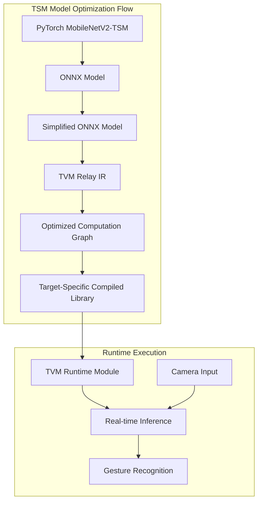
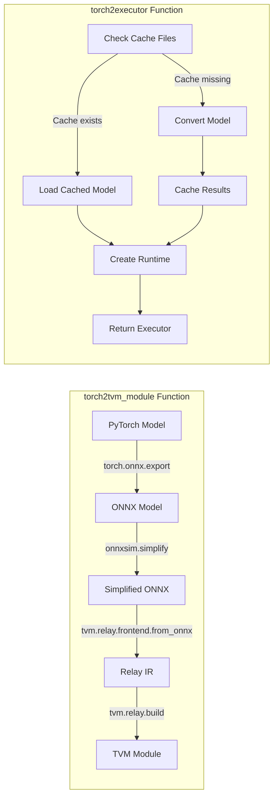
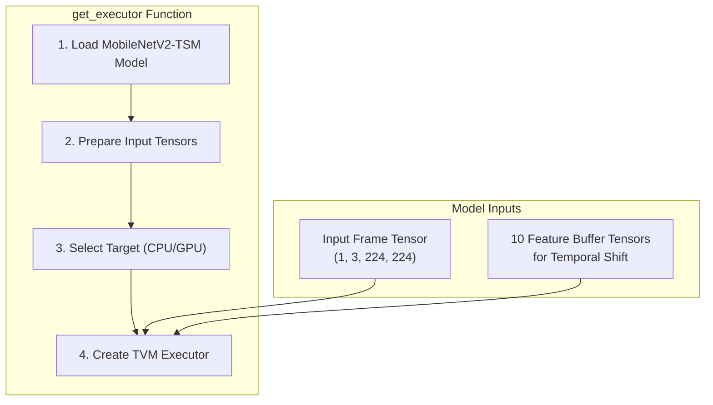
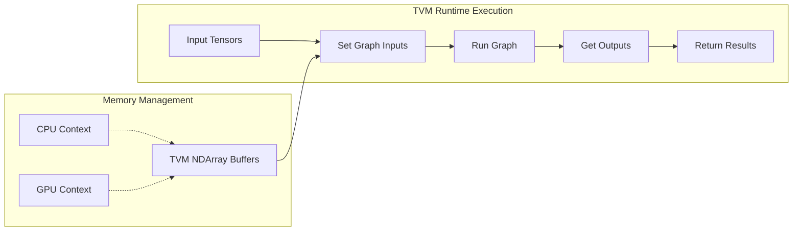
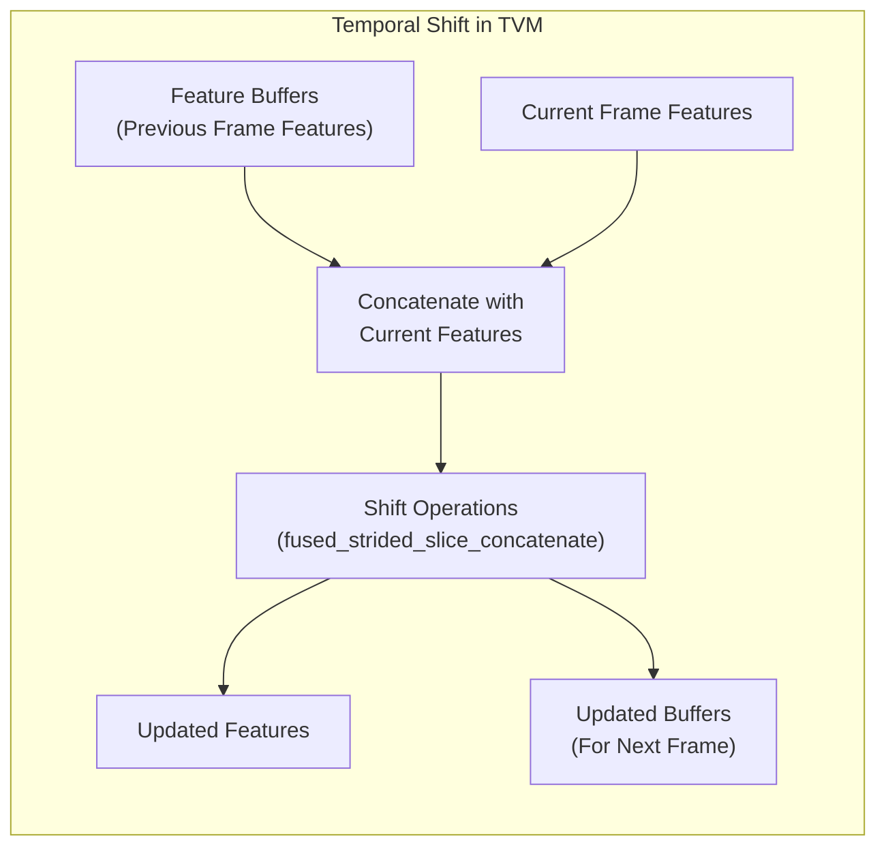
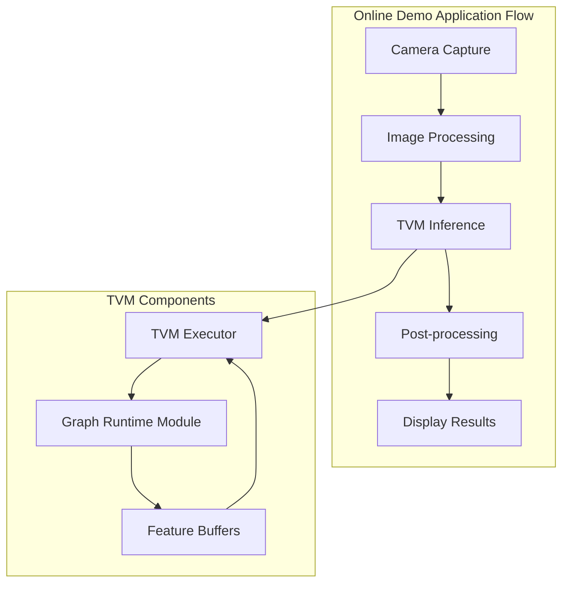

<!-- source: DeepWiki mcp.deepwiki.com · repo mit-han-lab/temporal-shift-module · extra page TVM Optimization · fetched 2026-10-30 -->

# TVM Optimization

Relevant source files

The following files were used as context for generating this wiki page:

- [online_demo/main.py](online_demo/main.py)
- [online_demo/mobilenet_tsm_tvm_cuda.json](online_demo/mobilenet_tsm_tvm_cuda.json)

## Purpose and Scope

This document explains how TVM (Tensor Virtual Machine) is used to optimize the Temporal Shift Module (TSM) for efficient real-time inference in the online hand gesture recognition demo. It covers the process of converting PyTorch models to TVM's optimized representation, the compilation process, and runtime execution. For information about the MobileNetV2 architecture with TSM integration, see [MobileNetV2 with TSM](#3.1.3).

## Introduction to TVM in TSM

TVM is a deep learning compiler framework that optimizes models for deployment across different hardware platforms. In the TSM project, TVM is used to accelerate the inference speed of MobileNetV2-based TSM models, enabling real-time hand gesture recognition with minimal latency.

Sources: [online_demo/main.py:5-14](), [online_demo/main.py:21-41]()

## TVM Optimization Process

The TVM optimization process in TSM consists of several key steps that transform the PyTorch model into an optimized executable for the target platform.

### Model Conversion Pipeline

Sources: [online_demo/main.py:21-41](), [online_demo/main.py:44-73]()

### Key Conversion Steps

1. **PyTorch to ONNX**: The PyTorch model is first exported to ONNX format, which provides a standard intermediate representation.

2. **ONNX Simplification**: The ONNX model is simplified using the ONNX Simplifier to remove redundant operations and optimize the graph structure.

3. **Relay IR Generation**: The simplified ONNX model is converted to TVM's Relay IR (Intermediate Representation), which allows for hardware-specific optimizations.

4. **Compilation**: The Relay IR is compiled with optimization level 3 to produce a target-specific module.

5. **Caching**: To avoid repeated compilation, the optimized model is cached by saving:
   - The compiled library (.tar)
   - The computation graph (.json)
   - The parameters (.params)

Sources: [online_demo/main.py:30-40](), [online_demo/main.py:47-60]()

## Implementation Details

### Model Loading and Optimization

The `get_executor` function handles loading the MobileNetV2-TSM model and creating an optimized TVM executor:

The function handles model initialization with the following key operations:
- Instantiates a MobileNetV2 model with 27 output classes (gestures)
- Downloads the pre-trained weights if needed
- Creates input tensors with appropriate shapes for the network
- Selects the target hardware (CUDA for GPU, LLVM for ARM CPU)
- Converts the model and creates an executor function

Sources: [online_demo/main.py:76-99]()

### Execution Context and Runtime

When the model is converted and compiled, TVM creates a Graph Runtime module that efficiently executes the computation graph:

The executor function encapsulates:
- Setting input tensors on the graph
- Running the computation graph
- Retrieving output tensors
- Managing device memory (CPU or GPU)

Sources: [online_demo/main.py:62-72]()

## Computation Graph Structure

The compiled TVM model produces a computation graph that represents the optimized operations of the MobileNetV2-TSM network. The graph includes:

| Component | Description |
|-----------|-------------|
| Nodes | Operations like convolutions, additions, and activations |
| Inputs | 11 tensors (1 frame + 10 feature buffers) |
| Outputs | 11 tensors (1 prediction + 10 updated buffers) |
| Fused operations | Operations combined for efficiency (e.g., `fused_nn_conv2d_add_clip`) |

The optimization includes fusion of operations to reduce memory traffic and execution overhead. For example, convolution, bias addition, and ReLU activation are fused into single operations like `fused_nn_conv2d_add_clip`.

Sources: [online_demo/mobilenet_tsm_tvm_cuda.json:13-2509](), [online_demo/main.py:39-40]()

## Temporal Shift Implementation

TVM optimizes the temporal shift operations which are central to TSM. The temporal shift mechanism is implemented through:

The temporal shift is implemented using strided slice and concatenation operations, which are optimized by TVM's fusion passes. These operations enable information exchange between adjacent frames without additional parameters.

Sources: [online_demo/mobilenet_tsm_tvm_cuda.json:279-301](), [online_demo/main.py:285-297]()

## Deployment Targets

TVM enables efficient deployment on both GPU and CPU platforms:

| Target | Description | TVM Configuration |
|--------|-------------|------------------|
| GPU | CUDA-enabled graphics cards | `target = 'cuda'` |
| ARM CPU | Embedded or mobile processors | `target = 'llvm -mcpu=cortex-a72 -target=armv7l-linux-gnueabihf'` |

The choice of target affects:
- Compilation strategy and optimizations
- Memory allocation (CPU or GPU memory)
- Runtime performance characteristics

Sources: [online_demo/main.py:95-98](), [online_demo/main.py:62-63]()

## Performance Benefits

The TVM optimization provides several key benefits for real-time inference:

1. **Improved throughput**: The main loop of the demo processes frames at interactive rates, displaying the frames-per-second (FPS) in the UI.

2. **Reduced latency**: Operation fusion and target-specific optimizations minimize processing time per frame.

3. **Efficient memory usage**: The buffer mechanism allows the model to maintain temporal information without storing all video frames.

4. **Cross-platform compatibility**: The same model can run efficiently on different hardware by changing the target.

Sources: [online_demo/main.py:355-358](), [online_demo/main.py:307-342]()

## Integration with TSM Demo

The TVM optimization is fully integrated into the online demo application:

The TVM inference is embedded in the main application loop, where:
1. Camera frames are captured and pre-processed
2. The TVM executor processes each frame
3. The output logits are post-processed with temporal smoothing
4. Results are displayed in real-time

Sources: [online_demo/main.py:262-386](), [online_demo/main.py:311-336]()

## Conclusion

TVM optimization is a crucial component of the TSM system that enables efficient real-time inference for video understanding tasks. By converting PyTorch models to optimized computation graphs, TVM significantly improves the performance of TSM models on both CPU and GPU platforms, making real-time hand gesture recognition possible even on resource-constrained devices.

---

