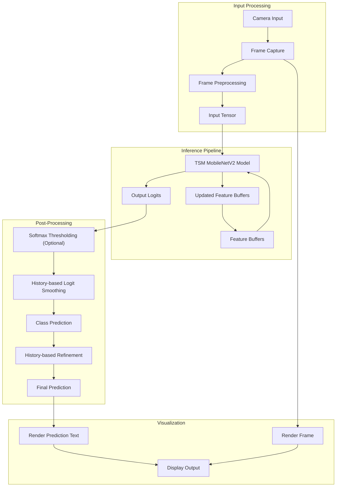
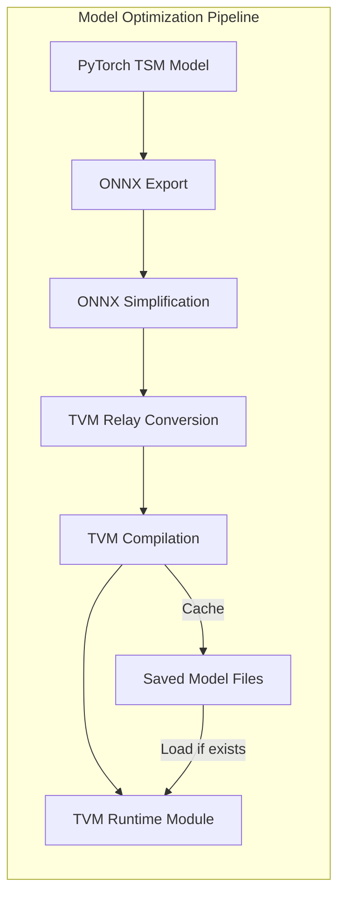
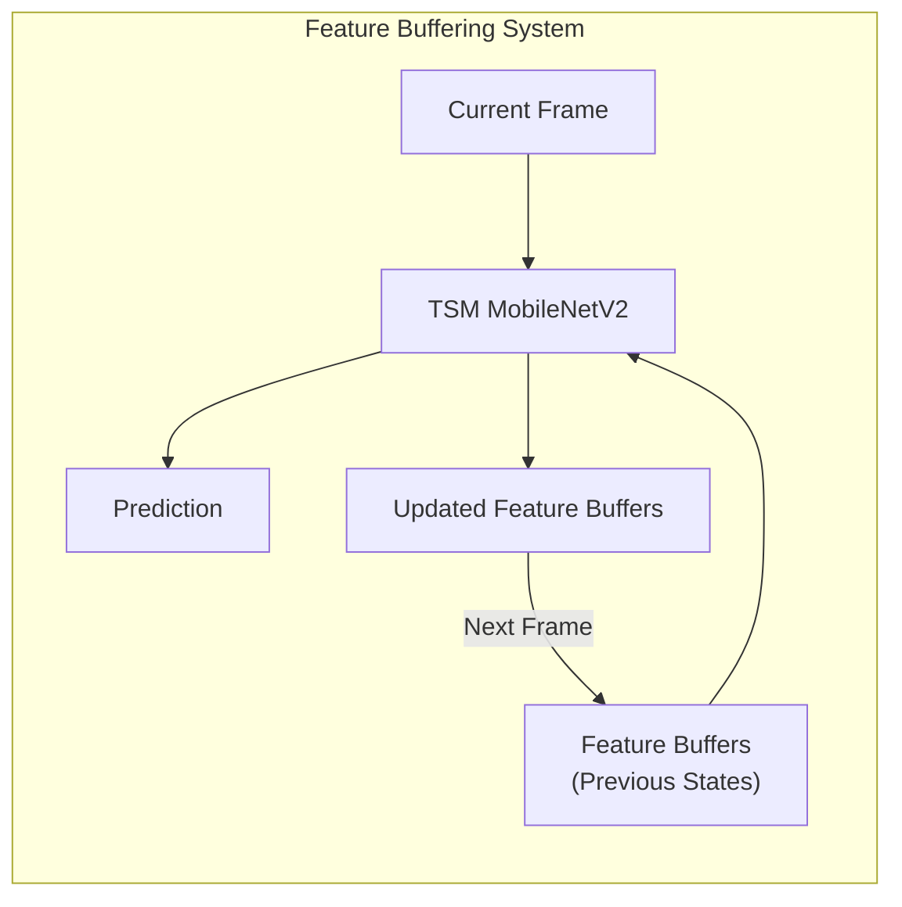

<!-- source: DeepWiki mcp.deepwiki.com · repo mit-han-lab/temporal-shift-module · extra page Technical Implementation · fetched 2026-10-30 -->

# Technical Implementation

Relevant source files

The following files were used as context for generating this wiki page:

- [online_demo/main.py](online_demo/main.py)

This document details the technical implementation of the online hand gesture recognition demo in the Temporal Shift Module (TSM) repository. It covers the core components, data flow, optimization techniques, and real-time processing aspects of the demo. For setup instructions, see [Setup and Configuration](#3.1.1). For specific details about MobileNetV2 with TSM integration, see [MobileNetV2 with TSM](#3.1.3).

## System Architecture

The online demo implements a real-time hand gesture recognition system that processes webcam video input and produces gesture classifications with minimal latency. The system uses TVM (Tensor Virtual Machine) to optimize a TSM-enhanced MobileNetV2 model for efficient inference.

**Diagram: Online Demo Architecture and Data Flow**

Sources: [online_demo/main.py:262-386]()

## Key Components

### Model Optimization with TVM

The demo uses TVM to optimize the PyTorch model for faster inference. This involves:

1. Exporting the PyTorch model to ONNX
2. Simplifying the ONNX model
3. Converting to TVM Relay representation
4. Compiling for the target hardware (CPU or GPU)
5. Caching the compiled model for future use

**Diagram: TVM Optimization Pipeline**

Sources: [online_demo/main.py:21-73]()

The optimization process creates three key files to cache the compiled model:
- A `.tar` file containing the compiled library
- A `.json` file containing the graph structure
- A `.params` file containing the model parameters

The system first checks if these files exist before compiling the model again, which speeds up startup time for subsequent runs.

### Input Processing Pipeline

The demo implements a sophisticated image transformation pipeline to prepare camera frames for inference:

| Transformation | Purpose |
|---------------|---------|
| `GroupScale` | Rescales input images to have a smaller edge of specified size |
| `GroupCenterCrop` | Crops the center of the image to 224×224 pixels |
| `Stack` | Stacks multiple images along the channel dimension |
| `ToTorchFormatTensor` | Converts images to torch tensors and normalizes values to [0,1] |
| `GroupNormalize` | Normalizes tensors using ImageNet mean and std dev values |

Sources: [online_demo/main.py:102-198]()

### Feature Buffering Mechanism

The TSM architecture requires maintaining state between frames to capture temporal relationships. The demo implements this through a series of feature buffers:

**Diagram: Feature Buffering Mechanism**

Sources: [online_demo/main.py:286-297](), [online_demo/main.py:314-316]()

The buffers are initialized as empty tensors and updated with each frame's processing. This allows the model to maintain temporal context across frames, which is essential for the TSM approach to work effectively.

### Post-processing and Output Refinement

The demo implements several post-processing techniques to improve prediction stability:

1. **Softmax Thresholding**: Optional filtering of predictions based on confidence
2. **History-based Logit Smoothing**: Averaging logits over recent frames
3. **Prediction Refinement**: Temporal smoothing and illegal action masking

```mermaid
flowchart TD
    subgraph "Post-processing Pipeline"
        RawLogits["Raw Model Logits"] --> SoftmaxCheck{Apply Softmax Threshold?}
        SoftmaxCheck -->|"Yes"| ThresholdCheck{"Confidence > Threshold?"}
        ThresholdCheck -->|"Yes"| MaxClass["Take argmax"]
        ThresholdCheck -->|"No"| UsePrevious["Use Previous Prediction"]
        SoftmaxCheck -->|"No"| MaxClass
        
        MaxClass --> LogitHistoryCheck{Apply Logit History?}
        UsePrevious --> OutputRefinement
        
        LogitHistoryCheck -->|"Yes"| AverageLogits["Average Recent Logits"]
        LogitHistoryCheck -->|"No"| OutputRefinement["Output Refinement"]
        AverageLogits --> OutputRefinement
        
        OutputRefinement --> IllegalActionCheck{"Is Illegal Action?"}
        IllegalActionCheck -->|"Yes"| UsePreviousValid["Use Previous Valid Action"]
        IllegalActionCheck -->|"No"| StabilityCheck{"New != Recent History?"}
        
        StabilityCheck -->|"Yes"| StabilitySubCheck{"Recent History Stable?"}
        StabilityCheck -->|"No"| AppendHistory["Append to History"]
        
        StabilitySubCheck -->|"Yes"| UsePreviousValid
        StabilitySubCheck -->|"No"| AppendHistory
        
        UsePreviousValid --> AppendHistory
        AppendHistory --> FinalPrediction["Final Prediction"]
    end
```

**Diagram: Post-processing Pipeline**

Sources: [online_demo/main.py:233-258](), [online_demo/main.py:319-338]()

## Implementation Details

### Real-time Processing Loop

The main processing loop performs the following steps for each frame:

1. Capture a frame from the camera
2. Skip every other frame to maintain a suitable frame rate
3. Transform the frame into the format expected by the model
4. Run inference using the model and current feature buffers
5. Process the output using history-based smoothing
6. Display the prediction and performance metrics

The loop continues until the user presses 'q' to exit or 'f' to toggle fullscreen mode.

Sources: [online_demo/main.py:306-384]()

### Gesture Categories

The demo recognizes 27 different hand gestures, categorized as:

| Index | Gesture |
|-------|---------|
| 0 | Doing other things |
| 1 | Drumming Fingers |
| 2 | No gesture |
| ... | ... |
| 20 | Thumb Up |
| ... | ... |
| 26 | Zooming Out With Two Fingers |

Sources: [online_demo/main.py:200-228]()

### Model Executor Creation

The model executor is created using the following process:

1. Load the MobileNetV2 model with TSM
2. Download pre-trained weights if not available
3. Define input shapes for the model and feature buffers
4. Convert the model to TVM format for the target hardware
5. Create an executor function that handles input/output and runs the model

Sources: [online_demo/main.py:76-99]()

## Performance Considerations

Several optimizations are implemented to achieve real-time performance:

1. **Frame Skipping**: The demo processes every other frame to maintain real-time performance
2. **Resolution Reduction**: Camera input is downsized to 320×240 pixels before processing
3. **Model Caching**: The compiled TVM model is cached to disk to speed up startup time
4. **GPU Acceleration**: The model can be compiled for GPU execution when available
5. **Efficient Transformations**: Input transformations are optimized for speed

The system displays the current frame rate (videos processed per second) in real-time, allowing users to monitor performance.

Sources: [online_demo/main.py:269-270](), [online_demo/main.py:309](), [online_demo/main.py:355-358]()

## Integration with TSM

This demo showcases how TSM can be effectively deployed for real-time applications. The key TSM feature - temporal shifting of channels to capture motion information - is implemented through the feature buffer mechanism that maintains state between frames, enabling the recognition of dynamic hand gestures rather than just static hand poses.

Sources: [online_demo/main.py:286-297](), [online_demo/main.py:314-316]()

---

