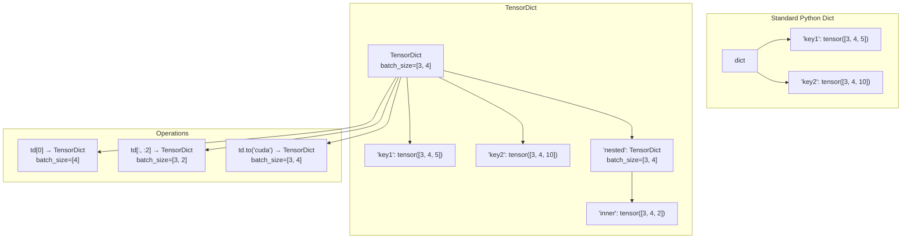
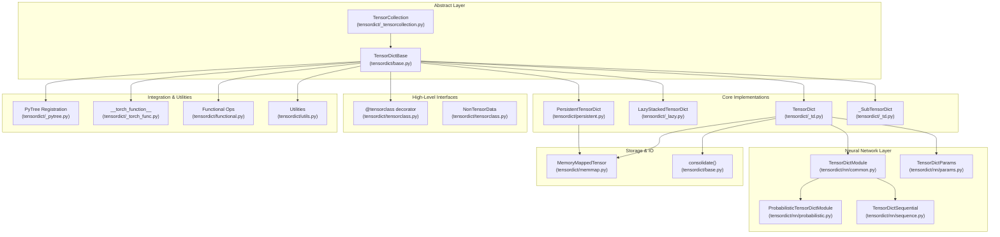
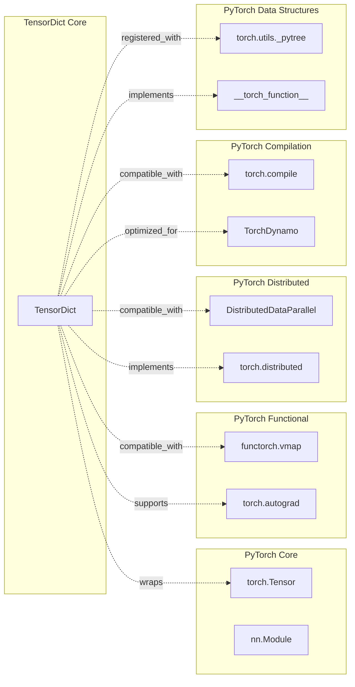
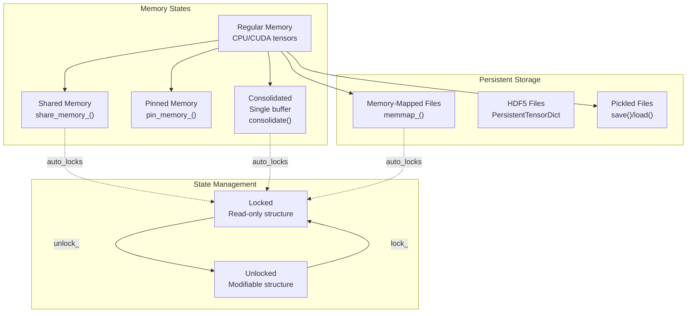

<!-- source: DeepWiki mcp.deepwiki.com · repo pytorch/tensordict · page 1 Overview · fetched 2026-10-21 -->

# Overview

<details>
<summary>Relevant source files</summary>

The following files were used as context for generating this wiki page:

- [README.md](README.md)
- [setup.py](setup.py)
- [tensordict/base.py](tensordict/base.py)
- [tensordict/tensordict.py](tensordict/tensordict.py)
- [test/_utils_internal.py](test/_utils_internal.py)
- [test/test_tensordict.py](test/test_tensordict.py)
- [version.txt](version.txt)

</details>


This document provides a high-level introduction to the TensorDict library, its architecture, and its role as a PyTorch extension for structured tensor collections. TensorDict provides dictionary-like containers that inherit tensor semantics, enabling efficient manipulation of collections of tensors with batch dimensions, device management, and deep integration with PyTorch's functional and distributed computing features.

For detailed information about specific subsystems, see:
- Core data structures and operations: [Core TensorDict System](#2)
- The `@tensorclass` decorator and dataclass-like interface: [TensorClass System](#3)
- Neural network integration: [Neural Network Integration](#4)
- Persistence mechanisms: [Storage and Persistence](#5)
- Advanced functional and distributed features: [Advanced Features](#6)

## Purpose and Scope

TensorDict is a library that extends PyTorch by providing a data structure for managing collections of tensors. It treats dictionaries of tensors as first-class objects that support tensor-like operations (indexing, slicing, shape manipulation) while maintaining the nested structure of the data. The library is designed to:

- **Simplify code** by abstracting away operations on collections of tensors
- **Improve performance** through optimizations like consolidation, asynchronous transfers, and compilation support
- **Enable modularity** in machine learning workflows by treating data as structured objects
- **Integrate seamlessly** with PyTorch's ecosystem (functorch, distributed, compilation)

**Sources:** [README.md:1-179](), [tensordict/base.py:300-302]()

## What is TensorDict?

A `TensorDict` is a dictionary-like container that maps string keys (or nested tuples of strings) to tensors or other TensorDicts. Unlike a standard Python dictionary, a TensorDict has a **batch size** that constrains the leading dimensions of all contained tensors, and supports **tensor-like operations** that are broadcast across all entries.



**Key Properties:**
- **Batch semantics**: All tensors must have leading dimensions compatible with the batch size
- **Nested structure**: TensorDicts can contain other TensorDicts, forming hierarchies
- **Device management**: Entire collections can be moved between devices atomically
- **Indexing**: Standard tensor indexing operations apply to all tensors simultaneously

**Sources:** [tensordict/base.py:300-571](), [README.md:30-60](), [test/test_tensordict.py:210-295]()

## Architecture Overview

The TensorDict library follows a layered architecture with clear separation between abstract interfaces, concrete implementations, and integration layers.



**Sources:** [tensordict/tensordict.py:1-37](), [tensordict/base.py:1-53](), Diagram 3 from provided context

## Core Components

### TensorDictBase: The Abstract Interface

`TensorDictBase` is the abstract base class that defines the contract for all TensorDict implementations. It inherits from both `MutableMapping` (Python's dict-like interface) and `TensorCollection` (custom PyTorch-compatible interface).

**Key responsibilities:**
- Define abstract methods for indexing, setting, and iteration
- Implement common operations that work across all implementations
- Manage batch size, device, and locking state
- Provide PyTree and `__torch_function__` integration

**Sources:** [tensordict/base.py:300-324]()

### TensorDict: The Main Implementation

`TensorDict` is the primary concrete implementation stored in [tensordict/_td.py](). It uses an internal dictionary (`_tensordict`) to store tensors and nested TensorDicts.

**Key features:**
- Direct storage of tensors in memory
- Fast indexing and modification
- Support for consolidation (single-buffer storage)
- Memory-mapping capabilities
- Locking mechanism for thread safety

**Sources:** [tensordict/_td.py]() (referenced but not provided in full), [tensordict/base.py:314-322]()

### LazyStackedTensorDict: Deferred Materialization

`LazyStackedTensorDict` represents a stack of TensorDicts without immediately copying data. It stores references to the original TensorDicts and only materializes the stacked view when necessary.

**Use cases:**
- Efficient batching of data without memory duplication
- Lazy evaluation pipelines
- Memory-efficient data loading

**Sources:** [tensordict/_lazy.py]() (referenced), [test/test_tensordict.py:39,261-271,885-918]()

### TensorClass: Dataclass-like Interface

The `@tensorclass` decorator transforms Python dataclasses into TensorDict-backed objects with attribute access syntax.

```python
@tensorclass
class MyData:
    observation: torch.Tensor
    action: torch.Tensor
    reward: torch.Tensor
```

**Sources:** [tensordict/tensorclass.py]() (referenced), [test/test_tensordict.py:44,57-63]()

## Integration with PyTorch Ecosystem

TensorDict integrates deeply with PyTorch's core features through multiple mechanisms:



### PyTree Registration

TensorDict registers with PyTorch's PyTree system, enabling it to work with `torch.utils._pytree.tree_map` and other tree-traversal utilities. This is crucial for compatibility with `functorch.vmap`.

**Implementation:** [tensordict/_pytree.py]()

**Sources:** [tensordict/base.py:676-691](), Diagram 4 from provided context

### __torch_function__ Protocol

TensorDict implements the `__torch_function__` protocol, allowing it to intercept PyTorch function calls and provide custom behavior. This enables operations like `torch.cat`, `torch.stack`, and `torch.zeros_like` to work directly on TensorDict instances.

**Implementation:** [tensordict/_torch_func.py]()

**Sources:** [tensordict/base.py:676-691]()

### Distributed Operations

TensorDict implements distributed communication primitives that integrate with `torch.distributed`:
- `send()`, `recv()`: Point-to-point communication
- `gather_and_stack()`: Collective gathering
- `reduce()`: Reduction operations

**Sources:** [tensordict/base.py]() (methods not shown in excerpt), Diagram 4 from provided context

### Compilation Support

TensorDict is designed to work with `torch.compile` and TorchDynamo. The implementation avoids dynamic behavior in hot paths and uses compile-friendly patterns.

**Sources:** [tensordict/base.py:124-127]() (is_compiling import), Diagram 4 from provided context

## Package Structure

The codebase is organized into focused modules:

| Module | Purpose | Key Files |
|--------|---------|-----------|
| **Core** | Abstract interface and main implementation | `base.py`, `_td.py`, `_lazy.py` |
| **High-level** | User-friendly interfaces | `tensorclass.py`, `tensorclass.pyi` |
| **Neural Network** | ML workflow integration | `nn/common.py`, `nn/probabilistic.py`, `nn/sequence.py`, `nn/params.py` |
| **Storage** | Persistence and memory management | `memmap.py`, `persistent.py` |
| **Integration** | PyTorch ecosystem hooks | `_pytree.py`, `_torch_func.py` |
| **Functional** | Utility operations | `functional.py` |
| **Utilities** | Helper functions | `utils.py` |

**Public API Entry Point:** [tensordict/tensordict.py:1-37]() re-exports the primary classes and functions.

**Sources:** [tensordict/tensordict.py:1-37](), [setup.py:117-122](), Diagram 3 from provided context

## Memory Management and Storage

TensorDict provides multiple strategies for memory management and data persistence:



### Consolidation

The `consolidate()` method reorganizes tensors to occupy a single contiguous memory buffer, improving I/O performance and enabling efficient serialization. Consolidated TensorDicts are automatically locked to prevent structural modifications.

**Sources:** [test/test_tensordict.py:423-544,572-734]()

### Memory-Mapped Tensors

`MemoryMappedTensor` enables zero-copy sharing of tensors across processes and out-of-core computation for datasets larger than RAM.

**Sources:** [tensordict/memmap.py]() (referenced), [test/test_tensordict.py:54]()

### Persistent Storage

`PersistentTensorDict` provides HDF5-backed storage for large datasets with lazy loading support.

**Sources:** [tensordict/persistent.py]() (referenced), [test/test_tensordict.py:41]()

## Common Usage Patterns

### Creating TensorDicts

```python
# From dictionary
td = TensorDict({"a": torch.randn(3, 4), "b": torch.randn(3, 4, 5)}, batch_size=[3, 4])

# From module parameters
td = TensorDict.from_module(model)

# From HDF5 file (if h5py available)
td = PersistentTensorDict.from_h5("data.h5")
```

**Factory methods:** `from_dict()`, `from_module()`, `from_h5()`, `from_consolidated()`

**Sources:** [tensordict/base.py]() (method signatures referenced but not shown in excerpt), [test/test_tensordict.py:211-295]()

### Indexing and Slicing

TensorDicts support standard tensor indexing, which applies to all contained tensors:

```python
td[0]           # Index first element
td[:, :2]       # Slice first two along dimension 1
td[mask]        # Boolean indexing
td["key"]       # Access by key
td["nested", "key"]  # Access nested key
```

**Sources:** [tensordict/base.py:573-628]()

### Shape Operations

TensorDicts support tensor-like shape manipulation:

```python
td.expand(10, 3, 4)      # Expand batch dimensions
td.unsqueeze(0)          # Add dimension
td.squeeze()             # Remove singleton dimensions
td.reshape(-1)           # Reshape batch dimensions
td.permute(1, 0)         # Permute dimensions
```

**Sources:** [test/test_tensordict.py:1010-1027,867-918]()

### Device Transfer

```python
td_cuda = td.to("cuda")                    # Move to GPU
td_cpu = td.to("cpu", non_blocking=False)  # Synchronous CPU transfer
```

**Sources:** [README.md:68-78]()

### Neural Network Integration

```python
from tensordict.nn import TensorDictModule

# Wrap a module
module = TensorDictModule(
    nn.Linear(4, 5),
    in_keys=["observation"],
    out_keys=["action"]
)

# Process TensorDict
output = module(input_td)  # Reads "observation", writes "action"
```

**Sources:** [tensordict/nn]() (referenced), [test/test_tensordict.py:56]()

## Build and Distribution

The package uses setuptools with CMake for building C++ extensions:

- **Build system:** [setup.py:1-123]()
- **C++ extensions:** Compiled via CMake from `tensordict/csrc/`
- **Version management:** [version.txt:1-2]() with setuptools_scm
- **Distribution:** PyPI (stable and nightly) and conda-forge

**Sources:** [setup.py:1-123](), [version.txt:1-2](), [README.md:128-153]()

## Design Principles

1. **Composability**: Operations on TensorDict mirror operations on individual tensors
2. **Performance**: Lazy evaluation, consolidation, and compilation support minimize overhead
3. **Type Safety**: Type stubs and IDE support via `.pyi` files
4. **Modularity**: Clear separation between core, high-level interfaces, and integration layers
5. **PyTorch Native**: Deep integration with PyTorch's functional and distributed features

**Sources:** [README.md:42-60](), [tensordict/base.py:300-324]()

---

