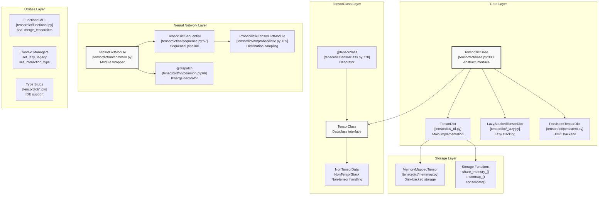
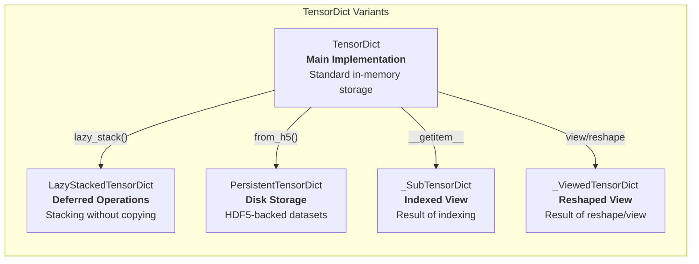
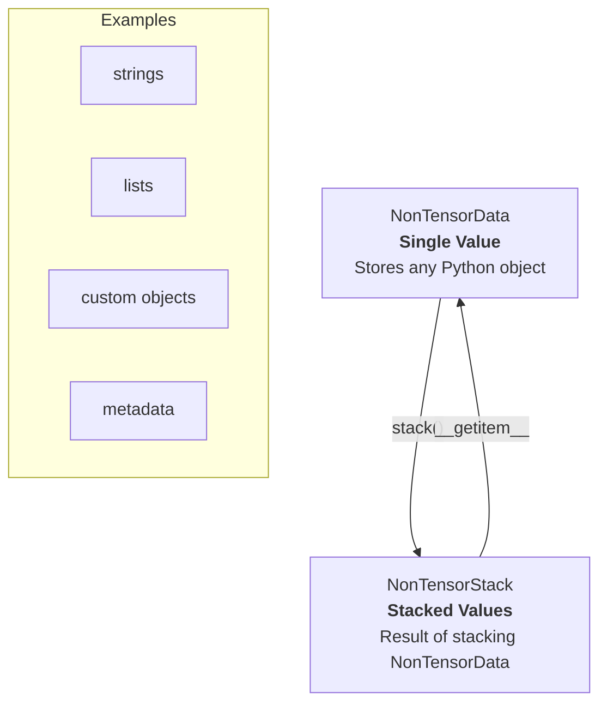
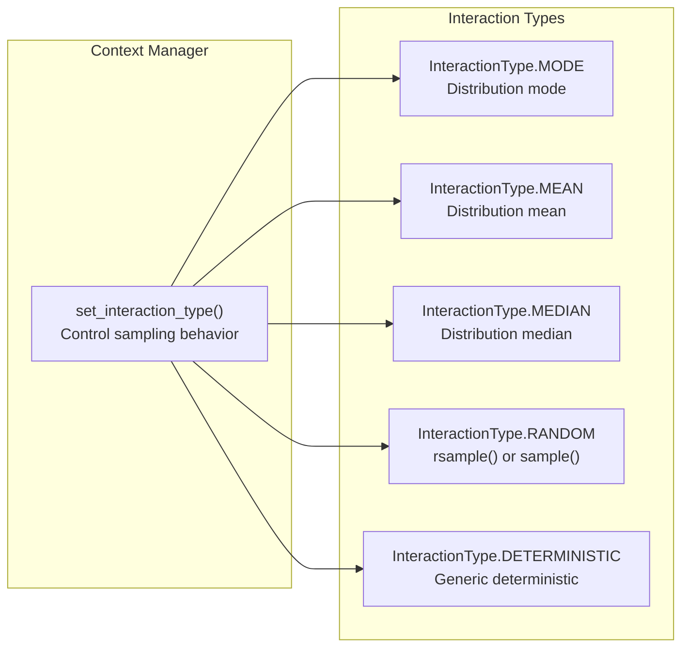
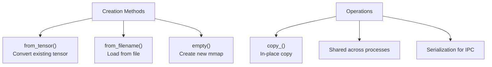
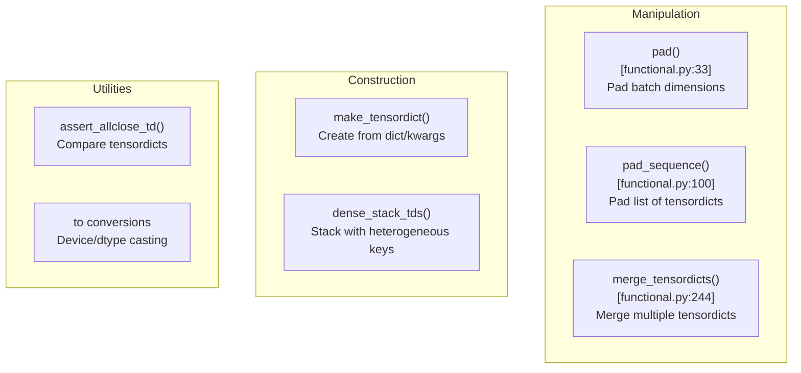
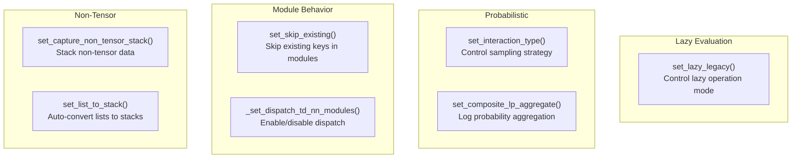

<!-- source: DeepWiki mcp.deepwiki.com · repo pytorch/tensordict · page 10 API Reference · fetched 2026-10-21 -->

# API Reference

<details>
<summary>Relevant source files</summary>

The following files were used as context for generating this wiki page:

- [tensordict/base.py](tensordict/base.py)
- [tensordict/tensordict.py](tensordict/tensordict.py)
- [test/_utils_internal.py](test/_utils_internal.py)
- [test/test_tensordict.py](test/test_tensordict.py)

</details>


This page provides a comprehensive reference to the TensorDict API, organized by module and functionality. The API is divided into five main categories: core TensorDict classes, TensorClass system, neural network integration modules, storage and persistence utilities, and general utility functions.

For detailed documentation of specific components:
- Core TensorDict operations: see [TensorDict API](#10.1)
- TensorClass decorator and features: see [TensorClass API](#10.2)
- Neural network integration: see [Neural Network Modules API](#10.3)
- Storage backends and memory management: see [Storage and Persistence API](#10.4)
- Helper functions and context managers: see [Utility Functions API](#10.5)

## API Organization Overview

The TensorDict API is structured around a core abstract interface with multiple implementations and extension points:



Sources: [tensordict/base.py:300](), [tensordict/_td.py](), [tensordict/tensorclass.py:770](), [tensordict/nn/common.py](), [tensordict/nn/sequence.py:57](), [tensordict/nn/probabilistic.py:159]()

## Core API Components

### TensorDictBase Abstract Interface

`TensorDictBase` is the foundational abstract class that defines the interface for all TensorDict implementations. Located at [tensordict/base.py:300](), it provides:

| Method Category | Key Methods | Purpose |
|----------------|-------------|---------|
| **Construction** | `__init__`, `from_dict`, `from_module`, `from_h5` | Create TensorDict instances |
| **Access** | `get`, `set`, `__getitem__`, `__setitem__` | Read/write data |
| **Shape Operations** | `reshape`, `view`, `permute`, `transpose`, `expand`, `squeeze`, `unsqueeze` | Manipulate batch dimensions |
| **Iteration** | `keys`, `values`, `items`, `__iter__` | Traverse contents |
| **Reduction** | `all`, `any`, `sum`, `mean`, `min`, `max`, `std`, `var` | Aggregate values |
| **Stacking** | `stack`, `cat`, `unbind`, `chunk`, `split` | Combine/split tensordicts |
| **Device/Dtype** | `to`, `cpu`, `cuda`, `float`, `int`, `bool` | Type/device conversion |
| **Locking** | `lock_`, `unlock_`, `is_locked` | Immutability control |
| **Storage** | `share_memory_`, `memmap_`, `is_shared`, `is_memmap` | Memory management |

Sources: [tensordict/base.py:300-5000]()

### TensorDict Implementation Classes



Sources: [tensordict/_td.py](), [tensordict/_lazy.py](), [tensordict/persistent.py]()

## TensorClass System

The TensorClass system provides a dataclass-like interface built on top of TensorDict:

### @tensorclass Decorator

Located at [tensordict/tensorclass.py:770](), the `@tensorclass` decorator transforms Python dataclasses into tensor-aware classes with automatic batching and device management.

**Configuration Options:**

| Parameter | Type | Default | Description |
|-----------|------|---------|-------------|
| `autocast` | bool | False | Auto-cast inputs to declared types |
| `frozen` | bool | False | Make instance immutable |
| `nocast` | bool | False | Disable automatic tensor conversion |
| `shadow` | bool | False | Disable field name validation |
| `tensor_only` | bool | False | Require all fields to be tensors |

**Key Methods Delegated to TensorDict:**

The decorator creates a class that wraps a `_tensordict` attribute and delegates over 300 methods. These are organized in [tensordict/tensorclass.py:169-550]():

- `_METHOD_FROM_TD`: Direct delegation (e.g., `save`, `memmap_`)
- `_FALLBACK_METHOD_FROM_TD_NOWRAP`: Delegation without wrapping (e.g., `batch_size`, `device`, `is_locked`)
- `_FALLBACK_METHOD_FROM_TD`: Delegation with result wrapping (e.g., `clone`, `to`, `expand`)
- `_FALLBACK_METHOD_FROM_TD_COPY`: Delegation with non-tensor data copying (e.g., `copy`, `clone`)

Sources: [tensordict/tensorclass.py:770-897](), [tensordict/tensorclass.py:169-558]()

### Non-Tensor Data Handling

TensorClass supports storing non-tensor data through specialized classes:



Sources: [tensordict/tensorclass.py:1500-2000]()

## Neural Network Integration

### TensorDictModule

The `TensorDictModule` class at [tensordict/nn/common.py:324]() wraps PyTorch modules to operate on TensorDict inputs and outputs:

**Constructor Signature:**
```python
TensorDictModule(
    module: Callable,
    in_keys: List[NestedKey] | Dict[str, NestedKey],
    out_keys: List[NestedKey]
)
```

**Key Attributes:**

| Attribute | Type | Description |
|-----------|------|-------------|
| `in_keys` | list | Keys to read from input TensorDict |
| `out_keys` | list | Keys to write to output TensorDict |
| `module` | Callable | Wrapped module or function |

Sources: [tensordict/nn/common.py:324-600]()

### TensorDictSequential

Chains multiple TensorDictModule instances together. Located at [tensordict/nn/sequence.py:57]():

**Special Features:**

- **Partial tolerance**: Execute only modules with available input keys
- **Key selection**: Filter output keys with `select_out_keys()`
- **Subsequences**: Extract subsets with `select_subsequence()`

Sources: [tensordict/nn/sequence.py:57-400]()

### ProbabilisticTensorDictModule

Handles probabilistic operations at [tensordict/nn/probabilistic.py:159]():



**Key Parameters:**

| Parameter | Type | Description |
|-----------|------|-------------|
| `distribution_class` | Type[Distribution] | Torch distribution to use |
| `default_interaction_type` | InteractionType | Default sampling strategy |
| `return_log_prob` | bool | Compute and store log probabilities |
| `cache_dist` | bool | Cache distribution parameters |

Sources: [tensordict/nn/probabilistic.py:159-500](), [tensordict/nn/probabilistic.py:59-157]()

### @dispatch Decorator

The `@dispatch` decorator at [tensordict/nn/common.py:66]() enables calling TensorDict-based modules with keyword arguments:

**Usage Pattern:**
```python
class MyModule(nn.Module):
    in_keys = ["x", "y"]
    out_keys = ["z"]
    
    @dispatch
    def forward(self, tensordict):
        # Implementation
        return tensordict
```

**Features:**
- Automatic TensorDict creation from kwargs
- Support for nested keys with custom separators
- Batch size inference

Sources: [tensordict/nn/common.py:66-323]()

## Storage and Persistence API

### Memory-Mapped Tensors

`MemoryMappedTensor` provides disk-backed tensor storage at [tensordict/memmap.py]():



Sources: [tensordict/memmap.py]()

### Storage Management Methods

Located on TensorDictBase:

| Method | Location | Purpose |
|--------|----------|---------|
| `share_memory_()` | [tensordict/base.py]() | Move to shared memory |
| `memmap_()` | [tensordict/base.py]() | Convert to memory-mapped |
| `memmap_like()` | [tensordict/base.py]() | Create memory-mapped copy |
| `consolidate()` | [tensordict/base.py]() | Pack tensors into contiguous storage |
| `is_shared()` | [tensordict/base.py]() | Check if in shared memory |
| `is_memmap()` | [tensordict/base.py]() | Check if memory-mapped |

Sources: [tensordict/base.py:3000-4000]()

## Functional Utilities API

The functional API at [tensordict/functional.py]() provides pure functions for common operations:

### Key Functions



**Function Details:**

| Function | Signature | Purpose |
|----------|-----------|---------|
| `pad` | `(td, pad_size, value=0.0)` | Pad batch dimensions with constant value |
| `pad_sequence` | `(list_of_tds, pad_dim=0, return_mask=False)` | Pad and stack sequence of tensordicts |
| `merge_tensordicts` | `(*tds, callback_exist=None)` | Merge multiple tensordicts |

Sources: [tensordict/functional.py:33-260]()

## Type Annotations and IDE Support

TensorDict provides comprehensive type stubs for IDE integration:

**Type Stub Files:**

| File | Purpose |
|------|---------|
| [tensordict/tensorclass.pyi]() | TensorClass type hints |
| [tensordict/_tensorcollection.pyi]() | TensorCollection interface |
| [tensordict/base.pyi]() | TensorDictBase stubs |

**Key Type Aliases:**

- `NestedKey`: `str | Tuple[str, ...]` - Keys for nested data
- `IndexType`: Union of valid indexing types
- `DeviceType`: `torch.device | str | int`

Sources: [tensordict/tensorclass.pyi:1-100](), [tensordict/_tensorcollection.pyi:1-100]()

## Context Managers and Global State

TensorDict provides several context managers for controlling behavior:



**Usage Example:**
```python
with set_lazy_legacy(True):
    td_lazy = td.unsqueeze(0)
    # Operations deferred until materialization

with set_interaction_type(InteractionType.MODE):
    action = policy(observation)
    # Samples mode instead of random
```

Sources: [tensordict/utils.py](), [tensordict/nn/probabilistic.py:128-157](), [tensordict/nn/utils.py]()

## PyTorch Function Overrides

TensorDict integrates with PyTorch's function dispatch system at [tensordict/_torch_func.py]():

**Registered Functions:**

| PyTorch Function | TensorDict Implementation |
|------------------|---------------------------|
| `torch.stack` | Stack tensordicts |
| `torch.cat` | Concatenate tensordicts |
| `torch.unbind` | Unbind into tuple |
| `torch.clone` | Deep copy |
| `torch.squeeze/unsqueeze` | Shape manipulation |
| `torch.gather` | Advanced indexing |
| `torch.permute/transpose` | Dimension reordering |
| `torch.*_like` | Creation functions |

**Implementation Pattern:**
Each override is registered via `@implements_for_td` decorator at [tensordict/_torch_func.py:62-81]().

Sources: [tensordict/_torch_func.py:48-500]()

## API Usage Patterns

### Pattern 1: Module-TensorDict Integration

```python
# Define module with TensorDictModule wrapper
module = TensorDictModule(
    nn.Linear(10, 5),
    in_keys=["observation"],
    out_keys=["action_logits"]
)

# Use with TensorDict
td = TensorDict({"observation": torch.randn(32, 10)}, batch_size=[32])
td = module(td)  # Adds "action_logits" key

# Or use with kwargs via @dispatch
logits = module(observation=torch.randn(32, 10))
```

Sources: [tensordict/nn/common.py:324-600](), [test/test_nn.py:324-424]()

### Pattern 2: Sequential Pipeline

```python
policy = TensorDictSequential(
    TensorDictModule(encoder, in_keys=["obs"], out_keys=["hidden"]),
    TensorDictModule(actor_head, in_keys=["hidden"], out_keys=["action"]),
    TensorDictModule(value_head, in_keys=["hidden"], out_keys=["value"])
)

# Execute full pipeline
td = TensorDict({"obs": observation}, batch_size=[batch_size])
td = policy(td)  # Contains "obs", "hidden", "action", "value"

# Select subset of outputs
policy.select_out_keys("action", "value")
```

Sources: [tensordict/nn/sequence.py:57-400](), [test/test_nn.py:500-700]()

### Pattern 3: Memory Management

```python
# Share memory for multiprocessing
td.share_memory_()
# Pass to worker processes

# Memory-map large datasets
td = TensorDict.from_dict(large_dict, batch_size=batch_size)
td.memmap_(prefix="/path/to/memmap")

# Consolidate for efficiency
td_consolidated = td.consolidate()
# All tensors in contiguous storage
```

Sources: [tensordict/base.py:3000-4000](), [test/test_tensordict.py:400-530]()

This API reference provides the foundation for understanding TensorDict's capabilities. For detailed method signatures and examples, refer to the sub-pages listed at the beginning of this document.

---

