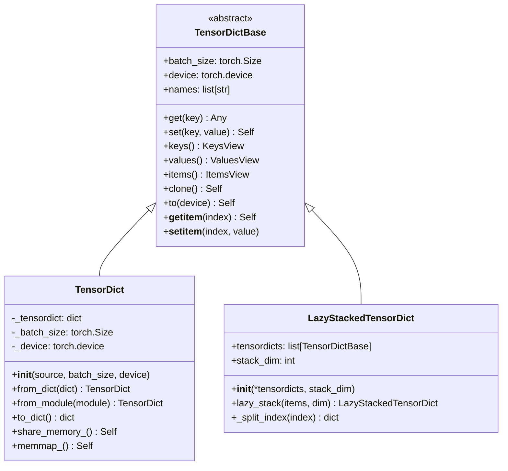
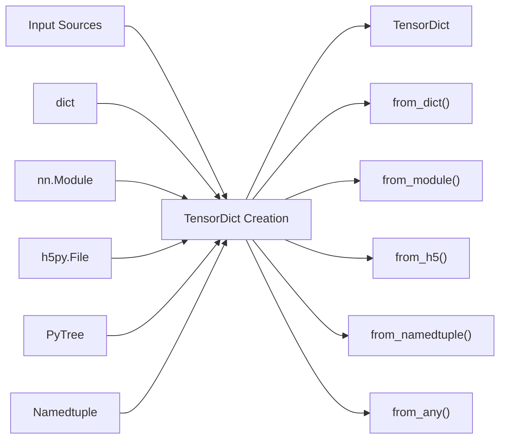
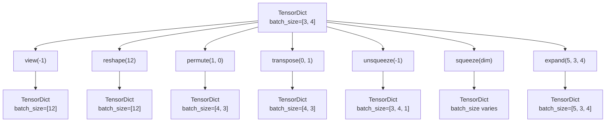
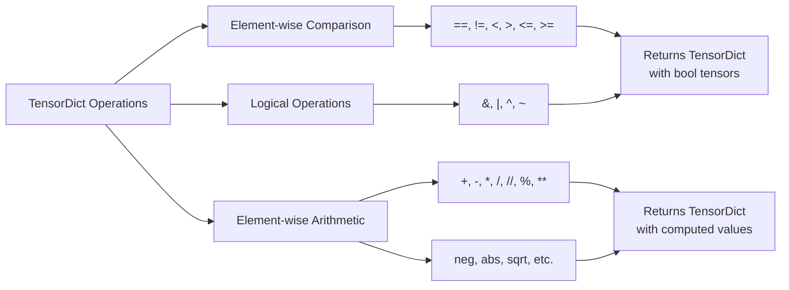
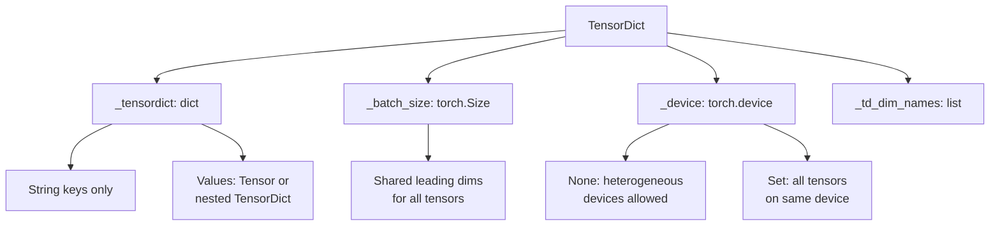
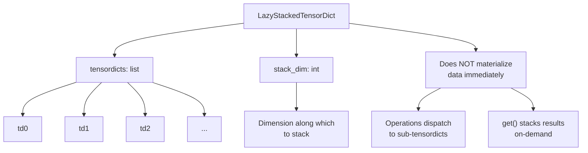

<!-- source: DeepWiki mcp.deepwiki.com · repo pytorch/tensordict · page 10.1 TensorDict API · fetched 2026-10-21 -->

# TensorDict API

<details>
<summary>Relevant source files</summary>

The following files were used as context for generating this wiki page:

- [tensordict/base.py](tensordict/base.py)
- [tensordict/tensordict.py](tensordict/tensordict.py)
- [test/_utils_internal.py](test/_utils_internal.py)
- [test/test_tensordict.py](test/test_tensordict.py)

</details>


This page provides a comprehensive API reference for the core TensorDict classes: `TensorDictBase`, `TensorDict`, and `LazyStackedTensorDict`. These classes form the foundation of the tensordict library, providing dictionary-like containers for PyTorch tensors with batch semantics.

**Scope**: This page covers the complete API surface of the three main TensorDict classes, including constructors, properties, methods, and operations. For specialized storage implementations, see [Storage and Persistence API](#10.4). For TensorClass API, see [TensorClass API](#10.2). For neural network integration, see [Neural Network Modules API](#10.3).

---

## Class Hierarchy



**Description**: `TensorDictBase` is the abstract parent class defining the interface. `TensorDict` is the main concrete implementation storing tensors in a dictionary. `LazyStackedTensorDict` stacks multiple tensordicts without materializing the data.

**Sources**: [tensordict/base.py:300-320](), [tensordict/_td.py:150-244](), [tensordict/_lazy.py:176-225]()

---

## TensorDictBase Abstract Interface

### Core Properties

| Property | Type | Description |
|----------|------|-------------|
| `batch_size` | `torch.Size` | Leading dimensions shared by all tensors |
| `batch_dims` | `int` | Number of batch dimensions (read-only) |
| `device` | `torch.device \| None` | Device where tensors are stored (None if mixed) |
| `names` | `list[str] \| None` | Names for each batch dimension |
| `shape` | `torch.Size` | Alias for `batch_size` |
| `ndim` | `int` | Alias for `batch_dims` |
| `is_locked` | `bool` | Whether the tensordict is locked (read-only structure) |

**Sources**: [tensordict/base.py:300-600]()

### Constructor Methods



**Description**: Multiple factory methods exist for creating TensorDict instances from various data sources.

#### `__init__(source, batch_size, device, names, non_blocking, lock)`

Creates a new TensorDict instance.

**Parameters**:
- `source` (dict or TensorDict, optional): Initial data
- `batch_size` (Sequence[int] or torch.Size, optional): Batch dimensions
- `device` (torch.device, optional): Target device for all tensors
- `names` (list[str], optional): Names for batch dimensions
- `non_blocking` (bool, optional): Whether to perform async device transfers
- `lock` (bool, optional): Whether to lock the tensordict after creation

**Sources**: [tensordict/_td.py:250-322]()

#### `from_dict(input_dict, batch_size, device, batch_dims, auto_batch_size)`

Creates a TensorDict from a dictionary.

**Parameters**:
- `input_dict` (dict): Dictionary mapping keys to tensors or nested dicts
- `batch_size` (torch.Size, optional): Explicit batch size
- `device` (torch.device, optional): Target device
- `batch_dims` (int, optional): Number of batch dimensions to infer
- `auto_batch_size` (bool): Whether to automatically infer batch size

**Returns**: `TensorDict` instance

**Sources**: [tensordict/base.py:3850-3970]()

#### `from_module(module, as_module, lock, use_state_dict, filter_empty)`

Extracts parameters and buffers from a PyTorch module.

**Parameters**:
- `module` (nn.Module): PyTorch module to extract from
- `as_module` (bool): Whether to return a TensorDictParams wrapper
- `lock` (bool): Whether to lock the result
- `use_state_dict` (bool): Whether to use state_dict() method
- `filter_empty` (bool): Whether to filter empty tensordicts

**Returns**: `TensorDict` or `TensorDictParams`

**Sources**: [tensordict/_td.py:393-479]()

---

### Data Access Methods

#### `get(key, default)`

Retrieves a value by key.

**Parameters**:
- `key` (str or tuple): Key to retrieve (supports nested keys like `("a", "b")`)
- `default` (Any, optional): Default value if key not found

**Returns**: Tensor, TensorDict, or default value

**Behavior**: As of v0.7, returns `None` by default if key is missing (controlled by `TD_GET_DEFAULTS_TO_NONE` environment variable).

**Sources**: [tensordict/base.py:199-217](), [tensordict/base.py:4580-4650]()

#### `set(key, value, inplace, non_blocking)`

Sets a value for a key.

**Parameters**:
- `key` (str or tuple): Key to set
- `value` (Tensor or TensorDict): Value to store
- `inplace` (bool): Whether to modify in-place
- `non_blocking` (bool): Whether to perform async device transfers

**Returns**: `Self`

**Validation**: Checks that tensor shape is compatible with batch_size and device matches (if set).

**Sources**: [tensordict/base.py:7850-7980]()

#### `set_(key, value, non_blocking)`

In-place version of `set()`. Equivalent to `set(key, value, inplace=True)`.

**Sources**: [tensordict/base.py:8020-8050]()

#### `__getitem__(index)`

Supports multiple indexing patterns:

| Index Type | Example | Result |
|------------|---------|--------|
| Key (str) | `td["key"]` | Gets tensor or nested TensorDict |
| Nested key (tuple) | `td["a", "b"]` | Gets nested entry |
| Integer | `td[0]` | Gets first batch element |
| Slice | `td[0:5]` | Gets batch slice |
| Tensor | `td[mask]` | Boolean or integer tensor indexing |
| Tuple | `td[0, :, 2]` | Multi-dimensional indexing |
| Ellipsis | `td[..., 0]` | Ellipsis indexing |

**Returns**: Tensor, TensorDict, or value depending on index type

**Sources**: [tensordict/base.py:573-628]()

#### `__setitem__(index, value)`

Sets values using indexing syntax. Supports all index types from `__getitem__`.

**Behavior**:
- If value is dict or TensorDict, updates all keys
- If value is Tensor, broadcasts to all leaf tensors
- Index must result in compatible batch size

**Sources**: [tensordict/_td.py:836-916]()

---

### Shape Operations



**Description**: Shape operations apply to the batch dimensions, affecting all contained tensors consistently.

#### `view(*shape)` and `reshape(*shape)`

Reshapes batch dimensions.

**Parameters**:
- `shape` (int or tuple): New batch shape (supports -1 for inference)

**Returns**: View or reshaped TensorDict

**Difference**: `view()` requires contiguous memory; `reshape()` allows discontiguous.

**Sources**: [tensordict/base.py:9450-9550]()

#### `permute(*dims)` and `transpose(dim0, dim1)`

Reorders batch dimensions.

**Parameters**:
- `dims` (tuple of int): New dimension order
- `dim0`, `dim1` (int): Dimensions to swap

**Returns**: Permuted TensorDict

**Sources**: [tensordict/base.py:7450-7520]()

#### `unsqueeze(dim)` and `squeeze(dim)`

Adds or removes singleton dimensions.

**Parameters**:
- `dim` (int): Dimension to add/remove

**Returns**: TensorDict with modified batch dimensions

**Sources**: [tensordict/base.py:9850-9950](), [tensordict/base.py:8750-8850]()

#### `expand(*shape)` and `expand_as(other)`

Expands singleton dimensions.

**Parameters**:
- `shape` (tuple of int): Target shape
- `other` (TensorDict): Match this tensordict's shape

**Returns**: Expanded view (no data copy)

**Sources**: [tensordict/base.py:3450-3520]()

#### `flatten(start_dim, end_dim)`

Flattens a range of dimensions.

**Parameters**:
- `start_dim` (int): First dimension to flatten
- `end_dim` (int): Last dimension to flatten

**Returns**: Flattened TensorDict

**Sources**: [tensordict/base.py:3620-3680]()

#### `unflatten(dim, sizes)`

Unflattens a dimension into multiple dimensions.

**Parameters**:
- `dim` (int): Dimension to unflatten
- `sizes` (tuple): Target sizes for new dimensions

**Returns**: Unflattened TensorDict

**Sources**: [tensordict/base.py:10150-10220]()

**Sources**: [tensordict/base.py:3400-10300]()

---

### Collection Operations

#### `unbind(dim)`

Splits along a dimension into a tuple of TensorDicts.

**Parameters**:
- `dim` (int): Dimension to unbind

**Returns**: `tuple[TensorDict]`

**Sources**: [tensordict/base.py:10080-10140]()

#### `chunk(chunks, dim)`

Splits into approximately equal chunks.

**Parameters**:
- `chunks` (int): Number of chunks
- `dim` (int): Dimension to split

**Returns**: `tuple[TensorDict]`

**Sources**: [tensordict/base.py:2580-2630]()

#### `split(split_size, dim)`

Splits into chunks of specified size.

**Parameters**:
- `split_size` (int or list[int]): Size(s) of chunks
- `dim` (int): Dimension to split

**Returns**: `tuple[TensorDict]`

**Sources**: [tensordict/base.py:8650-8720]()

---

### Device and Memory Operations

#### `to(device, dtype, non_blocking)`

Moves tensordict to device or casts to dtype.

**Parameters**:
- `device` (torch.device or str): Target device
- `dtype` (torch.dtype, optional): Target dtype (raises error if passed)
- `non_blocking` (bool): Whether to perform async transfer

**Returns**: New TensorDict on target device

**Note**: Unlike PyTorch tensors, `to(dtype)` is not supported. Use type-specific methods instead.

**Sources**: [tensordict/base.py:9620-9750]()

#### `cpu()`, `cuda()`, `pin_memory()`

Device-specific convenience methods.

**Returns**: TensorDict on specified device

**Sources**: [tensordict/base.py:2800-2900]()

#### `clone(recurse)`

Creates a deep copy.

**Parameters**:
- `recurse` (bool): Whether to clone nested tensordicts

**Returns**: Cloned TensorDict

**Sources**: [tensordict/base.py:2680-2750]()

#### `contiguous()`

Ensures all tensors are contiguous in memory.

**Returns**: Contiguous TensorDict

**Sources**: [tensordict/base.py:2760-2800]()

#### `share_memory_()`

Places all tensors in shared memory (for multiprocessing).

**Returns**: `Self`

**Sources**: [tensordict/base.py:8380-8450]()

#### `memmap_(prefix, copy_existing)`

Converts tensors to memory-mapped storage.

**Parameters**:
- `prefix` (str or Path, optional): Directory prefix for memmap files
- `copy_existing` (bool): Whether to copy existing data

**Returns**: `Self`

**Sources**: [tensordict/base.py:6750-6850]()

#### `consolidate(filename, num_threads, metadata)`

Consolidates tensors into a single memory buffer for efficiency.

**Parameters**:
- `filename` (str or Path, optional): Path for memory-mapped consolidation
- `num_threads` (int): Number of threads for parallel consolidation
- `metadata` (bool): Whether to store metadata

**Returns**: Consolidated TensorDict (automatically locked)

**Note**: Consolidated tensordicts are automatically locked to prevent structure modification.

**Sources**: [tensordict/base.py:2900-3100]()

---

### Comparison and Arithmetic Operations



**Description**: Arithmetic and comparison operations apply element-wise to all tensors in the tensordict.

#### Comparison Operations

All comparison operators (`==`, `!=`, `<`, `>`, `<=`, `>=`) are supported:

```python
result = td1 == td2  # Element-wise equality
result = td > 0.5    # Compare with scalar
```

**Returns**: TensorDict with boolean tensors

**Sources**: [tensordict/base.py:471-523](), [tensordict/_td.py:647-834]()

#### Arithmetic Operations

Standard arithmetic operators are supported:
- Binary: `+`, `-`, `*`, `/`, `//`, `%`, `**`
- Unary: `-` (negation), `abs()`, `sqrt()`, `exp()`, `log()`, etc.

**Broadcasting**: Supports broadcasting with scalars and tensors

**Sources**: [tensordict/base.py:326-349]()

#### Logical Operations

Bitwise/logical operations: `&` (and), `|` (or), `^` (xor), `~` (not)

**Returns**: TensorDict with boolean results

**Sources**: [tensordict/base.py:434-468](), [tensordict/_td.py:671-719]()

---

### Reduction Operations

#### `all(dim)` and `any(dim)`

Boolean reductions.

**Parameters**:
- `dim` (int, optional): Dimension to reduce. If None, reduces all dimensions.

**Returns**: `bool` (if dim=None) or `TensorDict` with reduced dimension

**Sources**: [tensordict/_td.py:917-959]()

#### `min(dim, keepdim, reduce, return_indices)`

Computes minimum values.

**Parameters**:
- `dim` (int, optional): Dimension to reduce
- `keepdim` (bool): Whether to keep dimension
- `reduce` (bool): If True, returns single tensor (not TensorDict)
- `return_indices` (bool): Whether to return indices (like `torch.min`)

**Returns**: TensorDict with min values, or `torch.return_types.min` with values and indices

**Sources**: [tensordict/base.py:870-980]()

#### `max(dim, keepdim, reduce, return_indices)`

Computes maximum values. Same signature as `min()`.

**Sources**: [tensordict/base.py:1038-1148]()

#### `amin(dim, keepdim, reduce)` and `amax(dim, keepdim, reduce)`

Like `min()`/`max()` but without returning indices.

**Sources**: [tensordict/base.py:830-1017]()

#### `sum(dim, keepdim, reduce)`, `mean(dim, keepdim, reduce)`

Statistical reductions.

**Parameters**:
- `dim` (int, optional): Dimension to reduce, or `"feature"` to reduce all non-batch dimensions
- `keepdim` (bool): Whether to keep dimension
- `reduce` (bool): If True, returns single tensor

**Returns**: TensorDict with reduced values or single tensor

**Sources**: [tensordict/base.py:8850-9050]()

#### `std(dim, keepdim, reduce)`, `var(dim, keepdim, reduce)`

Standard deviation and variance.

**Sources**: [tensordict/base.py:9050-9200]()

#### `prod(dim, keepdim, reduce)`

Product reduction.

**Sources**: [tensordict/base.py:7650-7750]()

#### `norm(p, dim, keepdim)`

Computes the p-norm.

**Parameters**:
- `p` (float): Order of norm
- `dim` (int, optional): Dimension to compute norm over
- `keepdim` (bool): Whether to keep dimension

**Sources**: [tensordict/base.py:7200-7280]()

**Sources**: [tensordict/base.py:721-9450](), [tensordict/_td.py:961-1173]()

---

### Key and Structure Operations

#### `keys(include_nested, leaves_only, is_leaf)`

Returns keys in the tensordict.

**Parameters**:
- `include_nested` (bool): Whether to include nested keys as tuples
- `leaves_only` (bool): Whether to only return leaf keys (non-TensorDict entries)
- `is_leaf` (callable, optional): Custom function to determine leaf status

**Returns**: `KeysView` (iterable)

**Examples**:
```python
td.keys()  # ["a", "b", "c"]
td.keys(include_nested=True)  # ["a", "b", "c", ("c", "d"), ("c", "e")]
td.keys(include_nested=True, leaves_only=True)  # ["a", "b", ("c", "d"), ("c", "e")]
```

**Sources**: [tensordict/base.py:5870-5950]()

#### `values(include_nested, leaves_only, is_leaf)`

Returns values corresponding to keys. Same parameters as `keys()`.

**Returns**: `ValuesView` (iterable)

**Sources**: [tensordict/base.py:10350-10430]()

#### `items(include_nested, leaves_only, is_leaf)`

Returns key-value pairs. Same parameters as `keys()`.

**Returns**: `ItemsView` (iterable of tuples)

**Sources**: [tensordict/base.py:5380-5460]()

#### `flatten_keys(separator, inplace, is_leaf)`

Flattens nested keys into strings.

**Parameters**:
- `separator` (str): String to join nested keys (default: ".")
- `inplace` (bool): Whether to modify in-place
- `is_leaf` (callable, optional): Custom leaf function

**Example**: `("a", "b", "c")` becomes `"a.b.c"`

**Returns**: Flattened TensorDict

**Sources**: [tensordict/base.py:3680-3780]()

#### `unflatten_keys(separator, inplace)`

Opposite of `flatten_keys()`. Converts string keys into nested structure.

**Sources**: [tensordict/base.py:10220-10310]()

#### `select(*keys, inplace, strict)`

Creates a new tensordict with only specified keys.

**Parameters**:
- `keys` (str or tuple): Keys to keep
- `inplace` (bool): Whether to modify in-place
- `strict` (bool): Whether to raise error if key not found

**Returns**: Selected TensorDict

**Sources**: [tensordict/base.py:8280-8350]()

#### `exclude(*keys, inplace)`

Opposite of `select()`. Removes specified keys.

**Sources**: [tensordict/base.py:3330-3400]()

#### `rename_key_(old_key, new_key)`

Renames a key in-place.

**Parameters**:
- `old_key` (str or tuple): Current key name
- `new_key` (str or tuple): New key name

**Returns**: `Self`

**Sources**: [tensordict/base.py:7880-7940]()

#### `split_keys(*key_sets)`

Splits tensordict into multiple tensordicts by key sets.

**Parameters**:
- `key_sets` (dict): Mapping from new keys to old keys

**Returns**: Tuple of TensorDicts

**Sources**: [tensordict/base.py:8580-8640]()

---

### Update Operations

#### `update(other, inplace, clone, non_blocking)`

Updates tensordict with contents of another tensordict or dict.

**Parameters**:
- `other` (TensorDict or dict): Source to update from
- `inplace` (bool): Whether to update tensors in-place
- `clone` (bool): Whether to clone values from other
- `non_blocking` (bool): Whether to perform async device transfers

**Returns**: `Self`

**Sources**: [tensordict/base.py:10310-10420]()

#### `update_(other, clone, non_blocking)`

In-place version of `update()`. Equivalent to `update(other, inplace=True)`.

**Sources**: [tensordict/base.py:10420-10470]()

#### `update_at_(other, index)`

Updates values at specific indices.

**Parameters**:
- `other` (TensorDict): Source values
- `index` (IndexType): Where to update

**Returns**: `Self`

**Sources**: [tensordict/base.py:10470-10520]()

#### `fill_(key, value)`

Fills all values of a key with a scalar or tensor.

**Parameters**:
- `key` (str or tuple): Key to fill
- `value` (scalar or Tensor): Value to fill with

**Returns**: `Self`

**Sources**: [tensordict/base.py:3580-3620]()

#### `zero_()`

Zeros out all tensor values.

**Returns**: `Self`

**Sources**: [tensordict/base.py:10820-10860]()

#### `empty(recurse)`

Creates an empty tensordict with same structure.

**Parameters**:
- `recurse` (bool): Whether to recursively empty nested tensordicts

**Returns**: Empty TensorDict

**Sources**: [tensordict/base.py:3280-3330]()

---

### Locking and Immutability

#### `lock_()` and `unlock_()`

Locks/unlocks the tensordict structure, preventing addition or removal of keys.

**Returns**: `Self`

**Note**: Locked tensordicts can still modify tensor values in-place, but cannot add/remove keys.

**Behavior**: 
- Locking is recursive (locks all nested tensordicts)
- Unlocking is non-recursive (only unlocks the current level)
- Consolidated tensordicts are automatically locked

**Sources**: [tensordict/base.py:6380-6500]()

#### `is_locked` property

Read-only property indicating lock status.

**Returns**: `bool`

**Sources**: [tensordict/base.py:5470-5490]()

#### `unlock_()` context manager

Temporarily unlocks a tensordict:

```python
with td.unlock_():
    td["new_key"] = value  # Allowed inside context
# td is locked again
```

**Sources**: [tensordict/base.py:10570-10620]()

---

### Utility Methods

#### `apply(fn, *others, batch_size, device, names, filter_empty, **kwargs)`

Applies a function to all tensors.

**Parameters**:
- `fn` (callable): Function to apply. Signature: `fn(tensor, *others) -> tensor`
- `others` (TensorDict): Additional tensordicts to pass to function
- `batch_size` (torch.Size, optional): Override batch size of result
- `device` (torch.device, optional): Device for result
- `names` (list[str], optional): Names for result
- `filter_empty` (bool): Whether to filter out None results
- Additional kwargs control behavior (e.g., `call_on_nested`, `inplace`, etc.)

**Returns**: New TensorDict with transformed values

**Sources**: [tensordict/base.py:1230-1450]()

#### `apply_(fn, *others, **kwargs)`

In-place version of `apply()`.

**Sources**: [tensordict/base.py:1450-1520]()

#### `named_apply(fn, nested_keys, **kwargs)`

Applies a named function that receives both key and value.

**Parameters**:
- `fn` (callable): Function with signature `fn(name, tensor) -> tensor`
- `nested_keys` (bool): Whether to pass full nested key tuples

**Sources**: [tensordict/base.py:7040-7120]()

#### `map(fn, dim, **kwargs)`

Maps a function across a dimension (similar to vmap).

**Parameters**:
- `fn` (callable): Function to map
- `dim` (int): Dimension to map over

**Sources**: [tensordict/base.py:6500-6600]()

#### `map_iter(fn, dim, **kwargs)`

Iterator version of `map()`, yields results lazily.

**Sources**: [tensordict/base.py:6600-6680]()

---

## TensorDict Implementation

### Storage and Implementation Details



**Description**: TensorDict stores data in a regular Python dictionary with string keys and enforces batch size consistency across all values.

**Sources**: [tensordict/_td.py:150-266]()

### Specialized Constructors

#### `from_consolidated(filename)`

Loads a consolidated tensordict from disk.

**Parameters**:
- `filename` (str or Path): Path to consolidated file

**Returns**: Consolidated TensorDict

**Sources**: [tensordict/base.py:4160-4230]()

#### `from_namedtuple(named_tuple, auto_batch_size)`

Creates TensorDict from a named tuple.

**Parameters**:
- `named_tuple`: Named tuple with tensor values
- `auto_batch_size` (bool): Whether to infer batch size

**Returns**: TensorDict

**Sources**: [tensordict/base.py:4230-4290]()

#### `from_pytree(pytree, auto_batch_size)`

Creates TensorDict from a PyTree structure.

**Parameters**:
- `pytree`: PyTree-compatible structure
- `auto_batch_size` (bool): Whether to infer batch size

**Returns**: TensorDict

**Sources**: [tensordict/base.py:4350-4420]()

#### `from_any(data, auto_batch_size)`

Generic factory method that detects input type automatically.

**Parameters**:
- `data`: Any supported input (dict, module, pytree, etc.)
- `auto_batch_size` (bool): Whether to infer batch size

**Returns**: TensorDict or appropriate type

**Sources**: [tensordict/base.py:4000-4110]()

---

### Memory-Mapped Operations

#### `memmap(prefix, copy_existing, num_threads)`

Creates a memory-mapped copy of the tensordict.

**Parameters**:
- `prefix` (str or Path): Directory for memmap files
- `copy_existing` (bool): Whether to copy from existing memmap
- `num_threads` (int): Parallel threads for writing

**Returns**: Memory-mapped TensorDict

**Sources**: [tensordict/base.py:6680-6750]()

#### `memmap_refresh_()`

Refreshes memory-mapped tensors from disk.

**Returns**: `Self`

**Sources**: [tensordict/base.py:6850-6900]()

#### `memmap_like(prefix, copy_existing)`

Creates a memory-mapped tensordict with same structure.

**Parameters**:
- `prefix` (str or Path): Directory for memmap files
- `copy_existing` (bool): Whether to copy data

**Returns**: Memory-mapped TensorDict

**Sources**: [tensordict/base.py:6900-6950]()

---

### Module Integration

#### `to_module(module, inplace, return_swap, use_state_dict)`

Writes tensordict values to a PyTorch module's parameters and buffers.

**Parameters**:
- `module` (nn.Module): Target module
- `inplace` (bool): Whether to modify parameter data in-place
- `return_swap` (bool): Whether to return the swapped-out values
- `use_state_dict` (bool): Whether to use state_dict mechanism

**Returns**: Swapped out TensorDict if `return_swap=True`

**Usage**: Temporarily replace module parameters for inference:
```python
original_params = td.to_module(model)
# ... run model with td parameters ...
original_params.to_module(model)  # restore
```

**Sources**: [tensordict/_td.py:495-645](), [tensordict/base.py:9750-9820]()

#### `from_module(module, as_module, lock, use_state_dict, filter_empty)`

Documented above in TensorDictBase section.

**Sources**: [tensordict/_td.py:393-479]()

---

## LazyStackedTensorDict

### Overview



**Description**: LazyStackedTensorDict represents a stack of tensordicts without actually stacking the data. Operations are dispatched to individual tensordicts and results are combined lazily.

**Use Cases**:
- Memory-efficient stacking of large tensordicts
- Deferred operations that may not access all data
- Heterogeneous tensordict stacking (different keys/shapes allowed)

**Sources**: [tensordict/_lazy.py:176-265]()

### Constructor

#### `__init__(*tensordicts, stack_dim, hook_out, hook_in, batch_size, device, names, stack_dim_name, strict_shape)`

Creates a lazy stack.

**Parameters**:
- `tensordicts` (TensorDict instances): Tensordicts to stack
- `stack_dim` (int): Dimension along which to stack (default: 0)
- `hook_out` (callable, optional): Hook applied after get operations
- `hook_in` (callable, optional): Hook applied before set operations
- `batch_size` (torch.Size, optional): Override batch size
- `device` (torch.device, optional): Expected device
- `names` (list[str], optional): Dimension names
- `stack_dim_name` (str, optional): Name for the stacking dimension
- `strict_shape` (bool): Whether to enforce identical shapes (default: False)

**Batch Size**: Automatically computed by inserting stack dimension into sub-tensordict batch sizes.

**Sources**: [tensordict/_lazy.py:255-303]()

### Factory Method

#### `lazy_stack(items, dim, device, out, stack_dim_name, strict_shape, as_list, as_padded_tensor, as_nested_tensor, padding_side, layout, padding_value)`

Creates a LazyStackedTensorDict or stacks tensors directly.

**Parameters**:
- `items` (Sequence): Items to stack (TensorDicts or Tensors)
- `dim` (int): Stack dimension (default: 0)
- `device` (torch.device, optional): Target device
- `out` (TensorDict, optional): Output tensordict to write to
- `stack_dim_name` (str, optional): Name for stack dimension
- `strict_shape` (bool): Whether shapes must match exactly
- `as_list` (bool): Return ragged tensors as lists
- `as_padded_tensor` (bool): Return ragged tensors padded
- `as_nested_tensor` (bool): Return ragged tensors as nested tensor
- `padding_side` (str): "left" or "right" for padding
- `layout` (torch.layout): Layout for nested tensors
- `padding_value` (scalar): Value for padding

**Returns**: 
- `LazyStackedTensorDict` if stacking TensorDicts
- `torch.Tensor` if stacking plain tensors
- List if `as_list=True` and shapes don't match

**Behavior**:
- If all items are tensors with matching shapes: calls `torch.stack()`
- If all items are tensors with mismatching shapes: returns list, padded tensor, or nested tensor based on parameters
- If all items are TensorDicts: creates `LazyStackedTensorDict`

**Sources**: [tensordict/_lazy.py:1429-1569]()

---

### Indexing Behavior

LazyStackedTensorDict has special indexing behavior:

| Index Pattern | Behavior | Example |
|---------------|----------|---------|
| Integer at stack_dim | Returns single tensordict | `lazy_td[0]` → `tensordicts[0]` |
| Slice at stack_dim | Returns LazyStack subset | `lazy_td[0:2]` → LazyStack of 2 tds |
| Other dimensions | Indexes all sub-tds | `lazy_td[:, 0]` → LazyStack with indexed tds |
| Nested key | Gets from all tds, stacks | `lazy_td["key"]` → stacked tensor |

**Sources**: [tensordict/_lazy.py:824-1008]()

### Special Methods

#### `_split_index(index)`

Internal method that splits a tuple index into per-tensordict indices.

**Returns**: Dictionary mapping tensordict indices to their respective index tuples

**Purpose**: Enables efficient indexing by determining which sub-tensordicts are accessed and how.

**Sources**: [tensordict/_lazy.py:824-1008]()

#### `get(key, as_list, as_padded_tensor, as_nested_tensor, padding_side, layout, padding_value)`

Gets a value by key, with special handling for ragged tensors.

**Additional Parameters** (compared to TensorDictBase):
- `as_list` (bool): Return ragged tensors as list instead of failing
- `as_padded_tensor` (bool): Pad ragged tensors to uniform shape
- `as_nested_tensor` (bool): Return as nested tensor
- `padding_side` (str): "left" or "right" 
- `layout` (torch.layout): Layout for nested tensors (e.g., `torch.jagged`)
- `padding_value` (scalar): Value for padding

**Behavior**: 
- Retrieves value from each sub-tensordict
- Attempts to stack results
- If stacking fails (mismatched shapes), handles based on parameters:
  - Default: raises RuntimeError
  - `as_list=True`: returns list of tensors
  - `as_padded_tensor=True`: pads and stacks
  - `as_nested_tensor=True`: returns nested tensor

**Sources**: [tensordict/_lazy.py:1230-1412]()

#### `_has_exclusive_keys` property

Returns `True` if sub-tensordicts have different key sets.

**Behavior**: Many operations (like `to_dict()`, `flatten_keys()`) raise errors when this is True.

**Sources**: [tensordict/_lazy.py:446-456]()

---

### Exclusive Keys Handling

When sub-tensordicts have different keys, certain operations fail:

```python
td1 = TensorDict({"a": 1}, [])
td2 = TensorDict({"b": 2}, [])
lazy = LazyStackedTensorDict.lazy_stack([td1, td2], 0)

# These will raise RuntimeError:
# lazy.to_dict()
# lazy.flatten_keys()
# lazy.state_dict()
```

**Workaround**: Convert to regular TensorDict first:
```python
materialized = lazy.to_tensordict()
materialized.to_dict()  # works
```

**Sources**: [tensordict/_lazy.py:161-173](), [tensordict/_lazy.py:458-552]()

---

### Performance Considerations

| Operation | LazyStackedTensorDict | Regular TensorDict |
|-----------|----------------------|-------------------|
| Creation | O(1) - no data copy | O(n) - copies/stacks data |
| Indexing (stack dim) | O(1) - direct access | O(n) - slices all tensors |
| Key access | O(n) - gets from all tds | O(1) - direct lookup |
| Memory | References only | Full materialized data |

**Best Practices**:
- Use LazyStackedTensorDict when you may not access all data
- Use regular TensorDict when you'll access the same key multiple times
- Call `contiguous()` to materialize if needed repeatedly

**Sources**: [tensordict/_lazy.py:176-225]()

---

## Type Annotations and Generics

The TensorDict API uses generic type variables for better type safety:

```python
T = TypeVar("T", bound=TensorCollection)
Self = TypeVar("Self")  # Returns same type as caller

# Many methods are annotated to return Self:
def clone(self) -> Self: ...
def to(self, device) -> Self: ...
```

**Sources**: [tensordict/base.py:162-168]()

---

## Common Patterns

### Pattern: Batch Processing

```python
# Create batch of data
td = TensorDict({
    "obs": torch.randn(32, 4),
    "action": torch.randn(32, 2),
}, batch_size=[32])

# Process batch element
for item in td:  # Iterates over first dimension
    process(item)  # Each item has batch_size=[]
```

### Pattern: Nested Structure

```python
td = TensorDict({
    "policy": TensorDict({
        "mean": torch.randn(10, 4),
        "std": torch.randn(10, 4),
    }, batch_size=[10]),
    "value": torch.randn(10, 1),
}, batch_size=[10])

# Access nested
mean = td["policy", "mean"]
# Or
mean = td["policy"]["mean"]
```

### Pattern: Lazy Stacking

```python
# Instead of:
tds = [generate_data() for _ in range(1000)]
stacked = torch.stack([td.to_tensordict() for td in tds])

# Use:
tds = [generate_data() for _ in range(1000)]
lazy_stack = LazyStackedTensorDict.lazy_stack(tds, 0)
# Data not materialized until accessed
subset = lazy_stack[0:10]  # Still lazy
data = lazy_stack["key"]  # Materializes this key only
```

### Pattern: Module Parameter Swapping

```python
# Temporarily use different parameters
original = TensorDict.from_module(model)
new_params = generate_new_params()
new_params.to_module(model)
# ... use model ...
original.to_module(model)  # restore
```

**Sources**: [tensordict/base.py:1-300](), [test/test_tensordict.py:1-1000]()

---

## Sources
[tensordict/base.py:1-12000](), [tensordict/_td.py:1-5000](), [tensordict/_lazy.py:1-3000](), [test/test_tensordict.py:1-2000]()

---

