<!-- source: DeepWiki mcp.deepwiki.com · repo pytorch/tensordict · page 10.2 TensorClass API · fetched 2026-10-21 -->

# TensorClass API

<details>
<summary>Relevant source files</summary>

The following files were used as context for generating this wiki page:

- [tensordict/_torch_func.py](tensordict/_torch_func.py)
- [tensordict/functional.py](tensordict/functional.py)
- [tensordict/tensorclass.py](tensordict/tensorclass.py)
- [test/test_tensorclass.py](test/test_tensorclass.py)

</details>


This page provides a comprehensive API reference for the TensorClass system, which offers a dataclass-like interface for structured tensor data. For information about the core TensorDict API, see [TensorDict API](#10.1). For neural network integration, see [Neural Network Modules API](#10.3).

TensorClass combines Python's dataclass syntax with TensorDict's functionality, enabling type-annotated, attribute-style access to batched tensor data. The system provides automatic method delegation to the underlying TensorDict implementation while maintaining a clean, Pythonic interface.

---

## Core Decorator and Factory Functions

### The @tensorclass Decorator

The primary entry point for creating tensorclasses is the `@tensorclass` decorator, which transforms a standard Python class into a tensor-compatible dataclass.

**Signature:**
```python
@tensorclass(
    cls: T = None,
    /,
    *,
    autocast: bool = False,
    frozen: bool = False,
    nocast: bool = False,
    shadow: bool = False,
    tensor_only: bool = False,
) -> T
```

**Configuration Parameters:**

| Parameter | Type | Default | Description |
|-----------|------|---------|-------------|
| `autocast` | bool | False | Enforce type annotations when setting attributes |
| `frozen` | bool | False | Make tensorclass instances immutable |
| `nocast` | bool | False | Disable automatic tensor conversion for compatible types |
| `shadow` | bool | False | Allow field names that conflict with TensorDict attributes |
| `tensor_only` | bool | False | Expect all data to be tensor-compatible (enables optimizations) |

**Sources:** [tensordict/tensorclass.py:770-896](), [tensordict/tensorclass.py:570-628]()

---

### from_dataclass Function

Converts existing dataclass instances or types into tensorclass equivalents.

**Signature:**
```python
from_dataclass(
    obj: Any,
    *,
    dest_cls: Type | None = None,
    auto_batch_size: bool = False,
    batch_dims: int | None = None,
    batch_size: torch.Size | None = None,
    frozen: bool = False,
    autocast: bool = False,
    nocast: bool = False,
    inplace: bool = False,
    shadow: bool = False,
    tensor_only: bool = False,
    device: torch.device | None = None,
) -> Any
```

**Sources:** [tensordict/tensorclass.py:631-766]()

---

## TensorClass Architecture

### Dual Storage System

TensorClass maintains two separate storage backends to handle both tensor and non-tensor data efficiently.

**Storage System Diagram:**

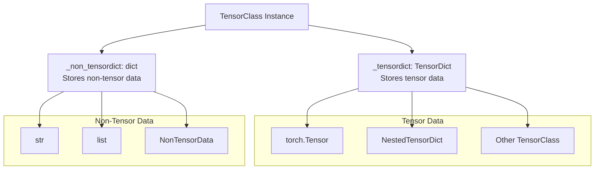

**Key Implementation Details:**

- **_tensordict**: Internal TensorDict instance storing all tensor-compatible data [tensordict/tensorclass.py:1211-1227]()
- **_non_tensordict**: Dictionary storing non-tensor data like strings, lists, or custom objects
- Attribute access automatically routes to the appropriate storage backend

**Sources:** [tensordict/tensorclass.py:900-1119](), [tensordict/tensorclass.py:1278-1338]()

---

### Method Delegation System

TensorClass delegates most operations to the underlying TensorDict while maintaining the tensorclass interface. The delegation is organized into four categories:

**Method Delegation Architecture:**

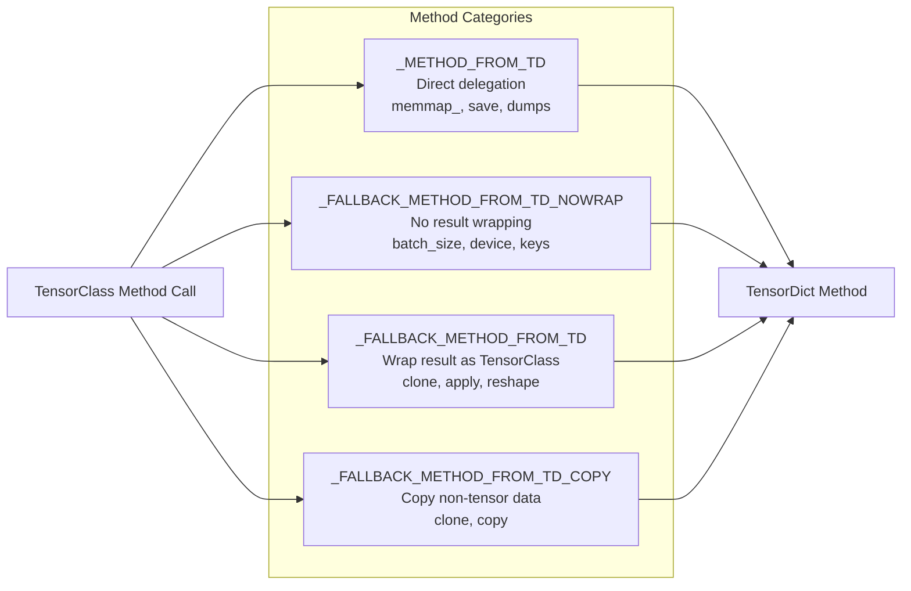

**Method Categories:**

1. **Direct Methods** (`_METHOD_FROM_TD`): Methods executed directly from TensorDict without modification
   - Examples: `memmap_`, `save`, `dumps`, `load_`
   - [tensordict/tensorclass.py:169-179]()

2. **No-Wrap Methods** (`_FALLBACK_METHOD_FROM_TD_NOWRAP`): Methods that return values without wrapping in tensorclass
   - Examples: `batch_size`, `device`, `keys`, `items`, `values`
   - [tensordict/tensorclass.py:181-252]()

3. **Wrapped Methods** (`_FALLBACK_METHOD_FROM_TD`): Methods that return tensorclass instances
   - Examples: `clone`, `apply`, `reshape`, `expand`, `to`
   - [tensordict/tensorclass.py:262-550]()

4. **Copy Methods** (`_FALLBACK_METHOD_FROM_TD_COPY`): Methods requiring non-tensor data copying
   - Examples: `clone`, `copy`
   - [tensordict/tensorclass.py:553-557]()

**Sources:** [tensordict/tensorclass.py:169-557](), [tensordict/tensorclass.py:1039-1063]()

---

## PyTorch Function Integration

TensorClass implements `__torch_function__` to intercept PyTorch operations and handle them appropriately.

**Torch Function Integration Flow:**

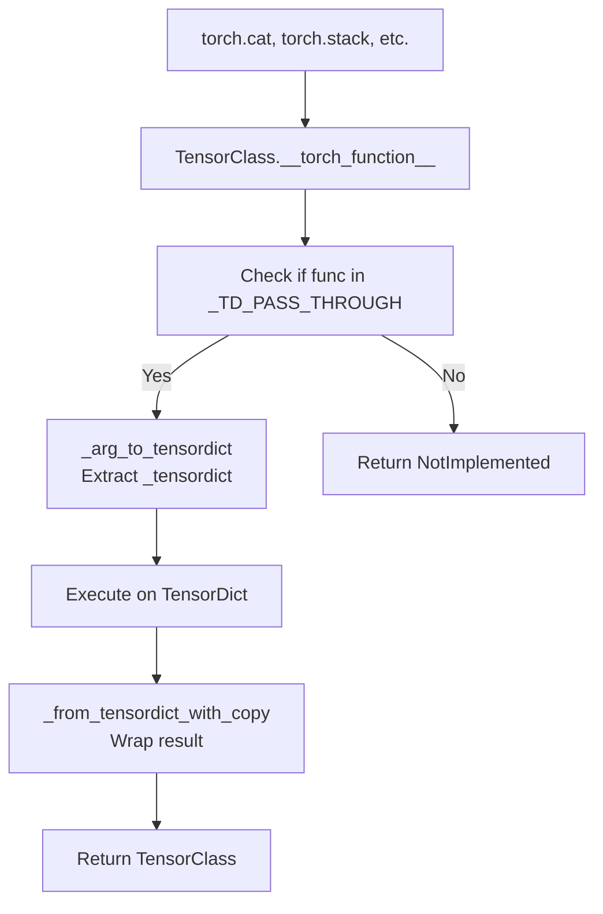

**Supported PyTorch Operations** (`_TD_PASS_THROUGH`):

| Operation | Description |
|-----------|-------------|
| `torch.cat` | Concatenate tensorclasses |
| `torch.stack` | Stack tensorclasses |
| `torch.clone` | Clone tensorclass |
| `torch.squeeze` / `torch.unsqueeze` | Dimension manipulation |
| `torch.permute` | Permute dimensions |
| `torch.split` / `torch.unbind` | Split operations |
| `torch.flatten` / `torch.unflatten` | Reshape operations |
| `torch.zeros_like` / `torch.ones_like` / `torch.rand_like` | Tensor creation |
| `torch.gather` | Gather operation |

**Sources:** [tensordict/tensorclass.py:148-167](), [tensordict/tensorclass.py:901-932](), [tensordict/_torch_func.py:48-881]()

---

## Type System and Casting Behavior

### Type Annotation Handling

TensorClass processes type hints to determine how to handle data during initialization and attribute assignment.

**Type Processing Flow:**

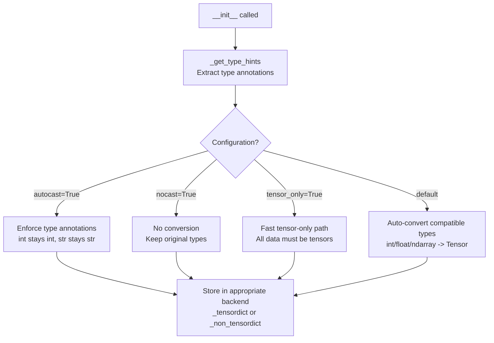

**Type Casting Modes:**

| Mode | Behavior | Use Case |
|------|----------|----------|
| Default | Auto-convert compatible types to tensors | General ML data handling |
| `autocast=True` | Enforce type hints, preserve non-tensor types | Mixed data structures |
| `nocast=True` | Never convert, keep all types as-is | Raw data preservation |
| `tensor_only=True` | Expect only tensors, enable optimizations | Performance-critical paths |

**Sources:** [tensordict/tensorclass.py:965-1119](), [tensordict/tensorclass.py:1166-1277]()

---

## Creating and Initializing TensorClasses

### Basic Creation

```python
@tensorclass
class MyData:
    X: torch.Tensor
    y: torch.Tensor
    label: str

# Create instance
data = MyData(
    X=torch.randn(3, 4),
    y=torch.randn(3, 4),
    label="training",
    batch_size=[3, 4]
)
```

### Initialization Flow

**Initialization Architecture:**

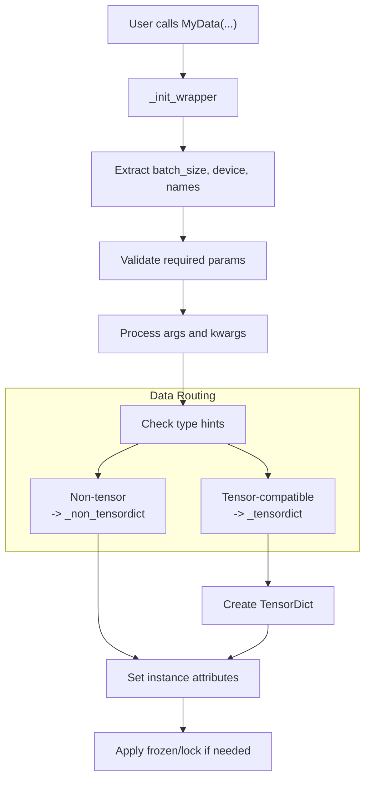

**Initialization Parameters:**

| Parameter | Type | Description |
|-----------|------|-------------|
| `batch_size` | Sequence[int] \| torch.Size | Batch dimensions for the tensorclass |
| `device` | torch.device \| str | Device placement for tensor data |
| `names` | Sequence[str] | Named dimensions |
| `lock` | bool | Whether to lock the tensorclass (immutable) |

**Sources:** [tensordict/tensorclass.py:1165-1277](), [tensordict/tensorclass.py:966-1002]()

---

## Data Access and Modification

### Attribute Access

TensorClass provides attribute-style access through `__getattr__` and `__setattr__` implementations:

**Attribute Access Implementation:**

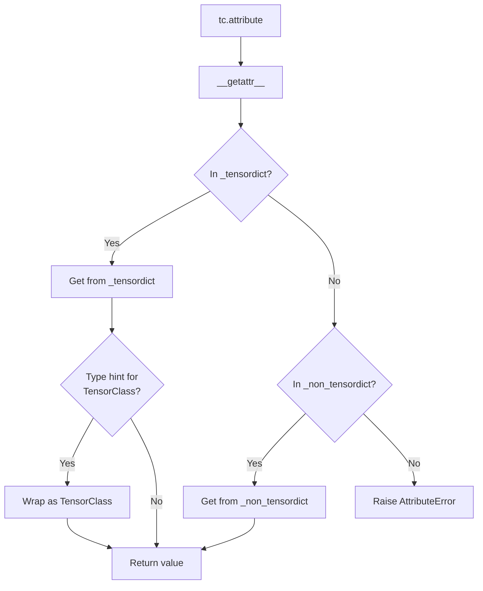

**Attribute Access Variants:**

- **Standard Mode** (`_getattr`): Handles both tensor and non-tensor data [tensordict/tensorclass.py:1278-1338]()
- **Tensor-Only Mode** (`_getattr_tensor_only`): Optimized path for tensor-only mode [tensordict/tensorclass.py:976-977]()

**Sources:** [tensordict/tensorclass.py:976-977](), [tensordict/tensorclass.py:1278-1338]()

### Attribute Setting

**Setting Attribute Flow:**

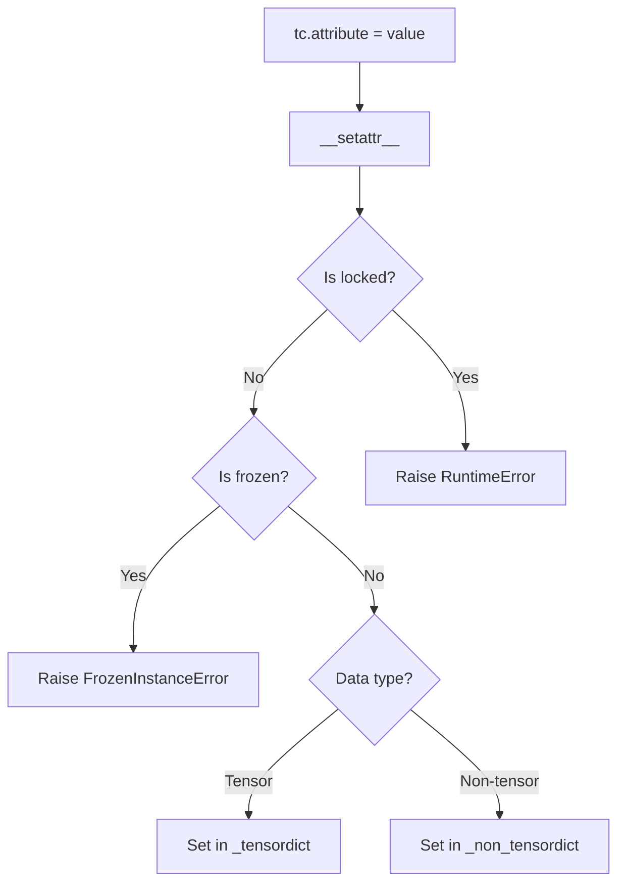

**Sources:** [tensordict/tensorclass.py:981-984](), [tensordict/tensorclass.py:1340-1437]()

---

## Key Methods Reference

### Construction Methods

| Method | Description | Returns |
|--------|-------------|---------|
| `from_dict(dict, ...)` | Create from dictionary | TensorClass |
| `from_dataclass(obj, ...)` | Convert dataclass to tensorclass | TensorClass |
| `from_tensordict(td, ...)` | Create from TensorDict | TensorClass |
| `_from_tensordict(td, non_tensordict)` | Internal construction | TensorClass |
| `_new_unsafe(...)` | Unsafe fast construction | TensorClass |

**Sources:** [tensordict/tensorclass.py:1075-1081](), [tensordict/tensorclass.py:1441-1477]()

### Data Access Methods

| Method | Description | Returns |
|--------|-------------|---------|
| `get(key, default)` | Get value by key | Any |
| `get_at(key, index, default)` | Get value at index | Any |
| `set(key, value, ...)` | Set value by key | Self |
| `set_at_(key, value, index)` | Set value at index | Self |
| `update(dict_or_td, ...)` | Update multiple keys | Self |
| `update_(dict_or_td, ...)` | In-place update | Self |

**Sources:** [tensordict/tensorclass.py:1006-1036]()

### Shape Operations

| Method | Description | Returns |
|--------|-------------|---------|
| `reshape(*shape)` | Reshape batch dimensions | Self |
| `view(*shape)` | View with different shape | Self |
| `expand(*shape)` | Expand batch dimensions | Self |
| `squeeze(dim)` | Remove dimensions of size 1 | Self |
| `unsqueeze(dim)` | Add dimension of size 1 | Self |
| `permute(*dims)` | Permute dimensions | Self |
| `transpose(dim0, dim1)` | Transpose dimensions | Self |
| `flatten(start_dim, end_dim)` | Flatten dimensions | Self |
| `unflatten(dim, sizes)` | Unflatten dimension | Self |

All shape operations are delegated to the underlying TensorDict via the method delegation system.

**Sources:** [tensordict/tensorclass.py:262-550]()

### Batch Operations

| Method | Description | Returns |
|--------|-------------|---------|
| `unbind(dim)` | Unbind along dimension | tuple[Self, ...] |
| `chunk(chunks, dim)` | Split into chunks | tuple[Self, ...] |
| `split(split_size, dim)` | Split into sections | list[Self] |
| `stack(list, dim)` | Stack tensorclasses | Self |
| `cat(list, dim)` | Concatenate tensorclasses | Self |
| `lazy_stack(list, dim)` | Lazy stack | LazyStackedTensorDict |

**Sources:** [tensordict/tensorclass.py:1022-1024]()

---

## Storage and Persistence

### Memory Management Methods

| Method | Description |
|--------|-------------|
| `share_memory_()` | Move to shared memory for IPC |
| `memmap_(prefix, ...)` | Convert to memory-mapped storage |
| `memmap(prefix, ...)` | Create memory-mapped copy |
| `consolidate(filename, ...)` | Consolidate into single file |
| `save(prefix, ...)` | Save to disk |
| `load(prefix, ...)` | Load from disk |

**Sources:** [tensordict/tensorclass.py:1031-1032](), [tensordict/tensorclass.py:1039-1041]()

### State Management

| Method | Description | Returns |
|--------|-------------|---------|
| `state_dict(...)` | Get state dictionary | OrderedDict |
| `load_state_dict(state_dict, ...)` | Load state dictionary | Self |
| `to_dict()` | Convert to Python dict | dict |
| `to_tensordict()` | Convert to TensorDict | TensorDict |

**Sources:** [tensordict/tensorclass.py:1025-1028](), [tensordict/tensorclass.py:1100-1101]()

---

## Properties Reference

### Core Properties

| Property | Type | Description |
|----------|------|-------------|
| `batch_size` | torch.Size | Batch dimensions |
| `device` | torch.device | Device placement |
| `shape` | torch.Size | Alias for batch_size |
| `names` | list[str] | Named dimensions |
| `data` | Self | Data view (for autograd) |
| `grad` | Self | Gradient tensorclass |
| `is_locked` | bool | Whether tensorclass is locked |
| `is_shared` | bool | Whether in shared memory |
| `is_memmap` | bool | Whether memory-mapped |

**Sources:** [tensordict/tensorclass.py:1094-1101](), [tensordict/tensorclass.pyi:536-708]()

---

## Configuration System

### TensorClass Configuration Options

**Configuration Application:**

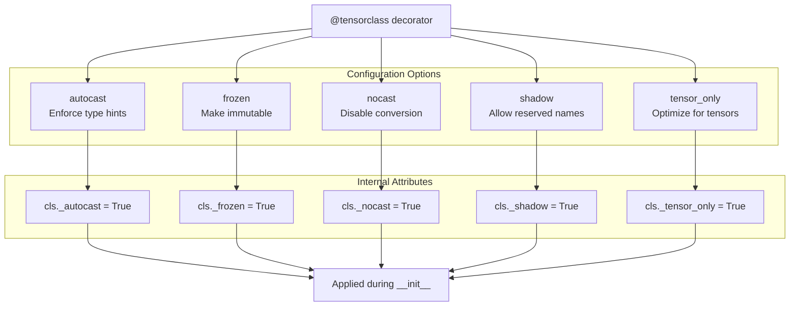

**Configuration Attributes:**

All configuration options are stored as class attributes prefixed with underscore:
- `_autocast`: Controls type enforcement
- `_frozen`: Controls mutability
- `_nocast`: Controls automatic conversion
- `_shadow`: Controls name validation
- `_tensor_only`: Enables optimizations

**Sources:** [tensordict/tensorclass.py:570-628](), [tensordict/tensorclass.py:623-628]()

---

## Special Methods

### Comparison and Logical Operations

TensorClass supports element-wise comparison and logical operations through delegation:

| Method | Operation | Description |
|--------|-----------|-------------|
| `__eq__` | `==` | Element-wise equality |
| `__ne__` | `!=` | Element-wise inequality |
| `__lt__` | `<` | Element-wise less than |
| `__le__` | `<=` | Element-wise less than or equal |
| `__gt__` | `>` | Element-wise greater than |
| `__ge__` | `>=` | Element-wise greater than or equal |
| `__and__` | `&` | Element-wise logical AND |
| `__or__` | `\|` | Element-wise logical OR |
| `__xor__` | `^` | Element-wise logical XOR |

**Sources:** [tensordict/tensorclass.py:996-1000](), [tensordict/tensorclass.py:256-289]()

### Arithmetic Operations

| Method | Operation | Description |
|--------|-----------|-------------|
| `__add__` / `__radd__` | `+` | Addition |
| `__sub__` / `__rsub__` | `-` | Subtraction |
| `__mul__` / `__rmul__` | `*` | Multiplication |
| `__truediv__` / `__rtruediv__` | `/` | Division |
| `__pow__` / `__rpow__` | `**` | Power |
| `__neg__` | `-` | Negation |

**Sources:** [tensordict/tensorclass.py:262-289]()

### Container Protocol

| Method | Description |
|--------|-------------|
| `__len__` | Returns batch size along first dimension |
| `__iter__` | Iterates over first dimension |
| `__getitem__` | Index/slice access |
| `__setitem__` | Index/slice assignment |
| `__contains__` | Check if key exists |
| `__bool__` | Boolean conversion (checks if any element is True) |

**Sources:** [tensordict/tensorclass.py:985-1000]()

---

## Type Stub Integration

TensorClass provides comprehensive type stubs for IDE support and type checking.

**Type Stub Classes:**

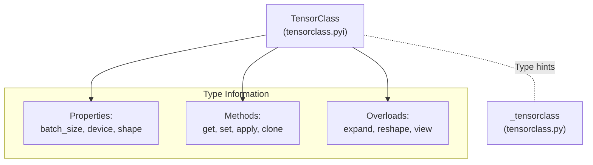

The type stub file provides:
- Complete method signatures with type hints
- Overloaded method variants for different call patterns
- Property type annotations
- Return type information for better IDE autocomplete

**Sources:** [tensordict/tensorclass.pyi:88-1300]()

---

## Advanced Features

### Non-Tensor Data Handling

TensorClass can store non-tensor data alongside tensors using the `_non_tensordict` backend:

**Non-Tensor Storage:**

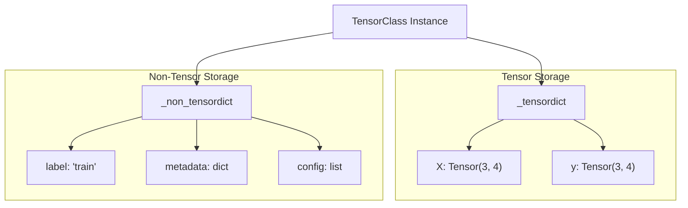

**Methods for Non-Tensor Data:**

| Method | Description |
|--------|-------------|
| `set_non_tensor(key, value)` | Set non-tensor data |
| `get_non_tensor(key, default)` | Get non-tensor data |
| `non_tensor_items()` | Iterate over non-tensor items |
| `filter_non_tensor_data()` | Remove non-tensor data |

**Sources:** [tensordict/tensorclass.py:1004-1005]()

### Locking and Immutability

TensorClass supports locking to prevent modifications:

| Method | Description |
|--------|-------------|
| `lock_()` | Lock the tensorclass |
| `unlock_()` | Unlock the tensorclass |
| `is_locked` | Check if locked |

When `frozen=True` is specified, the tensorclass is automatically locked on creation.

**Sources:** [tensordict/tensorclass.py:262-550]()

---

## Internal Implementation Details

### Class Registration

When a tensorclass is created, it's registered in the system:

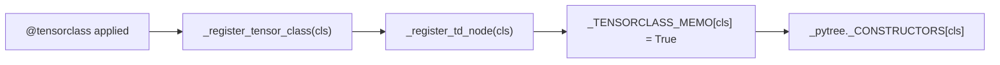

This registration enables:
- PyTree integration for use with `tree_map`
- Tensorclass detection via `is_tensorclass()`
- Proper serialization and deserialization

**Sources:** [tensordict/tensorclass.py:1105-1119]()

### Expected Keys System

TensorClass maintains an `__expected_keys__` set containing all field names defined in the class:

```python
expected_keys = cls.__expected_keys__ = {
    field.name for field in dataclasses.fields(cls)
}
```

This set is used to:
- Validate attribute names during initialization
- Check for conflicts with reserved TensorDict attributes (unless `shadow=True`)
- Determine which attributes to serialize

**Sources:** [tensordict/tensorclass.py:943-954]()

---

## Common Patterns and Usage

### Pattern: Mixed Tensor and Non-Tensor Data

```python
@tensorclass
class ObservationData:
    pixels: torch.Tensor      # Image data
    state: torch.Tensor       # Vector state
    metadata: str             # Frame info (non-tensor)
    timestamp: float          # Time (non-tensor)
```

### Pattern: Nested TensorClasses

```python
@tensorclass
class Agent:
    policy: PolicyData
    value: ValueData
    
@tensorclass
class PolicyData:
    weights: torch.Tensor
    biases: torch.Tensor
```

### Pattern: Frozen Configuration

```python
@tensorclass(frozen=True)
class Config:
    learning_rate: float
    batch_size: int
    
# Instances are immutable and hashable
config = Config(learning_rate=0.001, batch_size=32)
```

### Pattern: Type-Enforced Fields with autocast

```python
@tensorclass(autocast=True)
class DataPoint:
    features: torch.Tensor   # Will be tensor
    label: int               # Will stay int (not converted)
    name: str                # Will stay str
```

---

## Performance Considerations

### tensor_only Mode

When all data is guaranteed to be tensor-compatible, use `tensor_only=True` for optimizations:

- Faster attribute access via `_getattr_tensor_only`
- Simplified type checking
- Reduced overhead in delegation

**Trade-off:** Cannot store non-tensor data when this mode is enabled.

**Sources:** [tensordict/tensorclass.py:976-984]()

### Method Delegation Overhead

Method delegation categories have different performance characteristics:

1. **Direct methods** (fastest): No wrapping overhead
2. **No-wrap methods**: Single delegation, no result wrapping
3. **Wrapped methods**: Requires result wrapping as tensorclass
4. **Copy methods**: Additional non-tensor data copying

For performance-critical code, prefer operations that can use direct or no-wrap methods.

**Sources:** [tensordict/tensorclass.py:169-557]()

---

## Error Handling

### Common Errors

**AttributeError: Reserved Name Conflict**
```
AttributeError: Attribute name reshape can't be used with @tensorclass
```
**Solution:** Use `@tensorclass(shadow=True)` to allow reserved names (use with caution).

**TypeError: Conflicting Options**
```
TypeError: autocast is exclusive with nocast
TypeError: tensor_only and autocast or nocast are exclusive features
```
**Solution:** Don't combine incompatible configuration options.

**RuntimeError: Lock Error**
```
RuntimeError: Cannot modify locked TensorDict
```
**Solution:** Use `unlock_()` context manager or don't modify frozen tensorclasses.

**Sources:** [tensordict/tensorclass.py:606-616](), [tensordict/tensorclass.py:947-954]()

---

