<!-- source: DeepWiki mcp.deepwiki.com · repo pytorch/tensordict · page 10.3 Neural Network Modules API · fetched 2026-10-21 -->

# Neural Network Modules API

<details>
<summary>Relevant source files</summary>

The following files were used as context for generating this wiki page:

- [tensordict/nn/common.py](tensordict/nn/common.py)
- [tensordict/nn/distributions/composite.py](tensordict/nn/distributions/composite.py)
- [tensordict/nn/probabilistic.py](tensordict/nn/probabilistic.py)
- [tensordict/nn/sequence.py](tensordict/nn/sequence.py)
- [test/test_nn.py](test/test_nn.py)

</details>


This page provides a comprehensive API reference for TensorDict's neural network integration modules. These classes enable seamless integration between PyTorch `nn.Module` instances and TensorDict data structures, allowing models to read from and write to structured dictionary-like containers.

**Scope**: This document covers the core module classes (`TensorDictModule`, `TensorDictSequential`), probabilistic modules (`ProbabilisticTensorDictModule`, `ProbabilisticTensorDictSequential`), and related utilities. For general TensorDict operations, see [2](#2). For parameter management with `TensorDictParams`, see [4.4](#4.4). For storage and persistence features, see [5](#5).

---

## Module Class Hierarchy

The following diagram shows the inheritance and composition relationships between the main neural network module classes:

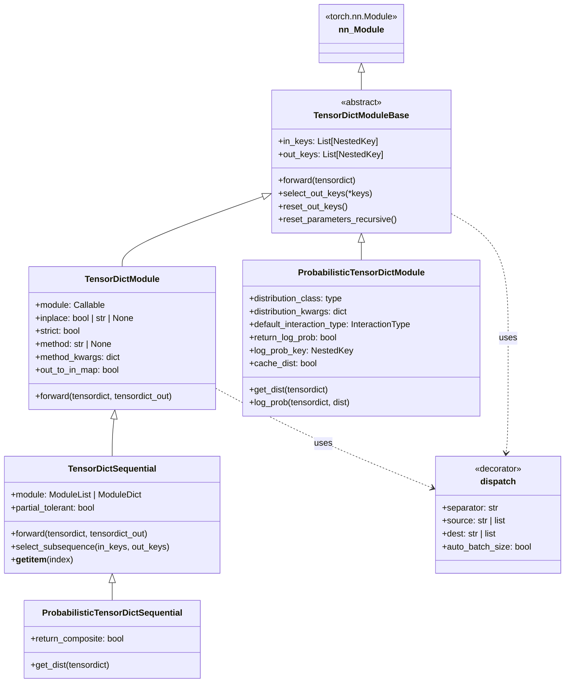

**Sources**: [tensordict/nn/common.py:477-798](), [tensordict/nn/common.py:800-1241](), [tensordict/nn/sequence.py:57-683](), [tensordict/nn/probabilistic.py:159-769](), [tensordict/nn/probabilistic.py:771-1062]()

---

## TensorDictModuleBase

Abstract base class for all TensorDict modules. Defines the core interface and common functionality.

### Class Definition

Located at [tensordict/nn/common.py:477-798]()

### Core Attributes

| Attribute | Type | Description |
|-----------|------|-------------|
| `in_keys` | `List[NestedKey]` | Keys to read from input tensordict |
| `out_keys` | `List[NestedKey]` | Keys to write to output tensordict |
| `_out_keys` | `List[NestedKey]` | Ground truth out_keys (for reset) |
| `_out_keys_apparent` | `List[NestedKey]` | Currently active out_keys |

### Key Methods

#### `in_keys` (property)
Returns the list of input keys. Keys are automatically unraveled from tuples like `("a",)` to strings `"a"` and nested tuples like `("a", ("b",))` to `("a", "b")`.

**Sources**: [tensordict/nn/common.py:548-554]()

#### `out_keys` (property)
Returns the list of output keys. Can be modified using `select_out_keys()`.

**Sources**: [tensordict/nn/common.py:556-570]()

#### `select_out_keys(*out_keys) -> TensorDictModuleBase`
Selects which output keys should be written to the output tensordict. Useful for removing intermediate keys in complex graphs.

**Parameters**:
- `*out_keys`: Sequence of strings or tuples specifying keys to keep

**Returns**: Same module instance (in-place modification)

**Sources**: [tensordict/nn/common.py:572-683]()

#### `reset_out_keys() -> TensorDictModuleBase`
Resets `out_keys` to original values before any `select_out_keys()` calls.

**Sources**: [tensordict/nn/common.py:685-722]()

#### `reset_parameters_recursive(parameters=None) -> Optional[TensorDictBase]`
Recursively resets parameters of the module and its children.

**Parameters**:
- `parameters` (optional): TensorDict of parameters. If None, uses `self.parameters()`

**Returns**: Updated parameters TensorDict if `parameters` was provided, otherwise None

**Sources**: [tensordict/nn/common.py:724-789]()

#### `is_tdmodule_compatible(module) -> bool` (static)
Checks if a module has `in_keys` and `out_keys` attributes.

**Sources**: [tensordict/nn/common.py:543-546]()

---

## TensorDictModule

Wraps a callable (typically `nn.Module`) to read from and write to TensorDict instances.

### Class Definition

Located at [tensordict/nn/common.py:800-1241]()

### Constructor Parameters

| Parameter | Type | Default | Description |
|-----------|------|---------|-------------|
| `module` | `Callable` | Required | Function or nn.Module to wrap |
| `in_keys` | `List[NestedKey]` or `Dict` | Required | Input keys or mapping |
| `out_keys` | `List[NestedKey]` | Required | Output keys |
| `out_to_in_map` | `bool` | `True` | If True, dict keys are fn args, values are TD keys |
| `inplace` | `bool` or `str` | `None` | Control output behavior |
| `method` | `str` | `None` | Method name to call on module |
| `method_kwargs` | `dict` | `None` | Additional kwargs for method |
| `strict` | `bool` | `False` | If True, raise on missing input keys |
| `get_kwargs` | `dict` | `{}` | Kwargs for TensorDict.get() |

**Sources**: [tensordict/nn/common.py:1003-1130]()

### Key Method: `forward()`

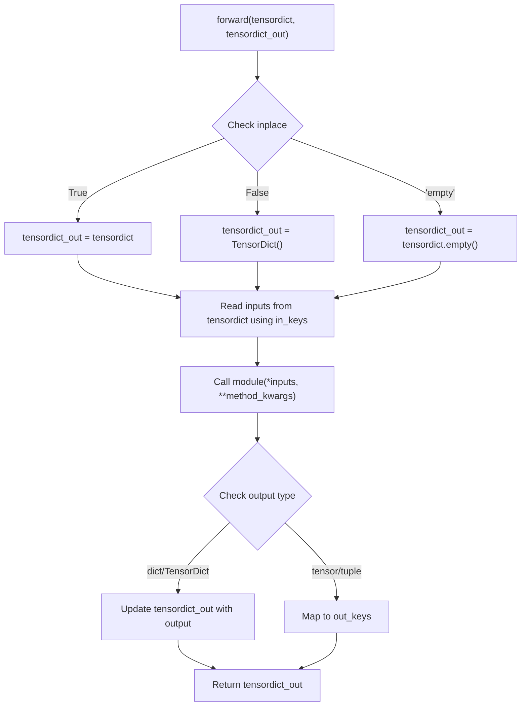

**Sources**: [tensordict/nn/common.py:1132-1241]()

### Input Key Mapping

When `in_keys` is a dictionary, it maps between TensorDict keys and function arguments:

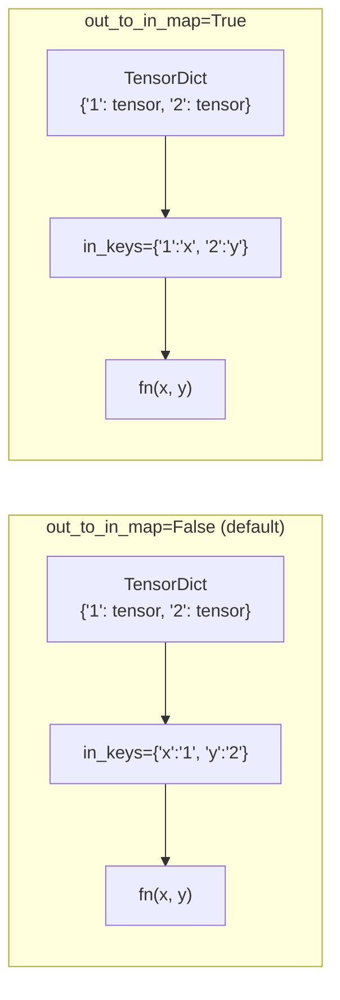

**Sources**: [tensordict/nn/common.py:811-849](), [test/test_nn.py:434-463]()

---

## TensorDictSequential

Chains multiple TensorDictModule instances in sequence, managing data flow between them.

### Class Definition

Located at [tensordict/nn/sequence.py:57-683]()

### Constructor Signatures

```python
# Positional modules
TensorDictSequential(*modules, partial_tolerant=False, selected_out_keys=None, inplace=None)

# Ordered dict
TensorDictSequential(OrderedDict[str, Callable], partial_tolerant=False, ...)

# List
TensorDictSequential(List[Callable], partial_tolerant=False, ...)
```

**Sources**: [tensordict/nn/sequence.py:194-260]()

### Constructor Parameters

| Parameter | Type | Default | Description |
|-----------|------|---------|-------------|
| `*modules` | `Callable` | Required | Sequence of callables |
| `partial_tolerant` | `bool` | `False` | Execute only modules with available inputs |
| `selected_out_keys` | `List[NestedKey]` | `None` | Filter output keys |
| `inplace` | `bool` or `str` | `None` | Control output behavior |

### Key Attributes

| Attribute | Type | Description |
|-----------|------|-------------|
| `module` | `ModuleList` or `ModuleDict` | Container of sub-modules |
| `partial_tolerant` | `bool` | Partial execution mode flag |
| `_complete_out_keys` | `list` | All possible output keys |

**Sources**: [tensordict/nn/sequence.py:191-272]()

### Key Methods

#### `select_subsequence(in_keys=None, out_keys=None) -> TensorDictSequential`

Returns a new sequential module containing only modules necessary to compute specified outputs from specified inputs.

**Algorithm**:
1. Forward pass: Keep modules whose inputs are available
2. Backward pass: Keep modules whose outputs are needed

**Sources**: [tensordict/nn/sequence.py:334-568]()

#### `forward(tensordict, tensordict_out=None, **kwargs) -> TensorDictBase`

Executes modules in sequence. If `partial_tolerant=True` and a module's inputs are missing, the module is skipped.

**Sources**: [tensordict/nn/sequence.py:608-665]()

### Data Flow Pattern

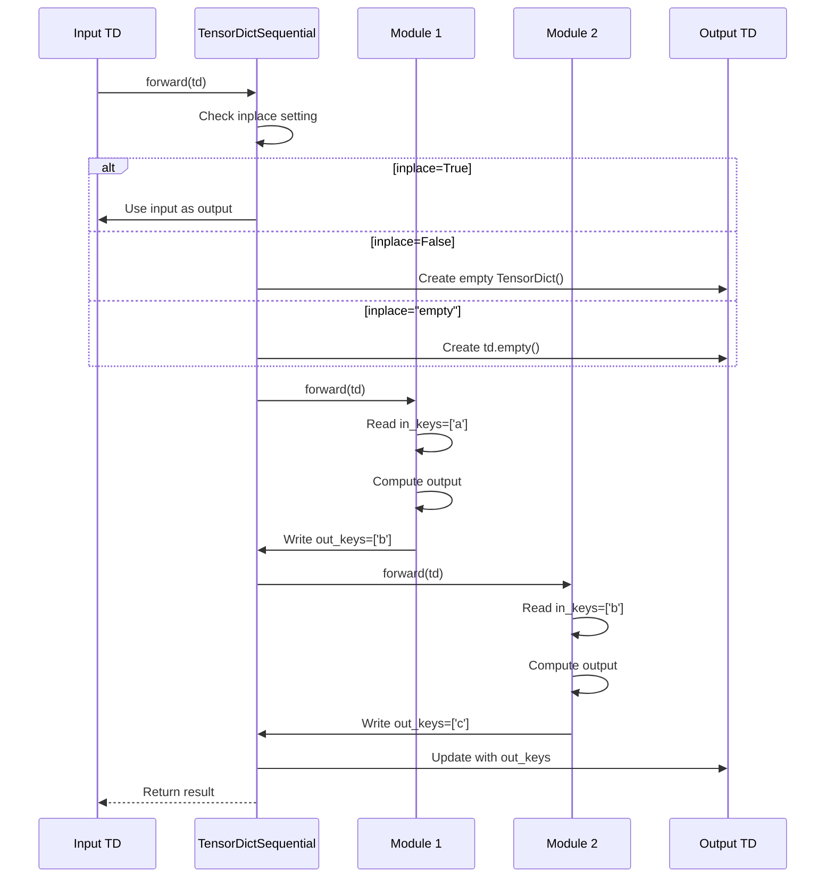

**Sources**: [tensordict/nn/sequence.py:608-665]()

---

## dispatch Decorator

The `dispatch` decorator enables calling TensorDictModule-compatible functions with keyword arguments instead of TensorDict instances.

### Class Definition

Located at [tensordict/nn/common.py:66-377]()

### Constructor Parameters

| Parameter | Type | Default | Description |
|-----------|------|---------|-------------|
| `separator` | `str` | `"_"` | Separator for nested keys |
| `source` | `str` or `list` | `"in_keys"` | Attribute or list for input keys |
| `dest` | `str` or `list` | `"out_keys"` | Attribute or list for output keys |
| `auto_batch_size` | `bool` | `True` | Infer batch size from inputs |

### Usage Patterns

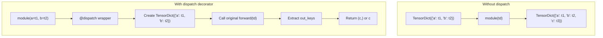

**Sources**: [tensordict/nn/common.py:66-377](), [test/test_nn.py:858-900]()

### Nested Key Handling

When `in_keys` contains nested keys like `("a", "c")`, the decorator flattens them using the separator:

```python
in_keys = [("a", "c"), "d"]
# Callable as: module(a_c=tensor, d=tensor)
```

**Sources**: [tensordict/nn/common.py:209-240](), [test/test_nn.py:873-900]()

---

## InteractionType

Enum defining how samples are drawn from probability distributions.

### Class Definition

Located at [tensordict/nn/probabilistic.py:59-94]()

### Values

| Value | Description | Access Method |
|-------|-------------|---------------|
| `MODE` | Use `dist.mode` | Property access |
| `MEDIAN` | Use `dist.median` | Property access |
| `MEAN` | Use `dist.mean` | Property access |
| `RANDOM` | Use `dist.rsample()` or `dist.sample()` | Method call |
| `DETERMINISTIC` | Use `dist.deterministic_sample` or fallback | Property/method |

**Sources**: [tensordict/nn/probabilistic.py:59-83]()

### Context Manager: `set_interaction_type`

```python
with set_interaction_type(InteractionType.DETERMINISTIC):
    output = prob_module(tensordict)
```

**Sources**: [tensordict/nn/probabilistic.py:128-157]()

### Global Function: `interaction_type()`

Returns the current interaction type from the context manager stack.

**Sources**: [tensordict/nn/probabilistic.py:123-125]()

---

## ProbabilisticTensorDictModule

Non-parametric module that constructs a probability distribution and samples from it (or computes mode/mean/etc.).

### Class Definition

Located at [tensordict/nn/probabilistic.py:159-769]()

### Constructor Parameters

| Parameter | Type | Default | Description |
|-----------|------|---------|-------------|
| `in_keys` | `List[NestedKey]` or `Dict` | Required | Distribution parameter keys |
| `out_keys` | `List[NestedKey]` | `None` | Sample output keys (inferred for CompositeDistribution) |
| `default_interaction_type` | `InteractionType` | `DETERMINISTIC` | Default sampling method |
| `distribution_class` | `type` | `Delta` | Distribution class to instantiate |
| `distribution_kwargs` | `dict` | `{}` | Additional distribution kwargs |
| `return_log_prob` | `bool` | `False` | Whether to compute log probability |
| `log_prob_key` | `NestedKey` | `"sample_log_prob"` | Key for aggregated log prob |
| `log_prob_keys` | `List[NestedKey]` | Auto | Keys for individual log probs |
| `cache_dist` | `bool` | `False` | Cache distribution parameters |
| `n_empirical_estimate` | `int` | `1000` | Samples for empirical mean |
| `num_samples` | `int` or `torch.Size` | `None` | Number of samples to draw |

**Sources**: [tensordict/nn/probabilistic.py:347-444]()

### Key Methods

#### `get_dist(tensordict) -> Distribution`

Constructs a distribution from parameters in the tensordict.

**Sources**: [tensordict/nn/probabilistic.py:509-542]()

#### `log_prob(tensordict, dist=None) -> Tensor`

Computes log probability of samples.

**Sources**: [tensordict/nn/probabilistic.py:548-587]()

#### `forward(tensordict, tensordict_out=None, _requires_sample=True) -> TensorDictBase`

Main execution method. Constructs distribution, samples, and optionally computes log probability.

**Sources**: [tensordict/nn/probabilistic.py:601-670]()

### Interaction Type Resolution

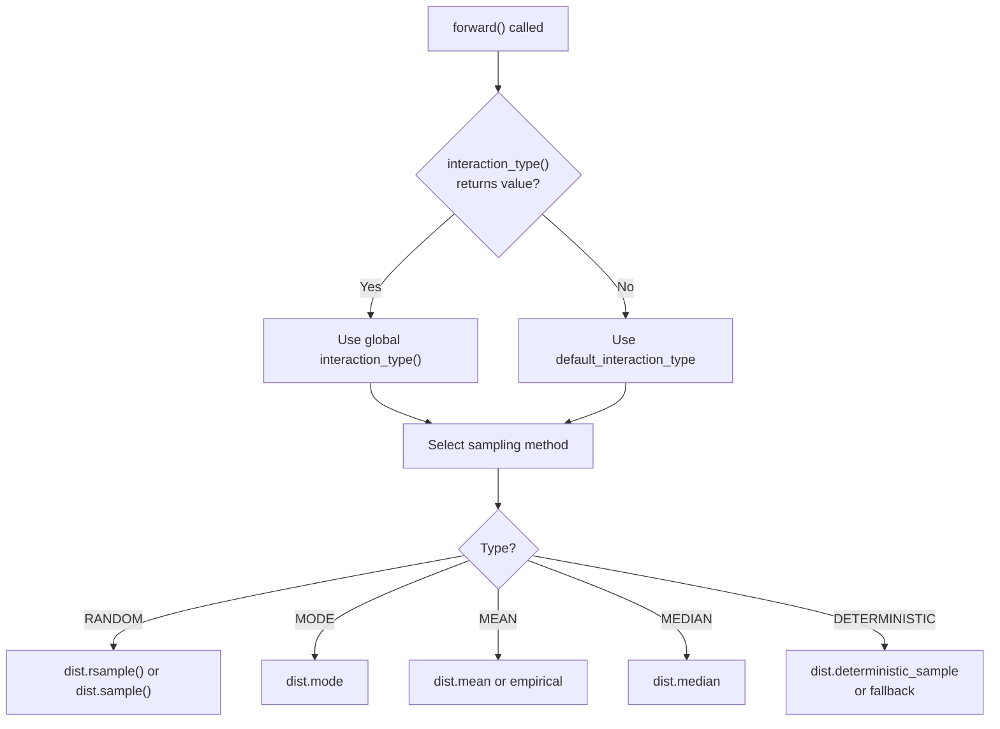

**Sources**: [tensordict/nn/probabilistic.py:672-768]()

---

## ProbabilisticTensorDictSequential

Sequential module with support for probabilistic operations and distribution composition.

### Class Definition

Located at [tensordict/nn/probabilistic.py:771-1062]()

### Constructor Parameters

Inherits from `TensorDictSequential` with additional parameters:

| Parameter | Type | Default | Description |
|-----------|------|---------|-------------|
| `return_composite` | `bool` | Auto | Return CompositeDistribution from multiple prob modules |

If `return_composite` is not specified, it defaults to `True` when:
- Multiple `ProbabilisticTensorDictModule` instances exist, OR
- The last module is not probabilistic

**Sources**: [tensordict/nn/probabilistic.py:800-890]()

### Key Methods

#### `get_dist(tensordict) -> Distribution`

Returns either:
- A single distribution from the last probabilistic module (if `return_composite=False`)
- A `CompositeDistribution` wrapping all probabilistic modules (if `return_composite=True`)

**Sources**: [tensordict/nn/probabilistic.py:932-1062]()

### Multi-Module Distribution Construction

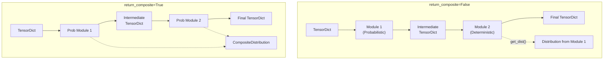

**Sources**: [tensordict/nn/probabilistic.py:932-1062]()

---

## CompositeDistribution

A distribution that groups multiple independent distributions, enabling joint operations.

### Class Definition

Located at [tensordict/nn/distributions/composite.py:24-567]()

### Constructor Parameters

| Parameter | Type | Required | Description |
|-----------|------|----------|-------------|
| `params` | `TensorDictBase` | Yes | Nested parameter structure |
| `distribution_map` | `dict` | Yes | Maps sample names to distribution types |
| `name_map` | `dict` | No | Maps distribution names to output keys |
| `extra_kwargs` | `dict` | No | Additional kwargs per distribution |
| `log_prob_key` | `NestedKey` | No | Key for aggregated log prob (default: `"sample_log_prob"`) |
| `entropy_key` | `NestedKey` | No | Key for aggregated entropy (default: `"entropy"`) |

**Sources**: [tensordict/nn/distributions/composite.py:92-133]()

### Key Properties

| Property | Type | Description |
|----------|------|-------------|
| `dists` | `dict` | Dictionary of component distributions |
| `mode` | `TensorDictBase` | Mode of each component |
| `mean` | `TensorDictBase` | Mean of each component |
| `deterministic_sample` | `TensorDictBase` | Deterministic sample from each |

**Sources**: [tensordict/nn/distributions/composite.py:259-337]()

### Key Methods

#### `sample(shape=None) -> TensorDictBase`

Samples from all component distributions and returns a TensorDict.

**Sources**: [tensordict/nn/distributions/composite.py:250-257]()

#### `rsample(shape=None) -> TensorDictBase`

Reparameterized sampling from all component distributions.

**Sources**: [tensordict/nn/distributions/composite.py:342-348]()

#### `log_prob(sample) -> Tensor | TensorDictBase`

Computes log probability. Behavior depends on `composite_lp_aggregate()`:
- If `True`: Returns sum of log probabilities as a single tensor
- If `False`: Returns TensorDict with individual log probs

**Sources**: [tensordict/nn/distributions/composite.py:350-375]()

#### `log_prob_composite(sample, include_sum=None) -> TensorDictBase`

Always returns TensorDict with individual log probabilities, optionally including sum.

**Sources**: [tensordict/nn/distributions/composite.py:377-419]()

#### `entropy(samples_mc=1, aggregate_probabilities=None, include_sum=None) -> Tensor | TensorDictBase`

Computes entropy for each component. Uses Monte Carlo estimation if closed-form is unavailable.

**Sources**: [tensordict/nn/distributions/composite.py:421-464]()

### Log Probability Aggregation

The behavior of log probability computation is controlled by the `composite_lp_aggregate()` context manager:

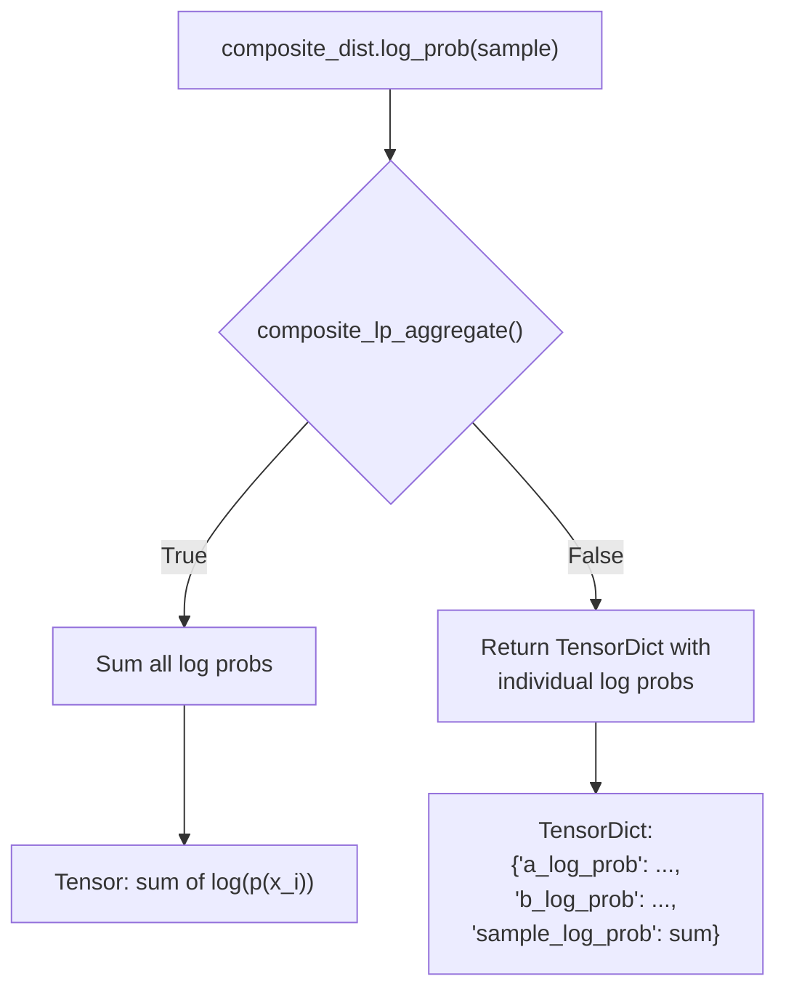

**Sources**: [tensordict/nn/distributions/composite.py:350-419](), [tensordict/nn/utils.py:composite_lp_aggregate]()

---

## Module Interaction Patterns

### Pattern 1: Basic TensorDictModule Wrapping

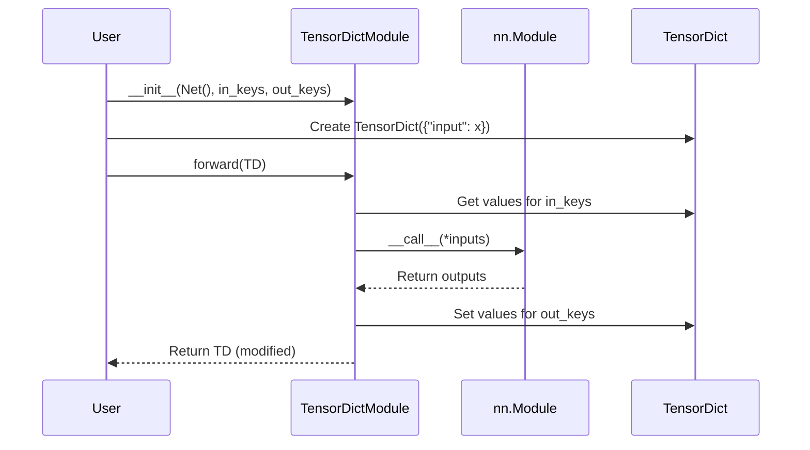

**Sources**: [tensordict/nn/common.py:800-1241]()

### Pattern 2: Sequential Pipeline

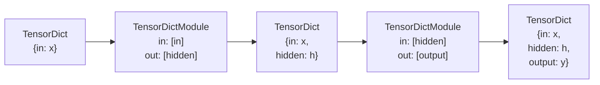

**Sources**: [tensordict/nn/sequence.py:57-683]()

### Pattern 3: Probabilistic Sampling

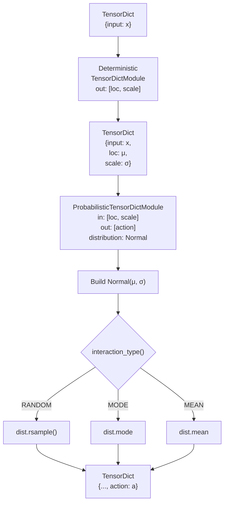

**Sources**: [tensordict/nn/probabilistic.py:159-769](), [test/test_nn.py:746-789]()

---

## Common Usage Examples

### Example 1: Wrapping a Linear Layer

From [test/test_nn.py:583-594]():

```python
# Create wrapped module
module = TensorDictModule(
    module=nn.Linear(3, 4),
    in_keys=["in"],
    out_keys=["out"]
)

# Use with tensordict
td = TensorDict({"in": torch.randn(3, 3)}, [3])
module(td)
# td now contains both "in" and "out" keys
```

### Example 2: Sequential Processing

From [tensordict/nn/sequence.py:92-115]():

```python
# Chain modules
module = TensorDictSequential(
    TensorDictModule(lambda x: x+1, in_keys=["x"], out_keys=["x+1"]),
    TensorDictModule(nn.Linear(3, 4), in_keys=["x+1"], out_keys=["output"]),
)

# Process tensordict
td = TensorDict({"x": torch.zeros(3)}, [])
result = module(td)
# result contains "x", "x+1", and "output"
```

### Example 3: Probabilistic Module

From [test/test_nn.py:756-789]():

```python
# Network producing distribution parameters
net = TensorDictModule(
    nn.Linear(3, 8),
    in_keys=["in"],
    out_keys=["params"]
)

# Extract loc and scale
param_extractor = TensorDictModule(
    NormalParamExtractor(),
    in_keys=["params"],
    out_keys=["loc", "scale"]
)

# Probabilistic sampling
prob_module = ProbabilisticTensorDictModule(
    in_keys=["loc", "scale"],
    out_keys=["action"],
    distribution_class=Normal,
    return_log_prob=True
)

# Combine
policy = ProbabilisticTensorDictSequential(
    net, param_extractor, prob_module
)

# Sample actions
td = TensorDict({"in": torch.randn(3, 3)}, [3])
with set_interaction_type(InteractionType.RANDOM):
    policy(td)
# td now has "action" and "sample_log_prob"
```

### Example 4: Dispatch Decorator

From [test/test_nn.py:858-863]():

```python
# Define module with dispatch
tdm = TensorDictModule(nn.Linear(1, 1), ["a"], ["b"])

# Call with tensordict
td = TensorDict({"a": torch.zeros(1, 1)}, 1)
tdm(td)  # Modifies td in place

# Call with kwargs (dispatch automatically converts)
out = tdm(a=torch.zeros(1, 1))  # Returns tensor directly
```

---

## Method Reference Tables

### TensorDictModule Methods

| Method | Parameters | Returns | Description |
|--------|-----------|---------|-------------|
| `forward` | `tensordict`, `tensordict_out=None` | `TensorDictBase` | Execute wrapped module |
| `__call__` | Same as forward | Same as forward | Alias for forward (supports dispatch) |

**Sources**: [tensordict/nn/common.py:1132-1241]()

### TensorDictSequential Methods

| Method | Parameters | Returns | Description |
|--------|-----------|---------|-------------|
| `forward` | `tensordict`, `tensordict_out=None`, `**kwargs` | `TensorDictBase` | Execute all modules in sequence |
| `select_subsequence` | `in_keys=None`, `out_keys=None` | `TensorDictSequential` | Extract relevant sub-graph |
| `__getitem__` | `index: int | slice | str` | Module or Sequential | Access sub-modules |
| `__len__` | None | `int` | Number of modules |

**Sources**: [tensordict/nn/sequence.py:334-683]()

### ProbabilisticTensorDictModule Methods

| Method | Parameters | Returns | Description |
|--------|-----------|---------|-------------|
| `get_dist` | `tensordict` | `Distribution` | Build distribution from params |
| `log_prob` | `tensordict`, `dist=None` | `Tensor` | Compute log probability |
| `forward` | `tensordict`, `tensordict_out=None`, `_requires_sample=True` | `TensorDictBase` | Sample from distribution |

**Sources**: [tensordict/nn/probabilistic.py:509-670]()

### CompositeDistribution Methods

| Method | Parameters | Returns | Description |
|--------|-----------|---------|-------------|
| `sample` | `shape=None` | `TensorDictBase` | Sample all distributions |
| `rsample` | `shape=None` | `TensorDictBase` | Reparameterized sample |
| `log_prob` | `sample` | `Tensor` or `TensorDictBase` | Log probability (aggregated or composite) |
| `log_prob_composite` | `sample`, `include_sum=None` | `TensorDictBase` | Individual log probs |
| `entropy` | `samples_mc=1`, `aggregate_probabilities=None`, `include_sum=None` | `Tensor` or `TensorDictBase` | Entropy |
| `cdf` | `sample` | `TensorDictBase` | Cumulative distribution |
| `icdf` | `sample` | `TensorDictBase` | Inverse CDF |

**Sources**: [tensordict/nn/distributions/composite.py:250-559]()

---

## Code Entity Reference

This section maps high-level concepts to specific code locations:

### Core Classes

- **TensorDictModuleBase**: [tensordict/nn/common.py:477-798]()
- **TensorDictModule**: [tensordict/nn/common.py:800-1241]()
- **TensorDictSequential**: [tensordict/nn/sequence.py:57-683]()
- **ProbabilisticTensorDictModule**: [tensordict/nn/probabilistic.py:159-769]()
- **ProbabilisticTensorDictSequential**: [tensordict/nn/probabilistic.py:771-1062]()
- **CompositeDistribution**: [tensordict/nn/distributions/composite.py:24-567]()

### Decorators and Context Managers

- **dispatch**: [tensordict/nn/common.py:66-377]()
- **set_interaction_type**: [tensordict/nn/probabilistic.py:128-157]()
- **interaction_type()**: [tensordict/nn/probabilistic.py:123-125]()

### Enums

- **InteractionType**: [tensordict/nn/probabilistic.py:59-94]()

### Helper Classes

- **_OutKeysSelect**: [tensordict/nn/common.py:379-474]()
- **WrapModule**: [tensordict/nn/common.py:1244-1292]()

**Sources**: All file paths listed above

---

