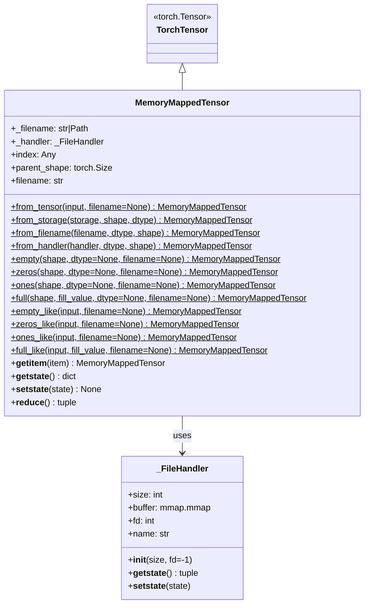
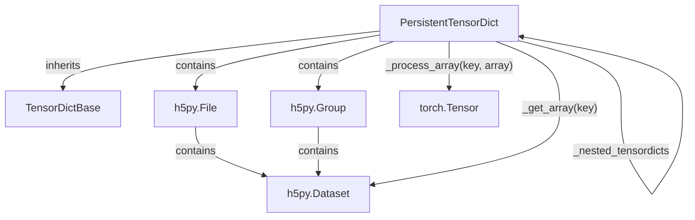
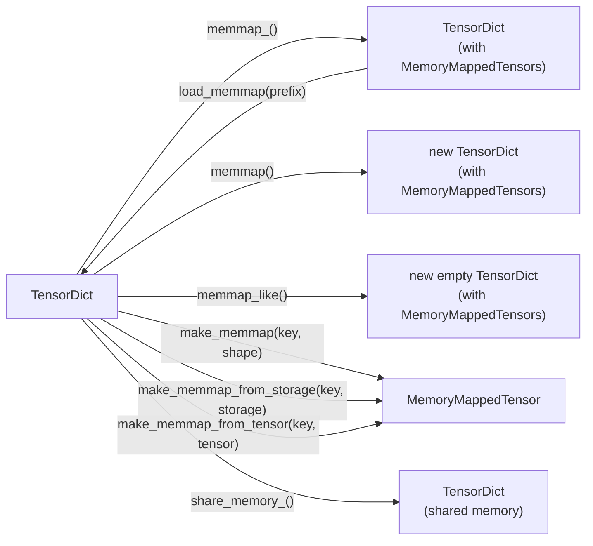

<!-- source: DeepWiki mcp.deepwiki.com · repo pytorch/tensordict · page 10.4 Storage and Persistence API · fetched 2026-10-21 -->

# Storage and Persistence API

<details>
<summary>Relevant source files</summary>

The following files were used as context for generating this wiki page:

- [tensordict/memmap.py](tensordict/memmap.py)
- [tensordict/nn/params.py](tensordict/nn/params.py)
- [tensordict/nn/tensorclass_module.py](tensordict/nn/tensorclass_module.py)
- [tensordict/persistent.py](tensordict/persistent.py)
- [test/test_distributed.py](test/test_distributed.py)
- [test/test_memmap.py](test/test_memmap.py)

</details>


This page provides a comprehensive API reference for storage and persistence functionality in TensorDict. This includes memory-mapped tensors for efficient disk-backed storage and HDF5-based persistent tensordicts for working with datasets larger than RAM.

For higher-level concepts and usage patterns, see [Memory Management Strategies](#5.3). For serialization and inter-process communication patterns, see [Serialization and Inter-Process Communication](#5.4).

---

## Overview

The storage and persistence API consists of two primary classes and their supporting infrastructure:

| Class | Backend | Use Case | File Support |
|-------|---------|----------|--------------|
| `MemoryMappedTensor` | Memory-mapped files | Fast disk-backed tensors, zero-copy IPC | Optional filename or file handler |
| `PersistentTensorDict` | HDF5 files | Large datasets, nested structures | Required filename or h5py group |

Both classes enable working with data larger than available RAM by keeping data on disk and loading only accessed portions into memory.

**Sources:** [tensordict/memmap.py:36-69](), [tensordict/persistent.py:115-149]()

---

## MemoryMappedTensor Class

### Class Definition

```python
class MemoryMappedTensor(torch.Tensor)
```

A `torch.Tensor` subclass that stores data in memory-mapped files or file handlers, enabling efficient disk-backed storage and zero-copy serialization for inter-process communication.

**Key Attributes:**
- `_filename` (str | Path | None): Path to the backing file, if using file-based storage
- `_handler` (_FileHandler | None): File handler object, if using handler-based storage
- `index` (Any): Index used if this tensor is a view of a larger memory-mapped tensor
- `parent_shape` (torch.Size): Original shape before any indexing

**Sources:** [tensordict/memmap.py:36-76]()

---

### Class Diagram



**Sources:** [tensordict/memmap.py:36-980]()

---

### Constructor Methods

#### `MemoryMappedTensor.from_tensor`

```python
@classmethod
def from_tensor(
    cls,
    input: torch.Tensor,
    *,
    filename: Path | str = None,
    existsok: bool = False,
    copy_existing: bool = False,
    copy_data: bool = True,
    shape: torch.Size | None = None,
) -> MemoryMappedTensor
```

Creates a `MemoryMappedTensor` from an existing tensor.

**Parameters:**
- `input` (torch.Tensor): Source tensor to copy or reference
- `filename` (Path | str, optional): Path to backing file. If `None`, uses a file handler
- `existsok` (bool): If `True`, overwrites existing file. Default: `False`
- `copy_existing` (bool): If `True`, allows copying from an existing MemoryMappedTensor to a new location. Default: `False`
- `copy_data` (bool): If `True`, copies tensor content to storage. Default: `True`
- `shape` (torch.Size | None): Override tensor shape

**Returns:** MemoryMappedTensor instance

**Behavior:**
- If `input` is already a `MemoryMappedTensor` and `filename` matches or is `None`, returns the input unchanged
- Raises `RuntimeError` if trying to copy an existing `MemoryMappedTensor` to a new location without `copy_existing=True`
- Raises `RuntimeError` if `input.requires_grad=True`

**Sources:** [tensordict/memmap.py:141-286]()

---

#### `MemoryMappedTensor.from_storage`

```python
@classmethod
def from_storage(
    cls,
    storage: torch.StorageBase,
    *,
    shape: torch.Size | None = None,
    dtype: torch.dtype | None = None,
    device: torch.device | None = None,
    index: IndexType | None = None,
    filename: Path | str = None,
    handler: _FileHandler = None,
) -> MemoryMappedTensor
```

Creates a `MemoryMappedTensor` from an existing storage object.

**Parameters:**
- `storage` (torch.StorageBase): Source storage
- `shape` (torch.Size | None): Shape to view the storage as
- `dtype` (torch.dtype | None): Data type
- `device` (torch.device | None): Device (must be CPU)
- `index` (IndexType | None): Optional index to apply
- `filename` (Path | str | None): Associated filename
- `handler` (_FileHandler | None): Associated file handler

**Returns:** MemoryMappedTensor instance

**Sources:** [tensordict/memmap.py:288-337]()

---

#### `MemoryMappedTensor.from_filename`

```python
@classmethod
def from_filename(
    cls,
    filename: Path | str,
    dtype: torch.dtype,
    shape: torch.Size | torch.Tensor,
    index: IndexType = None,
) -> MemoryMappedTensor
```

Loads a `MemoryMappedTensor` from a file.

**Parameters:**
- `filename` (Path | str): Path to the memory-mapped file
- `dtype` (torch.dtype): Data type of the tensor
- `shape` (torch.Size | torch.Tensor): Shape of the tensor. If a tensor, assumes nested tensor structure
- `index` (IndexType, optional): Index to apply when building the tensor

**Returns:** MemoryMappedTensor instance

**Sources:** [tensordict/memmap.py:716-778]()

---

#### `MemoryMappedTensor.from_handler`

```python
@classmethod
def from_handler(
    cls,
    handler: _FileHandler,
    dtype: torch.dtype,
    shape: torch.Size | torch.Tensor,
    index: IndexType = None,
) -> MemoryMappedTensor
```

Loads a `MemoryMappedTensor` from a file handler.

**Parameters:**
- `handler` (_FileHandler): File handler object
- `dtype` (torch.dtype): Data type
- `shape` (torch.Size | torch.Tensor): Tensor shape. If a tensor, assumes nested tensor
- `index` (IndexType, optional): Index to apply

**Returns:** MemoryMappedTensor instance

**Sources:** [tensordict/memmap.py:780-824]()

---

### Factory Methods

#### `MemoryMappedTensor.empty`

```python
@classmethod
def empty(
    cls,
    *size,
    shape=None,
    dtype=None,
    device=None,
    filename=None,
) -> MemoryMappedTensor
```

Creates a memory-mapped tensor with uninitialized content.

**Parameters:**
- `*size` or `shape`: Shape specification (variadic integers or keyword argument)
- `dtype` (torch.dtype, optional): Data type
- `device` (torch.device, optional): Must be `None` or `"cpu"`
- `filename` (Path | str, optional): Path to backing file
- `existsok` (bool, optional): Whether to overwrite existing files

**Returns:** MemoryMappedTensor with uninitialized content

**Sources:** [tensordict/memmap.py:537-633]()

---

#### `MemoryMappedTensor.zeros` / `ones` / `full`

```python
@classmethod
def zeros(cls, *size, shape=None, dtype=None, device=None, filename=None) -> MemoryMappedTensor

@classmethod
def ones(cls, *size, shape=None, dtype=None, device=None, filename=None) -> MemoryMappedTensor

@classmethod
def full(cls, *size, shape=None, fill_value=None, dtype=None, device=None, filename=None) -> MemoryMappedTensor
```

Create memory-mapped tensors filled with specific values (0, 1, or `fill_value`).

**Parameters:** Same as `empty`, plus:
- `fill_value` (float): Fill value for `full` method

**Returns:** MemoryMappedTensor initialized with specified values

**Sources:** [tensordict/memmap.py:443-714]()

---

#### `MemoryMappedTensor.empty_like` / `zeros_like` / `ones_like` / `full_like`

```python
@classmethod
def empty_like(cls, input, *, filename=None) -> MemoryMappedTensor

@classmethod
def zeros_like(cls, input, *, filename=None) -> MemoryMappedTensor

@classmethod
def ones_like(cls, input, *, filename=None) -> MemoryMappedTensor

@classmethod
def full_like(cls, input, fill_value, *, filename=None) -> MemoryMappedTensor
```

Create memory-mapped tensors with the same shape and dtype as `input`.

**Parameters:**
- `input` (torch.Tensor): Template tensor
- `fill_value` (float): Fill value for `full_like`
- `filename` (Path | str, optional): Path to backing file

**Returns:** MemoryMappedTensor matching input shape/dtype

**Sources:** [tensordict/memmap.py:362-432]()

---

### Properties

#### `filename`

```python
@property
def filename(self) -> str
```

Returns the absolute path to the backing file.

**Raises:** `RuntimeError` if the tensor uses a handler instead of a filename.

**Sources:** [tensordict/memmap.py:339-360]()

---

### Special Methods

#### `__getitem__`

```python
def __getitem__(self, item: IndexType) -> MemoryMappedTensor | torch.Tensor
```

Indexes the memory-mapped tensor. If the result shares storage with the parent, returns a `MemoryMappedTensor`; otherwise returns a regular `torch.Tensor`.

**Parameters:**
- `item` (IndexType): Torch-compatible index

**Returns:** MemoryMappedTensor or torch.Tensor

**Raises:** `ValueError` if used with first-class dimension indices (functorch dimensions)

**Sources:** [tensordict/memmap.py:876-926]()

---

#### `__reduce__` / `__getstate__` / `__setstate__`

Serialization methods that enable zero-copy pickling for inter-process communication.

```python
def __reduce__(self) -> tuple
def __getstate__(self) -> dict
def __setstate__(self, state: dict) -> None
```

These methods serialize only the metadata (filename/handler, dtype, shape, index), not the actual data, enabling efficient IPC.

**Sources:** [tensordict/memmap.py:831-874]()

---

### Additional Methods

#### `chunk` / `split` / `unbind`

```python
def chunk(self, chunks: int, dim: int = 0) -> tuple[MemoryMappedTensor, ...]
def split(self, split_size: int, dim: int = 0) -> tuple[MemoryMappedTensor, ...]
def unbind(self, dim: int) -> tuple[MemoryMappedTensor, ...]
```

Splitting operations that preserve the `MemoryMappedTensor` type and maintain references to the backing storage.

**Sources:** [tensordict/memmap.py:940-980]()

---

## PersistentTensorDict Class

### Class Definition

```python
class PersistentTensorDict(TensorDictBase)
```

A `TensorDictBase` implementation backed by HDF5 files, enabling efficient storage and access to datasets larger than RAM.

**Key Attributes:**
- `file` (h5py.File | h5py.Group): HDF5 file or group object
- `filename` (str | None): Path to HDF5 file
- `mode` (str): File access mode (e.g., `"r"`, `"w"`, `"a"`)
- `kwargs` (dict): Additional arguments for HDF5 dataset creation
- `_nested_tensordicts` (dict): Cache of nested PersistentTensorDict instances

**Sources:** [tensordict/persistent.py:115-196]()

---

### Class Structure Diagram



**Sources:** [tensordict/persistent.py:115-196]()

---

### Constructor

#### `PersistentTensorDict.__init__`

```python
def __init__(
    self,
    *,
    batch_size=None,
    filename=None,
    group=None,
    mode="r",
    backend="h5",
    device=None,
    **kwargs,
)
```

**Parameters:**
- `batch_size` (torch.Size, optional): TensorDict batch size. Default: `torch.Size(())`
- `filename` (str, optional): Path to HDF5 file. Exclusive with `group`
- `group` (h5py.Group, optional): HDF5 file or group. Exclusive with `filename`
- `mode` (str): File access mode. Default: `"r"`
- `backend` (str): Storage backend. Only `"h5"` is currently supported
- `device` (torch.device, optional): Device where tensors are loaded
- `**kwargs`: Additional arguments passed to `h5py.File.create_dataset`

**Raises:**
- `ModuleNotFoundError` if h5py is not installed
- `NotImplementedError` if backend is not `"h5"`
- `RuntimeError` if both or neither of `filename` and `group` are provided

**Sources:** [tensordict/persistent.py:154-196]()

---

### Class Methods

#### `PersistentTensorDict.from_h5`

```python
@classmethod
def from_h5(
    cls,
    filename: str,
    *,
    mode: str = "r",
    batch_size: torch.Size | None = None,
) -> PersistentTensorDict
```

Creates a `PersistentTensorDict` from an HDF5 file, automatically determining batch sizes.

**Parameters:**
- `filename` (str): Path to HDF5 file
- `mode` (str): File access mode. Default: `"r"`
- `batch_size` (torch.Size, optional): Batch size. If `None`, automatically determined

**Returns:** PersistentTensorDict instance

**Sources:** [tensordict/persistent.py:198-231]()

---

#### `PersistentTensorDict.from_dict`

```python
@classmethod
def from_dict(
    cls,
    input_dict: dict | TensorDictBase,
    filename: str | Path,
    *,
    auto_batch_size: bool = False,
    batch_size=None,
    device=None,
    **kwargs,
) -> PersistentTensorDict
```

Converts a dictionary or TensorDict to an HDF5-backed PersistentTensorDict.

**Parameters:**
- `input_dict` (dict | TensorDictBase): Source data
- `filename` (str | Path): Path to HDF5 file to create
- `auto_batch_size` (bool): If `True`, compute batch size automatically
- `batch_size` (torch.Size, optional): TensorDict batch size
- `device` (torch.device, optional): Device for loaded tensors
- `**kwargs`: Arguments passed to `h5py.File.create_dataset`

**Returns:** PersistentTensorDict instance

**Sources:** [tensordict/persistent.py:233-284]()

---

### Core Methods

#### `get` / `__getitem__`

```python
def get(self, key: NestedKey, default=None) -> torch.Tensor | PersistentTensorDict
def __getitem__(self, index: IndexType) -> PersistentTensorDict | torch.Tensor | Any
```

Retrieves values from the HDF5 storage. Data is loaded from disk only when accessed.

**Parameters:**
- `key` (NestedKey): Key to retrieve (string or tuple)
- `default`: Default value if key not found
- `index` (IndexType): Index for sub-tensordict access

**Returns:** 
- Tensor data loaded into memory (on specified device)
- Nested PersistentTensorDict for groups
- Sub-tensordict for indexing operations

**Sources:** [tensordict/persistent.py:348-462]()

---

#### `get_at`

```python
def get_at(
    self,
    key: NestedKey,
    idx: IndexType,
    default=NO_DEFAULT,
) -> torch.Tensor
```

Efficiently retrieves indexed values directly from HDF5, avoiding loading entire arrays.

**Parameters:**
- `key` (NestedKey): Key to retrieve
- `idx` (IndexType): Index to apply
- `default`: Default value if key not found

**Returns:** Indexed tensor

**Note:** Includes a workaround for h5py boolean masking limitations.

**Sources:** [tensordict/persistent.py:358-401]()

---

#### `keys`

```python
def keys(
    self,
    include_nested: bool = False,
    leaves_only: bool = False,
    is_leaf: Callable[[Type], bool] | None = None,
    *,
    sort: bool = False,
) -> _PersistentTDKeysView
```

Returns a view of keys in the HDF5 file.

**Parameters:**
- `include_nested` (bool): Include keys from nested groups
- `leaves_only` (bool): Only return leaf keys (datasets)
- `is_leaf` (Callable): Custom leaf detection function
- `sort` (bool): Sort keys

**Returns:** _PersistentTDKeysView iterator

**Sources:** [tensordict/persistent.py:504-522]()

---

#### `__setitem__` / `set`

```python
def __setitem__(self, index: IndexType, value: Any) -> None
def set(self, key: NestedKey, item, inplace: bool = False, **kwargs) -> PersistentTensorDict
```

Modifies data in the HDF5 file.

**Note:** Setting values requires write mode and modifies data in-place on disk.

**Sources:** [tensordict/persistent.py:465-492]()

---

#### `close`

```python
def close(self) -> None
```

Closes the HDF5 file.

**Important:** `PersistentTensorDict` instances do not automatically close when going out of scope. Manual closure is the user's responsibility.

**Sources:** [tensordict/persistent.py:286-288]()

---

### Metadata Methods

#### `_get_metadata`

```python
def _get_metadata(self, key: NestedKey) -> dict
```

Retrieves metadata for an entry without loading the full array.

**Returns:** Dictionary with keys:
- `"dtype"` (torch.dtype): Data type
- `"shape"` (torch.Size): Shape
- `"dim"` (int): Number of dimensions
- `"array"` (bool): Whether it's an array (True) or group (False)
- `"non_tensor"` (bool): Whether it's non-numeric data

**Sources:** [tensordict/persistent.py:403-435]()

---

### Persistence Methods

#### `memmap` / `memmap_`

```python
def memmap(
    self,
    prefix: str | None = None,
    copy_existing: bool = False,
    num_threads: int = 0,
) -> TensorDict

def memmap_(
    self,
    prefix: str | None = None,
    copy_existing: bool = False,
    num_threads: int = 0,
) -> PersistentTensorDict
```

Converts the PersistentTensorDict to a memory-mapped TensorDict.

**Parameters:**
- `prefix` (str | None): Directory prefix for memory-mapped files
- `copy_existing` (bool): Whether to copy existing data
- `num_threads` (int): Number of threads for parallel conversion

**Returns:** 
- `memmap`: New memory-mapped TensorDict
- `memmap_`: Raises RuntimeError (in-place not supported)

**Sources:** [tensordict/persistent.py:741-873]()

---

### Additional Methods

#### `to_tensordict`

```python
def to_tensordict(self, *, retain_none: bool | None = None) -> TensorDict
```

Materializes the entire PersistentTensorDict into a regular in-memory TensorDict.

**Sources:** [tensordict/persistent.py:574-575]()

---

#### `contiguous`

```python
def contiguous(self) -> TensorDict
```

Alias for `to_tensordict()`.

**Sources:** [tensordict/persistent.py:573-575]()

---

#### `empty`

```python
def empty(
    self,
    recurse: bool = False,
    *,
    batch_size=None,
    device=NO_DEFAULT,
    names=None,
) -> TensorDict
```

Creates an empty TensorDict with the same batch_size and metadata.

**Sources:** [tensordict/persistent.py:591-618]()

---

#### `map`

```python
def map(
    self,
    fn: Callable,
    dim: int = 0,
    num_workers: int | None = None,
    *,
    out: TensorDictBase = None,
    chunksize: int | None = None,
    num_chunks: int | None = None,
    pool: mp.Pool = None,
    generator: torch.Generator | None = None,
    max_tasks_per_child: int | None = None,
    worker_threads: int = 1,
    index_with_generator: bool = False,
    pbar: bool = False,
    mp_start_method: str | None = None,
) -> TensorDict
```

Applies a function across the PersistentTensorDict using multiprocessing.

**Note:** Automatically converts chunks to regular TensorDict before processing.

**Sources:** [tensordict/persistent.py:888-1010]()

---

#### `fill_` / `zero_`

```python
def fill_(self, key: NestedKey, value: float | bool) -> TensorDictBase
def zero_(self) -> PersistentTensorDict
```

In-place fill operations that modify HDF5 data directly.

**Sources:** [tensordict/persistent.py:657-660](), [tensordict/persistent.py:1023-1042]()

---

#### `rename_key_`

```python
def rename_key_(
    self,
    old_key: NestedKey,
    new_key: NestedKey,
    safe: bool = False,
) -> PersistentTensorDict
```

Renames a key in the HDF5 file structure.

**Sources:** [tensordict/persistent.py:1012-1021]()

---

#### `del_`

```python
def del_(self, key: NestedKey) -> PersistentTensorDict
```

Deletes an entry from the HDF5 file.

**Sources:** [tensordict/persistent.py:577-581]()

---

### Limitations

The following operations are **not supported** for `PersistentTensorDict`:

- `make_memmap` / `make_memmap_from_storage` / `make_memmap_from_tensor`: Cannot create memory-mapped tensors after instantiation
- `pin_memory`: Cannot pin memory directly (use `to_tensordict()` first)
- `select` / `exclude`: Not implemented (use `to_tensordict()` first)
- `popitem`: Not implemented

**Sources:** [tensordict/persistent.py:701-740](), [tensordict/persistent.py:877-880](), [tensordict/persistent.py:883-886](), [tensordict/persistent.py:1049-1060]()

---

## TensorDict Storage Methods

The main `TensorDict` class provides several methods for creating and managing memory-mapped storage.

### Method Reference Diagram



**Sources:** [tensordict/_td.py]()

---

### `memmap_` / `memmap`

```python
def memmap_(
    self,
    prefix: str | None = None,
    copy_existing: bool = False,
    num_threads: int = 0,
) -> TensorDict

def memmap(
    self,
    prefix: str | None = None,
    copy_existing: bool = False,
    num_threads: int = 0,
) -> TensorDict
```

Converts tensors in the TensorDict to memory-mapped tensors.

**Parameters:**
- `prefix` (str | None): Directory path for memory-mapped files. If `None`, uses file handlers
- `copy_existing` (bool): Whether to copy data from existing memory-mapped tensors
- `num_threads` (int): Number of threads for parallel conversion. 0 means sequential

**Returns:**
- `memmap_`: Modified TensorDict (in-place)
- `memmap`: New TensorDict with memory-mapped tensors

**Behavior:**
- Creates `<prefix>/<key>.memmap` files for each tensor
- Stores metadata in `<prefix>/meta.json`
- Nested TensorDicts are recursively converted
- The `_is_memmap` flag is set to `True`

**Sources:** References to implementation in TensorDict class

---

### `memmap_like`

```python
def memmap_like(
    self,
    prefix: str | None = None,
    copy_existing: bool = False,
    num_threads: int = 0,
) -> TensorDict
```

Creates an empty memory-mapped TensorDict with the same structure.

**Parameters:** Same as `memmap`

**Returns:** New TensorDict with empty memory-mapped tensors matching the structure

**Sources:** References to implementation in TensorDict class

---

### `load_memmap`

```python
@classmethod
def load_memmap(
    cls,
    prefix: str,
    *,
    device: torch.device | None = None,
) -> TensorDict
```

Loads a memory-mapped TensorDict from disk.

**Parameters:**
- `prefix` (str): Directory containing the memory-mapped files
- `device` (torch.device, optional): Device to place loaded tensors

**Returns:** TensorDict with memory-mapped tensors

**Behavior:**
- Reads `<prefix>/meta.json` for metadata
- Loads `<key>.memmap` files using `MemoryMappedTensor.from_filename`
- Reconstructs nested structure

**Sources:** References to implementation in TensorDict class

---

### `make_memmap`

```python
def make_memmap(
    self,
    key: NestedKey,
    shape: torch.Size | torch.Tensor,
    *,
    dtype: torch.dtype | None = None,
    robust_key: bool | None = None,
) -> MemoryMappedTensor
```

Creates a new memory-mapped tensor for a specific key.

**Parameters:**
- `key` (NestedKey): Key where tensor will be stored
- `shape` (torch.Size | torch.Tensor): Shape of the tensor to create
- `dtype` (torch.dtype, optional): Data type
- `robust_key` (bool, optional): Whether to use robust key naming

**Returns:** Newly created MemoryMappedTensor

**Note:** Only works if TensorDict was created with `memmap_()` or `memmap_like()`

**Sources:** References to implementation in TensorDict class

---

### `make_memmap_from_storage`

```python
def make_memmap_from_storage(
    self,
    key: NestedKey,
    storage: torch.UntypedStorage,
    shape: torch.Size | torch.Tensor,
    *,
    dtype: torch.dtype | None = None,
    robust_key: bool | None = None,
) -> MemoryMappedTensor
```

Creates a memory-mapped tensor from existing storage.

**Parameters:**
- `key` (NestedKey): Key where tensor will be stored
- `storage` (torch.UntypedStorage): Source storage
- `shape` (torch.Size): Shape
- `dtype` (torch.dtype, optional): Data type
- `robust_key` (bool, optional): Robust key naming

**Returns:** MemoryMappedTensor

**Sources:** References to implementation in TensorDict class

---

### `make_memmap_from_tensor`

```python
def make_memmap_from_tensor(
    self,
    key: NestedKey,
    tensor: torch.Tensor,
    *,
    copy_data: bool = True,
    robust_key: bool | None = None,
) -> MemoryMappedTensor
```

Creates a memory-mapped tensor from an existing tensor.

**Parameters:**
- `key` (NestedKey): Key where tensor will be stored
- `tensor` (torch.Tensor): Source tensor
- `copy_data` (bool): Whether to copy data. Default: `True`
- `robust_key` (bool, optional): Robust key naming

**Returns:** MemoryMappedTensor

**Sources:** References to implementation in TensorDict class

---

### `share_memory_`

```python
def share_memory_(self) -> TensorDict
```

Moves all tensors to shared memory for inter-process communication.

**Returns:** Self (modified in-place)

**Behavior:**
- Calls `share_memory_()` on all contained tensors
- Sets `_is_shared` flag to `True`
- Enables zero-copy sharing between processes

**Note:** This is different from memory-mapping; shared memory is for temporary IPC, while memory-mapping provides persistent disk-backed storage.

**Sources:** References to implementation in TensorDict class

---

## Helper Functions and Utilities

### `_is_writable`

```python
def _is_writable(filename: str | Path) -> bool
```

Checks if a memory-mapped file is writable based on file permissions.

**Parameters:**
- `filename` (str | Path): Path to check

**Returns:** `True` if file is writable, `False` otherwise

**Sources:** [tensordict/memmap.py:1110-1129]()

---

### `_FileHandler` Class

Internal class for managing memory-mapped file handlers on different platforms.

**Platform Differences:**
- **Windows:** Uses named shared memory regions via `mmap.mmap(-1, size, tagname=name)`
- **Linux/Unix:** Uses temporary files in `/dev/shm` (Linux) or temp directory (other Unix)

**Key Methods:**
- `__init__(size, fd=-1)`: Initialize handler with size
- `__getstate__() / __setstate__()`: Serialization for multiprocessing

**Sources:** [tensordict/memmap.py:982-1062]()

---

### Storage Method Comparison Table

| Method | In-Place | Creates Files | Persistent | Use Case |
|--------|----------|---------------|------------|----------|
| `memmap_()` | Yes | Yes (if prefix given) | Yes | Convert existing TD to disk-backed |
| `memmap()` | No | Yes (if prefix given) | Yes | Create new disk-backed TD |
| `memmap_like()` | No | Yes (if prefix given) | Yes | Create empty disk-backed TD |
| `share_memory_()` | Yes | No | No | IPC without disk I/O |
| `PersistentTensorDict` | N/A | Uses existing HDF5 | Yes | Large datasets, complex nesting |

**Sources:** [tensordict/memmap.py](), [tensordict/persistent.py]()

---

## Usage Patterns

### Creating Memory-Mapped Storage

```python
# From existing tensor
import torch
from tensordict.memmap import MemoryMappedTensor

tensor = torch.randn(1000, 1000)
# With filename (persistent)
mmap_tensor = MemoryMappedTensor.from_tensor(tensor, filename="data.memmap")
# With handler (temporary)
mmap_tensor = MemoryMappedTensor.from_tensor(tensor)

# Creating directly
mmap_empty = MemoryMappedTensor.empty((1000, 1000), filename="empty.memmap")
mmap_zeros = MemoryMappedTensor.zeros((1000, 1000), filename="zeros.memmap")
```

### Creating Persistent TensorDict

```python
from tensordict import TensorDict
from tensordict.persistent import PersistentTensorDict

# From existing TensorDict
td = TensorDict({"a": torch.randn(10), "b": torch.randn(10)}, batch_size=[10])
ptd = PersistentTensorDict.from_dict(td, "data.h5")

# Loading existing HDF5
ptd = PersistentTensorDict.from_h5("data.h5", mode="r")
```

### Converting TensorDict to Memory-Mapped

```python
from tensordict import TensorDict

td = TensorDict({"x": torch.randn(100, 100)}, batch_size=[100])

# With persistent files
td_memmap = td.memmap("./memmap_dir")

# With temporary handlers (no disk files)
td_memmap = td.memmap()
```

**Sources:** [test/test_memmap.py](), [test/test_distributed.py]()

---

## Implementation Notes

### Zero-Copy Serialization

Both `MemoryMappedTensor` and `PersistentTensorDict` implement efficient serialization:

1. **MemoryMappedTensor** serializes only metadata (filename/handler, dtype, shape, index)
2. **Multiprocessing** automatically handles `_FileHandler` serialization with file descriptor passing
3. **No data copying** occurs when passing between processes

This enables efficient data sharing in distributed training and data loading scenarios.

**Sources:** [tensordict/memmap.py:831-874](), [tensordict/memmap.py:1050-1062]()

---

### HDF5 Data Loading

`PersistentTensorDict` loads data lazily:

1. **Metadata only**: `keys()` and `_get_metadata()` read only HDF5 structure
2. **On-demand loading**: `get()` loads tensors from disk when accessed
3. **Indexed access**: `get_at()` loads only the required slice from HDF5
4. **Caching**: Nested PersistentTensorDict instances are cached in `_nested_tensordicts`

**Sources:** [tensordict/persistent.py:348-435]()

---

### Memory-Mapped File Structure

When using `memmap()` with a prefix:

```
<prefix>/
├── meta.json          # TensorDict metadata
├── key1.memmap        # Memory-mapped tensor
├── key2.memmap
└── nested/
    ├── meta.json      # Nested TensorDict metadata
    └── key3.memmap
```

**Sources:** [tensordict/persistent.py:768-873]()

---

## Related API References

- For high-level usage and strategies, see [Memory Management Strategies](#5.3)
- For distributed usage patterns, see [Distributed Operations](#6.3)
- For main TensorDict API, see [TensorDict API](#10.1)
- For serialization patterns, see [Serialization and Inter-Process Communication](#5.4)

---

