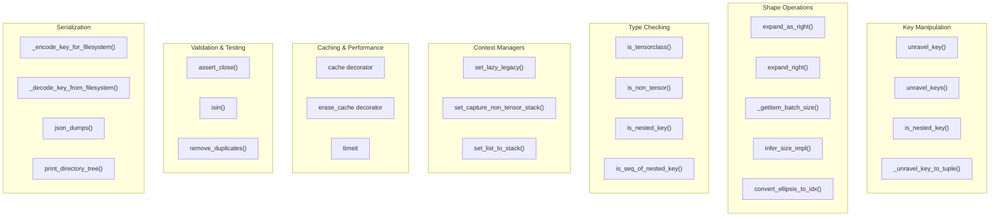
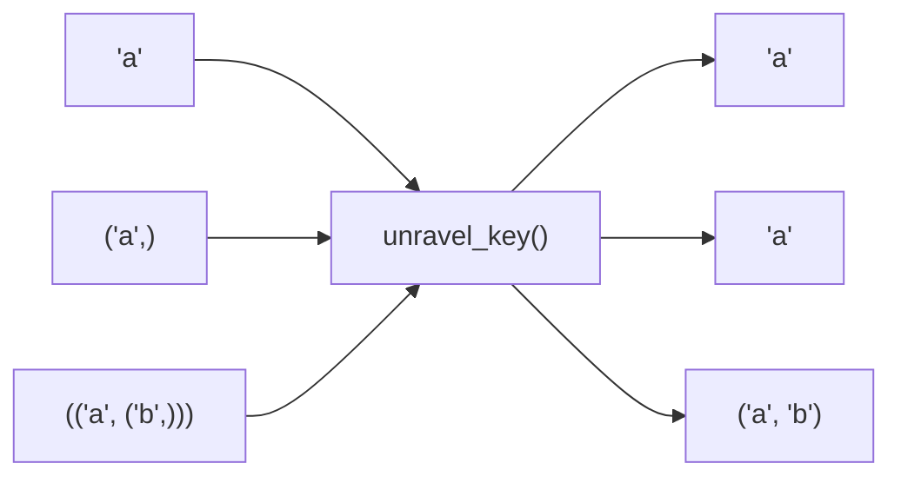
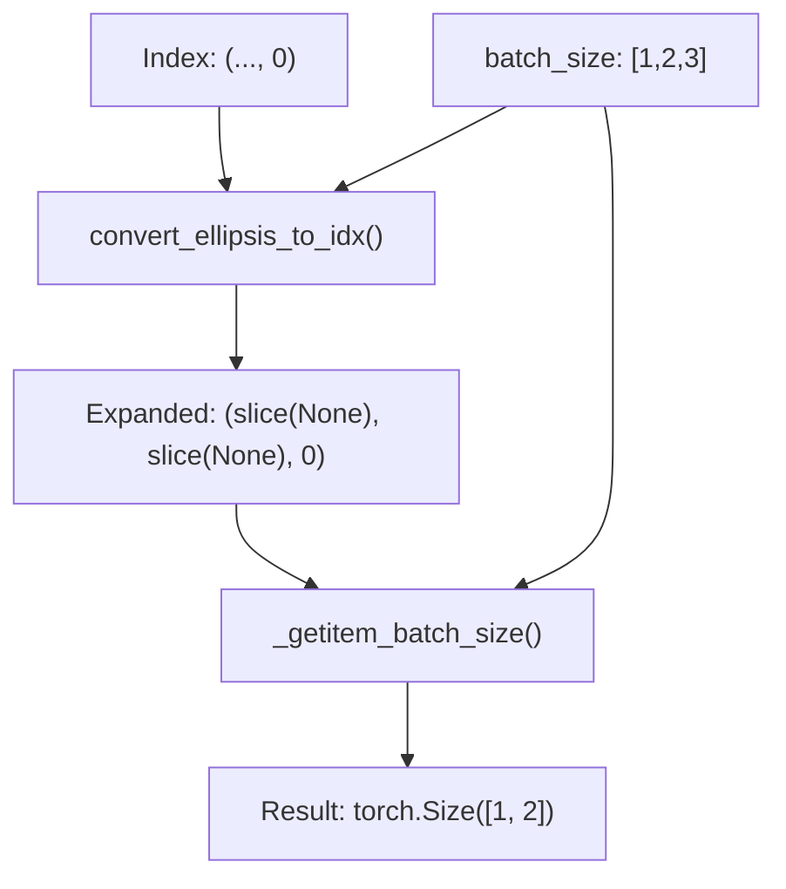
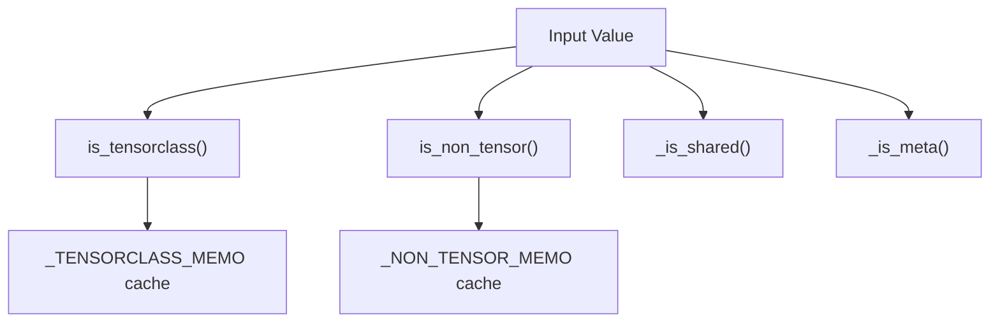
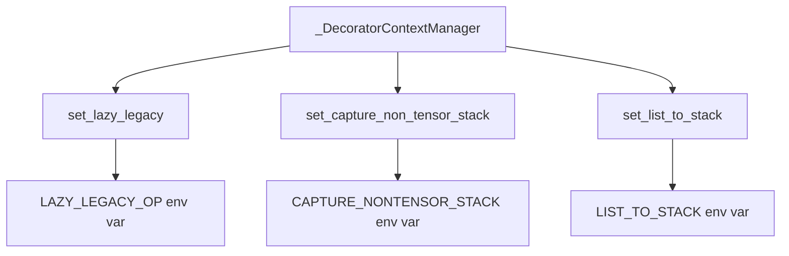
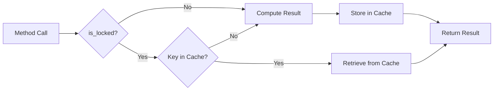
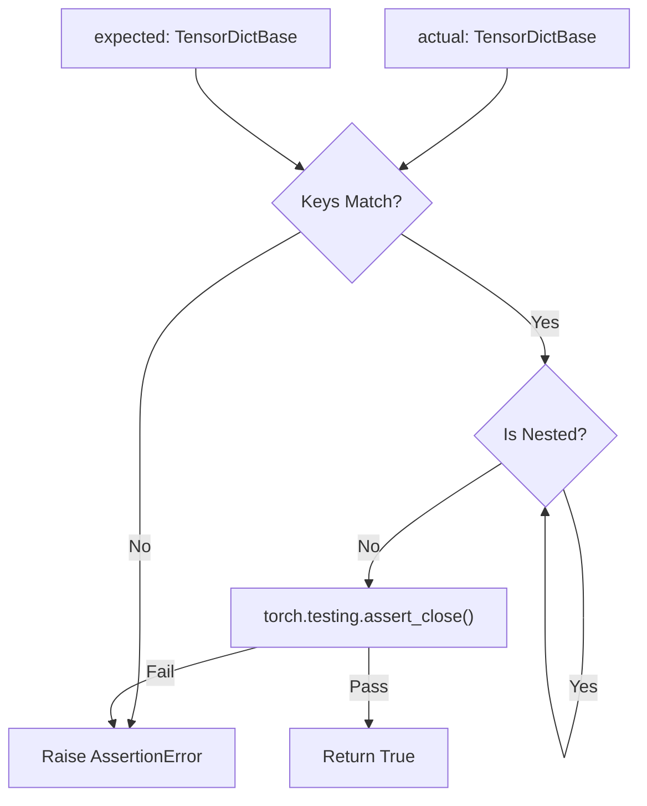
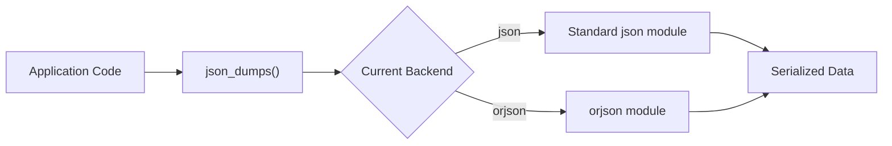

<!-- source: DeepWiki mcp.deepwiki.com · repo pytorch/tensordict · page 10.5 Utility Functions API · fetched 2026-10-21 -->

# Utility Functions API

<details>
<summary>Relevant source files</summary>

The following files were used as context for generating this wiki page:

- [tensordict/utils.py](tensordict/utils.py)

</details>


This page documents the utility functions, helper classes, and context managers available in the `tensordict.utils` module. These utilities support the core TensorDict functionality by providing infrastructure for key manipulation, shape operations, type checking, caching, serialization, and various context managers that control library behavior.

For information about the core TensorDict operations, see [TensorDict API](#10.1). For storage-specific utilities, see [Storage and Persistence API](#10.4).

---

## Overview of Utility Categories

The `tensordict.utils` module provides utilities organized into several functional categories. These utilities are primarily internal infrastructure but many are exposed for advanced usage patterns.

**Utility Categories Diagram**



Sources: [tensordict/utils.py:1-3243]()

---

## Nested Key Operations

Nested keys are the fundamental addressing mechanism in TensorDict, allowing hierarchical access like `("a", "b", "c")`. The following functions manipulate and validate nested keys.

### Key Unraveling Functions

| Function | Purpose | Input | Output |
|----------|---------|-------|--------|
| `unravel_key()` | Flattens nested key structures | `str` or `tuple` | Canonical key format |
| `unravel_keys()` | Unravels multiple keys | `*keys` | Tuple of canonical keys |
| `unravel_key_list()` | Unravels a list of keys | `list[NestedKey]` | List of canonical keys |
| `_unravel_key_to_tuple()` | Converts any key to tuple form | `NestedKey` | `tuple[str, ...]` |

**Key Unraveling Process**



The unraveling functions handle both C++ optimized paths (via `_unravel_key_to_tuple_cpp`, `unravel_key_cpp`) and pure Python fallbacks for `torch.compile` compatibility.

Sources: [tensordict/utils.py:2494-2539](), [tensordict/utils.py:44-49]()

### Key Validation Functions

```python
# Check if value is a valid nested key
is_nested_key(key: NestedKey) -> bool

# Check if sequence contains only nested keys  
is_seq_of_nested_key(seq: Sequence[NestedKey]) -> bool
```

These validators ensure that keys conform to TensorDict's requirements: either strings or tuples of strings.

Sources: [tensordict/utils.py:519-536]()

---

## Shape and Indexing Utilities

These utilities handle tensor shape manipulation, expansion operations, and index calculations without materializing tensors.

### Shape Expansion Functions

**expand_as_right()**

Expands a tensor on the right to match another tensor's shape. This is useful for broadcasting operations where the target shape has additional trailing dimensions.

```python
expand_as_right(
    tensor: torch.Tensor | TensorDictBase,
    dest: torch.Tensor | TensorDictBase,
) -> torch.Tensor | TensorDictBase
```

Example: A tensor of shape `[3, 4]` expanded to match destination shape `[3, 4, 5]` becomes `[3, 4, 5]`.

**expand_right()**

Expands a tensor on the right to a specified shape:

```python
expand_right(tensor: Tensor, shape: Sequence[int]) -> Tensor
```

Sources: [tensordict/utils.py:437-499]()

### Index and Batch Size Utilities

**convert_ellipsis_to_idx()**

Converts ellipsis (`...`) in indices to explicit `slice(None)` objects:

```python
convert_ellipsis_to_idx(
    idx: tuple[int | Ellipsis] | Ellipsis, 
    batch_size: list[int]
) -> tuple[int, ...]
```

**_getitem_batch_size()**

Computes the resulting batch size after indexing without actually performing the indexing operation. This is critical for lazy evaluation and efficiency.

```python
_getitem_batch_size(batch_size, index) -> torch.Size
```

**Shape Calculation Flow**



Sources: [tensordict/utils.py:299-366](), [tensordict/utils.py:1682-1772]()

### Size Inference

**infer_size_impl()**

Infers the complete shape when one dimension is specified as `-1`:

```python
infer_size_impl(shape: list[int], numel: int) -> list[int]
```

This is copied from PyTorch for compatibility and handles the common pattern `tensor.view(-1, ...)`.

Sources: [tensordict/utils.py:372-400](), [tensordict/utils.py:2780-2802]()

---

## Type Checking and Validation

### Tensor Type Utilities

**Type Checking Functions**



| Function | Purpose | Returns |
|----------|---------|---------|
| `is_tensorclass(obj)` | Check if object is a tensorclass | `bool` |
| `is_non_tensor(data)` | Check if data is `NonTensorData` | `bool` |
| `_is_shared(tensor)` | Check if tensor uses shared memory | `bool` or `None` |
| `_is_meta(tensor)` | Check if tensor is on meta device | `bool` |
| `_device(tensor)` | Get tensor device | `torch.device` |
| `_dtype(tensor)` | Get tensor dtype | `torch.dtype` |
| `_shape(tensor)` | Get tensor shape | `torch.Size` |

These utilities provide a unified interface for checking properties across regular tensors, batched tensors, and TensorDict types.

Sources: [tensordict/utils.py:738-754](), [tensordict/utils.py:2404-2443](), [tensordict/utils.py:538-593]()

### Data Structure Validation

**is_namedtuple() and is_namedtuple_class()**

Check if an object is a namedtuple instance or class:

```python
is_namedtuple(obj) -> bool
is_namedtuple_class(cls) -> bool
```

Sources: [tensordict/utils.py:2464-2473]()

---

## Context Managers

TensorDict provides several context managers that control global library behavior. These can be used as decorators or context managers.

### Lazy Operation Control

**set_lazy_legacy()**

Controls whether certain operations (`view`, `permute`, `transpose`, `squeeze`, `unsqueeze`) return lazy representations or materialized tensors:

```python
class set_lazy_legacy(_DecoratorContextManager):
    def __init__(self, mode: bool) -> None
```

**Usage:**

```python
# As context manager
with set_lazy_legacy(True):
    td_view = td.view(-1)  # Returns LazyStackedTensorDict
    
# As decorator
@set_lazy_legacy(False)
def process_tensordict(td):
    return td.view(-1)  # Returns regular TensorDict
```

The current setting can be queried with `lazy_legacy(allow_none=False)`.

Sources: [tensordict/utils.py:1779-1824]()

### Non-Tensor Stack Control

**set_capture_non_tensor_stack()**

Controls whether identical non-tensor data should be captured as a single `NonTensorData` or stacked into `NonTensorStack`:

```python
class set_capture_non_tensor_stack(_DecoratorContextManager):
    def __init__(self, mode: bool) -> None
```

**Behavior:**

| Mode | Behavior | Result |
|------|----------|--------|
| `True` | Capture single value | `NonTensorData("a", batch_size=[2])` |
| `False` | Stack all values | `NonTensorStack(["a", "a"], stack_dim=0)` |

Sources: [tensordict/utils.py:1840-1923]()

### List-to-Stack Control

**set_list_to_stack()**

Controls whether lists assigned to TensorDict are automatically stacked:

```python
class set_list_to_stack(_DecoratorContextManager):
    def __init__(self, mode: bool) -> None
```

When enabled, lists are converted to stacked tensors along the batch dimension:

```python
with set_list_to_stack(True):
    td = TensorDict(a=[torch.zeros(()), torch.ones(())], batch_size=2)
    # td["a"] becomes torch.tensor([0, 1])
```

Sources: [tensordict/utils.py:1930-2007]()

**Context Manager Hierarchy**



Sources: [tensordict/utils.py:1779-2007]()

---

## Caching and Performance

### Cache Decorator

**cache()**

A decorator that caches method return values for locked TensorDicts. The cache key is based on input arguments, and cached values persist until the TensorDict is unlocked or the cache is manually erased.

```python
@cache
def expensive_operation(self, *args, **kwargs):
    # Computation is cached when TensorDict is locked
    return result
```

**Caching Mechanism:**



The cache is stored in `_cache` attribute as a nested `defaultdict` and is automatically erased when the TensorDict is unlocked.

Sources: [tensordict/utils.py:781-824]()

**erase_cache()**

Decorator that erases the cache before executing a method:

```python
@erase_cache
def modifying_operation(self):
    # Cache cleared before this runs
    pass
```

Sources: [tensordict/utils.py:827-836]()

### Performance Profiling

**timeit Class**

A simple profiling decorator that tracks execution time statistics:

```python
@timeit(name="operation_name")
def expensive_function():
    pass

# Print accumulated statistics
timeit.print(prefix="My Stats")
timeit.erase()  # Reset counters
```

The `timeit._REG` dictionary stores `[mean_time, total_time, count]` for each named operation.

Sources: [tensordict/utils.py:648-695]()

---

## Testing and Validation Utilities

### assert_close()

Compares two TensorDicts element-wise with tolerance, similar to `torch.testing.assert_close()`:

```python
assert_close(
    actual: T,
    expected: T,
    rtol: float | None = None,
    atol: float | None = None,
    equal_nan: bool = True,
    intersection: bool = False,
    msg: str = "",
    prefix: NestedKey = (),
) -> bool
```

**Features:**
- Recursively compares nested TensorDicts
- Handles `LazyStackedTensorDict` by comparing constituent tensordicts
- Supports `intersection=True` to compare only common keys
- Provides detailed error messages with key paths

**Comparison Flow:**



Sources: [tensordict/utils.py:1207-1362]()

### isin()

Tests if elements along a dimension in one TensorDict are present in a reference TensorDict:

```python
isin(
    input: TensorDictBase,
    reference: TensorDictBase,
    key: NestedKey,
    dim: int = 0,
) -> Tensor
```

Returns a boolean tensor indicating which elements from `input[key]` are also in `reference[key]`.

Sources: [tensordict/utils.py:2160-2237]()

### remove_duplicates()

Removes duplicate elements along a specified dimension:

```python
remove_duplicates(
    input: TensorDictBase,
    key: NestedKey,
    dim: int = 0,
    *,
    return_indices: bool = False,
) -> TensorDictBase
```

Detects duplicates in `input[key]` along `dim` and removes corresponding indices from all tensors in the TensorDict.

Sources: [tensordict/utils.py:2252-2340]()

---

## Serialization and Filesystem Utilities

### Filesystem-Safe Key Encoding

**_encode_key_for_filesystem()**

Encodes TensorDict keys to be safe for filesystem paths by percent-encoding problematic characters:

```python
_encode_key_for_filesystem(key: str, *, robust: bool = True) -> str
```

**Encoding Examples:**

| Original Key | Encoded Key (robust=True) |
|--------------|---------------------------|
| `"a/b/c"` | `"a%2Fb%2Fc"` |
| `"normal_key"` | `"normal_key"` |
| `"key with spaces"` | `"key%20with%20spaces"` |

Unsafe characters include: `/ < > : " | ? * \ space null %` and control characters.

**_decode_key_from_filesystem()**

Reverses the encoding:

```python
_decode_key_from_filesystem(encoded_key: str) -> str
```

Sources: [tensordict/utils.py:2541-2680]()

### Directory Inspection

**print_directory_tree()**

Prints a formatted directory tree with optional size metadata:

```python
print_directory_tree(
    path, 
    indent="", 
    display_metadata=True
) -> str
```

Useful for inspecting persistent TensorDict storage structures.

Sources: [tensordict/utils.py:2106-2158]()

### JSON Serialization

**JSON Backend System:**



**Functions:**

```python
# Unified JSON serialization
json_dumps(data, **kwargs)

# Set backend
set_json_backend(backend: str)  # "json" or "orjson"

# Get current backend
get_json_backend() -> str
```

The system uses `orjson` if available for better performance, falling back to standard `json`.

Sources: [tensordict/utils.py:3113-3158]()

---

## Internal Utilities

### Locking and Safety

**lock_blocked()**

Decorator that prevents operations on locked TensorDicts:

```python
@lock_blocked
def modifying_operation(self, *args, **kwargs):
    # Raises RuntimeError if self.is_locked
    pass
```

Sources: [tensordict/utils.py:883-897]()

**_lock_warn()**

Issues a warning when using `lock_()` in compiled graphs, since `torch.compile` doesn't support the weakrefs used for lock management.

Sources: [tensordict/utils.py:2732-2744]()

### Data Conversion

**_convert_list_to_stack()**

Converts nested lists to stacked tensors or NonTensorStacks:

```python
_convert_list_to_stack(
    a_list: list[Any],
) -> tuple[torch.Tensor | TensorDictBase | NonTensorStack, bool]
```

Returns the converted data and a boolean indicating if non-tensor data was encountered.

Sources: [tensordict/utils.py:2009-2037]()

### Index Manipulation

**_sub_index()**

Allows nested tuple indexing:

```python
_sub_index(tensor: Tensor, idx: IndexType) -> Tensor
```

Equivalent to `tensor[tuple1][tuple2]` when called as `_sub_index(tensor, (tuple1, tuple2))`.

Sources: [tensordict/utils.py:280-297]()

**_broadcast_tensors()**

Broadcasts tensor indices to compatible shapes:

```python
_broadcast_tensors(index) -> tuple
```

Sources: [tensordict/utils.py:1586-1600]()

### Helper Classes

**KeyDependentDefaultDict**

A defaultdict where the default value depends on the key:

```python
my_dict = KeyDependentDefaultDict(lambda key: "foo_" + key)
print(my_dict["bar"])  # "foo_bar"
```

Sources: [tensordict/utils.py:2445-2462]()

**LinkedList**

A list subclass that automatically updates a TensorDict when modified:

```python
class LinkedList(list):
    def __init__(self, *args, td: TensorDictBase, **kwargs)
```

Maintains a weak reference to the TensorDict and propagates modifications.

Sources: [tensordict/utils.py:3160-3243]()

**Buffer and BufferLegacy**

Tensor subclasses for buffer management:

```python
class Buffer(torch.Tensor, metaclass=_BufferMeta)
class BufferLegacy(_parent_buffer_cls)
```

Replicate `torch.nn.Buffer` for older PyTorch versions and provide a legacy version that preserves gradient function history.

Sources: [tensordict/utils.py:1632-1680]()

---

## Constants and Configuration

### Data Type Mappings

```python
# PyTorch dtypes
_TORCH_DTYPES = (torch.float32, torch.int64, ...)

# String to dtype mapping
_STRDTYPE2DTYPE = {"torch.float32": torch.float32, ...}

# NumPy to PyTorch dtype conversion
NUMPY_TO_TORCH_DTYPE_DICT = {...}
TORCH_TO_NUMPY_DTYPE_DICT = {...}
```

Sources: [tensordict/utils.py:206-236](), [tensordict/utils.py:501-516]()

### Error Messages

```python
_KEY_ERROR = 'key "{}" not found in {} with keys {}'
_LOCK_ERROR = "Cannot modify locked TensorDict..."
_NON_STR_KEY_ERR = "TensorDict keys are always strings..."
```

Sources: [tensordict/utils.py:242-246](), [tensordict/utils.py:838-841]()

### Logging

```python
# Logger configuration
logger = logging.getLogger("tensordict")
LOGGING_LEVEL = os.environ.get("TD_LOGGING_LEVEL", "DEBUG")
```

The logger can be configured via the `TD_LOGGING_LEVEL` environment variable.

Sources: [tensordict/utils.py:249-262]()

---

## Integration Utilities

### Functorch Integration

**_wrap_functorch_function()**

Wraps C++ functorch functions for `torch.compile` compatibility:

```python
_wrap_functorch_function(func)
```

Uses `torch.compiler.allow_in_graph` when available.

Sources: [tensordict/utils.py:104-124]()

**_import_and_wrap_functorch()**

Helper for importing and wrapping multiple functorch functions:

```python
_import_and_wrap_functorch(
    *names, 
    wrap_names=None
)
```

Sources: [tensordict/utils.py:126-179]()

### PyTorch Internals

**_parse_to()**

Parses arguments to `TensorDict.to()` method, handling device, dtype, and other parameters:

```python
_parse_to(*args, **kwargs) -> tuple
```

Returns parsed `(device, dtype, non_blocking, convert_to_format, batch_size, non_blocking_pin, num_threads, inplace)`.

Sources: [tensordict/utils.py:1069-1116]()

**_pin_mem()**

Worker function for pinning memory in background threads:

```python
_pin_mem(q_in, q_out)
```

Used for asynchronous memory pinning operations.

Sources: [tensordict/utils.py:2768-2778]()

---

## Summary

The `tensordict.utils` module provides comprehensive infrastructure supporting TensorDict operations:

**Key Categories:**

| Category | Purpose | Key Functions |
|----------|---------|---------------|
| Key Manipulation | Handle nested key structures | `unravel_key`, `is_nested_key` |
| Shape Operations | Compute shapes without materialization | `expand_as_right`, `_getitem_batch_size` |
| Type Checking | Validate data types | `is_tensorclass`, `is_non_tensor` |
| Context Managers | Control global behavior | `set_lazy_legacy`, `set_capture_non_tensor_stack` |
| Caching | Optimize repeated operations | `cache`, `timeit` |
| Testing | Validate TensorDict equality | `assert_close`, `isin` |
| Serialization | Filesystem-safe encoding | `_encode_key_for_filesystem`, `json_dumps` |

These utilities are primarily internal but many are useful for advanced use cases requiring fine-grained control over TensorDict behavior.

Sources: [tensordict/utils.py:1-3243]()