<!-- source: DeepWiki mcp.deepwiki.com · repo pytorch/tensordict · page 2 Core TensorDict System · fetched 2026-10-21 -->

# Core TensorDict System

<details>
<summary>Relevant source files</summary>

The following files were used as context for generating this wiki page:

- [tensordict/_lazy.py](tensordict/_lazy.py)
- [tensordict/_td.py](tensordict/_td.py)
- [tensordict/base.py](tensordict/base.py)
- [test/test_tensordict.py](test/test_tensordict.py)

</details>


## Purpose and Scope

This document describes the fundamental TensorDict data structure system, including the abstract `TensorDictBase` interface and its core implementations (`TensorDict` and `LazyStackedTensorDict`). It covers the architectural design, internal data structures, and key concepts like batch semantics and device management.

For specific operations and methods:
- Creating and initializing TensorDicts: see [Creating and Initializing TensorDicts](#2.2)
- Accessing and modifying data: see [Accessing and Modifying Data](#2.3)
- Shape operations: see [Shape Operations and Transformations](#2.4)
- Storage and persistence: see [Storage and Persistence](#5)
- Neural network integration: see [Neural Network Integration](#4)

## System Architecture

The TensorDict system is built on an abstract interface pattern with multiple specialized implementations. The core hierarchy provides different storage and evaluation strategies while maintaining a consistent API.

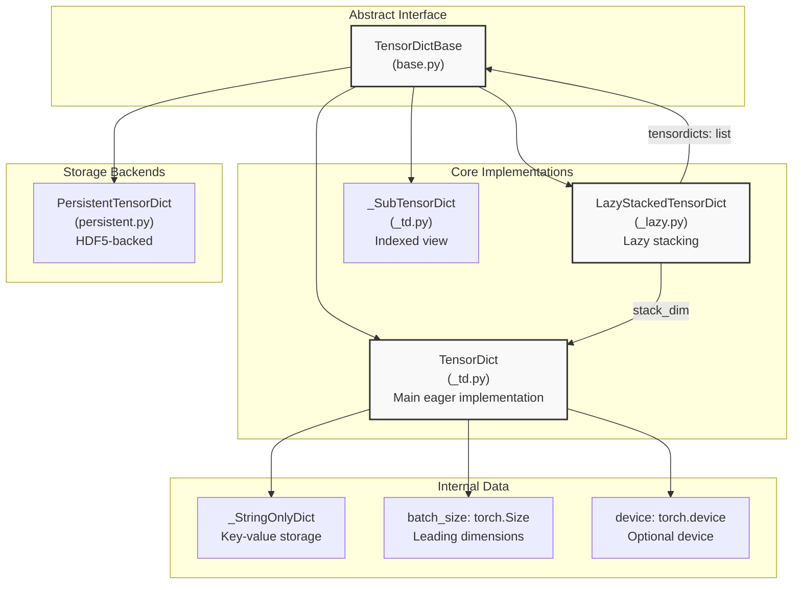

**Sources:** [tensordict/base.py:300-331](), [tensordict/_td.py:150-243](), [tensordict/_lazy.py:176-225]()

The system uses a layered architecture:

| Layer | Component | File | Responsibility |
|-------|-----------|------|----------------|
| Abstract Interface | `TensorDictBase` | `base.py` | Defines API contract for all implementations |
| Primary Implementation | `TensorDict` | `_td.py` | Eager tensor storage with dictionary semantics |
| Lazy Evaluation | `LazyStackedTensorDict` | `_lazy.py` | Deferred stacking of multiple TensorDicts |
| Indexed Views | `_SubTensorDict` | `_td.py` | Lazy indexed view over parent TensorDict |
| Persistence | `PersistentTensorDict` | `persistent.py` | Memory-mapped HDF5 storage |

## TensorDictBase Abstract Interface

`TensorDictBase` is the abstract base class that defines the contract for all TensorDict implementations. It inherits from `MutableMapping` and `TensorCollection`, providing dictionary-like semantics for tensor containers.

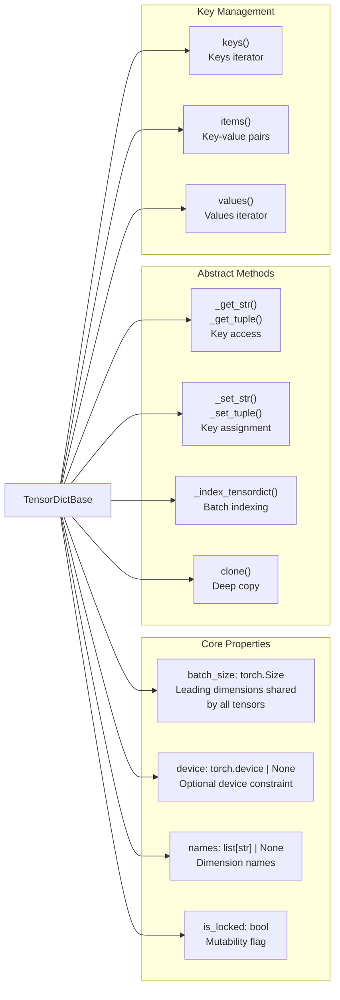

**Sources:** [tensordict/base.py:300-310](), [tensordict/base.py:559-648]()

### Key Characteristics

The abstract interface enforces several invariants:

1. **Batch Semantics**: All tensors must share the first `N` dimensions defined by `batch_size` [tensordict/base.py:301-302]()
2. **Device Consistency**: When a device is set, all tensors must reside on that device [tensordict/_td.py:254-257]()
3. **Nested Keys**: Keys can be strings or tuples of strings for nested access [tensordict/base.py:559-571]()
4. **Immutability Control**: Locking prevents structural modifications while allowing in-place updates [tensordict/base.py:307]()

### Critical Abstract Methods

Implementations must provide these core methods:

| Method | Purpose | Signature |
|--------|---------|-----------|
| `_get_str()` | Retrieve value by string key | `(key: str, default) -> Any` |
| `_get_tuple()` | Retrieve nested value | `(key: tuple, default) -> Any` |
| `_set_str()` | Set value by string key | `(key, value, inplace, validated) -> Self` |
| `_set_tuple()` | Set nested value | `(key, value, inplace, validated) -> Self` |
| `_index_tensordict()` | Index along batch dimensions | `(index: IndexType) -> Self` |

**Sources:** [tensordict/base.py:639-648]()

## TensorDict: Main Implementation

`TensorDict` is the primary concrete implementation that stores tensors in an eager dictionary-like structure. It uses `_StringOnlyDict` for internal storage, which enforces string-only keys at the top level.

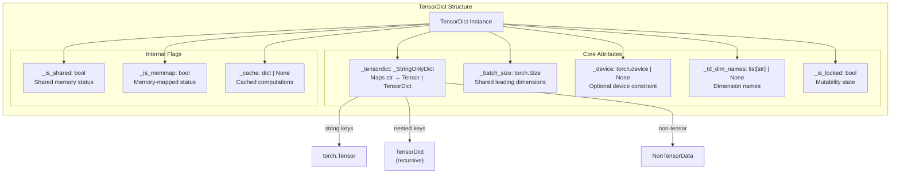

**Sources:** [tensordict/_td.py:150-259](), [tensordict/_td.py:266-267]()

### Initialization and Construction

The `TensorDict.__init__()` method handles several initialization patterns:

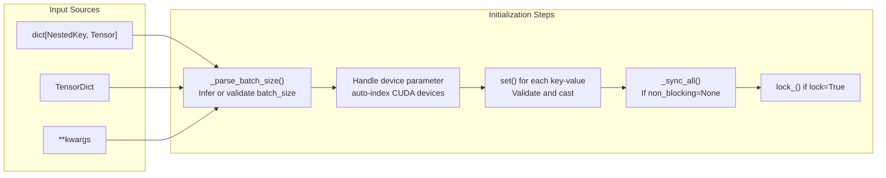

**Sources:** [tensordict/_td.py:250-322]()

Key initialization behaviors:

1. **Device Auto-indexing**: CUDA devices without explicit index use `torch.cuda.current_device()` [tensordict/_td.py:280-286]()
2. **Asynchronous Transfers**: `non_blocking=None` enables async transfer with sync after init [tensordict/_td.py:272-294]()
3. **Batch Size Parsing**: Can infer from source or require explicit specification [tensordict/_td.py:304]()
4. **Recursive Construction**: Nested dicts become nested TensorDicts [tensordict/_td.py:309-310]()

### Internal Storage: _StringOnlyDict

The `_StringOnlyDict` class provides string-only key enforcement at the top level, while nested structures handle tuples through recursive descent.

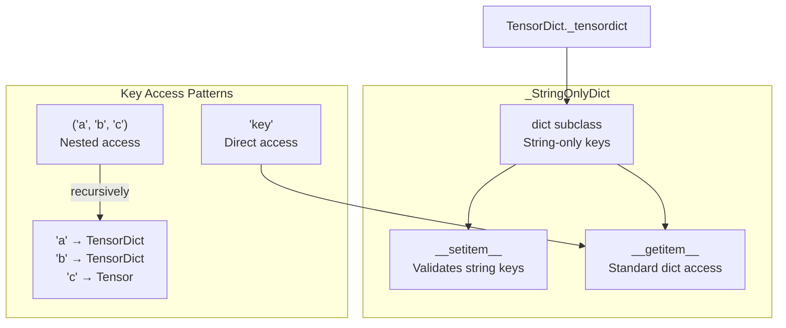

**Sources:** [tensordict/utils.py]() (referenced in imports), [tensordict/_td.py:266]()

### Value Validation and Setting

The `_set_str()` method performs validation and type conversion:

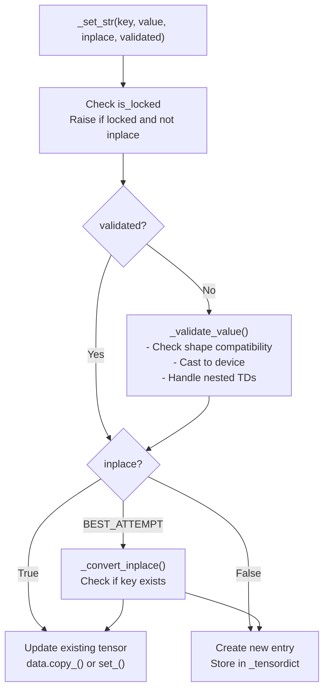

**Sources:** [tensordict/_td.py]() (methods distributed across file), [tensordict/base.py]() (validation logic)

Key validation steps:
- **Shape Validation**: Ensure tensor shape matches or is compatible with `batch_size` [tensordict/base.py]()
- **Device Casting**: Convert tensors to tensordict's device if specified [tensordict/_td.py:310]()
- **Type Conversion**: Handle Python primitives, NumPy arrays, nested dicts [tensordict/base.py]()
- **Nested Structure**: Recursively convert nested dicts to nested TensorDicts [tensordict/_td.py:372-380]()

## LazyStackedTensorDict: Deferred Stacking

`LazyStackedTensorDict` provides a lazy view over a stack of TensorDicts without materializing the stacked tensors until accessed. This enables memory-efficient operations on collections of TensorDicts.

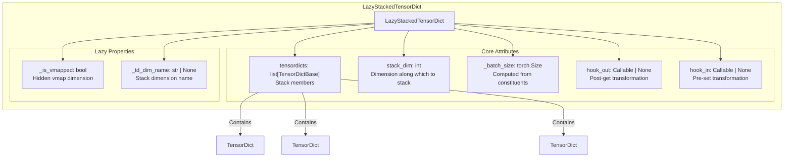

**Sources:** [tensordict/_lazy.py:176-225](), [tensordict/_lazy.py:255-303]()

### Stack Dimension and Batch Size

The batch size is computed by inserting the stack length at `stack_dim`:

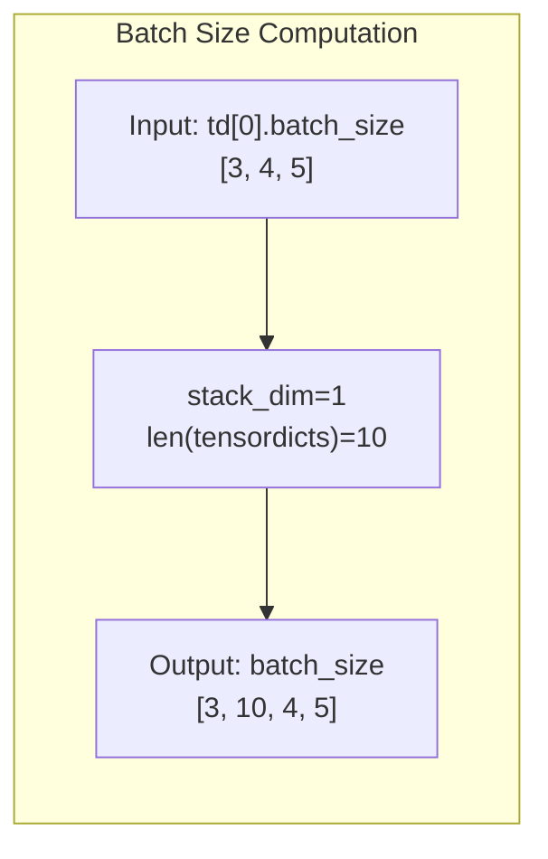

Formula: `batch_size = (*batch_size[:stack_dim], len(tensordicts), *batch_size[stack_dim:])`

**Sources:** [tensordict/_lazy.py:723-729]()

### Lazy Get Operation

The `_get_str()` method defers stacking until access:

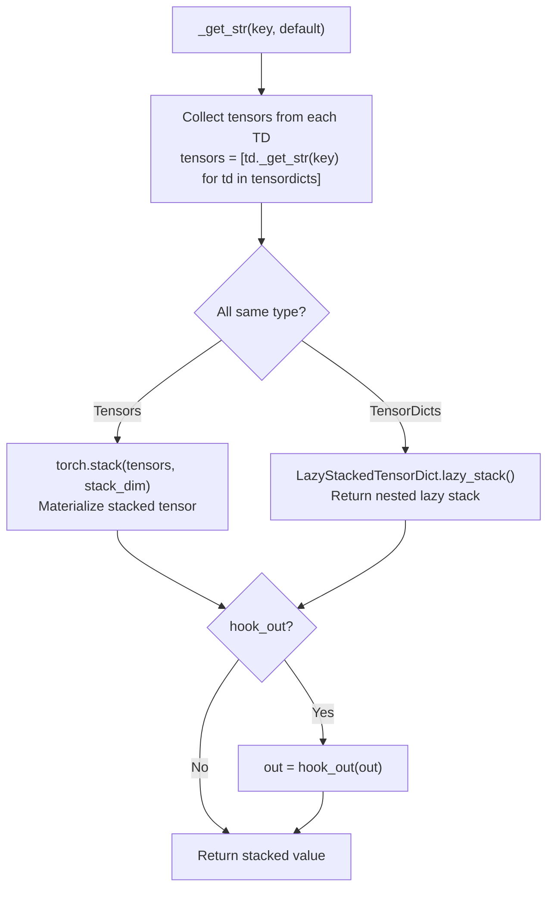

**Sources:** [tensordict/_lazy.py:1299-1412]()

Key behaviors:
- **Deferred Materialization**: Tensors only stacked when accessed [tensordict/_lazy.py:1313-1327]()
- **Nested Lazy Stacks**: TensorDict values result in nested LazyStackedTensorDict [tensordict/_lazy.py:1362-1378]()
- **Hook Integration**: `hook_out` applied after stacking for vmap support [tensordict/_lazy.py:1396-1398]()
- **Error Handling**: Shape mismatches raise informative errors [tensordict/_lazy.py:1399-1411]()

### Lazy Set Operation

Setting values on a lazy stack unbinds the value and distributes to constituents:

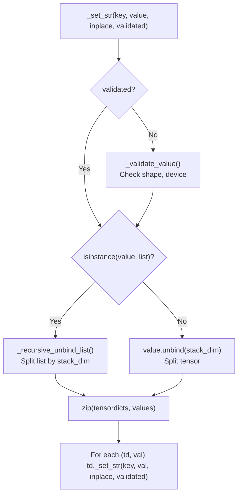

**Sources:** [tensordict/_lazy.py:731-774]()

The distribution logic:
1. **List Handling**: Lists split according to stack_dim structure [tensordict/_lazy.py:759-762]()
2. **Tensor Unbinding**: Tensors unbind along stack_dim [tensordict/_lazy.py:764]()
3. **In-place Propagation**: `inplace` flag propagated to constituents [tensordict/_lazy.py:766-773]()

### Exclusive Keys and Heterogeneous Stacks

LazyStackedTensorDict tracks whether constituent TensorDicts have different keys:

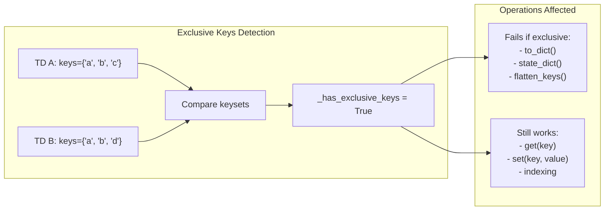

**Sources:** [tensordict/_lazy.py:444-456](), [tensordict/_lazy.py:161-173]()

## Batch Size and Device Semantics

### Batch Size Invariants

All tensors in a TensorDict must share the leading `N` dimensions defined by `batch_size`:

| TensorDict State | Tensor Shape Requirements | Example |
|------------------|---------------------------|---------|
| `batch_size=[3, 4]` | All tensors start with `[3, 4, ...]` | `[3, 4, 5]`, `[3, 4]`, `[3, 4, 10, 20]` |
| `batch_size=[]` | Tensors can have any shape | `[]`, `[5]`, `[10, 20]` |
| Nested TD | Nested TD must have compatible batch_size | Parent `[3, 4]`, child `[3, 4]` or `[3, 4, 5]` |

**Sources:** [tensordict/base.py:301-302]()

### Device Management

Device behavior depends on whether a device is specified:

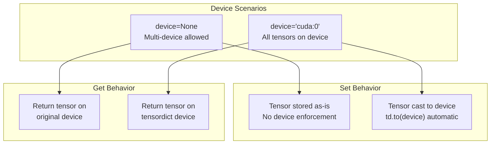

**Sources:** [tensordict/_td.py:254-257](), [tensordict/_td.py:778-794]()

Device auto-indexing for CUDA:
- `device="cuda"` → `device="cuda:X"` where X is `torch.cuda.current_device()` [tensordict/_td.py:280-286]()
- Other device types (cpu, meta) handled without indexing [tensordict/_td.py:285-286]()

## Nested Keys and Recursive Structure

TensorDict supports nested structures through tuple keys:

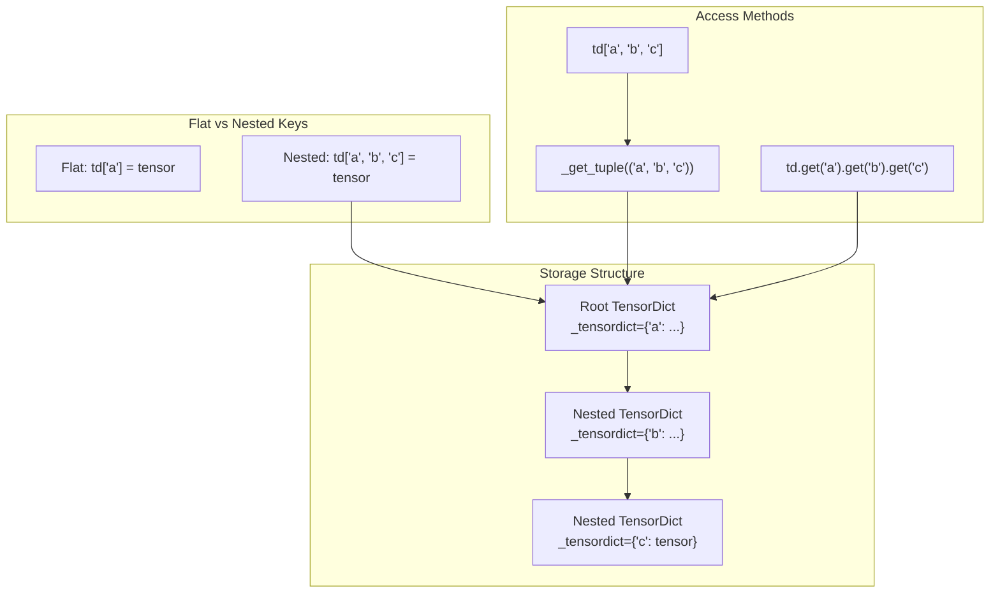

**Sources:** [tensordict/base.py:559-571](), [tensordict/_td.py:843-857]()

Key access patterns:
- **String Key**: `td["key"]` → direct lookup in `_tensordict` [tensordict/_td.py]()
- **Tuple Key**: `td["a", "b"]` → recursive descent: `td.get("a").get("b")` [tensordict/base.py]()
- **Tuple of Length 1**: `td[("key",)]` → treated as string key [tensordict/base.py]()

## Internal State and Flags

TensorDict maintains several boolean flags to track state:

| Flag | Purpose | Set By | Effect |
|------|---------|--------|--------|
| `_is_locked` | Prevents structural changes | `lock_()` | Blocks new keys, allows in-place updates |
| `_is_shared` | Shared memory status | `share_memory_()` | Marks tensors in shared memory |
| `_is_memmap` | Memory-mapped status | `memmap_()` | Marks tensors as memory-mapped |
| `_is_vmapped` | Hidden vmap dimension | `_add_batch_dim()` | For functorch vmap integration |
| `_cache` | Cached computations | Various | Memoization of expensive operations |

**Sources:** [tensordict/_td.py:246-248](), [tensordict/base.py:303-312]()

### Locking Behavior

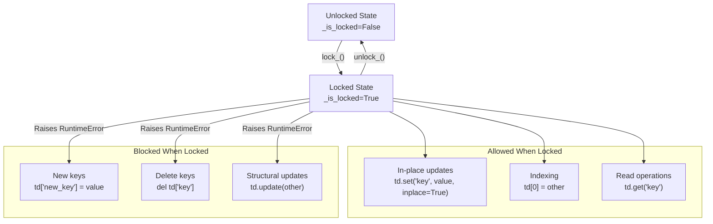

**Sources:** [tensordict/base.py:307](), [tensordict/utils.py]() (_LOCK_ERROR constant)

## SubTensorDict: Indexed Views

`_SubTensorDict` provides a lazy indexed view over a parent TensorDict without copying data:

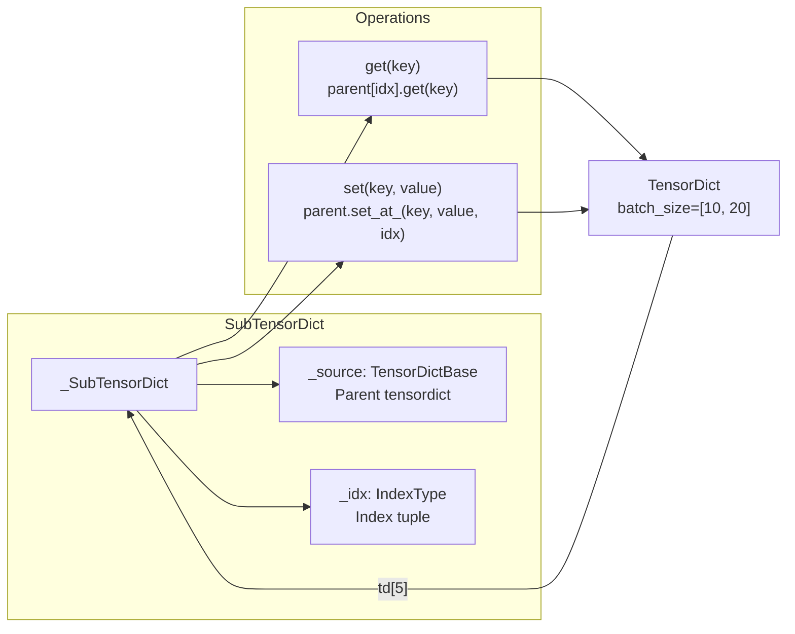

**Sources:** [tensordict/_td.py]() (_SubTensorDict class), [tensordict/base.py:633-637]()

SubTensorDict behavior:
- **Lazy Evaluation**: No data copied until materialized [tensordict/base.py:633-637]()
- **Pass-through Writes**: Sets propagate to parent via indexed assignment [tensordict/_td.py]()
- **Batch Size**: Computed from parent batch_size and index [tensordict/utils.py]() (_getitem_batch_size)

## Key Design Decisions

### 1. Eager vs Lazy Evaluation

| Implementation | Strategy | Use Case |
|----------------|----------|----------|
| `TensorDict` | Eager | General-purpose, small-medium data |
| `LazyStackedTensorDict` | Lazy stacking | Collections of TensorDicts, memory efficiency |
| `_SubTensorDict` | Lazy indexing | Views without copying |
| `PersistentTensorDict` | Lazy loading | Large datasets on disk |

**Sources:** [tensordict/_td.py:150-243](), [tensordict/_lazy.py:176-225]()

### 2. String-Only Top-Level Keys

Top-level keys must be strings, but nested access uses tuples:

```python
td["key"]           # Valid: string key
td[("a", "b")]      # Valid: nested tuple key
td[(0, "a")]        # Invalid: mixed type
```

This design prevents ambiguity between batch indexing and key access.

**Sources:** [tensordict/utils.py]() (_StringOnlyDict), [tensordict/base.py:559-571]()

### 3. Inplace Semantics

The `inplace` parameter has three modes:
- `inplace=False`: Always create new tensor (default for new keys)
- `inplace=True`: Must modify existing tensor (raises if key missing)
- `inplace=BEST_ATTEMPT_INPLACE`: Modify if exists, create if not

**Sources:** [tensordict/base.py:171-178]()

### 4. Validation and Type Coercion

Values undergo validation and coercion:
1. Python primitives → `torch.Tensor`
2. NumPy arrays → `torch.Tensor`
3. Dicts → nested `TensorDict`
4. Device casting if tensordict has device
5. Shape validation against `batch_size`

**Sources:** [tensordict/base.py]() (_validate_value methods)

---

**Primary Sources:**
- [tensordict/base.py:1-2000]()
- [tensordict/_td.py:1-2000]()
- [tensordict/_lazy.py:1-2000]()
- [test/test_tensordict.py:1-1000]()

---

