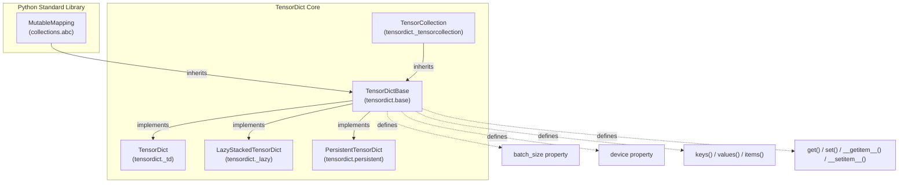
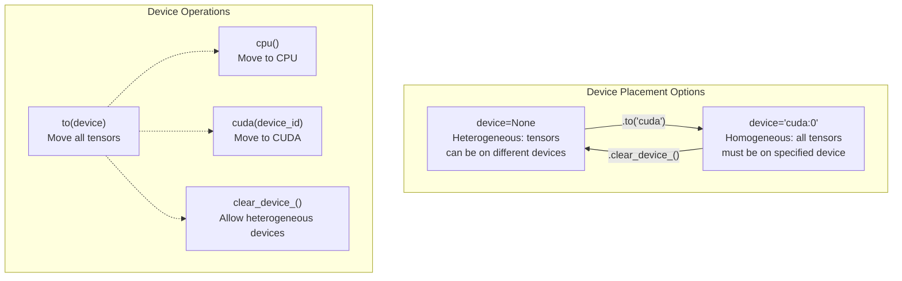
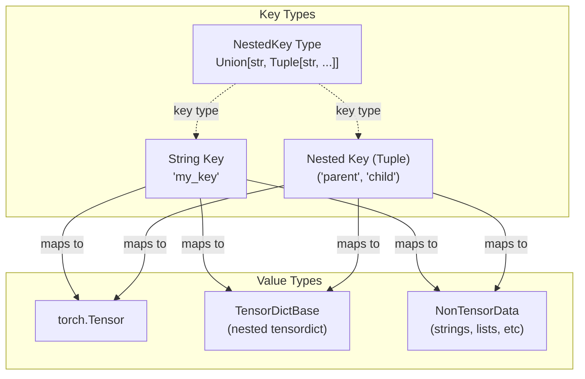
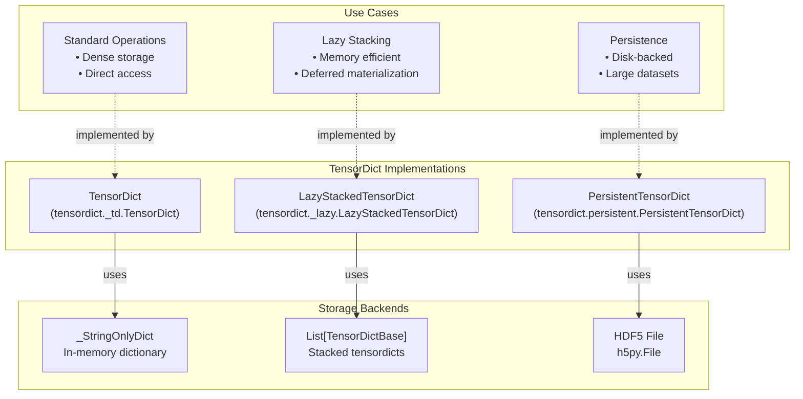
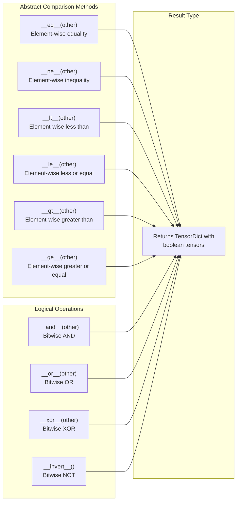
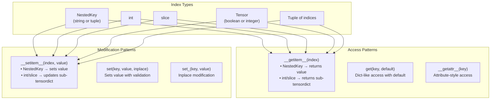
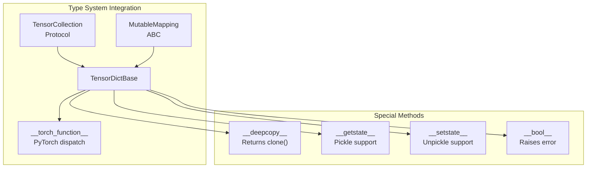

<!-- source: DeepWiki mcp.deepwiki.com · repo pytorch/tensordict · page 2.1 TensorDictBase Interface and Core Concepts · fetched 2026-10-21 -->

# TensorDictBase Interface and Core Concepts

<details>
<summary>Relevant source files</summary>

The following files were used as context for generating this wiki page:

- [tensordict/_lazy.py](tensordict/_lazy.py)
- [tensordict/_td.py](tensordict/_td.py)
- [tensordict/base.py](tensordict/base.py)
- [test/test_tensordict.py](test/test_tensordict.py)

</details>


## Purpose and Scope

This document explains the abstract `TensorDictBase` interface that defines the core contract for all TensorDict implementations, along with fundamental concepts like batch semantics, device management, and the key-value storage model. Understanding these concepts is essential for working with any TensorDict variant.

For specific implementations and their factory methods, see [Creating and Initializing TensorDicts](#2.2). For operations on data within tensordicts, see [Accessing and Modifying Data](#2.3) and [Shape Operations and Transformations](#2.4). For the `@tensorclass` decorator which provides a dataclass-like interface over TensorDict, see [TensorClass System](#3).

## Abstract Interface Overview

`TensorDictBase` is an abstract base class that establishes the contract for all TensorDict implementations. It inherits from both `MutableMapping` (providing dict-like semantics) and `TensorCollection` (providing tensor-specific operations).



**Sources:** [tensordict/base.py:300-302](), [tensordict/_td.py:150](), [tensordict/_lazy.py:176]()

### Key Characteristics

The abstract interface defines several critical attributes that all implementations inherit:

| Attribute | Type | Purpose |
|-----------|------|---------|
| `_safe` | `bool` | Controls validation behavior during tensor assignment |
| `_lazy` | `bool` | Indicates if the implementation uses lazy evaluation |
| `_inplace_set` | `bool` | Controls default inplace modification behavior |
| `_is_locked` | `bool` | Prevents structural modifications when True |
| `_cache` | `bool \| None` | Controls caching of computed properties |
| `is_meta` | `bool` | Indicates if tensors are meta tensors (no storage) |
| `_is_non_tensor` | `bool` | Marks non-tensor data containers |

**Sources:** [tensordict/base.py:303-312]()

## Batch Semantics

The fundamental concept in TensorDict is **batch semantics**: all tensors stored in a TensorDict share the same leading dimensions, called the **batch size**. This allows treating collections of tensors as batched data structures.

```mermaid
graph LR
    subgraph "TensorDict with batch_size=[3, 4]"
        KEY_A["key: 'a'<br/>shape: [3, 4, 5]"]
        KEY_B["key: 'b'<br/>shape: [3, 4, 10]"]
        KEY_C["key: ('nested', 'c')<br/>shape: [3, 4, 2, 3]"]
    end
    
    BATCH["batch dimensions: [3, 4]<br/>All tensors must share<br/>these leading dimensions"]
    
    BATCH -.->|validates| KEY_A
    BATCH -.->|validates| KEY_B
    BATCH -.->|validates| KEY_C
    
    KEY_A -.->|extra dims: [5]| FEATURE_A["feature dimensions"]
    KEY_B -.->|extra dims: [10]| FEATURE_B["feature dimensions"]
    KEY_C -.->|extra dims: [2, 3]| FEATURE_C["feature dimensions"]
```

**Sources:** [tensordict/_td.py:150-176](), [tensordict/base.py:547-553]()

### Batch Size Properties

The `batch_size` property is fundamental to all TensorDict operations:

- **Immutable as `torch.Size`**: The batch size is stored as a `torch.Size` object
- **Settable with validation**: Can be modified if all tensors are compatible with the new size
- **Determines iteration**: `len(tensordict)` returns `batch_size[0]` if non-empty, else 0
- **Affects indexing**: Shape operations respect batch dimensions

The batch size can be dynamically reset if compatible:

**Sources:** [tensordict/base.py:547-553](), [test/test_tensordict.py:210-283]()

### Batch Dimensions Terminology

| Term | Definition | Example |
|------|------------|---------|
| `batch_size` | The leading shape shared by all tensors | `torch.Size([3, 4])` |
| `batch_dims` | Number of batch dimensions | `2` for batch_size `[3, 4]` |
| `ndim` | Alias for `batch_dims` | `2` |
| `shape` | Alias for `batch_size` | `torch.Size([3, 4])` |
| Feature dimensions | Dimensions after batch dimensions in each tensor | Varies per tensor |

**Sources:** [tensordict/base.py:547-553]()

## Device Management

TensorDict supports device placement similar to PyTorch tensors, but with important differences for heterogeneous device support.



**Sources:** [tensordict/base.py:219-244](), [tensordict/_td.py:250-322]()

### Device Semantics

When a TensorDict has a specified device:
1. All new tensors are automatically moved to that device during `set()` operations
2. The `device` property returns the common device
3. Device transfers can be synchronous or asynchronous (controlled by `non_blocking` parameter)

When `device=None`:
1. Tensors can reside on different devices
2. The `device` property returns `None`
3. No automatic device casting occurs

**Sources:** [tensordict/_td.py:270-322](), [test/test_tensordict.py:777-848]()

### Device Transfer Recording

The `_RecordDeviceTransfer` mechanism tracks device movements during initialization to optimize synchronization:

**Sources:** [tensordict/base.py:219-244]()

## Key-Value Storage Model

TensorDicts implement a hierarchical key-value storage model supporting both flat and nested keys.

### Key Types



**Sources:** [tensordict/base.py:559-572](), [tensordict/_nestedkey.py]()

### Nested Key Handling

Nested keys are tuples of strings that represent hierarchical paths:

```python
# These are equivalent
td[("parent", "child", "leaf")]
td["parent"]["child"]["leaf"]
td.get(("parent", "child", "leaf"))
```

The base implementation provides methods for nested key operations:
- `_get_str(key, default)`: Get a single string key
- `_get_tuple(key, default)`: Get a nested (tuple) key
- `_set_str(key, value, ...)`: Set a single string key
- `_set_tuple(key, value, ...)`: Set a nested (tuple) key

**Sources:** [tensordict/base.py:573-628](), [tensordict/_td.py:836-857]()

## Core Implementations

The TensorDict library provides three main implementations of `TensorDictBase`:



**Sources:** [tensordict/_td.py:150](), [tensordict/_lazy.py:176](), [tensordict/persistent.py]()

### TensorDict (Main Implementation)

The primary implementation stores tensors in a `_StringOnlyDict` for efficient string-based lookups:

- **Storage**: `self._tensordict` is a `_StringOnlyDict` mapping keys to values
- **Eager evaluation**: All operations materialize results immediately
- **Device enforcement**: When device is set, validates all tensors are on that device
- **Constructor parameters**: `source`, `batch_size`, `device`, `names`, `non_blocking`, `lock`

**Sources:** [tensordict/_td.py:150-322](), [tensordict/_td.py:266]()

### LazyStackedTensorDict

Represents a stack of tensordicts without materializing the stack:

- **Storage**: `self.tensordicts` is a list of `TensorDictBase` instances
- **Lazy evaluation**: Operations on stacked data are deferred until necessary
- **Stack dimension**: `self.stack_dim` specifies which dimension represents the stack
- **Memory efficient**: Avoids copying data when stacking

**Sources:** [tensordict/_lazy.py:176-304](), [tensordict/_lazy.py:255-266]()

### PersistentTensorDict

Backed by HDF5 files for disk-based storage:

- **Storage**: Data stored in HDF5 file format
- **Lazy loading**: Tensors loaded from disk on access
- **Large dataset support**: Enables working with datasets larger than memory

**Sources:** Referenced in [tensordict/base.py:139]()

## Fundamental Operations

All `TensorDictBase` implementations must support core operations divided into categories:

### Comparison Operations



**Sources:** [tensordict/base.py:351-524](), [tensordict/_td.py:646-834]()

### Reduction Operations

Abstract methods for computing reductions across tensors:

| Method | Purpose | Returns |
|--------|---------|---------|
| `all(dim)` | Check if all elements are True | `bool` or `TensorCollection` |
| `any(dim)` | Check if any elements are True | `bool` or `TensorCollection` |
| `min(dim, keepdim, reduce)` | Minimum values | TensorDict or scalar |
| `max(dim, keepdim, reduce)` | Maximum values | TensorDict or scalar |
| `sum(dim, keepdim, reduce)` | Sum of elements | TensorDict or scalar |
| `mean(dim, keepdim, reduce)` | Mean of elements | TensorDict or scalar |

When `dim` is specified, reductions occur along that batch dimension. When `reduce=True`, a single scalar is returned across all entries.

**Sources:** [tensordict/base.py:693-1148](), [tensordict/_td.py:917-1173]()

### Indexing and Item Access



**Sources:** [tensordict/base.py:573-628](), [tensordict/_td.py:836-916]()

### Locking Mechanism

TensorDicts can be locked to prevent structural modifications:

- **Purpose**: Ensure immutability of structure (keys and shapes) while allowing in-place value updates
- **Methods**: `lock_()` to lock, `unlock_()` to unlock, `is_locked` property
- **Behavior**: Locked tensordicts raise errors on structural modifications but allow `set(..., inplace=True)`
- **Context manager**: `with td.unlock_():` temporarily unlocks for modifications
- **Automatic locking**: Occurs when consolidating, sharing memory, or memory-mapping

**Sources:** [tensordict/base.py:307](), [test/test_tensordict.py:572-734]()

## Abstract vs. Concrete Methods

The interface distinguishes between methods that must be implemented and those with default implementations:

### Must Implement (Abstract)

- Comparison operators: `__eq__`, `__ne__`, `__lt__`, `__le__`, `__gt__`, `__ge__`
- Logical operators: `__xor__`, `__or__`
- Access: `__setitem__`
- Reductions: `all`, `any`

### Default Implementation Provided

- Arithmetic: `__abs__`, `__neg__`
- Logical: `__and__`, `__invert__`
- Validity checks: `isfinite`, `isnan`, `isreal`, `isneginf`, `isposinf`
- Container: `__contains__`, `__len__`, `__iter__`, `__getitem__`
- Representation: `__repr__`

**Sources:** [tensordict/base.py:300-1000]()

## Type System Integration

`TensorDictBase` integrates with Python's type system and PyTorch's dispatch mechanism:



**Sources:** [tensordict/base.py:300-302](), [tensordict/base.py:323-325](), [tensordict/base.py:554-558](), [tensordict/base.py:650-674](), [tensordict/base.py:676-692]()

The `__torch_function__` implementation allows TensorDict to participate in PyTorch's tensor dispatch system, enabling operations like `torch.stack([td1, td2])` and `torch.cat([td1, td2])`.

**Sources:** [tensordict/base.py:676-692](), [tensordict/_torch_func.py]()

---

