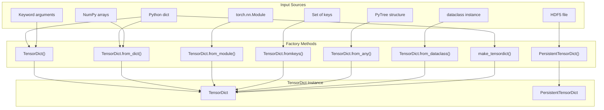
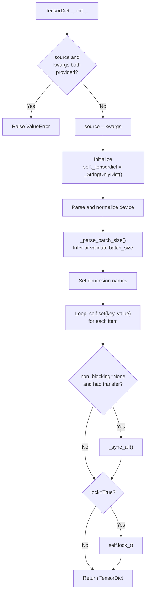
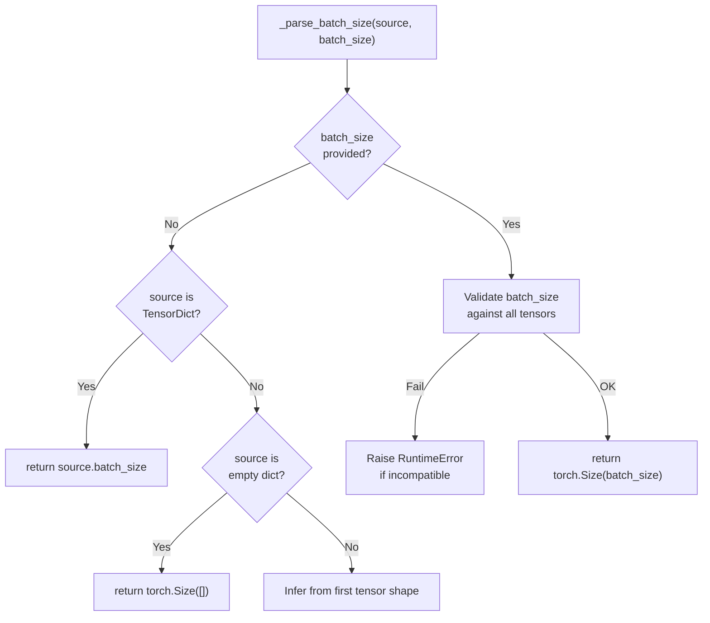
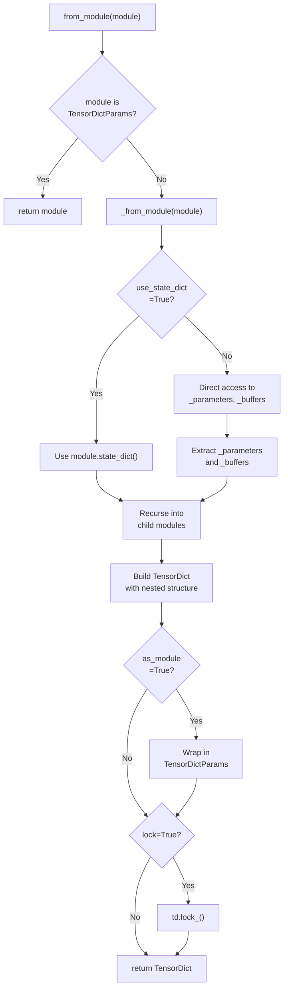
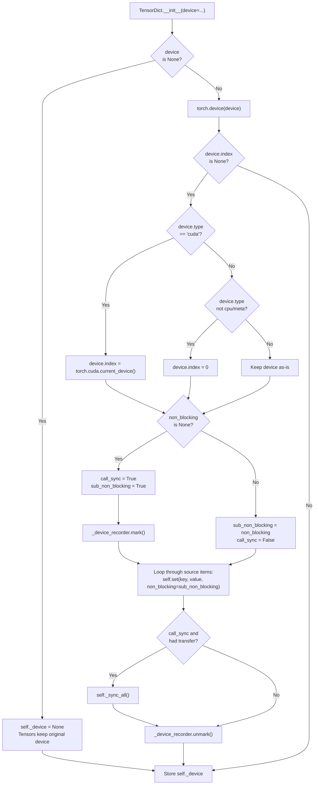

<!-- source: DeepWiki mcp.deepwiki.com · repo pytorch/tensordict · page 2.2 Creating and Initializing TensorDicts · fetched 2026-10-21 -->

# Creating and Initializing TensorDicts

<details>
<summary>Relevant source files</summary>

The following files were used as context for generating this wiki page:

- [tensordict/base.py](tensordict/base.py)
- [tensordict/tensordict.py](tensordict/tensordict.py)
- [test/_utils_internal.py](test/_utils_internal.py)
- [test/test_tensordict.py](test/test_tensordict.py)

</details>


This page documents all methods for creating and initializing TensorDict instances, including the main constructor, factory methods like `from_dict`, `from_module`, and `from_h5`, as well as batch size inference and device management during initialization.

For information about TensorDictBase interface and core concepts, see [TensorDictBase Interface and Core Concepts](#2.1). For details on accessing and modifying data after creation, see [Accessing and Modifying Data](#2.3).

## Overview of Creation Methods

TensorDict instances can be created through multiple pathways, each suited for different use cases:



**Sources:** [tensordict/_td.py:250-322](), [tensordict/base.py:1269-1340](), [test/test_tensordict.py:718-721]()

## The Main Constructor

The primary way to create a TensorDict is through its constructor, which accepts either a source dictionary or keyword arguments.

### Constructor Signature

```python
TensorDict(
    source: dict | TensorDictBase | None = None,
    batch_size: Sequence[int] | torch.Size | int | None = None,
    device: torch.device | str | None = None,
    names: Sequence[str] | None = None,
    non_blocking: bool | None = None,
    lock: bool = False,
    **kwargs: Any
)
```

### Constructor Flow



**Sources:** [tensordict/_td.py:250-322]()

### Basic Usage Examples

```python
# Empty TensorDict with specified batch size
td = TensorDict({}, batch_size=[3, 4])

# From dictionary
td = TensorDict({
    "a": torch.randn(3, 4),
    "b": torch.zeros(3, 4, 5)
}, batch_size=[3, 4])

# Using keyword arguments
td = TensorDict(
    a=torch.randn(3, 4),
    b=torch.zeros(3, 4, 5),
    batch_size=[3, 4]
)

# With device
td = TensorDict({
    "a": torch.randn(3, 4)
}, batch_size=[3], device="cuda:0")

# With dimension names
td = TensorDict({
    "a": torch.randn(3, 4)
}, batch_size=[3, 4], names=["batch", "time"])
```

**Sources:** [tensordict/_td.py:250-259](), [test/test_tensordict.py:718-723]()

### Parameter Details

| Parameter | Type | Description |
|-----------|------|-------------|
| `source` | `dict \| TensorDictBase \| None` | Source data as dictionary or another TensorDict |
| `batch_size` | `Sequence[int] \| torch.Size \| int \| None` | Batch dimensions. If `None`, empty batch size is assumed |
| `device` | `torch.device \| str \| None` | Device for all tensors. If `None`, tensors can be on different devices |
| `names` | `Sequence[str] \| None` | Names for batch dimensions |
| `non_blocking` | `bool \| None` | If `True`, asynchronous device transfer. If `None`, async with final sync |
| `lock` | `bool` | If `True`, lock the TensorDict after creation |

**Sources:** [tensordict/_td.py:250-259]()

## Batch Size Inference and Management

### Batch Size Parsing

During construction, the batch size is parsed and validated against the provided data:



**Sources:** [tensordict/_td.py:304](), [test/test_tensordict.py:199-260]()

### Automatic Batch Size Inference

Use `auto_batch_size_()` to automatically infer and set the batch size:

```python
# Create without batch size, then infer
td = TensorDict({"a": torch.randn(3, 4, 5)})
td.auto_batch_size_()  # Sets batch_size to [3, 4]

# Or use from_dict with auto_batch_size
td = TensorDict.from_dict(
    {"a": torch.randn(3, 4, 5)},
    auto_batch_size=True
)  # batch_size is [3, 4]
```

**Sources:** [tensordict/base.py:1269-1340]()

### Batch Size Modification

After creation, the batch size can be modified if compatible with existing tensors:

```python
td = TensorDict({
    "a": torch.randn(3, 4, 5, 6),
    "b": torch.randn(3, 4, 5)
}, batch_size=[3, 4])

# Expand batch size
td.batch_size = torch.Size([3, 4, 5])  # OK

# Incompatible batch size
td.batch_size = [3, 5]  # RuntimeError
```

**Sources:** [test/test_tensordict.py:199-260]()

## Creating from Python Dictionaries

### TensorDict.from_dict()

The `from_dict` class method provides more control over dictionary-to-TensorDict conversion:

```python
@classmethod
def from_dict(
    cls,
    input_dict: dict,
    batch_size: torch.Size | None = None,
    device: torch.device | None = None,
    batch_dims: int | None = None,
    auto_batch_size: bool = False
) -> TensorDict
```

#### Usage Examples

```python
# Basic usage
data = {
    "a": torch.zeros(3, 4, 5),
    "b": {"c": torch.zeros(3, 4, 5, 6)}
}
td = TensorDict.from_dict(data, batch_size=[3, 4])

# Auto-infer batch size
td = TensorDict.from_dict(data, auto_batch_size=True)  # batch_size=[3, 4]

# Using batch_dims instead of batch_size
td = TensorDict.from_dict(data, batch_dims=2)  # batch_size=[3, 4]

# Nested keys in dictionary
data = {
    "a": torch.zeros(3, 4, 5),
    ("b", "c"): torch.zeros(3, 4, 5, 6),
    ("b", "f"): torch.zeros(3, 4, 5, 5)
}
td = TensorDict.from_dict(data, batch_size=[3, 4])
```

**Sources:** [tensordict/base.py:1269-1340](), [test/test_tensordict.py:1266-1340]()

### Nested Dictionary Handling

`from_dict` automatically creates nested TensorDict structures:

```python
data = {
    "a": torch.zeros(3, 4, 5),
    "b": {
        "c": torch.zeros(3, 4, 5, 6),
        "d": torch.zeros(3, 4, 5)
    }
}
td = TensorDict.from_dict(data, batch_size=[3, 4])
# td["b"] is itself a TensorDict
```

**Sources:** [test/test_tensordict.py:1266-1340]()

## Creating from PyTorch Modules

### TensorDict.from_module()

Extract parameters and buffers from a `torch.nn.Module` into a TensorDict:

```python
@classmethod
def from_module(
    cls,
    module: torch.nn.Module,
    as_module: bool = False,
    lock: bool = False,
    use_state_dict: bool = False,
    filter_empty: bool = True
) -> TensorDict | TensorDictParams
```

### Module Extraction Flow



**Sources:** [tensordict/_td.py:393-479]()

### Usage Examples

```python
import torch.nn as nn

# Create a module
module = nn.Sequential(
    nn.Linear(10, 20),
    nn.ReLU(),
    nn.Linear(20, 5)
)

# Extract parameters and buffers
td = TensorDict.from_module(module)
# Creates nested structure:
# {
#   "0": {"weight": ..., "bias": ...},
#   "2": {"weight": ..., "bias": ...}
# }

# As TensorDictParams for use with optimizers
params = TensorDict.from_module(module, as_module=True)

# Using state_dict (includes hooks)
td = TensorDict.from_module(module, use_state_dict=True)

# Locked TensorDict
td = TensorDict.from_module(module, lock=True)
```

**Sources:** [tensordict/_td.py:393-412]()

### Filtering Empty Modules

The `filter_empty` parameter controls whether modules with no parameters/buffers are included:

```python
class EmptyModule(nn.Module):
    def __init__(self):
        super().__init__()

class ModuleWithEmpty(nn.Module):
    def __init__(self):
        super().__init__()
        self.linear = nn.Linear(10, 5)
        self.empty = EmptyModule()

module = ModuleWithEmpty()

# filter_empty=True (default): empty submodules excluded
td = TensorDict.from_module(module, filter_empty=True)
# Only contains "linear"

# filter_empty=False: all submodules included
td = TensorDict.from_module(module, filter_empty=False)
# Contains "linear" and "empty"
```

**Sources:** [tensordict/_td.py:399-421]()

## Creating from HDF5 Files

### PersistentTensorDict

For datasets larger than RAM, use `PersistentTensorDict` which stores data in HDF5 files:

```python
from tensordict import PersistentTensorDict

# Create new persistent tensordict
td = PersistentTensorDict.from_dict(
    {
        "a": torch.randn(1000, 100),
        "b": {"c": torch.randn(1000, 50)}
    },
    filename="data.h5",
    batch_size=[1000]
)

# Load existing HDF5 file
td = PersistentTensorDict.from_h5("existing_data.h5")
```

See [PersistentTensorDict and HDF5 Storage](#5.2) for detailed documentation on persistent storage.

**Sources:** [test/test_tensordict.py:1195-1238]()

## Other Factory Methods

### fromkeys()

Create a TensorDict with specified keys and default value:

```python
# All keys initialized to 0
td = TensorDict.fromkeys({"a", "b", "c"})
assert td["a"] == 0

# Custom default value
td = TensorDict.fromkeys({"a", "b", "c"}, 1)
assert td["a"] == 1
```

**Sources:** [test/test_tensordict.py:1189-1194]()

### from_any()

Convert arbitrary Python structures (PyTrees, dataclasses, etc.) to TensorDict:

```python
from dataclasses import dataclass

@dataclass
class MyClass:
    a: int

# From nested structure
pytree = (
    [[-1, 0, 1], [2, 3, 4]],
    {
        "tensor": torch.randn(2,),
        "td": TensorDict({"one": 1}),
        "tuple": (1, 2, 3),
    },
    {"dataclass": MyClass(a=0)},
)

td = TensorDict.from_any(pytree)
# Creates nested TensorDict preserving structure
```

**Sources:** [test/test_tensordict.py:1195-1238]()

### from_dataclass()

Convert a dataclass instance to TensorDict or TensorClass:

```python
@dataclass
class MyClass:
    a: int
    b: Any

obj = MyClass(a=0, b=1)

# As TensorDict
td = TensorDict.from_dataclass(obj)

# As TensorClass
tc = TensorDict.from_dataclass(obj, as_tensorclass=True)
```

**Sources:** [test/test_tensordict.py:1254-1264]()

### make_tensordict()

Functional interface for creating TensorDicts:

```python
from tensordict import make_tensordict

td = make_tensordict(
    a=torch.randn(3, 4),
    b=torch.zeros(3, 4, 5)
)
# Automatically infers batch_size=[3, 4]
```

**Sources:** [test/test_tensordict.py:40]()

## Device Management

### Device Parameter Behavior

The `device` parameter controls where tensors are stored and how they are moved during initialization:

| `device` Value | Behavior |
|----------------|----------|
| `None` (default) | Tensors remain on their original devices |
| `"cuda:0"`, `"cpu"`, etc. | All tensors moved to specified device |

**Sources:** [tensordict/_td.py:270-294]()

### Device Transfer Flow



**Sources:** [tensordict/_td.py:270-322](), [tensordict/base.py:219-244]()

### Non-Blocking Device Transfers

The `non_blocking` parameter controls synchronization during device transfers:

| `non_blocking` | Behavior |
|----------------|----------|
| `True` | Fastest: no synchronization, safe only for CPU→CUDA |
| `False` | Slowest: every transfer is synchronous |
| `None` (default) | Balanced: async transfer with final sync if needed |

```python
# Synchronous transfer (slowest, safest)
td = TensorDict(
    {"a": torch.randn(100, 100)},
    batch_size=[100],
    device="cuda:0",
    non_blocking=False
)

# Asynchronous without sync (fastest, unsafe)
td = TensorDict(
    {"a": torch.randn(100, 100)},
    batch_size=[100],
    device="cuda:0",
    non_blocking=True
)

# Asynchronous with final sync (recommended)
td = TensorDict(
    {"a": torch.randn(100, 100)},
    batch_size=[100],
    device="cuda:0",
    non_blocking=None  # or omit
)
```

**Sources:** [tensordict/_td.py:213-221](), [tensordict/_td.py:270-322]()

### Device Auto-Indexing

When a device is specified without an index, TensorDict automatically adds one:

```python
# CUDA device: uses current device
td = TensorDict({}, batch_size=[], device="cuda")
# Equivalent to device="cuda:0" if torch.cuda.current_device() == 0

# CPU and meta: no index needed
td = TensorDict({}, batch_size=[], device="cpu")
td = TensorDict({}, batch_size=[], device="meta")

# Other devices: defaults to index 0
td = TensorDict({}, batch_size=[], device="mps")
# Equivalent to device="mps:0"
```

**Sources:** [tensordict/_td.py:279-286]()

## Locking During Initialization

TensorDicts can be locked immediately after creation to prevent modifications:

```python
# Locked TensorDict
td = TensorDict(
    {"a": torch.randn(3, 4)},
    batch_size=[3, 4],
    lock=True
)

# Cannot add new keys
td["b"] = torch.zeros(3, 4)  # RuntimeError: TensorDict is locked

# Can still modify values in-place
td.set("a", torch.ones(3, 4), inplace=True)  # OK
```

See [Locking and Thread Safety](#6.4) for comprehensive documentation on locking behavior.

**Sources:** [tensordict/_td.py:317-318](), [test/test_tensordict.py:555-605]()

## Internal Constructor: _new_unsafe

For performance-critical code, TensorDict provides an unsafe constructor that skips validation:

```python
@classmethod
def _new_unsafe(
    cls,
    source: dict | None = None,
    batch_size: torch.Size | None = None,
    device: torch.device | None = None,
    names: Sequence[str] | None = None,
    non_blocking: bool | None = None,
    lock: bool = False,
    nested: bool = True,
    is_shared: bool = False,
    is_memmap: bool = False,
    **kwargs
) -> TensorDict
```

This method is used internally for faster TensorDict creation when data is already validated. It directly assigns attributes without checks.

**Sources:** [tensordict/_td.py:323-391]()

## Summary Table

| Method | Primary Use Case | Batch Size | Device |
|--------|------------------|------------|--------|
| `TensorDict()` | General construction | Required or inferred | Optional |
| `from_dict()` | Dictionary conversion | Optional with auto-inference | Optional |
| `from_module()` | Extract module parameters | Auto (empty) | Module's device |
| `PersistentTensorDict()` | Large datasets on disk | Required | Usually CPU |
| `fromkeys()` | Initialize with default values | Optional | Optional |
| `from_any()` | Convert PyTrees/arbitrary structures | Auto-inferred | Optional |
| `from_dataclass()` | Dataclass conversion | Auto-inferred | Optional |
| `make_tensordict()` | Functional interface | Auto-inferred | Optional |

**Sources:** [tensordict/_td.py:150-243](), [tensordict/base.py:1269-1340](), [test/test_tensordict.py:718-1340]()

---

