<!-- source: DeepWiki mcp.deepwiki.com · repo pytorch/tensordict · page 2.3 Accessing and Modifying Data · fetched 2026-10-21 -->

# Accessing and Modifying Data

<details>
<summary>Relevant source files</summary>

The following files were used as context for generating this wiki page:

- [tensordict/_lazy.py](tensordict/_lazy.py)
- [tensordict/_td.py](tensordict/_td.py)
- [tensordict/base.py](tensordict/base.py)
- [test/test_tensordict.py](test/test_tensordict.py)

</details>


This document covers the mechanisms for reading from and writing to TensorDict instances. It includes basic key access, nested key patterns, indexing operations, and various specialized access methods. For information about creating TensorDict instances, see [Creating and Initializing TensorDicts](#2.2). For shape-related operations like indexing that transform the batch dimensions, see [Shape Operations and Transformations](#2.4).

## Overview of Access Methods

TensorDict provides multiple ways to access and modify data, following a dictionary-like interface while supporting tensor-like indexing. The primary operations are:

- **Dictionary-style access**: `td["key"]` and `td["key"] = value`
- **get/set methods**: `td.get("key")`, `td.set("key", value)`
- **Nested keys**: `td["nested", "key"]` or `td[("nested", "key")]`
- **Index-based access**: `td[0]`, `td[:2]`, `td[torch.tensor([0, 1])]`
- **Combined access**: `td["key", 0]` mixes keys and indices

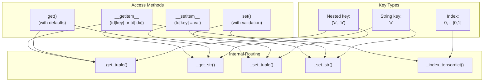

**Sources:** [tensordict/base.py:573-649](), [tensordict/_td.py:836-916]()

## Reading Data with get() and __getitem__

### Basic Key Access

The primary method for reading data is through dictionary-style bracket notation or the `get()` method. When accessing by key, `__getitem__` determines whether the index is a key (string or tuple of strings) or a tensor index.

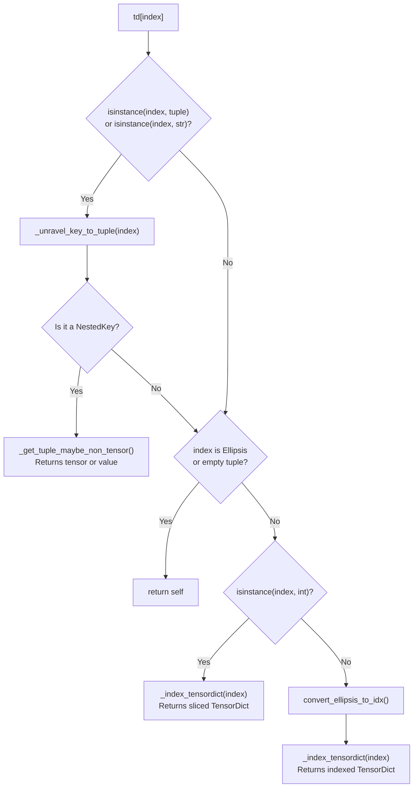

**Sources:** [tensordict/base.py:573-627](), [tensordict/_td.py:1159-1335]()

The `_get_str()` method handles retrieval of values by string keys:

| Method | Purpose | Returns | Example |
|--------|---------|---------|---------|
| `td["key"]` | Direct access, raises KeyError if missing | Tensor or TensorDict | `td["observation"]` |
| `td.get("key")` | Safe access with optional default | Tensor, TensorDict, or default | `td.get("missing", default=0)` |
| `td.get("key", default=None)` | Returns None if key is missing | Tensor, TensorDict, or None | Common pattern for optional keys |
| `td[("a", "b")]` | Nested key access | Tensor or TensorDict | Access nested structure |

**Sources:** [tensordict/base.py:1946-2064](), [tensordict/_td.py:1159-1233]()

### Nested Key Access

TensorDict supports nested key access through tuples of strings. The key can be specified as a tuple `("parent", "child")` or as separate arguments in some methods.

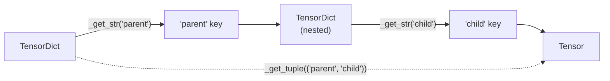

The `_get_tuple()` method recursively traverses the nested structure:

**Sources:** [tensordict/base.py:2066-2123](), [tensordict/_td.py:1235-1290]()

### Default Values and Error Handling

The `get()` method provides flexible default value handling. The global behavior is controlled by `set_get_defaults_to_none()`:

| Configuration | Behavior when key missing and no default | Usage |
|---------------|------------------------------------------|-------|
| `_GET_DEFAULTS_TO_NONE=True` (default) | Returns `None` | Safe access pattern |
| `_GET_DEFAULTS_TO_NONE=False` | Raises `KeyError` | Strict access pattern |
| Explicit `default` argument | Returns provided default | Per-call override |

**Sources:** [tensordict/base.py:193-216](), [tensordict/base.py:1946-2064]()

## Writing Data with set() and __setitem__

### Basic Assignment Operations

Writing data to a TensorDict can be done through bracket notation or the `set()` method. The system validates values and handles device placement automatically.

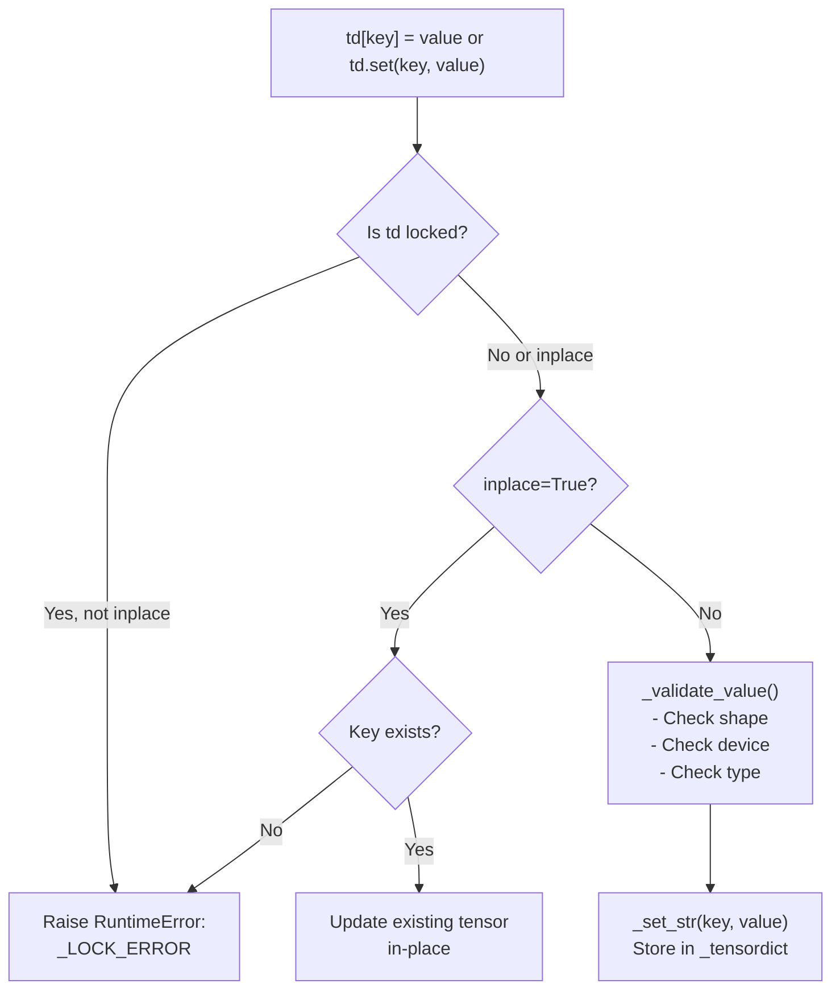

**Sources:** [tensordict/base.py:2217-2374](), [tensordict/_td.py:1451-1666]()

### In-place vs Out-of-place Operations

TensorDict distinguishes between modifying operations and creating new structures:

| Operation | Creates New TD | Modifies Existing | Method Suffix | Example |
|-----------|---------------|-------------------|---------------|---------|
| `set()` | No | Yes (adds key) | None | `td.set("key", value)` |
| `set_()` | No | Yes (in-place update) | `_` | `td.set_("key", value, inplace=True)` |
| `update()` | No | Yes (multiple keys) | None | `td.update(other_td)` |
| `update_()` | No | Yes (in-place) | `_` | `td.update_(other_td)` |
| `clone()` | Yes | No | None | `td2 = td.clone()` |

**Sources:** [tensordict/base.py:2217-2374](), [tensordict/_td.py:1668-1803]()

### Value Validation

The `_validate_value()` method ensures that values meet TensorDict requirements:

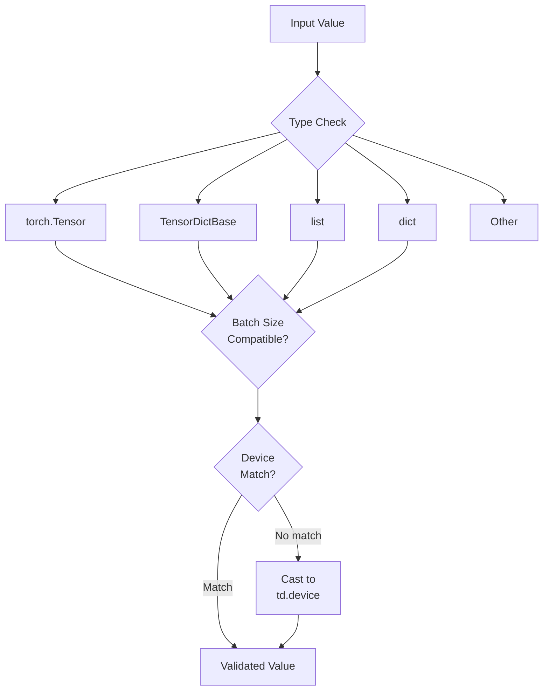

**Sources:** [tensordict/base.py:5028-5287]()

### Nested Key Assignment

Setting values with nested keys creates parent TensorDicts automatically if they don't exist:

**Sources:** [tensordict/base.py:2376-2464](), [tensordict/_td.py:1805-1897]()

## Indexing Patterns

### Index Types and Behavior

TensorDict supports various indexing patterns that operate on the batch dimensions:

| Index Type | Example | Returns | Batch Size Change |
|------------|---------|---------|-------------------|
| Integer | `td[0]` | TensorDict | Reduces by 1 dimension |
| Slice | `td[:2]` | TensorDict | First dimension becomes 2 |
| List | `td[[0, 2, 4]]` | TensorDict | First dimension becomes 3 |
| Tensor (int) | `td[torch.tensor([0, 1])]` | TensorDict | First dimension becomes 2 |
| Tensor (bool) | `td[mask]` | TensorDict | Dimension becomes mask.sum() |
| Ellipsis | `td[..., 0]` | TensorDict | Last dimension removed |
| None | `td[None]` | TensorDict | Adds dimension of size 1 |

**Sources:** [tensordict/base.py:573-627](), [tensordict/_td.py:1899-2100]()

### Integer and Slice Indexing

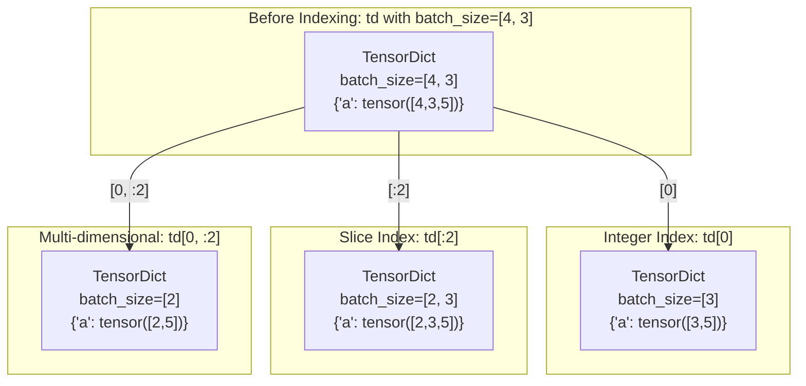

**Sources:** [tensordict/_td.py:1899-2100]()

### Advanced Indexing with Tensors

When indexing with tensor indices, TensorDict follows PyTorch's advanced indexing semantics:

**Sources:** [tensordict/_td.py:2102-2300]()

### Boolean Masking

Boolean tensor indexing filters elements along dimensions:

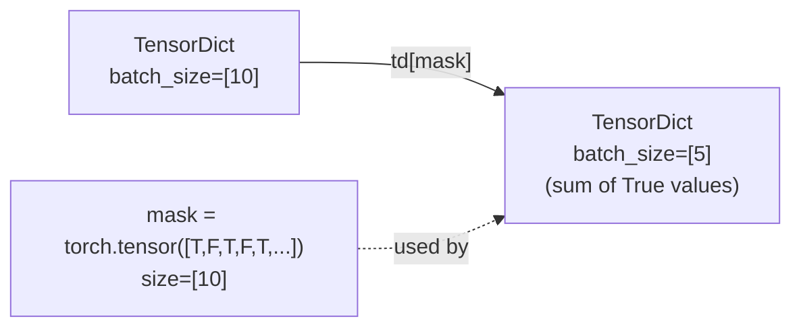

**Sources:** [tensordict/_td.py:2302-2509]()

## Special Access Methods

### get_at() and set_at_() Methods

These methods combine key access with indexing in a single operation:

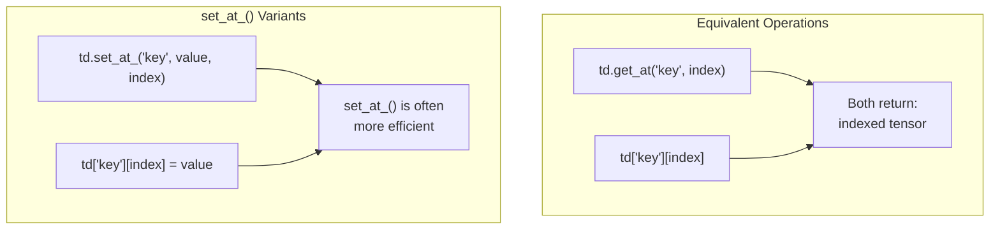

The methods are defined in the base class with implementations in concrete classes:

| Method | Purpose | In-place | Example |
|--------|---------|----------|---------|
| `get_at(key, index)` | Get indexed value | N/A | `td.get_at("obs", 0)` |
| `set_at_(key, value, index)` | Set at index | Yes | `td.set_at_("obs", val, 0)` |

**Sources:** [tensordict/base.py:2467-2551](), [tensordict/_td.py:2511-2635]()

### Batch Operations: update() and update_()

The `update()` family of methods modifies multiple keys at once:

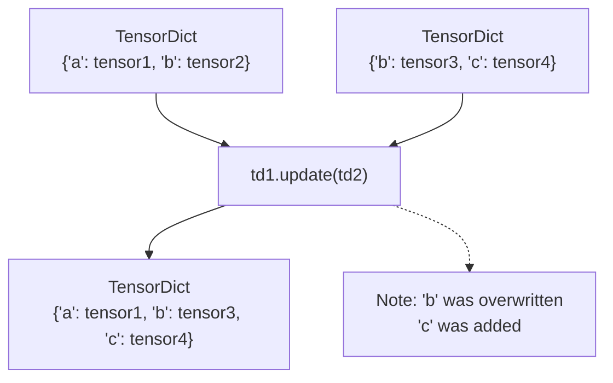

**Behavior differences:**

- `update(other)`: Creates new tensors for updated keys
- `update_(other)`: Modifies tensors in-place where possible
- `update(other, clone=True)`: Clones values from other
- `update(other, inplace=True)`: Only updates existing keys

**Sources:** [tensordict/base.py:4582-4769](), [tensordict/_td.py:3235-3438]()

### fill_() Method

The `fill_()` method sets all values of a key to a scalar:

**Sources:** [tensordict/base.py:3629-3669]()

### rename_key_() Method

Renames a key in-place without copying data:

**Sources:** [tensordict/base.py:4179-4255]()

## Key Iteration and Membership

### Checking Key Existence

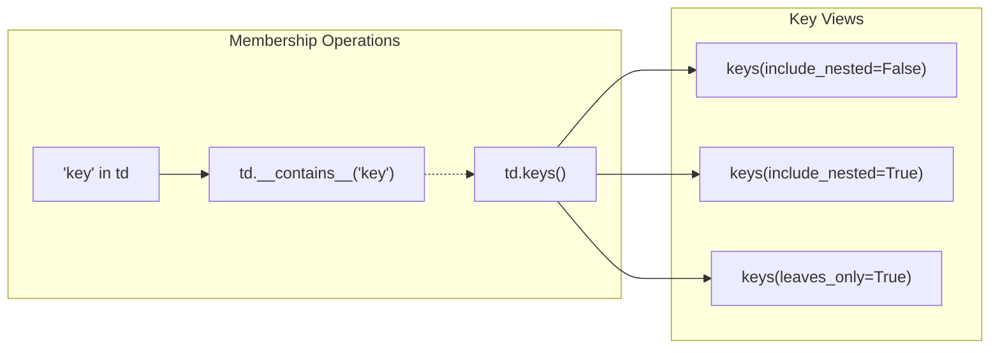

**Key iteration patterns:**

| Pattern | Result | Example |
|---------|--------|---------|
| `for key in td.keys()` | Top-level keys only | `['a', 'b', 'c']` |
| `for key in td.keys(True)` | All keys including nested | `['a', 'b', ('c', 'd')]` |
| `for key in td.keys(True, True)` | Leaf keys only | `['a', 'b', ('c', 'd')]` |

**Sources:** [tensordict/base.py:559-571](), [tensordict/base.py:3854-3960]()

## LazyStackedTensorDict Access Patterns

LazyStackedTensorDict has special considerations for access:

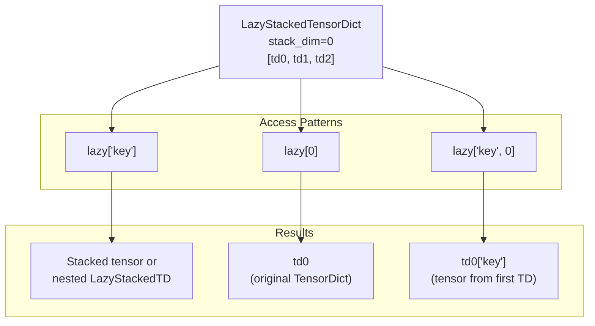

LazyStackedTensorDict can return data in different formats when dimensions mismatch:

| Argument | Effect | Use Case |
|----------|--------|----------|
| `as_list=True` | Returns list of tensors | Heterogeneous shapes |
| `as_padded_tensor=True` | Pads to uniform shape | Sequence data |
| `as_nested_tensor=True` | Returns NestedTensor | Jagged tensors |

**Sources:** [tensordict/_lazy.py:1230-1429]()

## Locking and Access Control

TensorDict instances can be locked to prevent structural modifications:

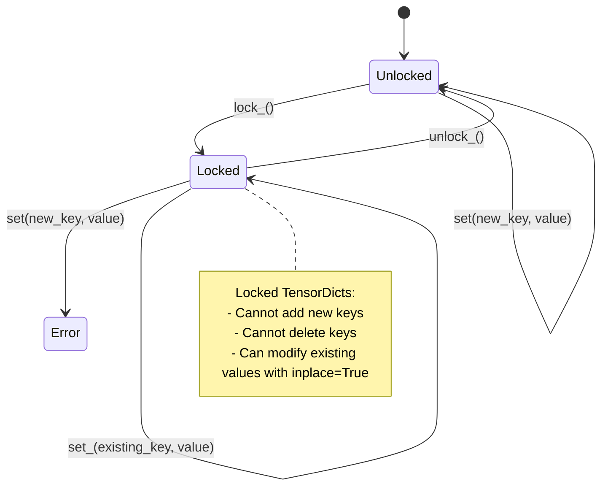

**Locking behavior:**

- `td.lock_()`: Locks the TensorDict and all nested TensorDicts
- `td.unlock_()`: Unlocks the TensorDict
- `td.is_locked`: Boolean property
- Locked TensorDicts raise `_LOCK_ERROR` when trying to add/remove keys
- `set(..., inplace=True)` works on locked TensorDicts for existing keys

**Sources:** [tensordict/base.py:4027-4130](), [tensordict/utils.py:883-896]()

## Performance Considerations

### Validation Overhead

The `validated=True` parameter can skip redundant validation:

```python
# Slow: validates multiple times
for i in range(1000):
    td.set("key", value)

# Faster: validate once
value = td._validate_value(value)
for i in range(1000):
    td.set("key", value, validated=True)
```

### Non-blocking Device Transfers

The `non_blocking` parameter controls synchronization during device transfers:

**Sources:** [tensordict/base.py:2217-2374]()

### Direct Access via _tensordict

For performance-critical code, direct dictionary access bypasses validation (not recommended for general use):

```python
# Public API (safe)
value = td.get("key")
td.set("key", value)

# Internal access (fast but unsafe)
value = td._tensordict["key"]
td._tensordict["key"] = value  # No validation!
```

**Sources:** [tensordict/_td.py:266]()

---

