<!-- source: DeepWiki mcp.deepwiki.com · repo pytorch/tensordict · page 2.4 Shape Operations and Transformations · fetched 2026-10-21 -->

# Shape Operations and Transformations

<details>
<summary>Relevant source files</summary>

The following files were used as context for generating this wiki page:

- [tensordict/_lazy.py](tensordict/_lazy.py)
- [tensordict/_td.py](tensordict/_td.py)
- [tensordict/base.py](tensordict/base.py)
- [test/test_tensordict.py](test/test_tensordict.py)

</details>


This page documents shape manipulation operations available on TensorDict instances. Shape operations allow you to transform the batch dimensions of a TensorDict while preserving the contained data. These operations are fundamental for batch processing, dimension alignment, and data reorganization in machine learning workflows.

**Scope**: This page covers operations that modify the batch_size of a TensorDict: `expand`, `reshape`, `view`, `squeeze`, `unsqueeze`, `transpose`, `permute`, `flatten`, `unflatten`, `chunk`, `split`, and `unbind`. For accessing data within specific batch indices, see [Accessing and Modifying Data](#2.3). For operations that reduce dimensions through aggregation, see [Reduction Operations](#6.5).

## Core Concepts

TensorDict shape operations distinguish between **batch dimensions** (controlled by `batch_size`) and **feature dimensions** (the remaining dimensions of each tensor). Shape operations primarily manipulate batch dimensions, applying the transformation uniformly across all tensors in the TensorDict.

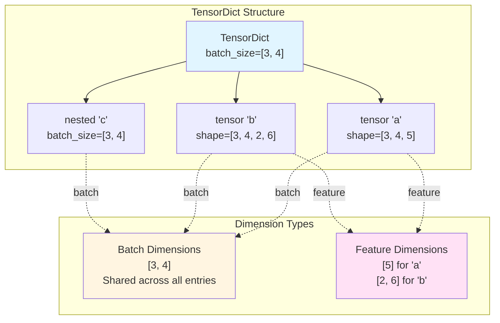

**Key Principle**: When a shape operation is applied to a TensorDict, it operates on the batch dimensions as if working with a tensor of shape `batch_size`, then applies the transformation to each contained tensor by operating on its first `len(batch_size)` dimensions.

Sources: [tensordict/base.py:150-186](), [test/test_tensordict.py:169-176]()

## Batch Dimension Operations

### expand

The `expand` method broadcasts the TensorDict to a larger batch size. Expansion can only add dimensions or expand singleton dimensions; it cannot change non-singleton dimensions.

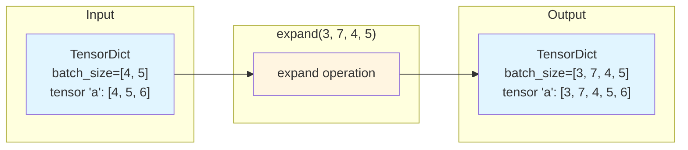

**Implementation**: The `expand` method expands the batch dimensions while preserving feature dimensions. It handles both regular TensorDict and LazyStackedTensorDict instances.

```python
# Example from test suite
td = TensorDict({"key1": torch.randn(4, 5, 6)}, batch_size=(4, 5))
td_expanded = td.expand(3, 7, 4, 5)
# Result: batch_size=[3, 7, 4, 5], key1.shape=[3, 7, 4, 5, 6]
```

**Key Methods**:
- `expand(*sizes)` - Expands to new batch size
- `expand_as(other)` - Expands to match another TensorDict's shape

**Special Cases**:
- Singleton dimensions can be expanded to any size
- Non-singleton dimensions must match exactly
- Feature dimensions remain unchanged

Sources: [test/test_tensordict.py:1010-1046](), [tensordict/base.py:3914-3977]()

### squeeze and unsqueeze

These operations remove or add singleton dimensions (dimensions of size 1) to the batch size.

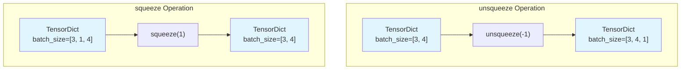

**unsqueeze(dim: int)**:
- Adds a singleton dimension at the specified position
- `dim` can be negative (counted from the end)
- Valid range: `-td.batch_dims - 1` to `td.batch_dims`
- Returns a new TensorDict with expanded batch_size

**squeeze(dim: int | None)**:
- Removes a singleton dimension at the specified position
- If `dim=None`, removes all singleton dimensions iteratively
- Only operates on dimensions where `batch_size[dim] == 1`
- Returns a new TensorDict with reduced batch_size

**LazyStackedTensorDict Behavior**: For lazy stacks, squeeze/unsqueeze operations adjust the stack dimension accordingly. If the operation affects the stack dimension itself, the result may be unwrapped.

Sources: [tensordict/base.py:4230-4307](), [tensordict/_lazy.py:1126-1184](), [test/test_tensordict.py:283-294]()

## Reshaping Operations

### view and reshape

The `view` and `reshape` methods change the batch dimensions while preserving the total number of elements.

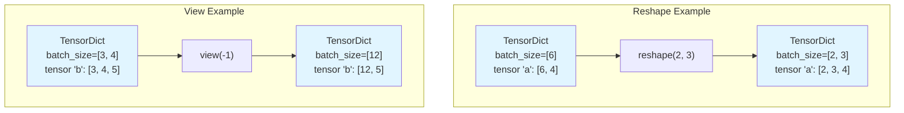

**Key Differences**:
- `view()` returns a view when possible (memory shared with original)
- `reshape()` may copy data if necessary for contiguity
- Both accept `-1` as a wildcard dimension to infer size
- Total batch elements must remain constant

**Implementation Details**:
- The methods compute the new batch size using `torch.Size.numel()`
- Each tensor's batch dimensions are reshaped while feature dimensions remain unchanged
- For nested TensorDicts, the operation is applied recursively

Sources: [tensordict/base.py:6196-6296](), [test/test_tensordict.py:836-848]()

### flatten and unflatten

These operations collapse or expand batch dimensions.

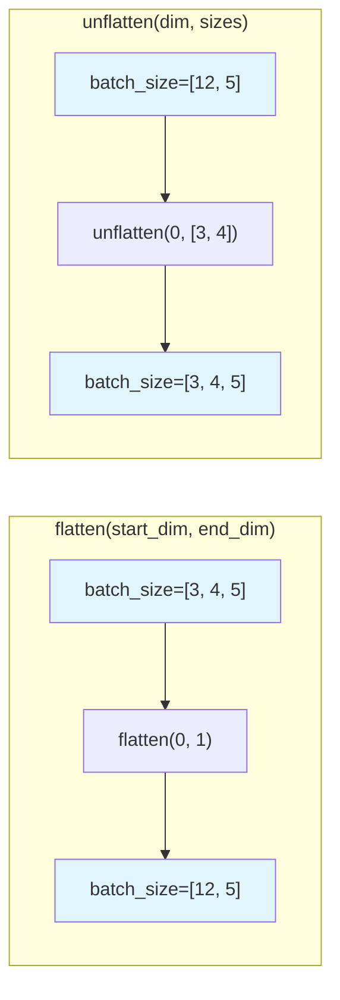

**flatten(start_dim, end_dim)**:
- Collapses dimensions from `start_dim` to `end_dim` (inclusive)
- Returns a new TensorDict with reduced dimensionality
- Negative indices are supported
- If start_dim and end_dim are equal, returns self

**unflatten(dim, sizes)**:
- Expands dimension `dim` into multiple dimensions with given sizes
- Product of `sizes` must equal `batch_size[dim]`
- Returns a new TensorDict with expanded dimensionality

**Special Case - Empty Batch**: When a TensorDict has empty batch_size, flatten operations may still be valid depending on the arguments.

Sources: [tensordict/base.py:4056-4186](), [test/test_tensordict.py:1193-1207]()

## Dimension Reordering

### transpose and permute

These operations reorder batch dimensions without changing their sizes.

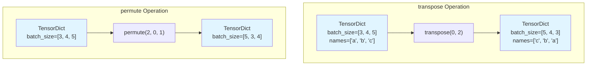

**transpose(dim0, dim1)**:
- Swaps two batch dimensions
- Dimension names are also swapped if present
- Returns a new TensorDict (does not modify in-place)
- Each contained tensor has its corresponding dimensions transposed

**permute(*dims)**:
- Reorders all batch dimensions according to the provided permutation
- Length of `dims` must match `batch_dims`
- Dimension names follow the permutation if present
- All tensors in the TensorDict are permuted consistently

**Implementation Note**: For `LazyStackedTensorDict`, the stack dimension is tracked and adjusted according to the permutation to maintain correct stacking behavior.

Sources: [tensordict/base.py:7169-7249](), [tensordict/base.py:7100-7167]()

## Splitting Operations

### chunk

The `chunk` method splits a TensorDict into a specified number of chunks along a dimension.

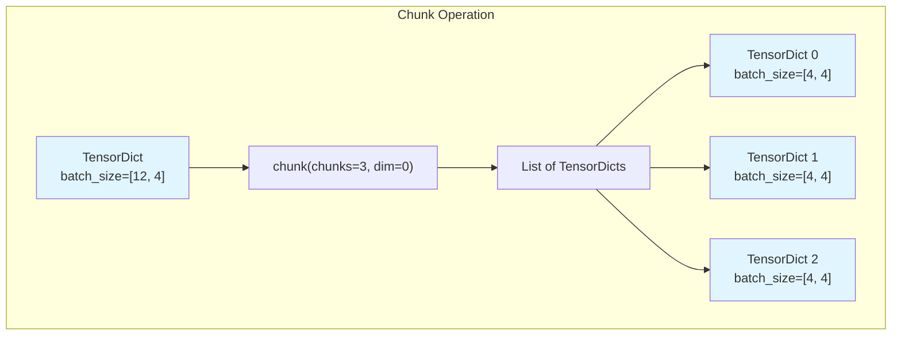

**Method Signature**: `chunk(chunks: int, dim: int = 0)`

**Behavior**:
- Splits the TensorDict into approximately equal chunks
- Returns a tuple of TensorDict instances
- If the dimension size is not evenly divisible, the last chunk may be smaller
- Works with nested tensors through special handling

**Nested Tensor Support**: The implementation handles PyTorch nested tensors (jagged tensors) by chunking them appropriately while preserving their structure.

Sources: [tensordict/base.py:3607-3656](), [test/test_tensordict.py:378-395]()

### split

The `split` method provides more control than chunk by specifying exact split sizes or indices.

**Method Signature**: `split(split_size_or_sections: int | list[int], dim: int = 0)`

**Two Modes**:
1. **Integer split_size**: Splits into chunks of the specified size
2. **List of sizes**: Splits into chunks with specified sizes for each section

**Difference from chunk**: While `chunk` specifies the number of resulting pieces, `split` specifies the size of each piece.

Sources: [tensordict/base.py:7251-7324]()

### unbind

The `unbind` method removes a dimension by splitting along it, returning a tuple of TensorDicts.

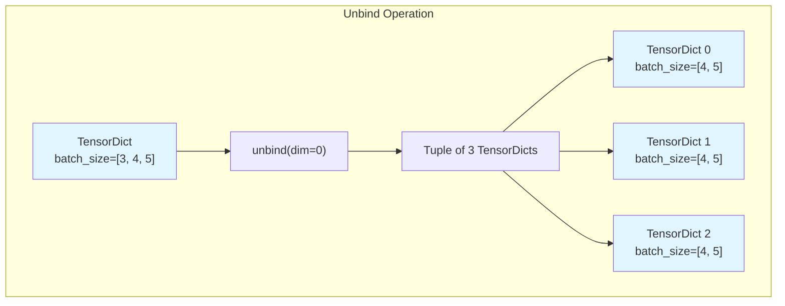

**Method Signature**: `unbind(dim: int)`

**Behavior**:
- Removes the specified batch dimension, returning one TensorDict per element along that dimension
- The returned TensorDicts have `batch_dims` reduced by 1
- Equivalent to iterating over the TensorDict along the specified dimension
- Can be used in iteration: `for td in tensordict.unbind(0): ...`

**LazyStackedTensorDict Special Case**: If unbinding along the stack dimension, returns the original constituent tensordicts directly without creating new objects.

Sources: [tensordict/base.py:7747-7797](), [tensordict/_lazy.py:1186-1200]()

## Shape Operation Hierarchy

The following diagram shows how shape operations are organized in the codebase:

```mermaid
graph TB
    subgraph "TensorDictBase Abstract Interface"
        ABS["TensorDictBase"]
        EXP["expand()"]
        SQZ["squeeze()"]
        UNSQZ["unsqueeze()"]
        VIEW["view()"]
        RESHAPE["reshape()"]
        TRANS["transpose()"]
        PERM["permute()"]
        FLAT["flatten()"]
        UNFLAT["unflatten()"]
        CHUNK["chunk()"]
        SPLIT["split()"]
        UNBIND["unbind()"]
        
        ABS --> EXP
        ABS --> SQZ
        ABS --> UNSQZ
        ABS --> VIEW
        ABS --> RESHAPE
        ABS --> TRANS
        ABS --> PERM
        ABS --> FLAT
        ABS --> UNFLAT
        ABS --> CHUNK
        ABS --> SPLIT
        ABS --> UNBIND
    end
    
    subgraph "TensorDict Implementation"
        TD["TensorDict"]
        TD_IMPL["_apply_nest() framework"]
        TD_FAST["_fast_apply() for tensors"]
        
        TD --> TD_IMPL
        TD --> TD_FAST
    end
    
    subgraph "LazyStackedTensorDict"
        LAZY["LazyStackedTensorDict"]
        LAZY_SQZ["_legacy_squeeze()"]
        LAZY_UNSQZ["_legacy_unsqueeze()"]
        LAZY_UNB["_unbind()"]
        LAZY_STACK["stack_dim tracking"]
        
        LAZY --> LAZY_SQZ
        LAZY --> LAZY_UNSQZ
        LAZY --> LAZY_UNB
        LAZY --> LAZY_STACK
    end
    
    EXP -.implemented by.-> TD_IMPL
    SQZ -.implemented by.-> TD_IMPL
    VIEW -.implemented by.-> TD_IMPL
    UNBIND -.special handling.-> LAZY_UNB
    
    style ABS fill:#e1f5ff
    style TD fill:#fff5e1
    style LAZY fill:#ffe1f5
```

Sources: [tensordict/base.py:300-320](), [tensordict/_td.py:150-243](), [tensordict/_lazy.py:176-225]()

## Implementation Patterns

### The _fast_apply Pattern

Most shape operations in TensorDict use the `_fast_apply` method to uniformly transform all contained tensors:

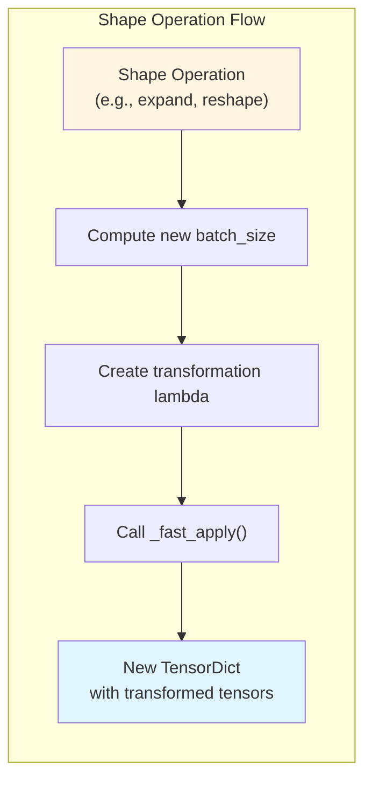

**Pattern Structure**:
1. Compute the new batch_size based on the operation
2. Define a lambda function that performs the operation on individual tensors
3. Call `_fast_apply()` with the lambda, new batch_size, and other parameters
4. Return the resulting TensorDict

**Example from expand implementation**:
```python
def expand(self, *shape):
    # 1. Compute new shape
    shape = infer_size_impl(shape, self.batch_size)
    # 2. Define transformation
    def expand_tensor(tensor):
        return tensor.expand(*shape, *tensor.shape[self.ndim:])
    # 3. Apply transformation
    return self._fast_apply(
        expand_tensor,
        batch_size=shape,
        # ... other params
    )
```

Sources: [tensordict/base.py:3914-3977](), [tensordict/_td.py:1397-1700]()

### Batch Size Validation

Shape operations maintain consistency by validating that the total number of batch elements is preserved (for reshape/view) or that dimensions are compatible (for expand).

**Validation Logic**:
- `reshape`/`view`: Checks that `prod(old_batch_size) == prod(new_batch_size)`
- `expand`: Verifies that non-singleton dimensions match and new dims extend the shape
- `squeeze`: Confirms the target dimension has size 1
- `transpose`/`permute`: Ensures dimension indices are valid

Sources: [tensordict/base.py:6196-6296](), [tensordict/utils.py:2700-2800]()

### LazyStackedTensorDict Considerations

LazyStackedTensorDict requires special handling for shape operations because it maintains a `stack_dim` that must be tracked and adjusted:

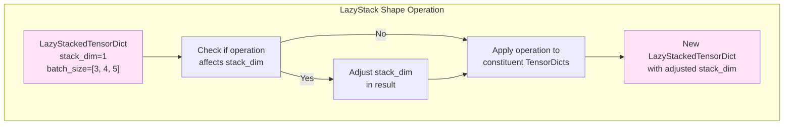

**Key Behaviors**:
- Operations before the stack_dim may shift the stack_dim forward
- Operations after the stack_dim may require adjusting dimension indices
- Operations on the stack_dim itself may unwrap the lazy stack
- The stack_dim is tracked through `_td_dim_name` for named dimensions

Sources: [tensordict/_lazy.py:1126-1184](), [tensordict/_lazy.py:226-304]()

## Common Use Cases

### Broadcasting for Batch Processing

Shape operations enable broadcasting patterns common in machine learning:

```python
# Create data with different batch sizes
td_single = TensorDict({"features": torch.randn(1, 10)}, batch_size=[1])
td_batch = TensorDict({"labels": torch.randint(0, 5, (32,))}, batch_size=[32])

# Expand single example to match batch
td_single_expanded = td_single.expand(32)
# Now: batch_size=[32], features.shape=[32, 10]

# Combine with batch data
combined = td_single_expanded.update(td_batch)
```

### Dimension Alignment

Reshape operations align dimensions for different processing stages:

```python
# Sequence processing: [batch, sequence, features]
td_sequence = TensorDict({"seq": torch.randn(8, 10, 64)}, batch_size=[8, 10])

# Flatten for processing: [batch*sequence, features]
td_flat = td_sequence.view(-1)
# Now: batch_size=[80], seq.shape=[80, 64]

# Restore after processing
td_restored = td_flat.view(8, 10)
```

### Data Splitting

Split operations enable parallel processing and data sharding:

```python
# Split dataset for distributed training
dataset = TensorDict({"x": torch.randn(1000, 32)}, batch_size=[1000])
shards = dataset.chunk(chunks=4, dim=0)
# Returns 4 TensorDicts each with batch_size=[250]
```

Sources: [test/test_tensordict.py:1010-1094](), [test/test_tensordict.py:337-367]()

## Performance Considerations

### View vs Copy

Operations that return views (when possible) are more memory-efficient than those that copy data:

- **View operations**: `view()`, `unsqueeze()`, `transpose()`, `unbind()`
- **May copy**: `reshape()`, `expand()`, `permute()`

For LazyStackedTensorDict, many operations are lazy and don't materialize data until necessary.

### Consolidation

For memory-mapped or shared tensordicts, shape operations may be more efficient after consolidation:

```python
td = TensorDict({...}).share_memory_()
td_consolidated = td.consolidate()  # Single buffer
td_reshaped = td_consolidated.reshape(...)  # More efficient
```

Sources: [tensordict/base.py:6196-6296](), [test/test_tensordict.py:423-543]()

## Summary Table

| Operation | Purpose | Returns View | Preserves Elements | LazyStack Support |
|-----------|---------|--------------|-------------------|-------------------|
| `expand` | Broadcast dimensions | Yes | No (increases) | Yes |
| `squeeze` | Remove singleton dims | Yes | Yes | Yes (special) |
| `unsqueeze` | Add singleton dims | Yes | Yes | Yes (special) |
| `view` | Reshape (contiguous) | Yes | Yes | Via consolidate |
| `reshape` | Reshape (any) | Sometimes | Yes | Via consolidate |
| `flatten` | Collapse dims | Yes | Yes | Yes |
| `unflatten` | Expand dims | Yes | Yes | Yes |
| `transpose` | Swap two dims | Yes | Yes | Yes |
| `permute` | Reorder all dims | Yes | Yes | Yes |
| `chunk` | Split into N pieces | No | Yes | Yes |
| `split` | Split by sizes | No | Yes | Yes |
| `unbind` | Remove dimension | No | Yes | Yes (optimized) |

Sources: [tensordict/base.py:300-7800](), [tensordict/_lazy.py:176-1700]()

---

