<!-- source: DeepWiki mcp.deepwiki.com · repo pytorch/tensordict · page 2.5 LazyStackedTensorDict · fetched 2026-10-21 -->

# LazyStackedTensorDict

<details>
<summary>Relevant source files</summary>

The following files were used as context for generating this wiki page:

- [tensordict/_lazy.py](tensordict/_lazy.py)
- [tensordict/_td.py](tensordict/_td.py)

</details>


## Purpose and Scope

`LazyStackedTensorDict` is a specialized TensorDict implementation that stacks multiple TensorDict instances along a dimension without immediately materializing the stacked result. It enables memory-efficient operations on collections of TensorDicts by deferring tensor concatenation until data is accessed. This class is essential for scenarios where you need to work with batches of TensorDicts without the memory overhead of eagerly stacking all tensors.

For information about the base TensorDict interface, see [TensorDictBase Interface and Core Concepts](#2.1). For shape operations on regular TensorDict instances, see [Shape Operations and Transformations](#2.4). For storage backends and memory management, see [Memory Management Strategies](#5.3).

**Sources:** [tensordict/_lazy.py:176-225]()

---

## Core Concepts

### Lazy Stacking Architecture

LazyStackedTensorDict maintains a list of TensorDict instances (`tensordicts`) and a `stack_dim` along which they are conceptually stacked. Rather than immediately concatenating tensors, it stores references to the original TensorDicts and only performs the actual stacking when data is accessed.

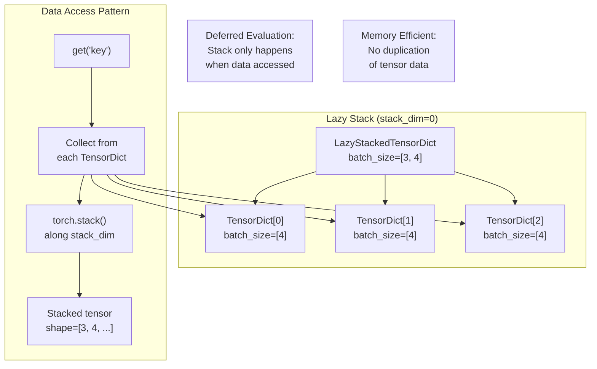

**Sources:** [tensordict/_lazy.py:176-225](), [tensordict/_lazy.py:255-303]()

---

## Creating LazyStackedTensorDict

### Direct Instantiation

The primary way to create a LazyStackedTensorDict is through the constructor, which accepts multiple TensorDict instances:

| Parameter | Type | Description |
|-----------|------|-------------|
| `*tensordicts` | `TensorDictBase` | Variable number of TensorDict instances to stack |
| `stack_dim` | `int` | Dimension along which to stack (default: 0) |
| `hook_out` | `callable` | Function to execute after `get()` operations |
| `hook_in` | `callable` | Function to execute before `set()` operations |
| `batch_size` | `Sequence[int]` | Optional explicit batch size |
| `device` | `torch.device` | Device for the lazy stack |
| `names` | `Sequence[str]` | Dimension names |
| `stack_dim_name` | `str` | Name for the stack dimension |
| `strict_shape` | `bool` | If True, all TensorDicts must have identical shapes |

**Sources:** [tensordict/_lazy.py:255-303]()

### Using lazy_stack Classmethod

The `lazy_stack` classmethod provides a more feature-rich interface with support for ragged tensors:

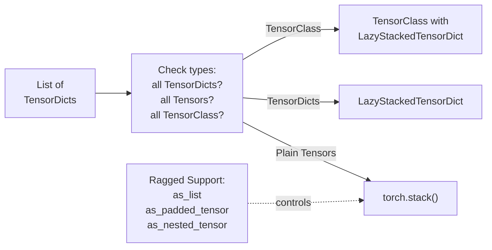

**Sources:** [tensordict/_lazy.py:1429-1568]()

---

## Index Splitting and Access Patterns

### The _split_index Method

The `_split_index` method is central to LazyStackedTensorDict's indexing behavior. It takes a complex index and splits it into per-tensordict indices:

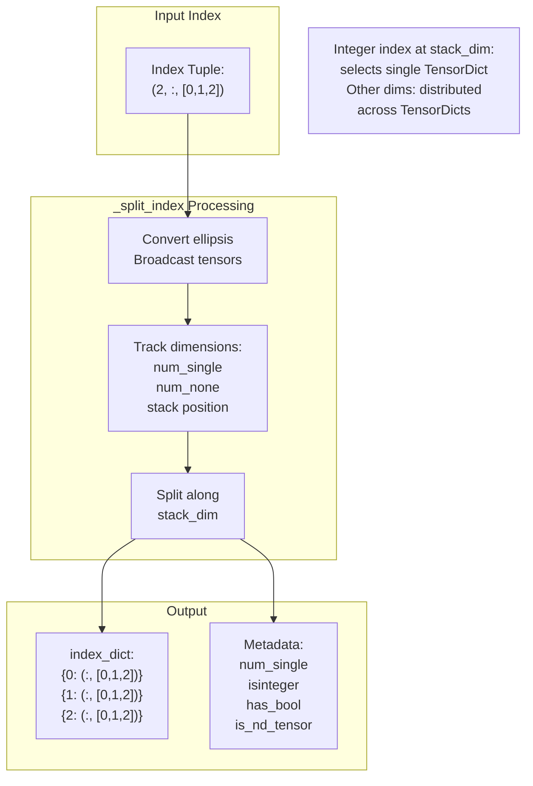

**Key behaviors:**
- **Integer at stack_dim**: Returns single TensorDict (or indexed view)
- **Slice at stack_dim**: Returns subset of TensorDicts in new LazyStackedTensorDict
- **Tensor index**: Complex splitting based on tensor dimensions
- **Boolean mask**: Splits mask across stack dimension

**Sources:** [tensordict/_lazy.py:824-1008]()

### Index Type Handling

| Index Type | At Stack Dim | Other Dims | Result Type |
|------------|--------------|------------|-------------|
| Integer | Single TD selected | Applied to TD | TensorDict or value |
| Slice | Subset of TDs | Applied to each TD | LazyStackedTensorDict |
| Range/List | Subset of TDs | Applied to each TD | LazyStackedTensorDict |
| Boolean Tensor | Split by mask | Applied to each TD | LazyStackedTensorDict or concatenated |
| N-D Tensor | Complex distribution | Complex distribution | LazyStackedTensorDict |

**Sources:** [tensordict/_lazy.py:2515-2619]()

---

## Data Access and Modification

### Getting Values

The `_get_str` method implements lazy data retrieval:

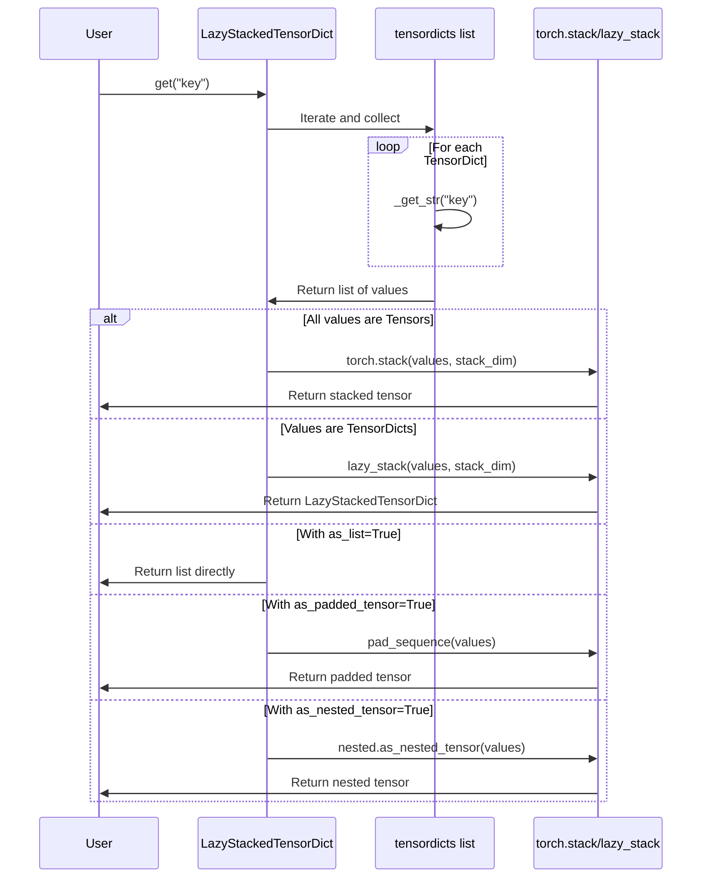

**Sources:** [tensordict/_lazy.py:1300-1411](), [tensordict/_lazy.py:1230-1297]()

### Setting Values

Setting values in a LazyStackedTensorDict requires the value to be split across the constituent TensorDicts:

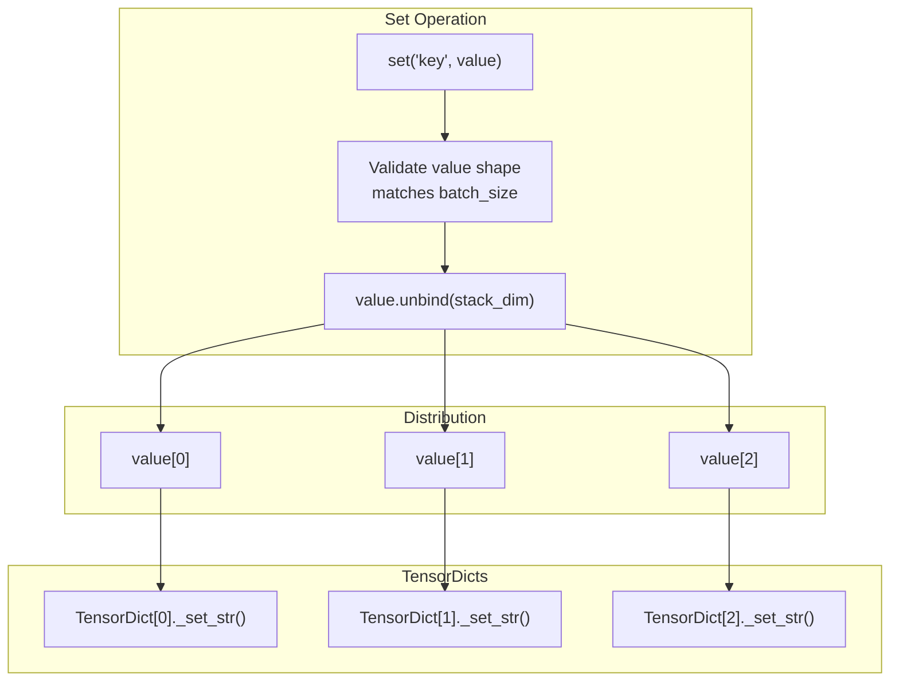

**Special case:** Lists can be set directly if using `list_to_stack()` context or when lists have the correct structure.

**Sources:** [tensordict/_lazy.py:731-774](), [tensordict/_lazy.py:776-822]()

---

## Ragged Tensor Support

LazyStackedTensorDict provides three ways to handle tensors with mismatched shapes across the stack:

### Comparison of Ragged Handling Methods

| Method | Parameter | Output Type | Use Case |
|--------|-----------|-------------|----------|
| As List | `as_list=True` | `list` | Preserve original structure, no padding |
| As Padded | `as_padded_tensor=True` | `torch.Tensor` | Fixed-size tensor with padding |
| As Nested | `as_nested_tensor=True` | `torch.nested.NestedTensor` | Efficient ragged representation |

**Padded Tensor Options:**
- `padding_value`: Value to use for padding (default: 0.0)
- `padding_side`: `"left"` or `"right"` (default: "right")

**Nested Tensor Options:**
- `layout`: `torch.jagged` or other nested layouts

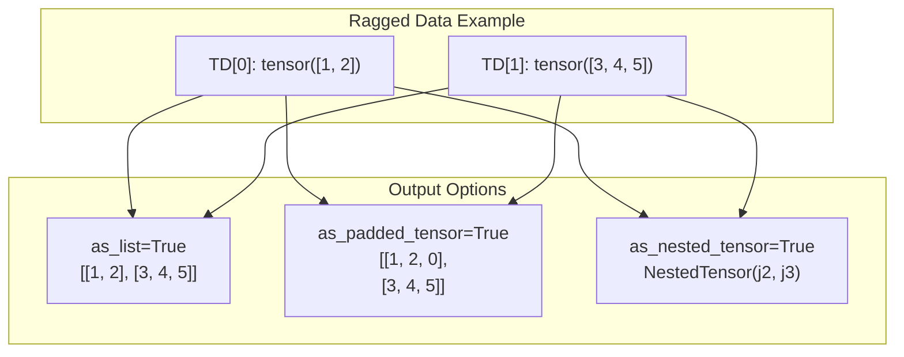

**Sources:** [tensordict/_lazy.py:1230-1297](), [tensordict/_lazy.py:1344-1372]()

---

## Exclusive Keys

LazyStackedTensorDict has a property `_has_exclusive_keys` that indicates whether all constituent TensorDicts share the same keys:

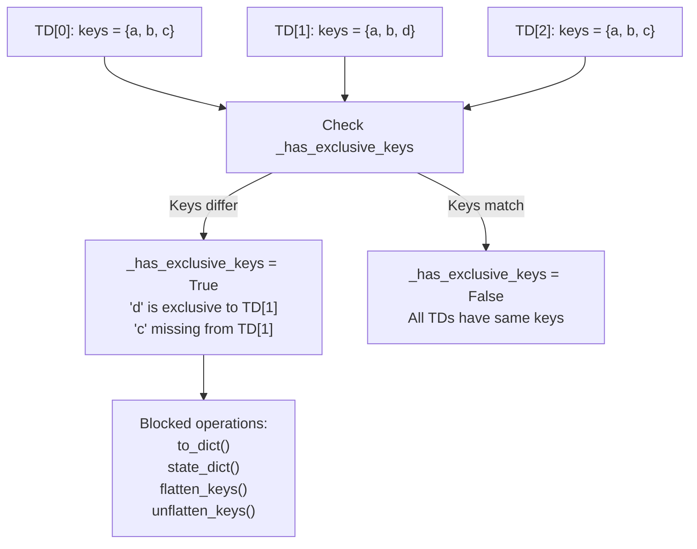

**Methods that fail with exclusive keys:**
- `to_dict()` [tensordict/_lazy.py:459-465]()
- `state_dict()` [tensordict/_lazy.py:535-541]()
- `flatten_keys()` [tensordict/_lazy.py:544-549]()
- `unflatten_keys()` [tensordict/_lazy.py:551-552]()

**Sources:** [tensordict/_lazy.py:444-456](), [tensordict/_lazy.py:161-173]()

---

## Batch Dimension Management

### Stack Dimension and Batch Size

The batch size of a LazyStackedTensorDict is computed by inserting the stack count at the `stack_dim`:

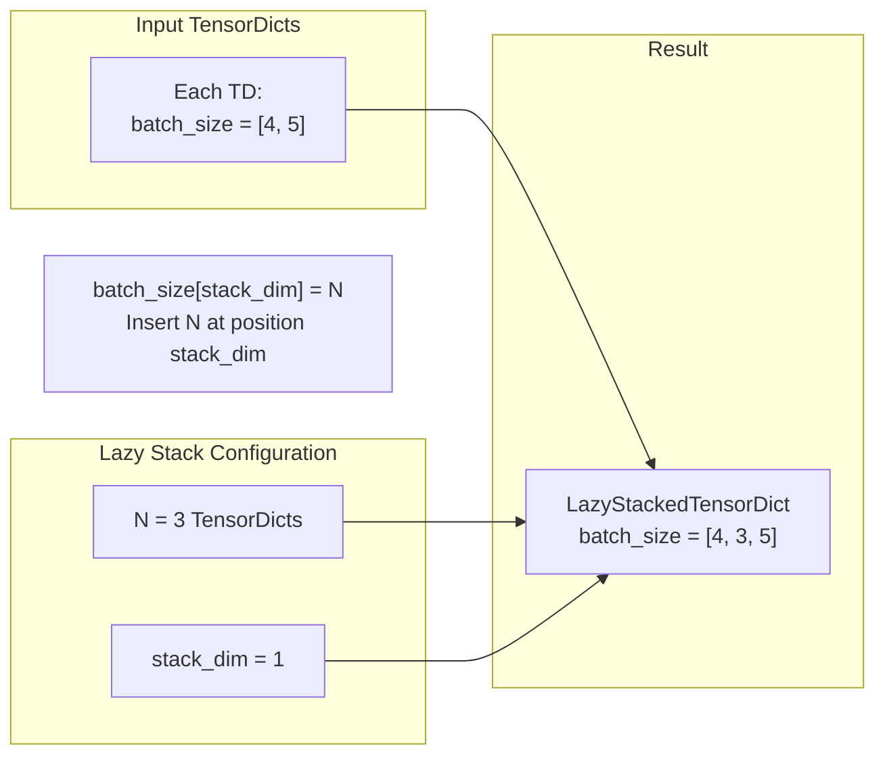

**Computation:** `_compute_batch_size()` inserts the number of TensorDicts at the stack dimension.

**Heterogeneous shapes:** If TensorDicts have different batch sizes (when `strict_shape=False`), mismatched dimensions are represented as `-1` in the batch size.

**Sources:** [tensordict/_lazy.py:723-729](), [tensordict/_lazy.py:688-721]()

### Changing Batch Size

Changing the batch size of a LazyStackedTensorDict is restricted:

```python
# Constraint: new_size must be at least as long as stack_dim
# because we can't change the number of stacked TensorDicts
```

**Sources:** [tensordict/_lazy.py:1944-1954]()

---

## Functional Operations and Hooks

### Hook System for vmap Integration

LazyStackedTensorDict supports hooks for integration with functorch's `vmap`:

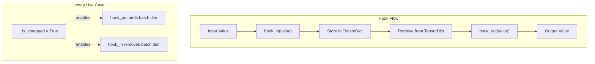

**Key hook methods:**
- `_add_batch_dim()`: Adds a batch dimension for vmap [tensordict/_lazy.py:1592-1631]()
- `_remove_batch_dim()`: Removes a batch dimension after vmap [tensordict/_lazy.py:1665-1703]()
- `_cached_add_batch_dims()`: Creates a vmapped lazy stack with hooks [tensordict/_lazy.py:1633-1663]()

**Sources:** [tensordict/_lazy.py:1592-1746]()

---

## Memory Efficiency and Materialization

### Lazy vs Eager Operations

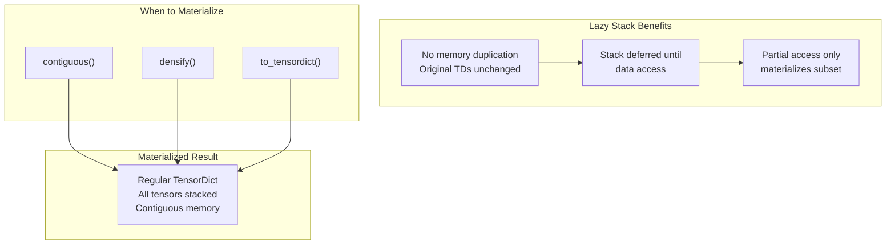

### Contiguous and Densify Operations

| Method | Purpose | Output | When to Use |
|--------|---------|--------|-------------|
| `contiguous()` | Convert to regular TensorDict | TensorDict with stacked tensors | Need contiguous memory |
| `densify()` | Handle ragged with nested tensors | TensorDict with nested/padded tensors | Preserve ragged structure |
| `to_tensordict()` | Alias for contiguous | TensorDict | Compatibility |

**Sources:** [tensordict/_lazy.py:1810-1821](), [tensordict/_lazy.py:1823-1886]()

---

## Specialized Operations

### Unbind Operation

Unbinding a LazyStackedTensorDict returns the original TensorDicts when unbinding along the stack dimension:

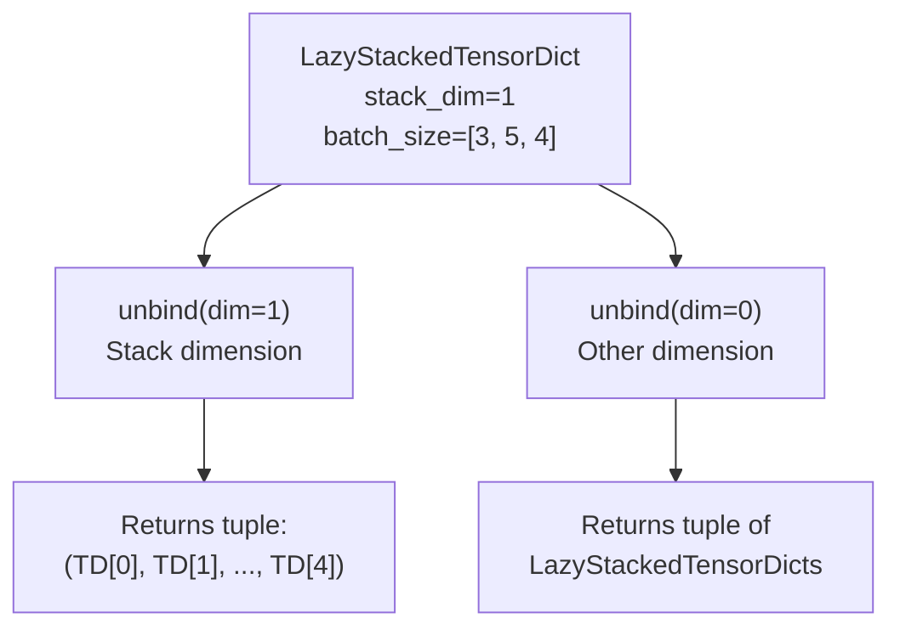

**Sources:** [tensordict/_lazy.py:1186-1200]()

### Select and Exclude

These operations filter keys while preserving the lazy structure:

```python
# _select(): Keep only specified keys
lazy_stack._select("key1", "key2", inplace=False)

# _exclude(): Remove specified keys  
lazy_stack._exclude("key1", "key2", inplace=False)
```

**Sources:** [tensordict/_lazy.py:2347-2379]()

---

## Apply Operations

### _apply_nest Method

The `_apply_nest` method applies a function across all TensorDicts in the stack:

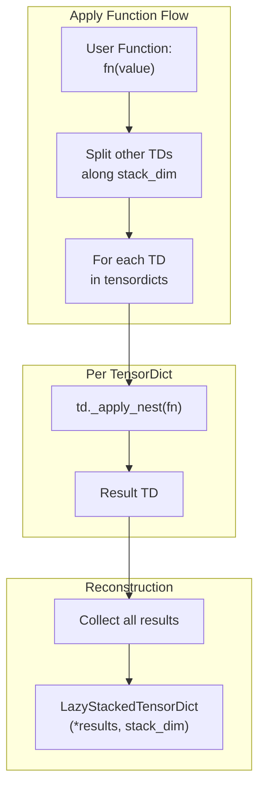

**Key parameters:**
- `call_on_nested`: Whether to call on nested TensorDicts
- `inplace`: Modify in place vs return new
- `filter_empty`: Remove None results
- `named`: Pass key names to function
- `is_leaf`: Custom leaf detection

**Sources:** [tensordict/_lazy.py:2216-2345]()

### Multithread Apply

For performance, LazyStackedTensorDict supports multithreaded apply operations:

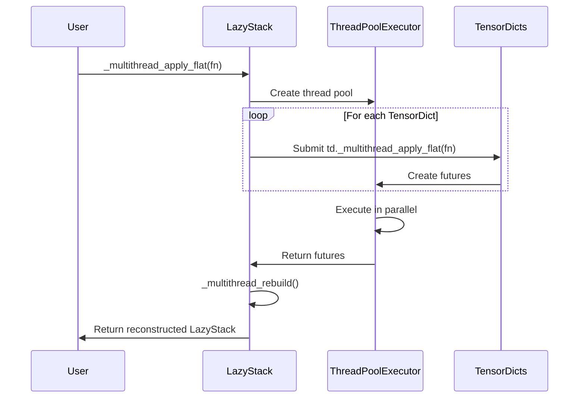

**Sources:** [tensordict/_lazy.py:2094-2149](), [tensordict/_lazy.py:2151-2214]()

---

## Memory-Mapped Storage

### Saving LazyStackedTensorDict to Disk

LazyStackedTensorDict can be memory-mapped, saving each constituent TensorDict in a separate subdirectory:

```
prefix/
├── meta.json          # Contains stack_dim and type info
├── 0/                 # First TensorDict
│   ├── meta.json
│   └── tensors...
├── 1/                 # Second TensorDict
│   ├── meta.json
│   └── tensors...
└── 2/                 # Third TensorDict
    └── ...
```

**Metadata structure:**
```json
{
  "_type": "LazyStackedTensorDict",
  "stack_dim": 0
}
```

**Sources:** [tensordict/_lazy.py:2928-2985](), [tensordict/_lazy.py:2987-3015]()

---

## Comparison Operations

LazyStackedTensorDict supports element-wise comparisons that return new LazyStackedTensorDict instances:

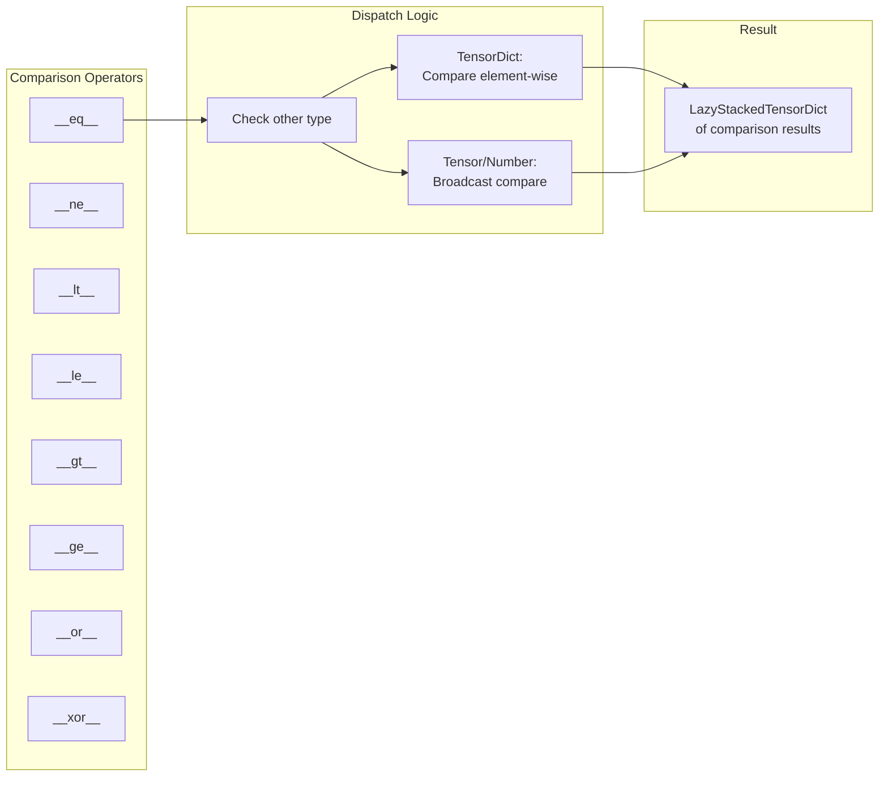

**Sources:** [tensordict/_lazy.py:2621-2681]()

---

## Reduction Operations

LazyStackedTensorDict supports reductions through `_cast_reduction`:

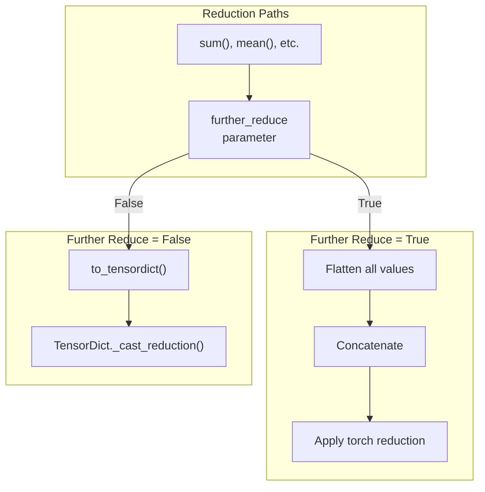

**Supported reductions:**
- `all()`, `any()`
- `sum()`, `mean()`, `std()`, `var()`
- `min()`, `max()`
- Along dimensions or across entire structure

**Sources:** [tensordict/_lazy.py:2683-2750](), [tensordict/_lazy.py:2752-2784]()

---

## Key Differences from TensorDict

| Aspect | TensorDict | LazyStackedTensorDict |
|--------|-----------|----------------------|
| **Storage** | Dictionary of tensors | List of TensorDicts |
| **Memory** | All tensors stored | References only |
| **Stacking** | Eager | Deferred |
| **Indexing** | Direct tensor indexing | Split across TensorDicts |
| **Contiguous** | Always | `contiguous()` required |
| **Exclusive Keys** | All entries match schema | Keys may differ across stack |
| **Batch Size Change** | Flexible | Constrained by stack_dim |

**Sources:** [tensordict/_lazy.py:176-225](), [tensordict/_td.py:150-243]()

---

## Code Entity Map

```mermaid
graph TB
    subgraph "Core Classes"
        LSTD["LazyStackedTensorDict<br/>_lazy.py:176"]
        KEYS_VIEW["_LazyStackedTensorDictKeysView<br/>_lazy.py:121"]
    end
    
    subgraph "Key Methods"
        INIT["__init__<br/>_lazy.py:255"]
        LAZY_STACK["lazy_stack<br/>_lazy.py:1429"]
        SPLIT_IDX["_split_index<br/>_lazy.py:824"]
        GET["_get_str<br/>_lazy.py:1300"]
        SET["_set_str<br/>_lazy.py:731"]
        GETITEM["__getitem__<br/>_lazy.py:2515"]
        SETITEM["__setitem__<br/>_lazy.py:2381"]
    end
    
    subgraph "Materialization"
        CONTIGUOUS["contiguous<br/>_lazy.py:1810"]
        DENSIFY["densify<br/>_lazy.py:1823"]
        TO_TD["to_tensordict"]
    end
    
    subgraph "Advanced Features"
        APPLY["_apply_nest<br/>_lazy.py:2216"]
        UNBIND["_unbind<br/>_lazy.py:1186"]
        VMAP["_add_batch_dim<br/>_lazy.py:1592"]
        MEMMAP["_memmap_<br/>_lazy.py:2928"]
    end
    
    LSTD --> INIT
    LSTD --> LAZY_STACK
    LSTD --> SPLIT_IDX
    LSTD --> GET
    LSTD --> SET
    LSTD --> GETITEM
    LSTD --> SETITEM
    LSTD --> CONTIGUOUS
    LSTD --> DENSIFY
    LSTD --> APPLY
    LSTD --> UNBIND
    LSTD --> VMAP
    LSTD --> MEMMAP
    
    LSTD --> KEYS_VIEW
```

**Sources:** [tensordict/_lazy.py:1-3100]()

---

