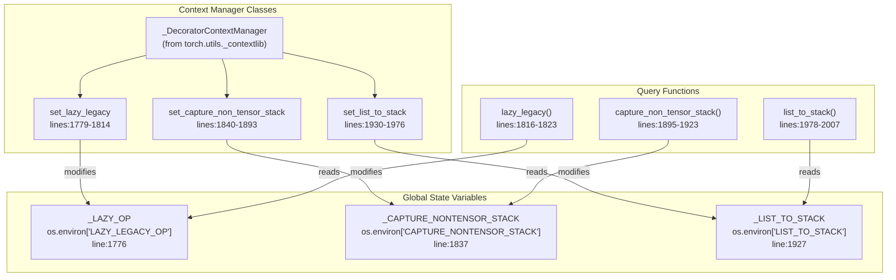
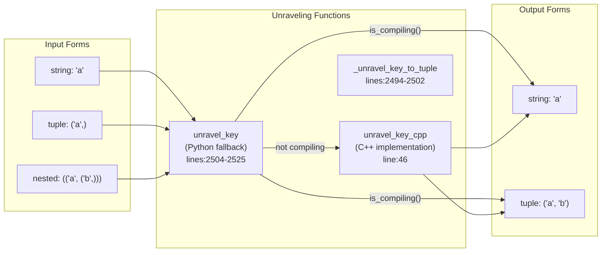
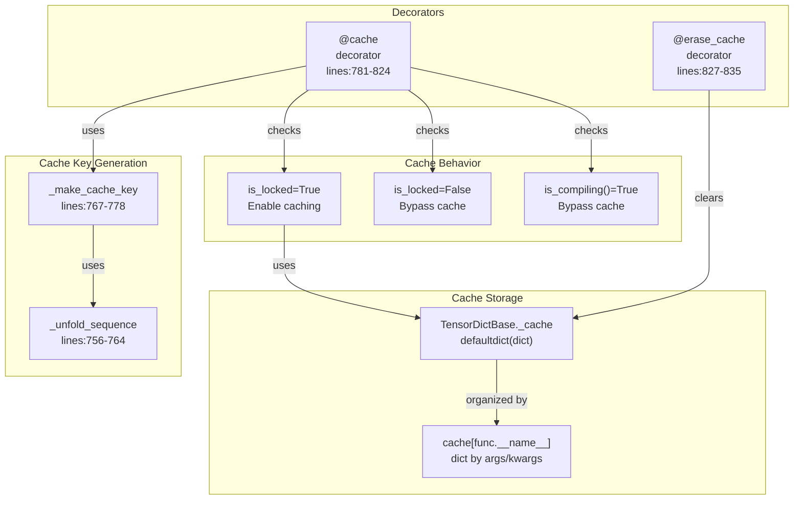
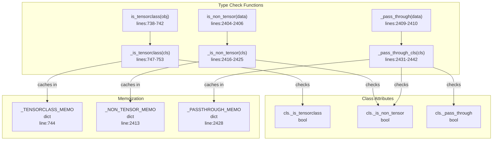

<!-- source: DeepWiki mcp.deepwiki.com · repo pytorch/tensordict · page 2.6 Utility Functions and Helpers · fetched 2026-10-21 -->

# Utility Functions and Context Managers

<details>
<summary>Relevant source files</summary>

The following files were used as context for generating this wiki page:

- [tensordict/utils.py](tensordict/utils.py)

</details>


This document covers the utility functions and context managers provided in [tensordict/utils.py](). These utilities support core TensorDict operations including nested key handling, runtime behavior configuration, caching, shape manipulation, and testing utilities.

For storage-related utilities (memory mapping, HDF5), see [5. Storage and Persistence](#5). For locking mechanisms specific to TensorDict operations, see [6.4 Locking and Thread Safety](#6.4).

---

## Overview of Utility Categories

The utilities in [tensordict/utils.py]() fall into several functional categories:

| Category | Purpose | Key Components |
|----------|---------|----------------|
| **Context Managers** | Control runtime behavior globally or within scope | `set_lazy_legacy`, `set_capture_non_tensor_stack`, `set_list_to_stack` |
| **Nested Key Handling** | Process and validate nested key structures | `unravel_key`, `is_nested_key`, `_unravel_key_to_tuple` |
| **Caching** | Optimize repeated operations | `cache` decorator, `erase_cache` decorator |
| **Shape Utilities** | Manipulate tensor shapes and indices | `expand_as_right`, `convert_ellipsis_to_idx`, `_getitem_batch_size` |
| **Type Checking** | Validate types and structures | `is_tensorclass`, `is_nested_key`, `is_non_tensor` |
| **Comparison & Testing** | Compare and validate TensorDict instances | `assert_close`, `isin`, `remove_duplicates` |
| **Internal Helpers** | Low-level utilities for internal use | `_parse_to`, `_split_tensordict`, `_encode_key_for_filesystem` |

Sources: [tensordict/utils.py:1-3243]()

---

## Context Managers for Runtime Control

TensorDict provides several context managers that control behavior globally or within a specific scope. These are implemented as decorators deriving from `_DecoratorContextManager`.

### Context Manager Architecture



Sources: [tensordict/utils.py:1774-2007]()

### set_lazy_legacy

Controls whether certain operations (`view`, `permute`, `transpose`, `squeeze`, `unsqueeze`) use lazy representations via `LazyStackedTensorDict` instead of eager execution.

```python
# As context manager
with set_lazy_legacy(True):
    td_permuted = td.permute(1, 0)  # Returns LazyStackedTensorDict
    
# As decorator
@set_lazy_legacy(False)
def process_data(td):
    return td.view(-1)  # Eager execution

# Persistent setting
set_lazy_legacy(True).set()  # Affects all subsequent calls
```

**Implementation Details:**
- Class: [tensordict/utils.py:1779-1814]()
- Query function: `lazy_legacy()` [tensordict/utils.py:1816-1823]()
- Environment variable: `LAZY_LEGACY_OP`
- Default: `False` [tensordict/utils.py:1775]()

Sources: [tensordict/utils.py:1774-1823]()

### set_capture_non_tensor_stack

Controls how identical non-tensor data is stacked. When `True`, identical values are captured as a single `NonTensorData` with the desired batch size. When `False`, creates a `NonTensorStack`.

```python
from tensordict import NonTensorData

# With capture enabled (default is False)
with set_capture_non_tensor_stack(True):
    result = torch.stack([NonTensorData("a"), NonTensorData("a")])
    # Result: NonTensorData("a", batch_size=[2])

# Without capture
with set_capture_non_tensor_stack(False):
    result = torch.stack([NonTensorData("a"), NonTensorData("a")])
    # Result: NonTensorStack(["a", "a"], stack_dim=0)
```

**Implementation Details:**
- Class: [tensordict/utils.py:1840-1893]()
- Query function: `capture_non_tensor_stack()` [tensordict/utils.py:1895-1923]()
- Environment variable: `CAPTURE_NONTENSOR_STACK`
- Default: `False` [tensordict/utils.py:1836]()

Sources: [tensordict/utils.py:1835-1923]()

### set_list_to_stack

Controls whether lists assigned to TensorDict are automatically stacked along the batch dimension or converted to numpy arrays wrapped in `NonTensorData`.

```python
with set_list_to_stack(True):
    td = TensorDict({"a": [torch.zeros(()), torch.ones(())]}, batch_size=2)
    assert (td["a"] == torch.tensor([0, 1])).all()
    assert td[0]["a"] == 0
    assert td[1]["a"] == 1
```

**Implementation Details:**
- Class: [tensordict/utils.py:1930-1976]()
- Query function: `list_to_stack()` [tensordict/utils.py:1978-2007]()
- Environment variable: `LIST_TO_STACK`
- Default: `"1"` (enabled) [tensordict/utils.py:1926]()

Sources: [tensordict/utils.py:1925-2007]()

---

## Nested Key Handling

TensorDict uses nested keys to represent hierarchical data structures. A `NestedKey` can be a string (flat key) or a tuple of strings (nested key path).

### Key Unraveling Pipeline



Sources: [tensordict/utils.py:44-49](), [tensordict/utils.py:2494-2539]()

### Core Key Functions

**unravel_key(key)**

Simplifies nested key structures to their canonical form:
- `"a"` → `"a"`
- `("a",)` → `"a"`
- `(("a", ("b",)))` → `("a", "b")`

Implementation: [tensordict/utils.py:2504-2525]()

**is_nested_key(key)**

Validates if a key is a proper `NestedKey` (string or tuple of strings):

```python
is_nested_key("a")                    # True
is_nested_key(("a", "b", "c"))        # True
is_nested_key(["a", "b"])             # True (lists treated as tuples)
is_nested_key(("a", 123))             # False (non-string element)
is_nested_key({})                     # False
```

Implementation: [tensordict/utils.py:519-526]()

**unravel_keys(*keys)** and **unravel_key_list(keys)**

Process multiple keys at once:
- `unravel_keys("a", ("b",), (("c", "d")))` → `("a", "b", ("c", "d"))`
- `unravel_key_list([("a",), "b"])` → `["a", "b"]`

Implementation: [tensordict/utils.py:2527-2539]()

### C++ Accelerated Functions

For performance, key unraveling has C++ implementations imported from `tensordict._C`:
- `unravel_key_cpp` [tensordict/utils.py:46]()
- `_unravel_key_to_tuple_cpp` [tensordict/utils.py:45]()
- `unravel_key_list_cpp` [tensordict/utils.py:47]()
- `unravel_keys_cpp` [tensordict/utils.py:48]()

These are automatically used when not compiling with `torch.compile`. During compilation, Python fallbacks are used.

Sources: [tensordict/utils.py:44-49](), [tensordict/utils.py:2494-2539]()

---

## Caching System

The caching system optimizes repeated operations on locked TensorDicts by memoizing results based on input arguments.

### Cache Architecture



Sources: [tensordict/utils.py:756-835]()

### Using the Cache Decorator

The `@cache` decorator stores return values for methods on locked TensorDicts:

```python
from tensordict import TensorDict
from tensordict.utils import cache

class CustomTensorDict(TensorDict):
    @cache
    def all_keys(self):
        # Expensive operation: collect all nested keys
        return set(self.keys(include_nested=True))

td = CustomTensorDict({("a", "b", "c", "d", "e", "f", "g"): 1.0}, [])
td.lock_()

# First call computes and caches
keys1 = td.all_keys()

# Subsequent calls retrieve from cache (much faster)
keys2 = td.all_keys()
```

**Behavior:**
- Only caches when `is_locked=True` [tensordict/utils.py:807]()
- Bypasses cache during `torch.compile` [tensordict/utils.py:807]()
- Does not cache `torch.Tensor` objects (to avoid memory issues) [tensordict/utils.py:816-819]()
- Cache keys are computed from arguments using `_make_cache_key` [tensordict/utils.py:813]()

**Cache Key Generation:**

The cache key minimizes memory footprint by:
- Converting tensors to their `id()` [tensordict/utils.py:763]()
- Recursively unfolding nested sequences [tensordict/utils.py:756-764]()
- Handling special cases like empty args/kwargs [tensordict/utils.py:770-771]()

Implementation: [tensordict/utils.py:767-778]()

### Erasing the Cache

The `@erase_cache` decorator clears the cache before executing a method:

```python
from tensordict.utils import erase_cache

class CustomTensorDict(TensorDict):
    @erase_cache
    def update_data(self, key, value):
        self._erase_cache()  # Explicit call
        return self.set(key, value)
```

This is useful when mutations invalidate cached results.

Implementation: [tensordict/utils.py:827-835]()

Sources: [tensordict/utils.py:756-835]()

---

## Shape and Index Utilities

### Shape Manipulation Functions

**expand_as_right(tensor, dest)**

Expands a tensor on the right to match another tensor's shape:

```python
tensor = torch.zeros(3, 4)
dest = torch.zeros(3, 4, 5)
result = expand_as_right(tensor, dest)
assert result.shape == torch.Size([3, 4, 5])
```

Implementation: [tensordict/utils.py:437-474]()

**expand_right(tensor, shape)**

Expands a tensor on the right to match a target shape:

```python
tensor = torch.zeros(3, 4)
shape = (3, 4, 5)
result = expand_right(tensor, shape)
assert result.shape == torch.Size([3, 4, 5])
```

Implementation: [tensordict/utils.py:477-498]()

### Index Processing

**convert_ellipsis_to_idx(idx, batch_size)**

Converts ellipsis (`...`) in indices to explicit `slice(None)`:

```python
idx = (..., 0)
batch_size = [1, 2, 3]
new_index = convert_ellipsis_to_idx(idx, batch_size)
# Result: (slice(None), slice(None), 0)
```

Implementation: [tensordict/utils.py:299-365]()

**_getitem_batch_size(batch_size, index)**

Computes the resulting batch size after indexing without performing the actual indexing:

```python
batch_size = torch.Size([4, 3, 2, 1])
idx = (None, ..., None)
result_size = _getitem_batch_size(batch_size, idx)
# Result: torch.Size([1, 4, 3, 2, 1, 1])
```

This is crucial for lazy operations where computing the actual result would be expensive.

Implementation: [tensordict/utils.py:1682-1771]()

### Size Inference

**infer_size_impl(shape, numel)**

Infers the complete shape when one dimension is `-1`:

```python
shape = [2, -1, 3]
numel = 24
result = infer_size_impl(shape, numel)
# Result: [2, 4, 3]  (since 2 * 4 * 3 = 24)
```

Copied from PyTorch for compatibility. Implementation: [tensordict/utils.py:372-399]()

Sources: [tensordict/utils.py:299-498](), [tensordict/utils.py:1682-1771]()

---

## Type Checking and Validation

### Type Checking Functions



Sources: [tensordict/utils.py:738-753](), [tensordict/utils.py:2404-2442]()

**is_tensorclass(obj)**

Checks if an object or class is a tensorclass:

```python
from tensordict import tensorclass

@tensorclass
class MyClass:
    x: torch.Tensor

is_tensorclass(MyClass)              # True
is_tensorclass(MyClass(x=torch.zeros(3)))  # True
is_tensorclass(torch.Tensor)         # False
```

The check uses memoization (`_TENSORCLASS_MEMO`) to cache results, but bypasses the cache during compilation.

Implementation: [tensordict/utils.py:738-753]()

**is_non_tensor(data)**

Checks if data is a non-tensor type (e.g., `NonTensorData` or `NonTensorStack`):

```python
from tensordict import NonTensorData

is_non_tensor(NonTensorData("hello"))  # True
is_non_tensor(torch.zeros(3))          # False
```

Implementation: [tensordict/utils.py:2404-2425]()

Sources: [tensordict/utils.py:738-753](), [tensordict/utils.py:2404-2442]()

---

## Comparison and Testing Utilities

### assert_close

Tests element-wise equality between two TensorDicts within tolerances:

```python
from tensordict import TensorDict
from tensordict.utils import assert_close

actual = TensorDict({"a": torch.tensor([1.0, 2.0])}, batch_size=[2])
expected = TensorDict({"a": torch.tensor([1.0001, 2.0001])}, batch_size=[2])

assert_close(actual, expected, rtol=1e-3, atol=1e-3)  # Passes
```

**Features:**
- Supports nested TensorDicts recursively [tensordict/utils.py:1302-1315]()
- Handles `LazyStackedTensorDict` by comparing constituent tensordicts [tensordict/utils.py:1258-1278]()
- Can compare intersection of keys with `intersection=True` [tensordict/utils.py:1290-1296]()
- Provides detailed error messages with key paths [tensordict/utils.py:1338-1339]()
- Skips non-tensor data [tensordict/utils.py:1303-1305]()

Implementation: [tensordict/utils.py:1207-1361]()

### isin

Tests if elements in one TensorDict are present in another along a dimension:

```python
td = TensorDict({
    "tensor1": torch.tensor([[1, 2, 3], [4, 5, 6], [1, 2, 3], [7, 8, 9]]),
}, batch_size=[4])

td_ref = TensorDict({
    "tensor1": torch.tensor([[1, 2, 3], [4, 5, 6], [10, 11, 12]]),
}, batch_size=[3])

in_reference = isin(td, td_ref, key="tensor1", dim=0)
# Result: tensor([True, True, True, False])
```

Implementation: [tensordict/utils.py:2160-2236]()

### remove_duplicates

Removes duplicate elements along a dimension based on a specific key:

```python
td = TensorDict({
    "tensor1": torch.tensor([[1, 2, 3], [4, 5, 6], [1, 2, 3], [7, 8, 9]]),
    "tensor2": torch.tensor([[10, 20], [30, 40], [40, 50], [50, 60]]),
}, batch_size=[4])

output = remove_duplicates(td, key="tensor1", dim=0)
# Output batch_size: [3] (duplicate [1,2,3] removed)

# With return_indices
output, indices = remove_duplicates(td, key="tensor1", dim=0, return_indices=True)
```

Implementation: [tensordict/utils.py:2252-2339]()

Sources: [tensordict/utils.py:1207-1361](), [tensordict/utils.py:2160-2339]()

---

## Internal Utilities

### Filesystem Key Encoding

TensorDict provides robust encoding for keys used as filesystem paths (e.g., in `PersistentTensorDict`).

**_encode_key_for_filesystem(key, robust=True)**

Encodes problematic characters using percent-encoding:

```python
_encode_key_for_filesystem("a/b/c")           # "a%2Fb%2Fc"
_encode_key_for_filesystem("key with spaces") # "key%20with%20spaces"
_encode_key_for_filesystem("normal_key")      # "normal_key"
```

Characters encoded include:
- Path separators: `/`, `\`
- Windows reserved: `<`, `>`, `:`, `"`, `|`, `?`, `*`
- Special: space, percent, null, control characters (0-31), DEL (127)

Implementation: [tensordict/utils.py:2541-2587]()

**_decode_key_from_filesystem(encoded_key)**

Reverses the encoding:

```python
_decode_key_from_filesystem("a%2Fb%2Fc")  # "a/b/c"
_decode_key_from_filesystem("key%20with%20spaces")  # "key with spaces"
```

Implementation: [tensordict/utils.py:2642-2679]()

Sources: [tensordict/utils.py:2541-2679]()

### Device and Dtype Utilities

**_parse_to(*args, **kwargs)**

Parses arguments for `.to()` operations, handling:
- Device specification (string, `torch.device`, or index)
- Dtype specification
- Non-blocking transfers
- Batch size updates
- Pin memory settings
- Thread count for operations

Returns a tuple of parsed values for use in device transfer operations.

Implementation: [tensordict/utils.py:1069-1115]()

**Dtype Mappings:**

Global dictionaries for dtype conversion:
- `NUMPY_TO_TORCH_DTYPE_DICT`: Maps NumPy dtypes to PyTorch dtypes [tensordict/utils.py:512]()
- `TORCH_TO_NUMPY_DTYPE_DICT`: Maps PyTorch dtypes to NumPy dtypes [tensordict/utils.py:514-516]()
- `_STR_DTYPE_TO_DTYPE`: Maps string representations to `torch.dtype` [tensordict/utils.py:231]()

Sources: [tensordict/utils.py:1069-1115](), [tensordict/utils.py:501-516]()

### Splitting and Distribution

**_split_tensordict(td, chunksize, num_chunks, num_workers, dim, use_generator, to_tensordict, shuffle)**

Splits a TensorDict for parallel processing:

```python
# Split by number of chunks
splits = _split_tensordict(td, chunksize=None, num_chunks=4, num_workers=4, dim=0)

# Split by chunk size
splits = _split_tensordict(td, chunksize=10, num_chunks=None, num_workers=4, dim=0)

# As generator with shuffling
generator = _split_tensordict(
    td, chunksize=10, num_chunks=None, num_workers=4, dim=0,
    use_generator=True, shuffle=True
)
```

Features:
- Supports both fixed chunk size and fixed number of chunks
- Can return generator for memory efficiency
- Optional shuffling (requires `use_generator=True`)
- Controls materialization with `to_tensordict` flag

Implementation: [tensordict/utils.py:986-1066]()

Sources: [tensordict/utils.py:986-1066]()

### Profiling with timeit

The `timeit` class provides a simple profiling decorator and context manager:

```python
from tensordict.utils import timeit

# As decorator
@timeit("my_function")
def process_data(td):
    return td.apply(lambda x: x * 2)

# As context manager
with timeit("my_operation"):
    result = expensive_operation()

# Print statistics
timeit.print()
# Output: my_function took 1.234 msec (total = 5.678 sec)

# Reset statistics
timeit.erase()
```

The class maintains a registry (`_REG`) that tracks:
- Average time per call
- Total time across all calls
- Call count

Implementation: [tensordict/utils.py:648-694]()

Sources: [tensordict/utils.py:648-694]()

---

## Locking Utilities

**lock_blocked(func)**

Decorator that prevents execution when a TensorDict is locked:

```python
from tensordict.utils import lock_blocked

class MyTensorDict(TensorDict):
    @lock_blocked
    def unsafe_operation(self):
        # This will raise RuntimeError if tensordict is locked
        self._tensordict["new_key"] = value
```

The decorator checks:
- `ignore_lock` kwarg to bypass the check [tensordict/utils.py:889]()
- `is_locked` property [tensordict/utils.py:890]()
- `inplace` kwarg to allow in-place modifications [tensordict/utils.py:891]()

Raises `RuntimeError` with message: `"Cannot modify locked TensorDict. For in-place modification, consider using the set_() method and make sure the key is present."` [tensordict/utils.py:243-246]()

Implementation: [tensordict/utils.py:883-896]()

Sources: [tensordict/utils.py:883-896]()

---

## Summary Table of Key Utilities

| Function/Class | Purpose | Location |
|----------------|---------|----------|
| `set_lazy_legacy` | Control lazy operation mode | [1779-1814]() |
| `set_capture_non_tensor_stack` | Control non-tensor stacking | [1840-1893]() |
| `set_list_to_stack` | Control list-to-stack conversion | [1930-1976]() |
| `cache` | Cache decorator for locked TDs | [781-824]() |
| `unravel_key` | Simplify nested keys | [2504-2525]() |
| `is_nested_key` | Validate nested keys | [519-526]() |
| `expand_as_right` | Expand tensor on right | [437-474]() |
| `convert_ellipsis_to_idx` | Convert ellipsis to slices | [299-365]() |
| `_getitem_batch_size` | Compute result shape | [1682-1771]() |
| `is_tensorclass` | Check tensorclass type | [738-753]() |
| `is_non_tensor` | Check non-tensor type | [2404-2425]() |
| `assert_close` | Compare TensorDicts | [1207-1361]() |
| `isin` | Test element membership | [2160-2236]() |
| `remove_duplicates` | Remove duplicate elements | [2252-2339]() |
| `_encode_key_for_filesystem` | Encode keys for paths | [2541-2587]() |
| `_split_tensordict` | Split for parallel processing | [986-1066]() |
| `timeit` | Profiling decorator | [648-694]() |
| `lock_blocked` | Prevent locked modifications | [883-896]() |

Sources: [tensordict/utils.py:1-3243]()

---

