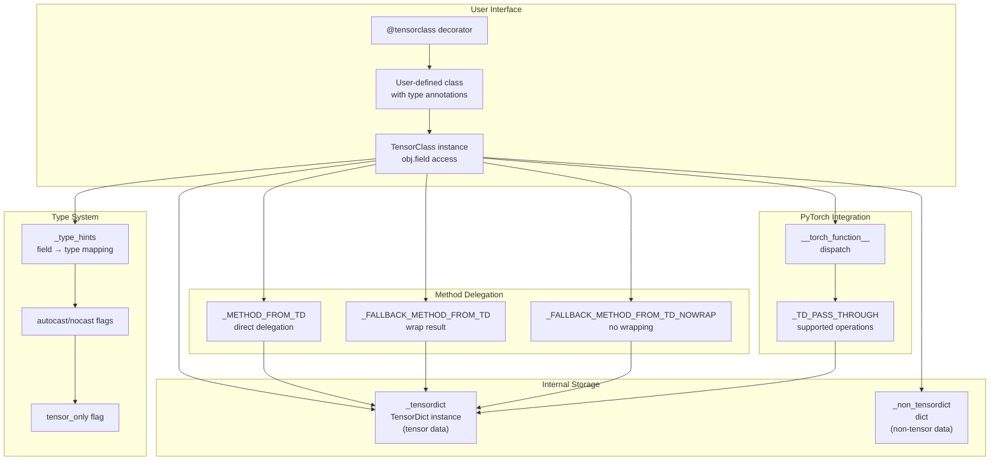
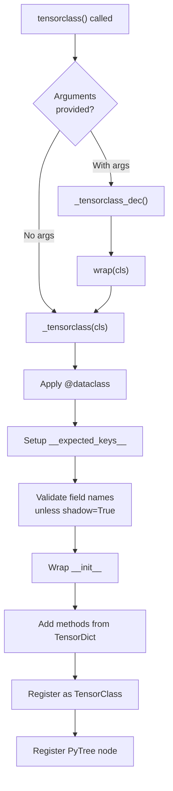
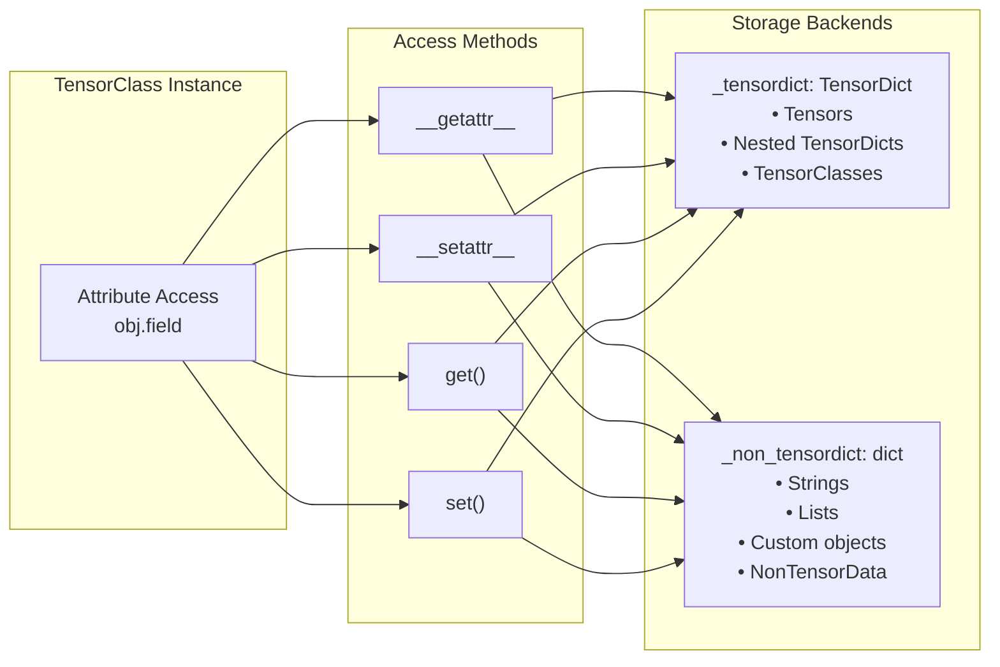
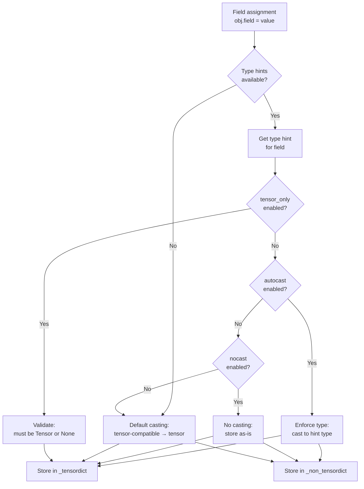
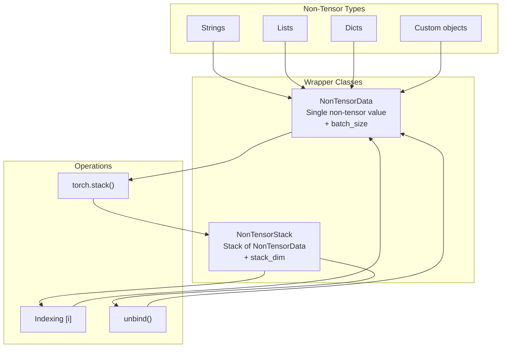
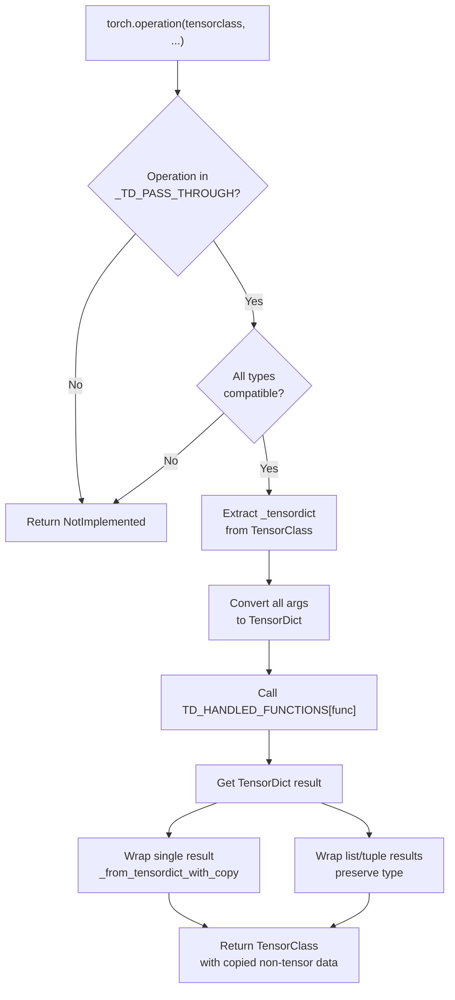
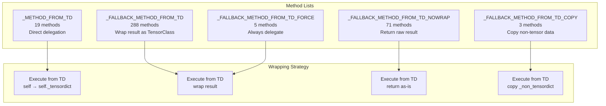
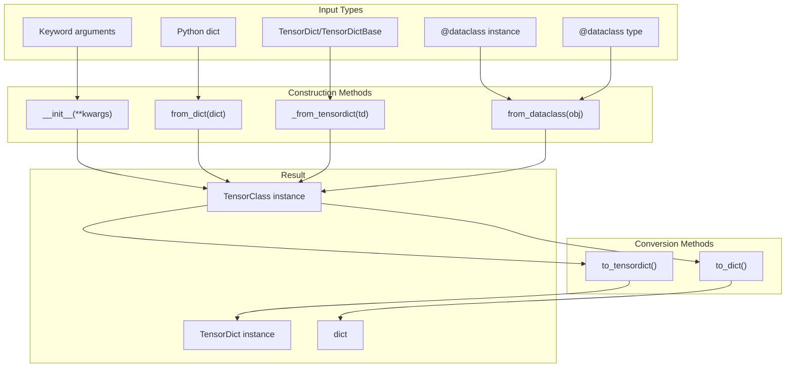
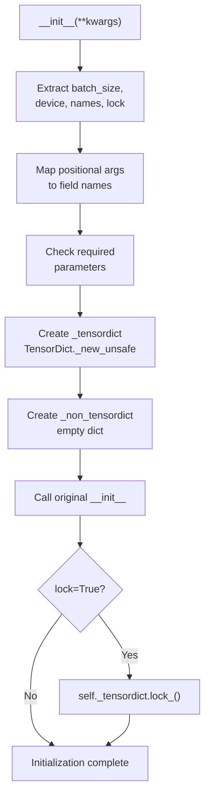

<!-- source: DeepWiki mcp.deepwiki.com · repo pytorch/tensordict · page 3 TensorClass System · fetched 2026-10-21 -->

# TensorClass System

<details>
<summary>Relevant source files</summary>

The following files were used as context for generating this wiki page:

- [tensordict/_torch_func.py](tensordict/_torch_func.py)
- [tensordict/functional.py](tensordict/functional.py)
- [tensordict/tensorclass.py](tensordict/tensorclass.py)
- [test/test_tensorclass.py](test/test_tensorclass.py)

</details>


## Purpose and Scope

The TensorClass system provides a dataclass-like interface for creating structured tensor collections with type annotations and attribute-based access. It wraps the underlying `TensorDict` functionality with a familiar Python dataclass syntax, enabling users to define custom classes that behave like dataclasses while leveraging TensorDict's batching, indexing, and device management capabilities.

This page covers the TensorClass decorator, configuration options, internal storage architecture, type system, and PyTorch integration. For details about the underlying TensorDict implementation, see [Core TensorDict System](#2). For neural network integration using TensorClass instances, see [Neural Network Integration](#4).

**Sources:** [tensordict/tensorclass.py:770-896](), [tensordict/tensorclass.py:1-50]()

---

## System Overview

TensorClass transforms a Python dataclass into a specialized container that:
- Stores tensor data in an internal `TensorDict` instance
- Stores non-tensor data (strings, lists, custom objects) separately
- Provides attribute-based access (`obj.field`) instead of dictionary-based access (`td["key"]`)
- Inherits all TensorDict operations (indexing, stacking, shape manipulation)
- Integrates seamlessly with PyTorch operations via `__torch_function__`

### Architecture Overview



**Sources:** [tensordict/tensorclass.py:900-1119](), [tensordict/tensorclass.py:1262-1284]()

---

## The @tensorclass Decorator

The `@tensorclass` decorator is the primary interface for creating TensorClass types. It accepts configuration flags that control type conversion, mutability, and validation behavior.

### Configuration Flags

| Flag | Type | Default | Description |
|------|------|---------|-------------|
| `autocast` | bool | False | Enforces type annotations when setting attributes |
| `frozen` | bool | False | Makes the instance immutable (like dataclass frozen) |
| `nocast` | bool | False | Prevents automatic casting of tensor-compatible types |
| `shadow` | bool | False | Disables validation against TensorDict reserved names |
| `tensor_only` | bool | False | Requires all fields to be tensors (significant performance boost) |

### Usage Patterns

```python
# Basic usage - no arguments
@tensorclass
class MyData:
    x: torch.Tensor
    y: torch.Tensor

# With configuration
@tensorclass(autocast=True, frozen=True)
class ConfiguredData:
    x: torch.Tensor
    label: int  # Will remain as int due to autocast
```

### Decorator Implementation Flow



**Sources:** [tensordict/tensorclass.py:770-896](), [tensordict/tensorclass.py:570-629](), [tensordict/tensorclass.py:900-1119]()

---

## Internal Data Storage

TensorClass instances maintain two separate storage backends to handle tensor and non-tensor data efficiently.

### Storage Architecture



### Attribute Resolution Process

When accessing `obj.field`, the system follows this priority:

1. **Instance `__dict__`**: Check for instance attributes
2. **Class attributes**: Check for class-level attributes (properties, methods)
3. **`_tensordict`**: Check for tensor data
4. **`_non_tensordict`**: Check for non-tensor data
5. **Raise AttributeError**: If not found in any location

### Storage Initialization

During `__init__`, the wrapper creates the storage backends:

```python
# From the initialization wrapper
super(type(self), self).__setattr__(
    "_tensordict",
    TensorDict._new_unsafe(
        {},
        batch_size=torch.Size(batch_size),
        device=device,
        names=names,
    ),
)
self.__setattr_parent__("_non_tensordict", {})
self.__setattr_parent__("_is_initialized", True)
```

**Sources:** [tensordict/tensorclass.py:1262-1284](), [tensordict/tensorclass.py:975-987](), [tensordict/tensorclass.py:1165-1319]()

---

## Type System and Casting Behavior

The TensorClass type system determines how Python values are converted to tensors and how type annotations are enforced.

### Type Annotation Processing



### Type Hint Retrieval

The `_get_type_hints` function extracts type annotations and handles local class references:

| Situation | Behavior |
|-----------|----------|
| Forward references | Attempts to resolve from parent frames |
| `tensor_only=True` | Validates all types are `torch.Tensor`, tensor subtypes, or `Optional[Tensor]` |
| Type errors | Falls back gracefully, disables auto-mapping in `from_dict` |
| `Any` type | Treated as a special marker, no type enforcement |

### Casting Examples

```python
# autocast=False (default): tensor-compatible types → tensor
@tensorclass
class Default:
    x: torch.Tensor
    
obj = Default(x=1)  # x becomes torch.tensor(1)

# autocast=True: enforce type annotations
@tensorclass(autocast=True)
class Enforced:
    x: int
    
obj = Enforced(x=1)  # x remains int (not a tensor)

# nocast=True: no automatic casting
@tensorclass(nocast=True)
class NoCast:
    x: Any
    
obj = NoCast(x=1)  # x remains int

# tensor_only=True: all fields must be tensors
@tensorclass(tensor_only=True)
class TensorOnly:
    x: torch.Tensor
    y: Optional[torch.Tensor]  # Only Tensor or None allowed
```

**Sources:** [tensordict/tensorclass.py:1331-1449](), [tensordict/tensorclass.py:570-629](), [tensordict/tensorclass.py:1386-1417]()

---

## Non-Tensor Data Handling

TensorClass supports mixed data types by wrapping non-tensor data in special container classes.

### NonTensorData and NonTensorStack



### NonTensorData Structure

`NonTensorData` wraps a single non-tensor value with batch semantics:

- **`data`**: The actual non-tensor value
- **`batch_size`**: The batch dimensions this data applies to
- **`device`**: Device information (always None for non-tensors)

### NonTensorStack Structure

`NonTensorStack` represents a stack of non-tensor values:

- **`tensors`**: List of `NonTensorData` instances or raw values
- **`stack_dim`**: The dimension along which values are stacked

### Indexing Behavior

Non-tensor data has special indexing semantics:

| Operation | Behavior |
|-----------|----------|
| `obj[0].string_field` | Returns the same string (no indexing) |
| `obj[:2].string_field` | Returns the same string |
| `torch.stack([obj1, obj2]).string_field` | Returns `NonTensorStack` if `capture_non_tensor_stack=True` |

### Example Usage

```python
@tensorclass
class MixedData:
    tensor_field: torch.Tensor
    string_field: str
    list_field: list

data = MixedData(
    tensor_field=torch.randn(3, 4),
    string_field="hello",
    list_field=[1, 2, 3],
    batch_size=[3]
)

# Indexing
print(data[0].tensor_field.shape)  # torch.Size([4])
print(data[0].string_field)         # "hello" (same for all indices)

# Stacking with capture enabled
with set_capture_non_tensor_stack(True):
    stacked = torch.stack([data, data.clone()])
    # stacked.string_field is a NonTensorStack
```

**Sources:** [tensordict/tensorclass.py:2127-2532](), [tensordict/tensorclass.py:560-568](), [test/test_tensorclass.py:1102-1138]()

---

## PyTorch Function Integration

TensorClass integrates with PyTorch operations through the `__torch_function__` protocol, enabling operations like `torch.stack`, `torch.cat`, `torch.zeros_like` to work seamlessly with TensorClass instances.

### Function Dispatch Mechanism



### Supported Operations

The `_TD_PASS_THROUGH` dictionary defines supported PyTorch operations:

| Category | Operations |
|----------|------------|
| Creation | `torch.zeros_like`, `torch.ones_like`, `torch.empty_like`, `torch.full_like`, `torch.rand_like`, `torch.randn_like` |
| Stacking | `torch.cat`, `torch.stack` |
| Shape | `torch.squeeze`, `torch.unsqueeze`, `torch.flatten`, `torch.unflatten`, `torch.permute` |
| Indexing | `torch.gather`, `torch.split`, `torch.unbind` |
| Cloning | `torch.clone` |
| Autograd | `torch.autograd.grad` |

### Implementation Details

The `__torch_function__` method:

1. **Validates** the operation is supported and types are compatible
2. **Extracts** the underlying `_tensordict` from TensorClass instances
3. **Delegates** to the corresponding `TD_HANDLED_FUNCTIONS` implementation
4. **Wraps** the result back into a TensorClass with copied non-tensor data
5. **Preserves** list/tuple structures for operations that return multiple results

### Metadata Handling

Special operations clear metadata in their return values:

- **`all()`, `any()`**: Clear non-tensor data in `_CLEAR_METADATA` set
- **Reduction operations**: May remove non-tensor fields depending on context

**Sources:** [tensordict/tensorclass.py:901-933](), [tensordict/tensorclass.py:148-167](), [tensordict/tensorclass.py:1128-1163](), [tensordict/_torch_func.py:1-958]()

---

## Method Delegation to TensorDict

TensorClass delegates most operations to the underlying `_tensordict` instance through a sophisticated method wrapping system.

### Method Categories



### Method Wrapping Implementation

The `_wrap_td_method` function creates wrapper methods that:

1. **Extract** the underlying `_tensordict`
2. **Call** the method on `_tensordict`
3. **Wrap** the result back into the TensorClass type (if needed)
4. **Preserve** or copy non-tensor data depending on the operation

### Key Method Categories

| Category | Count | Examples | Behavior |
|----------|-------|----------|----------|
| Direct delegation | 19 | `dumps`, `load_`, `memmap`, `save` | Execute from TensorDict, reference to self |
| Standard fallback | 288 | `add`, `clone`, `expand`, `reshape` | Execute from TensorDict, wrap result |
| No wrap | 71 | `batch_size`, `device`, `is_locked`, `shape` | Execute from TensorDict, return raw result |
| Forced | 5 | `__ge__`, `__gt__`, `__le__`, `__lt__` | Always delegate to TensorDict |
| Copy metadata | 3 | `clone`, `copy` | Execute and copy `_non_tensordict` |

### Example Method Wrapping

```python
# Simplified version of _wrap_td_method
def _wrap_td_method(method_name, no_wrap=False, copy_non_tensor=False):
    def wrapper(self, *args, **kwargs):
        # Get the method from TensorDict
        method = getattr(self._tensordict, method_name)
        # Call it
        result = method(*args, **kwargs)
        
        if no_wrap:
            return result
        elif copy_non_tensor:
            return type(self)._from_tensordict(
                result, non_tensordict=dict(self._non_tensordict)
            )
        else:
            return type(self)._from_tensordict(result)
    return wrapper
```

**Sources:** [tensordict/tensorclass.py:169-550](), [tensordict/tensorclass.py:1690-1769](), [tensordict/tensorclass.py:1039-1063]()

---

## TensorClass Construction and Conversion

TensorClass provides multiple pathways for creating instances and converting between TensorClass, TensorDict, and dataclass representations.

### Construction Methods



### from_dataclass Function

The `from_dataclass` function converts between dataclass and TensorClass:

```python
# Convert a dataclass type to tensorclass type
MyTensorClass = from_dataclass(MyDataClass, autocast=True)

# Convert a dataclass instance to tensorclass instance
instance = from_dataclass(dataclass_obj, dest_cls=MyTensorClass)

# Modify a dataclass type in-place
from_dataclass(MyDataClass, inplace=True, tensor_only=True)
```

**Function Parameters:**

| Parameter | Type | Description |
|-----------|------|-------------|
| `obj` | Any | Dataclass instance or type |
| `dest_cls` | Type \| None | Target TensorClass type for instances |
| `auto_batch_size` | bool | Automatically compute batch size |
| `batch_dims` | int \| None | Number of batch dimensions |
| `batch_size` | torch.Size \| None | Explicit batch size |
| `frozen` | bool | Make instance immutable |
| `autocast` | bool | Enable type casting |
| `nocast` | bool | Disable type casting |
| `tensor_only` | bool | Require all fields to be tensors |
| `inplace` | bool | Modify dataclass type in-place |
| `device` | torch.device \| None | Device for tensors |

### _from_tensordict Method

The `_from_tensordict` classmethod creates a TensorClass instance from a TensorDict:

```python
@tensorclass
class MyData:
    x: torch.Tensor
    y: str

td = TensorDict({"x": torch.randn(3), "y": "hello"}, batch_size=[3])
tc = MyData._from_tensordict(td, non_tensordict={"y": "hello"})
```

This method:
- Wraps the TensorDict as `_tensordict`
- Accepts optional `non_tensordict` dict for non-tensor fields
- Bypasses `__init__` validation
- Used internally by method delegation system

### Conversion Utilities

**`to_tensordict()`**: Returns the underlying `_tensordict`, optionally including non-tensor data as nested fields.

**`to_dict()`**: Converts the entire TensorClass to a nested dictionary representation.

**Sources:** [tensordict/tensorclass.py:631-767](), [tensordict/tensorclass.py:1451-1530](), [tensordict/tensorclass.py:3224-3236](), [tensordict/tensorclass.py:3237-3242]()

---

## Key Implementation Details

### Field Validation

During decorator application, field names are validated against TensorDict reserved attributes (unless `shadow=True`):

```python
if not shadow:
    for attr in expected_keys:
        if attr in dir(TensorDict) and attr not in ("_is_non_tensor", "data"):
            raise AttributeError(
                f"Attribute name {attr} can't be used with @tensorclass"
            )
```

### Initialization Flow



### ClassVar Handling

`ClassVar` fields are excluded from `__expected_keys__` and are not stored in `_tensordict` or `_non_tensordict`:

```python
expected_keys = cls.__expected_keys__ = {
    field.name for field in dataclasses.fields(cls)
}
```

The `dataclasses.fields()` function automatically filters out `ClassVar` fields.

### Pickle Support

TensorClass implements custom `__getstate__` and `__setstate__` methods for serialization:

- **`__getstate__`**: Returns a tuple of `(_tensordict, _non_tensordict, type(self))`
- **`__setstate__`**: Reconstructs the instance from the state tuple

### PyTree Registration

TensorClass instances are automatically registered as PyTree nodes, enabling use with `torch.utils._pytree.tree_map` and similar utilities:

```python
_register_td_node(cls)
_pytree._CONSTRUCTORS[cls] = _pytree._tensorclass_constructor
```

**Sources:** [tensordict/tensorclass.py:1165-1319](), [tensordict/tensorclass.py:943-964](), [tensordict/tensorclass.py:3028-3066](), [tensordict/tensorclass.py:1105-1119]()

---

## Performance Considerations

### tensor_only Mode

When `tensor_only=True`, TensorClass uses optimized attribute access methods that skip non-tensor data checks:

```python
if tensor_only:
    cls.__getattr__ = _getattr_tensor_only
else:
    cls.__getattr__ = _getattr
```

This provides **significant performance improvements** for use cases where all fields are guaranteed to be tensors or `None`.

### Method Resolution Order

The attribute resolution process checks locations in this order for optimal performance:

1. Instance `__dict__` (fastest)
2. Class attributes (properties, methods)
3. `_tensordict` (main storage)
4. `_non_tensordict` (fallback)

### Memory Efficiency

TensorClass shares the underlying `_tensordict` when possible:

- **Indexing operations** create views into the same storage
- **Method calls** often return new TensorClass instances that share non-tensor data references
- **Consolidation** can reduce memory fragmentation by storing all tensors in a single buffer

**Sources:** [tensordict/tensorclass.py:974-987](), [tensordict/tensorclass.py:1386-1417]()

---

