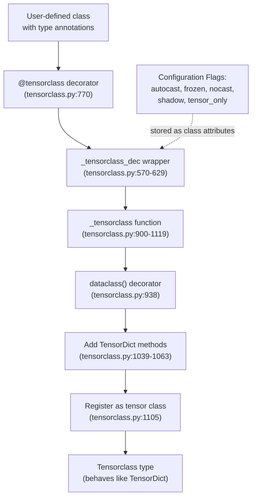
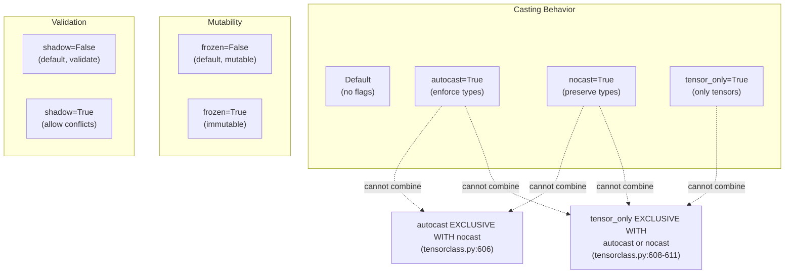
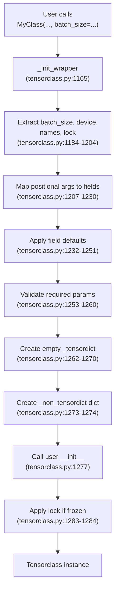
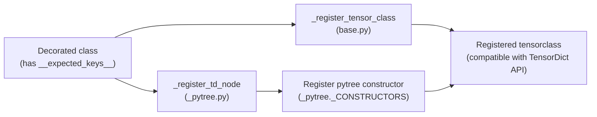
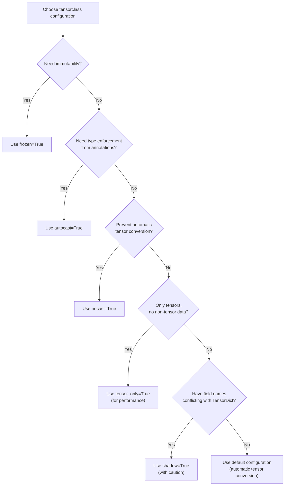

<!-- source: DeepWiki mcp.deepwiki.com · repo pytorch/tensordict · page 3.1 Creating and Configuring TensorClasses · fetched 2026-10-21 -->

# Creating and Configuring TensorClasses

<details>
<summary>Relevant source files</summary>

The following files were used as context for generating this wiki page:

- [tensordict/_torch_func.py](tensordict/_torch_func.py)
- [tensordict/functional.py](tensordict/functional.py)
- [tensordict/tensorclass.py](tensordict/tensorclass.py)
- [test/test_tensorclass.py](test/test_tensorclass.py)

</details>


This document explains how to create tensorclass types using the `@tensorclass` decorator and the `from_dataclass` function, including all configuration options that control type casting, mutability, and field validation behavior.

For information about tensorclass internal storage mechanisms and the type system, see [TensorClass Data Storage and Type System](#3.2). For handling non-tensor data types, see [Mixed Data Types and NonTensorData](#3.3).

---

## The @tensorclass Decorator

The `@tensorclass` decorator transforms a Python dataclass into a tensorclass, which is a specialized dataclass that can execute tensor operations. The decorator is defined in [tensordict/tensorclass.py:770-897]() and can be applied with or without configuration arguments.

### Basic Usage Patterns

The decorator supports three invocation patterns:

```python
# Pattern 1: Direct application (no arguments)
@tensorclass
class MyData:
    x: torch.Tensor
    y: torch.Tensor

# Pattern 2: With empty parentheses
@tensorclass()
class MyData:
    x: torch.Tensor
    y: torch.Tensor

# Pattern 3: With configuration flags
@tensorclass(autocast=True, frozen=False)
class MyData:
    x: torch.Tensor
    y: torch.Tensor
```

All three patterns are handled by the decorator's implementation in [tensordict/tensorclass.py:880-896](), which detects whether arguments are provided based on the first parameter type.

### Decorator Application Flow



**Diagram: Tensorclass Decorator Transformation Pipeline**

Sources: [tensordict/tensorclass.py:570-629](), [tensordict/tensorclass.py:770-897](), [tensordict/tensorclass.py:900-1119]()

---

## Configuration Flags

The `@tensorclass` decorator accepts five boolean configuration flags that control type casting, mutability, and validation behavior. These flags are processed by `_tensorclass_dec` in [tensordict/tensorclass.py:577-628]().

### Flag Definitions and Effects

| Flag | Default | Purpose | Incompatible With |
|------|---------|---------|-------------------|
| `autocast` | `False` | Enforces type annotations when setting attributes | `nocast`, `tensor_only` |
| `frozen` | `False` | Makes tensorclass immutable after creation | None |
| `nocast` | `False` | Prevents automatic tensor conversion of compatible types | `autocast`, `tensor_only` |
| `shadow` | `False` | Allows field names that conflict with TensorDict attributes | None |
| `tensor_only` | `False` | Requires all fields to be tensors or tensor-compatible | `autocast`, `nocast` |

Sources: [tensordict/tensorclass.py:577-628](), [tensordict/tensorclass.py:788-801]()

### autocast Flag

When `autocast=True`, the tensorclass enforces type annotations when attributes are set. Non-tensor data is stored as-is rather than being converted to tensors.

**Type Hint Processing:** Type hints are extracted in [tensordict/tensorclass.py:1331-1434]() using `get_type_hints()`. The hints are stored in the class's `_type_hints` attribute and used during attribute setting operations.

**Example Behavior:**
```python
@tensorclass(autocast=True)
class Data:
    a: int
    b: torch.Tensor

data = Data(a=0, b=0)
# data.a is int (not converted to tensor)
# data.b is torch.Tensor (converted from int 0)
```

Sources: [tensordict/tensorclass.py:788-790](), [tensordict/tensorclass.py:1331-1434](), [test/test_tensorclass.py:826-840]()

### frozen Flag

When `frozen=True`, the tensorclass becomes immutable after initialization. This is implemented by locking the underlying `_tensordict` in [tensordict/tensorclass.py:1283-1284]().

**Lock Behavior:**
- Prevents modification of existing fields
- Prevents addition of new fields
- Makes the instance hashable (can be used as dictionary keys)
- Compatible with `dataclasses.FrozenInstanceError` semantics

**Implementation:** The frozen flag sets `lock=True` in the `__init__` wrapper [tensordict/tensorclass.py:1205-1206]() and automatically locks the tensordict at [tensordict/tensorclass.py:1283-1284]().

Sources: [tensordict/tensorclass.py:790-792](), [tensordict/tensorclass.py:1205-1206](), [tensordict/tensorclass.py:1283-1284](), [test/test_tensorclass.py:925-968]()

### nocast Flag

When `nocast=True`, tensor-compatible types (int, float, np.ndarray, etc.) are NOT automatically converted to tensors. This preserves the original Python types.

**Example Behavior:**
```python
@tensorclass(nocast=True)
class Data:
    a: Any

data = Data(a=1)
# data.a is int (not converted to tensor)
```

**Mutual Exclusivity:** The decorator validates that `nocast` and `autocast` are not both True in [tensordict/tensorclass.py:606-607]().

Sources: [tensordict/tensorclass.py:793-795](), [tensordict/tensorclass.py:606-607](), [test/test_tensorclass.py:841-851]()

### shadow Flag

When `shadow=False` (default), the decorator validates that field names don't conflict with TensorDict's reserved attributes. Setting `shadow=True` disables this validation.

**Validation Logic:** The check occurs in [tensordict/tensorclass.py:947-954]() and raises `AttributeError` if a field name conflicts with a TensorDict method or property.

**Warning:** Using `shadow=True` can cause unintended consequences if field names clash with TensorDict's API.

Sources: [tensordict/tensorclass.py:796-797](), [tensordict/tensorclass.py:947-954]()

### tensor_only Flag

When `tensor_only=True`, all fields must be tensors or tensor-collections. This is validated in [tensordict/tensorclass.py:1386-1417]() by checking type hints.

**Performance Benefit:** This flag enables optimizations by using specialized `__getattr__` and `__setattr__` implementations [tensordict/tensorclass.py:974-984]() that avoid non-tensor data handling.

**Type Validation:** The validation function `is_tensor_or_optional_tensor()` checks if type hints are `torch.Tensor`, tensor subtypes, tensor collections, or `Optional` versions thereof.

**Mutual Exclusivity:** Cannot be combined with `autocast` or `nocast` [tensordict/tensorclass.py:608-611]().

Sources: [tensordict/tensorclass.py:798-801](), [tensordict/tensorclass.py:974-984](), [tensordict/tensorclass.py:1386-1417](), [tensordict/tensorclass.py:608-611]()

---

## Configuration Flag Interactions



**Diagram: Configuration Flag Compatibility Rules**

Sources: [tensordict/tensorclass.py:606-616]()

---

## Creating TensorClass Instances

Once a tensorclass is defined, instances are created through the generated `__init__` method, which is wrapped by `_init_wrapper` in [tensordict/tensorclass.py:1165-1319]().

### Constructor Signature

Every tensorclass constructor automatically receives three additional keyword-only parameters:

```python
def __init__(
    self,
    # ... user-defined fields (positional or keyword) ...
    batch_size: torch.Size | Sequence[int] = (),
    device: torch.device | None = None,
    names: list[str] | None = None
)
```

**Parameter Processing:** The wrapper extracts these parameters in [tensordict/tensorclass.py:1184-1204](), with defaults set to empty batch size, no device, and no dimension names.

Sources: [tensordict/tensorclass.py:1165-1319](), [tensordict/tensorclass.py:1184-1204](), [tensordict/tensorclass.py:1287-1317]()

### Positional and Keyword Arguments

Fields can be passed as positional or keyword arguments. The wrapper in [tensordict/tensorclass.py:1207-1230]() maps positional arguments to field names based on the order in `__dataclass_fields__`.

**Argument Validation:**
- Too many positional arguments raises `TypeError` [tensordict/tensorclass.py:1218-1220]()
- Duplicate specification (both positional and keyword) raises `ValueError` [tensordict/tensorclass.py:1223-1224]()
- Missing required parameters raises `TypeError` [tensordict/tensorclass.py:1253-1260]()

**Compilation Note:** When `torch.compile()` is active, positional arguments are not supported [tensordict/tensorclass.py:1227-1230]().

Sources: [tensordict/tensorclass.py:1207-1230](), [test/test_tensorclass.py:381-407]()

### Default Values and Factories

Tensorclasses support field defaults and default factories through standard dataclass mechanisms:

```python
@tensorclass
class MyData:
    x: torch.Tensor = None
    y: torch.Tensor = torch.ones(3, 4, 5)
    z: torch.Tensor = dataclasses.field(default_factory=lambda: torch.rand(2))
```

**Default Application:** Defaults are applied in [tensordict/tensorclass.py:1232-1251]() before the user's `__init__` is called. Default factories are invoked using `field.default_factory()`.

Sources: [tensordict/tensorclass.py:1232-1251](), [test/test_tensorclass.py:674-712]()

### Internal Initialization Flow



**Diagram: Tensorclass Instance Creation Pipeline**

Sources: [tensordict/tensorclass.py:1165-1319]()

---

## Converting from Dataclasses

The `from_dataclass` function in [tensordict/tensorclass.py:631-767]() converts existing dataclass types or instances into tensorclass types or instances.

### Function Signature and Modes

```python
def from_dataclass(
    obj: Any,  # dataclass type or instance
    *,
    dest_cls: Type | None = None,
    auto_batch_size: bool = False,
    batch_dims: int | None = None,
    batch_size: torch.Size | None = None,
    frozen: bool = False,
    autocast: bool = False,
    nocast: bool = False,
    inplace: bool = False,
    shadow: bool = False,
    tensor_only: bool = False,
    device: torch.device | None = None,
) -> Any
```

**Two Operating Modes:**
1. **Type Conversion** (when `obj` is a type): Returns a new tensorclass type [tensordict/tensorclass.py:718-736]()
2. **Instance Conversion** (when `obj` is an instance): Returns a tensorclass instance [tensordict/tensorclass.py:738-766]()

Sources: [tensordict/tensorclass.py:631-767]()

### Type Conversion

When passed a dataclass type, `from_dataclass` creates a new tensorclass type with the specified configuration:

**Type Conversion Logic:**
- Checks if already a tensorclass [tensordict/tensorclass.py:719-720]()
- Creates a new dataclass with suffix `"_tc"` if `inplace=False` [tensordict/tensorclass.py:722-728]()
- Applies `_tensorclass` transformation [tensordict/tensorclass.py:729]()
- Sets configuration flags as class attributes [tensordict/tensorclass.py:730-735]()

**Example:**
```python
@dataclasses.dataclass
class MyDataClass:
    a: int
    b: torch.Tensor

# Convert type
MyTensorClass = from_dataclass(MyDataClass, autocast=True)
# MyTensorClass is now a tensorclass type
```

Sources: [tensordict/tensorclass.py:718-736](), [test/test_tensorclass.py:826-883]()

### Instance Conversion

When passed a dataclass instance, `from_dataclass` creates a tensorclass instance:

**Instance Conversion Logic:**
- Validates input is a dataclass [tensordict/tensorclass.py:738-739]()
- Creates destination class if not provided [tensordict/tensorclass.py:741-756]()
- Extracts data using `dataclasses.asdict()` [tensordict/tensorclass.py:759]()
- Creates instance with extracted data [tensordict/tensorclass.py:759]()
- Applies `auto_batch_size_()` if requested [tensordict/tensorclass.py:760-765]()

**Example:**
```python
obj = MyDataClass(a=0, b=torch.zeros(3))
tc_instance = from_dataclass(obj)
# tc_instance is a tensorclass instance with the data from obj
```

Sources: [tensordict/tensorclass.py:738-766](), [test/test_tensorclass.py:864-883]()

### Configuration Validation

The function validates configuration flag compatibility in [tensordict/tensorclass.py:742-745]():

```python
if tensor_only and (autocast or nocast):
    raise TypeError(
        "tensor_only and autocast or nocast are exclusive features."
    )
```

This mirrors the validation in the `@tensorclass` decorator.

Sources: [tensordict/tensorclass.py:742-745]()

---

## Field Types and ClassVar

### Supported Field Types

Tensorclass fields can have any type annotation, but the behavior depends on configuration flags:

**Without Configuration Flags:**
- Tensor-compatible types (int, float, list, np.ndarray) are converted to tensors
- Tensors remain as tensors
- TensorDict/tensorclass types remain as nested structures
- Non-convertible types are stored in `_non_tensordict`

**With autocast=True:**
- Types are enforced based on annotations
- Non-tensor types are preserved

**With nocast=True:**
- No automatic conversion occurs
- All types are preserved as-is

**With tensor_only=True:**
- Only torch.Tensor and tensor collections are allowed
- Type validation occurs at class definition time [tensordict/tensorclass.py:1386-1417]()

Sources: [tensordict/tensorclass.py:1386-1417]()

### ClassVar Fields

Fields annotated with `ClassVar` are excluded from tensorclass processing. The `__expected_keys__` set is built from `dataclasses.fields()` which excludes `ClassVar` fields [tensordict/tensorclass.py:943-945]().

**ClassVar Behavior:**
- Not included in `__expected_keys__`
- Not processed during initialization
- Not stored in `_tensordict` or `_non_tensordict`
- Accessible as class attributes

**Example:**
```python
@tensorclass
class MyData:
    X: torch.Tensor
    y: ClassVar[float] = 0.5  # Class-level constant

data = MyData(X=torch.ones(3, 4, 5), batch_size=[3, 4])
assert MyData.y == 0.5
assert "y" not in data.__expected_keys__
```

Sources: [tensordict/tensorclass.py:943-945](), [test/test_tensorclass.py:558-613]()

---

## Class Registration and Method Injection

After applying the decorator, the tensorclass is registered with the TensorDict system and receives numerous methods from `TensorDictBase`.

### Registration Flow



**Diagram: Tensorclass Registration Process**

Sources: [tensordict/tensorclass.py:1105-1110]()

### Method Categories

Methods are added to the tensorclass in several categories:

**Direct Methods** (from TensorDict) [tensordict/tensorclass.py:1039-1041]():
- `dumps`, `load_`, `memmap`, `memmap_`, `save`, etc.

**Wrapped Methods** (call `_tensordict`) [tensordict/tensorclass.py:1042-1063]():
- Arithmetic operations (`__add__`, `__mul__`, etc.)
- Shape operations (`expand`, `reshape`, `squeeze`, etc.)
- Tensor operations (`clone`, `contiguous`, `to`, etc.)

**Properties** [tensordict/tensorclass.py:1047-1056]():
- `batch_size`, `device`, `shape`, `names`, `dtype`, etc.

**ClassMethods** [tensordict/tensorclass.py:1083-1090]():
- Factory methods from `TensorDictBase` are wrapped to return the correct class type

Sources: [tensordict/tensorclass.py:1039-1118]()

---

## Summary: Configuration Decision Tree



**Diagram: Configuration Flag Selection Guide**

---

Sources: [tensordict/tensorclass.py:570-1119](), [test/test_tensorclass.py:278-968]()

---

