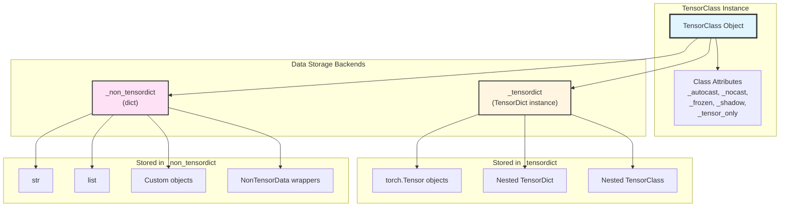
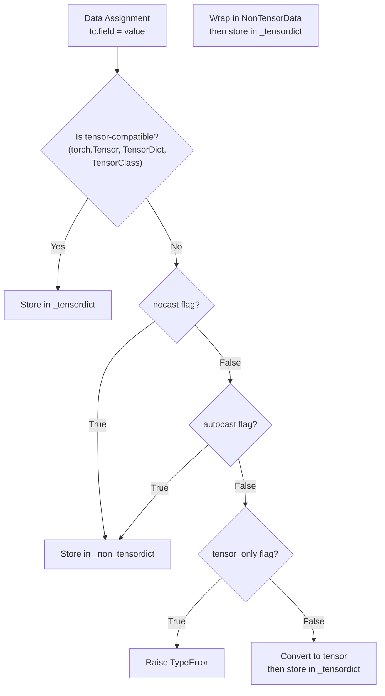
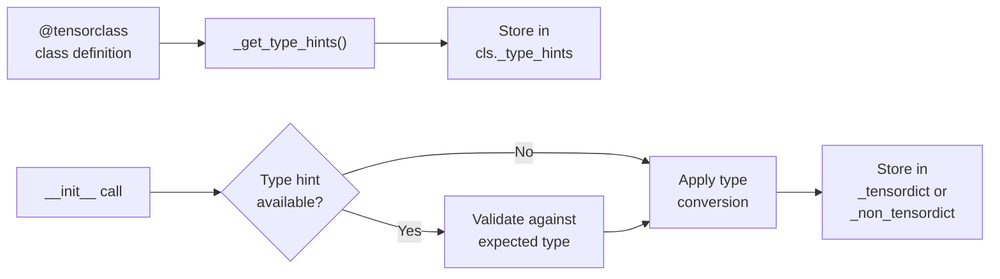
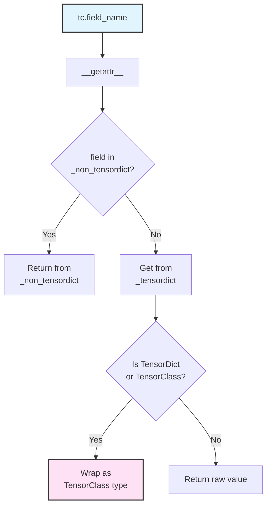
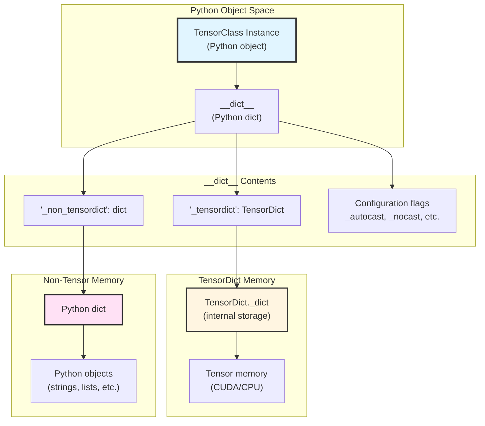
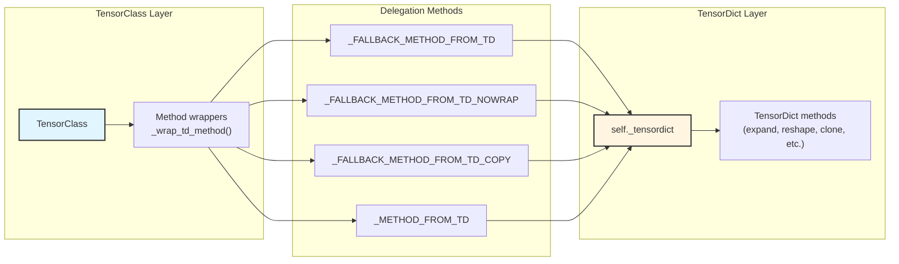

<!-- source: DeepWiki mcp.deepwiki.com · repo pytorch/tensordict · page 3.2 TensorClass Data Storage and Type System · fetched 2026-10-21 -->

# TensorClass Data Storage and Type System

<details>
<summary>Relevant source files</summary>

The following files were used as context for generating this wiki page:

- [tensordict/_tensorcollection.pyi](tensordict/_tensorcollection.pyi)
- [tensordict/_torch_func.py](tensordict/_torch_func.py)
- [tensordict/functional.py](tensordict/functional.py)
- [tensordict/tensorclass.py](tensordict/tensorclass.py)
- [tensordict/tensorclass.pyi](tensordict/tensorclass.pyi)
- [test/test_tensorclass.py](test/test_tensorclass.py)

</details>


## Purpose and Scope

This page documents the internal storage mechanisms and type system used by TensorClass instances. It covers:
- The dual storage architecture (`_tensordict` and `_non_tensordict`)
- Type conversion flags and their behavior (`autocast`, `nocast`, `tensor_only`, etc.)
- How data is accessed, stored, and type-converted internally
- The relationship between TensorClass and its underlying TensorDict storage

For information about creating and configuring TensorClass instances, see [Creating and Configuring TensorClasses](#3.1). For handling non-tensor data specifically, see [Mixed Data Types and NonTensorData](#3.3).

---

## Storage Architecture Overview

TensorClass uses a dual storage system to maintain both tensor and non-tensor data. The architecture separates concerns: tensor data (including nested TensorDicts) is stored in a `TensorDict` backend, while non-tensor data (strings, lists, custom objects) is stored in a separate dictionary.

### TensorClass Storage Architecture



**Sources:** [tensordict/tensorclass.py:1128-1163](), [tensordict/tensorclass.py:900-1119]()

---

## Dual Storage System

### _tensordict Storage

The `_tensordict` attribute is the primary storage backend for all tensor-compatible data. It is an instance of `TensorDict` that maintains:

| Property | Description |
|----------|-------------|
| **Type** | `TensorDict` instance |
| **Contents** | `torch.Tensor`, nested `TensorDict`, nested `TensorClass` |
| **Access** | Via `self.__dict__["_tensordict"]` |
| **Batch Size** | Shared with TensorClass instance |
| **Device** | Shared with TensorClass instance |

The `_tensordict` backend handles:
- All tensor operations (indexing, slicing, shape manipulation)
- Device management and transfers
- Batch size validation
- Nested structure traversal

**Sources:** [tensordict/tensorclass.py:1209-1240](), [tensordict/tensorclass.py:1417-1429]()

### _non_tensordict Storage

The `_non_tensordict` attribute is a Python dictionary that stores non-tensor data:

```python
_non_tensordict: Dict[str, Any]
```

| Property | Description |
|----------|-------------|
| **Type** | Python `dict` |
| **Contents** | Non-tensor data (strings, lists, custom objects) |
| **Access** | Via `self.__dict__["_non_tensordict"]` |
| **Persistence** | Preserved during cloning and stacking operations |

Non-tensor data includes:
- String values
- List objects
- Custom Python objects
- `NonTensorData` wrapped objects

**Sources:** [tensordict/tensorclass.py:1148-1163](), [tensordict/tensorclass.py:1552-1567]()

### Storage Separation Logic

The decision of where to store data depends on type checking and configuration flags:



**Sources:** [tensordict/tensorclass.py:577-629](), [tensordict/tensorclass.py:1695-1797]()

---

## Type System and Conversion

### Configuration Flags

TensorClass behavior is controlled by five configuration flags set during class decoration:

| Flag | Type | Default | Description |
|------|------|---------|-------------|
| `_autocast` | `bool` | `False` | When `True`, enforces type hints; non-tensor-compatible types are NOT converted |
| `_nocast` | `bool` | `False` | When `True`, disables all automatic type conversion to tensors |
| `_frozen` | `bool` | `False` | When `True`, makes the instance immutable (auto-locked) |
| `_shadow` | `bool` | `False` | When `True`, allows field names that conflict with TensorDict methods |
| `_tensor_only` | `bool` | `False` | When `True`, expects all data to be tensor-compatible; optimizes performance |

**Mutual Exclusivity:**
- `autocast` and `nocast` cannot both be `True`
- `tensor_only` and (`autocast` or `nocast`) cannot be combined

**Sources:** [tensordict/tensorclass.py:570-629](), [tensordict/tensorclass.py:769-897]()

### Type Conversion Behavior Matrix

The following table shows how data is handled based on configuration flags:

| Input Type | Default | `autocast=True` | `nocast=True` | `tensor_only=True` |
|------------|---------|-----------------|---------------|-------------------|
| `torch.Tensor` | → `_tensordict` | → `_tensordict` | → `_tensordict` | → `_tensordict` |
| `int` / `float` | Convert → `_tensordict` | → `_non_tensordict` | → `_non_tensordict` | Error |
| `np.ndarray` | Convert → `_tensordict` | → `_non_tensordict` | → `_non_tensordict` | Error |
| `str` | → `_non_tensordict` | → `_non_tensordict` | → `_non_tensordict` | Error |
| `list` | → `_non_tensordict` | → `_non_tensordict` | → `_non_tensordict` | Error |
| `TensorDict` | → `_tensordict` | → `_tensordict` | → `_tensordict` | → `_tensordict` |
| Nested TensorClass | → `_tensordict` | → `_tensordict` | → `_tensordict` | → `_tensordict` |

**Sources:** [tensordict/tensorclass.py:631-767]()

### Type Hints Processing

Type hints are extracted and stored during class decoration to guide type conversion:



Type hint information is used to:
- Validate input types during assignment
- Determine nested TensorClass types for proper reconstruction
- Support `Optional[T]` and `Union[T1, T2]` type annotations
- Handle `Any` type annotations (bypass strict checking)

**Sources:** [tensordict/tensorclass.py:965](), [tensordict/tensorclass.py:2154-2200]()

---

## Storage Access Mechanisms

### Attribute Access Path

When accessing a TensorClass field, the following path is followed:



**Sources:** [tensordict/tensorclass.py:1522-1616](), [tensordict/tensorclass.py:1618-1686]()

### __getattr__ Implementation

Two versions of `__getattr__` exist depending on the `tensor_only` flag:

**Standard Version (`_getattr`):**
1. Check `_non_tensordict` dictionary first
2. If not found, query `_tensordict`
3. For nested TensorDict/TensorClass, wrap with appropriate type based on type hints
4. Return value

**Tensor-Only Version (`_getattr_tensor_only`):**
1. Query `_tensordict` directly (skips `_non_tensordict` check)
2. Optimized for performance when all data is tensor-compatible
3. Raises AttributeError for non-existent fields

**Sources:** [tensordict/tensorclass.py:974-984](), [tensordict/tensorclass.py:1522-1616](), [tensordict/tensorclass.py:1618-1686]()

### __setattr__ Implementation

Assignment follows a similar dual-path approach:

**Standard Version (`_setattr`):**
1. Check if field is in `__expected_keys__`
2. Determine target storage based on type and flags
3. For tensors: store in `_tensordict` via `_set_str`
4. For non-tensors: store in `_non_tensordict`

**Tensor-Only Version (`_setattr_tensor_only`):**
1. Convert all data to tensors (or raise error)
2. Store directly in `_tensordict`
3. No `_non_tensordict` interaction

**Sources:** [tensordict/tensorclass.py:980-984](), [tensordict/tensorclass.py:1695-1797](), [tensordict/tensorclass.py:1799-1860]()

---

## Memory Layout and Representation

### In-Memory Structure



**Memory Characteristics:**

| Aspect | _tensordict | _non_tensordict |
|--------|-------------|-----------------|
| **Memory Location** | GPU/CPU tensor memory | Python heap |
| **Batch Operations** | Vectorized (broadcast, slice, etc.) | Element-wise copying |
| **Device Transfer** | Efficient (via `.to()`, `.cuda()`, etc.) | No-op (remains in Python memory) |
| **Serialization** | Tensor-specific formats (`.pt`, memmap) | Python pickle |
| **Memory Sharing** | Supported (shared memory, memmap) | Copy-on-write via dict copy |

**Sources:** [tensordict/tensorclass.py:1148-1163](), [tensordict/tensorclass.py:2202-2224]()

---

## Relationship with TensorDictBase

TensorClass delegates most operations to its underlying `_tensordict` instance, maintaining interface compatibility with `TensorDictBase`:

### Delegation Architecture



**Method Categories:**

| Category | Behavior | Examples |
|----------|----------|----------|
| `_METHOD_FROM_TD` | Execute on `_tensordict`, return as TensorDict | `dumps`, `save`, `memmap_` |
| `_FALLBACK_METHOD_FROM_TD` | Execute on `_tensordict`, wrap result as TensorClass | `clone`, `reshape`, `expand` |
| `_FALLBACK_METHOD_FROM_TD_NOWRAP` | Execute on `_tensordict`, return raw result | `batch_size`, `device`, `is_locked` |
| `_FALLBACK_METHOD_FROM_TD_COPY` | Execute on `_tensordict`, copy `_non_tensordict` | `clone`, `copy` |

**Sources:** [tensordict/tensorclass.py:169-558](), [tensordict/tensorclass.py:1039-1063]()

### Wrapping Mechanism

The `_wrap_td_method` function creates wrapper methods that:
1. Call the corresponding method on `self._tensordict`
2. Process the result based on the method category
3. Reconstruct TensorClass instances when needed
4. Preserve `_non_tensordict` data when appropriate

```python
# Simplified wrapping logic
def _wrap_td_method(method_name, no_wrap=False, copy_non_tensor=False):
    def wrapper(self, *args, **kwargs):
        result = getattr(self._tensordict, method_name)(*args, **kwargs)
        
        if no_wrap:
            return result
        
        if isinstance(result, TensorDict):
            if copy_non_tensor:
                non_tensordict = dict(self._non_tensordict)
            else:
                non_tensordict = self._non_tensordict
            return type(self)._from_tensordict(result, non_tensordict)
        
        return result
    return wrapper
```

**Sources:** [tensordict/tensorclass.py:1943-2026]()

---

## Type Conversion Examples

### Example 1: Default Behavior

```python
@tensorclass
class Data:
    x: torch.Tensor
    y: Any
    z: str

data = Data(x=1, y=[1, 2, 3], z="text", batch_size=[])
# x=1 → converted to torch.tensor(1) → stored in _tensordict
# y=[1, 2, 3] → list kept as-is → stored in _non_tensordict  
# z="text" → string kept as-is → stored in _non_tensordict
```

### Example 2: autocast=True

```python
@tensorclass(autocast=True)
class Data:
    x: int
    y: torch.Tensor

data = Data(x=1, y=2, batch_size=[])
# x=1 → kept as int (type hint is int) → stored in _non_tensordict
# y=2 → converted to torch.tensor(2) → stored in _tensordict
```

### Example 3: tensor_only=True

```python
@tensorclass(tensor_only=True)
class Data:
    x: torch.Tensor
    y: torch.Tensor

data = Data(x=torch.tensor(1), y=torch.tensor(2), batch_size=[])
# x → stored in _tensordict
# y → stored in _tensordict
# Any non-tensor assignment would raise TypeError
```

**Sources:** [tensordict/tensorclass.py:769-897](), [test/test_tensorclass.py:826-883]()

---

