<!-- source: DeepWiki mcp.deepwiki.com · repo pytorch/tensordict · page 3.3 Mixed Data Types and NonTensorData · fetched 2026-10-21 -->

# Mixed Data Types and NonTensorData

<details>
<summary>Relevant source files</summary>

The following files were used as context for generating this wiki page:

- [tensordict/_torch_func.py](tensordict/_torch_func.py)
- [tensordict/functional.py](tensordict/functional.py)
- [tensordict/tensorclass.py](tensordict/tensorclass.py)
- [test/test_tensorclass.py](test/test_tensorclass.py)

</details>


## Introduction

TensorClass instances can store heterogeneous data, mixing tensors with non-tensor types such as strings, lists, dictionaries, or custom Python objects. This is accomplished through two specialized classes: `NonTensorData` for individual non-tensor values and `NonTensorStack` for stacked collections of non-tensor data. These classes implement the `TensorDictBase` interface, allowing non-tensor data to participate in TensorDict operations while maintaining their native Python types.

This page explains how non-tensor data is stored, accessed, and manipulated within TensorClass instances.

Sources: [tensordict/tensorclass.py:560-567](), [tensordict/tensorclass.py:2252-2300]()

## Key Components

The non-tensor data system consists of three main classes:

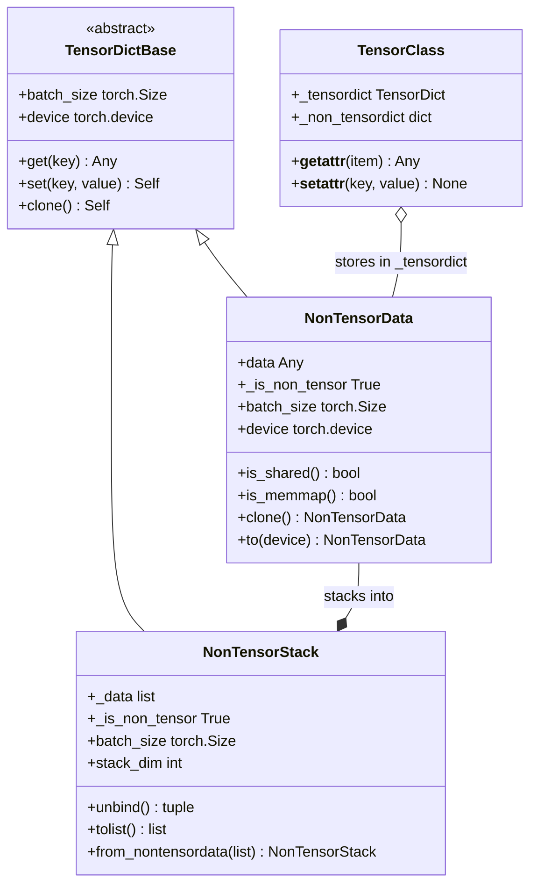

**Diagram: Core Classes for Non-Tensor Data Handling**

Sources: [tensordict/tensorclass.py:2252-2300](), [tensordict/tensorclass.py:2606-2650](), [tensordict/tensorclass.py:1165-1250]()

## NonTensorData Class

`NonTensorData` is a `TensorDictBase` subclass that wraps a single non-tensor value. It implements the full `TensorDictBase` interface so that non-tensor data can be stored, indexed, and manipulated alongside tensors.

### Class Definition and Core Attributes

The `NonTensorData` class is defined at [tensordict/tensorclass.py:2252-2603](). Key attributes:

- `data`: The wrapped Python object (string, list, dict, custom object, etc.)
- `_is_non_tensor`: Class attribute set to `True` for type identification
- `batch_size`: The batch dimensions (typically `torch.Size([])` for scalars)
- `device`: Device attribute (metadata only, not a physical device location)
- `names`: Optional dimension names

### Type Detection

The `is_non_tensor()` function identifies non-tensor data:

```python
def is_non_tensor(obj) -> bool:
    """Check if an object is non-tensor data."""
    return isinstance(obj, (NonTensorDataBase, NonTensorStack))
```

This function is used throughout TensorDict to apply special handling for non-tensor types.

**Diagram: NonTensorData Integration Flow**

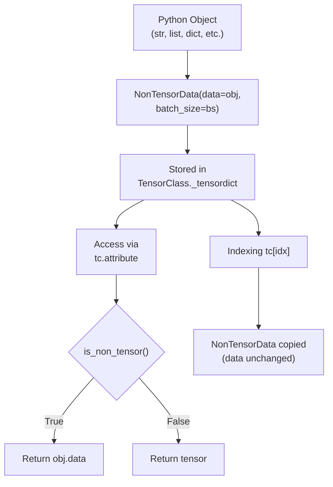

Sources: [tensordict/tensorclass.py:560-567](), [tensordict/tensorclass.py:2252-2300](), [tensordict/tensorclass.py:1674-1710]()

## Dual Storage Mechanism in TensorClass

TensorClass maintains two separate storage locations for data:

1. **`_tensordict`**: A `TensorDict` instance storing tensors and `NonTensorData` objects
2. **`_non_tensordict`**: A Python dictionary storing non-tensor metadata (used less commonly for special cases)

### Storage Decision Logic

During TensorClass initialization at [tensordict/tensorclass.py:1165-1353](), each attribute is processed:

**Diagram: TensorClass Initialization and Storage**

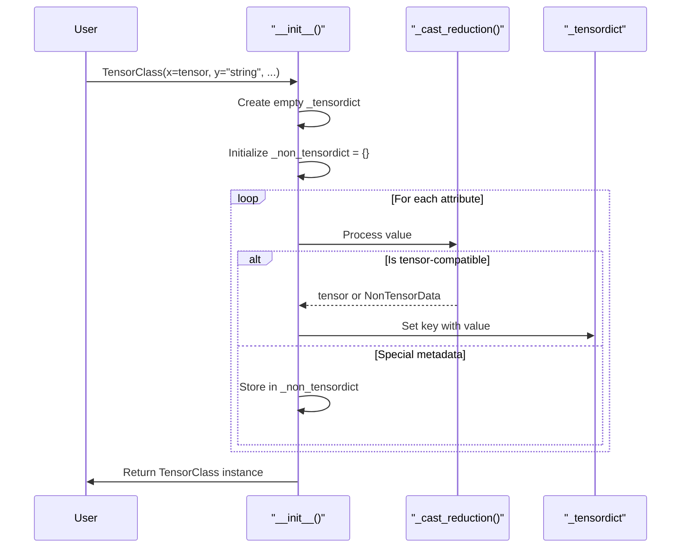

### Attribute Access

The `_getattr` function at [tensordict/tensorclass.py:1634-1661]() handles attribute retrieval:

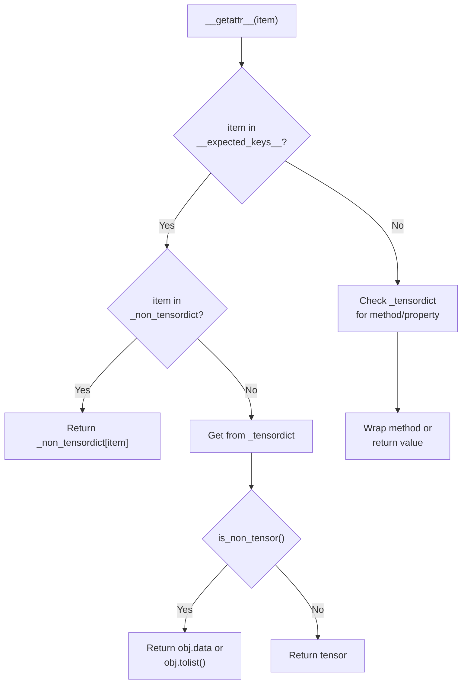

**Diagram: Attribute Access Flow in TensorClass**

Sources: [tensordict/tensorclass.py:1165-1353](), [tensordict/tensorclass.py:1634-1661](), [tensordict/tensorclass.py:1674-1710]()

## Operations on Mixed Data Types

The following table compares how different operations behave for tensor vs. non-tensor data:

| Operation | Tensor Data | NonTensorData |
|-----------|-------------|---------------|
| Storage | `_tensordict` (as Tensor) | `_tensordict` (as NonTensorData) |
| Indexing `tc[idx]` | Tensor indexed: `tensor[idx]` | NonTensorData copied, data unchanged |
| Device transfer `tc.to(device)` | Tensor moved to device | Device attribute updated, data stays in memory |
| Stacking `torch.stack([tc1, tc2])` | Tensors stacked with `torch.stack` | NonTensorData objects stacked into `NonTensorStack` |
| Serialization `.memmap_()` | Memory-mapped to disk | Pickled or JSON-serialized to metadata file |
| Clone `tc.clone()` | Tensor cloned | NonTensorData cloned with `copy.copy(data)` |
| Equality `tc1 == tc2` | Tensor element-wise comparison | Data compared with `==` operator |

### Example: Mixed Data in TensorClass

```python
@tensorclass
class MyData:
    X: torch.Tensor
    label: str
    metadata: dict

# Create instance with mixed types
data = MyData(
    X=torch.randn(3, 4),
    label="sample_001",
    metadata={"source": "sensor_A"},
    batch_size=[3]
)

# X is a tensor, label and metadata are NonTensorData
# Indexing: X is indexed, label/metadata are copied
subset = data[0]  # subset.X.shape == (4,), subset.label == "sample_001"
```

Sources: [tensordict/tensorclass.py:2252-2400](), [tensordict/tensorclass.py:1966-2017](), [test/test_tensorclass.py:195-246]()

## NonTensorStack Class

`NonTensorStack` at [tensordict/tensorclass.py:2606-2995]() handles stacking of multiple `NonTensorData` objects. It represents a collection of non-tensor values along a specified dimension, analogous to stacked tensors.

### Key Attributes

- `_data`: List of `NonTensorData` objects being stacked
- `stack_dim`: The dimension along which stacking occurs
- `batch_size`: Shape including the stacked dimension
- `_is_non_tensor`: Set to `True` for type detection

### Creation and Operations

**Diagram: NonTensorStack Lifecycle**

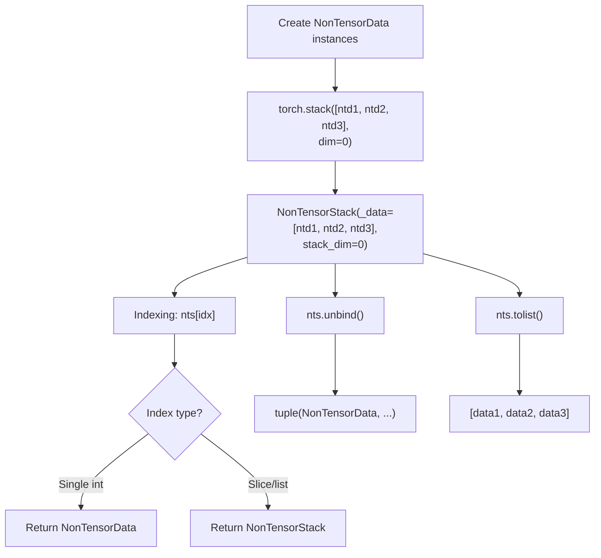

### Usage Example

```python
# Stacking strings
@tensorclass
class DataWithLabel:
    x: torch.Tensor
    label: str

batch = torch.stack([
    DataWithLabel(x=torch.randn(5), label="cat", batch_size=[]),
    DataWithLabel(x=torch.randn(5), label="dog", batch_size=[]),
    DataWithLabel(x=torch.randn(5), label="bird", batch_size=[])
], dim=0)

# batch.label is a NonTensorStack
batch.label.tolist()  # Returns: ["cat", "dog", "bird"]
batch[0].label        # Returns: "cat"
```

Sources: [tensordict/tensorclass.py:2606-2995](), [tensordict/tensorclass.py:560-567]()

## Type Checking and Casting

### is_non_tensor Function

The `is_non_tensor()` function at [tensordict/tensorclass.py:560-567]() identifies non-tensor data:

```python
def is_non_tensor(obj) -> bool:
    return isinstance(obj, (NonTensorDataBase, NonTensorStack))
```

This is used throughout TensorDict to branch logic for non-tensor handling.

### Automatic Type Casting

During TensorClass initialization, the `_cast_reduction()` function at [tensordict/tensorclass.py:1220-1340]() determines how to store each attribute:

**Diagram: Type Casting Decision Tree**

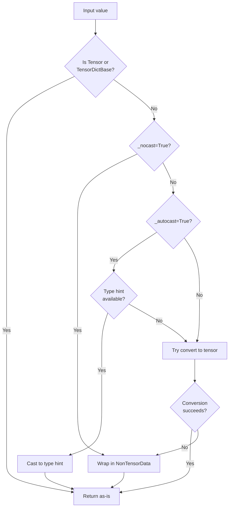

Sources: [tensordict/tensorclass.py:560-567](), [tensordict/tensorclass.py:1220-1340]()

## TensorClass Handling of Mixed Data Types

When using TensorClass, non-tensor attributes are automatically identified and properly handled:

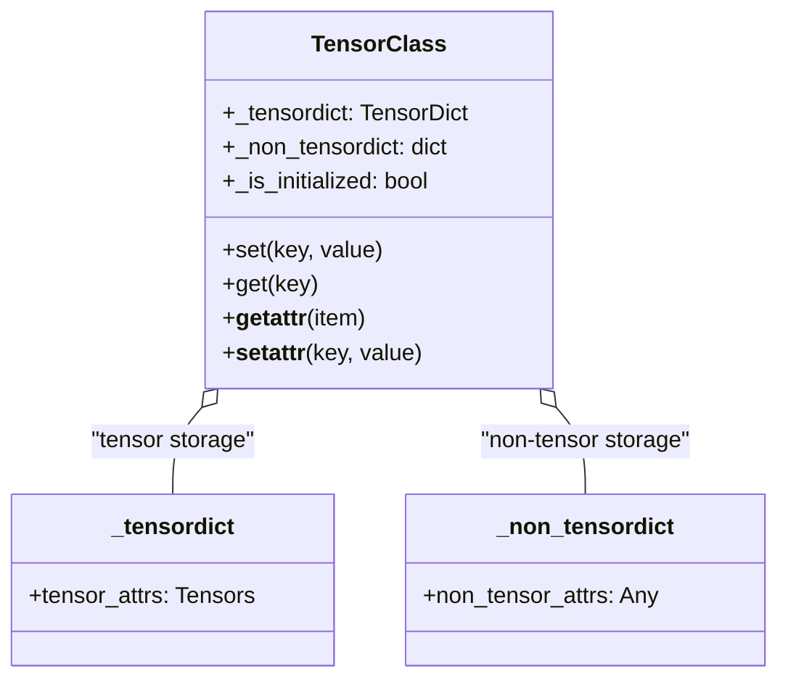

Sources: [tensordict/tensorclass.py:1634-1661](), [tensordict/tensorclass.py:1674-1706]()

### Attribute Access Methods

The `__getattr__` method in TensorClass is carefully designed to check both tensor and non-tensor storage:

```python
def _getattr(self, item: str, **kwargs) -> Any:
    __dataclass_fields__ = type(self).__expected_keys__

    if item in __dataclass_fields__:
        _non_tensordict = self._non_tensordict
        if _non_tensordict:
            out = _non_tensordict.get(item, NO_DEFAULT)
            if out is not NO_DEFAULT:
                if (
                    isinstance(self, NonTensorData)
                    and item == "data"
                    and (self._is_shared or self._is_memmap)
                ):
                    return _from_shared_nontensor(out)
                return out
        out = self._tensordict._get_str(item, NO_DEFAULT, **kwargs)
        if is_non_tensor(out):
            return out.data if not isinstance(out, NonTensorStack) else out.tolist()
        return out

    out = getattr(self._tensordict, item, NO_DEFAULT)
    if out is not NO_DEFAULT:
        if not callable(out) and not is_non_tensor(out):
            return out
        if is_non_tensor(out):
            return out.data if hasattr(out, "data") else out.tolist()
        return _wrap_method(self, item, out)
    raise AttributeError(item)
```

Similarly, the `__setattr__` method handles both tensor and non-tensor data appropriately.

Sources: [tensordict/tensorclass.py:1634-1661](), [tensordict/tensorclass.py:1674-1706]()

## Serialization and Persistence

NonTensorData requires special handling during serialization because it contains arbitrary Python objects.

### Memory Mapping

When calling `.memmap_()` on a TensorClass at [tensordict/tensorclass.py:2083-2119]():

**Diagram: NonTensorData Serialization Flow**

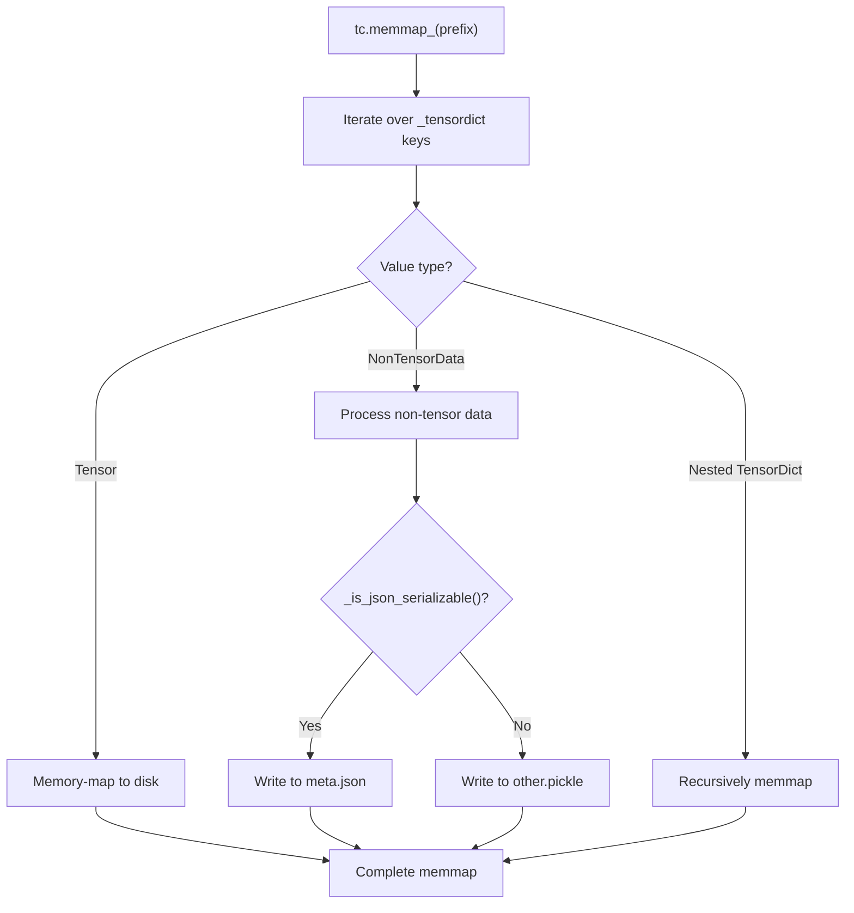

### Pickle Serialization

For `torch.save()` and `pickle`, the `_getstate()` and `_setstate()` methods at [tensordict/tensorclass.py:1479-1564]() handle serialization:

- `_getstate()`: Captures both `_tensordict` and `_non_tensordict`
- `_setstate()`: Reconstructs the TensorClass from serialized state
- NonTensorData objects are pickled with their wrapped data

Sources: [tensordict/tensorclass.py:2083-2119](), [tensordict/tensorclass.py:1479-1564](), [tensordict/utils.py:1070-1120]()

## Indexing Behavior

Indexing a TensorClass follows different rules for tensors and non-tensor data.

### Indexing Implementation

The `_getitem` function at [tensordict/tensorclass.py:1966-2017]() handles indexing:

**Diagram: TensorClass Indexing Logic**

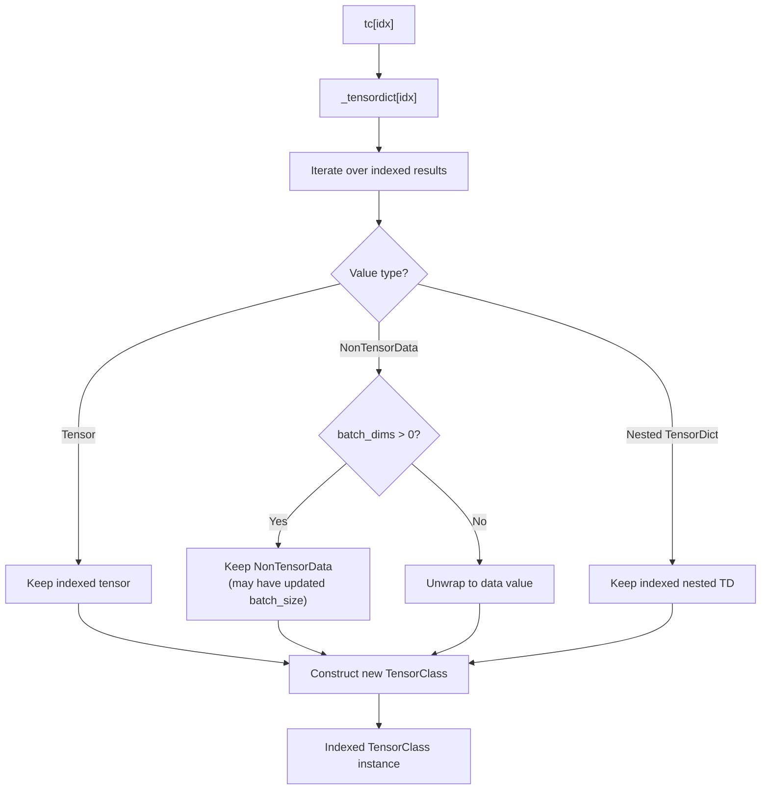

### Key Behavior

1. **Tensors**: Indexed normally, shape changes according to index
2. **NonTensorData with batch_dims > 0**: Copied with potentially updated batch_size
3. **NonTensorData scalars (batch_dims == 0)**: Unwrapped to raw data
4. **NonTensorStack**: Indexed to return subset or single NonTensorData

### Example

```python
@tensorclass
class Example:
    values: torch.Tensor
    label: str

batch = Example(
    values=torch.randn(5, 3),
    label="test",
    batch_size=[5]
)

# Indexing
single = batch[0]  # values: (3,), label: "test" (unchanged)
subset = batch[1:3]  # values: (2, 3), label: "test" (unchanged)
```

Sources: [tensordict/tensorclass.py:1966-2017](), [tensordict/tensorclass.py:2252-2400]()

## Configuration Options

### Capture Non-Tensor Stack

The `set_capture_non_tensor_stack()` context manager controls stacking behavior:

```python
from tensordict import set_capture_non_tensor_stack

# Enable NonTensorStack creation during stacking
with set_capture_non_tensor_stack(True):
    batch = torch.stack([tc1, tc2, tc3])
    # Non-tensor fields become NonTensorStack instances
    
# Default behavior: non-tensor data is shared (not stacked)
batch = torch.stack([tc1, tc2, tc3])
# Non-tensor fields maintain single value
```

### TensorClass Configuration Flags

When defining a TensorClass, three flags affect non-tensor handling:

| Flag | Effect |
|------|--------|
| `autocast=True` | Type hints are enforced, non-castable values become NonTensorData |
| `nocast=True` | All values remain as-is, wrapped in NonTensorData if not tensors |
| `tensor_only=True` | Only tensor types allowed, non-tensor types raise errors |

```python
@tensorclass(nocast=True)
class NocastExample:
    data: Any  # Keeps original type, wrapped in NonTensorData

@tensorclass(autocast=True)
class AutocastExample:
    value: int  # Casts to int, wraps in NonTensorData if necessary
```

Sources: [tensordict/utils.py:538-580](), [tensordict/tensorclass.py:570-628](), [tensordict/tensorclass.py:1220-1340]()

## Common Use Cases

### 1. Dataset Labels and Metadata

```python
@tensorclass
class LabeledImage:
    image: torch.Tensor
    label: str
    metadata: dict

sample = LabeledImage(
    image=torch.randn(3, 224, 224),
    label="cat",
    metadata={"camera_id": "A1", "timestamp": "2024-01-01"},
    batch_size=[]
)
```

### 2. Mixed Feature Types

```python
@tensorclass
class MixedFeatures:
    numeric_features: torch.Tensor
    categorical_labels: list
    text_data: str

data = MixedFeatures(
    numeric_features=torch.randn(10, 5),
    categorical_labels=["A", "B", "C", ...],
    text_data="description",
    batch_size=[10]
)
```

### 3. Model Outputs with Explanations

```python
@tensorclass
class PredictionWithMeta:
    logits: torch.Tensor
    prediction_class: str
    confidence: torch.Tensor
    explanation: dict

output = PredictionWithMeta(
    logits=torch.randn(1000),
    prediction_class="dog",
    confidence=torch.tensor(0.95),
    explanation={"top_features": [...], "reasoning": "..."},
    batch_size=[]
)
```

### 4. Heterogeneous Batching

```python
# Stack multiple samples with mixed types
batch = torch.stack([sample1, sample2, sample3], dim=0)
# Tensor fields are stacked normally
# Non-tensor fields become NonTensorStack or are shared
```

Sources: [test/test_tensorclass.py:195-246](), [test/test_tensorclass.py:519-555]()

## Integration Points

NonTensorData integrates with the TensorDict ecosystem at multiple levels:

**Diagram: NonTensorData in TensorDict Ecosystem**

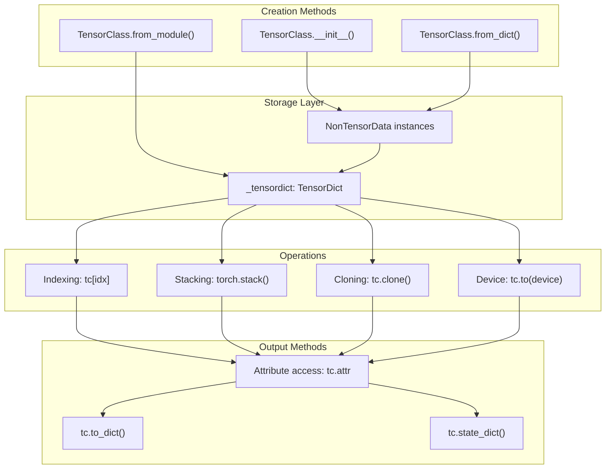

### Compatibility Notes

- **TensorDictModule**: Works with TensorClass containing NonTensorData, but only operates on tensor fields
- **LazyStackedTensorDict**: Can contain NonTensorStack when lazy-stacking TensorClass instances
- **Distributed Operations**: NonTensorData is serialized during `send()`/`recv()` operations
- **Device transfers**: NonTensorData device attribute is updated but data remains in CPU memory

Sources: [tensordict/tensorclass.py:1165-1353](), [tensordict/tensorclass.py:1966-2017](), [tensordict/tensorclass.py:2252-2603]()

## Advanced Operations: Memory Mapping and Sharing

TensorDict provides sophisticated mechanisms for memory mapping and sharing that accommodate mixed data types:

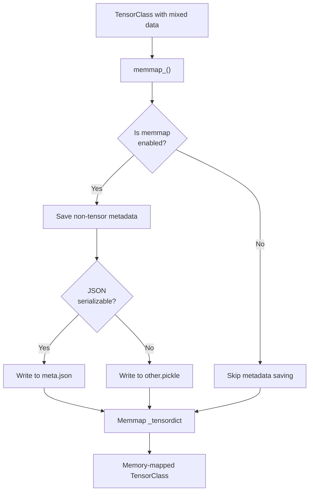

Sources: [tensordict/tensorclass.py:1479-1564]()

---

