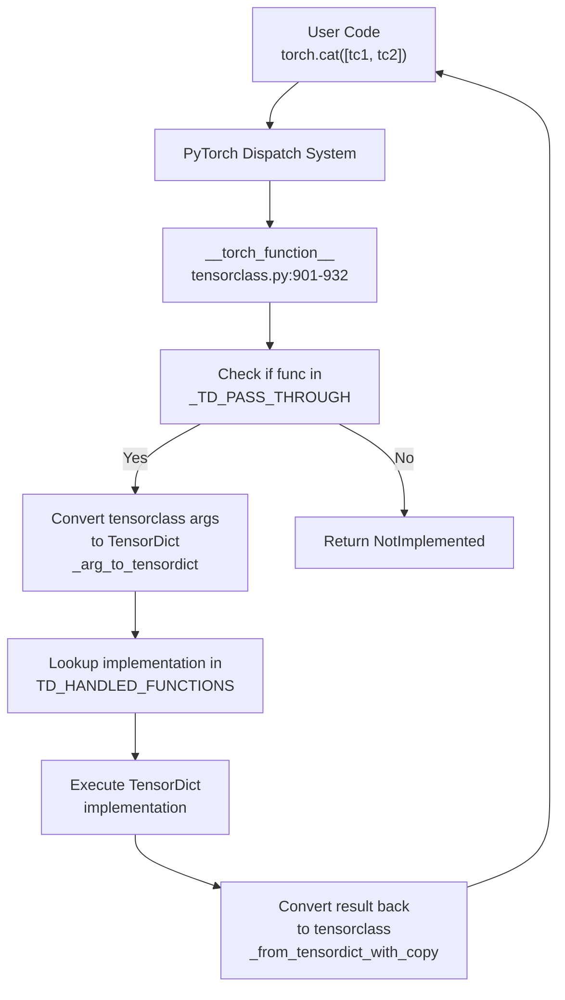
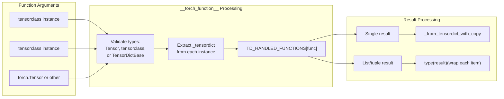
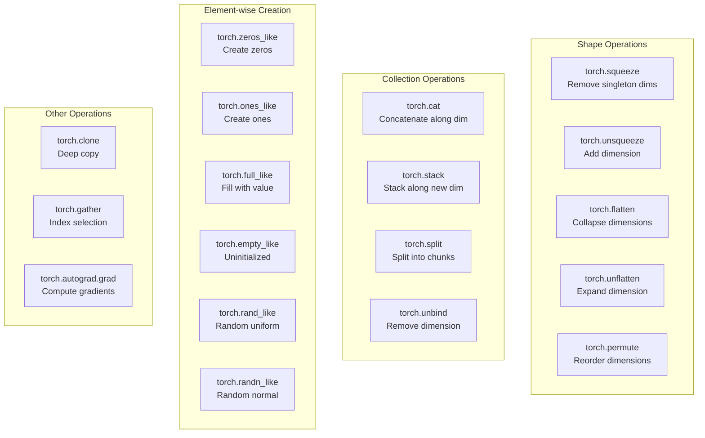
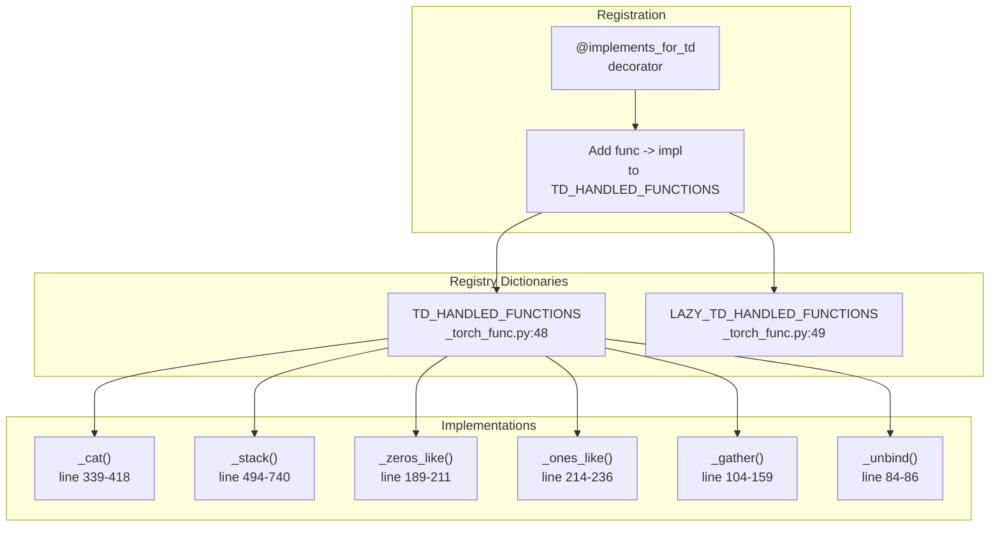
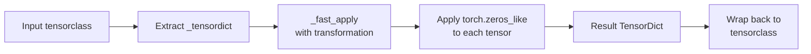
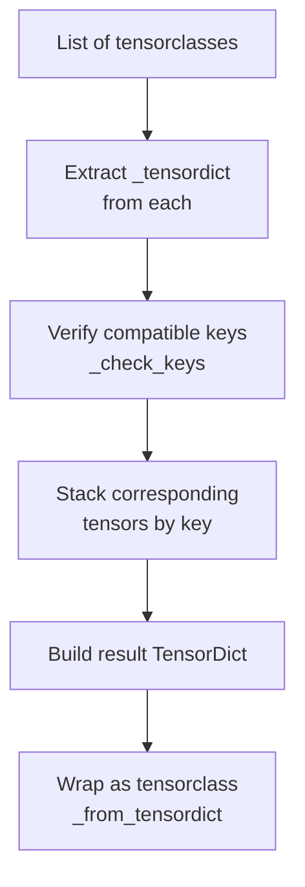
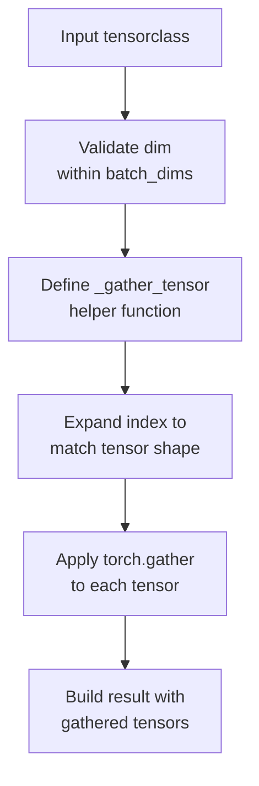
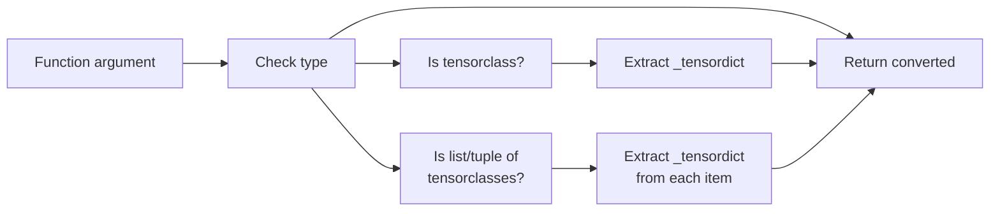
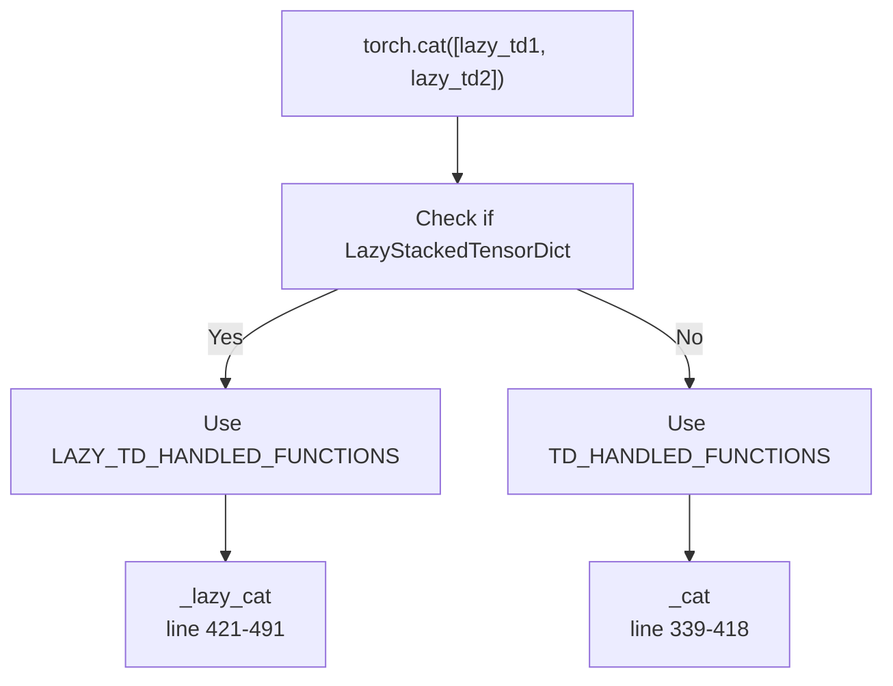

<!-- source: DeepWiki mcp.deepwiki.com · repo pytorch/tensordict · page 3.4 PyTorch Function Overrides · fetched 2026-10-21 -->

# PyTorch Function Overrides

<details>
<summary>Relevant source files</summary>

The following files were used as context for generating this wiki page:

- [tensordict/_torch_func.py](tensordict/_torch_func.py)
- [tensordict/functional.py](tensordict/functional.py)
- [tensordict/tensorclass.py](tensordict/tensorclass.py)
- [test/test_tensorclass.py](test/test_tensorclass.py)

</details>


## Purpose and Scope

This document describes how TensorClass instances integrate with PyTorch's function dispatch system through the `__torch_function__` protocol. This enables standard PyTorch operations like `torch.cat`, `torch.stack`, `torch.zeros_like`, and others to work seamlessly with tensorclass instances. The implementation allows tensorclasses to behave like native PyTorch tensors while maintaining their structured data semantics.

For information about how TensorDict implements these operations, see the core implementation in `_torch_func.py`. For general TensorClass concepts, see [Creating and Configuring TensorClasses](#3.1).

## Dispatch Mechanism Overview

When a PyTorch function is called with a tensorclass argument, Python's dispatch system invokes the `__torch_function__` method on the tensorclass. This method determines whether the operation is supported and routes it to the appropriate implementation.



**Dispatch Flow for TensorClass Operations**

Sources: [tensordict/tensorclass.py:901-932](), [tensordict/tensorclass.py:1128-1146]()

## The `__torch_function__` Implementation

The `__torch_function__` method is defined during tensorclass creation and serves as the entry point for PyTorch function dispatch. It follows a standard pattern:

1. **Validation**: Check if the function is supported and all types are compatible
2. **Conversion**: Extract underlying `_tensordict` from tensorclass instances
3. **Delegation**: Call the corresponding TensorDict implementation
4. **Reconstruction**: Wrap the result back into the original tensorclass type



**Argument Processing and Result Conversion Flow**

The implementation at [tensordict/tensorclass.py:901-932]() handles this dispatch:

```python
def __torch_function__(
    cls,
    func: Callable,
    types: tuple[type, ...],
    args: tuple[Any, ...] = (),
    kwargs: dict[str, Any] | None = None,
) -> Callable:
```

Key checks performed:
- Function must be in `_TD_PASS_THROUGH` dictionary
- All types must be `Tensor`, tensorclass, or `TensorDictBase` subclasses
- If checks fail, returns `NotImplemented` to allow other dispatch handlers

Sources: [tensordict/tensorclass.py:901-932](), [tensordict/tensorclass.py:1128-1154]()

## Supported Operations

The `_TD_PASS_THROUGH` dictionary at [tensordict/tensorclass.py:148-167]() defines which PyTorch functions are supported for tensorclass instances:

| Category | Functions |
|----------|-----------|
| **Creation-like** | `torch.empty_like`, `torch.full_like`, `torch.ones_like`, `torch.zeros_like`, `torch.rand_like`, `torch.randn_like` |
| **Stacking/Concatenation** | `torch.cat`, `torch.stack`, `torch.split`, `torch.unbind` |
| **Shape Operations** | `torch.squeeze`, `torch.unsqueeze`, `torch.flatten`, `torch.unflatten`, `torch.permute` |
| **Indexing/Selection** | `torch.gather` |
| **Cloning** | `torch.clone` |
| **Autograd** | `torch.autograd.grad` |



**Categorization of Supported PyTorch Operations**

Sources: [tensordict/tensorclass.py:148-167]()

## Function Registration System

The registration system uses decorators to associate PyTorch functions with their TensorDict implementations. This system is defined in [tensordict/_torch_func.py]().



**Function Registration and Implementation Mapping**

The `implements_for_td` decorator at [tensordict/_torch_func.py:62-70]() registers implementations:

```python
def implements_for_td(torch_function: Callable) -> Callable[[Callable], Callable]:
    """Register a torch function override for TensorDict."""
    @functools.wraps(torch_function)
    def decorator(func: Callable) -> Callable:
        TD_HANDLED_FUNCTIONS[torch_function] = func
        return func
    return decorator
```

Example registration pattern:
```python
@implements_for_td(torch.cat)
def _cat(list_of_tensordicts, dim=0, device=None, out=None):
    # Implementation
```

Sources: [tensordict/_torch_func.py:62-70](), [tensordict/_torch_func.py:48-49]()

## Implementation Patterns

### Pattern 1: Element-wise Operations

Operations like `zeros_like`, `ones_like`, and `full_like` apply transformations to each tensor in the tensordict using `_fast_apply`:



**Element-wise Operation Pattern**

Implementation at [tensordict/_torch_func.py:189-211]():
- Extract device and dtype kwargs
- Define transformation function
- Apply to all tensors via `_fast_apply`
- Preserve metadata (lock state, device)

Sources: [tensordict/_torch_func.py:189-236](), [tensordict/_torch_func.py:239-286]()

### Pattern 2: Stacking Operations

`torch.stack` and `torch.cat` handle collections of tensordicts:



**Collection Operation Pattern (torch.stack)**

The `_stack` implementation at [tensordict/_torch_func.py:494-740]() is complex and handles:
- Heterogeneous batch sizes (creates `LazyStackedTensorDict`)
- Nested tensorclasses
- Uninitialized parameters
- Output tensor specification
- Lazy vs eager stacking based on `lazy_legacy()` setting

Key logic:
1. Validate all tensordicts have compatible structures
2. Group tensors by key
3. Stack each group using `torch.stack`
4. Build result with correct batch_size

Sources: [tensordict/_torch_func.py:494-740](), [tensordict/_torch_func.py:339-418]()

### Pattern 3: Indexing Operations

`torch.gather` performs advanced indexing across all tensors:



**Indexing Operation Pattern (torch.gather)**

Implementation at [tensordict/_torch_func.py:104-159]():
- Validates dimension is within batch dimensions
- Expands index tensor to match each tensor's shape
- Applies `torch.gather` to each leaf tensor
- Preserves structure while modifying contents

Sources: [tensordict/_torch_func.py:104-159]()

## Argument Conversion

The `_arg_to_tensordict` helper function at [tensordict/tensorclass.py:1128-1146]() converts tensorclass instances in arguments to their underlying tensordicts:



**Argument Conversion Logic**

This handles:
- Single tensorclass instances: returns `instance._tensordict`
- Lists/tuples of tensorclasses: returns same collection type with extracted tensordicts
- Other types: returns unchanged

Sources: [tensordict/tensorclass.py:1128-1146]()

## Result Reconstruction

After executing the TensorDict implementation, results must be converted back to tensorclass instances. The `_from_tensordict_with_copy` function at [tensordict/tensorclass.py:1148-1154]() handles this:

```python
def _from_tensordict_with_copy(tc, tensordict):
    return type(tc)._from_tensordict(
        tensordict=tensordict, 
        non_tensordict=dict(tc._non_tensordict)
    )
```

This preserves:
- The original tensorclass type
- Non-tensor data stored in `_non_tensordict`
- Structural metadata

For operations returning multiple results (like `torch.split` or `torch.unbind`), the implementation at [tensordict/tensorclass.py:926-932]() wraps each result:

```python
if isinstance(result, (list, tuple)):
    return type(result)(
        _from_tensordict_with_copy(tensorclass_instance, tensordict_result)
        for tensordict_result in result
    )
```

Sources: [tensordict/tensorclass.py:1148-1154](), [tensordict/tensorclass.py:926-932]()

## Non-Tensor Data Handling

Non-tensor data stored in tensorclass instances (strings, lists, custom objects via `NonTensorData`) requires special handling during operations:

| Operation Type | Non-Tensor Behavior |
|----------------|---------------------|
| **Element-wise** (`zeros_like`, `ones_like`) | Preserved unchanged |
| **Stacking** (`stack`, `cat`) | Checked for consistency, preserved from first element |
| **Cloning** (`clone`) | Deep copied via `dict(tc._non_tensordict)` |
| **Shape ops** (`squeeze`, `unsqueeze`) | Preserved unchanged (not affected by shape) |
| **Indexing** (`gather`, `__getitem__`) | Preserved unchanged (not indexed) |

The `_CLEAR_METADATA` set at [tensordict/tensorclass.py:146]() specifies operations that should clear non-tensor data:

```python
_CLEAR_METADATA = {"all", "any"}
```

These operations return boolean tensors that don't preserve the original structure's metadata.

Sources: [tensordict/tensorclass.py:146](), [tensordict/tensorclass.py:1148-1163]()

## Lazy Stacking Support

Some operations have separate implementations for `LazyStackedTensorDict`. The `implements_for_lazy_td` decorator at [tensordict/_torch_func.py:73-81]() registers these:



**Lazy vs Regular Implementation Selection**

The `_lazy_cat` implementation at [tensordict/_torch_func.py:421-491]() optimizes concatenation for lazy-stacked tensordicts by:
- Avoiding materialization when possible
- Handling stack_dim specially (just concatenates the internal list)
- Falling back to regular `_cat` for incompatible stack dimensions

Sources: [tensordict/_torch_func.py:73-81](), [tensordict/_torch_func.py:421-491]()

## Type Validation

The `__torch_function__` implementation validates that all types in the operation are compatible. The check at [tensordict/tensorclass.py:908-911]():

```python
if func not in _TD_PASS_THROUGH or not all(
    issubclass(t, (Tensor, cls, TensorDictBase)) for t in types
):
    return NotImplemented
```

This ensures:
- Only registered functions are dispatched
- All arguments are tensors, tensorclasses of the same type, or TensorDictBase instances
- Mixed types that don't make sense return `NotImplemented`, allowing Python's dispatch to try other handlers

Sources: [tensordict/tensorclass.py:908-911]()

## Extension Points

To add support for a new PyTorch function:

1. **Register the function** in `_TD_PASS_THROUGH` at [tensordict/tensorclass.py:148-167]()
2. **Implement the operation** in `_torch_func.py` using `@implements_for_td` decorator
3. **Test the implementation** in `test/test_tensorclass.py`

Example template:

```python
# In _torch_func.py
@implements_for_td(torch.my_new_function)
def _my_new_function(td: T, *args, **kwargs) -> T:
    # Implementation that operates on TensorDict
    return td.my_method(*args, **kwargs)

# In tensorclass.py
_TD_PASS_THROUGH = {
    # ... existing entries
    torch.my_new_function: True,
}
```

Requirements for implementations:
- Must preserve batch_size semantics
- Should handle nested tensordicts correctly
- Must preserve device and dtype where appropriate
- Should handle non-tensor data appropriately

Sources: [tensordict/_torch_func.py:62-70](), [tensordict/tensorclass.py:148-167]()

---

