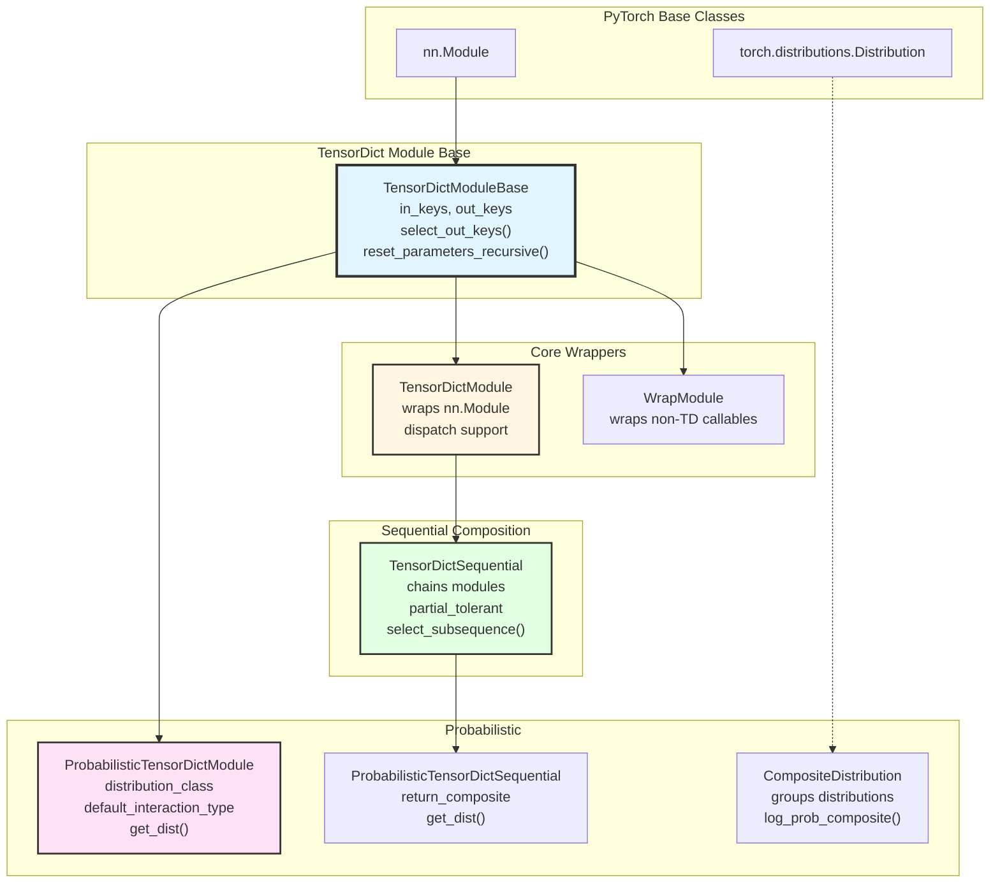
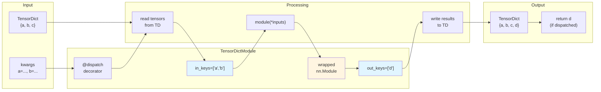
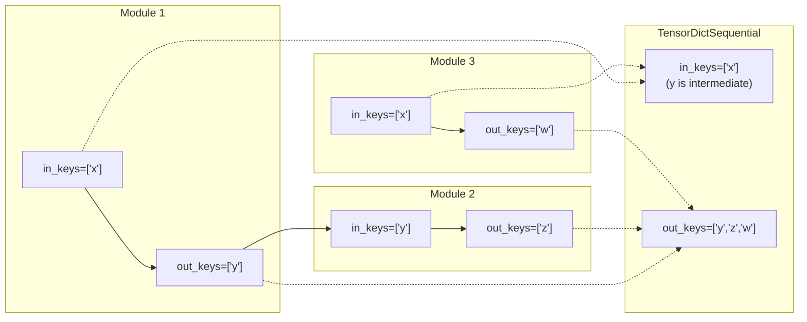
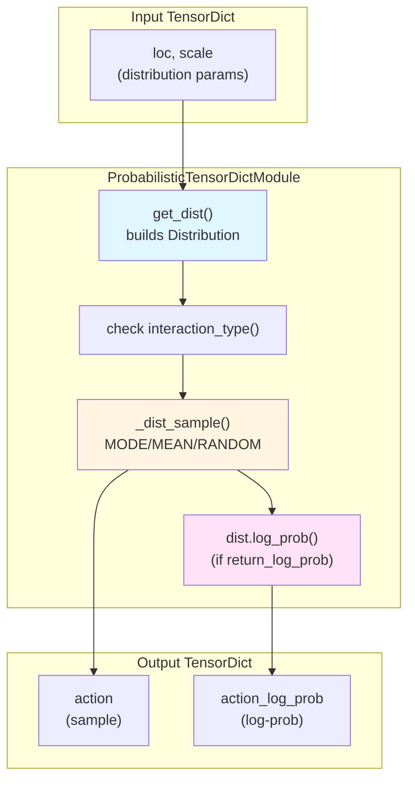

<!-- source: DeepWiki mcp.deepwiki.com · repo pytorch/tensordict · page 4 Neural Network Integration · fetched 2026-10-21 -->

# Neural Network Integration

<details>
<summary>Relevant source files</summary>

The following files were used as context for generating this wiki page:

- [tensordict/nn/common.py](tensordict/nn/common.py)
- [tensordict/nn/distributions/composite.py](tensordict/nn/distributions/composite.py)
- [tensordict/nn/probabilistic.py](tensordict/nn/probabilistic.py)
- [tensordict/nn/sequence.py](tensordict/nn/sequence.py)
- [test/test_nn.py](test/test_nn.py)

</details>


## Purpose and Scope

This page provides an overview of how TensorDict integrates with PyTorch's `nn.Module` system to enable ML workflows. The neural network integration layer allows standard PyTorch modules to read from and write to TensorDict instances through a declarative interface based on `in_keys` and `out_keys`. This design enables modular composition, functional programming patterns, and probabilistic modeling.

For details on specific components:
- **TensorDictModule and dispatch mechanism**: See [4.1](#4.1)
- **Sequential composition and module chaining**: See [4.2](#4.2)
- **Probabilistic neural networks and sampling strategies**: See [4.3](#4.3)
- **Parameter management**: See [4.4](#4.4)
- **Module conversion utilities**: See [4.5](#4.5)

For core TensorDict operations without neural networks, see [2](#2). For functional transformations like vmap, see [6.1](#6.1).

## Architecture Overview

The neural network integration system consists of four main component categories:

1. **Module Wrappers**: `TensorDictModule` and `TensorDictModuleBase` wrap `nn.Module` instances to provide TensorDict-aware interfaces
2. **Composition Primitives**: `TensorDictSequential` chains multiple modules together
3. **Probabilistic Modules**: `ProbabilisticTensorDictModule` and `ProbabilisticTensorDictSequential` handle distribution sampling
4. **Parameter Management**: `TensorDictParams` wraps module parameters as TensorDict for functional programming

All these components follow a common pattern: they declare `in_keys` (what to read from the input TensorDict) and `out_keys` (what to write to the output TensorDict), enabling automatic data routing and modular composition.

**Sources**: [tensordict/nn/common.py:1-64](), [tensordict/nn/sequence.py:1-56](), [tensordict/nn/probabilistic.py:1-57]()

## Class Hierarchy and Relationships



**Sources**: [tensordict/nn/common.py:477-541](), [tensordict/nn/common.py:800-803](), [tensordict/nn/sequence.py:57-189](), [tensordict/nn/probabilistic.py:159-346](), [tensordict/nn/probabilistic.py:771-828]()

## Core Module Components

| Component | File | Purpose | Key Features |
|-----------|------|---------|--------------|
| `TensorDictModuleBase` | [tensordict/nn/common.py:477-798]() | Abstract base class | `in_keys`/`out_keys` properties, `select_out_keys()`, `reset_parameters_recursive()` |
| `TensorDictModule` | [tensordict/nn/common.py:800-1300+]() | Main wrapper class | Wraps any `nn.Module` or callable, supports `@dispatch` decorator |
| `dispatch` | [tensordict/nn/common.py:66-377]() | Decorator/wrapper | Enables calling modules with kwargs instead of TensorDict |
| `TensorDictSequential` | [tensordict/nn/sequence.py:57-692]() | Sequential composition | Chains modules, computes aggregate keys, `select_subsequence()` |
| `ProbabilisticTensorDictModule` | [tensordict/nn/probabilistic.py:159-769]() | Probabilistic wrapper | Wraps distributions, sampling strategies, log-prob computation |
| `InteractionType` | [tensordict/nn/probabilistic.py:59-94]() | Sampling strategy enum | `MODE`, `MEAN`, `MEDIAN`, `RANDOM`, `DETERMINISTIC` |
| `CompositeDistribution` | [tensordict/nn/distributions/composite.py:24-567]() | Multi-distribution | Groups distributions, returns TensorDict samples |

**Sources**: [tensordict/nn/common.py:60-64](), [tensordict/nn/sequence.py:54](), [tensordict/nn/probabilistic.py:56]()

## Data Flow Through Neural Network Modules



**Sources**: [tensordict/nn/common.py:1000-1200](), [tensordict/nn/common.py:266-329](), [test/test_nn.py:340-439]()

## TensorDictModule: Key Concepts

### Input and Output Keys

`TensorDictModule` instances declare what they read and write through `in_keys` and `out_keys`:

- **`in_keys`**: List of keys (or dictionary mapping) specifying which tensors to read from the input TensorDict
- **`out_keys`**: List of keys specifying where to write the module's outputs

The module automatically extracts inputs based on `in_keys`, passes them to the wrapped module, and writes outputs to `out_keys`.

**Sources**: [tensordict/nn/common.py:811-822](), [test/test_nn.py:371-407]()

### Dictionary-Based Input Mapping

When `in_keys` is a dictionary, it maps TensorDict keys to function argument names:

```python
# in_keys={'arg_name': 'td_key', 'other_arg': 'other_key'}
# Reads tensordict['td_key'] and passes it as arg_name=...
```

The `out_to_in_map` parameter controls the mapping direction (defaults to `True`).

**Sources**: [tensordict/nn/common.py:815-819](), [test/test_nn.py:450-497]()

### Dispatch Mechanism

The `@dispatch` decorator enables calling modules with keyword arguments instead of TensorDict:

```python
# Standard call: module(tensordict)
# Dispatched call: module(a=tensor1, b=tensor2)
```

The decorator:
- Constructs a TensorDict from kwargs based on `in_keys`
- Calls the module
- Returns individual tensors (or tuple) instead of TensorDict

For nested keys like `("path", "to", "key")`, the separator (default `"_"`) joins them: `path_to_key=...`

**Sources**: [tensordict/nn/common.py:66-377](), [test/test_nn.py:874-1016]()

## Sequential Module Composition

### TensorDictSequential

`TensorDictSequential` chains multiple `TensorDictModuleBase` instances, automatically computing aggregate `in_keys` and `out_keys`:

- **Input keys**: Keys required by any module that are not produced by earlier modules
- **Output keys**: All keys produced by any module (deduplicated)

**Key features**:

| Feature | Description |
|---------|-------------|
| `partial_tolerant` | If `True`, skips modules whose inputs are unavailable |
| `selected_out_keys` | Filters which outputs to keep in final TensorDict |
| `select_subsequence()` | Extracts subgraph based on desired inputs/outputs |
| `inplace` | Controls whether input TensorDict is modified (`True`/`False`/`"empty"`) |

**Sources**: [tensordict/nn/sequence.py:57-280](), [tensordict/nn/sequence.py:343-577](), [test/test_nn.py:91-167]()

### Module Chaining and Key Propagation



**Sources**: [tensordict/nn/sequence.py:297-317](), [test/test_nn.py:92-167]()

## Probabilistic Neural Networks

### ProbabilisticTensorDictModule

`ProbabilisticTensorDictModule` wraps distribution constructors to sample from probability distributions:

**Key parameters**:

| Parameter | Type | Purpose |
|-----------|------|---------|
| `in_keys` | List or Dict | Keys containing distribution parameters |
| `out_keys` | List | Keys where samples will be written |
| `distribution_class` | Type | Distribution class (e.g., `Normal`, `Categorical`) |
| `distribution_kwargs` | Dict | Static kwargs for distribution constructor |
| `default_interaction_type` | InteractionType | Default sampling strategy |
| `return_log_prob` | bool | Whether to compute and store log-probabilities |
| `log_prob_key` / `log_prob_keys` | NestedKey(s) | Where to write log-probabilities |

**Sources**: [tensordict/nn/probabilistic.py:191-361](), [test/test_nn.py:638-712]()

### InteractionType System

The `InteractionType` enum controls how samples are drawn from distributions:

| Type | Behavior | Use Case |
|------|----------|----------|
| `MODE` | Returns `dist.mode` | Deterministic, most likely value |
| `MEAN` | Returns `dist.mean` | Deterministic, average value |
| `MEDIAN` | Returns `dist.median` | Deterministic, median value |
| `RANDOM` | Calls `dist.rsample()` or `dist.sample()` | Stochastic sampling |
| `DETERMINISTIC` | Uses `dist.deterministic_sample` with fallbacks | Generic deterministic |

The active interaction type is determined by:
1. Global `interaction_type()` (set via `set_interaction_type()` context manager)
2. Module's `default_interaction_type` (if global is `None`)

**Sources**: [tensordict/nn/probabilistic.py:59-157](), [tensordict/nn/probabilistic.py:672-768](), [test/test_nn.py:131-193]()

### Sampling and Log-Probability Computation



**Sources**: [tensordict/nn/probabilistic.py:509-542](), [tensordict/nn/probabilistic.py:603-670](), [tensordict/nn/probabilistic.py:672-768]()

### CompositeDistribution

`CompositeDistribution` groups multiple distributions and operates on TensorDict samples:

**Key methods**:

| Method | Returns | Purpose |
|--------|---------|---------|
| `sample()` / `rsample()` | TensorDict | Sample from all distributions |
| `log_prob()` | Tensor or TensorDict | Compute (summed) log-probabilities |
| `log_prob_composite()` | TensorDict | Individual log-probs per distribution |
| `entropy()` / `entropy_composite()` | Tensor or TensorDict | Compute entropies |
| `mode` / `mean` / `deterministic_sample` | TensorDict | Deterministic samples |

The behavior is controlled by `composite_lp_aggregate()`:
- If `True`: Returns aggregated single tensor for log-prob/entropy
- If `False`: Returns TensorDict with individual values per distribution

**Sources**: [tensordict/nn/distributions/composite.py:24-567](), [tensordict/nn/probabilistic.py:548-598](), [test/test_nn.py:64-118]()

## ProbabilisticTensorDictSequential

`ProbabilisticTensorDictSequential` extends `TensorDictSequential` for sequences containing probabilistic modules:

**Key features**:

- **`return_composite`**: If `True` and multiple probabilistic modules exist, returns `CompositeDistribution` from `get_dist()`
- **`get_dist()`**: Returns distribution object(s) without sampling
- Supports conditional probability chains (log-probs are conditional on earlier samples)

**Sources**: [tensordict/nn/probabilistic.py:771-1100+](), [test/test_nn.py:638-805]()

## Integration with PyTorch Ecosystem

### Functional Programming with vmap

TensorDict modules work seamlessly with `torch.vmap` (or `functorch.vmap`):

```python
# modules support batched execution via vmap
params = TensorDict.from_module(module).expand(batch_size)
def func(td, params):
    with params.to_module(module):
        return module(td)
vmapped_output = vmap(func, (None, 0))(input_td, params)
```

**Sources**: [tensordict/nn/common.py:963-987](), [test/test_nn.py:830-842](), [test/test_nn.py:168-187]()

### Compilation Support

Modules are compatible with `torch.compile` for optimized execution:

- `TensorDictModule` and subclasses work with TorchDynamo
- `@dispatch` decorator is compile-aware
- See [7.3](#7.3) for compilation best practices

**Sources**: [tensordict/nn/common.py:42-44](), [tensordict/nn/sequence.py:41-44]()

### Parameter Management

Modules integrate with TensorDict's parameter management:

| Operation | Description |
|-----------|-------------|
| `TensorDict.from_module(module)` | Extract parameters/buffers into TensorDict |
| `params.to_module(module)` | Context manager for functional execution |
| `module.reset_parameters_recursive(params)` | Functionally reset parameters |

See [4.4](#4.4) for `TensorDictParams` and [4.5](#4.5) for detailed parameter conversion utilities.

**Sources**: [tensordict/nn/common.py:724-789](), [test/test_nn.py:499-592]()

### Dispatch Control

The `dispatch` behavior can be globally controlled:

```python
from tensordict.nn.utils import _set_dispatch_td_nn_modules

# Enable/disable dispatch decorator
with _set_dispatch_td_nn_modules(True):
    result = module(a=tensor1, b=tensor2)  # dispatched call
```

By default, dispatch is enabled.

**Sources**: [tensordict/nn/common.py:32](), [test/test_nn.py:857-873]()

## Module Configuration and Behavior

### Inplace vs Non-Inplace Execution

Modules support three `inplace` modes:

| Mode | Behavior |
|------|----------|
| `True` | Modifies input TensorDict in-place |
| `False` | Creates new empty TensorDict for output |
| `"empty"` | Uses `input.empty()` (preserves type/device/batch-size) |
| `None` | Defers to sub-module settings (for Sequential) |

**Sources**: [tensordict/nn/common.py:828-844](), [tensordict/nn/sequence.py:83-84]()

### Strict Mode

When `strict=True`, modules raise `KeyError` if required `in_keys` are missing from input. When `False`, `None` is passed as a placeholder.

**Sources**: [tensordict/nn/common.py:848-849](), [test/test_nn.py:713-728]()

### Output Key Selection

Use `select_out_keys()` to filter which keys are written to the output:

```python
# Original out_keys: ["a", "b", "c"]
module.select_out_keys("b", "c")
# Now only writes "b" and "c"
```

This works with both direct calls and dispatch. Use `reset_out_keys()` to restore original keys.

**Sources**: [tensordict/nn/common.py:572-683](), [tensordict/nn/common.py:685-722](), [test/test_nn.py:589-665]()

### Method Selection and Kwargs

Specify which method to call on the wrapped module:

```python
TensorDictModule(
    module=my_net,
    in_keys=["input"],
    out_keys=["output"],
    method="my_method",  # call my_net.my_method() instead of __call__
    method_kwargs={"arg": value}  # static kwargs
)
```

**Sources**: [tensordict/nn/common.py:846-847](), [test/test_nn.py:340-360]()

## Summary of Key Design Patterns

| Pattern | Implementation | Benefit |
|---------|----------------|---------|
| Declarative I/O | `in_keys` + `out_keys` | Clear data dependencies, automatic routing |
| Modular composition | `TensorDictSequential` | Build complex pipelines from simple components |
| Flexible invocation | `@dispatch` decorator | Call with TensorDict or kwargs interchangeably |
| Probabilistic modeling | `ProbabilisticTensorDictModule` | Unified interface for distribution sampling |
| Interaction control | `InteractionType` enum | Switch between deterministic/stochastic easily |
| Functional programming | `from_module()` / `to_module()` | Separate parameters from computation |
| Partial execution | `partial_tolerant` mode | Handle incomplete data gracefully |
| Graph extraction | `select_subsequence()` | Extract relevant sub-pipelines |

**Sources**: [tensordict/nn/common.py:477-798](), [tensordict/nn/sequence.py:57-692](), [tensordict/nn/probabilistic.py:159-769]()

---

