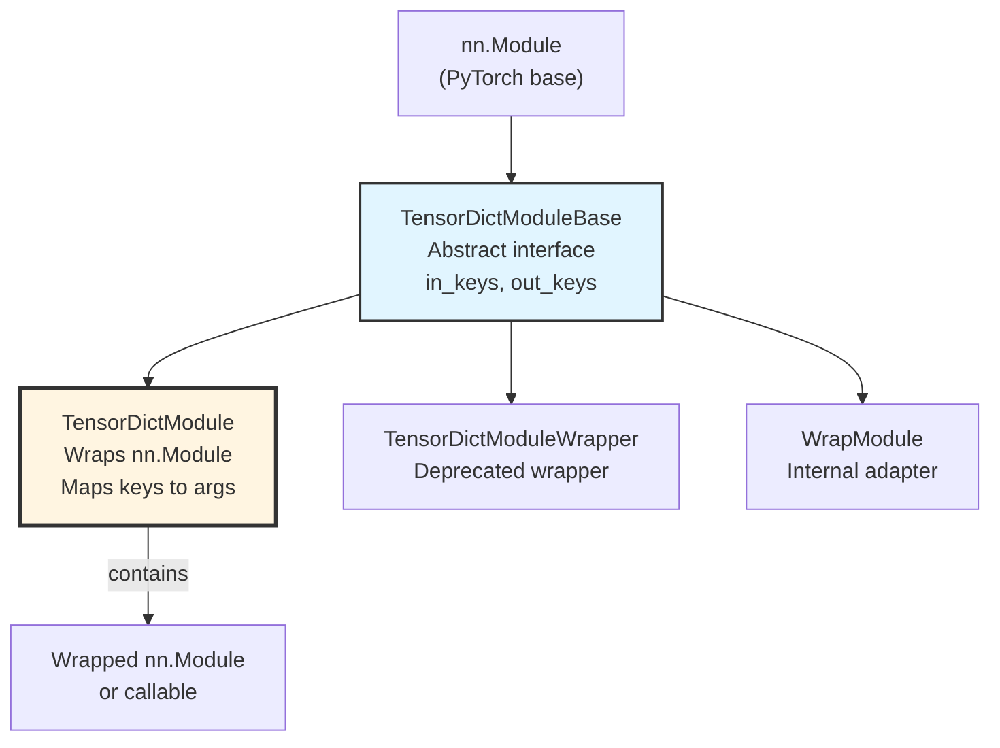
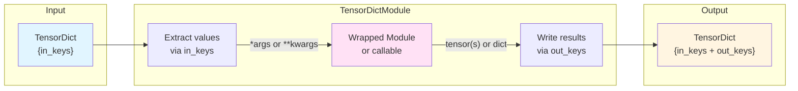
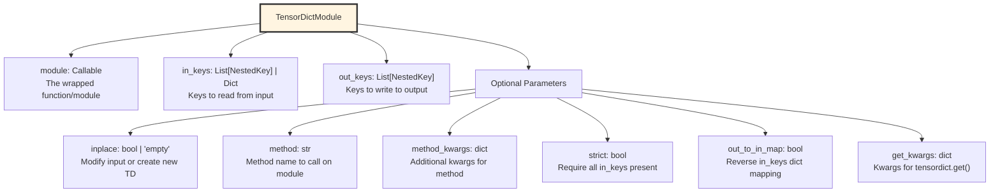
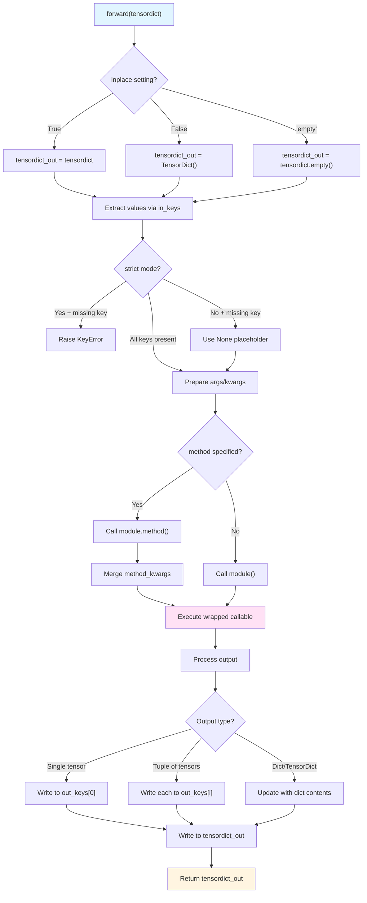
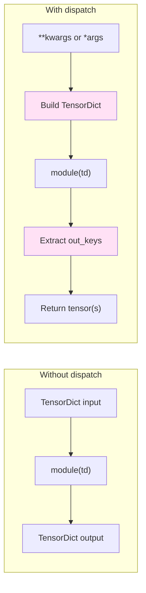
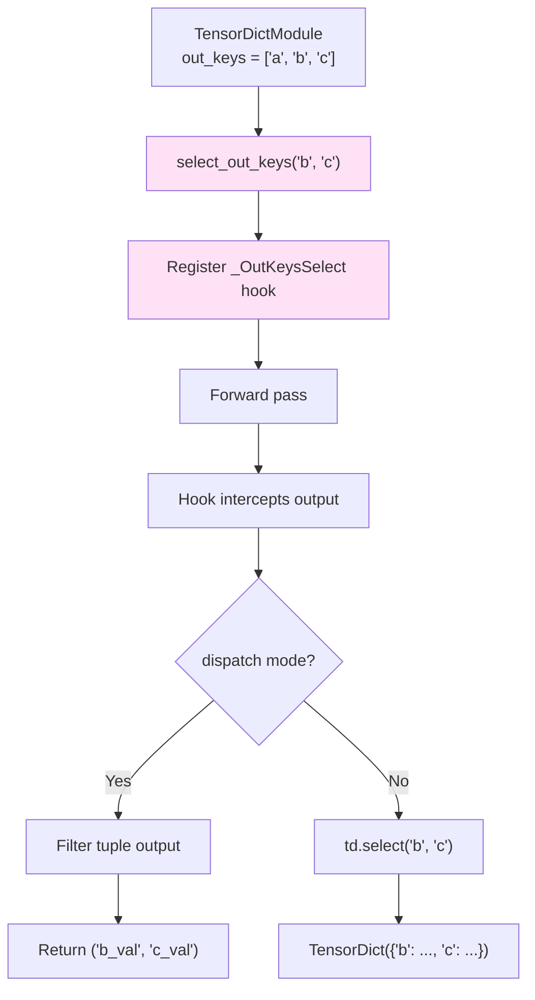
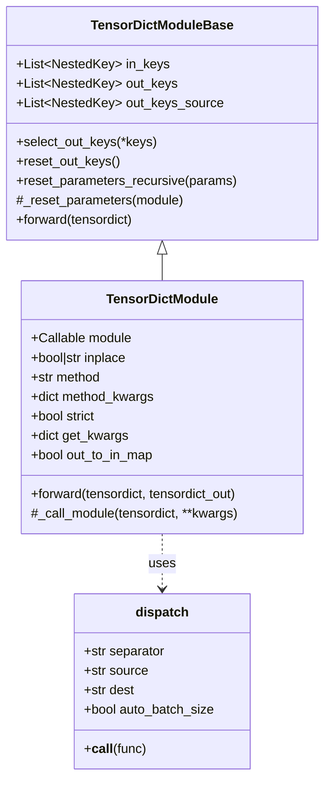
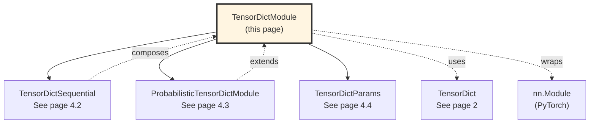

<!-- source: DeepWiki mcp.deepwiki.com · repo pytorch/tensordict · page 4.1 TensorDictModule · fetched 2026-10-21 -->

# TensorDictModule

<details>
<summary>Relevant source files</summary>

The following files were used as context for generating this wiki page:

- [tensordict/nn/common.py](tensordict/nn/common.py)
- [tensordict/nn/distributions/composite.py](tensordict/nn/distributions/composite.py)
- [tensordict/nn/probabilistic.py](tensordict/nn/probabilistic.py)
- [tensordict/nn/sequence.py](tensordict/nn/sequence.py)
- [test/test_nn.py](test/test_nn.py)

</details>


## Purpose and Scope

`TensorDictModule` is a wrapper class that adapts standard PyTorch `nn.Module` instances to read from and write to `TensorDict` objects. It serves as the foundational building block for integrating neural networks into TensorDict-based workflows, enabling seamless composition of modules that communicate via dictionary-like tensor containers rather than positional arguments.

For information about sequencing multiple TensorDictModules, see [TensorDictSequential and Composition](#4.2). For probabilistic modules that sample from distributions, see [Probabilistic Neural Networks](#4.3).

**Sources:** [tensordict/nn/common.py:800-1200]()

---

## Core Architecture

### Class Hierarchy



**Sources:** [tensordict/nn/common.py:477-798](), [tensordict/nn/common.py:800-1200]()

---

### Component Relationships



**Sources:** [tensordict/nn/common.py:1001-1153]()

---

## TensorDictModuleBase

`TensorDictModuleBase` is the abstract base class that defines the core interface for all TensorDict-compatible modules. It establishes the contract for `in_keys` and `out_keys` attributes that control input/output key mappings.

### Key Features

| Feature | Description | Implementation |
|---------|-------------|----------------|
| `in_keys` | List of keys to read from input TensorDict | Property with automatic unraveling |
| `out_keys` | List of keys to write to output TensorDict | Property with selective filtering |
| `select_out_keys()` | Filter which keys appear in output | Registers forward hook |
| `reset_out_keys()` | Restore original out_keys | Removes selection hooks |
| `reset_parameters_recursive()` | Recursively reset module parameters | Functional and stateful modes |

**Sources:** [tensordict/nn/common.py:477-798]()

### Key Unraveling

The base class automatically unravels nested key tuples containing single-element tuples to canonical form:

```python
# Input: ["a", ("b",), ("c", ("d",))]
# After unraveling: ["a", "b", ("c", "d")]
```

This normalization happens in `__new__` for class attributes and via `unravel_key_list()` for instance attributes.

**Sources:** [tensordict/nn/common.py:520-571]()

---

## TensorDictModule

`TensorDictModule` is the primary implementation that wraps any callable (typically an `nn.Module`) and manages the mapping between TensorDict keys and function arguments.

### Constructor Parameters



**Sources:** [tensordict/nn/common.py:800-1000]()

---

## Input Key Specification

`TensorDictModule` supports three modes for specifying input keys:

### Mode 1: List of Keys (Standard)

```python
# Keys extracted in order, passed as positional args
TensorDictModule(
    module=lambda x, y: x + y,
    in_keys=["a", "b"],
    out_keys=["c"]
)
```

### Mode 2: Dictionary (Keyword Mapping - Default)

```python
# Keys map to function argument names
# Format: {td_key: func_arg_name}
TensorDictModule(
    module=lambda x, *, y: x + y,
    in_keys={"key1": "x", "key2": "y"},
    out_keys=["result"],
    out_to_in_map=False  # Default: dict keys are TD keys
)
```

### Mode 3: Dictionary (Inverted Mapping)

```python
# Keys map from function args to TD keys
# Format: {func_arg_name: td_key}
TensorDictModule(
    module=lambda x, *, y: x + y,
    in_keys={"x": "key1", "y": "key2"},
    out_keys=["result"],
    out_to_in_map=True  # Invert: dict keys are func args
)
```

**Sources:** [tensordict/nn/common.py:1001-1100](), [test/test_nn.py:408-498]()

---

## Forward Pass Mechanism



**Sources:** [tensordict/nn/common.py:1001-1153]()

---

## The dispatch Decorator

The `dispatch` decorator enables calling TensorDictModules using keyword arguments or positional tensors instead of TensorDict objects. It automatically constructs a TensorDict from the arguments and unpacks the results.

### Dispatch Mechanism



**Sources:** [tensordict/nn/common.py:66-377]()

### Dispatch Configuration

| Parameter | Default | Description |
|-----------|---------|-------------|
| `separator` | `"_"` | Joins nested key tuples (e.g., `("a", "b")` → `"a_b"`) |
| `source` | `"in_keys"` | Attribute name or list containing input keys |
| `dest` | `"out_keys"` | Attribute name or list containing output keys |
| `auto_batch_size` | `True` | Automatically infer batch size from inputs |

**Sources:** [tensordict/nn/common.py:210-241]()

### Nested Key Handling

For nested keys, the separator joins tuple elements:

```python
# With default separator "_":
# in_keys = [("a", "c")]
# Expects kwarg: a_c=tensor

# With custom separator "sep":
# in_keys = [("a", "c")]  
# Expects kwarg: asepc=tensor
```

**Sources:** [tensordict/nn/common.py:143-173](), [test/test_nn.py:889-995]()

---

## Output Key Selection

The `select_out_keys()` method dynamically filters which keys appear in the output TensorDict. This is implemented via a forward hook that intercepts the module output.



**Sources:** [tensordict/nn/common.py:572-683](), [tensordict/nn/common.py:379-475]()

---

## Method Invocation

Instead of calling the module's `__call__` method, you can specify a different method to invoke:

```python
class MyNet(nn.Module):
    def my_func(self, tensor: torch.Tensor, *, an_integer: int):
        return tensor + an_integer

module = TensorDictModule(
    MyNet(),
    in_keys=["input"],
    out_keys=["output"],
    method="my_func",
    method_kwargs={"an_integer": 2}
)
```

This exposes the module's parameters and buffers while allowing non-standard forward signatures.

**Sources:** [tensordict/nn/common.py:1001-1051](), [test/test_nn.py:340-360]()

---

## Parameter Management

### reset_parameters_recursive()

This method recursively resets all parameters in the module hierarchy. It supports two modes:

#### Stateful Mode (Default)

```python
# Resets parameters in-place using module.reset_parameters()
module.reset_parameters_recursive()
```

#### Functional Mode

```python
# Resets parameters in a TensorDict without modifying the module
params = TensorDict.from_module(module)
new_params = module.reset_parameters_recursive(params)
# params is modified in-place; new_params is the same object
```

The functional mode is useful for parameter sampling in ensemble methods or functional programming workflows.

**Sources:** [tensordict/nn/common.py:724-789](), [test/test_nn.py:499-593]()

---

## Integration with PyTorch Ecosystem

### Functorch/vmap Support

TensorDictModule is compatible with `torch.vmap` for batched execution:

```python
from torch import vmap

module = TensorDictModule(nn.Linear(4, 8), ["input"], ["output"])
params = TensorDict.from_module(module).expand(10)  # 10 sets of params

def func(td, params):
    with params.to_module(module):
        return module(td)

td_batch = vmap(func, (None, 0))(td, params)
```

**Sources:** [tensordict/nn/common.py:1001-1200](), [test/test_nn.py:830-842]()

### torch.compile Compatibility

TensorDictModule works with `torch.compile` for optimized execution:

```python
compiled_module = torch.compile(module)
result = compiled_module(tensordict)
```

**Sources:** Referenced in architecture overview (Diagram 4)

---

## Key Design Patterns

### Pattern 1: Simple Wrapper

```python
net = nn.Linear(3, 4)
td_module = TensorDictModule(net, in_keys=["x"], out_keys=["y"])

# Usage:
td = TensorDict({"x": torch.randn(2, 3)}, batch_size=[2])
td = td_module(td)
# td now contains "y" key
```

### Pattern 2: Lambda Functions

```python
module = TensorDictModule(
    lambda x: x + 1,
    in_keys=["input"],
    out_keys=["output"]
)
```

### Pattern 3: Multiple Inputs/Outputs

```python
module = TensorDictModule(
    lambda x, y: (x + y, x - y),
    in_keys=["a", "b"],
    out_keys=["sum", "diff"]
)
```

### Pattern 4: Nested Keys

```python
module = TensorDictModule(
    transform_fn,
    in_keys=[("obs", "image"), ("obs", "vector")],
    out_keys=[("features", "visual"), ("features", "state")]
)
```

**Sources:** [test/test_nn.py:594-760]()

---

## Strict Mode and Error Handling

When `strict=False` (default), missing input keys are replaced with `None`:

```python
def check(a, b):
    assert b is None
    return a

tdm = TensorDictModule(
    check,
    in_keys=["present", "missing"],
    out_keys=["output"],
    strict=False
)

td = TensorDict({"present": torch.tensor(1)})
result = tdm(td)  # Works; "missing" is passed as None
```

When `strict=True`, missing keys raise a `KeyError`.

**Sources:** [test/test_nn.py:713-728]()

---

## Non-Tensor Data Handling

TensorDictModule supports non-tensor data (strings, lists, custom objects) through `NonTensorData` and `NonTensorStack`:

```python
module = TensorDictModule(
    lambda: "a string!",
    in_keys=[],
    out_keys=["output"]
)

result = module(TensorDict())
# result["output"] == "a string!"
```

**Sources:** [test/test_nn.py:730-760]()

---

## Implementation Details

### Class Structure



**Sources:** [tensordict/nn/common.py:477-1200]()

### Key Implementation Methods

| Method | Location | Purpose |
|--------|----------|---------|
| `forward()` | [common.py:1001-1153]() | Main execution logic |
| `_call_module()` | [common.py:1051-1100]() | Invokes wrapped module |
| `select_out_keys()` | [common.py:572-683]() | Filter output keys |
| `reset_parameters_recursive()` | [common.py:724-789]() | Parameter reinitialization |
| `dispatch.__call__()` | [common.py:242-331]() | Kwargs-to-TensorDict conversion |

**Sources:** [tensordict/nn/common.py:800-1200]()

---

## Advanced Usage

### Dynamic Output Selection

```python
# Create module with multiple outputs
module = TensorDictModule(
    lambda x, y: (x+2, y+2),
    in_keys=["a", "b"],
    out_keys=["c", "d"]
)

# Dynamically select only "d" in output
module.select_out_keys("d")
td = TensorDict({"a": torch.zeros(()), "b": torch.ones(())}, [])
result = module(td)
# result contains only "d", not "c"

# Restore original behavior
module.reset_out_keys()
```

**Sources:** [test/test_nn.py:591-666]()

### Dispatch with Nested Keys

```python
class MyModule(nn.Module):
    in_keys = [("a", "c"), "d"]
    out_keys = ["b"]
    
    @dispatch(separator="_")
    def forward(self, tensordict):
        tensordict["b"] = tensordict["a", "c"] + tensordict["d"]
        return tensordict

module = MyModule()
# Call with kwargs: a_c and d
result = module(a_c=torch.zeros(1, 2), d=torch.ones(1, 2))
```

**Sources:** [test/test_nn.py:903-917]()

---

## Relationship to Other Components



**Sources:** High-level architecture diagrams in prompt

---

## Summary

`TensorDictModule` is the foundational abstraction for integrating PyTorch modules into TensorDict-based workflows. Key characteristics:

- **Wraps any callable**: Works with `nn.Module`, lambda functions, or any callable
- **Key-based I/O**: Reads from and writes to TensorDict via `in_keys`/`out_keys`
- **Flexible invocation**: Supports both TensorDict and kwargs/args via `dispatch`
- **Composable**: Designed to work with `TensorDictSequential` and other composition patterns
- **Functional programming**: Supports parameter injection via `to_module()` context
- **vmap compatible**: Works with batched execution and functional transformations

**Sources:** [tensordict/nn/common.py:800-1200](), [test/test_nn.py:320-1100]()

---

