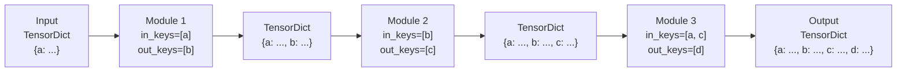
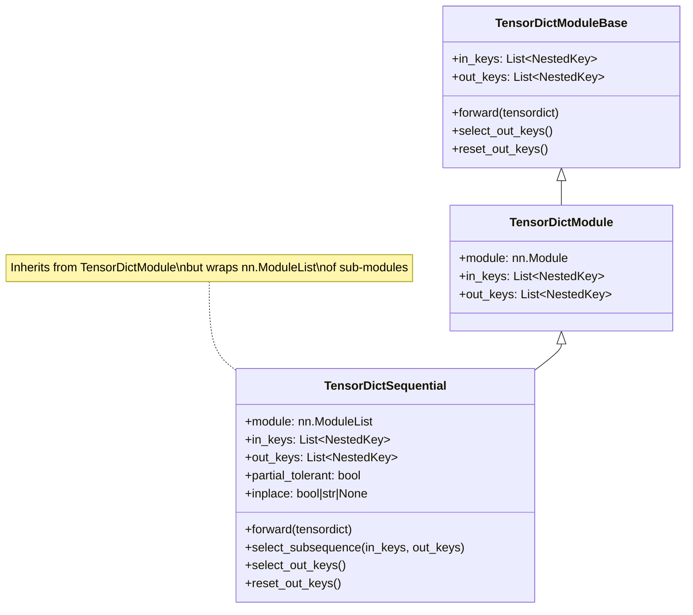
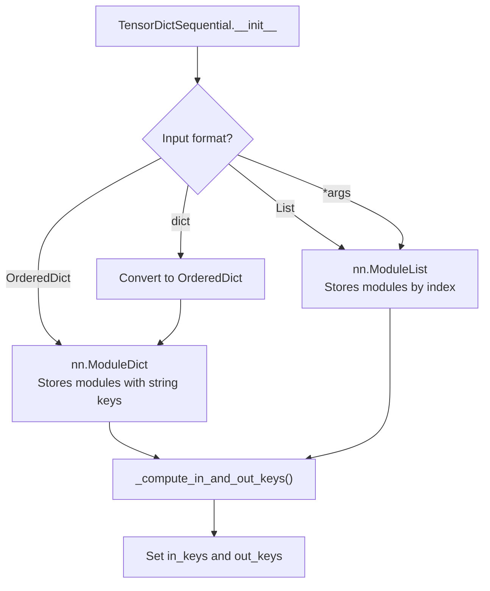
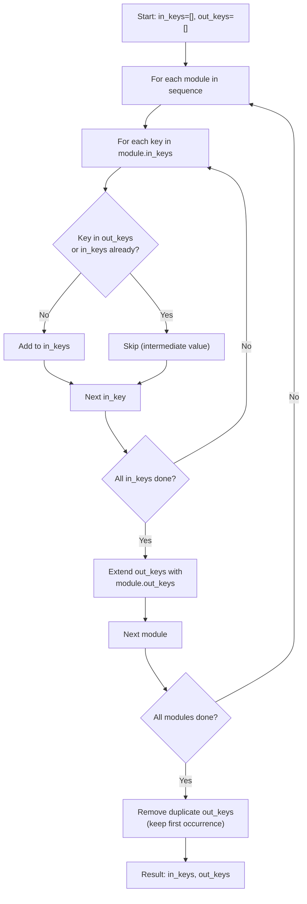
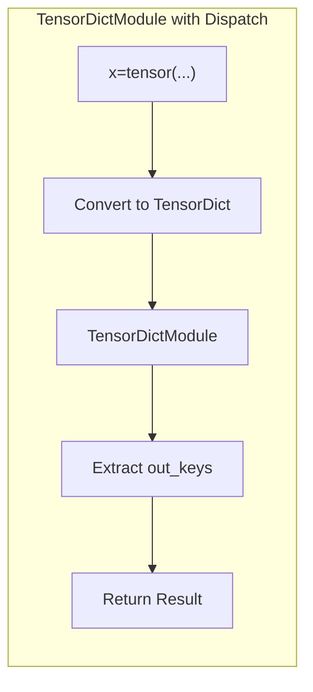
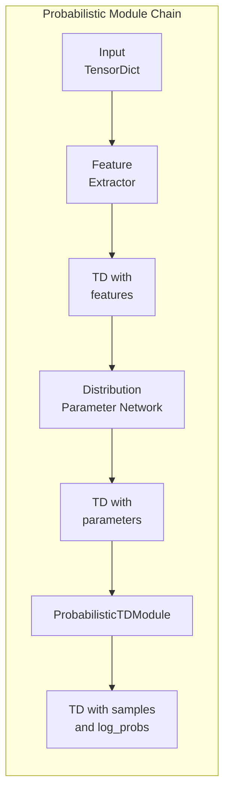
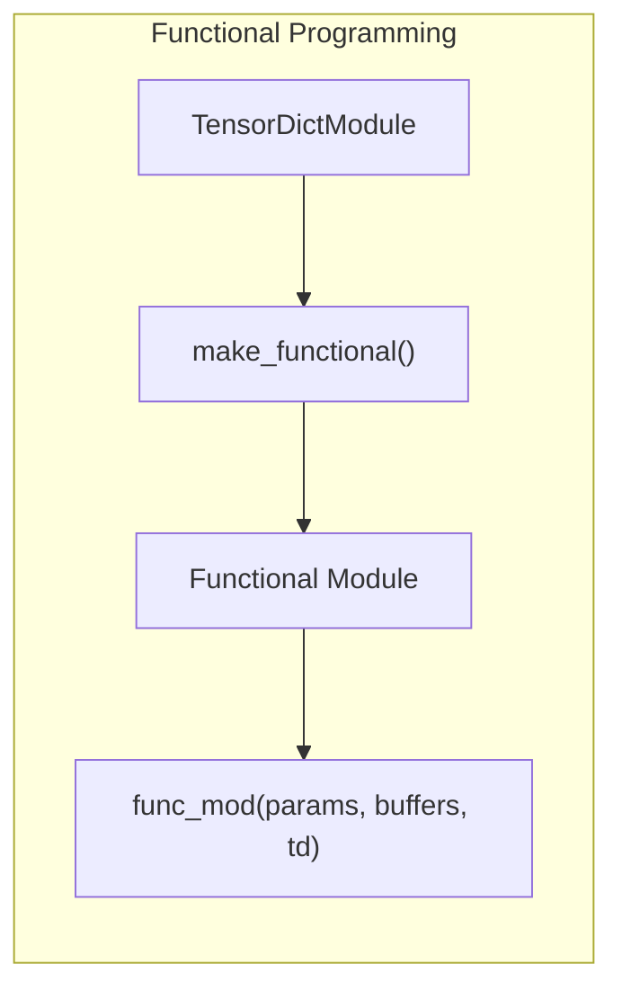
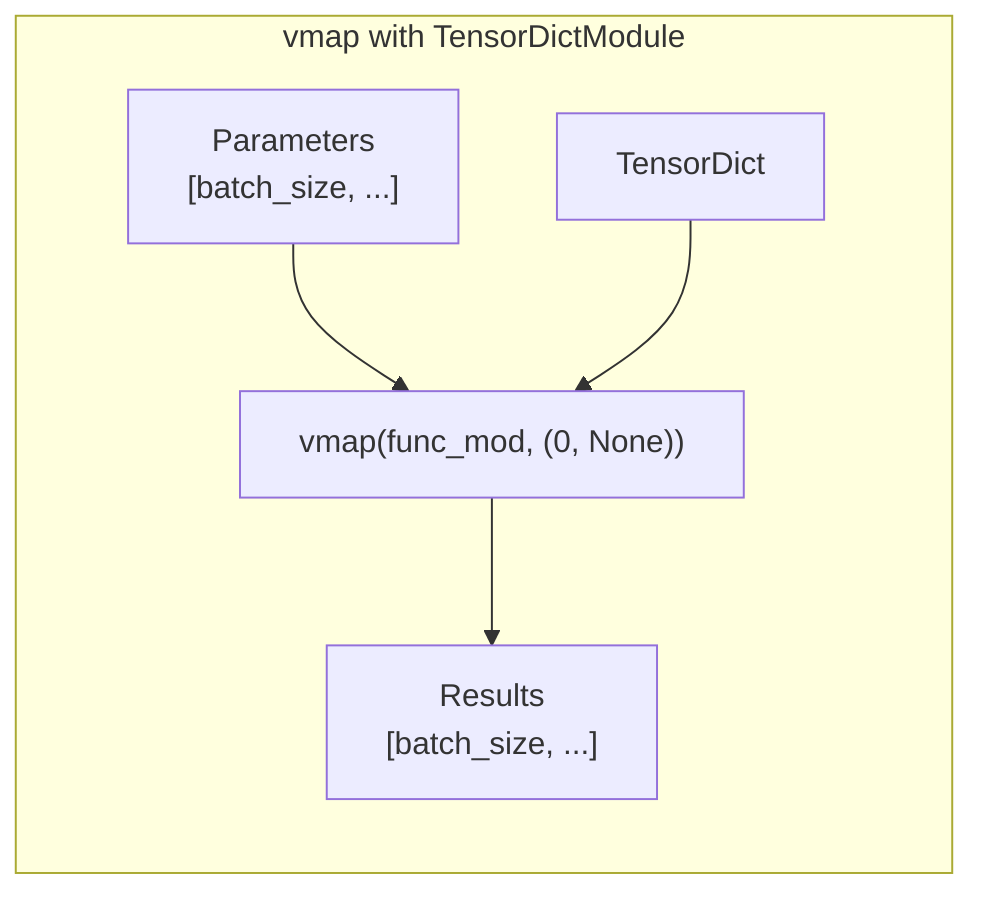

<!-- source: DeepWiki mcp.deepwiki.com · repo pytorch/tensordict · page 4.2 TensorDictSequential and Composition · fetched 2026-10-21 -->

# TensorDictSequential and Composition

<details>
<summary>Relevant source files</summary>

The following files were used as context for generating this wiki page:

- [tensordict/nn/common.py](tensordict/nn/common.py)
- [tensordict/nn/distributions/composite.py](tensordict/nn/distributions/composite.py)
- [tensordict/nn/probabilistic.py](tensordict/nn/probabilistic.py)
- [tensordict/nn/sequence.py](tensordict/nn/sequence.py)
- [test/test_nn.py](test/test_nn.py)

</details>


This document explains how to chain multiple TensorDict-compatible modules together using `TensorDictSequential`, build complex computational graphs, and selectively execute sub-pipelines. These capabilities enable flexible composition of neural network components with automatic data flow management.

For basic module wrapping, see page 4.1. For probabilistic modules, see page 4.3.

## Overview

`TensorDictSequential` chains multiple `TensorDictModule` instances (or other callables) together, passing a single TensorDict through each module in sequence. Unlike PyTorch's `nn.Sequential`, it naturally handles modules with multiple inputs and outputs, preserving intermediate results in the TensorDict for use by later modules.

**Sequential Data Flow Diagram**


Sources: [tensordict/nn/sequence.py:57-188]()

## TensorDictSequential Class Structure

**Class Hierarchy**


The `TensorDictSequential` class extends `TensorDictModule` and stores its sub-modules in either an `nn.ModuleList` or `nn.ModuleDict`. The modules are stored in the `module` attribute and can be accessed via indexing.

Sources: [tensordict/nn/sequence.py:57-188](). [tensordict/nn/common.py:477-542]()

## Initialization and Module Storage

`TensorDictSequential` accepts modules in three formats:

**Module Storage Options**


When initialized with a dictionary, modules can be accessed by name: `sequential["encoder"]`. When initialized with a list or varargs, modules are accessed by index: `sequential[0]`.

Sources: [tensordict/nn/sequence.py:194-261]()

## Automatic Key Computation

`TensorDictSequential` automatically computes its `in_keys` and `out_keys` from the constituent modules. This computation follows a specific algorithm:

**Key Computation Algorithm**


**Key Computation Example:**
```
Module 1: in_keys=["a"], out_keys=["b", "c"]
Module 2: in_keys=["b"], out_keys=["d"]  
Module 3: in_keys=["c", "d"], out_keys=["e"]

Sequential:
  in_keys = ["a"]           # Only "a" is external input
  out_keys = ["b", "c", "d", "e"]  # All outputs preserved
```

This algorithm ensures that:
1. Only truly external inputs appear in `in_keys`
2. Intermediate values that connect modules are not included in `in_keys`
3. All module outputs are preserved in `out_keys` (unless filtered later)
4. Duplicate outputs use the first occurrence

Sources: [tensordict/nn/sequence.py:288-308]()

## Advanced Features

### Dispatch Mechanism

The `dispatch` decorator allows modules to be called with keyword arguments instead of a TensorDict:



Sources: [tensordict/nn/common.py:66-377](). [test/test_nn.py:817-864]().

### Nested Key Handling

Nested keys provide access to hierarchical TensorDict structures:

```mermaid
flowchart LR
    subgraph "TensorDict Structure"
        TD["TensorDict"] --> Features["features: TensorDict"]
        Features --> X["x: Tensor"]
        TD --> Outputs["outputs: TensorDict"]
        Outputs --> Y["y: Tensor"]
    end

    subgraph "Access via Nested Keys"
        K1["(\"features\", \"x\")"] --> X
        K2["(\"outputs\", \"y\")"] --> Y
    end
```

Sources: [tensordict/nn/common.py:310-317](). [test/test_nn.py:845-852]().

### Integration with Probabilistic Models

`TensorDictModule` and `TensorDictSequential` integrate with probabilistic modules:



Sources: [tensordict/nn/probabilistic.py:144-665](). [test/test_nn.py:596-756]().

## PyTorch Ecosystem Integration

### Functional Programming Support

Modules can be converted to functional form for use with JAX-like transforms:



Sources: [test/test_nn.py:758-779]().

### vmap Support

Support for vectorized operations with `vmap`:



Sources: [test/test_nn.py:780-794](). [tensordict/nn/probabilistic.py:309-329]().

### torch.compile Compatibility

Both `TensorDictModule` and `TensorDictSequential` are compatible with `torch.compile` for accelerated execution.

Sources: [tensordict/nn/utils.py:412-436](). [docs/source/reference/nn.rst:238-245]().

## Conclusion

`TensorDictModule` and `TensorDictSequential` provide the critical bridge between TensorDict's data structures and PyTorch's neural network modules. They enable more flexible neural network architectures through key-based data flow specification, support for complex data hierarchies, and seamless integration with both traditional and probabilistic models.

These components are foundational to building complex neural network systems with TensorDict, offering a more intuitive and flexible alternative to traditional PyTorch patterns, especially for models with multiple inputs and outputs.

Sources: [tensordict/nn/__init__.py:1-49](). [docs/source/reference/nn.rst:1-188]().

---

