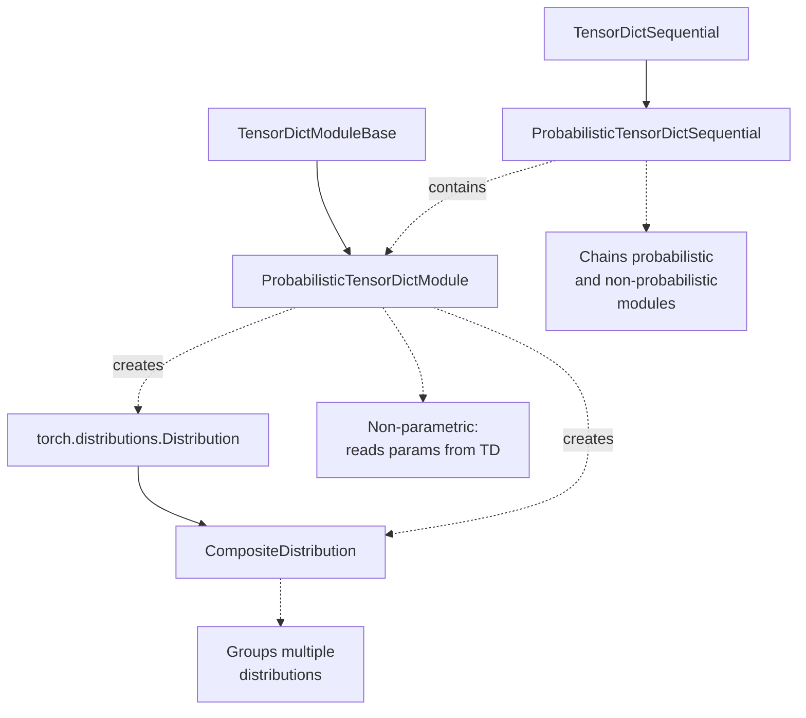
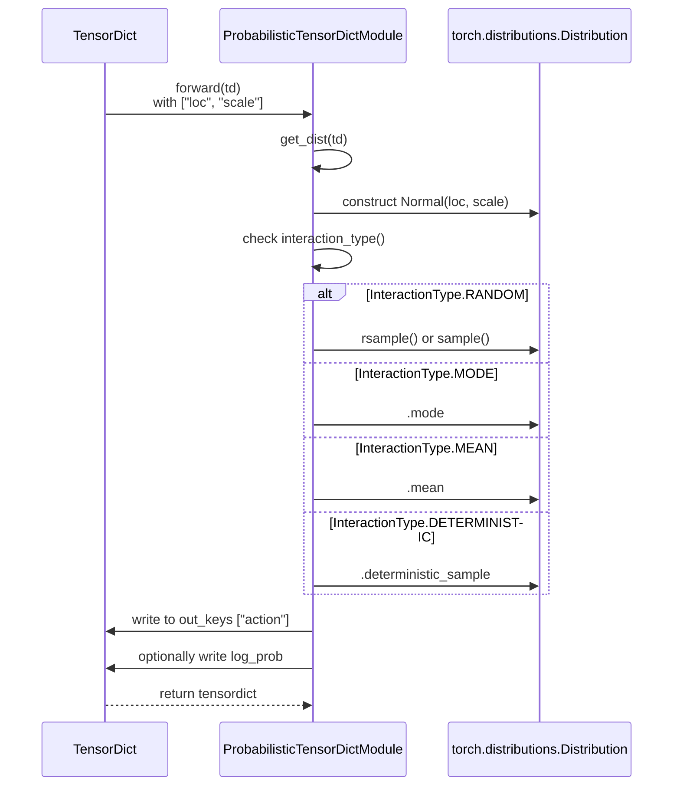
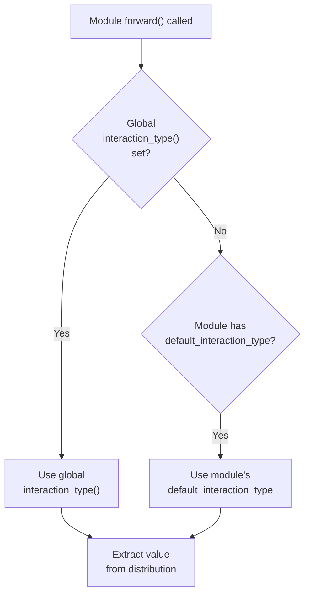
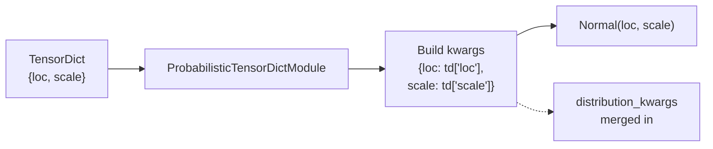
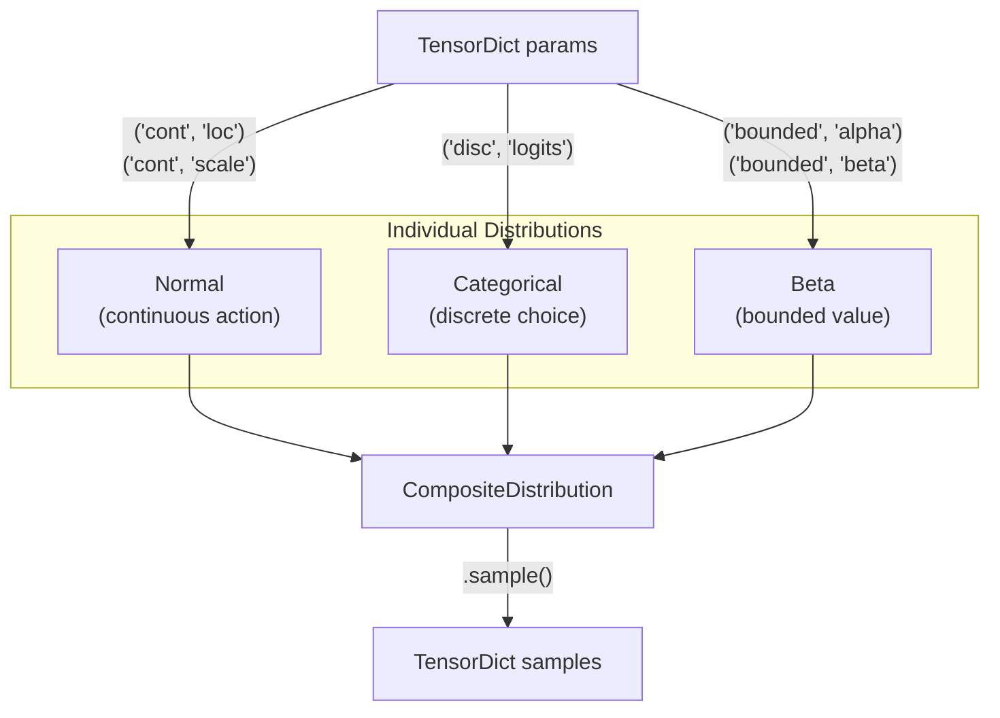
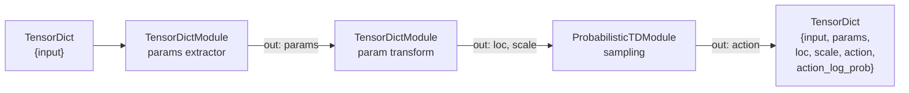

<!-- source: DeepWiki mcp.deepwiki.com · repo pytorch/tensordict · page 4.3 Probabilistic Neural Networks · fetched 2026-10-21 -->

# Probabilistic Neural Networks

<details>
<summary>Relevant source files</summary>

The following files were used as context for generating this wiki page:

- [tensordict/nn/common.py](tensordict/nn/common.py)
- [tensordict/nn/distributions/composite.py](tensordict/nn/distributions/composite.py)
- [tensordict/nn/probabilistic.py](tensordict/nn/probabilistic.py)
- [tensordict/nn/sequence.py](tensordict/nn/sequence.py)
- [test/test_nn.py](test/test_nn.py)

</details>


## Purpose and Scope

This page documents the probabilistic neural network components in TensorDict, which enable stochastic policy networks and probabilistic models. These components wrap PyTorch distributions to work seamlessly with TensorDict data structures, supporting different sampling strategies and log-probability computation.

For basic neural network integration without probabilistic behavior, see [TensorDictModule](#4.1). For chaining non-probabilistic modules, see [TensorDictSequential](#4.2).

## Overview

The probabilistic neural network system consists of three main components:

1. **`ProbabilisticTensorDictModule`** - Constructs distributions from parameters in a TensorDict and samples from them
2. **`InteractionType`** - Controls the sampling strategy (random, deterministic, mode, mean, median)
3. **`CompositeDistribution`** - Manages multiple distributions simultaneously for multi-headed outputs

These components integrate with PyTorch's `torch.distributions` API while maintaining TensorDict's key-based data flow patterns.

**Sources:** [tensordict/nn/probabilistic.py:159-345]()

## Class Hierarchy



**Sources:** [tensordict/nn/probabilistic.py:159-770](), [tensordict/nn/sequence.py:57-683](), [tensordict/nn/distributions/composite.py:24-567]()

## ProbabilisticTensorDictModule

### Core Functionality

`ProbabilisticTensorDictModule` is a non-parametric module that reads distribution parameters from a TensorDict, constructs a distribution, and produces an output based on the current `InteractionType`. Unlike standard neural network modules, it does not contain learnable parameters itself—instead, it reads parameters produced by upstream modules.



**Sources:** [tensordict/nn/probabilistic.py:159-345](), [tensordict/nn/probabilistic.py:603-671]()

### Constructor Arguments

| Argument | Type | Description |
|----------|------|-------------|
| `in_keys` | `List[NestedKey]` or `Dict[str, NestedKey]` | Keys to read distribution parameters from input TensorDict. Must match distribution constructor arguments (e.g., `["loc", "scale"]` for Normal) |
| `out_keys` | `List[NestedKey]` | Keys where sampled values will be written. Can be `None` for `CompositeDistribution` |
| `default_interaction_type` | `InteractionType` | Fallback sampling strategy when global `interaction_type()` returns `None`. Default: `DETERMINISTIC` |
| `distribution_class` | `Type[Distribution]` | PyTorch distribution class or callable. Default: `Delta` (deterministic) |
| `distribution_kwargs` | `dict` | Additional keyword arguments passed to distribution constructor |
| `return_log_prob` | `bool` | Whether to compute and write log-probability to tensordict. Default: `False` |
| `log_prob_key` | `NestedKey` | Key where log-probability will be written. Default: `"sample_log_prob"` |
| `cache_dist` | `bool` | EXPERIMENTAL: Cache distribution parameters in tensordict. Default: `False` |
| `num_samples` | `int` or `torch.Size` | Number of samples to draw when using `RANDOM` interaction type |

**Sources:** [tensordict/nn/probabilistic.py:347-445]()

### In-Keys Mapping

The `in_keys` parameter supports two modes:

**List Mode** (default): Keys are read from tensordict and matched to distribution parameters by leaf name:
```python
# in_keys=["loc", "scale"] reads td["loc"] and td["scale"]
# and passes them as Normal(loc=..., scale=...)
```

**Dictionary Mode** (with `out_to_in_map`): Maps tensordict keys to distribution parameter names:
```python
# in_keys={"loc": "mu", "scale": "sigma"} reads td["mu"] and td["sigma"]
# and passes them as Normal(loc=..., scale=...)
```

**Sources:** [tensordict/nn/probabilistic.py:386-397](), [tensordict/nn/probabilistic.py:521-542]()

## Interaction Type System

### InteractionType Enum

The `InteractionType` enum controls how values are extracted from distributions:

| Value | Behavior | Use Case |
|-------|----------|----------|
| `RANDOM` | Calls `rsample()` or `sample()` | Training with stochastic policies |
| `MODE` | Returns `dist.mode` | Evaluation with most likely value |
| `MEDIAN` | Returns `dist.median` | Evaluation with median value |
| `MEAN` | Returns `dist.mean` or empirical estimate | Evaluation with expected value |
| `DETERMINISTIC` | Returns `dist.deterministic_sample` with fallback | Generic deterministic evaluation |

**Sources:** [tensordict/nn/probabilistic.py:59-94]()

### Interaction Type Resolution

The module resolves the interaction type with the following precedence:



The global interaction type is set using the `set_interaction_type()` context manager:

```python
with set_interaction_type(InteractionType.RANDOM):
    # All probabilistic modules use random sampling
    td = module(td)
```

**Sources:** [tensordict/nn/probabilistic.py:123-157](), [tensordict/nn/probabilistic.py:672-769]()

### DETERMINISTIC Fallback Mechanism

When `InteractionType.DETERMINISTIC` is used but the distribution lacks a `deterministic_sample` attribute, the system consults the `DETERMINISTIC_REGISTER` dictionary to find an appropriate fallback:

1. Check if distribution has `deterministic_sample` attribute
2. If not, look up distribution class in `DETERMINISTIC_REGISTER`
3. Fall back to `MODE` for discrete distributions (those with `has_enumerate_support`)
4. Fall back to `MEAN` for continuous distributions
5. Issue a warning about the fallback

**Sources:** [tensordict/nn/probabilistic.py:99-121](), [tensordict/nn/probabilistic.py:689-731]()

## Distribution Construction

### get_dist Method

The `get_dist()` method constructs a distribution from tensordict parameters:



The method:
1. Iterates over `in_keys` and extracts values from the tensordict
2. Maps keys to distribution parameter names (handling both list and dict modes)
3. Merges in static `distribution_kwargs` 
4. Constructs the distribution using `distribution_class(**params, **distribution_kwargs)`
5. Returns the distribution object

**Sources:** [tensordict/nn/probabilistic.py:509-542]()

### Error Handling

The module raises informative `TypeError` exceptions when:
- Distribution keywords don't match tensordict keys
- Required positional arguments are missing
- Unexpected keyword arguments are provided

**Sources:** [tensordict/nn/probabilistic.py:530-541]()

## Log Probability Computation

### Return Log Probability

When `return_log_prob=True`, the module computes and writes log-probabilities after sampling:

| `composite_lp_aggregate()` | Output Behavior |
|---------------------------|-----------------|
| `True` | Single summed log-probability at `log_prob_key` |
| `False` | Individual log-probabilities at `{sample_name}_log_prob` for each output |

The aggregation mode is controlled by the global `composite_lp_aggregate()` function and affects both `ProbabilisticTensorDictModule` and `CompositeDistribution`.

**Sources:** [tensordict/nn/probabilistic.py:398-428](), [tensordict/nn/probabilistic.py:614-655]()

### Log Probability Keys

The module manages log-probability keys with version checking:

```python
# Module stores the composite_lp_aggregate setting at init time
self._composite_lp_aggreate_at_init = composite_lp_aggregate()

# At runtime, checks if setting has changed
if composite_lp_aggregate() != self._composite_lp_aggreate_at_init:
    raise RuntimeError("composite_lp_aggregate changed between init and execution")
```

This prevents inconsistent behavior when the global setting changes after module construction.

**Sources:** [tensordict/nn/probabilistic.py:445-497]()

### log_prob Method

The `log_prob()` method computes log-probabilities for existing samples:

```python
# Compute log-prob for a sample already in the tensordict
log_p = module.log_prob(tensordict, dist=dist)  # dist optional
```

For `CompositeDistribution`, it handles aggregation according to the current `composite_lp_aggregate()` setting.

**Sources:** [tensordict/nn/probabilistic.py:548-588]()

## CompositeDistribution

### Purpose

`CompositeDistribution` groups multiple independent distributions, enabling multi-headed outputs where each head samples from a different distribution type. It implements the `torch.distributions.Distribution` interface while using TensorDict for inputs and outputs.



**Sources:** [tensordict/nn/distributions/composite.py:24-90]()

### Constructor

The `CompositeDistribution` constructor requires:

| Argument | Description |
|----------|-------------|
| `params` | TensorDict with nested structure containing distribution parameters |
| `distribution_map` | Dict mapping keys to distribution classes: `{key: DistClass}` |
| `name_map` (optional) | Maps internal keys to output keys for renaming samples |
| `extra_kwargs` (optional) | Additional kwargs per distribution: `{key: kwargs_dict}` |
| `log_prob_key` | Key for aggregated log-probability (default: `"sample_log_prob"`) |
| `entropy_key` | Key for aggregated entropy (default: `"entropy"`) |

**Sources:** [tensordict/nn/distributions/composite.py:92-133]()

### Example Structure

```python
params = TensorDict({
    "cont": {"loc": torch.randn(3, 4), "scale": torch.rand(3, 4)},
    ("nested", "disc"): {"logits": torch.randn(3, 10)}
}, batch_size=[3])

dist = CompositeDistribution(
    params,
    distribution_map={
        "cont": d.Normal,
        ("nested", "disc"): d.Categorical
    }
)

# Sample returns TensorDict with keys "cont" and ("nested", "disc")
sample = dist.sample()
```

**Sources:** [tensordict/nn/distributions/composite.py:64-89]()

### Methods

| Method | Returns | Description |
|--------|---------|-------------|
| `sample(shape)` | `TensorDictBase` | Sample from all distributions |
| `rsample(shape)` | `TensorDictBase` | Reparameterized sample (if supported) |
| `log_prob(sample)` | `Tensor` or `TensorDictBase` | Log-probability (aggregated or per-component) |
| `log_prob_composite(sample)` | `TensorDictBase` | Always returns per-component log-probabilities |
| `entropy()` | `Tensor` or `TensorDictBase` | Entropy (aggregated or per-component) |
| `mode` | `TensorDictBase` | Mode of each distribution |
| `mean` | `TensorDictBase` | Mean of each distribution |
| `deterministic_sample` | `TensorDictBase` | Deterministic sample with fallbacks |

**Sources:** [tensordict/nn/distributions/composite.py:250-420]()

### Log Probability Aggregation

The `log_prob()` method behavior depends on `composite_lp_aggregate()`:

**Aggregated Mode** (`composite_lp_aggregate() == True`):
```python
# Returns single tensor with summed log-probabilities
log_p = dist.log_prob(sample)  # shape: sample.shape
```

**Composite Mode** (`composite_lp_aggregate() == False`):
```python
# Returns TensorDict with individual log-probabilities
result = dist.log_prob(sample)
# result["cont_log_prob"]: log-prob for continuous action
# result["nested", "disc_log_prob"]: log-prob for discrete choice
# result["sample_log_prob"]: sum of all log-probs (if include_sum=True)
```

**Sources:** [tensordict/nn/distributions/composite.py:350-419]()

## ProbabilisticTensorDictSequential

### Purpose

`ProbabilisticTensorDictSequential` extends `TensorDictSequential` to properly handle sequences containing one or more `ProbabilisticTensorDictModule` instances. It exposes methods for distribution construction and maintains compatibility with the probabilistic API.

**Sources:** [tensordict/nn/probabilistic.py:771-1085]()

### Key Features

1. **get_dist() Method**: Constructs distribution from the final probabilistic module in the sequence
2. **Multiple Probabilistic Modules**: Can contain multiple probabilistic modules; behavior controlled by `return_composite` flag
3. **Conditional Log-Probabilities**: When modules are chained, log-probabilities are conditional: `log p(z | x, y)` where `z = F(x, y)`



**Sources:** [tensordict/nn/probabilistic.py:771-826]()

### return_composite Flag

The `return_composite` keyword argument controls how multiple probabilistic modules are handled:

| `return_composite` | Behavior |
|-------------------|----------|
| `True` | All probabilistic modules contribute to a single `CompositeDistribution` |
| `False` (default) | Only the last probabilistic module produces a distribution; others sample normally |

If `return_composite=False` and the last module is not probabilistic, a `ValueError` is raised when calling `get_dist()`.

**Sources:** [tensordict/nn/probabilistic.py:815-822](), [tensordict/nn/probabilistic.py:893-984]()

### Example Usage

```python
# Typical pattern: parameters -> distribution -> sample
seq = ProbabilisticTensorDictSequential(
    TensorDictModule(nn.Linear(4, 8), in_keys=["input"], out_keys=["params"]),
    TensorDictModule(NormalParamExtractor(), in_keys=["params"], out_keys=["loc", "scale"]),
    ProbabilisticTensorDictModule(
        in_keys=["loc", "scale"],
        out_keys=["action"],
        distribution_class=Normal,
        return_log_prob=True
    )
)

# Forward pass samples action
td = seq(TensorDict({"input": torch.randn(3, 4)}, [3]))

# Get distribution without sampling
dist = seq.get_dist(td)
```

**Sources:** [test/test_nn.py:619-657](), [tensordict/nn/probabilistic.py:271-324]()

### Conditional Log-Probabilities

When probabilistic modules depend on outputs of previous modules, the log-probabilities are conditional:

```python
# If z = F(x, y) where y is sampled, then:
# log p(z) in tensordict is actually log p(z | x, y)
```

This is documented in the class docstring as an important consideration for probability calculations.

**Sources:** [tensordict/nn/probabilistic.py:789-799]()

## Integration Patterns

### With torch.distributions

`ProbabilisticTensorDictModule` wraps any `torch.distributions.Distribution` class:

```python
from torch.distributions import Normal, Categorical, Beta, Independent

# Single distribution
prob_module = ProbabilisticTensorDictModule(
    in_keys=["loc", "scale"],
    out_keys=["action"],
    distribution_class=Normal
)

# Independent distribution (for multivariate outputs)
def IndepNormal(**kwargs):
    return Independent(Normal(**kwargs), 1)

prob_module = ProbabilisticTensorDictModule(
    in_keys=["loc", "scale"],
    out_keys=["action"],
    distribution_class=IndepNormal
)
```

**Sources:** [tensordict/nn/probabilistic.py:272-324]()

### Custom Distribution Classes

The `distribution_class` can be any callable that returns a `Distribution`:

```python
# Lambda for custom construction
distribution_class = lambda loc, scale: Normal(loc, scale.exp())

# Custom distribution class
class MyDistribution(d.Distribution):
    def __init__(self, param1, param2):
        self.param1 = param1
        self.param2 = param2
        super().__init__(batch_shape=param1.shape)
    
    def sample(self, shape=torch.Size()):
        # Custom sampling logic
        pass

prob_module = ProbabilisticTensorDictModule(
    in_keys=["param1", "param2"],
    out_keys=["sample"],
    distribution_class=MyDistribution
)
```

**Sources:** [tensordict/nn/probabilistic.py:227-230](), [tensordict/nn/probabilistic.py:432-436]()

### Distribution Kwargs

Static distribution parameters can be passed via `distribution_kwargs`:

```python
# Bounds for Uniform distribution
prob_module = ProbabilisticTensorDictModule(
    in_keys=["low"],
    out_keys=["action"],
    distribution_class=distributions.Uniform,
    distribution_kwargs={"high": 1.0}  # high is always 1.0
)
```

To make `distribution_kwargs` device-aware, wrap them in `TensorDictParams`:

```python
from tensordict.nn import TensorDictParams

distribution_kwargs = TensorDictParams({
    "high": torch.tensor(1.0)
})

# Now calling module.to(device) will move the high parameter
```

**Sources:** [tensordict/nn/probabilistic.py:239-244](), [test/test_nn.py:659-696]()

## Testing and Validation

### Deterministic Sampling Tests

The test suite validates deterministic sampling for all standard PyTorch distributions:

```python
# Test that DETERMINISTIC interaction type works
with set_interaction_type("DETERMINISTIC"):
    td = prob_module(TensorDict())
    assert td["out"] is not None  # No exceptions raised
```

The test covers 30+ distribution types including Bernoulli, Normal, Categorical, Beta, Gamma, and more.

**Sources:** [test/test_nn.py:178-302]()

### Interaction Type Tests

Tests verify correct conversion and usage of interaction types:

```python
# String conversion
assert InteractionType.from_str("mode") == InteractionType.MODE
assert InteractionType.from_str("MEAN") == InteractionType.MEAN

# Context manager
with set_interaction_type("RANDOM"):
    assert interaction_type() == InteractionType.RANDOM
```

**Sources:** [test/test_nn.py:115-177]()

### Functional Programming Support

The probabilistic modules support functional programming with vmap:

```python
params = TensorDict.from_module(prob_module).expand(4)

def func(td, params):
    with params.to_module(prob_module):
        return prob_module(td)

td_vmap = vmap(func, (None, 0))(td, params)
```

**Sources:** [tensordict/nn/probabilistic.py:324-343](), [test/test_nn.py:168-187]()

---

