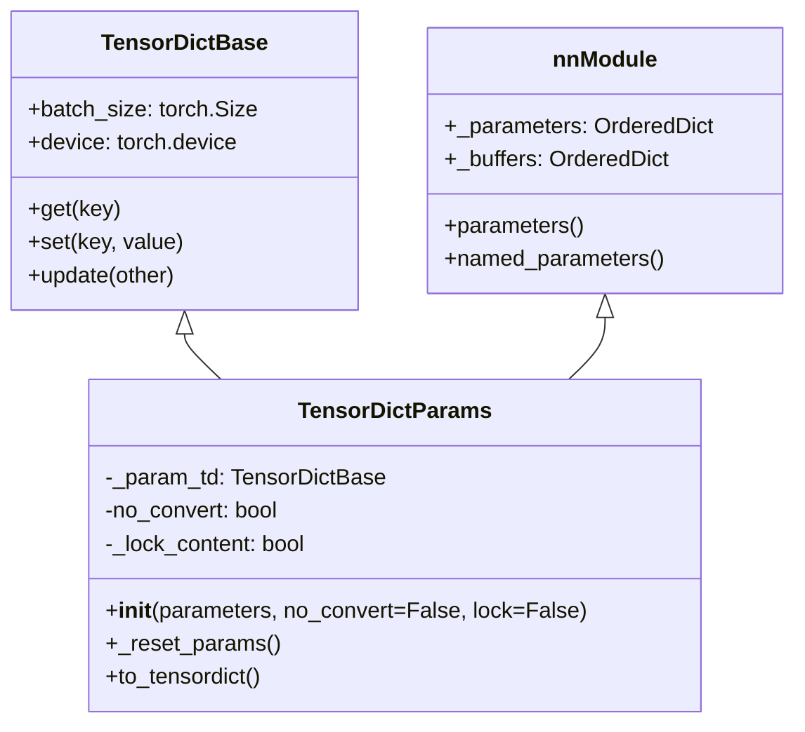
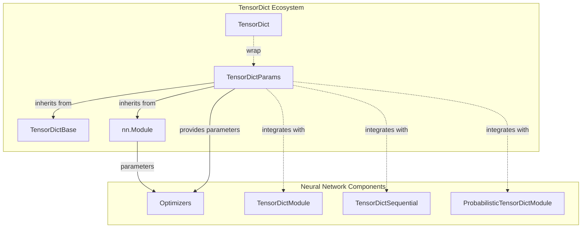
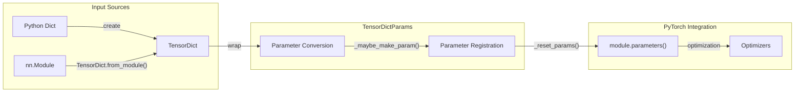
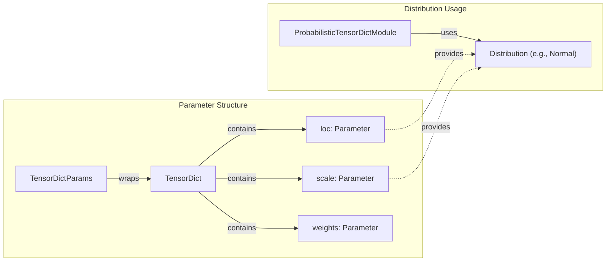

<!-- source: DeepWiki mcp.deepwiki.com · repo pytorch/tensordict · page 4.4 Parameter Management with TensorDictParams · fetched 2026-10-21 -->

# Parameter Management with TensorDictParams

<details>
<summary>Relevant source files</summary>

The following files were used as context for generating this wiki page:

- [tensordict/nn/common.py](tensordict/nn/common.py)
- [tensordict/nn/distributions/composite.py](tensordict/nn/distributions/composite.py)
- [tensordict/nn/params.py](tensordict/nn/params.py)
- [tensordict/nn/probabilistic.py](tensordict/nn/probabilistic.py)
- [tensordict/nn/sequence.py](tensordict/nn/sequence.py)
- [tensordict/persistent.py](tensordict/persistent.py)
- [test/test_nn.py](test/test_nn.py)

</details>


TensorDictParams is a specialized class that bridges TensorDict's data storage capabilities with PyTorch's parameter management system. It serves as a wrapper for TensorDict objects, automatically converting tensors to PyTorch parameters or buffers and exposing them to parent modules for optimization, while maintaining TensorDict's structured organization and access patterns.

## Core Concepts

TensorDictParams inherits from both `TensorDictBase` and `torch.nn.Module`, allowing it to function simultaneously as a tensor collection and as a module parameter container.



Sources: [tensordict/nn/params.py:270-346]()

### Key Features

1. **Parameter Registration**: Automatically registers tensors with PyTorch's parameter system
2. **Automatic Type Conversion**: Converts tensors to parameters or buffers based on configurable rules
3. **Familiar Interface**: Maintains TensorDict's dictionary-like access patterns
4. **Module Integration**: Allows parameters to be included in module hierarchies
5. **Optimization Support**: Enables direct optimization with PyTorch optimizers

### Parameter Conversion Rules

When tensors are added to a TensorDictParams instance, they are automatically converted according to these rules:

| Tensor Type | Default Conversion (`no_convert=False`) | Alternative (`no_convert=True`) |
|-------------|----------------------------------------|--------------------------------|
| Floating-point (float32, float64, half) | `nn.Parameter` (trainable) | `nn.Buffer` (if not requiring gradients) |
| Integer (int, long, etc.) | `nn.Buffer` (non-trainable) | `nn.Buffer` (non-trainable) |
| Already Parameter/Buffer | Preserved as-is | Preserved as-is |

Sources: [tensordict/nn/params.py:111-137]()

## Architecture and Integration

TensorDictParams functions as a bridge component in the TensorDict ecosystem, connecting structured tensor storage with PyTorch's parameter management.



Sources: [tensordict/nn/params.py:270-346](), [tensordict/nn/probabilistic.py:229-230]()

## Creating and Using TensorDictParams

### Initialization

TensorDictParams can be created from various sources:

```python
from tensordict import TensorDict
from tensordict.nn import TensorDictParams
import torch.nn as nn

# From an existing TensorDict
params_dict = TensorDict({"layer.weight": torch.randn(10, 5)}, [])
params = TensorDictParams(params_dict)

# From a dictionary
params = TensorDictParams({"layer.weight": torch.randn(10, 5)})

# From a PyTorch module
module = nn.Linear(5, 10)
params_dict = TensorDict.from_module(module)
params = TensorDictParams(params_dict)

# With no automatic parameter conversion
params = TensorDictParams(params_dict, no_convert=True)

# With content locking
params = TensorDictParams(params_dict, lock=True)
```

Sources: [tensordict/nn/params.py:345-384]()

### Parameter Access and Modification

TensorDictParams maintains TensorDict's familiar access patterns:

```python
# Access parameters
weight = params["layer.weight"]  # Returns nn.Parameter

# Modify parameters (automatically converts to parameter/buffer)
params["layer.bias"] = torch.zeros(10)  # Becomes nn.Parameter

# Nested access for complex parameter structures
params["block", 0, "conv.weight"] = torch.randn(32, 3, 3, 3)
```

Sources: [tensordict/nn/params.py:519-530]()

### Integration with PyTorch Modules

TensorDictParams can be used as a module attribute, exposing parameters to PyTorch:

```python
class CustomModule(nn.Module):
    def __init__(self, params):
        super().__init__()
        self.params = params  # TensorDictParams instance
        
    def forward(self, x):
        # Use parameters from TensorDictParams
        x = F.linear(x, self.params["layer1.weight"], self.params["layer1.bias"])
        return x
```

Sources: [test/test_nn.py:307-309]()

### Parameter Flow

The diagram below illustrates how parameters flow between TensorDict, TensorDictParams, and PyTorch's parameter management system:



Sources: [tensordict/nn/params.py:455-483](), [tensordict/nn/params.py:111-124]()

## Advanced Usage

### Parameter Management Control

TensorDictParams provides several flags to control parameter registration:

- `no_convert=False` (default): Auto-convert appropriate tensors to parameters
- `no_convert=True`: Only convert to buffers, no trainable parameters
- `lock=True`: Lock the wrapped tensordict to prevent modifications

Sources: [tensordict/nn/params.py:345-384]()

### Device Management

TensorDictParams supports device movement operations:

```python
# Move to GPU
params_gpu = params.cuda()
# or 
params_gpu = params.to(device='cuda')

# Move to CPU
params_cpu = params.cpu()
```

Sources: [tensordict/nn/params.py:690-694]()

### Integration with Probabilistic Models

TensorDictParams is particularly useful for managing distribution parameters in probabilistic models:

```python
from tensordict.nn import ProbabilisticTensorDictModule
from torch.distributions import Normal

# Create distribution module with parameters
prob_module = ProbabilisticTensorDictModule(
    in_keys=["loc", "scale"],
    out_keys=["action"],
    distribution_class=Normal
)

# Extract parameters
params = TensorDictParams(TensorDict.from_module(prob_module))

# Use in optimization
optimizer = torch.optim.Adam(params.parameters())
```

TensorDictParams can store distribution parameters as shown in this diagram:



Sources: [tensordict/nn/probabilistic.py:188-230](), [tensordict/nn/distributions/composite.py:98-139]()

## Integration with TensorDictModule

TensorDictParams works seamlessly with TensorDictModule for comprehensive parameter management:

```python
from tensordict.nn import TensorDictModule

# Create module with tensordict interface
linear = nn.Linear(5, 1)
module = TensorDictModule(linear, in_keys=["input"], out_keys=["output"])

# Extract parameters as TensorDictParams
params = TensorDictParams(TensorDict.from_module(module))

# Create input data
td = TensorDict({"input": torch.randn(10, 5)}, [10])

# Use parameters with module
result = module(td)
```

Sources: [test/test_nn.py:580-584]()

## Performance Considerations

- **Parameter Registration**: Modifying the wrapped tensordict directly won't update the registered parameters
- **Memory Management**: TensorDictParams typically shares memory with the original data unless explicitly cloned
- **Locking**: Use `lock=True` to prevent unintended modifications to the underlying data

Sources: [tensordict/nn/params.py:286-304](), [tensordict/nn/params.py:702-746]()

## Complete Example

Here's a complete workflow illustrating TensorDictParams in a training loop:

```python
# Create model and extract parameters
model = nn.Sequential(nn.Linear(10, 64), nn.ReLU(), nn.Linear(64, 1))
params = TensorDictParams(TensorDict.from_module(model))

# Create optimizer with parameters
optimizer = torch.optim.Adam(params.parameters(), lr=0.01)

# Training loop
for _ in range(100):
    # Forward pass
    x = torch.randn(32, 10)  # Input data
    y = torch.randn(32, 1)   # Target data
    
    # Use parameters functionally
    h = F.linear(x, params["0.weight"], params["0.bias"])
    h = F.relu(h)
    pred = F.linear(h, params["2.weight"], params["2.bias"])
    
    # Compute loss and update
    loss = F.mse_loss(pred, y)
    optimizer.zero_grad()
    loss.backward()
    optimizer.step()
```

## Conclusion

TensorDictParams provides a powerful bridge between TensorDict's structured data representation and PyTorch's parameter management system. By wrapping TensorDict objects and exposing their contents as parameters and buffers, it enables seamless integration with PyTorch's optimization capabilities while maintaining TensorDict's organization and access patterns.

This integration is particularly valuable for complex models with structured parameter hierarchies, functional programming approaches, and probabilistic modeling where parameter organization and structured access are essential.

---

