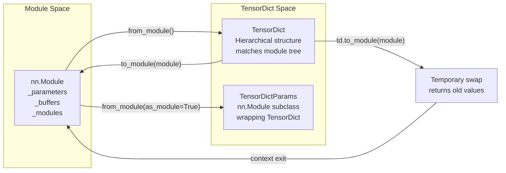
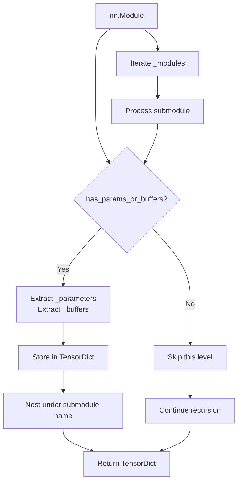
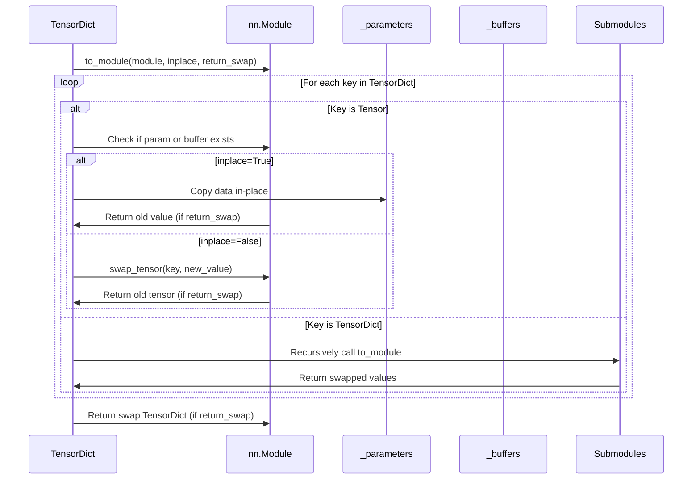
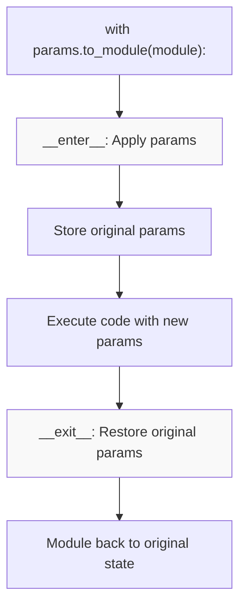
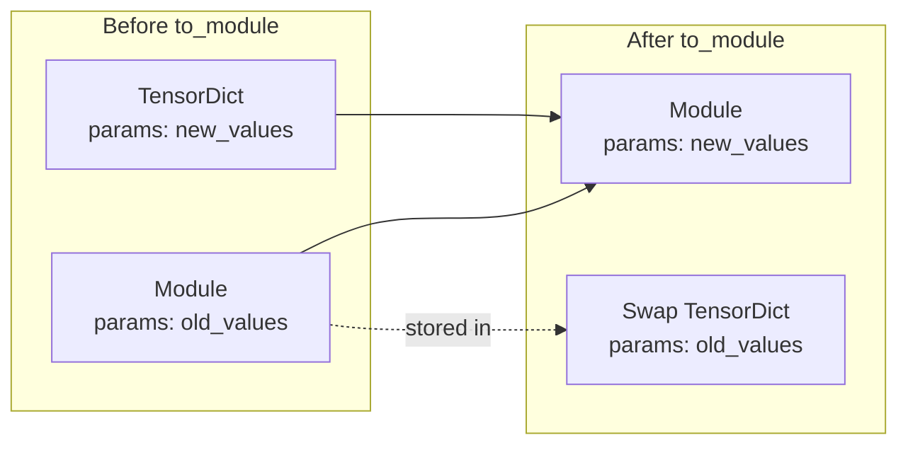
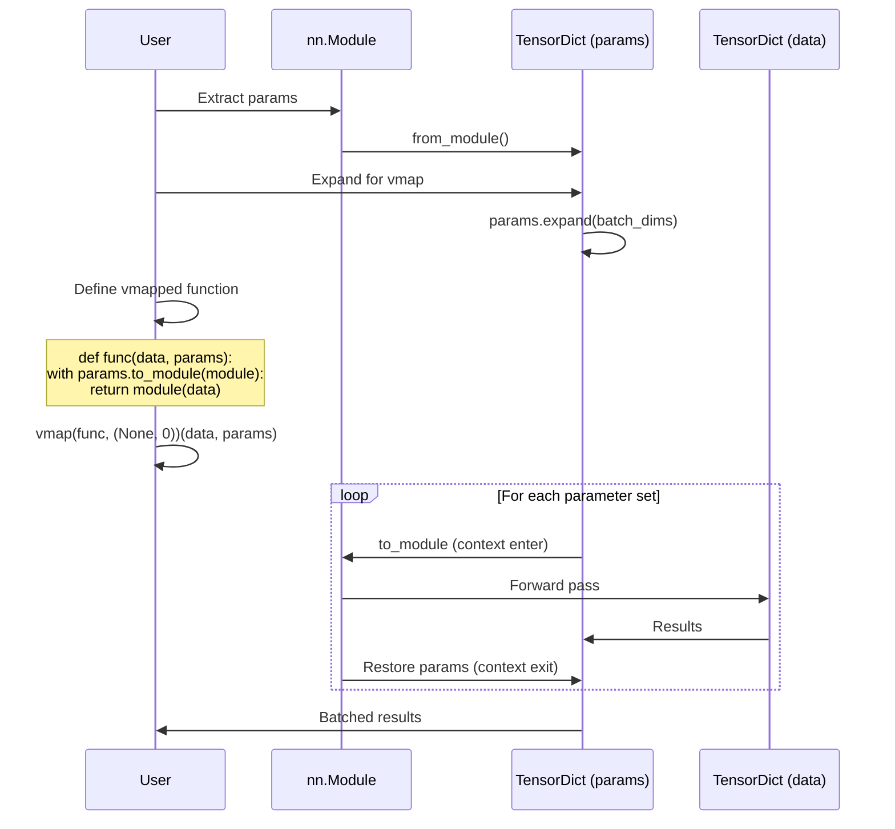
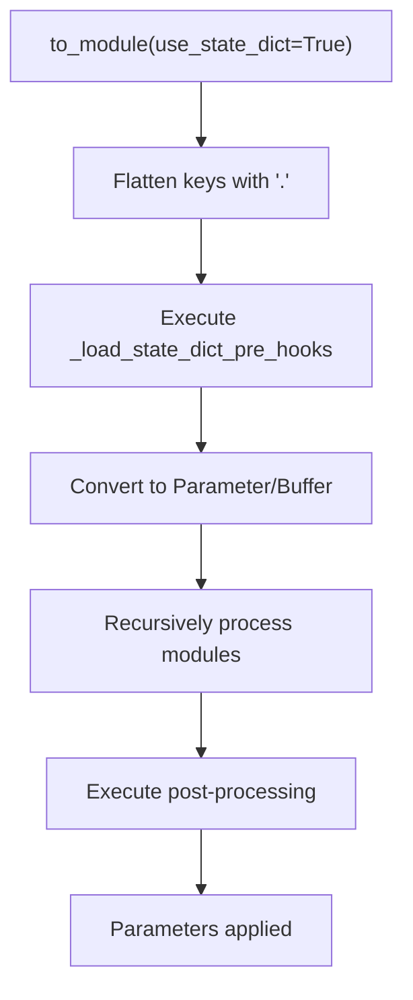
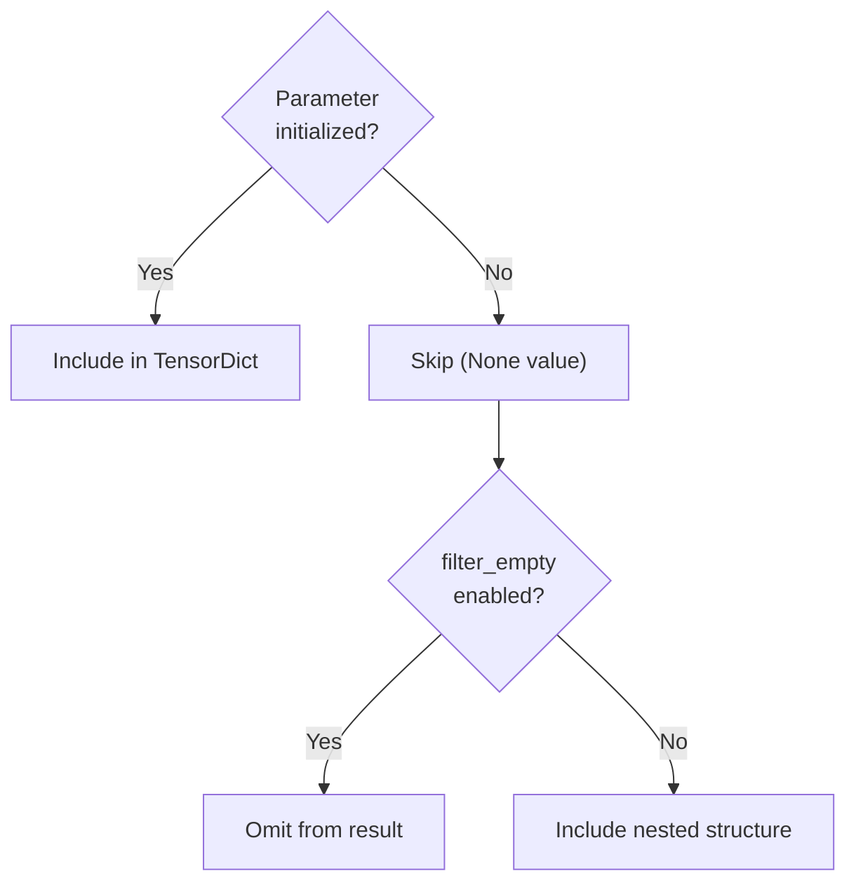
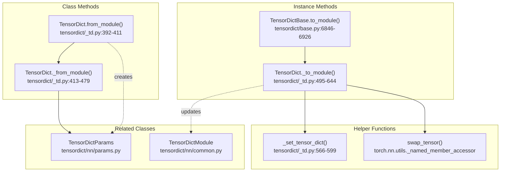

<!-- source: DeepWiki mcp.deepwiki.com · repo pytorch/tensordict · page 4.5 Module Conversion: from_module and to_module · fetched 2026-10-21 -->

# Module Conversion: from_module and to_module

<details>
<summary>Relevant source files</summary>

The following files were used as context for generating this wiki page:

- [tensordict/base.py](tensordict/base.py)
- [tensordict/nn/common.py](tensordict/nn/common.py)
- [tensordict/nn/distributions/composite.py](tensordict/nn/distributions/composite.py)
- [tensordict/nn/probabilistic.py](tensordict/nn/probabilistic.py)
- [tensordict/nn/sequence.py](tensordict/nn/sequence.py)
- [test/test_nn.py](test/test_nn.py)
- [test/test_tensordict.py](test/test_tensordict.py)

</details>


This document describes the parameter extraction and application mechanisms that enable bidirectional conversion between `torch.nn.Module` instances and `TensorDict` objects. These operations form the foundation of functional neural network programming with TensorDict.

For managing parameters as a TensorDict-backed module, see [TensorDictParams](#4.4). For wrapping modules with TensorDict input/output, see [TensorDictModule](#4.1).

## Purpose and Scope

The `from_module` and `to_module` operations enable:
- **Extraction** of parameters and buffers from `nn.Module` into a `TensorDict`
- **Application** of parameters from a `TensorDict` back to an `nn.Module`
- **Temporary swapping** of module parameters for context-managed execution
- **Functional programming** patterns compatible with `torch.vmap` and similar tools

These operations preserve the hierarchical structure of nested modules and support both direct parameter manipulation and `state_dict`-based workflows.

## Conversion Architecture

The following diagram illustrates the bidirectional conversion between modules and tensordicts:



**Key Operations:**
- `TensorDict.from_module(module)`: Extracts parameters/buffers into a new TensorDict
- `tensordict.to_module(module)`: Applies parameters from tensordict to module
- `tensordict.to_module(module)` (as context): Temporarily swaps parameters

Sources: [tensordict/_td.py:392-479](), [tensordict/_td.py:495-644](), [tensordict/base.py:6748-6926]()

## from_module: Parameter Extraction

The `from_module` class method creates a `TensorDict` by extracting parameters and buffers from a module's hierarchy.

### Basic Extraction



Sources: [tensordict/_td.py:392-479]()

### Implementation Details

The extraction process follows these steps:

1. **Direct Access Mode** (default, `use_state_dict=False`):
   - Reads from `module._parameters` and `module._buffers` dictionaries
   - Skips `None` values (uninitialized parameters)
   - Recursively processes `module._modules`
   - Creates nested TensorDict structure matching module hierarchy

2. **State Dict Mode** (`use_state_dict=True`):
   - Calls `module._save_to_state_dict()` with hooks
   - Executes `_state_dict_pre_hooks` and `_state_dict_hooks`
   - Flattens nested keys with "." separator
   - More compatible with custom save/load logic

**Method Signature:**
```python
@classmethod
def from_module(
    cls,
    module: torch.nn.Module,
    as_module: bool = False,
    lock: bool = False,
    use_state_dict: bool = False,
    filter_empty: bool = True,
)
```

**Parameters:**
| Parameter | Type | Description |
|-----------|------|-------------|
| `module` | `nn.Module` | The module to extract parameters from |
| `as_module` | `bool` | If `True`, returns `TensorDictParams` instead of `TensorDict` |
| `lock` | `bool` | If `True`, locks the resulting tensordict |
| `use_state_dict` | `bool` | If `True`, uses state_dict hooks for extraction |
| `filter_empty` | `bool` | If `True`, skips modules with no parameters or buffers |

**Returns:** `TensorDict` (or `TensorDictParams` if `as_module=True`)

Sources: [tensordict/_td.py:392-479](), [tensordict/_td.py:413-479]()

### Example Structure

Consider a simple neural network:
```python
class Net(nn.Module):
    def __init__(self):
        super().__init__()
        self.linear1 = nn.Linear(10, 20)
        self.linear2 = nn.Linear(20, 5)
```

After `td = TensorDict.from_module(net)`, the structure is:
```
TensorDict(
    fields={
        linear1: TensorDict(
            fields={
                weight: Tensor(shape=torch.Size([20, 10])),
                bias: Tensor(shape=torch.Size([20]))
            }
        ),
        linear2: TensorDict(
            fields={
                weight: Tensor(shape=torch.Size([5, 20])),
                bias: Tensor(shape=torch.Size([5]))
            }
        )
    },
    batch_size=torch.Size([])
)
```

Sources: [test/test_nn.py:862-917]()

## to_module: Parameter Application

The `to_module` method applies parameters from a TensorDict to a module, with options for in-place modification and value swapping.

### Application Flow



Sources: [tensordict/_td.py:495-644]()

### Operation Modes

The `to_module` operation has three primary modes controlled by the `inplace` parameter:

| Mode | Behavior | Use Case |
|------|----------|----------|
| `inplace=False` | Creates new parameter tensors, swaps references | Functional programming, temporary parameter changes |
| `inplace=True` | Copies data into existing parameter tensors | Gradient updates, optimizer steps |
| `inplace=None` | Default behavior (typically non-inplace) | General use |

**Key Implementation Detail:** The method uses `torch.nn.utils._named_member_accessor.swap_tensor()` for non-inplace swaps, which properly updates both the parameter storage and the module's internal dictionaries.

Sources: [tensordict/_td.py:495-644](), [tensordict/_td.py:566-618]()

### Context Manager Pattern

The context manager usage is the recommended pattern for temporary parameter swapping:



**Advantages:**
- Automatic restoration of original parameters
- Exception-safe (parameters restored even on error)
- Clean syntax for temporary modifications
- No memory leaks from unreturned tensors

Sources: [tensordict/base.py:6846-6926](), [test/test_nn.py:862-917]()

## Parameter Swapping and Return Values

When `return_swap=True` (default), `to_module` returns a TensorDict containing the previous parameter values:



**Implementation Details:**
- For each parameter/buffer, the old tensor is stored before replacement
- The swap TensorDict has the same structure as the input TensorDict
- Works recursively for nested modules
- When used as context manager, swap is automatically reapplied on exit

Sources: [tensordict/_td.py:495-644](), [tensordict/_td.py:620-644]()

### Swap Storage Optimization

The implementation uses a `memo` dictionary to avoid redundant swaps when the same module appears multiple times in the hierarchy:

```python
memo = {"hooks": hooks}
if return_swap:
    swap = {}
    memo[weakref.ref(module)] = swap
```

This prevents creating multiple swap copies and improves performance for shared submodules.

Sources: [tensordict/_td.py:502-525]()

## Integration with Functional Programming

The module conversion system enables functional programming patterns where parameters are explicit arguments rather than module state.

### Typical Workflow



**Key Points:**
- Parameters become explicit function inputs
- `vmap` can batch over parameter dimension
- Context manager ensures proper parameter lifecycle
- Original module remains unmodified between iterations

Sources: [test/test_nn.py:862-917](), [tensordict/base.py:6846-6926]()

### Example: Ensembling with vmap

```python
# Extract parameters
params = TensorDict.from_module(model)

# Create ensemble by expanding parameters
ensemble_params = params.expand(num_models)

# Define forward function
def forward_with_params(data, params):
    with params.to_module(model):
        return model(data)

# Apply with vmap
ensemble_results = torch.vmap(
    forward_with_params, 
    in_dims=(None, 0)
)(input_data, ensemble_params)
```

Sources: [test/test_nn.py:2127-2203]()

## State Dict Mode

When `use_state_dict=True`, the conversion uses PyTorch's state_dict mechanism instead of direct parameter access.

### Comparison Table

| Aspect | Direct Mode (`use_state_dict=False`) | State Dict Mode (`use_state_dict=True`) |
|--------|--------------------------------------|------------------------------------------|
| **Speed** | Faster (direct access) | Slower (hook execution) |
| **Compatibility** | Works with standard modules | Works with custom save/load logic |
| **Hooks** | Ignores state_dict hooks | Executes `_state_dict_pre_hooks` and `_state_dict_hooks` |
| **Key Format** | Nested structure | May be flattened depending on hooks |
| **Use Case** | General parameter extraction | Custom serialization requirements |

### State Dict Flow



**When to Use State Dict Mode:**
- Module has custom `_load_state_dict_pre_hooks`
- Need compatibility with serialization hooks
- Working with modules that override state dict behavior
- Debugging parameter loading issues

Sources: [tensordict/_td.py:527-560]()

## Advanced Parameter Management

### Handling Uninitialized Parameters

The extraction process handles `UninitializedTensorMixin` parameters (lazy modules):



**Behavior:**
- Uninitialized parameters (`None` values) are skipped by default
- `filter_empty=True` omits entire submodules with no initialized parameters
- `filter_empty=False` preserves structure even for empty modules

Sources: [tensordict/_td.py:437-444]()

### Custom Tensor Swapping

The `_set_tensor_dict` helper function handles the low-level tensor replacement:

```python
def _set_tensor_dict(__dict__, _parameters, _buffers, hooks, 
                     module, key, value, inplace):
```

This function:
1. Checks if key exists in `_parameters` or `_buffers`
2. Applies any registered hooks
3. Either copies data in-place or swaps tensor references
4. Returns the old value if needed

Sources: [tensordict/_td.py:566-599]()

### Type Preservation

When using `use_state_dict=True`, the system preserves parameter/buffer types:

```python
def convert_type(x, y):
    if isinstance(y, nn.Parameter):
        return nn.Parameter(x)
    if isinstance(y, Buffer):
        return Buffer(x)
    return x
```

This ensures that tensors maintain their semantics (parameter vs buffer) during conversion.

Sources: [tensordict/_td.py:551-556]()

## Error Handling and Edge Cases

### Common Issues

| Issue | Cause | Solution |
|-------|-------|----------|
| `KeyError` | TensorDict key doesn't match module parameter | Ensure key structure matches module hierarchy |
| `RuntimeError` (inplace with state_dict) | Incompatible modes | Don't combine `inplace` with `use_state_dict=True` |
| Missing parameters | `filter_empty=True` removed structure | Use `filter_empty=False` to preserve empty modules |
| Memory leak | Swap TensorDict not released | Use context manager or manually delete swap |

### Type Checking

The implementation checks for `TensorDictParams` to avoid double-wrapping:

```python
if isinstance(module, TensorDictParams):
    return module  # Already a TensorDict-backed module
```

This prevents infinite recursion and maintains clean semantics.

Sources: [tensordict/_td.py:423-425]()

## Code Entity Reference

The following diagram maps the primary code entities involved in module conversion:



**Key Files:**
- `tensordict/_td.py`: Core implementation of `from_module` and `_to_module`
- `tensordict/base.py`: Context manager wrapper for `to_module`
- `tensordict/nn/params.py`: `TensorDictParams` class definition
- `torch/nn/utils/_named_member_accessor.py`: `swap_tensor` utility

Sources: [tensordict/_td.py:392-644](), [tensordict/base.py:6846-6926]()

## Performance Considerations

### Memory Efficiency

**Direct Mode:**
- Creates new TensorDict but shares tensor storage with module
- No copying of tensor data during extraction
- Swap TensorDict also shares storage (references only)

**Inplace Mode:**
- Copies tensor data during `to_module`
- No additional memory for parameter storage
- Suitable for gradient updates

**Context Manager:**
- Temporarily allocates memory for swap TensorDict
- Memory released when context exits
- Small overhead for bookkeeping

### Execution Speed

Typical performance characteristics:

| Operation | Time Complexity | Notes |
|-----------|----------------|-------|
| `from_module()` | O(n) where n = number of parameters | Linear scan of module hierarchy |
| `to_module(inplace=False)` | O(n) + swap overhead | Tensor reference updates |
| `to_module(inplace=True)` | O(n × m) where m = parameter size | Data copying |
| `use_state_dict=True` | O(n) + hook execution | Hook overhead varies |

Sources: [tensordict/_td.py:392-644]()

## Testing and Validation

The test suite covers numerous scenarios:

**Basic Conversion:**
- Simple module extraction and application
- Nested module hierarchies
- Empty module handling

**Advanced Patterns:**
- vmap integration
- Ensemble models
- Gradient computation through parameters
- State dict compatibility

**Edge Cases:**
- Uninitialized parameters
- Shared submodules
- Custom hooks
- Type preservation

Sources: [test/test_nn.py:862-1035](), [test/test_tensordict.py:5959-6134]()

---

