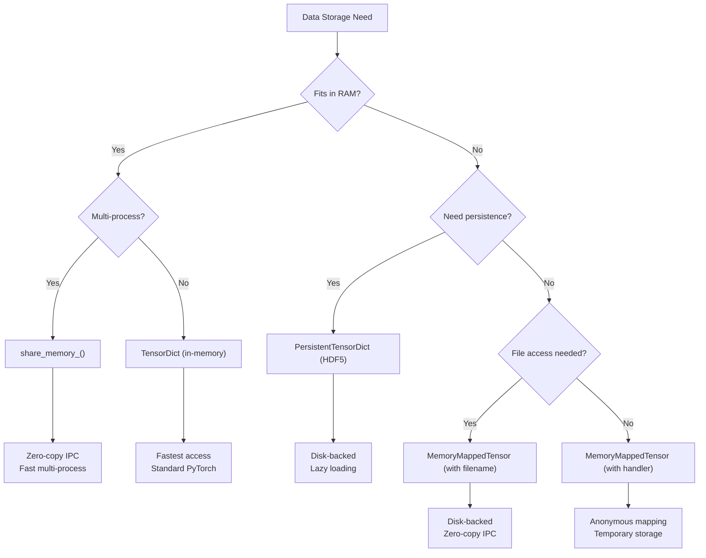
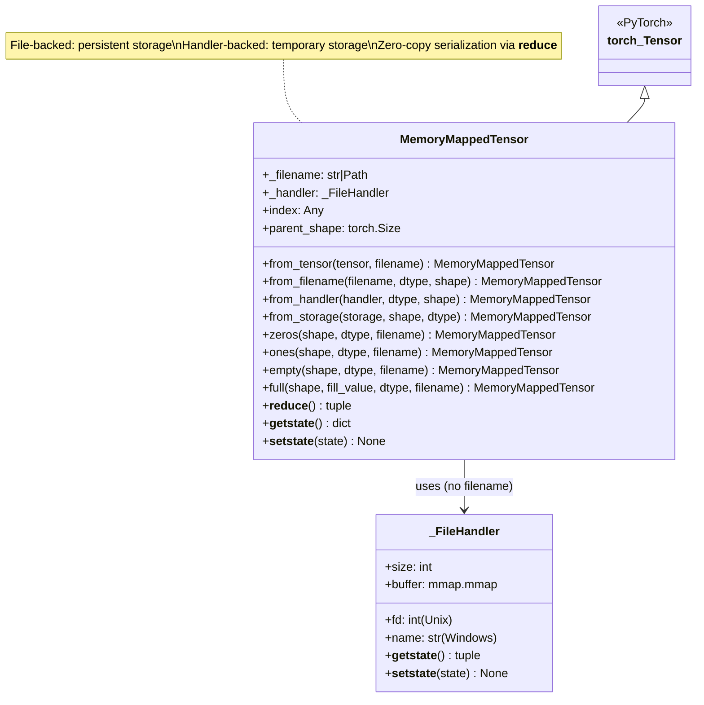
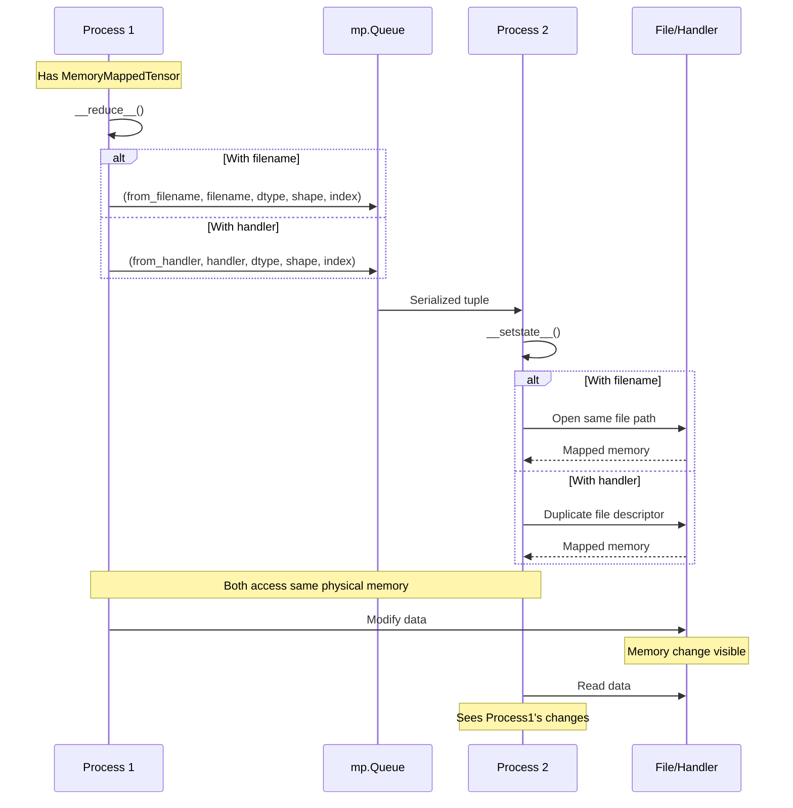
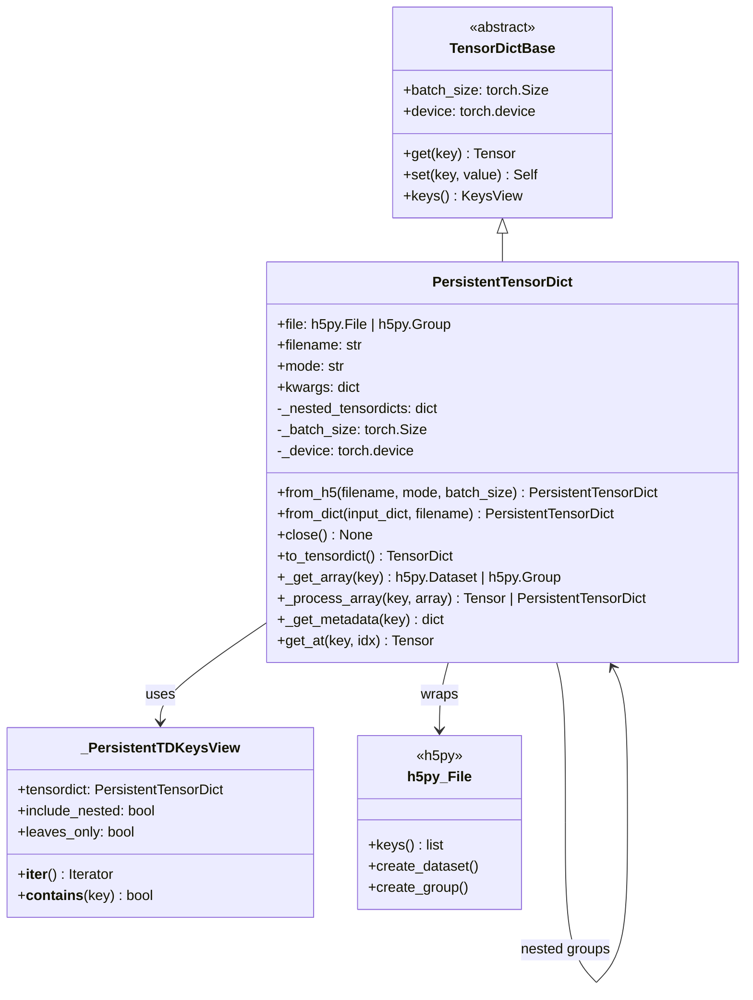
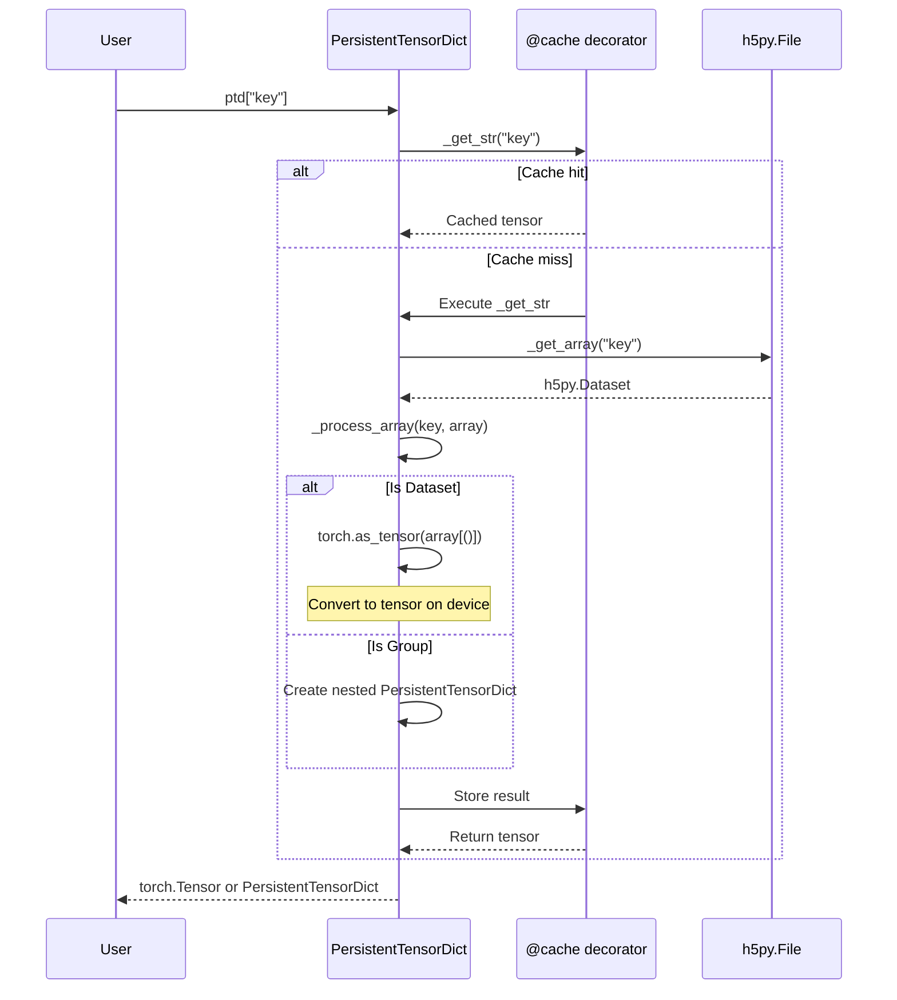
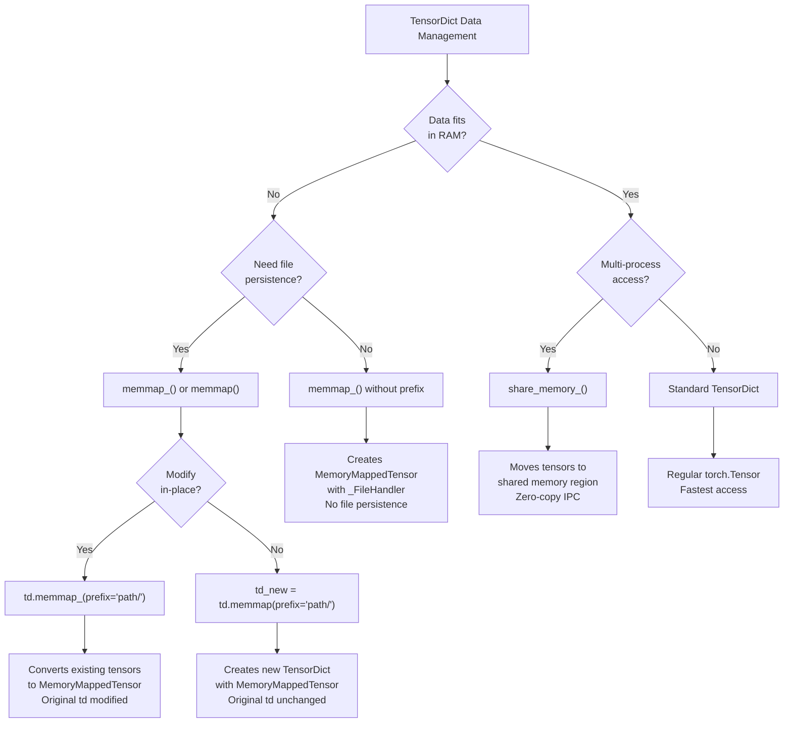

<!-- source: DeepWiki mcp.deepwiki.com · repo pytorch/tensordict · page 5 Storage and Persistence · fetched 2026-10-21 -->

# Storage and Persistence

<details>
<summary>Relevant source files</summary>

The following files were used as context for generating this wiki page:

- [tensordict/memmap.py](tensordict/memmap.py)
- [tensordict/nn/params.py](tensordict/nn/params.py)
- [tensordict/nn/tensorclass_module.py](tensordict/nn/tensorclass_module.py)
- [tensordict/persistent.py](tensordict/persistent.py)
- [test/test_distributed.py](test/test_distributed.py)
- [test/test_memmap.py](test/test_memmap.py)

</details>


This page documents the storage and persistence mechanisms in TensorDict, covering different backends for storing tensor data: memory-mapped files, HDF5 persistent storage, shared memory, and strategies for choosing between them. For information about neural network parameter storage, see [TensorDictParams](#4.4). For distributed data transfer operations, see [Distributed Operations](#6.3).

## Overview of Storage Backends

TensorDict provides multiple storage strategies to handle different scale and persistence requirements:

| Storage Backend | Class | Primary Use Case | Persistence | IPC Support |
|----------------|-------|------------------|-------------|-------------|
| In-Memory | `TensorDict` | Standard operations, fits in RAM | No | Via pickling |
| Memory-Mapped | `MemoryMappedTensor` | Datasets larger than RAM, zero-copy IPC | Optional | Yes (zero-copy) |
| HDF5 | `PersistentTensorDict` | Long-term storage, datasets larger than RAM | Yes | Via filename |
| Shared Memory | `TensorDict` (after `share_memory_()`) | Multi-process training | No | Yes (zero-copy) |

**Storage Backend Selection Diagram**



**Sources:** [tensordict/persistent.py:1-1300](), [tensordict/memmap.py:1-1150](), [Diagram 3 from high-level overview]()

## 5.1 Memory-Mapped Tensors

### Overview

The `MemoryMappedTensor` class extends `torch.Tensor` to provide file-backed or handler-backed storage with memory-mapped access. It enables working with datasets larger than RAM and provides zero-copy serialization for inter-process communication.

**Key characteristics:**
- Subclass of `torch.Tensor` with `__torch_function__` disabled
- Can be backed by a file (via filename) or anonymous mapping (via handler)
- Only supports CPU device
- Preserves memory-mapped properties through indexing operations

**MemoryMappedTensor Architecture**



**Sources:** [tensordict/memmap.py:36-140](), [tensordict/memmap.py:982-1063]()

### Creating Memory-Mapped Tensors

#### From Existing Tensors

The `from_tensor()` method converts a regular tensor to a memory-mapped tensor:

```python
# With a filename (persistent storage)
MemoryMappedTensor.from_tensor(tensor, filename="path/to/file.memmap")

# Without filename (temporary, handler-backed)
MemoryMappedTensor.from_tensor(tensor)

# Control data copying
MemoryMappedTensor.from_tensor(tensor, filename="path.memmap", 
                               copy_data=True,      # Copy tensor data to file
                               copy_existing=True,  # Allow copying from existing memmap
                               existsok=True)       # Overwrite existing file
```

**Key implementation details:**
- [tensordict/memmap.py:141-287]() handles conversion logic
- If input is already a `MemoryMappedTensor` with matching filename, returns the same instance
- Without `copy_existing=True`, raises error when copying from one file to another
- Supports nested tensors via `torch._nested_view_from_buffer()`

#### Factory Methods

Direct construction without source tensor:

```python
# Create new memory-mapped tensors
MemoryMappedTensor.zeros((100, 200), dtype=torch.float32, filename="zeros.memmap")
MemoryMappedTensor.ones((100, 200), dtype=torch.float32, filename="ones.memmap")
MemoryMappedTensor.empty((100, 200), dtype=torch.float32, filename="empty.memmap")
MemoryMappedTensor.full((100, 200), fill_value=42, dtype=torch.float32, filename="full.memmap")

# Create like existing tensors
MemoryMappedTensor.zeros_like(tensor, filename="zeros.memmap")
MemoryMappedTensor.ones_like(tensor, filename="ones.memmap")
MemoryMappedTensor.empty_like(tensor, filename="empty.memmap")
MemoryMappedTensor.full_like(tensor, fill_value=42, filename="full.memmap")
```

**Sources:** [tensordict/memmap.py:362-433](), [tensordict/memmap.py:443-714]()

#### From Storage or File

Load from existing storage:

```python
# From filename (loading existing file)
mmt = MemoryMappedTensor.from_filename(
    filename="existing.memmap",
    dtype=torch.float32,
    shape=(100, 200),
    index=None  # Optional index to apply
)

# From handler (for IPC)
mmt = MemoryMappedTensor.from_handler(
    handler=handler_object,
    dtype=torch.float32,
    shape=(100, 200),
    index=None
)

# From storage object
mmt = MemoryMappedTensor.from_storage(
    storage=tensor.untyped_storage(),
    shape=(100, 200),
    dtype=torch.float32,
    filename="optional.memmap"
)
```

**Sources:** [tensordict/memmap.py:717-779](), [tensordict/memmap.py:781-825](), [tensordict/memmap.py:289-338]()

### File Handlers

The `_FileHandler` class provides platform-specific memory-mapped storage:

**Platform Differences:**

| Platform | Implementation | Location |
|----------|----------------|----------|
| Windows | Named memory-mapped region via `_winapi` and `mmap` | [tensordict/memmap.py:989-1020]() |
| Unix/Linux | File descriptor with `mkstemp` and `mmap` | [tensordict/memmap.py:1023-1062]() |

**Unix implementation details:**
- Creates temporary file with `tempfile.mkstemp()` in `/dev/shm` (Linux) for performance
- Immediately unlinks the file (anonymous mapping)
- File descriptor kept open for `mmap()`
- Serialization via `reduction.DupFd()` for IPC

**Sources:** [tensordict/memmap.py:982-1070]()

### Serialization and Zero-Copy IPC

`MemoryMappedTensor` implements custom serialization for efficient inter-process communication:

**Serialization Flow Diagram**



**Implementation:**

[tensordict/memmap.py:831-875]() defines the serialization protocol:
- `__getstate__()` returns dict with `filename` or `handler`, `dtype`, `shape`, `index`
- `__setstate__()` reconstructs using `from_filename()` or `from_handler()`
- `__reduce__()` returns reconstruction function and arguments

**Zero-copy guarantee:**
- No tensor data is copied during serialization
- Both processes map the same physical memory
- Changes in one process are immediately visible to others

**Sources:** [tensordict/memmap.py:831-875](), [test/test_memmap.py:383-469]()

### Indexing and Slicing

Memory-mapped tensors preserve their type through indexing:

```python
mmt = MemoryMappedTensor.from_tensor(torch.randn(100, 200), filename="data.memmap")

# Indexing returns MemoryMappedTensor
subset = mmt[10:20]  # Still a MemoryMappedTensor
assert isinstance(subset, MemoryMappedTensor)
assert subset._filename == mmt._filename

# Split and chunk preserve mapping
chunks = mmt.chunk(5, dim=0)  # Returns tuple of MemoryMappedTensor
splits = mmt.split(20, dim=0)  # Returns tuple of MemoryMappedTensor
unbind = mmt.unbind(0)        # Returns tuple of MemoryMappedTensor
```

**Implementation details:**
- [tensordict/memmap.py:876-927]() implements `__getitem__` with storage pointer check
- [tensordict/memmap.py:928-980]() wraps indexed results via `_index_wrap()`
- Stores original `parent_shape` and `index` for proper serialization

**Sources:** [tensordict/memmap.py:876-980](), [test/test_memmap.py:350-440]()

### Usage in TensorDict

Memory-mapped tensors integrate seamlessly with TensorDict:

```python
td = TensorDict({}, batch_size=[100])

# Create memory-mapped entries
td.memmap_("path/to/storage")  # Convert entire tensordict to memory-mapped

# Or add specific memory-mapped tensors
td["data"] = MemoryMappedTensor.from_tensor(torch.randn(100, 50), 
                                            filename="data.memmap")
```

**Sources:** [test/test_memmap.py:756-776]()

## 5.2 PersistentTensorDict and HDF5 Storage

### Overview

`PersistentTensorDict` provides a TensorDict implementation backed by HDF5 files, enabling:
- Storage of datasets larger than available RAM
- Persistent storage across sessions
- Lazy loading (only loads accessed data)
- Nested structure preservation

**Key characteristics:**
- Requires `h5py` library
- Implements full `TensorDictBase` interface
- Device attribute controls target device when loading data (not storage location)
- Supports nested tensordicts as HDF5 groups

**PersistentTensorDict Class Structure**



**Sources:** [tensordict/persistent.py:115-1300](), [tensordict/persistent.py:85-113]()

### Creating PersistentTensorDict

#### From HDF5 File

Load an existing HDF5 file:

```python
# Load with automatic batch size detection
ptd = PersistentTensorDict.from_h5("data.h5", mode="r")

# Load with explicit batch size
ptd = PersistentTensorDict.from_h5("data.h5", mode="r", batch_size=[100])
```

**Implementation:**
- [tensordict/persistent.py:198-231]() implements `from_h5()` classmethod
- Calls `_set_max_batch_size()` helper to infer batch size from data if not provided
- Opens file using `h5py.File()` with specified mode

#### From Dictionary or TensorDict

Convert Python dict or TensorDict to HDF5:

```python
data = {
    "observations": torch.randn(1000, 84, 84),
    "actions": torch.randint(0, 10, (1000,)),
    ("nested", "value"): torch.randn(1000, 32)
}

# Create persistent tensordict from dict
ptd = PersistentTensorDict.from_dict(
    data,
    filename="dataset.h5",
    batch_size=[1000],
    device="cpu"  # Target device when loading
)
```

**Key features:**
- [tensordict/persistent.py:233-284]() implements `from_dict()` classmethod
- Opens file in write mode (`"w"`)
- Converts dict to TensorDict first if needed
- Supports nested keys (converted to HDF5 group hierarchy)
- Automatically infers batch size if not provided via `_set_max_batch_size()`

**Sources:** [tensordict/persistent.py:198-284]()

### Reading and Writing Data

#### Lazy Data Access

`PersistentTensorDict` loads data on-demand:

```python
ptd = PersistentTensorDict.from_h5("large_dataset.h5")

# Only loads "observations" when accessed
obs = ptd["observations"]  # Returns torch.Tensor on configured device

# Nested access
nested_value = ptd["nested", "key"]  # Traverses HDF5 groups

# Metadata access without loading data
metadata = ptd._get_metadata("observations")
# Returns: {"dtype": torch.float32, "shape": torch.Size([...]), "dim": ..., "array": True}
```

**Access flow:**



**Implementation details:**
- [tensordict/persistent.py:348-355]() implements cached `_get_str()`
- [tensordict/persistent.py:306-315]() implements `_get_array()` to retrieve HDF5 dataset/group
- [tensordict/persistent.py:316-346]() implements `_process_array()` for lazy conversion
- [tensordict/persistent.py:403-435]() implements `_get_metadata()` for metadata-only access

#### Indexed Access

The `get_at()` method enables efficient indexed access:

```python
ptd = PersistentTensorDict.from_h5("data.h5")

# Get specific indices without loading full array
subset = ptd.get_at("observations", idx=slice(0, 100))  # Only loads first 100
point = ptd.get_at("observations", idx=10)              # Only loads single item

# Boolean indexing (with performance warning for h5py broadcasting issues)
mask = torch.tensor([True, False, True, ...])
filtered = ptd.get_at("observations", idx=mask)
```

**Key features:**
- [tensordict/persistent.py:358-401]() implements `get_at()`
- Applies index directly to HDF5 dataset before loading
- Converts indices to NumPy arrays for h5py compatibility
- Handles h5py boolean indexing limitations with workaround

**Sources:** [tensordict/persistent.py:348-401]()

#### Writing Data

Setting values requires write mode:

```python
ptd = PersistentTensorDict.from_h5("data.h5", mode="r+")  # Read-write mode

# Set individual entries
ptd["new_key"] = torch.randn(1000, 32)

# Update existing entries
ptd["observations"] = torch.randn(1000, 84, 84)

# Batch updates
ptd.update({
    "actions": torch.randint(0, 10, (1000,)),
    "rewards": torch.randn(1000)
})

# In-place fill
ptd.fill_("observations", 0.0)
```

**Implementation:**
- Write operations require `mode="w"` or `mode="r+"` 
- Lock-blocked via decorator to prevent modification when locked
- [tensordict/persistent.py:1023-1042]() implements `fill_()` for in-place filling

**Sources:** [tensordict/persistent.py:465-492](), [tensordict/persistent.py:1023-1042]()

### Device Management

The `device` attribute controls where tensors are placed when loaded, **not where they are stored**:

```python
# Create with device specification
ptd = PersistentTensorDict.from_dict(
    data, 
    filename="data.h5",
    device="cuda"  # Tensors will be loaded to CUDA
)

# All data stored on disk, but loaded to CUDA
tensor = ptd["key"]  # Returns tensor on CUDA device
```

**Key points:**
- Storage is always on disk (HDF5 file)
- `device` attribute determines target device for loaded tensors
- [tensordict/persistent.py:316-346]() applies device in `_process_array()`
- Supports `pin_memory` for faster CPU→GPU transfers

**Sources:** [tensordict/persistent.py:154-196](), [tensordict/persistent.py:316-346]()

### Nested Structure Support

Nested keys map to HDF5 group hierarchy:

```python
# Create with nested keys
data = {
    ("agent", "policy", "weights"): torch.randn(100, 32),
    ("agent", "value", "weights"): torch.randn(100, 64),
    "environment": torch.randn(100, 84, 84)
}

ptd = PersistentTensorDict.from_dict(data, filename="nested.h5")

# HDF5 structure:
# /
# ├── agent/
# │   ├── policy/
# │   │   └── weights [dataset]
# │   └── value/
# │       └── weights [dataset]
# └── environment [dataset]

# Access nested values
weights = ptd["agent", "policy", "weights"]
nested_td = ptd["agent"]  # Returns PersistentTensorDict for group
```

**Implementation:**
- [tensordict/persistent.py:290-292]() converts nested keys to HDF5 path: `"/".join(key)`
- [tensordict/persistent.py:339-346]() creates nested `PersistentTensorDict` for groups
- [tensordict/persistent.py:192-193]() caches nested tensordicts

**Sources:** [tensordict/persistent.py:290-292](), [tensordict/persistent.py:339-346]()

### Key Iteration and Metadata

Custom keys view for efficient iteration:

```python
ptd = PersistentTensorDict.from_h5("data.h5")

# Iterate over keys
for key in ptd.keys():
    print(key, ptd._get_metadata(key))

# Include nested keys
for key in ptd.keys(include_nested=True):
    print(key)  # Returns flattened nested keys like ("agent", "policy", "weights")

# Leaves only (exclude intermediate groups)
for key in ptd.keys(leaves_only=True):
    value = ptd[key]  # Only leaf datasets
```

**`_PersistentTDKeysView` implementation:**
- [tensordict/persistent.py:85-113]() custom keys view class
- Uses `h5py.File.visit()` for nested traversal
- Filters based on `_get_metadata()` to distinguish datasets from groups
- Handles non-tensor data (stored as special HDF5 datasets)

**Sources:** [tensordict/persistent.py:85-113](), [tensordict/persistent.py:504-522]()

### Closing and Cleanup

Explicitly close HDF5 files:

```python
ptd = PersistentTensorDict.from_h5("data.h5")
# ... use ptd ...
ptd.close()  # Close underlying h5py.File
```

**Important notes:**
- [tensordict/persistent.py:139-140]() warns that `PersistentTensorDict` instances are **not** automatically closed when out of scope
- User responsibility to call `close()` if necessary
- [tensordict/persistent.py:286-288]() implements simple `close()` method

**Sources:** [tensordict/persistent.py:139-140](), [tensordict/persistent.py:286-288]()

### Conversion to Regular TensorDict

Materialize full dataset in memory:

```python
ptd = PersistentTensorDict.from_h5("data.h5")

# Load everything into memory
td = ptd.to_tensordict()  # Returns regular TensorDict
# or
td = ptd.contiguous()      # Same as to_tensordict()

# Now all data is in RAM
assert isinstance(td, TensorDict)
assert not isinstance(td, PersistentTensorDict)
```

**Sources:** [tensordict/persistent.py:573-575]()

## 5.3 Memory Management Strategies

### Overview of Memory Management Methods

TensorDict provides several methods to control how data is stored in memory:

| Method | Effect | Use Case | Returns New Instance |
|--------|--------|----------|---------------------|
| `share_memory_()` | Places tensors in shared memory | Multi-process training | No (in-place) |
| `memmap_()` | Converts tensors to memory-mapped files | Cannot fit in RAM, need persistence | No (in-place) |
| `memmap()` | Creates memory-mapped copy | Create persistent copy | Yes |
| `memmap_like()` | Creates memory-mapped structure without data | Initialize large structure | Yes |

**Memory Management Decision Tree**



**Sources:** [tensordict/_td.py](focusing on memmap and share_memory methods)

### share_memory_(): Shared Memory for IPC

The `share_memory_()` method moves tensors to shared memory regions, enabling zero-copy access across processes:

```python
td = TensorDict({
    "obs": torch.randn(100, 84, 84),
    "actions": torch.randint(0, 10, (100,))
}, batch_size=[100])

# Move to shared memory
td.share_memory_()

# Mark shared status
assert td.is_shared()

# Now can be passed to subprocesses without copying
def worker(shared_td):
    # Access and modify without copying data
    shared_td["obs"] += 1

with mp.Pool(4) as pool:
    pool.map(worker, [td] * 4)
```

**Key characteristics:**
- In-place operation (modifies existing tensordict)
- Calls `tensor.share_memory_()` on each tensor
- Sets `_is_shared` flag to `True`
- Essential for efficient multi-process data loaders

**Comparison with MemoryMappedTensor:**

| Feature | `share_memory_()` | `MemoryMappedTensor` |
|---------|------------------|----------------------|
| Persistence | No (RAM only) | Optional (file-backed) |
| Performance | Fastest (no I/O) | Slightly slower (I/O overhead) |
| Memory limit | RAM size | Disk size |
| Serialization | Via pickle | Zero-copy reduce |

**Sources:** [test/test_distributed.py:204-266]() (usage example)

### memmap_(): In-Place Memory Mapping

Convert existing tensordict to memory-mapped storage:

```python
td = TensorDict({
    "obs": torch.randn(1000, 84, 84),
    "actions": torch.randint(0, 10, (1000,))
}, batch_size=[1000])

# In-place conversion to memory-mapped with files
td.memmap_(prefix="path/to/storage/")

# Result: td now contains MemoryMappedTensor instances
assert isinstance(td["obs"], MemoryMappedTensor)
assert td["obs"]._filename is not None

# Files created:
# path/to/storage/obs.memmap
# path/to/storage/actions.memmap
# path/to/storage/meta.json  # Metadata file
```

**Without prefix (handler-backed):**

```python
td = TensorDict({
    "data": torch.randn(100, 50)
}, batch_size=[100])

# In-place conversion to memory-mapped without files
td.memmap_()  # No prefix argument

# Result: uses _FileHandler instead of files
assert isinstance(td["data"], MemoryMappedTensor)
assert td["data"]._handler is not None
assert td["data"]._filename is None
```

**Key features:**
- Modifies tensordict in-place
- Creates one file per tensor when `prefix` provided
- Generates `meta.json` for structure metadata
- Supports nested tensordicts recursively
- Can use threading via `num_threads` parameter

**Sources:** Implementation in TensorDict class (method signature suggests in-place behavior)

### memmap(): Create Memory-Mapped Copy

Create a new memory-mapped tensordict without modifying the original:

```python
td = TensorDict({
    "obs": torch.randn(1000, 84, 84),
}, batch_size=[1000])

# Create memory-mapped copy
td_memmap = td.memmap(prefix="path/to/storage/")

# Original unchanged
assert isinstance(td["obs"], torch.Tensor)
assert not isinstance(td["obs"], MemoryMappedTensor)

# Copy is memory-mapped
assert isinstance(td_memmap["obs"], MemoryMappedTensor)
```

**For PersistentTensorDict:**

[tensordict/persistent.py:751-873]() implements special `_memmap_()` for `PersistentTensorDict`:

```python
ptd = PersistentTensorDict.from_h5("data.h5")

# Create memory-mapped copy (loads from HDF5, writes to memmap)
td_memmap = ptd.memmap(prefix="path/to/memmap/")

# Result is regular TensorDict with MemoryMappedTensor values
assert isinstance(td_memmap, TensorDict)
assert isinstance(td_memmap["key"], MemoryMappedTensor)
```

**Optimization:**
- Uses metadata instead of loading full arrays
- Can parallelize with `ThreadPoolExecutor`
- [tensordict/persistent.py:805-865]() defines internal `_populate()` function for async writing

**Sources:** [tensordict/persistent.py:751-873]()

### Choosing Storage Strategy

**Selection Criteria:**

```python
# Decision logic
def choose_storage_strategy(data_size_gb, ram_gb, need_persistence, num_processes):
    if data_size_gb <= ram_gb * 0.5:
        if num_processes > 1:
            return "share_memory_()"
        else:
            return "Standard TensorDict"
    else:
        if need_persistence:
            if data_size_gb > ram_gb * 2:
                return "PersistentTensorDict (HDF5)"
            else:
                return "memmap_() with files"
        else:
            return "memmap_() without files"
```

**Performance characteristics:**

| Operation | Standard | Shared Memory | MemoryMapped (handler) | MemoryMapped (file) | PersistentTensorDict |
|-----------|----------|---------------|----------------------|-------------------|---------------------|
| Read speed | Fastest | Fastest | Fast | Fast (cached) | Slow (lazy load) |
| Write speed | Fastest | Fastest | Fast | Medium (I/O) | Slow (HDF5 I/O) |
| IPC overhead | High (copy) | None | None | None | High (filename only) |
| Memory usage | Full | Full (shared) | Full (mapped) | Minimal (paged) | Minimal (lazy) |
| Persistence | No | No | No | Yes | Yes |

**Sources:** Analysis based on [tensordict/persistent.py](), [tensordict/memmap.py](), [test/test_memmap.py](), [test/test_distributed.py]()

### Consolidation

The `consolidate()` operation can optimize memory layout:

```python
td = TensorDict({...}, batch_size=[100])

# Consolidate to contiguous storage
td_consolidated = td.consolidate()
```

This is relevant for memory management as it ensures tensors have contiguous memory layout, which can improve cache performance and reduce memory fragmentation.

**Sources:** General TensorDict operation (documented in base class)

## 5.4 Serialization and Inter-Process Communication

### Serialization Mechanisms

TensorDict supports multiple serialization paths depending on storage backend:

**Serialization Strategy Comparison**


**Sources:** [tensordict/memmap.py:831-875](), [tensordict/persistent.py:115-150]()

### Zero-Copy Transfer with MemoryMappedTensor

The core advantage of `MemoryMappedTensor` for IPC is zero-copy serialization:

**File-backed transfer:**

```python
# Process 1: Create and pass memory-mapped tensor
mmt = MemoryMappedTensor.from_tensor(
    torch.randn(1000, 1000),
    filename="/path/to/shared/storage.memmap"
)
queue.put(mmt)  # Serialization via __reduce__

# Process 2: Receive and use
mmt_received = queue.get()
# Both processes map the same file
# No tensor data copied between processes
```

**Handler-backed transfer (Unix):**

```python
# Process 1: Create with handler
mmt = MemoryMappedTensor.from_tensor(torch.randn(1000, 1000))
# No filename, uses _FileHandler
queue.put(mmt)

# Process 2: Receive
mmt_received = queue.get()
# File descriptor duplicated via reduction.DupFd()
# Both processes access same physical memory
```

**Serialization implementation:**

[tensordict/memmap.py:855-875]() implements `__reduce__()`:

```python
def __reduce__(self):
    if getattr(self, "_handler", None) is not None:
        return type(self).from_handler, (
            self._handler,      # Serializable handler
            self.dtype,
            self.parent_shape,
            self.index,
        )
    elif getattr(self, "_filename", None) is not None:
        return type(self).from_filename, (
            self._filename,     # File path as string
            self.dtype,
            self.parent_shape,
            self.index,
        )
```

**Sources:** [tensordict/memmap.py:855-875](), [tensordict/memmap.py:1050-1062]() (reduction registration)

### Distributed Operations

TensorDict provides high-level operations for distributed scenarios:

**send/recv Pattern:**

```python
# Process 0 (sender)
torch.distributed.init_process_group("gloo", rank=0, world_size=2)
td = TensorDict({
    "data": MemoryMappedTensor.from_tensor(torch.randn(100, 50)),
    "actions": torch.randint(0, 10, (100,))
}, batch_size=[100])

td.send(dst=1)  # Send to process 1

# Process 1 (receiver)
torch.distributed.init_process_group("gloo", rank=1, world_size=2)
td = TensorDict({
    "data": torch.zeros(100, 50),
    "actions": torch.zeros(100, dtype=torch.long)
}, batch_size=[100])

td.recv(src=0)  # Receive from process 0
# td now contains data from process 0
```

**Key features:**
- Handles nested tensordicts and `LazyStackedTensorDict`
- Supports `MemoryMappedTensor` in structure
- Optional `pseudo_rand` parameter for deterministic ordering
- Optional `group` parameter for process subgroups

**Sources:** [test/test_distributed.py:374-499]()

**gather_and_stack Pattern:**

```python
# Process 0 (root)
torch.distributed.init_process_group("gloo", rank=0, world_size=3)
td = TensorDict({
    "data": torch.zeros(2),
}, batch_size=[2]).expand(1, 2).contiguous()  # Shape: [1, 2]

td.gather_and_stack(dst=0)  # Gather from all processes

# Result: td now has shape [3, 2] (stacked along dim 0)
# Contains data from all 3 processes

# Process 1, 2 (non-root)
torch.distributed.init_process_group("gloo", rank=rank, world_size=3)
td = TensorDict({
    "data": torch.randn(2),
}, batch_size=[2])

td.gather_and_stack(dst=0)  # Send to root
```

**Sources:** [test/test_distributed.py:204-266]()

**reduce Pattern:**

```python
# All processes
torch.distributed.init_process_group("gloo", rank=rank, world_size=3)
td = TensorDict({
    "values": torch.ones(10),
}, batch_size=[10])

# Reduce to process 0 with SUM operation
td.reduce(dst=0, op=torch.distributed.ReduceOp.SUM, async_op=False)

# On process 0: td["values"] now contains sum across all processes
# If async_op=True, returns list of Work handles
```

**Supported operations:**
- `torch.distributed.ReduceOp.SUM`
- `torch.distributed.ReduceOp.PRODUCT`
- `torch.distributed.ReduceOp.MIN`
- `torch.distributed.ReduceOp.MAX`

**Sources:** [test/test_distributed.py:268-367]()

### Remote Initialization

Initialize a tensordict on one process and transfer structure to others:

```python
# Process 0 (root)
torch.distributed.init_process_group("gloo", rank=0, world_size=2)
td = TensorDict({
    ("a", "b"): torch.ones(2),
    "c": torch.ones(2),
    ("d", "e", "f"): MemoryMappedTensor.from_tensor(torch.ones(2, 2)),
}, batch_size=[2])

td.init_remote(dst=1)  # Send structure and data to process 1

# Process 1 (remote)
torch.distributed.init_process_group("gloo", rank=1, world_size=2)
td = TensorDict.from_remote_init(src=0)  # Receive from process 0

# td now has same structure and data as process 0
assert set(td.keys()) == {"a", "c", "d"}
```

**Sources:** [test/test_distributed.py:764-821]()

### Pickling Considerations

**Standard TensorDict pickling:**
- Uses default PyTorch tensor serialization
- Full tensor data copied during pickle/unpickle
- Supports CPU and CUDA tensors
- Can be slow for large tensordicts

**MemoryMappedTensor pickling:**
- Only metadata serialized (filename/handler, shape, dtype)
- Actual tensor data not copied
- Reconstruction opens same file or duplicates file descriptor
- Fast regardless of tensor size

**PersistentTensorDict pickling:**
- Only HDF5 filename and metadata serialized
- No tensor data loaded or copied
- Reconstruction opens same HDF5 file
- Fast and memory-efficient

**Shared memory tensors:**
- Tensor data in shared memory region
- Pickle includes reference to shared memory
- No copy on unpickle (same memory region accessed)
- Requires processes to have access to shared memory segment

**Sources:** [tensordict/memmap.py:831-875](), general tensor serialization behavior

### Multi-Process Data Loader Pattern

Common pattern for PyTorch data loading:

```python
from torch.utils.data import DataLoader, Dataset

class TensorDictDataset(Dataset):
    def __init__(self, tensordict):
        # Use memory-mapped or shared tensordict
        self.td = tensordict
        
    def __len__(self):
        return self.td.batch_size[0]
    
    def __getitem__(self, idx):
        return self.td[idx]

# Prepare memory-mapped tensordict
td = TensorDict.load_memmap("path/to/data")
# or
td = TensorDict({...}).share_memory_()

# Create dataset and loader
dataset = TensorDictDataset(td)
loader = DataLoader(dataset, batch_size=32, num_workers=4)

# Workers access td without copying data
for batch in loader:
    # batch is a TensorDict slice
    # No data copied to workers
    pass
```

**Key points:**
- Workers inherit memory-mapped or shared memory access
- No data copying between main process and workers
- Efficient for large datasets
- Both `share_memory_()` and `memmap_()` work

**Sources:** Common pattern combining DataLoader with TensorDict features

---

This document covers the primary storage and persistence mechanisms in TensorDict. For information about managing neural network parameters, see [TensorDictParams](#4.4). For advanced distributed training patterns, see [Distributed Operations](#6.3).

---

