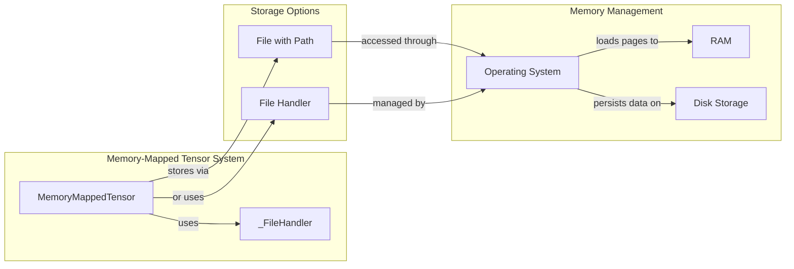
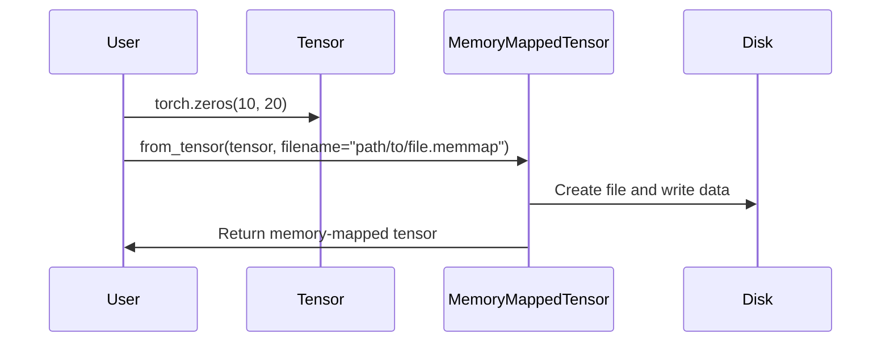
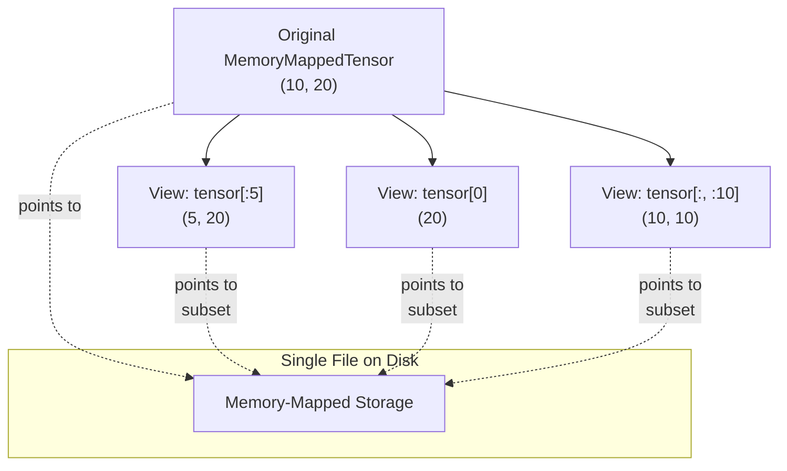
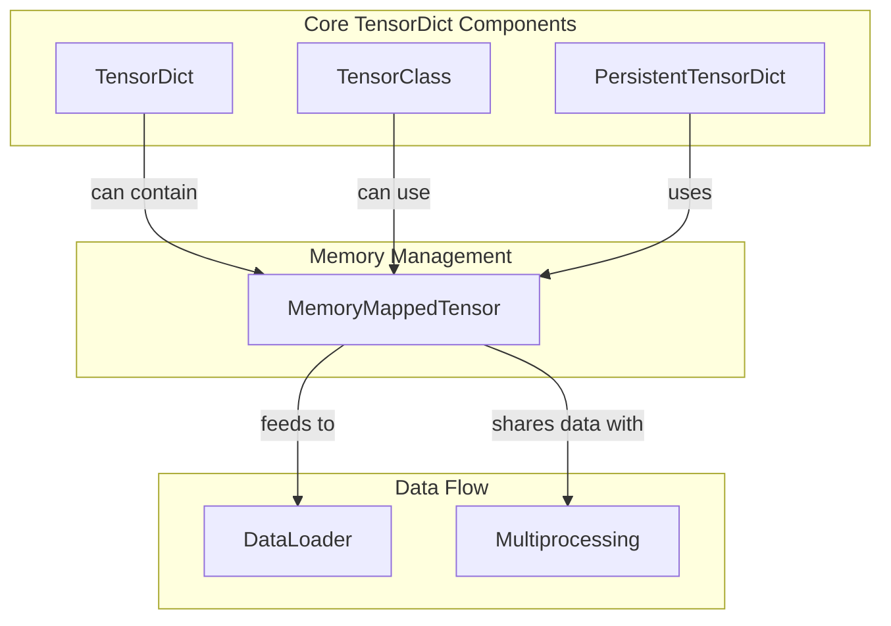
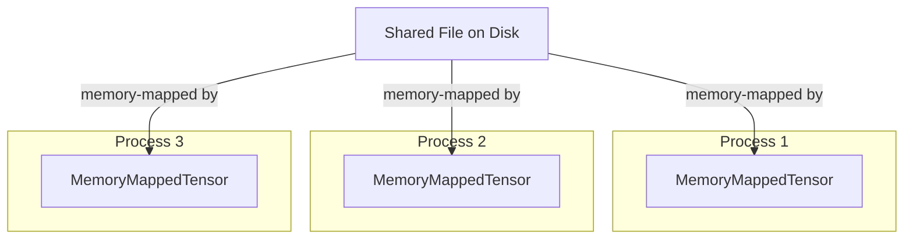

<!-- source: DeepWiki mcp.deepwiki.com · repo pytorch/tensordict · page 5.1 Memory-Mapped Tensors · fetched 2026-10-21 -->

# Memory-Mapped Tensors

<details>
<summary>Relevant source files</summary>

The following files were used as context for generating this wiki page:

- [tensordict/memmap.py](tensordict/memmap.py)
- [tensordict/nn/tensorclass_module.py](tensordict/nn/tensorclass_module.py)
- [test/test_distributed.py](test/test_distributed.py)
- [test/test_memmap.py](test/test_memmap.py)

</details>


Memory-Mapped Tensors (`MemoryMappedTensor`) provide an efficient way to store and access tensor data that may be too large to fit in memory. They allow tensor data to be stored on disk while providing seamless tensor operations similar to regular PyTorch tensors. This document covers the purpose, usage, and integration of memory-mapped tensors within the TensorDict ecosystem. For information about persistent storage of TensorDicts, see [Persistent Storage with PersistentTensorDict](#5.2).

## Overview of Memory-Mapped Tensors

Memory mapping is a technique that maps a file on disk directly to the process's address space, allowing the operating system to efficiently load only the accessed portions of data into memory. The `MemoryMappedTensor` class in TensorDict leverages this concept to provide large tensor storage capabilities with minimal memory overhead.



Sources: [tensordict/memmap.py:25-58](tensordict/memmap.py:25-58), [tensordict/memmap.py:921-987](tensordict/memmap.py:921-987)

## Key Features

`MemoryMappedTensor` provides several important features that make it valuable for handling large datasets and cross-process data sharing:

1. **Efficient Storage**: Store tensor data on disk while maintaining tensor operations
2. **Process Sharing**: Share tensor data across processes without copying
3. **Serialization**: Specialized serialization methods for queues and RPC calls
4. **PyTorch Integration**: Full compatibility with PyTorch tensor operations
5. **Multiple Creation Methods**: Create from existing tensors or directly with predefined values

Sources: [tensordict/memmap.py:25-58](tensordict/memmap.py:25-58)

## Creating Memory-Mapped Tensors

There are several ways to create a `MemoryMappedTensor`:

### From Existing Tensors

The most common way is to convert an existing PyTorch tensor to a memory-mapped tensor:



Sources: [tensordict/memmap.py:130-275](tensordict/memmap.py:130-275)

### Creating with Predefined Values

`MemoryMappedTensor` provides factory methods similar to PyTorch:

| Method | Description | Example |
|--------|-------------|---------|
| `empty` | Uninitialized tensor | `MemoryMappedTensor.empty(shape, dtype=torch.float32, filename="path.memmap")` |
| `zeros` | Tensor filled with zeros | `MemoryMappedTensor.zeros(shape, dtype=torch.float32, filename="path.memmap")` |
| `ones` | Tensor filled with ones | `MemoryMappedTensor.ones(shape, dtype=torch.float32, filename="path.memmap")` |
| `full` | Tensor filled with specified value | `MemoryMappedTensor.full(shape, fill_value=5, dtype=torch.float32, filename="path.memmap")` |

Sources: [tensordict/memmap.py:351-703](tensordict/memmap.py:351-703)

### Loading From File

You can load an existing memory-mapped tensor from a file:

```python
tensor = MemoryMappedTensor.from_filename("path/to/file.memmap", dtype=torch.float32, shape=[10, 20])
```

Sources: [tensordict/memmap.py:706-767](tensordict/memmap.py:706-767)

## Storage Options

`MemoryMappedTensor` provides two ways to store tensor data:

1. **Filename-based storage**: Data is stored in a file with a specified path
   ```python
   tensor = MemoryMappedTensor.from_tensor(torch.zeros(10, 20), filename="path/to/file.memmap")
   ```

2. **Handler-based storage**: Data is stored using a file handler (typically a temporary file)
   ```python
   tensor = MemoryMappedTensor.from_tensor(torch.zeros(10, 20))  # No filename - uses handler
   ```

Sources: [tensordict/memmap.py:64-105](tensordict/memmap.py:64-105), [tensordict/memmap.py:770-813](tensordict/memmap.py:770-813)

## Working with Memory-Mapped Tensors

`MemoryMappedTensor` behaves like a regular PyTorch tensor for most operations:

### Indexing and Slicing

Indexing and slicing operations return memory-mapped views of the original data, maintaining the memory-mapped nature:



Sources: [tensordict/memmap.py:866-918](tensordict/memmap.py:866-918)

### Tensor Operations

Most tensor operations like arithmetic operations, reshaping, and concatenation work as expected, although some operations might convert the tensor to a regular PyTorch tensor if they can't maintain memory mapping.

Sources: [test/test_memmap.py:564-590](test/test_memmap.py:564-590)

## Integration with TensorDict Ecosystem

`MemoryMappedTensor` integrates seamlessly with other components of the TensorDict ecosystem:



### With TensorDict

`TensorDict` can contain `MemoryMappedTensor` entries, and you can convert a regular `TensorDict` to use memory-mapped storage:

```python
# Convert TensorDict to use memory-mapped tensors
tensordict.memmap_()  # In-place conversion
# Or create a new memory-mapped copy
mm_tensordict = tensordict.memmap_like()
```

Sources: [tutorials/sphinx_tuto/tensordict_memory.py:104-141](tutorials/sphinx_tuto/tensordict_memory.py:104-141)

### With TensorClass

`TensorClass` can leverage `MemoryMappedTensor` for efficient storage of large datasets:

```python
@tensorclass
class ImageData:
    images: torch.Tensor
    labels: torch.Tensor
    
    @classmethod
    def from_dataset(cls, dataset):
        data = cls(
            images=MemoryMappedTensor.empty((len(dataset), *dataset[0][0].shape), dtype=torch.float32),
            labels=MemoryMappedTensor.empty((len(dataset),), dtype=torch.int64),
            batch_size=[len(dataset)],
        )
        # Populate data...
        return data
```

Sources: [tutorials/sphinx_tuto/tensorclass_fashion.py:59-77](tutorials/sphinx_tuto/tensorclass_fashion.py:59-77)

## Multi-Process and Distributed Usage

One of the key benefits of `MemoryMappedTensor` is efficient data sharing across processes:



### Cross-Process Serialization

`MemoryMappedTensor` implements specialized serialization methods for efficient sharing:

- When passing through queues or RPC calls, only the metadata and file reference are transferred, not the actual data
- The receiving process maps the same file, avoiding any data copying

Sources: [test/test_memmap.py:384-439](test/test_memmap.py:384-439), [test/test_distributed.py:266-445](test/test_distributed.py:266-445)

## Performance Benefits and Use Cases

### Efficient Data Loading

Memory-mapped tensors are particularly useful for loading large datasets:

- Pre-process data once and store in memory-mapped format
- Load data efficiently in batches directly from disk
- Avoid repeated computation for transforms that can be pre-applied

The primary use cases include:

1. **Large Dataset Handling**: Datasets too large to fit in RAM
2. **Efficient Data Loading**: Faster data loading pipelines
3. **Cross-Process Data Sharing**: Distributed training and multi-process environments
4. **Persistent Storage**: Long-term storage of tensors for repeated use

Sources: [tutorials/sphinx_tuto/tensorclass_imagenet.py:8-21](tutorials/sphinx_tuto/tensorclass_imagenet.py:8-21), [tutorials/sphinx_tuto/tensorclass_imagenet.py:400-406](tutorials/sphinx_tuto/tensorclass_imagenet.py:400-406)

### Benchmarks

In benchmark tests with ImageNet data, memory-mapped tensors provided significant performance improvements over traditional data loading:

| Method | Loading Speed | Relative Performance |
|--------|---------------|----------------------|
| Standard DataLoader (1 worker) | ~100 imgs/sec | 1x |
| Standard DataLoader (32 workers) | ~1,000 imgs/sec | 10x |
| MemoryMappedTensor (single thread) | ~2,000 imgs/sec | 20x |
| MemoryMappedTensor (multi-worker) | ~5,000 imgs/sec | 50x |

Sources: [tutorials/sphinx_tuto/tensorclass_imagenet.py:400-417](tutorials/sphinx_tuto/tensorclass_imagenet.py:400-417)

## Technical Implementation Details

### File Handler

The `_FileHandler` class manages the underlying file handling on different platforms:

- On Windows, it uses memory-mapped files with a unique tag name
- On Linux, it preferentially uses `/dev/shm` when available for better performance
- On other platforms, it uses temporary files with appropriate memory mapping

Sources: [tensordict/memmap.py:921-987](tensordict/memmap.py:921-987)

### Platform Differences

Implementation details vary by platform to optimize for each operating system's memory mapping capabilities:

| Platform | Implementation | Notes |
|----------|---------------|-------|
| Windows | `mmap` with tagname | Uses Windows-specific shared memory API |
| Linux | `mmap` with `/dev/shm` preference | Uses RAM-backed filesystem when available |
| Others | `mmap` with temporary files | Standard implementation |

Sources: [tensordict/memmap.py:921-987](tensordict/memmap.py:921-987)

## Limitations

There are some limitations to be aware of when using `MemoryMappedTensor`:

1. **CPU-Only**: Memory-mapped tensors are restricted to CPU (attempts to use other devices will raise errors)
2. **Complex Types**: Complex-valued tensors are not supported
3. **First-Class Dimension Indices**: Some advanced indexing operations are not supported
4. **Read-Only Files**: When a file is read-only, write operations will fail

Sources: [tensordict/memmap.py:77-78](tensordict/memmap.py:77-78), [tensordict/memmap.py:555-559](tensordict/memmap.py:555-559), [tensordict/memmap.py:869-874](tensordict/memmap.py:869-874), [test/test_memmap.py:720-786](test/test_memmap.py:720-786)

## Conclusion

`MemoryMappedTensor` provides an efficient solution for handling large tensor data in PyTorch applications. By leveraging memory mapping, it allows tensors to be stored on disk while maintaining the familiar PyTorch tensor interface. This is particularly useful for large datasets, distributed training, and scenarios where memory efficiency is critical.

The integration with the broader TensorDict ecosystem, including `TensorDict` and `TensorClass`, makes it a powerful tool for building efficient machine learning pipelines.

---

