<!-- source: DeepWiki mcp.deepwiki.com · repo pytorch/tensordict · page 5.2 PersistentTensorDict and HDF5 Storage · fetched 2026-10-21 -->

# PersistentTensorDict and HDF5 Storage

<details>
<summary>Relevant source files</summary>

The following files were used as context for generating this wiki page:

- [tensordict/nn/params.py](tensordict/nn/params.py)
- [tensordict/persistent.py](tensordict/persistent.py)

</details>


This document covers the `PersistentTensorDict` class and its HDF5-backed storage implementation. `PersistentTensorDict` enables working with datasets larger than available RAM by storing data on disk using the HDF5 format, while providing the same interface as in-memory TensorDict instances.

For in-memory storage with memory-mapped files, see [Memory-Mapped Tensors](#5.1). For general memory management strategies including `memmap_()` and `share_memory_()`, see [Memory Management Strategies](#5.3). For serialization patterns and inter-process communication, see [Serialization and Inter-Process Communication](#5.4).

## Overview

`PersistentTensorDict` is a `TensorDictBase` implementation that stores data on disk using HDF5 files. Unlike regular `TensorDict` instances that keep all data in memory, `PersistentTensorDict` only loads data when accessed, making it suitable for:

- Datasets larger than available RAM
- Long-term storage and archival of tensor data
- Sharing data across multiple processes without copying
- Incremental data loading and processing

The class implements the full `TensorDictBase` interface, allowing seamless integration with existing tensordict workflows. However, it has specific limitations on in-place modifications and shape operations.

**Class Hierarchy and Storage Architecture**

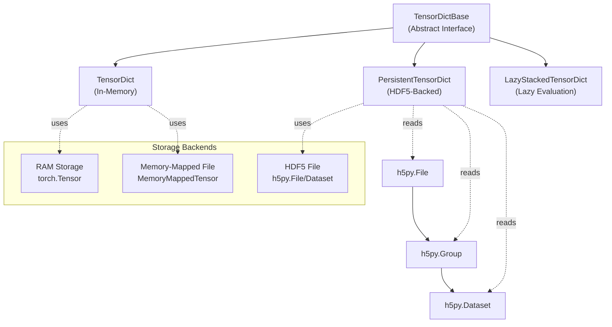

Sources: [tensordict/persistent.py:115-149](), [tensordict/persistent.py:154-197]()

## Creating PersistentTensorDict Instances

`PersistentTensorDict` can be created in three ways: directly from a filename, from an existing HDF5 group, or by converting existing data to HDF5 format.

### Constructor Parameters

The `__init__` method accepts the following parameters:

| Parameter | Type | Description |
|-----------|------|-------------|
| `batch_size` | `torch.Size` | Batch size of the tensordict (optional, defaults to `()`) |
| `filename` | `str` | Path to HDF5 file (exclusive with `group`) |
| `group` | `h5py.Group` | Existing HDF5 group or file (exclusive with `filename`) |
| `mode` | `str` | File access mode: `"r"` (read), `"w"` (write), `"a"` (append) |
| `backend` | `str` | Storage backend (currently only `"h5"` is supported) |
| `device` | `torch.device` | Device where tensors will be placed when loaded |
| `**kwargs` | | Additional arguments passed to `h5py.File.create_dataset` |

**Creation Methods Diagram**

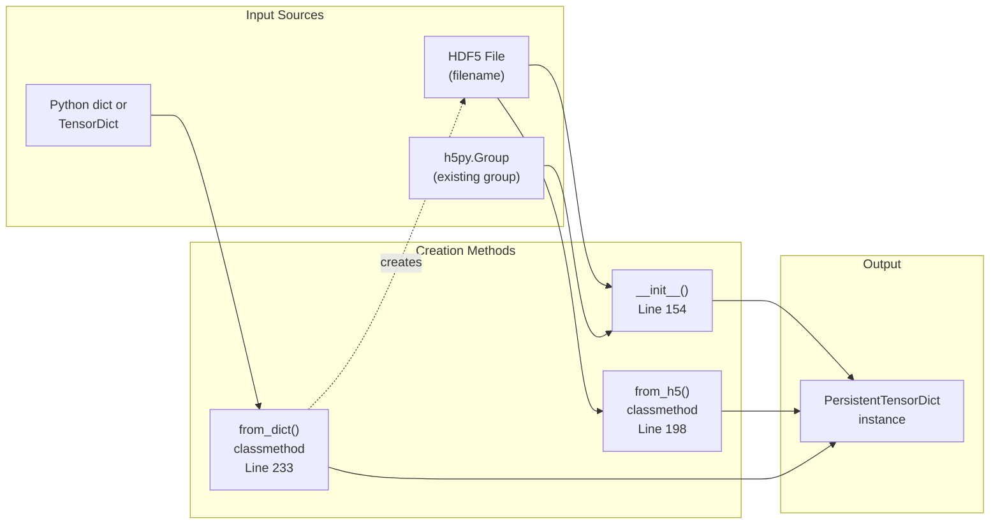

Sources: [tensordict/persistent.py:154-197](), [tensordict/persistent.py:198-231](), [tensordict/persistent.py:233-284]()

### from_h5 Classmethod

The `from_h5` classmethod creates a `PersistentTensorDict` from an existing HDF5 file with automatic batch size detection:

```python
PersistentTensorDict.from_h5(
    filename: str,
    mode: str = "r",
    batch_size: torch.Size | None = None
)
```

If `batch_size` is `None`, the method automatically determines the batch size by examining the shapes of stored arrays using the `_set_max_batch_size` helper function.

**Batch Size Inference Algorithm**

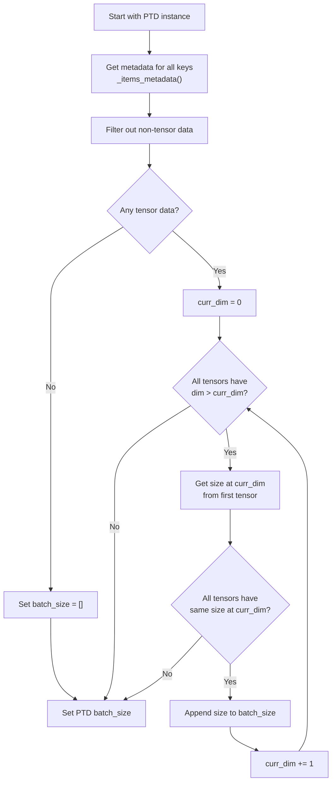

Sources: [tensordict/persistent.py:198-231](), [tensordict/persistent.py:1489-1519]()

### from_dict Classmethod

The `from_dict` classmethod converts a Python dictionary or `TensorDict` to a new HDF5 file:

```python
PersistentTensorDict.from_dict(
    input_dict: dict | TensorDict,
    filename: str,
    auto_batch_size: bool = False,
    batch_size: torch.Size | None = None,
    device: torch.device | None = None,
    **kwargs
)
```

This method creates a new HDF5 file in write mode (`"w"`), converts the input data to HDF5 datasets, and returns a `PersistentTensorDict` instance backed by the new file.

Sources: [tensordict/persistent.py:233-284]()

## HDF5 Storage Backend Architecture

`PersistentTensorDict` uses the `h5py` library to interact with HDF5 files. The storage structure maps tensordict keys to HDF5 datasets and groups.

**HDF5 Structure Mapping**

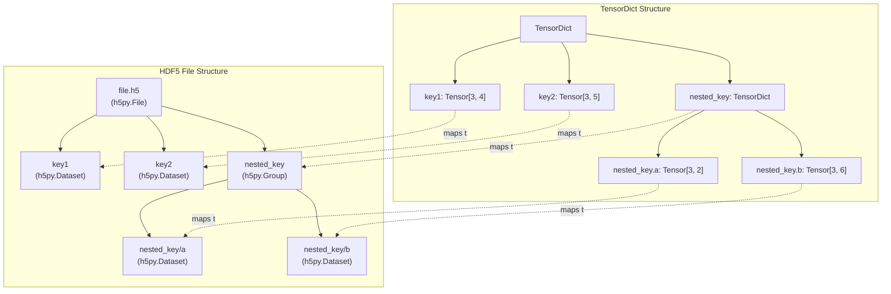

Sources: [tensordict/persistent.py:290-293](), [tensordict/persistent.py:1044-1047]()

### Key Processing

Nested keys are converted to HDF5 paths using forward slashes as separators:

- Tuple key `("a", "b", "c")` becomes HDF5 path `"a/b/c"`
- String key `"simple"` remains `"simple"`

The `_process_key` method handles this conversion at [tensordict/persistent.py:290-292]().

### Data Type Handling

`PersistentTensorDict` distinguishes between three types of stored data:

1. **Tensor Data**: Numeric arrays with dtypes that can be converted to PyTorch tensors
2. **Non-Tensor Data**: Strings and other opaque data types stored using HDF5's opaque dtype mechanism
3. **Nested TensorDicts**: HDF5 groups representing nested tensordict structures

The `_is_non_tensor_h5` helper function checks if an HDF5 dataset contains non-tensor data by examining the dtype:

Sources: [tensordict/persistent.py:1521-1533](), [tensordict/persistent.py:403-436]()

## Reading and Accessing Data

`PersistentTensorDict` provides lazy data access, loading data from disk only when accessed. This enables efficient memory usage with large datasets.

**Data Access Flow**

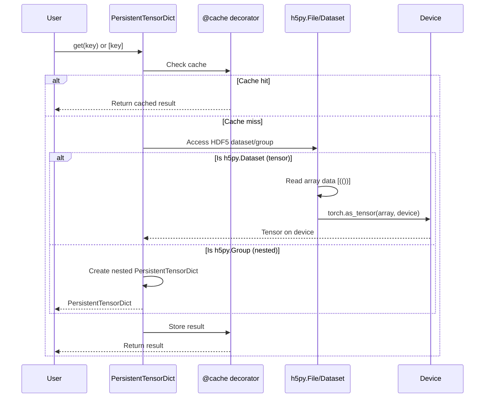

Sources: [tensordict/persistent.py:348-356](), [tensordict/persistent.py:316-346]()

### The @cache Decorator

The `_get_str` method is decorated with `@cache` to avoid repeatedly loading the same data from disk. The cache is automatically invalidated when the tensordict is modified or unlocked.

### Indexed Access with get_at

The `get_at` method enables efficient partial loading by indexing directly on the HDF5 dataset before converting to tensors:

```python
def get_at(self, key: NestedKey, idx: IndexType, default) -> Tensor
```

This is more efficient than loading the entire array and then indexing, especially for large datasets.

**Index Processing for HDF5**

HDF5 requires NumPy-compatible indices, so PyTorch tensors and Python ranges must be converted:

| Input Type | Conversion |
|------------|------------|
| `torch.Tensor` | `tensor.cpu().detach().numpy()` |
| `range` | `np.asarray(range)` |
| `list` | `np.asarray(list)` |
| `slice`, `int` | Pass through unchanged |

The `_process_index` classmethod handles these conversions at [tensordict/persistent.py:437-445]().

Sources: [tensordict/persistent.py:358-401](), [tensordict/persistent.py:437-445]()

### Boolean Mask Indexing Issue

HDF5 has a known limitation with boolean masks that require broadcasting. When this occurs, `PersistentTensorDict` falls back to loading the entire array into memory and indexing with PyTorch, with a performance warning.

Sources: [tensordict/persistent.py:374-387](), [tensordict/persistent.py:1203-1223]()

## Writing and Modifying Data

`PersistentTensorDict` supports both creating new entries and modifying existing ones. The `inplace` parameter controls whether data is written to an existing dataset or creates a new one.

**Write Operations Mapping**

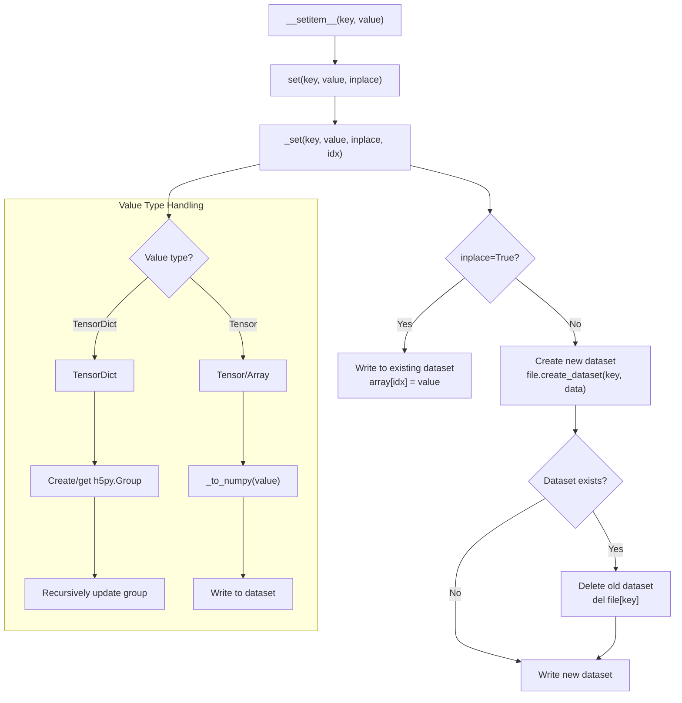

Sources: [tensordict/persistent.py:465-493](), [tensordict/persistent.py:1146-1240]()

### The _set Method

The core `_set` method at [tensordict/persistent.py:1146-1240]() handles all write operations. It performs the following steps:

1. Validates the value (unless `validated=True`)
2. Converts PyTorch tensors to NumPy arrays via `_to_numpy`
3. For nested tensordicts, creates or updates HDF5 groups recursively
4. For tensors, either writes in-place to existing datasets or creates new ones

### Data Conversion

The `_to_numpy` method converts various input types to HDF5-compatible formats:

| Input Type | Conversion |
|------------|------------|
| `torch.Tensor` | `tensor.cpu().detach().numpy()` |
| `dict` | Wrap in `TensorDict` |
| `TensorDictBase` | Pass through for recursive handling |
| `NonTensorData` | Extract `.data` and convert to opaque dtype |
| `np.ndarray` | Pass through |

Source: [tensordict/persistent.py:1121-1144]()

### Locking and Modifications

When a `PersistentTensorDict` is locked (via `lock_()`), write operations are blocked to prevent accidental modifications. The `ignore_lock` parameter can bypass this check when needed internally.

Sources: [tensordict/persistent.py:1163-1164]()

## Batch Size Management

`PersistentTensorDict` enforces that all stored tensors have a common batch size prefix. The `_check_batch_size` method validates this constraint.

**Batch Size Validation**

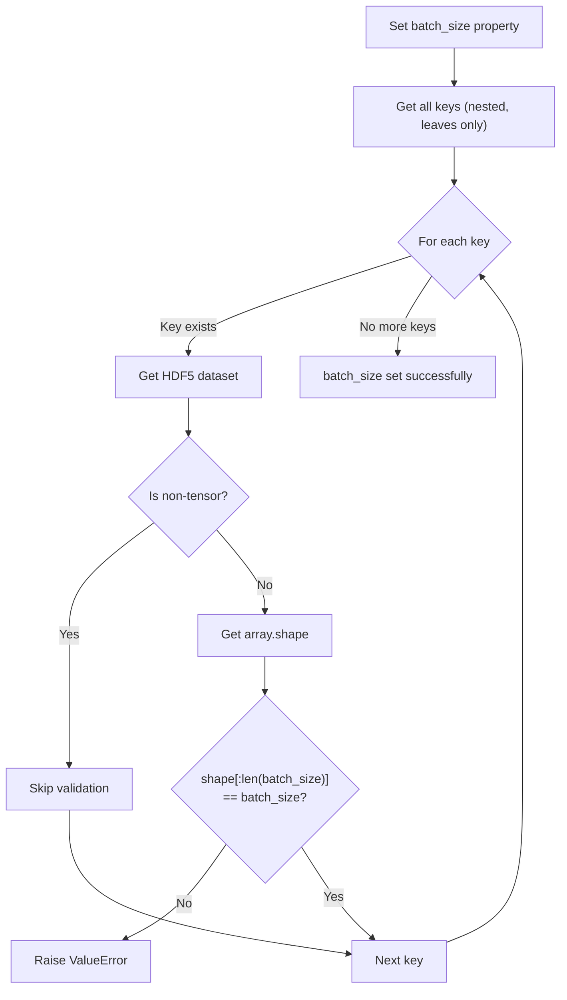

Sources: [tensordict/persistent.py:294-304](), [tensordict/persistent.py:549-560]()

### Automatic Batch Size Inference

When creating a `PersistentTensorDict` with `from_h5(batch_size=None)` or `from_dict(auto_batch_size=True)`, the batch size is automatically inferred by finding the longest common prefix among all tensor shapes.

The `_set_max_batch_size` function implements this algorithm:

1. Collect metadata for all stored tensors
2. Start with `curr_dim = 0`
3. Check if all tensors have at least `curr_dim + 1` dimensions
4. If yes, check if all tensors have the same size at `curr_dim`
5. If yes, append that size to `batch_size` and increment `curr_dim`
6. Repeat until a mismatch is found

Sources: [tensordict/persistent.py:1489-1519]()

## Nested TensorDicts

`PersistentTensorDict` supports nested structures where values are themselves tensordict-like. In HDF5, these are represented as groups rather than datasets.

**Nested Structure Handling**

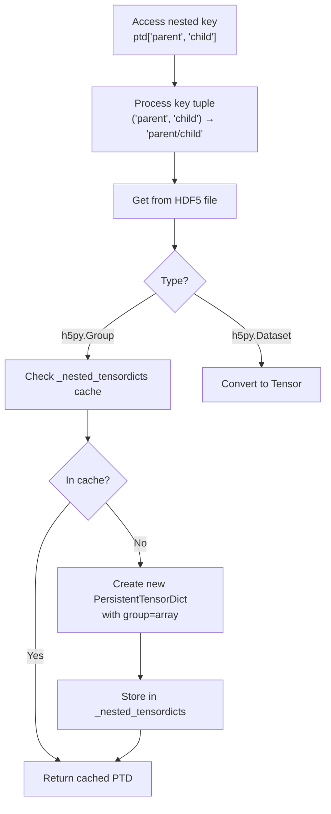

Sources: [tensordict/persistent.py:338-346](), [tensordict/persistent.py:391-399]()

### Nested TensorDict Cache

The `_nested_tensordicts` dictionary caches nested `PersistentTensorDict` instances to avoid recreating them on each access. This cache maps string keys to `PersistentTensorDict` instances.

When setting a nested tensordict, the code creates an HDF5 group and recursively updates it:

Sources: [tensordict/persistent.py:192-193](), [tensordict/persistent.py:1168-1189]()

## Metadata Operations

`PersistentTensorDict` can extract metadata (shape, dtype, dimensionality) without loading full arrays from disk. This is crucial for efficient inspection of large datasets.

**Metadata Extraction**

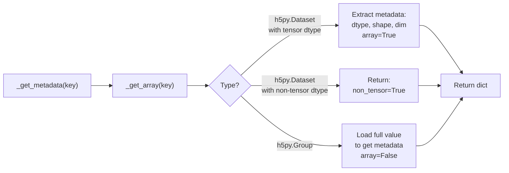

Sources: [tensordict/persistent.py:403-436]()

### Metadata Dictionary Structure

The `_get_metadata` method returns a dictionary with the following keys:

| Key | Description | Present When |
|-----|-------------|--------------|
| `dtype` | PyTorch dtype of the tensor | Array with tensor dtype |
| `shape` | `torch.Size` of the tensor | Always (for tensors) |
| `dim` | Number of dimensions | Always (for tensors) |
| `array` | `True` if regular array, `False` if nested | Always (for tensors) |
| `non_tensor` | `True` if non-tensor data | Non-tensor data only |

### Keys View with Metadata

The `_PersistentTDKeysView` class provides an iterator over keys that uses metadata to determine which keys to yield without loading data:

Sources: [tensordict/persistent.py:85-113](), [tensordict/persistent.py:504-522]()

## Limitations and Restrictions

`PersistentTensorDict` has several limitations compared to regular `TensorDict` due to its disk-backed nature:

### Unsupported Shape Operations

The following operations raise `RuntimeError` because they would require restructuring the HDF5 file:

- `view()` - Use `reshape()` instead
- `transpose()` - Convert to TensorDict first with `to_tensordict()`
- `permute()` - Convert to TensorDict first
- `squeeze()` - Convert to TensorDict first
- `unsqueeze()` - Convert to TensorDict first

**Workaround Pattern**


Sources: [tensordict/persistent.py:1421-1448]()

### Unsupported Operations

The following operations are not implemented:

- `select()` - Filter keys (line 1049)
- `exclude()` - Remove keys (line 1057)
- `flatten_keys(inplace=True)` - Must convert to TensorDict (line 1066)
- `unflatten_keys(inplace=True)` - Must convert to TensorDict (line 1073)
- `share_memory_()` - HDF5 files don't use shared memory (line 1081)
- `pin_memory()` - Cannot pin HDF5-backed data (line 877)
- `memmap_()` - Cannot convert to memmap in-place (line 741)

Sources: [tensordict/persistent.py:1049-1085]()

### Memory-Mapped Tensor Restrictions

`PersistentTensorDict` does not support creating `MemoryMappedTensor` instances after construction via:
- `make_memmap()`
- `make_memmap_from_storage()`
- `make_memmap_from_tensor()`

However, it can be converted to a memory-mapped TensorDict using the `memmap()` method (not `memmap_()`).

Sources: [tensordict/persistent.py:701-739]()

## Serialization and Pickling

`PersistentTensorDict` implements custom `__getstate__` and `__setstate__` methods to support pickling, which is essential for multiprocessing.

**Pickle/Unpickle Process**

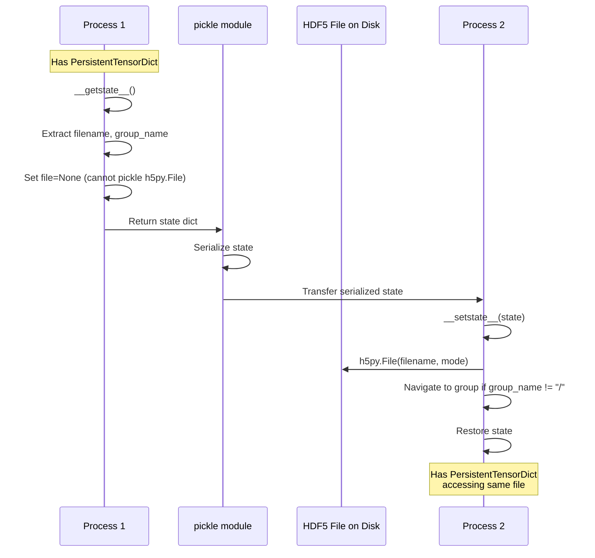

Sources: [tensordict/persistent.py:1385-1413]()

### Pickle State Structure

The state dictionary includes:
- `filename`: Path to the HDF5 file
- `group_name`: Path within the HDF5 file (e.g., `"/"` for root)
- All other instance attributes
- `file` is set to `None` (reconstructed on unpickle)
- `_lock_parents_weakrefs` is set to `None` (cannot pickle weakrefs)

### Locking After Unpickling

If the tensordict was locked before pickling, it is automatically re-locked after unpickling:

Sources: [tensordict/persistent.py:1405-1412]()

## Converting Between Formats

`PersistentTensorDict` provides methods to convert to and from other tensordict formats.

**Conversion Methods**

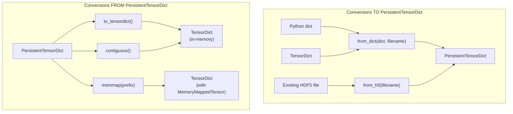

Sources: [tensordict/persistent.py:233-284](), [tensordict/persistent.py:198-231](), [tensordict/persistent.py:573-575]()

### The contiguous Method

The `contiguous()` method is an alias for `to_tensordict()` that materializes all data into memory:

Source: [tensordict/persistent.py:573-575]()

### Converting to Memory-Mapped Storage

The `_memmap_` method (inherited interface, not in-place for PersistentTensorDict) converts to a TensorDict with `MemoryMappedTensor` entries:

1. Iterate through all keys using metadata
2. For each tensor, create a `MemoryMappedTensor.from_tensor()` 
3. For nested tensordicts, recursively convert them
4. Save metadata to `meta.json` if prefix is provided

This enables efficient conversion from HDF5 to memory-mapped format without intermediate copies.

Sources: [tensordict/persistent.py:751-873]()

## Device Management

The `device` attribute of `PersistentTensorDict` specifies where tensors should be placed when loaded from disk. This does **not** mean the data is stored on that device—it only affects where data is loaded.

**Device Handling**

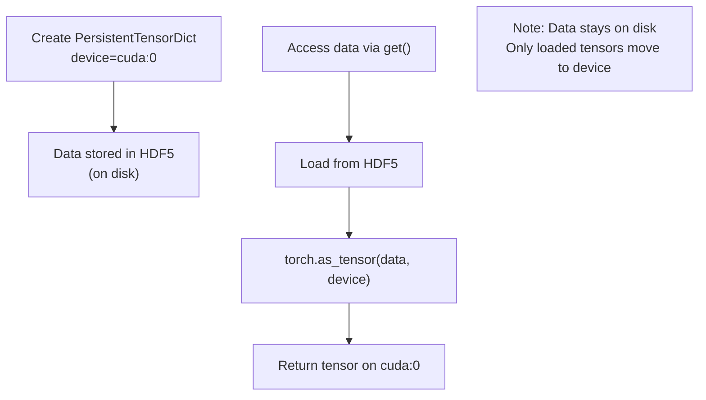

Sources: [tensordict/persistent.py:186-187](), [tensordict/persistent.py:320-329](), [tensordict/persistent.py:587-589]()

### The to Method

The `to(device)` method updates the device attribute but does not move any data. Data is only transferred to the new device when accessed:

Source: [tensordict/persistent.py:1087-1119]()

## Working with map and Multiprocessing

The `map` method enables parallel processing of `PersistentTensorDict` data using multiprocessing. Unlike regular `TensorDict`, it must convert each chunk to regular TensorDict before passing to workers.

**map Operation Flow**

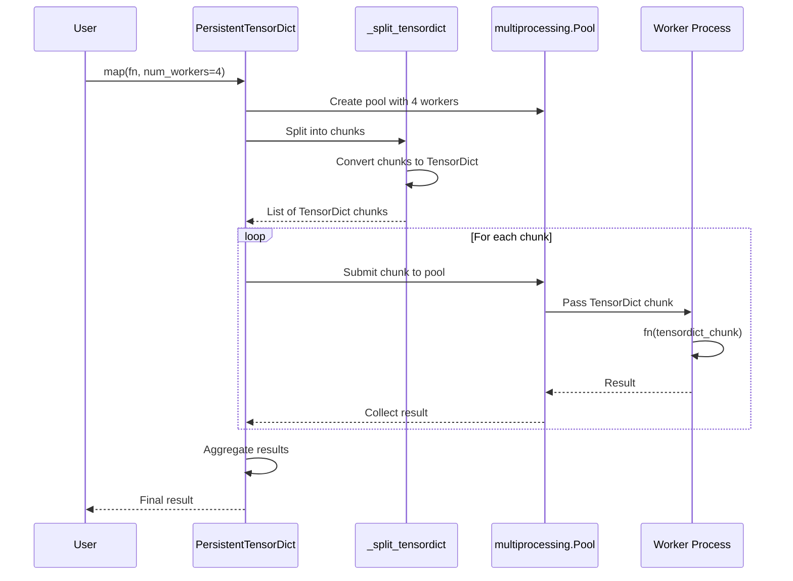

Sources: [tensordict/persistent.py:888-1010]()

### Conversion to TensorDict for Workers

The key detail is at line 952: `to_tensordict=True` forces conversion to regular TensorDict before passing to workers. This is necessary because:

1. Workers may not have access to the same HDF5 file handle
2. HDF5 files cannot be safely accessed from multiple processes simultaneously without coordination
3. Converting to TensorDict ensures each worker has independent data

Source: [tensordict/persistent.py:941-952]()

## Close and Resource Management

Unlike regular `TensorDict`, `PersistentTensorDict` holds a file handle that should be closed when done:

```python
ptd = PersistentTensorDict.from_h5("data.h5")
# ... use ptd ...
ptd.close()  # Close the underlying h5py.File
```

**Important Note**: `PersistentTensorDict` instances are **not** automatically closed when they go out of scope. It is the user's responsibility to call `close()` when finished.

Sources: [tensordict/persistent.py:138-140](), [tensordict/persistent.py:286-288]()

## Advanced Features

### Clone with Recurse

The `clone()` method has special behavior for `PersistentTensorDict`:

- `clone(recurse=False)`: Creates a new `PersistentTensorDict` pointing to the same HDF5 file
- `clone(recurse=True)`: Copies all data to a new HDF5 file

When `recurse=True` and no destination file is provided, a temporary file is created with a warning.

Sources: [tensordict/persistent.py:1332-1383]()

### Non-Tensor Data Support

`PersistentTensorDict` can store non-tensor data (strings, arbitrary Python objects) using HDF5's opaque dtype mechanism. This is detected and handled differently from regular tensors.

The `_is_non_tensor_h5` helper checks for opaque dtypes:

Sources: [tensordict/persistent.py:1521-1533](), [tensordict/persistent.py:331-336]()

### Visitor Pattern for Keys

The `_Visitor` class implements a visitor pattern for traversing HDF5 groups:

Sources: [tensordict/persistent.py:69-83]()

### Locking Integration

`PersistentTensorDict` integrates with the locking system but has special considerations:
- Locking prevents writes but doesn't affect reads
- Lock state is propagated to nested tensordicts
- Lock parents are tracked via weak references to prevent memory leaks

Sources: [tensordict/persistent.py:620-655]()

---

