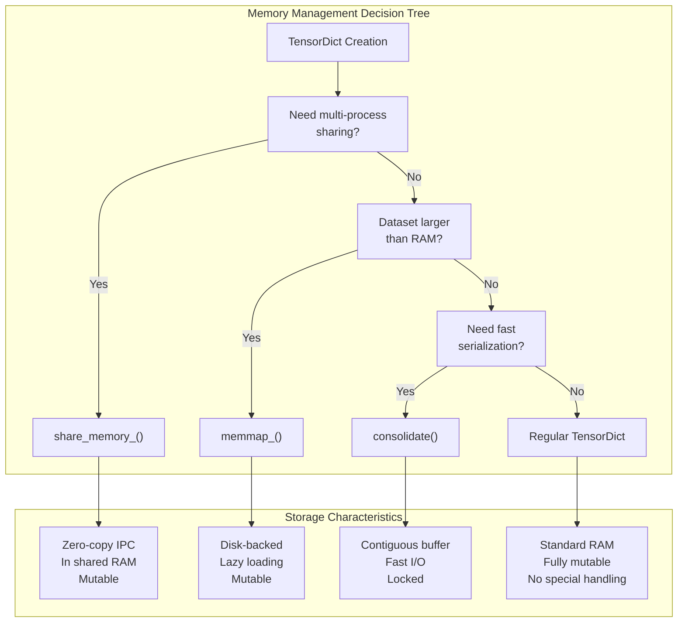
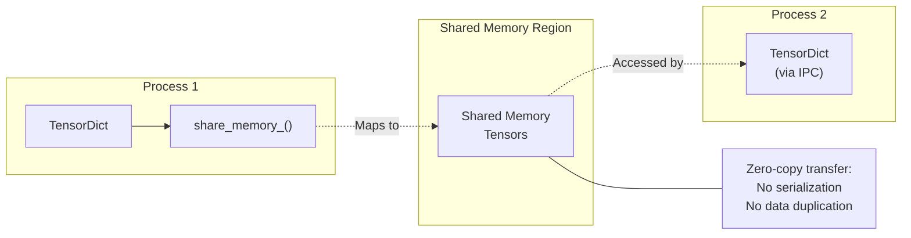
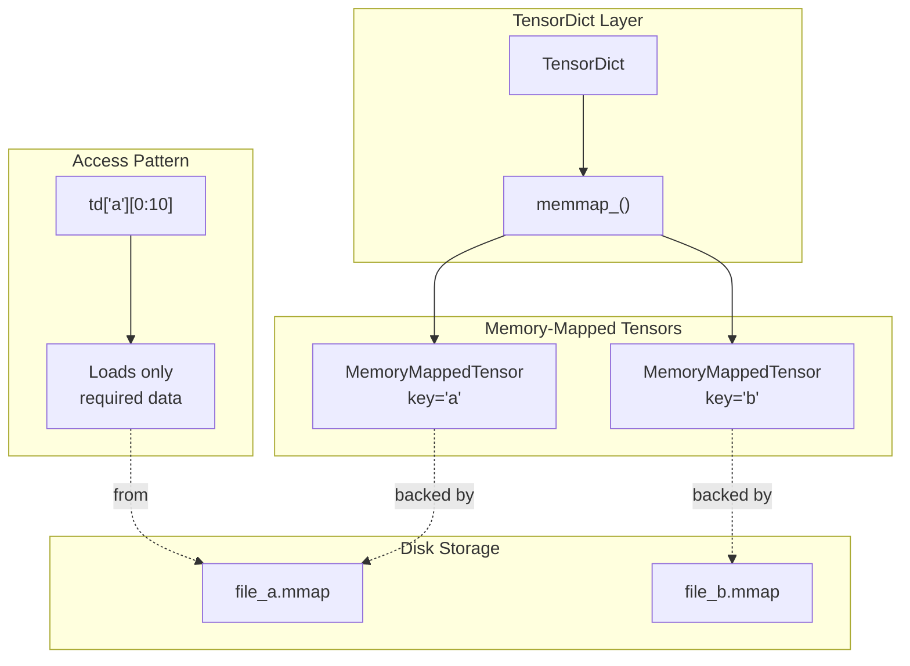
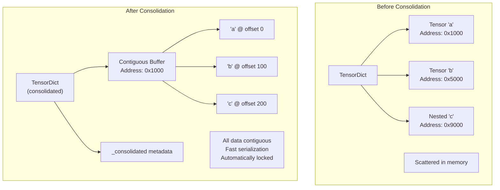
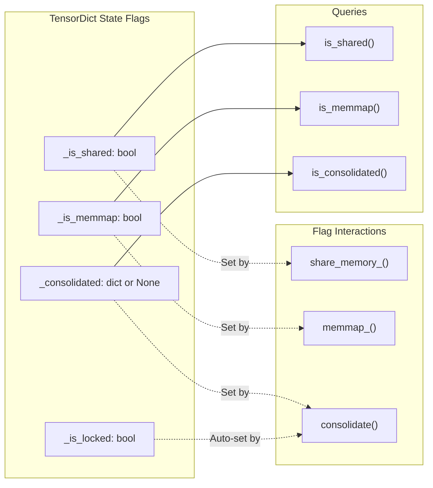

<!-- source: DeepWiki mcp.deepwiki.com · repo pytorch/tensordict · page 5.3 Memory Management Strategies · fetched 2026-10-21 -->

# Memory Management Strategies

<details>
<summary>Relevant source files</summary>

The following files were used as context for generating this wiki page:

- [tensordict/base.py](tensordict/base.py)
- [tensordict/memmap.py](tensordict/memmap.py)
- [tensordict/nn/tensorclass_module.py](tensordict/nn/tensorclass_module.py)
- [test/test_distributed.py](test/test_distributed.py)
- [test/test_memmap.py](test/test_memmap.py)
- [test/test_tensordict.py](test/test_tensordict.py)

</details>


This document covers memory management strategies in TensorDict, including shared memory, memory-mapped storage, and consolidation. These strategies enable efficient handling of large datasets, inter-process communication, and optimized memory layout.

For information about the underlying memory-mapped tensor implementation, see [Memory-Mapped Tensors](#5.1). For HDF5-based persistent storage, see [PersistentTensorDict and HDF5 Storage](#5.2). For serialization and IPC patterns, see [Serialization and Inter-Process Communication](#5.4).

## Overview of Memory Management Strategies

TensorDict provides three primary memory management strategies, each optimized for different use cases:

| Strategy | Primary Use Case | Key Method | Data Location | Mutability |
|----------|------------------|------------|---------------|------------|
| **Shared Memory** | Multi-process training, data loading | `share_memory_()` | Shared RAM | In-place modification supported |
| **Memory Mapping** | Datasets larger than RAM | `memmap_()` | Memory-mapped files on disk | In-place modification supported |
| **Consolidation** | Fast I/O, serialization | `consolidate()` | Contiguous RAM buffer | Locked after consolidation |



**Sources:** [tensordict/base.py:4800-5100](), [test/test_tensordict.py:409-530]()

## Shared Memory Strategy

The shared memory strategy enables zero-copy data sharing between processes, critical for efficient multi-process data loading and distributed training.

### Core Concept

When `share_memory_()` is called, tensors are moved to shared memory regions accessible by multiple processes without serialization overhead.



### Usage Pattern

```python
# Basic shared memory usage
td = TensorDict({"a": torch.zeros(3, 4)}, batch_size=[3])
td.share_memory_()  # Move to shared memory

# Check shared status
assert td.is_shared()

# Can be passed to other processes via multiprocessing
# without copying data
```

### Implementation Details

The `share_memory_()` method is implemented on `TensorDictBase` and recursively applies to all nested tensors:

- **Method:** `share_memory_()` [tensordict/base.py:4800-4850]()
- **Behavior:** In-place operation that modifies tensors to use shared memory
- **Nested Support:** Automatically applies to nested TensorDicts
- **LazyStackedTensorDict:** Applies to each tensordict in the stack

**Key Implementation Points:**

1. Uses PyTorch's native `Tensor.share_memory_()` method
2. Sets internal `_is_shared` flag for tracking
3. Works with memory-mapped tensors (returns self if already memory-mapped)
4. Recursive: applies to all nested TensorDict instances

**Sources:** [tensordict/base.py:4800-4850](), [test/test_tensordict.py:286-309]()

### Context Manager Usage

The `share_memory_()` method can be used as a context manager for temporary shared memory access:

```python
with td.share_memory_():
    # td is in shared memory within this block
    pass  # some multi-process operation
# td may or may not remain in shared memory after exiting
```

**Sources:** [tensordict/utils.py:903-961]()

## Memory-Mapped Storage Strategy

Memory mapping enables working with datasets larger than available RAM by storing data on disk and loading it on-demand.

### Core Concept

Memory-mapped tensors (`MemoryMappedTensor`) store data in files but present a tensor interface. Data is loaded lazily as accessed.



**Sources:** [tensordict/base.py:4850-4950](), [tensordict/memmap.py:1-300]()

### Usage Pattern

```python
# Convert to memory-mapped storage
td = TensorDict({"a": torch.randn(1000, 100)}, batch_size=[1000])
td_memmap = td.memmap_()  # Creates memory-mapped files

# Can also specify directory
td_memmap = td.memmap_(prefix="/path/to/storage")

# Access works the same way, but data loads on-demand
subset = td_memmap[0:10]  # Only loads 10 samples from disk
```

### Method Signatures

The primary methods for memory mapping are:

- **`memmap_(prefix=None, copy_existing=False, *, num_threads=0)`**: Convert TensorDict to memory-mapped storage in-place
- **`memmap(prefix=None, copy_existing=False, *, num_threads=0)`**: Create a new memory-mapped TensorDict
- **`memmap_like(prefix=None)`**: Create a memory-mapped TensorDict with the same structure but uninitialized data

**Parameters:**
- `prefix`: Directory path for memory-mapped files. If `None`, uses temporary directory
- `copy_existing`: If `True`, copies existing tensor data to memory-mapped files
- `num_threads`: Number of threads for parallel file operations (0 = serial)

**Sources:** [tensordict/base.py:4850-4950]()

### Memory-Mapped with LazyStackedTensorDict

When applied to a `LazyStackedTensorDict`, the memory mapping applies to each tensordict in the stack:

```python
# Stack of tensordicts
tds = [TensorDict({"x": torch.randn(10)}, [10]) for _ in range(100)]
lazy_stack = LazyStackedTensorDict.lazy_stack(tds, 0)

# Memory map the entire stack
lazy_stack.memmap_(prefix="/path/to/storage")

# Each tensordict in the stack is now memory-mapped
```

**Sources:** [test/test_tensordict.py:1-100]()

## Consolidation Strategy

Consolidation stores all tensors in a single contiguous memory buffer, optimizing for I/O performance and serialization.

### Core Concept

The `consolidate()` method reorganizes tensor storage so all data resides in a single contiguous buffer with metadata tracking offsets and shapes.



**Sources:** [tensordict/base.py:2950-3200](), [test/test_tensordict.py:409-530]()

### Usage Pattern

```python
# Create and consolidate
td = TensorDict({
    "a": torch.zeros(2),
    "b": {"c": torch.ones(2)},
}, batch_size=[2])

td_consolidated = td.consolidate()

# Check consolidation status
assert td_consolidated.is_consolidated()

# Automatically locked after consolidation
assert td_consolidated.is_locked

# Can unlock if needed (removes consolidation)
td_consolidated.unlock_()
assert not td_consolidated.is_consolidated()
```

### Consolidation with File Storage

Consolidation can write directly to disk as a memory-mapped file:

```python
# Consolidate to disk
td_consolidated = td.consolidate(filename="/path/to/file.mmap")

# Later, load from consolidated file
td_loaded = TensorDict.from_consolidated("/path/to/file.mmap")
```

**Sources:** [tensordict/base.py:3150-3200](), [test/test_tensordict.py:464-468]()

### Consolidation Metadata Structure

The `_consolidated` attribute stores metadata about the consolidated buffer:

```python
# Structure of _consolidated metadata
{
    "storage": Tensor,  # The contiguous storage buffer
    "metadata": [       # Per-tensor metadata
        {
            "name": str,        # Tensor key
            "offset": int,      # Offset in storage buffer
            "shape": tuple,     # Tensor shape
            "dtype": torch.dtype,
        },
        # ... more entries
    ]
}
```

**Sources:** [tensordict/base.py:2950-3050]()

### Locking Behavior

Consolidated TensorDicts are automatically locked to prevent structural modifications:

```python
td_consolidated = td.consolidate()

# Structural changes are blocked
try:
    td_consolidated["new_key"] = torch.zeros(2)
except RuntimeError:
    print("Cannot add keys to locked TensorDict")

# In-place modifications are allowed
td_consolidated.set("a", torch.ones(2), inplace=True)  # OK

# Unlock to allow modifications (removes consolidation)
with td_consolidated.unlock_():
    td_consolidated["new_key"] = torch.zeros(2)
    # consolidation is temporarily removed

# After context exits, it's locked again but NOT consolidated
```

**Sources:** [test/test_tensordict.py:555-717](), [tensordict/utils.py:883-897]()

### Multi-threaded Consolidation

The `num_threads` parameter enables parallel consolidation for large tensordicts:

```python
# Use 4 threads for consolidation
td_consolidated = td.consolidate(num_threads=4)
```

This is particularly useful when consolidating nested TensorDicts with many tensors.

**Sources:** [test/test_tensordict.py:409-430]()

## Choosing the Right Strategy

### Decision Matrix

| Use Case | Strategy | Reasoning |
|----------|----------|-----------|
| Multi-process DataLoader | Shared Memory | Zero-copy sharing, no serialization overhead |
| Dataset > RAM | Memory Mapping | Disk-backed storage, lazy loading |
| Frequent serialization/deserialization | Consolidation | Single contiguous buffer, fast I/O |
| Distributed training parameter broadcast | Shared Memory | Efficient parameter sharing across processes |
| Large-scale dataset storage | Memory Mapping + HDF5 | Disk-based, indexed access |
| Model checkpoint saving | Consolidation | Fast write/read, single file |

**Sources:** [tensordict/base.py:2900-5100]()

### Combining Strategies

Strategies can sometimes be combined or used sequentially:

```python
# Example: Consolidate then memory map
td = TensorDict({"a": torch.randn(1000, 100)}, [1000])

# First consolidate for contiguous storage
td_consolidated = td.consolidate()

# Then memory map the consolidated result
td_final = td_consolidated.memmap_(prefix="/storage")

# Result: Memory-mapped file with consolidated layout
```

**Sources:** [test/test_tensordict.py:409-530]()

### Performance Characteristics

```mermaid
graph TB
    subgraph "Operation Performance"
        direction TB
        
        OP1["Random Access"]
        OP2["Sequential Access"]
        OP3["Serialization"]
        OP4["IPC Transfer"]
        
        OP1 --> REG_R["Regular: Fast"]
        OP1 --> CON_R["Consolidated: Fast"]
        OP1 --> MM_R["MemMap: Slower<br/>(disk I/O)"]
        OP1 --> SH_R["Shared: Fast"]
        
        OP2 --> REG_S["Regular: Fast"]
        OP2 --> CON_S["Consolidated: Fastest"]
        OP2 --> MM_S["MemMap: Medium<br/>(sequential disk)"]
        OP2 --> SH_S["Shared: Fast"]
        
        OP3 --> REG_SER["Regular: Medium"]
        OP3 --> CON_SER["Consolidated: Fastest"]
        OP3 --> MM_SER["MemMap: Already on disk"]
        OP3 --> SH_SER["Shared: Medium"]
        
        OP4 --> REG_IPC["Regular: Slow<br/>(serialization)"]
        OP4 --> CON_IPC["Consolidated: Medium"]
        OP4 --> MM_IPC["MemMap: Fast<br/>(share file handle)"]
        OP4 --> SH_IPC["Shared: Fastest<br/>(zero-copy)"]
    end
```



**Sources:** [tensordict/base.py:2900-5100]()

## Implementation Details

### Core Methods and Classes

The memory management strategies are implemented across several key methods:

| Method | Class | File | Purpose |
|--------|-------|------|---------|
| `share_memory_()` | `TensorDictBase` | [tensordict/base.py:4800-4850]() | Move to shared memory |
| `memmap_()` | `TensorDictBase` | [tensordict/base.py:4850-4950]() | Convert to memory-mapped storage |
| `consolidate()` | `TensorDictBase` | [tensordict/base.py:2950-3200]() | Create contiguous buffer |
| `is_shared()` | `TensorDictBase` | [tensordict/base.py:4700-4750]() | Check shared status |
| `is_memmap()` | `TensorDictBase` | [tensordict/base.py:4750-4800]() | Check memory-mapped status |
| `is_consolidated()` | `TensorDictBase` | [tensordict/base.py:3200-3250]() | Check consolidation status |

**Sources:** [tensordict/base.py:2900-5100]()

### State Tracking

TensorDict instances track their memory management state through internal flags:



**Sources:** [tensordict/_td.py:245-250](), [tensordict/base.py:303-312]()

### Memory Management in LazyStackedTensorDict

`LazyStackedTensorDict` handles memory management differently since it's a view over multiple tensordicts:

```python
# Memory operations on lazy stacks propagate to all tensordicts
lazy_stack = LazyStackedTensorDict.lazy_stack([td1, td2, td3], 0)

# share_memory_() applies to each tensordict
lazy_stack.share_memory_()
# Equivalent to: td1.share_memory_(); td2.share_memory_(); td3.share_memory_()

# Query checks all tensordicts
assert lazy_stack.is_shared()  # True only if ALL are shared
```

**Properties:**
- `_is_shared`: Returns `True` only if all stacked tensordicts are shared [tensordict/_lazy.py:436-438]()
- `_is_memmap`: Returns `True` only if all stacked tensordicts are memory-mapped [tensordict/_lazy.py:440-442]()

**Sources:** [tensordict/_lazy.py:436-450]()

### Device Transfer and Memory Management

Memory management interacts with device transfers:

```python
# Consolidation can transfer to device
td_cpu = td.consolidate()
td_cuda = td_cpu.to("cuda")  # Transfers consolidated buffer

# Maintains consolidation if possible
assert td_cuda.is_consolidated()  # True if transfer succeeded
```

**Sources:** [test/test_tensordict.py:531-554]()

## Best Practices

### When to Use Each Strategy

1. **Shared Memory:**
   - Multi-process data loaders with `num_workers > 0`
   - Distributed training with parameter sharing
   - Real-time data pipelines with producer-consumer patterns

2. **Memory Mapping:**
   - Datasets that don't fit in RAM
   - Incremental dataset construction (append data over time)
   - Cached preprocessing results

3. **Consolidation:**
   - Before saving model checkpoints
   - When frequently serializing/deserializing
   - For network transfer of TensorDicts

### Common Patterns

```python
# Pattern 1: Multi-process DataLoader
def worker_init_fn(worker_id):
    # Share dataset in each worker
    global dataset
    dataset.share_memory_()

# Pattern 2: Large dataset construction
td = TensorDict.memmap(prefix="/data/cache")
for i, batch in enumerate(data_stream):
    td[i] = process(batch)  # Writes directly to disk

# Pattern 3: Fast checkpoint saving
state = get_model_state()
state_consolidated = state.consolidate()
torch.save(state_consolidated, "checkpoint.pt")
```

**Sources:** [tensordict/base.py:2900-5100](), [test/test_tensordict.py:409-717]()

### Avoiding Common Pitfalls

1. **Don't modify consolidated TensorDicts structurally:** Unlock first or accept that consolidation will be lost
2. **Memory-mapped operations may be slower:** Consider caching hot data in RAM
3. **Shared memory requires careful synchronization:** Use proper locks for concurrent writes
4. **Check compatibility:** Some operations may not support all memory strategies

**Sources:** [test/test_tensordict.py:555-717](), [tensordict/utils.py:883-897]()

---

