<!-- source: DeepWiki mcp.deepwiki.com · repo pytorch/tensordict · page 5.4 Serialization and Inter-Process Communication · fetched 2026-10-21 -->

# Serialization and Inter-Process Communication

<details>
<summary>Relevant source files</summary>

The following files were used as context for generating this wiki page:

- [tensordict/memmap.py](tensordict/memmap.py)
- [tensordict/nn/params.py](tensordict/nn/params.py)
- [tensordict/nn/tensorclass_module.py](tensordict/nn/tensorclass_module.py)
- [tensordict/persistent.py](tensordict/persistent.py)
- [test/test_distributed.py](test/test_distributed.py)
- [test/test_memmap.py](test/test_memmap.py)

</details>


## Purpose and Scope

This page documents how TensorDict instances are serialized and passed between processes. It covers standard Python pickling, zero-copy inter-process communication (IPC) mechanisms, and integration with `torch.distributed` for multi-process training. For general storage and persistence patterns, see [Memory Management Strategies](#5.3). For distributed training workflows specifically, see [Distributed Operations](#6.3).

The key challenge addressed here is efficient data transfer between processes without copying large tensor data. TensorDict provides several mechanisms that enable zero-copy or minimal-copy IPC through shared memory, memory-mapped files, and distributed communication primitives.

---

## Overview of Serialization Patterns

TensorDict supports multiple serialization strategies depending on the use case:

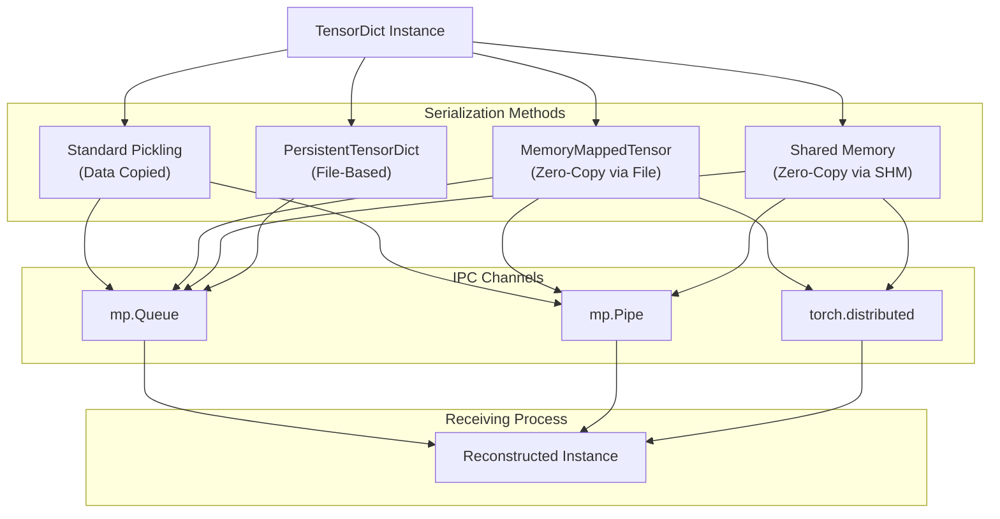

**Sources:** [tensordict/memmap.py:831-875](), [test/test_memmap.py:384-440](), [test/test_distributed.py:204-266]()

---

## Standard Pickling

TensorDict instances can be pickled using Python's standard `pickle` module. This works for passing instances through `multiprocessing.Queue`, `multiprocessing.Pipe`, or any other pickle-based serialization mechanism.

### Basic Mechanism

When a regular `TensorDict` is pickled, its tensor data is serialized and copied to the receiving process. This is straightforward but inefficient for large datasets:

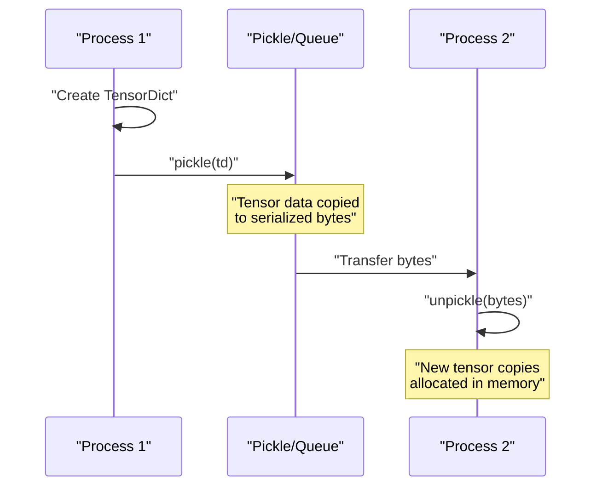

This approach is suitable when:
- Data size is small
- One-time transfer is acceptable
- No need for bidirectional updates

**Sources:** [tensordict/_td.py](), [test/test_memmap.py:1-26]()

---

## Zero-Copy IPC with MemoryMappedTensor

The `MemoryMappedTensor` class provides efficient zero-copy serialization by storing tensor data in memory-mapped files or shared memory buffers. When serialized, only the metadata and file handle are transferred, not the actual tensor data.

### Architecture

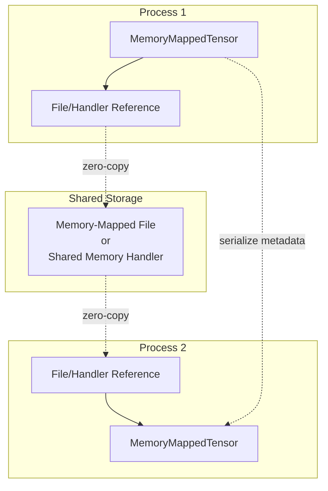

**Sources:** [tensordict/memmap.py:36-70](), [tensordict/memmap.py:831-875]()

### Serialization Methods

The `MemoryMappedTensor` class implements custom `__reduce__`, `__getstate__`, and `__setstate__` methods for efficient pickling:

| Method | Purpose | Returns |
|--------|---------|---------|
| `__reduce__()` | Defines how to reconstruct the tensor | Constructor function and arguments |
| `__getstate__()` | Extracts state for pickling | Dict with filename/handler and metadata |
| `__setstate__()` | Reconstructs tensor from state | None (modifies self) |

#### With Filename

When a `MemoryMappedTensor` has an associated file:

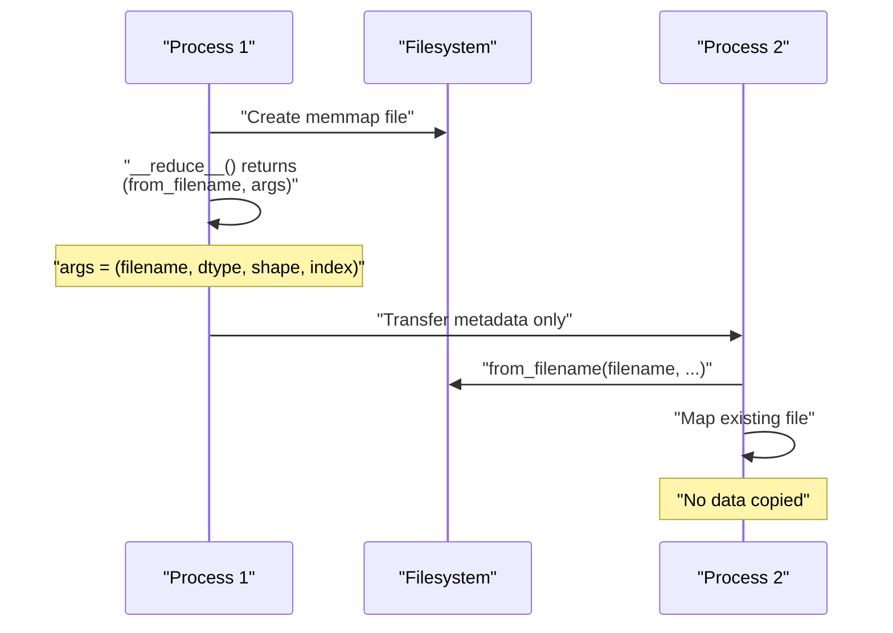

**Sources:** [tensordict/memmap.py:866-874](), [tensordict/memmap.py:717-778]()

#### With Handler

When using a file handler (for anonymous shared memory):

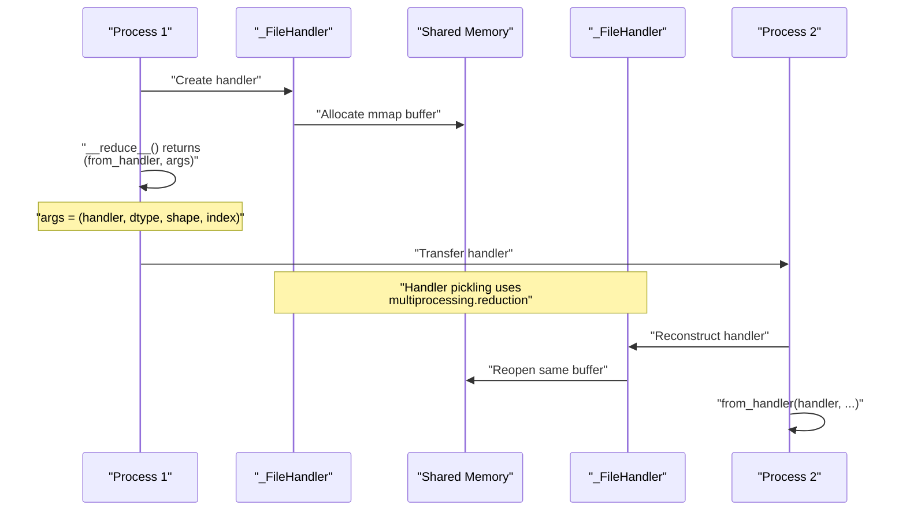

**Sources:** [tensordict/memmap.py:859-875](), [tensordict/memmap.py:781-824](), [tensordict/memmap.py:989-1063]()

### File Handler Implementation

The `_FileHandler` class manages shared memory buffers. It has platform-specific implementations:

**Linux/Unix:**
- Uses `tempfile.mkstemp()` to create temporary files
- Prefers `/dev/shm` for in-memory storage when available
- Uses `mmap.mmap()` to map the file descriptor
- Registers with `multiprocessing.reduction` for pickling

**Windows:**
- Uses `mmap.mmap(-1, size, tagname=name)` for named shared memory
- Generates unique names using `tempfile._RandomNameSequence()`
- Handler name is transmitted for reopening

**Sources:** [tensordict/memmap.py:986-1063]()

### Usage Example

Creating and transferring a memory-mapped tensor between processes:

**Process 1 (Sender):**
```python
# Create memory-mapped tensor with file
mmt = MemoryMappedTensor.from_tensor(
    torch.randn(1000, 1000), 
    filename="/tmp/tensor.memmap"
)
queue.put(mmt)  # Transfers only metadata
```

**Process 2 (Receiver):**
```python
# Receives reconstructed tensor pointing to same file
mmt = queue.get()
# Can read/write shared data with zero copy
mmt.fill_(1.0)  # Visible in Process 1
```

**Sources:** [test/test_memmap.py:384-410](), [test/test_memmap.py:413-439]()

---

## Shared Memory with share_memory_()

TensorDict provides the `share_memory_()` method to convert all contained tensors to shared memory, enabling zero-copy IPC for regular (non-memory-mapped) tensors.

### Mechanism

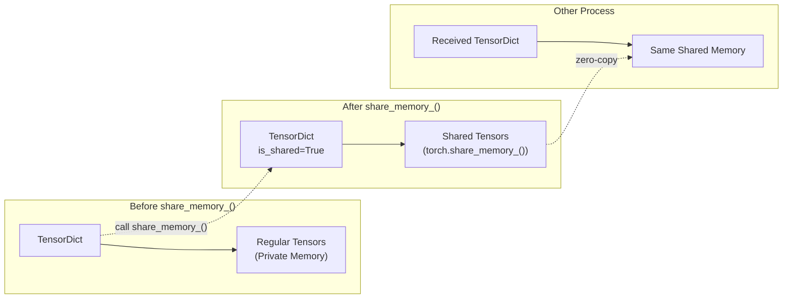

After calling `share_memory_()`, tensors use PyTorch's shared memory mechanism (typically POSIX shared memory on Unix systems). The `is_shared()` property returns `True` for such tensordicts.

**Sources:** [tensordict/_td.py](), [tensordict/base.py]()

### Comparison with Memory-Mapped Tensors

| Feature | `share_memory_()` | `MemoryMappedTensor` |
|---------|-------------------|----------------------|
| Storage | System shared memory | File or handler |
| Persistence | Temporary (process lifetime) | Can persist to disk |
| Access | Both processes must be alive | Can access after creator exits |
| Platform | PyTorch's shared memory | Custom implementation |
| Use Case | Short-lived IPC | Long-lived or persistent data |

**Sources:** [tensordict/memmap.py:36-70](), [test/test_memmap.py:384-440]()

---

## PersistentTensorDict for File-Based IPC

`PersistentTensorDict` provides file-based IPC through HDF5 files. Multiple processes can access the same file, though this approach involves some I/O overhead compared to pure memory-based methods.

### Architecture

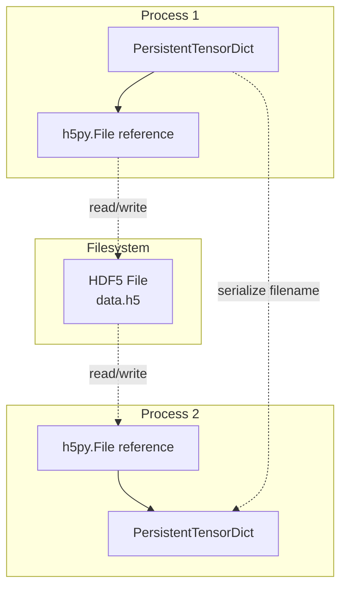

Each process opens its own file handle to the same HDF5 file. Coordination between processes requires external synchronization (e.g., locks, barriers) since HDF5 itself doesn't provide automatic multi-process coordination.

**Sources:** [tensordict/persistent.py:115-232](), [tensordict/persistent.py:234-284]()

---

## Distributed Communication with torch.distributed

TensorDict integrates with PyTorch's distributed communication primitives for efficient multi-process training. These operations work across multiple machines, not just locally.

### Communication Primitives

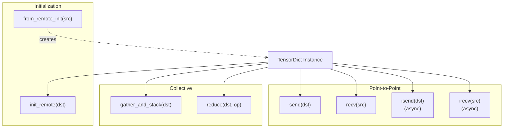

**Sources:** [tensordict/base.py](), [test/test_distributed.py:204-266](), [test/test_distributed.py:275-367]()

### Point-to-Point Communication

#### send() and recv()

Synchronous blocking send/receive operations:

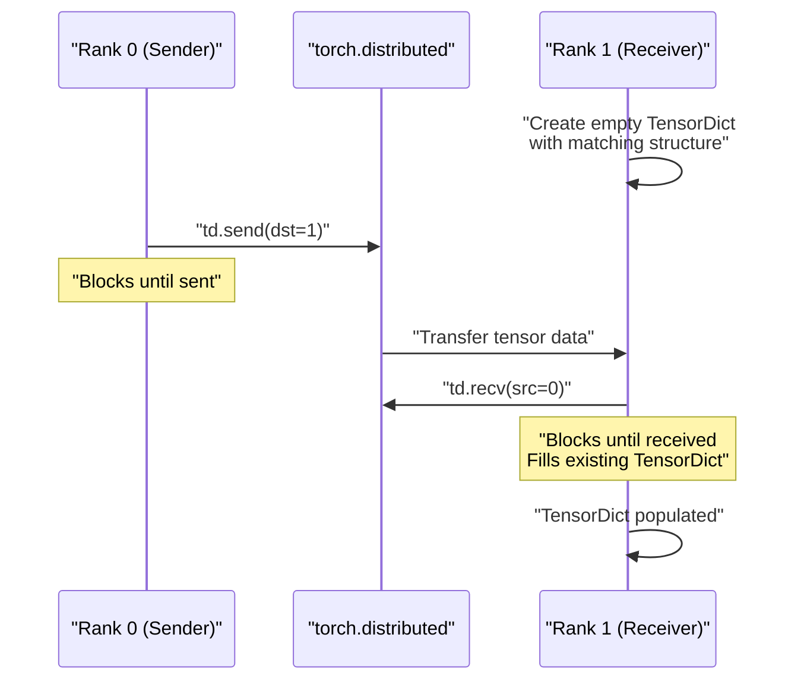

**Key Points:**
- Sender and receiver must have matching TensorDict structures (keys and shapes)
- Operations are blocking
- Data is copied over the network

**Sources:** [test/test_distributed.py:374-424](), [test/test_distributed.py:426-444]()

#### isend() and irecv()

Asynchronous non-blocking operations:

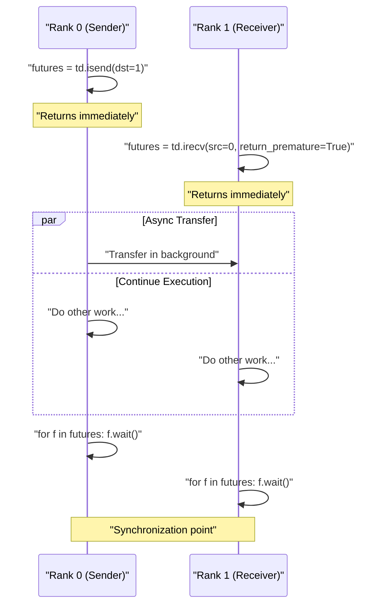

**Key Points:**
- Operations return immediately with futures
- `return_premature=True` returns list of `torch.distributed.Work` objects
- `return_premature=False` waits internally and returns `None`
- Allows overlapping computation with communication

**Sources:** [test/test_distributed.py:506-565](), [test/test_distributed.py:638-696]()

### Collective Operations

#### gather_and_stack()

Gathers TensorDicts from all ranks and stacks them:

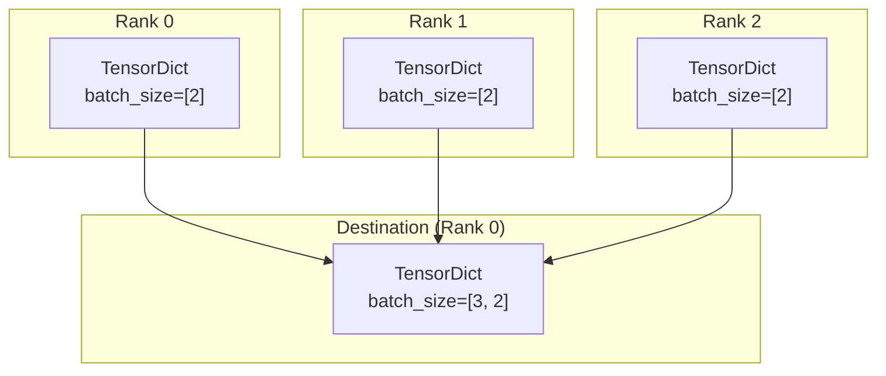

All ranks call `gather_and_stack(dst)`, but only the destination rank receives the stacked result. Other ranks' tensordicts remain unchanged.

**Sources:** [test/test_distributed.py:204-266]()

#### reduce()

Reduces (aggregates) TensorDicts across ranks using an operation:

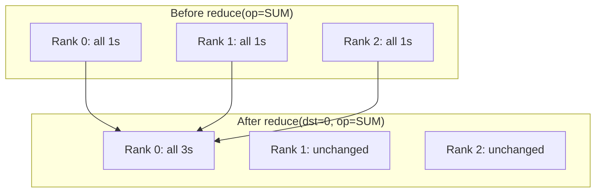

Supported operations include:
- `dist.ReduceOp.SUM` - Element-wise sum
- `dist.ReduceOp.PRODUCT` - Element-wise product
- `dist.ReduceOp.MIN` / `dist.ReduceOp.MAX` - Element-wise min/max

**Parameters:**
- `async_op`: If `True`, returns futures for async operation
- `return_premature`: If `True` with `async_op`, returns futures to user instead of waiting internally

**Sources:** [test/test_distributed.py:275-367]()

### Remote Initialization Pattern

For distributed training, ranks often need to create matching TensorDict structures. The `init_remote()` and `from_remote_init()` methods facilitate this:

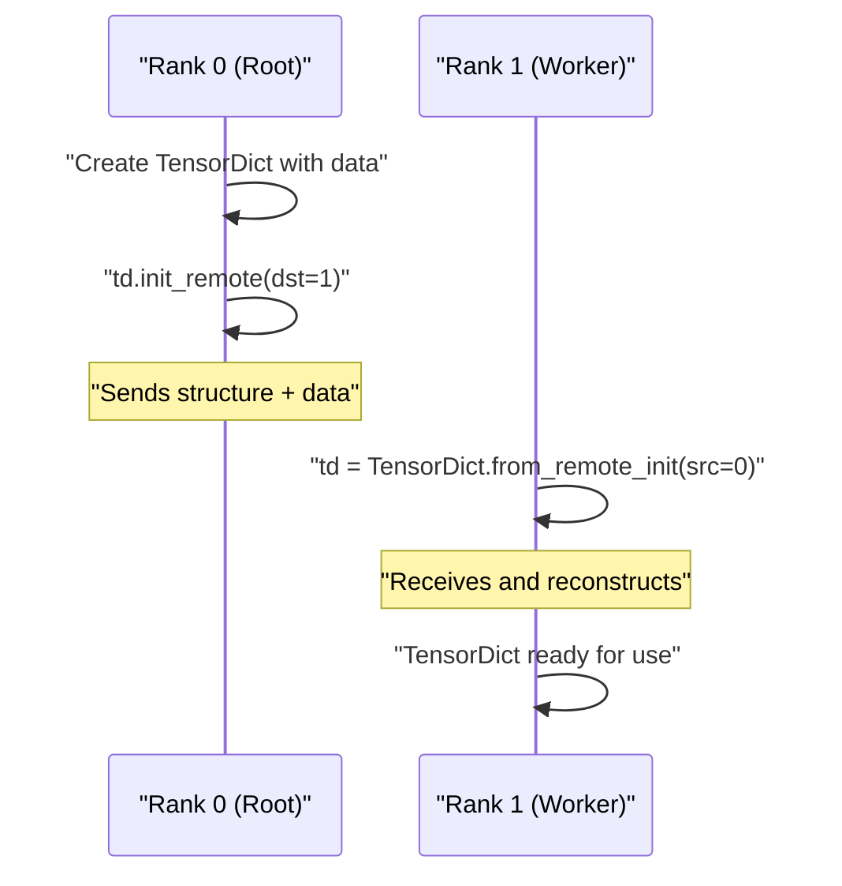

This pattern allows the root rank to define the data structure, which workers then receive. Workers get a fully-populated TensorDict without needing to know the structure in advance.

**Sources:** [test/test_distributed.py:764-821]()

---

## Implementation Details

### Serialization with Nested Structures

TensorDict handles nested structures (TensorDict containing other TensorDicts) by recursively serializing:

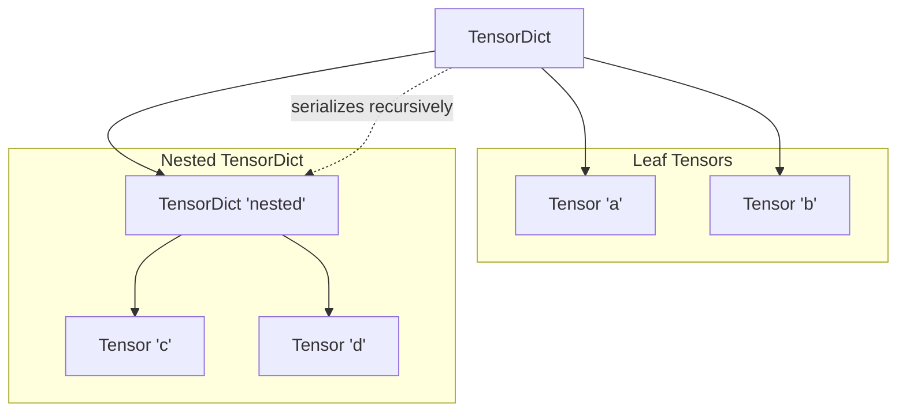

Each level is serialized independently, allowing mixing of memory-mapped, shared, and regular tensors within the same TensorDict.

**Sources:** [tensordict/_td.py](), [test/test_distributed.py:473-499]()

### LazyStackedTensorDict Serialization

`LazyStackedTensorDict` instances serialize by transmitting:
1. The list of constituent TensorDicts
2. The stack dimension
3. Whether the stack is contiguous

The receiving process reconstructs the lazy stack without materializing it:

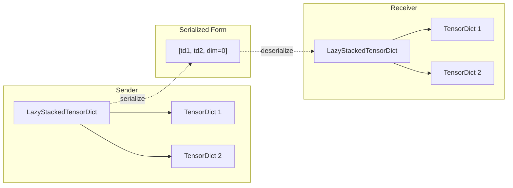

This preserves lazy evaluation semantics across process boundaries.

**Sources:** [tensordict/_lazy.py](), [test/test_distributed.py:447-471]()

### MemoryMappedTensor Reduction Registration

The `multiprocessing.reduction` module is used to register custom reduction functions for pickling:

| Function | Purpose |
|----------|---------|
| `_reduce_handler(handler)` | Pickles file handler by duplicating file descriptor |
| `_rebuild_handler(size, dupfd)` | Reconstructs handler in receiving process |
| `_reduce_memmap(memmap_tensor)` | Calls `__reduce__()` on MemoryMappedTensor |

**Registration:**
```python
reduction.register(_FileHandler, _reduce_handler)
reduction.register(MemoryMappedTensor, _reduce_memmap)
```

**Sources:** [tensordict/memmap.py:1050-1069]()

---

## Best Practices and Patterns

### Choosing a Serialization Strategy

| Scenario | Recommended Approach | Rationale |
|----------|---------------------|-----------|
| Small data, single transfer | Standard pickling | Simple, no setup required |
| Large data, single transfer | `MemoryMappedTensor` with file | Zero-copy, can persist |
| Large data, frequent updates | `share_memory_()` | Fast, bidirectional updates |
| Persistent storage needed | `PersistentTensorDict` | File-based, survives process exit |
| Distributed training | `torch.distributed` ops | Multi-machine support, collectives |
| Multi-worker data loading | `memmap_()` on dataset | Workers read shared file |

**Sources:** [tensordict/memmap.py:1-70](), [tensordict/persistent.py:115-232](), [test/test_distributed.py:1-50]()

### Process Safety Patterns

When using shared memory or memory-mapped tensors:

1. **Initialization Pattern:**
   ```python
   # Main process creates and populates
   td = TensorDict({...}).memmap(prefix="/tmp/dataset")
   
   # Worker processes load
   td = TensorDict.load_memmap("/tmp/dataset")
   ```

2. **Synchronization:**
   - Use `torch.distributed.barrier()` when coordinating multiple processes
   - Use explicit locks for concurrent writes to shared memory
   - Memory-mapped files don't provide automatic locking

3. **Cleanup:**
   - Close PersistentTensorDict files explicitly: `td.close()`
   - Memory-mapped files persist after process exit (manual deletion needed)
   - Shared memory is released when all processes exit

**Sources:** [test/test_memmap.py:384-440](), [test/test_distributed.py:73-95]()

### Performance Considerations

**Zero-Copy Benefits:**
- MemoryMappedTensor: No data copying between processes, only metadata transfer
- Shared memory: Direct memory access across processes
- File-based: I/O overhead but supports very large datasets

**Overhead:**
- Handler creation: ~1-2ms per MemoryMappedTensor
- File I/O: Depends on filesystem and file size
- torch.distributed: Network latency for multi-machine

**Optimization Tips:**
- Use `async_op=True` for overlapping computation/communication
- Batch small tensors in same TensorDict to reduce send/recv calls
- Prefer contiguous tensors to avoid scatter/gather overhead

**Sources:** [tensordict/memmap.py:989-1063](), [test/test_distributed.py:275-367]()

---

## Common Patterns

### Pattern 1: DataLoader Worker Sharing

Workers in a DataLoader can share a memory-mapped dataset:

**Main Process:**
```python
dataset_td = TensorDict({
    "images": torch.randn(10000, 3, 224, 224),
    "labels": torch.randint(0, 1000, (10000,))
})
dataset_td.memmap_("/tmp/dataset")
```

**Worker Processes:**
```python
def worker_init_fn(worker_id):
    global dataset
    dataset = TensorDict.load_memmap("/tmp/dataset")
```

**Sources:** [tensordict/_td.py](), [test/test_memmap.py:509-543]()

### Pattern 2: Distributed Training Communication

**Rank 0 (Parameter Server):**
```python
params = TensorDict.from_module(model)
params.init_remote(dst=1)  # Send to worker
updated_params = TensorDict.from_module(model)
updated_params.recv(src=1)  # Receive gradients
```

**Rank 1 (Worker):**
```python
params = TensorDict.from_remote_init(src=0)  # Receive parameters
# ... compute gradients ...
gradients.send(dst=0)  # Send back to server
```

**Sources:** [test/test_distributed.py:764-821]()

### Pattern 3: Async Pipeline

Overlap communication with computation:

```python
# Rank 0
futures = td.isend(dst=1)
result = expensive_computation()  # Overlap with send
for f in futures:
    f.wait()

# Rank 1  
futures = td.irecv(src=0, return_premature=True)
prepare_buffers()  # Overlap with recv
for f in futures:
    f.wait()
process(td)
```

**Sources:** [test/test_distributed.py:506-565](), [test/test_distributed.py:638-696]()

---

