<!-- source: DeepWiki mcp.deepwiki.com · repo pytorch/tensordict · page 6 Advanced Features · fetched 2026-10-21 -->

# Advanced Features

<details>
<summary>Relevant source files</summary>

The following files were used as context for generating this wiki page:

- [tensordict/_pytree.py](tensordict/_pytree.py)
- [tensordict/base.py](tensordict/base.py)
- [tensordict/nn/functional_modules.py](tensordict/nn/functional_modules.py)
- [test/test_functorch.py](test/test_functorch.py)
- [test/test_tensordict.py](test/test_tensordict.py)

</details>


This page covers advanced integration points and features for power users of TensorDict. Topics include functorch/vmap integration for vectorized operations, PyTree registration for functional transformations, distributed computing primitives, thread-safe locking mechanisms, and reduction operations.

## Overview of Advanced Integration Points

TensorDict provides deep integration with PyTorch's advanced features through several key mechanisms:

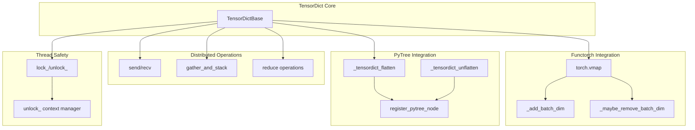

Sources: [tensordict/base.py:300-301](), [tensordict/nn/functional_modules.py:109-308](), [tensordict/_pytree.py:1-273]()

## Functorch Integration and vmap

### Monkey-Patching vmap for TensorDict Support

TensorDict integrates with PyTorch's `torch.vmap` through monkey-patching of internal vmap functions. This approach is controlled by the environment variable `PYTORCH_TENSORDICT_IMPORT_VMAP`. When not set to `"False"`, TensorDict modifies three key functions in `torch._functorch.vmap`:

**Diagram: vmap Integration Architecture**

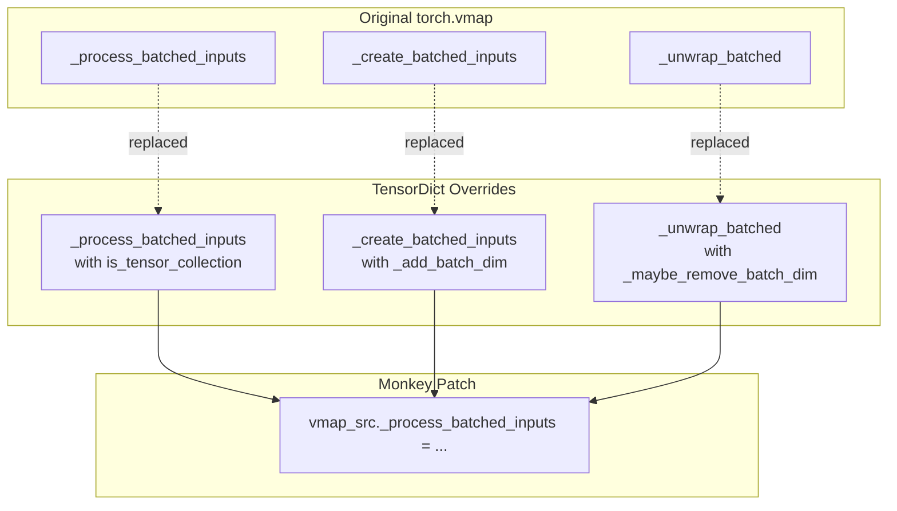

Sources: [tensordict/nn/functional_modules.py:145-308]()

### Implementation Details

The three modified functions handle TensorDict objects specially:

| Function | Role | TensorDict-Specific Logic |
|----------|------|---------------------------|
| `_process_batched_inputs` | Validates and processes inputs | Checks `is_tensor_collection(arg)` to detect TensorDict objects; handles TensorDict dimensions |
| `_create_batched_inputs` | Adds vmap batch dimensions | Calls `arg._add_batch_dim(in_dim, vmap_level)` for TensorDict objects instead of `_add_batch_dim` |
| `_unwrap_batched` | Removes vmap batch dimensions | Calls `batched_output._maybe_remove_batch_dim(...)` for TensorDict objects |

Sources: [tensordict/nn/functional_modules.py:148-221](), [tensordict/nn/functional_modules.py:224-249](), [tensordict/nn/functional_modules.py:252-307]()

### PyTree Exclusion Context Manager

The `_exclude_td_from_pytree` context manager temporarily removes TensorDict types from PyTree registration. This is necessary for older PyTorch versions (before 2.3) that don't support the `is_leaf` parameter in `tree_flatten`:

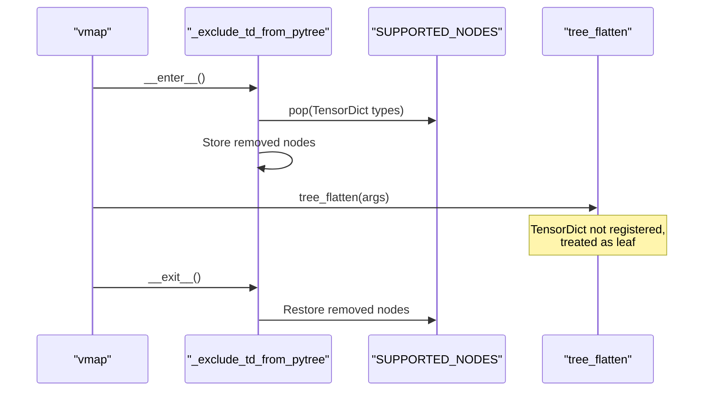

Sources: [tensordict/nn/functional_modules.py:123-142]()

### Using vmap with TensorDict and TensorDictModule

**Example Pattern: Batched TensorDictModule Execution**

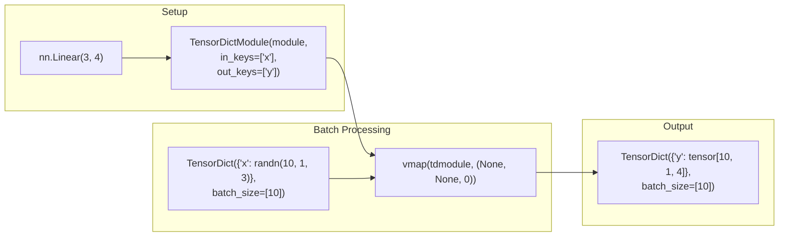

Sources: [test/test_functorch.py:49-81]()

Test examples demonstrate vmap usage with both `TensorDictModule` and `TensorDictSequential`. The tests show batching parameters across the vmap dimension (`batch_params=True`) or keeping them fixed (`batch_params=False`).

Sources: [test/test_functorch.py:36-133]()

### LazyStackedTensorDict with vmap

`LazyStackedTensorDict` works with vmap, but requires careful dimension management. When writing to a locked `LazyStackedTensorDict` within vmap, a `RuntimeError` is raised with "Cannot modify":

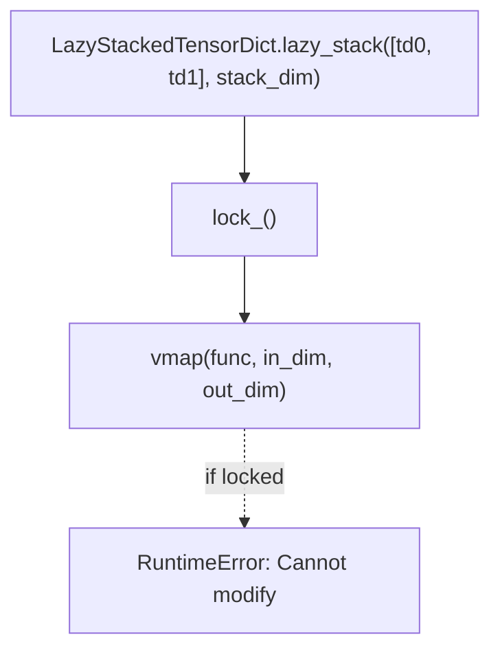

Sources: [test/test_functorch.py:163-194]()

## PyTree Registration and Integration

### Registration Mechanism

TensorDict types are registered as PyTree nodes via `register_pytree_node` from `torch.utils._pytree`. This registration happens automatically at import time for all standard TensorDict types:

**Diagram: PyTree Registration Architecture**

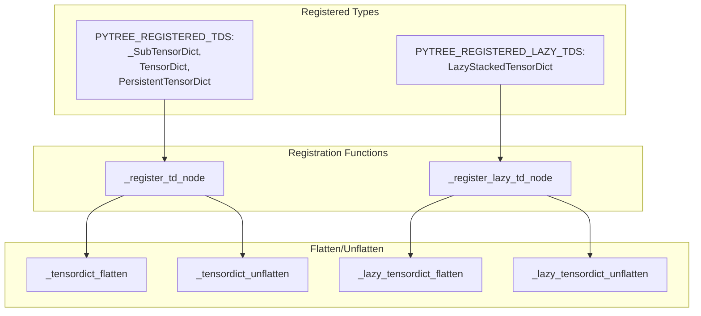

Sources: [tensordict/_pytree.py:23-28](), [tensordict/_pytree.py:269-272]()

### Flatten and Unflatten Functions

The PyTree protocol requires `flatten` and `unflatten` functions for each registered type:

| Function | Purpose | Returns |
|----------|---------|---------|
| `_tensordict_flatten` | Convert TensorDict to flat list + context | `(values, context_dict)` where context contains keys, batch_size, names, device, constructor, non_tensor_data |
| `_tensordict_unflatten` | Reconstruct TensorDict from flat list + context | New TensorDict instance with same structure |
| `_lazy_tensordict_flatten` | Flatten LazyStackedTensorDict | `(list(d.tensordicts), context_dict)` with stack_dim info |
| `_lazy_tensordict_unflatten` | Reconstruct LazyStackedTensorDict | New LazyStackedTensorDict with original stack configuration |

Sources: [tensordict/_pytree.py:85-111](), [tensordict/_pytree.py:114-148]()

### Context Preservation

The context dictionary preserves critical metadata during flatten/unflatten operations:

```mermaid
graph LR
    subgraph "TensorDict State"
        keys["keys"]
        bs["batch_size"]
        names["names"]
        device["device"]
        ntd["non_tensor_data"]
    end
    
    subgraph "Context Dict"
        ctx["context = {...}"]
    end
    
    subgraph "Constructor Function"
        constructor["_tensordict_constructor"]
    end
    
    keys --> ctx
    bs --> ctx
    names --> ctx
    device --> ctx
    ntd --> ctx
    ctx --> constructor
```

Sources: [tensordict/_pytree.py:94-102](), [tensordict/_pytree.py:236-247]()

### PyTree Operations with tree_map

`torch.utils._pytree.tree_map` applies functions uniformly across PyTree structures. With TensorDict registration, `tree_map` automatically traverses nested TensorDict structures:

**Comparison: tree_map vs apply**

| Aspect | tree_map | TensorDict.apply |
|--------|----------|------------------|
| Scope | Works on any PyTree | TensorDict-specific |
| Nested TDs | Automatically handled | Controlled by `recurse` parameter |
| Batch size | May change if function affects shape | Typically preserved |
| Performance | Creates intermediate structures | More optimized for TensorDict |

Sources: [test/test_functorch.py:253-299]()

### PyTree with Keys (PyTorch 2.3+)

PyTorch 2.3 introduced `flatten_with_keys_fn` which provides access to the path to each leaf:

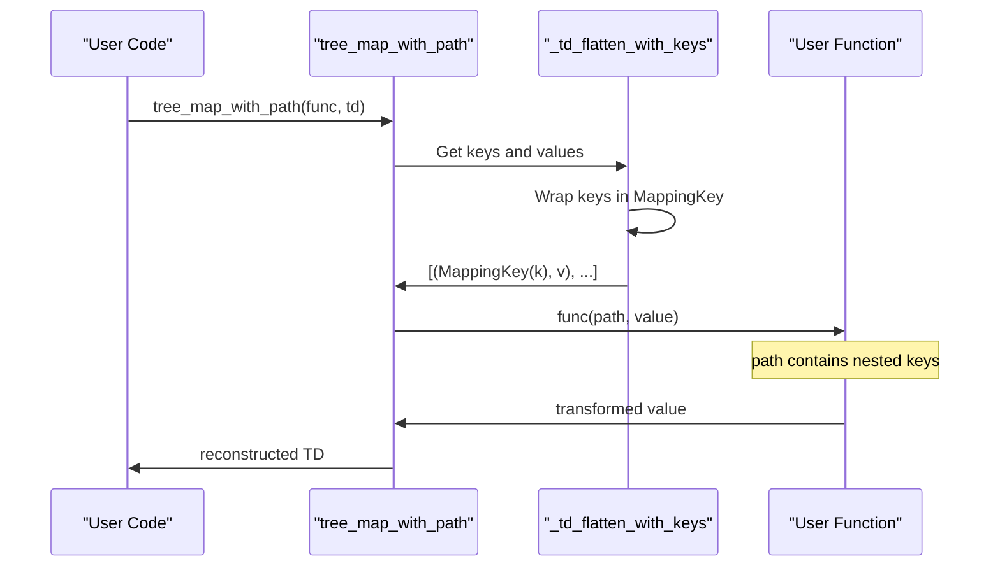

Sources: [tensordict/_pytree.py:150-169](), [test/test_functorch.py:300-313]()

### Lazy TensorDict PyTree Behavior

`LazyStackedTensorDict` has specialized PyTree behavior. The flattened form contains the list of stacked tensordicts rather than individual tensors:

Sources: [tensordict/_pytree.py:105-111](), [test/test_functorch.py:329-353]()

## Distributed Operations

TensorDict provides primitives for distributed computing using `torch.distributed`. These operations enable efficient data transfer and synchronization across multiple processes.

### send and recv Operations

Point-to-point communication between processes uses `send` and `recv` methods on TensorDict instances:

**Diagram: Point-to-Point Communication Flow**

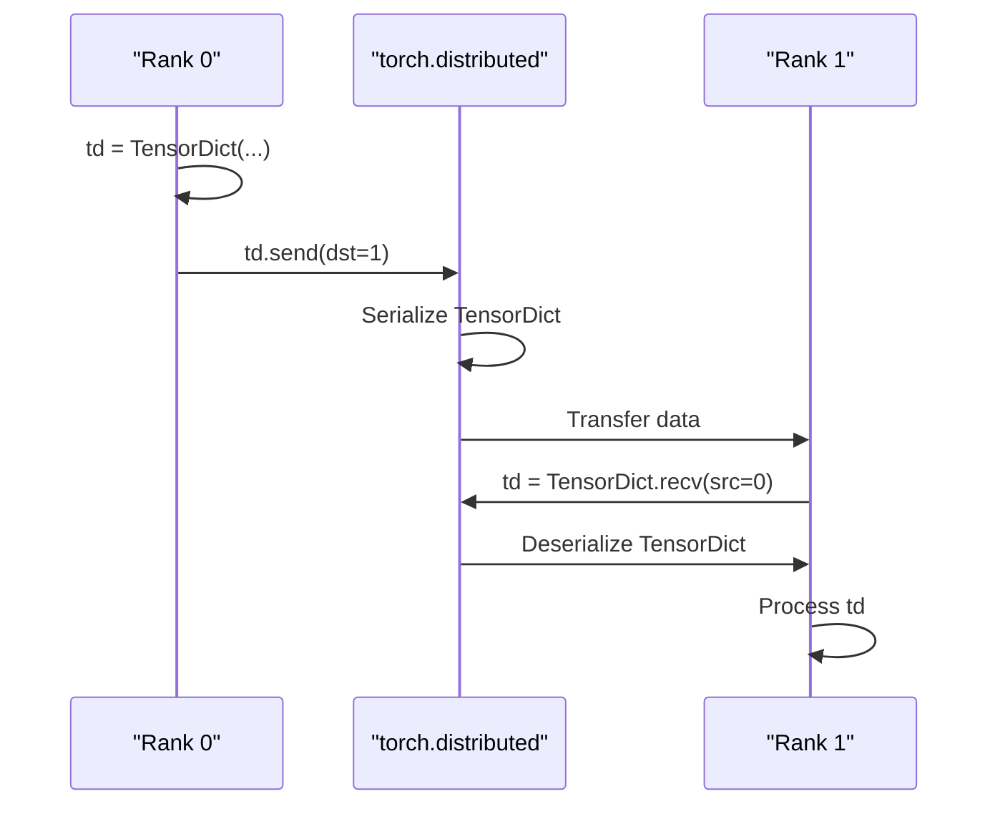

Sources: [tensordict/base.py:1-100]() (distributed methods are defined in TensorDictBase)

### gather_and_stack Operation

The `gather_and_stack` method collects TensorDict instances from all processes and stacks them along a specified dimension:

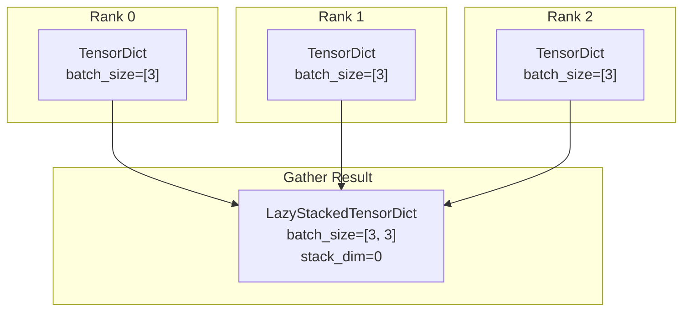

This operation is particularly useful for aggregating data in distributed training scenarios.

Sources: [tensordict/base.py:1-100]()

### reduce Operations

Reduction operations (sum, mean, etc.) can be performed across processes using distributed collectives:

| Operation | Behavior | Use Case |
|-----------|----------|----------|
| `reduce(..., op=ReduceOp.SUM)` | Sum tensors across ranks | Gradient aggregation |
| `reduce(..., op=ReduceOp.MEAN)` | Average tensors across ranks | Distributed statistics |
| `reduce(..., op=ReduceOp.MAX)` | Maximum across ranks | Tracking best metrics |

Sources: [tensordict/base.py:1-100]()

### FSDP Integration

TensorDict integrates with Fully Sharded Data Parallel (FSDP) for distributed training. The gather operations work seamlessly with FSDP's sharding mechanism.

Sources: Diagram 4 in system architecture overview

## Locking and Thread Safety

### Lock Mechanism

TensorDict provides a locking mechanism via `lock_()` and `unlock_()` methods to prevent structural modifications while allowing in-place updates. The lock state is tracked by the `_is_locked` boolean attribute:

**Diagram: Locking State Machine**

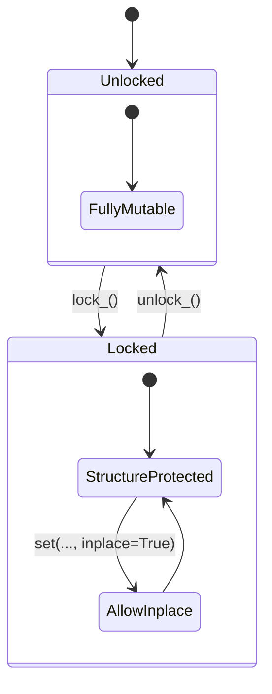

Sources: [tensordict/base.py:307]()

### Lock Behavior and Restrictions

When a TensorDict is locked, the following restrictions apply:

| Operation | Locked Behavior | Unlocked Behavior |
|-----------|----------------|-------------------|
| `td[key] = value` | Raises `RuntimeError` with `_LOCK_ERROR` | Allowed |
| `td.set(key, value)` | Raises `RuntimeError` | Allowed |
| `td.set(key, value, inplace=True)` | Allowed (overwrites existing tensor data) | Allowed |
| `td.update(other)` | Raises `RuntimeError` | Allowed |
| `del td[key]` | Raises `RuntimeError` | Allowed |

Sources: [test/test_tensordict.py:573-580](), [tensordict/utils.py]() (defines `_LOCK_ERROR` constant)

### Context Manager for Temporary Unlocking

The `unlock_()` method can be used as a context manager to temporarily unlock a TensorDict:

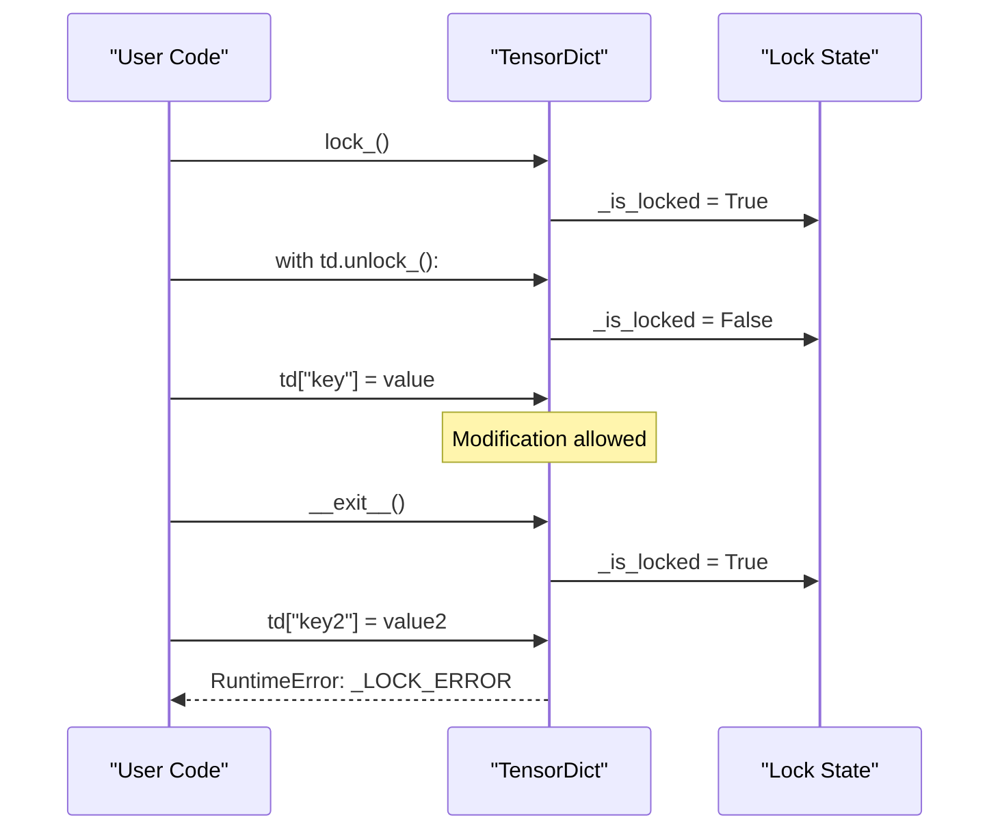

Sources: [test/test_tensordict.py:620-631]()

### Automatic Locking with Consolidation

When a TensorDict is consolidated (via `consolidate()`), it is automatically locked. This prevents modifications that would invalidate the consolidated memory layout:

Sources: [test/test_tensordict.py:555-604](), [test/test_tensordict.py:694-717]()

### Lock Propagation to Nested TensorDicts

Locking a TensorDict automatically locks all nested TensorDict instances. Similarly, unlocking propagates to nested structures:

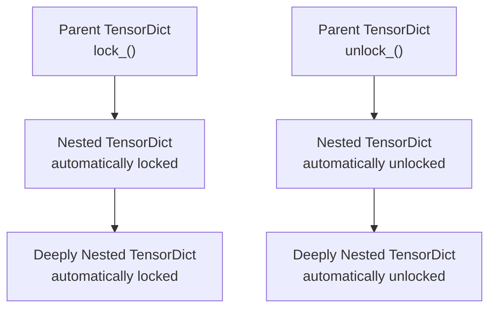

Sources: [test/test_tensordict.py:633-661]()

### Thread Safety Considerations

The locking mechanism provides protection against structural modifications but does not make TensorDict fully thread-safe for concurrent access. For multi-threaded scenarios:

- Lock prevents structural changes from multiple threads
- In-place modifications to tensor data are not protected by the lock
- Use additional synchronization primitives (e.g., `threading.Lock`) for concurrent data access

Sources: [tensordict/utils.py]() (lock-related utilities)

## Performance Considerations

When using advanced features with TensorDict, keep these performance considerations in mind:

| Feature | Benefits | Potential Issues | Best Practices |
|---------|----------|------------------|----------------|
| vmap | Efficient vectorization, reduced overhead | Memory usage scales with batch size | Use smaller batch sizes for large models |
| PyTree operations | Clean functional transformations | Can create many temporary objects | Avoid deep recursion in performance-critical code |
| LazyStackedTensorDict with vmap | Memory-efficient batch processing | Complex interaction with vmap dimensions | Test with small batches first |
| Symbolic tracing | Potential optimizations, static analysis | Experimental feature | Use primarily for analysis, not production code yet |

Sources: [test/test_functorch.py:163-194](https://github.com/pytorch/tensordict/blob/main/test/test_functorch.py)

## Integration with Other Advanced PyTorch Features

TensorDict is designed to integrate with many advanced PyTorch features beyond those covered on this page. For more information about specific integrations, refer to:

- [Functorch Integration](#7.1) for detailed explanation of vmap and other functorch features
- [Distributed Computing](#7.2) for using TensorDict in distributed environments
- [CUDA Graphs and Compilation](#6.2) for information about using TensorDict with CUDA graphs and torch.compile

Each of these integrations builds on the core TensorDict functionality to enable more advanced use cases while maintaining the consistent, dictionary-like interface that makes TensorDict valuable for tensor management.

---

