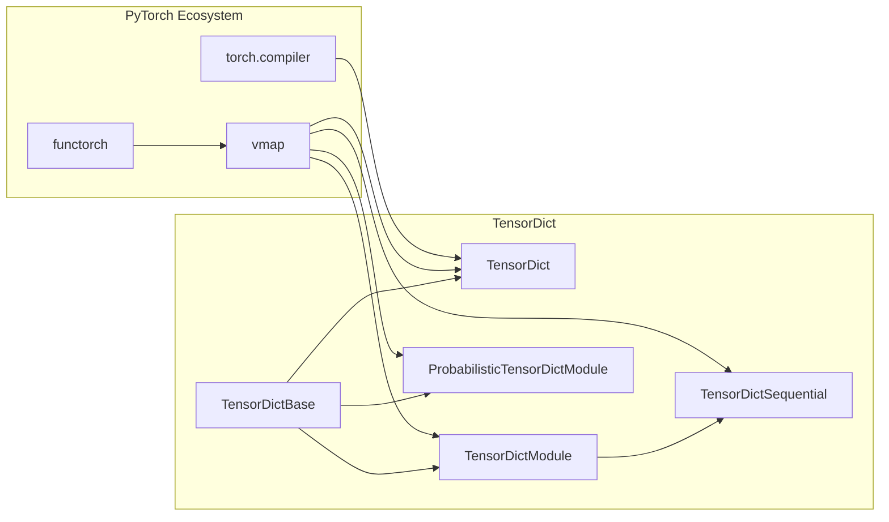
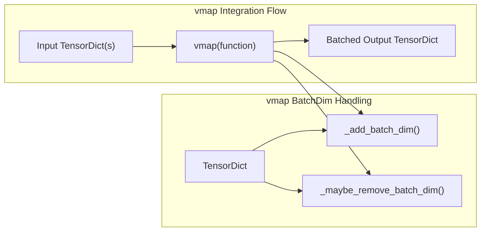
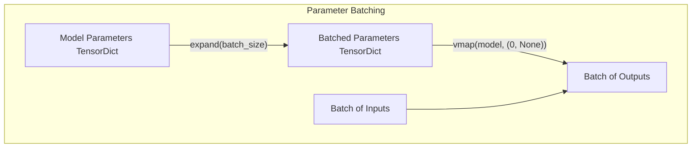
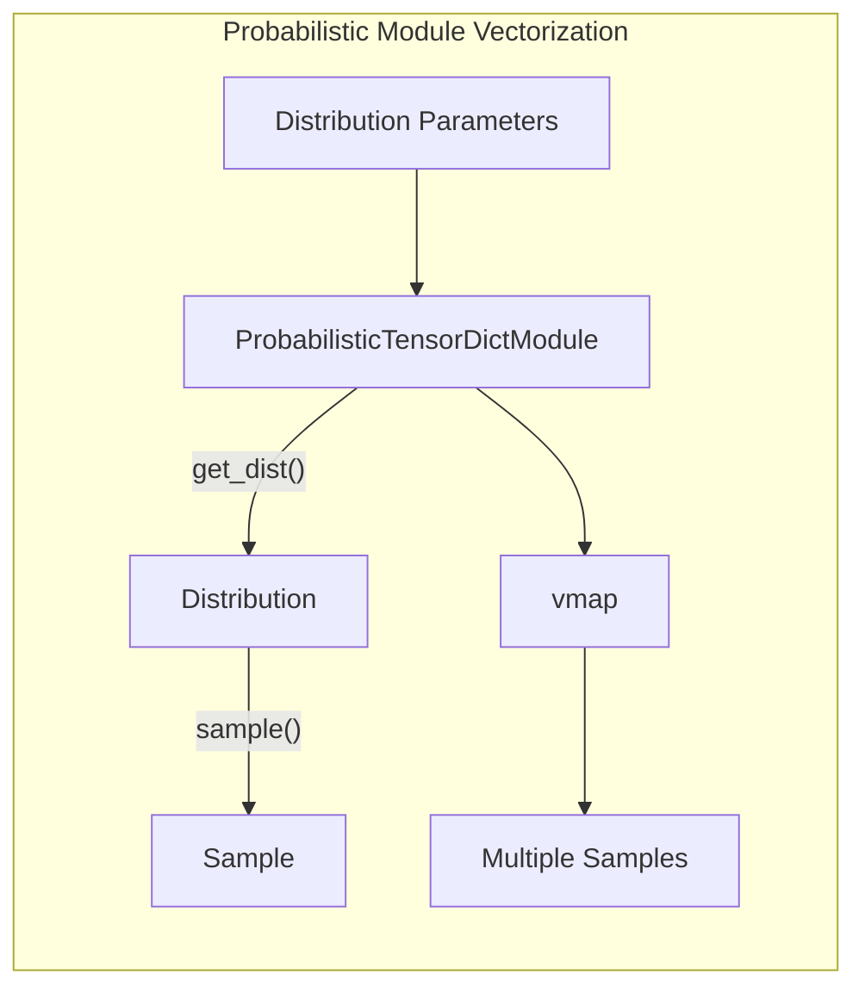
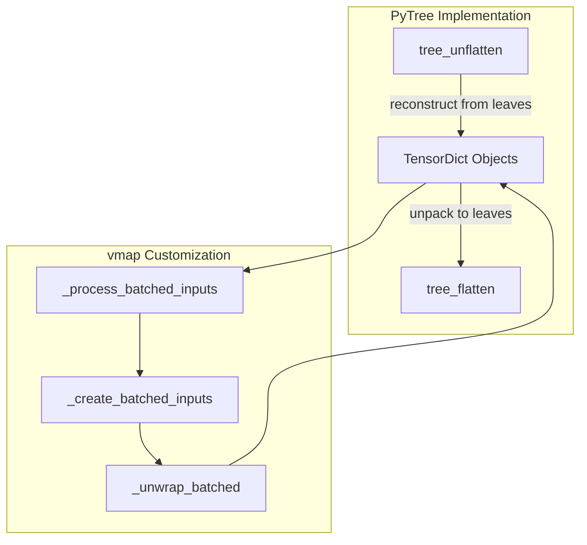

<!-- source: DeepWiki mcp.deepwiki.com · repo pytorch/tensordict · page 6.1 Functorch Integration and vmap · fetched 2026-10-21 -->

# Functorch Integration

<details>
<summary>Relevant source files</summary>

The following files were used as context for generating this wiki page:

- [tensordict/_pytree.py](tensordict/_pytree.py)
- [tensordict/nn/functional_modules.py](tensordict/nn/functional_modules.py)
- [test/test_functorch.py](test/test_functorch.py)

</details>


This page documents how TensorDict integrates with functorch, enabling vectorized operations, batched model evaluation, and functional transformations. If you're looking for information about distributed computing with TensorDict, see [Distributed Computing](#7.2).

## Overview

Functorch is PyTorch's functional programming library that provides composable function transforms such as `vmap` (vectorized mapping) and `make_functional`. TensorDict's integration with functorch enables users to efficiently apply these transforms to TensorDict-based models, enhancing performance and expressiveness for batched computation and model ensembles.



Sources: [test/test_functorch.py:20-33](test/test_functorch.py:20-33)

## Key Features

The integration with functorch offers several key capabilities:

1. **Vectorized Operations**: Apply operations across batches of tensordicts efficiently.
2. **Batched Model Evaluation**: Run multiple instances of a model on different inputs or parameters in parallel.
3. **Parameter Management**: Easily manage and transform model parameters as tensordicts.
4. **Support for Probabilistic Models**: Vectorize operations on probabilistic modules.

## vmap with TensorDict

The `vmap` function is the core of functorch integration, allowing you to run a function across multiple inputs in parallel. TensorDict is fully compatible with `vmap`, handling the proper batching dimensions for nested tensordict structures.



Sources: [tensordict/nn/functional_modules.py:145-308](tensordict/nn/functional_modules.py:145-308)

### Basic vmap Example

When using `vmap` with TensorDict, you can vectorize operations over tensordict instances:

```python
from torch import vmap
from tensordict import TensorDict

def function(td):
    # Process tensordict
    td["output"] = td["input"] * 2
    return td

# Create a batch of tensordicts
batch_td = TensorDict({"input": torch.randn(10, 3)}, batch_size=[10])

# Apply function to each tensordict in the batch
result = vmap(function)(batch_td)
```

### vmap with TensorDict Modules

You can also use `vmap` with TensorDictModule and TensorDictSequential:

```python
from tensordict.nn import TensorDictModule
from torch import vmap
import torch.nn as nn

# Create a module
module = TensorDictModule(nn.Linear(4, 8), in_keys=["input"], out_keys=["output"])

# Create a batch of inputs
batch_td = TensorDict({"input": torch.randn(10, 3, 4)}, batch_size=[10, 3])

# Apply module to each input in the batch
result = vmap(module)(batch_td)
```

Sources: [test/test_functorch.py:36-132](test/test_functorch.py:36-132)

## Parameter Management and Batched Models

One powerful use case is batching model parameters for ensembles or parallel parameter exploration.



Sources: [test/test_nn.py:758-780](test/test_nn.py:758-780)

### Batched Model Parameters Example

```python
from tensordict import TensorDict
from tensordict.nn import TensorDictModule
from torch import vmap
import torch.nn as nn

# Create a module
model = TensorDictModule(nn.Linear(4, 8), in_keys=["input"], out_keys=["output"])

# Extract parameters as a tensordict
params = TensorDict.from_module(model)

# Create a batch of 5 parameter sets (e.g., for ensemble)
batch_params = params.expand(5)

# Input data
td = TensorDict({"input": torch.randn(3, 4)}, batch_size=[3])

# Function that applies model with specific parameters
def apply_model(params, td):
    with params.to_module(model):
        return model(td)

# Apply model with each parameter set to input
result = vmap(apply_model, (0, None))(batch_params, td)
```

Sources: [tensordict/nn/sequence.py:142-178](tensordict/nn/sequence.py:142-178)

## vmap with Probabilistic Models

The integration extends to probabilistic modules like `ProbabilisticTensorDictModule`, enabling efficient vectorized sampling and inference.



Sources: [tensordict/nn/probabilistic.py:310-329](tensordict/nn/probabilistic.py:310-329)

### Probabilistic Module Example

```python
from tensordict import TensorDict
from tensordict.nn import ProbabilisticTensorDictModule
from torch.distributions import Normal
from torch import vmap

# Create a probabilistic module
prob_module = ProbabilisticTensorDictModule(
    in_keys=["loc", "scale"],
    out_keys=["action"],
    distribution_class=Normal,
    return_log_prob=True
)

# Create a batch of distribution parameters
batch_td = TensorDict({
    "loc": torch.randn(10, 3),
    "scale": torch.abs(torch.randn(10, 3))
}, batch_size=[10])

# Apply probabilistic module to each set of parameters
result = vmap(prob_module)(batch_td)
```

Sources: [tensordict/nn/probabilistic.py:268-326](tensordict/nn/probabilistic.py:268-326)

## Implementation Details

TensorDict's functorch integration is achieved through several key mechanisms:

1. **PyTree Protocol**: TensorDict implements the PyTree protocol to work with torch's functional transforms.
2. **Custom Batching Handlers**: Special methods handle adding and removing batch dimensions.
3. **Monkey Patching**: Some functorch functions are modified to properly handle TensorDict objects.

### PyTree and Batching



Sources: [tensordict/nn/functional_modules.py:110-308](tensordict/nn/functional_modules.py:110-308)

### Monkey-Patched Functions

TensorDict monkey-patches several functorch functions to properly handle TensorDict objects:

1. `_process_batched_inputs`: Modified to handle TensorDict objects in the inputs.
2. `_create_batched_inputs`: Adds batch dimensions to TensorDict objects correctly.
3. `_unwrap_batched`: Removes batch dimensions from TensorDict objects.

These modifications ensure that vmap correctly handles TensorDict objects, preserving their structure and batch dimensions.

Sources: [tensordict/nn/functional_modules.py:148-308](tensordict/nn/functional_modules.py:148-308)

## Common Usage Patterns

| Use Case | Pattern |
|----------|---------|
| Batch data processing | `result = vmap(function)(batch_td)` |
| Model ensembles | `result = vmap(apply_model, (0, None))(batch_params, td)` |
| Parallel parameter exploration | `result = vmap(apply_model, (None, 0))(params, batch_inputs)` |
| Multi-sample inference | `result = vmap(prob_module)(params_td)` |

## Considerations and Limitations

1. **Memory Usage**: Vectorized operations may significantly increase memory usage.
2. **Device Placement**: Ensure consistent device placement for parameters and inputs.
3. **Nested Structures**: Complex nested TensorDict structures might require careful handling of batch dimensions.
4. **Dispatch Compatibility**: When using `vmap` with methods decorated with `@dispatch`, make sure the batch dimensions are correctly specified.

## Example: End-to-End Probabilistic Model with vmap

Below is an example of how to use `vmap` with a complete probabilistic model:

```python
import torch
from tensordict import TensorDict
from tensordict.nn import TensorDictModule, ProbabilisticTensorDictModule, ProbabilisticTensorDictSequential
from tensordict.nn.distributions import NormalParamExtractor
from torch.distributions import Independent, Normal
from torch import vmap

# Define model components
feature_extractor = TensorDictModule(
    torch.nn.Linear(4, 64),
    in_keys=["observation"],
    out_keys=["features"]
)

policy_network = TensorDictModule(
    torch.nn.Linear(64, 16),
    in_keys=["features"],
    out_keys=["policy_params"]
)

param_extractor = TensorDictModule(
    NormalParamExtractor(),
    in_keys=["policy_params"],
    out_keys=["loc", "scale"]
)

# Create distribution module
def IndependentNormal(**kwargs):
    return Independent(Normal(**kwargs), 1)

policy_head = ProbabilisticTensorDictModule(
    in_keys=["loc", "scale"],
    out_keys=["action"],
    distribution_class=IndependentNormal,
    return_log_prob=True
)

# Combine into sequential model
policy = ProbabilisticTensorDictSequential(
    feature_extractor,
    policy_network,
    param_extractor,
    policy_head
)

# Extract parameters
params = TensorDict.from_module(policy)

# Batch parameters for ensemble
ensemble_size = 10
batch_params = params.expand(ensemble_size)

# Input data
batch_td = TensorDict({"observation": torch.randn(5, 4)}, batch_size=[5])

# Function to apply model with parameters
def apply_policy(params, td):
    with params.to_module(policy):
        return policy(td)

# Run ensemble inference
result = vmap(apply_policy, (0, None))(batch_params, batch_td)

# Shape: [ensemble_size, batch_size, action_dim]
actions = result["action"]  
```

Sources: [tensordict/nn/sequence.py:110-178](tensordict/nn/sequence.py:110-178)

This example demonstrates how to create an ensemble of policies by batching parameters and using vmap to efficiently evaluate them on the same input data.

---

