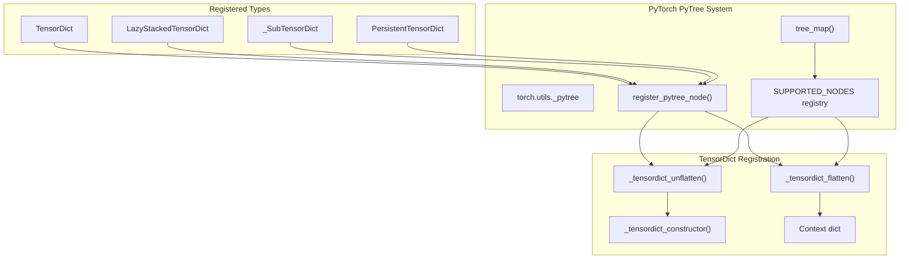
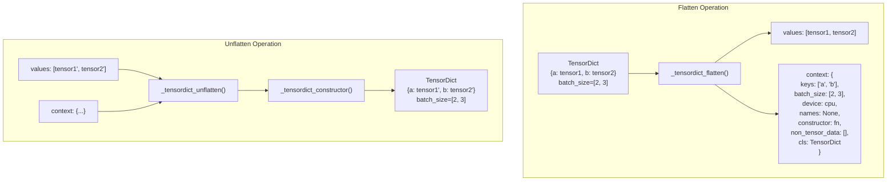
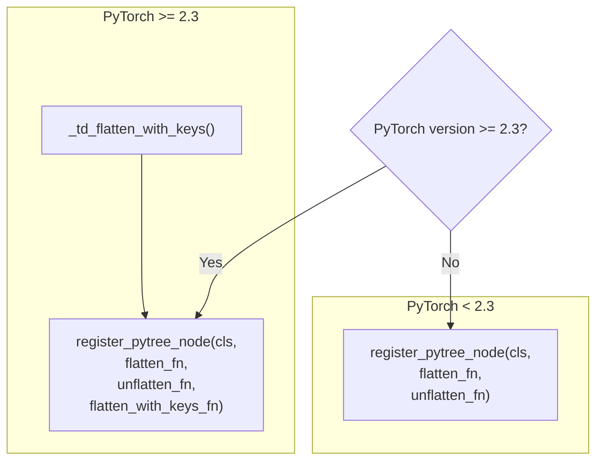
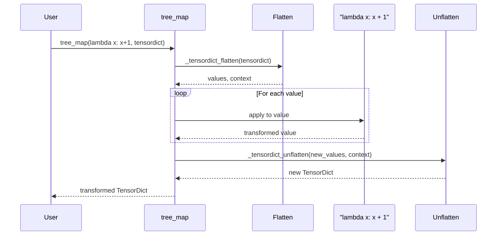
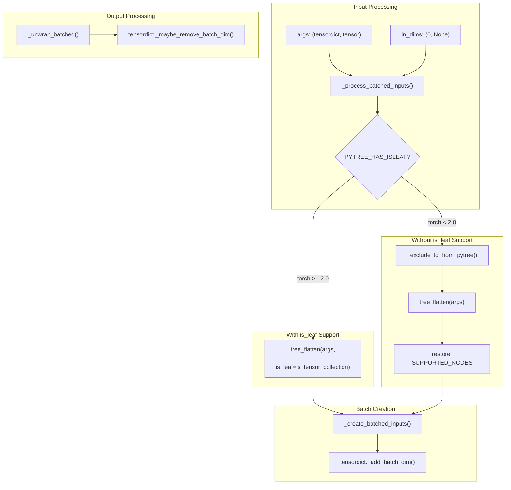
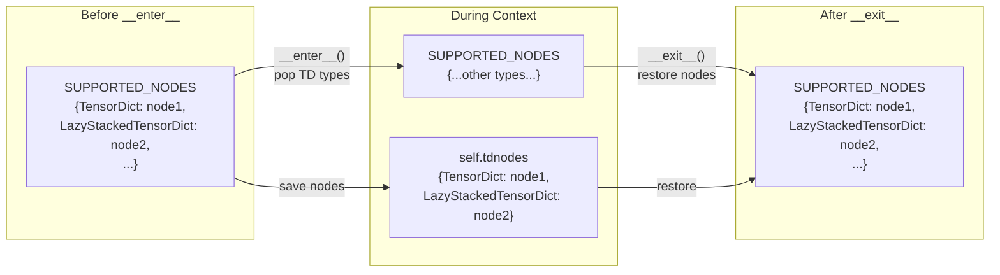
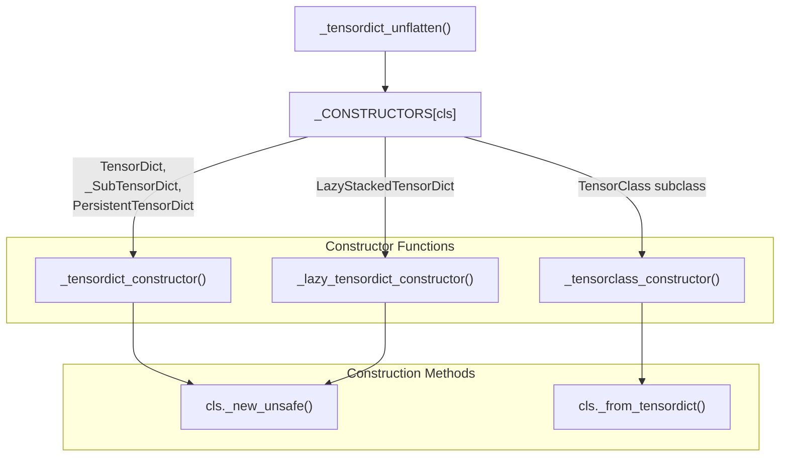

<!-- source: DeepWiki mcp.deepwiki.com · repo pytorch/tensordict · page 6.2 PyTree Registration and Integration · fetched 2026-10-21 -->

# PyTree Registration and Integration

<details>
<summary>Relevant source files</summary>

The following files were used as context for generating this wiki page:

- [tensordict/_pytree.py](tensordict/_pytree.py)
- [tensordict/nn/functional_modules.py](tensordict/nn/functional_modules.py)
- [test/test_functorch.py](test/test_functorch.py)

</details>


## Purpose and Scope

This document explains how TensorDict integrates with PyTorch's PyTree system, which provides utilities for working with nested data structures. PyTree registration enables TensorDict to work seamlessly with PyTorch's functional transformations like `torch.utils._pytree.tree_map` and `torch.vmap`. This integration allows TensorDict instances to be treated as pytree nodes, enabling automatic traversal and transformation of their contents.

For information about using vmap specifically with TensorDict neural network modules, see [Functorch Integration and vmap](#6.1). For general TensorDict operations, see [TensorDictBase Interface and Core Concepts](#2.1).

---

## PyTree System Overview

PyTree (Python Tree) is a PyTorch utility system for recursively manipulating nested structures containing tensors. By registering TensorDict as a pytree node, the system can automatically traverse TensorDict instances and apply operations to their contents.

### Diagram: PyTree Integration Architecture



**Sources:** [tensordict/_pytree.py:1-273](), [tensordict/nn/functional_modules.py:21-32]()

---

## Registered TensorDict Types

The library registers multiple TensorDict types as pytree nodes. Each type requires its own flatten/unflatten implementation.

| Type | Registration Constant | Purpose |
|------|----------------------|---------|
| `TensorDict` | `PYTREE_REGISTERED_TDS` | Standard TensorDict implementation |
| `_SubTensorDict` | `PYTREE_REGISTERED_TDS` | View into parent TensorDict |
| `PersistentTensorDict` | `PYTREE_REGISTERED_TDS` | HDF5-backed storage |
| `LazyStackedTensorDict` | `PYTREE_REGISTERED_LAZY_TDS` | Lazy stacking implementation |

These constants are defined at [tensordict/_pytree.py:23-28]() and used throughout the registration system.

**Sources:** [tensordict/_pytree.py:23-28](), [tensordict/_pytree.py:269-272]()

---

## Flatten and Unflatten Operations

PyTree registration requires implementing two core operations: flatten (decompose a structure) and unflatten (reconstruct it).

### Diagram: Flatten/Unflatten Process



**Sources:** [tensordict/_pytree.py:85-102](), [tensordict/_pytree.py:114-142]()

### TensorDict Flatten Implementation

The `_tensordict_flatten()` function extracts values and metadata:

```python
# Simplified view of tensordict/_pytree.py:85-102
def _tensordict_flatten(d: TensorDict) -> Tuple[List[Any], Context]:
    items = tuple(d.items())
    keys, values = zip(*items) if items else ([], [])
    return list(values), {
        "keys": list(keys),
        "batch_size": d.batch_size,
        "names": d.names if d._has_names() else None,
        "device": d.device,
        "constructor": _constructor(type(d)),
        "non_tensor_data": d.non_tensor_items(),
        "cls": type(d),
    }
```

The context dictionary preserves all metadata needed to reconstruct the TensorDict, including:
- **keys**: List of entry keys in order
- **batch_size**: Shape of the batch dimensions
- **names**: Optional dimension names
- **device**: Device placement (CPU/GPU)
- **constructor**: Factory function for reconstruction
- **non_tensor_data**: Non-tensor entries (strings, scalars, etc.)
- **cls**: Original class type

**Sources:** [tensordict/_pytree.py:85-102]()

### TensorDict Unflatten Implementation

The `_tensordict_unflatten()` function reconstructs a TensorDict from flattened components:

```python
# Simplified view of tensordict/_pytree.py:114-142
def _tensordict_unflatten(values: List[Any], context: Context) -> Dict[Any, Any]:
    # Validate device consistency
    device = context["device"]
    if device is not None:
        device = device if all(val.device == device for val in values) else None
    
    # Handle batch size mismatches
    batch_size = context["batch_size"]
    if any(_shape(tensor)[:len(batch_size)] != batch_size for tensor in values):
        batch_size = torch.Size([])
        
    constructor = context["constructor"]
    return constructor(
        cls=context["cls"],
        keys=context["keys"],
        values=values,
        batch_size=batch_size,
        names=context["names"],
        device=device,
        non_tensor_items=context["non_tensor_data"],
    )
```

The function handles edge cases:
- If tensors have inconsistent devices after transformation, device is set to `None`
- If tensor shapes no longer match the original batch_size, batch_size is reset to empty

**Sources:** [tensordict/_pytree.py:114-142](), [tensordict/_pytree.py:236-247]()

### LazyStackedTensorDict Flatten

LazyStackedTensorDict uses a different flatten strategy that preserves the list of stacked tensordicts:

```python
# Simplified view of tensordict/_pytree.py:105-111
def _lazy_tensordict_flatten(d: LazyStackedTensorDict) -> Tuple[List[Any], Context]:
    return list(d.tensordicts), {
        "stack_dim_name": d._td_dim_name,
        "stack_dim": d.stack_dim,
        "constructor": _lazy_tensordict_constructor,
        "cls": type(d),
    }
```

This preserves the lazy stacking structure, storing only the stack dimension and list of constituent tensordicts.

**Sources:** [tensordict/_pytree.py:105-111](), [tensordict/_pytree.py:145-147]()

---

## Version-Specific Registration

The registration mechanism differs between PyTorch versions due to API changes in the PyTree system.

### Diagram: Version-Specific Registration Flow



**Sources:** [tensordict/_pytree.py:178-213]()

### PyTorch 2.3+ Features

For PyTorch 2.3 and later, registration includes `flatten_with_keys_fn` which provides key information during flattening:

```python
# tensordict/_pytree.py:187-194
@implement_for("torch", "2.3")
def _register_td_node(cls):
    register_pytree_node(
        cls,
        _tensordict_flatten,
        _tensordict_unflatten,
        flatten_with_keys_fn=_td_flatten_with_keys,
    )
```

The `_td_flatten_with_keys` function wraps each key with `MappingKey` for better path tracking in operations like `tree_map_with_path`:

**Sources:** [tensordict/_pytree.py:150-169](), [tensordict/_pytree.py:187-194](), [test/test_functorch.py:300-313]()

---

## Using TensorDict with tree_map

Once registered, TensorDict instances can be used with `torch.utils._pytree.tree_map` to apply functions to all tensors.

### Diagram: tree_map Execution Flow



**Sources:** [test/test_functorch.py:253-278]()

### Basic tree_map Usage

```python
# Example from test/test_functorch.py:253-256
td = TensorDict({"a": {"b": {"c": 1}, "d": 1}, "e": 1}, [])
td = tree_map(lambda x: x + 1, td)
assert (td == 2).all()
```

The `tree_map` function:
1. Flattens the TensorDict into a list of tensors
2. Applies the lambda function to each tensor
3. Reconstructs a new TensorDict with transformed tensors

**Sources:** [test/test_functorch.py:253-256]()

### Preserving Nested Structure

When using `tree_map` with nested TensorDicts, the batch structure is preserved:

```python
# Example from test/test_functorch.py:258-277
td = TensorDict({
    "a": TensorDict({
        "b": TensorDict({"c": torch.ones(2, 3, 4)}, [2, 3]),
        "d": torch.ones(2),
    }, [2]),
    "e": 1,
}, [])

td = tree_map(lambda x: x + 1, td)

# Batch sizes are preserved
assert td.shape == torch.Size([])
assert td["a"].shape == torch.Size([2])
assert td["a", "b"].shape == torch.Size([2, 3])
```

**Sources:** [test/test_functorch.py:258-277]()

### Comparison with apply()

The `tree_map` operation is functionally similar to TensorDict's built-in `.apply()` method:

```python
# Example from test/test_functorch.py:279-298
td_pytree = tree_map(lambda x: x + 1, td)
td_apply = td.apply(lambda x: x + 1)

assert (td_apply == td_pytree).all()
```

Both produce equivalent results, but `tree_map` uses the PyTree protocol while `.apply()` uses TensorDict's internal traversal.

**Sources:** [test/test_functorch.py:279-298]()

---

## Integration with vmap

PyTree registration is critical for `torch.vmap` integration, enabling vectorized operations over TensorDict instances.

### Diagram: vmap with TensorDict



**Sources:** [tensordict/nn/functional_modules.py:31-32](), [tensordict/nn/functional_modules.py:148-220]()

### Handling TensorDict in vmap

The vmap integration requires special handling because TensorDict manages batch dimensions internally. The library monkey-patches vmap functions to handle this:

1. **Input Processing** - `_process_batched_inputs` is patched to exclude TensorDict from pytree flattening or use `is_leaf=is_tensor_collection`
2. **Batch Creation** - `_create_batched_inputs` calls TensorDict's `_add_batch_dim` method instead of generic tensor handling
3. **Output Processing** - `_unwrap_batched` calls TensorDict's `_maybe_remove_batch_dim` method

**Sources:** [tensordict/nn/functional_modules.py:148-220](), [tensordict/nn/functional_modules.py:224-248](), [tensordict/nn/functional_modules.py:252-308]()

### is_leaf Parameter

The `is_leaf` parameter in `tree_map` (available in PyTorch 2.0+) allows TensorDict to be treated as a leaf node:

```python
# tensordict/nn/functional_modules.py:31-32
PYTREE_HAS_ISLEAF = "is_leaf" in signature(torch.utils._pytree.tree_map).parameters
```

When available, this simplifies vmap integration:

```python
# tensordict/nn/functional_modules.py:165-167
if PYTREE_HAS_ISLEAF:
    flat_args, args_spec = tree_flatten(args, is_leaf=is_tensor_collection)
```

**Sources:** [tensordict/nn/functional_modules.py:31-32](), [tensordict/nn/functional_modules.py:165-167]()

### vmap Usage Example

```python
# Example from test/test_functorch.py:200-211
class MyModule(torch.nn.Module):
    def forward(self, tensordict):
        a = tensordict["a"]
        return TensorDict({"a": a}, tensordict.batch_size, device=tensordict.device)

tensordict = TensorDict({"a": torch.randn(3)}, []).expand(4)
out = vmap(MyModule(), (0,))(tensordict)

assert out.shape == torch.Size([4])
assert out["a"].shape == torch.Size([4, 3])
```

The vmap operation vectorizes over the first dimension of the TensorDict, applying the module independently to each element.

**Sources:** [test/test_functorch.py:200-211]()

---

## Excluding TensorDict from PyTree

In some scenarios, it's necessary to temporarily unregister TensorDict from the PyTree system.

### Diagram: _exclude_td_from_pytree Context Manager



**Sources:** [tensordict/nn/functional_modules.py:123-143]()

### Implementation

The `_exclude_td_from_pytree` context manager temporarily removes TensorDict types from the PyTree registry:

```python
# tensordict/nn/functional_modules.py:123-143
class _exclude_td_from_pytree:
    def __init__(self):
        self.tdnodes = {}

    def __enter__(self):
        for tdtype in PYTREE_REGISTERED_TDS + PYTREE_REGISTERED_LAZY_TDS:
            node = SUPPORTED_NODES.pop(tdtype, None)
            if node is None:
                continue
            self.tdnodes[tdtype] = node

    def __exit__(self, exc_type, exc_val, exc_tb):
        for tdtype, node in self.tdnodes.items():
            SUPPORTED_NODES[tdtype] = node
```

This is used in vmap integration when PyTorch doesn't support the `is_leaf` parameter:

```python
# tensordict/nn/functional_modules.py:176-177
with _exclude_td_from_pytree():
    flat_args, args_spec = tree_flatten(args)
```

**Sources:** [tensordict/nn/functional_modules.py:123-143](), [tensordict/nn/functional_modules.py:176-177]()

### Environment Variable Control

The exclusion can be permanently enabled via environment variable:

```python
# tensordict/nn/functional_modules.py:341-342
if strtobool(os.environ.get("EXCLUDE_TD_FROM_PYTREE", "0")):
    _exclude_td_from_pytree().set()
```

Setting `EXCLUDE_TD_FROM_PYTREE=1` prevents TensorDict from being registered as a pytree node.

**Sources:** [tensordict/nn/functional_modules.py:341-342]()

---

## Constructor System

The PyTree system uses a factory pattern to create TensorDict instances during unflatten operations.

### Diagram: Constructor Dispatch



**Sources:** [tensordict/_pytree.py:216-266]()

### Constructor Registry

The `_CONSTRUCTORS` dictionary maps TensorDict types to their constructor functions:

```python
# tensordict/_pytree.py:265-266
_CONSTRUCTORS = defaultdict(lambda: _tensordict_constructor)
_CONSTRUCTORS[LazyStackedTensorDict] = _lazy_tensordict_constructor
```

This allows different TensorDict types to use specialized reconstruction logic while sharing the same unflatten interface.

**Sources:** [tensordict/_pytree.py:216-217](), [tensordict/_pytree.py:265-266]()

### Standard Constructor

The `_tensordict_constructor` uses the efficient `_new_unsafe` method:

```python
# tensordict/_pytree.py:236-247
def _tensordict_constructor(*, cls, keys, values, batch_size, names, device, non_tensor_items):
    result = cls._new_unsafe(
        dict(zip(keys, values)),
        batch_size=batch_size,
        names=names,
        device=device,
    )
    for key, item in non_tensor_items:
        result.set_non_tensor(key, item)
    return result
```

This bypasses normal validation for performance since the context already contains validated metadata.

**Sources:** [tensordict/_pytree.py:236-247]()

---

## LazyStackedTensorDict with tree_map

LazyStackedTensorDict requires special handling in PyTree operations to preserve its lazy semantics.

### Example Usage

```python
# Example from test/test_functorch.py:329-352
td0 = TensorDict({
    "a": torch.zeros(3),
    "b": torch.zeros(4),
    "c": {"d": 0, "e": "a string!"},
    "f": "another string",
}, [])

td1 = TensorDict({
    "b": torch.zeros(5),
    "c": {"d": 0, "e": "a string!"},
    "f": "another string",
    "a": torch.zeros(3),
}, [])

td = TensorDict.lazy_stack([td0, td1])
result = tree_map(lambda x: x + 1, td)

assert (result == td + 1).all()
```

The `tree_map` operation:
1. Flattens LazyStackedTensorDict into its constituent tensordicts
2. Applies the function recursively
3. Reconstructs a new LazyStackedTensorDict with transformed data

**Sources:** [test/test_functorch.py:329-352]()

---

## Summary Table: Key Components

| Component | File Path | Purpose |
|-----------|-----------|---------|
| `register_pytree_node` | `torch.utils._pytree` | PyTorch API for registering custom types |
| `_tensordict_flatten` | [tensordict/_pytree.py:85-102]() | Decomposes TensorDict to values + context |
| `_tensordict_unflatten` | [tensordict/_pytree.py:114-142]() | Reconstructs TensorDict from components |
| `_td_flatten_with_keys` | [tensordict/_pytree.py:150-169]() | PyTorch 2.3+ flatten with key tracking |
| `_lazy_tensordict_flatten` | [tensordict/_pytree.py:105-111]() | Flattens LazyStackedTensorDict |
| `_tensordict_constructor` | [tensordict/_pytree.py:236-247]() | Factory for TensorDict reconstruction |
| `_CONSTRUCTORS` | [tensordict/_pytree.py:265-266]() | Registry mapping types to constructors |
| `_exclude_td_from_pytree` | [tensordict/nn/functional_modules.py:123-143]() | Context manager for temporary unregistration |
| `PYTREE_HAS_ISLEAF` | [tensordict/nn/functional_modules.py:31-32]() | Feature detection for is_leaf parameter |
| `PYTREE_REGISTERED_TDS` | [tensordict/_pytree.py:23-27]() | List of registered TensorDict types |
| `PYTREE_REGISTERED_LAZY_TDS` | [tensordict/_pytree.py:28]() | List of registered lazy types |

**Sources:** [tensordict/_pytree.py:1-273](), [tensordict/nn/functional_modules.py:1-343]()

---

