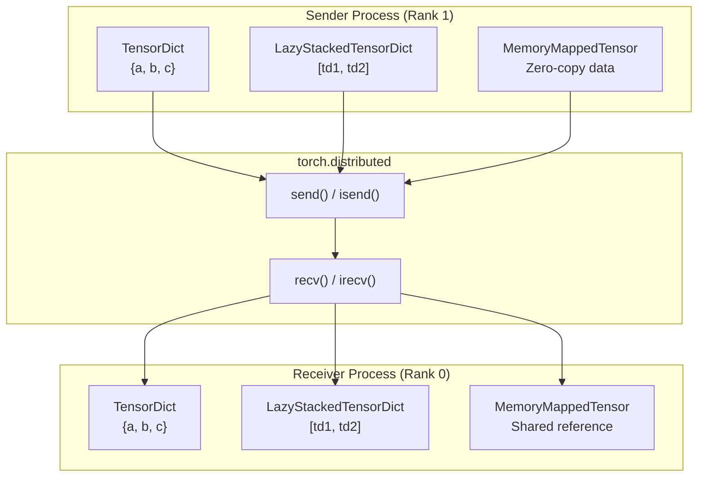
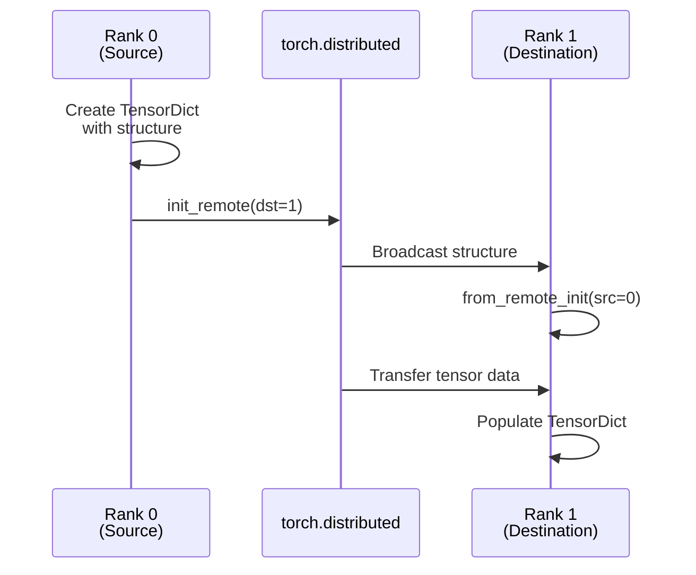
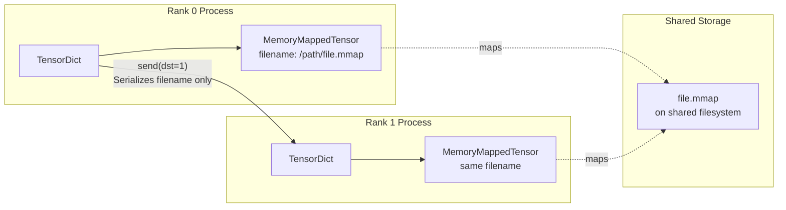

<!-- source: DeepWiki mcp.deepwiki.com · repo pytorch/tensordict · page 6.3 Distributed Operations · fetched 2026-10-21 -->

# Distributed Operations

<details>
<summary>Relevant source files</summary>

The following files were used as context for generating this wiki page:

- [tensordict/memmap.py](tensordict/memmap.py)
- [tensordict/nn/tensorclass_module.py](tensordict/nn/tensorclass_module.py)
- [test/test_distributed.py](test/test_distributed.py)
- [test/test_memmap.py](test/test_memmap.py)

</details>


## Overview

This document covers TensorDict's distributed operations for multi-process communication using `torch.distributed`. These operations enable efficient point-to-point and collective communication between processes in distributed training scenarios, supporting both blocking and non-blocking modes.

For storage backends that support inter-process communication, see [Memory Management Strategies](#5.3). For neural network integration including FSDP, see [Neural Network Integration](#4). For memory-mapped tensor serialization, see [Memory-Mapped Tensors](#5.1).

**Sources:** [test/test_distributed.py:1-826]()

---

## Point-to-Point Communication

TensorDict provides both blocking and non-blocking point-to-point communication methods that work seamlessly with `torch.distributed`. These operations support nested structures, memory-mapped tensors, and lazy stacked tensordicts.

### send and recv

The `send` method transmits a tensordict to a specified rank, while `recv` receives it. Both operations are blocking and support process groups.

```python
# Sender (rank 1)
td = TensorDict({
    ("a", "b"): torch.ones(2),
    "c": torch.ones(2, 3),
}, [2])
td.send(dst=0, pseudo_rand=False, group=None)

# Receiver (rank 0)
td = TensorDict({
    ("a", "b"): torch.zeros(2),
    "c": torch.zeros(2, 3),
}, [2])
td.recv(src=1, pseudo_rand=False, group=None)
```

**Method Signatures:**
- `send(dst: int, pseudo_rand: bool = False, group: dist.ProcessGroup | None = None) -> None`
- `recv(src: int, pseudo_rand: bool = False, group: dist.ProcessGroup | None = None) -> None`

**Parameters:**
- `dst`/`src`: Target/source rank for communication
- `pseudo_rand`: Whether to use pseudo-random tag generation for message identification
- `group`: Optional process group for scoped communication

**Sources:** [test/test_distributed.py:374-445](), [test/test_distributed.py:426-445]()

### isend and irecv (Non-Blocking)

Non-blocking variants return futures that can be waited on later, enabling overlapped computation and communication.

```python
# Non-blocking send (rank 1)
td.isend(dst=0, pseudo_rand=False, group=None)

# Non-blocking receive (rank 0)
futures = td.irecv(src=1, return_premature=True, pseudo_rand=False, group=None)
for fut in futures:
    fut.wait()  # Wait for completion
```

**Method Signatures:**
- `isend(dst: int, pseudo_rand: bool = False, group: dist.ProcessGroup | None = None) -> None`
- `irecv(src: int, return_premature: bool = False, pseudo_rand: bool = False, group: dist.ProcessGroup | None = None) -> List[Future] | None`

**Parameters:**
- `return_premature`: If `True`, returns a list of futures immediately; if `False`, waits internally and returns `None`

**Sources:** [test/test_distributed.py:506-631](), [test/test_distributed.py:638-762]()

---

## Communication Patterns

### Supported TensorDict Types

All point-to-point operations support:
1. **Regular TensorDict** - Standard nested structure
2. **LazyStackedTensorDict** as root - Stacked tensordicts with heterogeneous keys
3. **Nested LazyStackedTensorDict** - TensorDict containing lazy stacked fields
4. **MemoryMappedTensor fields** - Zero-copy serialization for large tensors



**Sources:** [test/test_distributed.py:447-499]()

---

## Collective Operations

### gather_and_stack

Gathers tensordicts from all ranks and stacks them at the destination rank. The operation handles nested structures and heterogeneous keys across ranks.

```python
# All ranks execute this
td = TensorDict({
    ("a", "b"): torch.randn(2),
    "c": torch.randn(2),
}, [2])

td.gather_and_stack(dst=0)

# After gather on rank 0:
# td.shape becomes [world_size, 2] with stacked data from all ranks
```

**Method Signature:**
- `gather_and_stack(dst: int, group: dist.ProcessGroup | None = None) -> None`

**Behavior:**
- Only rank `dst` receives the stacked result
- Other ranks' tensordicts remain unchanged
- Keys not present in all ranks are handled gracefully
- Nested structures are preserved

**Sources:** [test/test_distributed.py:204-266]()

### reduce

Performs element-wise reduction operations across all ranks using operators like `SUM` or `PRODUCT`.

```python
# All ranks
td = TensorDict({
    "a": torch.ones(2),
    "b": torch.ones(2, 3),
}, [2])

# Synchronous reduce
td.reduce(dst=0, op=dist.ReduceOp.SUM, async_op=False)
# On rank 0: td["a"] = sum of all ranks' "a" values

# Asynchronous reduce with futures
futures = td.reduce(dst=0, op=dist.ReduceOp.PRODUCT, 
                   async_op=True, return_premature=True)
for fut in futures:
    fut.wait()
```

**Method Signature:**
- `reduce(dst: int, op: dist.ReduceOp, async_op: bool = False, return_premature: bool = False, group: dist.ProcessGroup | None = None) -> List[Future] | None`

**Parameters:**
- `op`: Reduction operation (`dist.ReduceOp.SUM`, `dist.ReduceOp.PRODUCT`, etc.)
- `async_op`: Enable non-blocking mode
- `return_premature`: Return futures before completion (only if `async_op=True`)

**Supported Operations:**
| Operator | Description |
|----------|-------------|
| `dist.ReduceOp.SUM` | Element-wise sum |
| `dist.ReduceOp.PRODUCT` | Element-wise product |
| `dist.ReduceOp.MIN` | Element-wise minimum |
| `dist.ReduceOp.MAX` | Element-wise maximum |

**Sources:** [test/test_distributed.py:275-367]()

---

## Remote Initialization

Remote initialization allows one rank to define a tensordict structure and broadcast it to other ranks, enabling efficient setup without explicit communication code.

### init_remote

Broadcasts the tensordict structure and values from the source rank to destination ranks.

```python
# Rank 0 (source)
td = TensorDict({
    ("a", "b"): torch.ones(2),
    "c": torch.ones(2),
    ("d", "e", "f"): torch.ones(2, 2),
}, [2])
td.init_remote(dst=1)  # Initialize on rank 1
```

**Method Signature:**
- `init_remote(dst: int, group: dist.ProcessGroup | None = None) -> None`

**Sources:** [test/test_distributed.py:764-821]()

### from_remote_init

Creates a new tensordict on the destination rank by receiving structure and data from the source.

```python
# Rank 1 (destination)
td = TensorDict.from_remote_init(src=0)
# td now contains the structure and values from rank 0
```

**Method Signature:**
- `TensorDict.from_remote_init(src: int, group: dist.ProcessGroup | None = None) -> TensorDict`

**Behavior:**
- Automatically infers shape, keys, and nested structure
- Allocates memory and receives data
- Returns a fully populated tensordict



**Sources:** [test/test_distributed.py:764-821]()

---

## Integration with PyTorch Distributed

### FSDP Integration

TensorDict integrates with Fully Sharded Data Parallel (FSDP) for state dict management. The `from_module` and `to_module` methods work seamlessly with FSDP-wrapped modules.

```python
import torch.distributed as dist
from torch.distributed.fsdp import FullyShardedDataParallel as FSDP

# Wrap module with FSDP
module = MyModule()
sharded_module = FSDP(module, device_id=rank)

# Extract state as TensorDict
td = TensorDict.from_module(sharded_module, use_state_dict=True)

# Save to memmap (only on rank 0)
if rank == 0:
    td.memmap(path)
```

**Key Methods:**
- `TensorDict.from_module(module, use_state_dict=True)` - Extract FSDP state dict
- `td.memmap(path)` - Persist sharded parameters

**Sources:** [test/test_distributed.py:48-108]()

### DTensor Integration

DTensor (Distributed Tensor) support enables working with tensors sharded across devices. TensorDict preserves DTensor structure during operations.

```python
from torch.distributed._tensor import DeviceMesh, distribute_tensor, Shard

mesh = DeviceMesh("cpu", torch.arange(2))

# Module with DTensor parameters
sharded_module = distribute_module(module, mesh, partition_fn=shard_params)

# TensorDict preserves DTensor structure
td = TensorDict.from_module(sharded_module)
td.memmap()  # Requires calling full_tensor() on each worker
```

**Behavior:**
- DTensor parameters are preserved in TensorDict
- Operations like `memmap` require materializing DTensors with `full_tensor()`
- Each worker must participate in collective operations

**Sources:** [test/test_distributed.py:114-202]()

---

## Memory-Mapped Tensors for IPC

MemoryMappedTensor enables zero-copy data transfer between processes, significantly reducing overhead in distributed scenarios.

### Serialization Behavior

When a TensorDict containing `MemoryMappedTensor` is sent:
1. Only the file path or handler is serialized
2. Receiving process maps the same memory region
3. No data copy occurs during transfer

```python
# Sender
td = TensorDict({
    "data": MemoryMappedTensor.from_tensor(
        torch.randn(1000, 1000), 
        filename="/shared/data.mmap"
    )
}, [])
td.send(dst=1)

# Receiver automatically accesses the same file
td = TensorDict.from_remote_init(src=0)
# td["data"] points to /shared/data.mmap
```

**Requirements:**
- File-backed MemoryMappedTensor requires accessible file path on both nodes
- Handler-based MemoryMappedTensor works within a single machine



**Sources:** [test/test_distributed.py:204-266](), [test/test_memmap.py:384-498]()

---

## Implementation Details

### Pseudo-Random Tag Generation

The `pseudo_rand` parameter controls message tag generation for point-to-point operations:

**`pseudo_rand=False` (default):**
- Uses deterministic tags based on key structure
- Ensures correct matching even with heterogeneous keys
- Required when sender and receiver have different key sets

**`pseudo_rand=True`:**
- Uses random tags for each tensor
- Faster but requires identical key structure on both sides
- Fails if keys don't match exactly

```python
# Heterogeneous keys require pseudo_rand=False
td1 = TensorDict({"a": torch.ones(2), "b": torch.ones(3)}, [])
td2 = TensorDict({"a": torch.zeros(2), "c": torch.zeros(4)}, [])

# This works with pseudo_rand=False
td1.send(dst=1, pseudo_rand=False)  # Rank 0
td2.recv(src=0, pseudo_rand=False)  # Rank 1
```

**Sources:** [test/test_distributed.py:408-424]()

### Process Groups

All distributed operations support optional process groups for scoped communication:

```python
# Create a process group
group = dist.new_group([0, 1])

# Operations within group
td.send(dst=1, group=group)
td.gather_and_stack(dst=0, group=group)
td.reduce(dst=0, op=dist.ReduceOp.SUM, group=group)
```

**Benefits:**
- Isolate communication from other operations
- Reduce communication overhead
- Enable hierarchical distributed training

**Sources:** [test/test_distributed.py:408-424]()

---

## Usage Patterns

### Pattern 1: Data Parallel Training

Broadcast model updates from rank 0 to all workers:

```python
# Rank 0: trainer
model_state = TensorDict.from_module(model)
for rank in range(1, world_size):
    model_state.send(dst=rank)

# Other ranks: workers
model_state = TensorDict.from_remote_init(src=0)
model.load_state_dict(model_state.to_dict())
```

### Pattern 2: Gradient Aggregation

Reduce gradients across workers:

```python
# All ranks compute gradients
grad_td = TensorDict.from_module(model.parameters(), as_module=False)

# Synchronous reduction
grad_td.reduce(dst=0, op=dist.ReduceOp.SUM, async_op=False)

# Rank 0 updates model
if rank == 0:
    optimizer.step()
```

### Pattern 3: Batch Gathering

Collect results from distributed workers:

```python
# Each worker processes a batch
output_td = TensorDict({"predictions": predictions, "loss": loss}, [batch_size])

# Gather all results on rank 0
output_td.gather_and_stack(dst=0)
# Rank 0 now has shape [world_size, batch_size]
```

**Sources:** [test/test_distributed.py:204-266](), [test/test_distributed.py:275-367]()

---

## Key Classes and Methods

### TensorDictBase Distributed Methods

| Method | Type | Description |
|--------|------|-------------|
| `send(dst, pseudo_rand, group)` | Point-to-point | Blocking send to rank |
| `recv(src, pseudo_rand, group)` | Point-to-point | Blocking receive from rank |
| `isend(dst, pseudo_rand, group)` | Point-to-point | Non-blocking send |
| `irecv(src, return_premature, pseudo_rand, group)` | Point-to-point | Non-blocking receive |
| `gather_and_stack(dst, group)` | Collective | Gather and stack from all ranks |
| `reduce(dst, op, async_op, return_premature, group)` | Collective | Reduce across ranks |
| `init_remote(dst, group)` | Initialization | Initialize remote tensordict |
| `from_remote_init(src, group)` | Initialization | Create from remote source |

**Sources:** [tensordict/base.py:300-12000]() (methods distributed throughout file)

---

