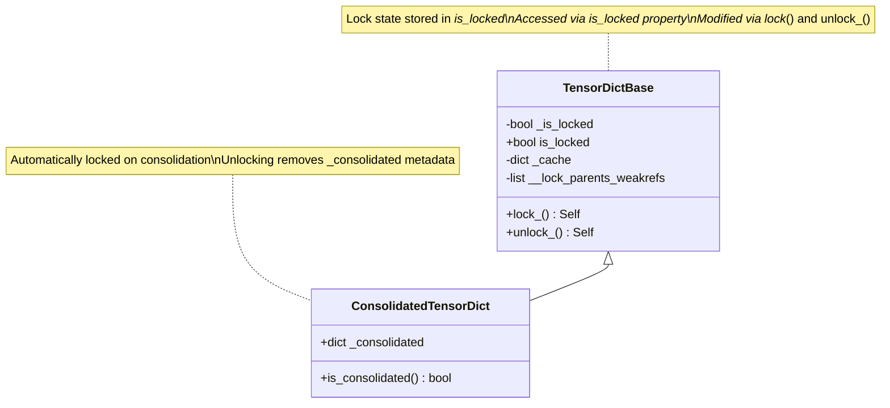
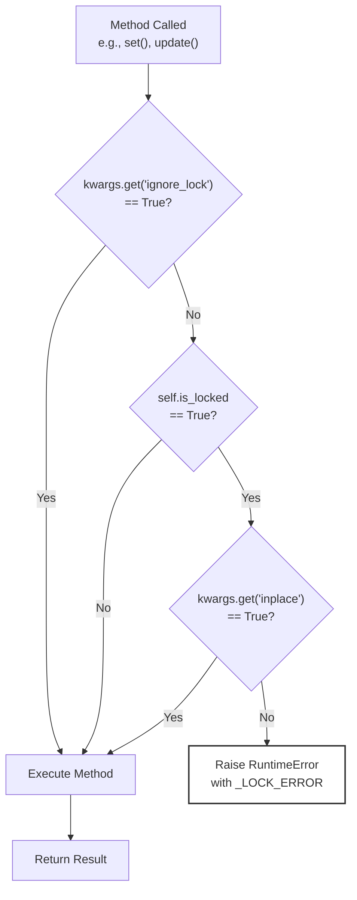
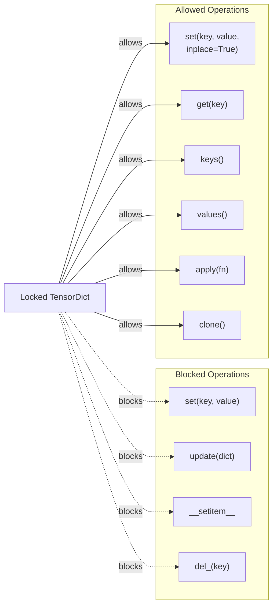
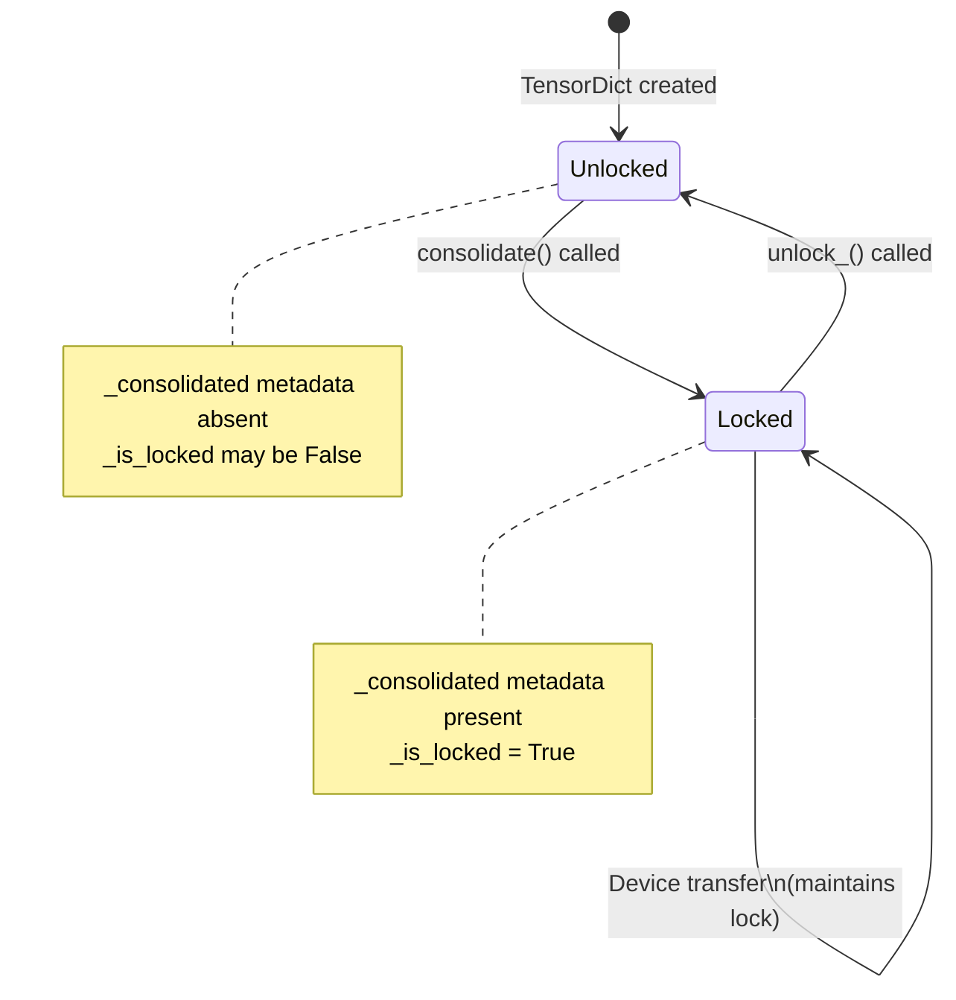
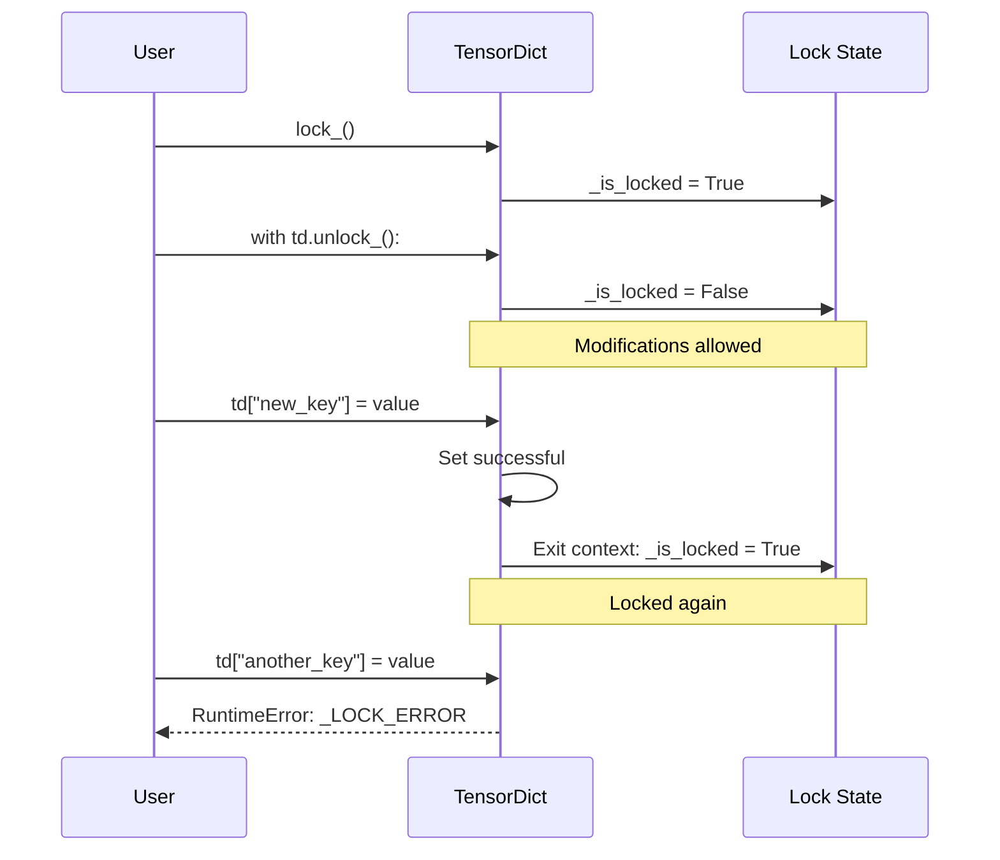
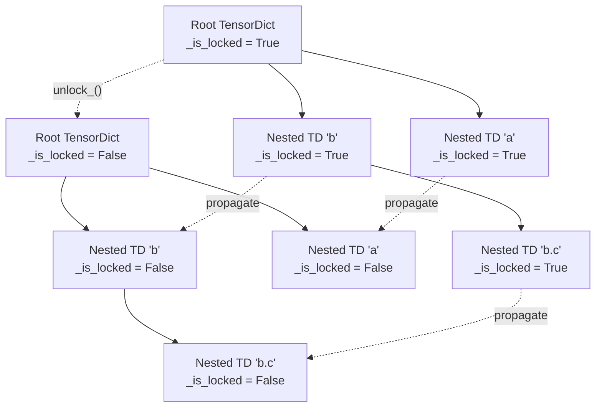
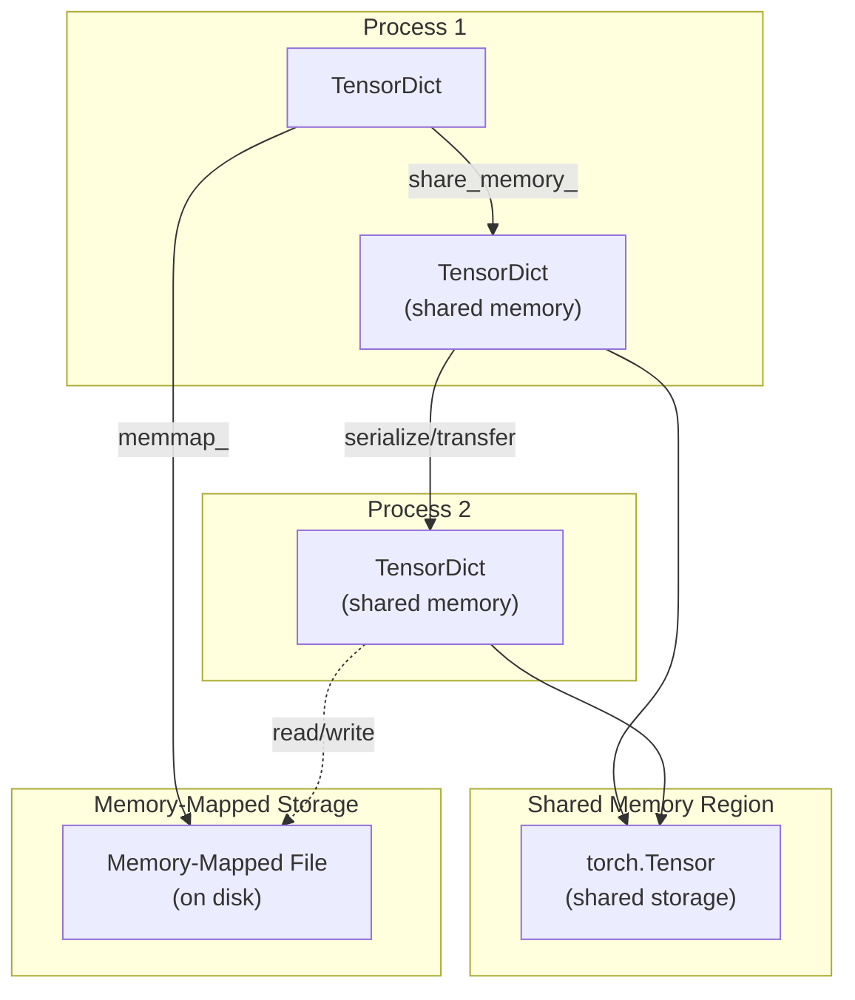
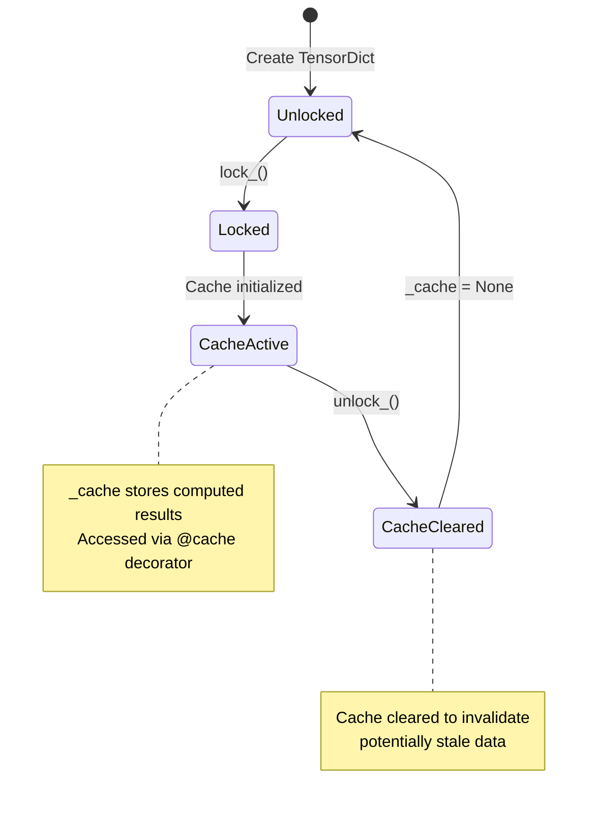

<!-- source: DeepWiki mcp.deepwiki.com · repo pytorch/tensordict · page 6.4 Locking and Thread Safety · fetched 2026-10-21 -->

# Locking and Thread Safety

<details>
<summary>Relevant source files</summary>

The following files were used as context for generating this wiki page:

- [tensordict/base.py](tensordict/base.py)
- [test/test_tensordict.py](test/test_tensordict.py)

</details>


This page documents the locking system and thread-safe operations in TensorDict. The locking mechanism prevents structural modifications to TensorDict instances while allowing in-place data updates, ensuring data integrity during multi-threaded operations and memory-mapped access patterns.

For information about memory management strategies including shared memory and memory mapping, see Memory Management Strategies (5.3). For details on serialization and inter-process communication patterns, see Serialization and Inter-Process Communication (5.4).

## Purpose and Scope

The TensorDict locking system provides:
- Protection against structural modifications (adding/removing keys) while allowing in-place value updates
- Automatic locking for consolidated memory layouts
- Context manager support for temporary unlocking
- Lock propagation through nested TensorDict structures
- Thread-safe access patterns for multi-process workflows

## Lock State Management

### Core Lock Attributes

The lock state is managed through a simple boolean flag on each `TensorDictBase` instance:



**Sources:** [tensordict/base.py:307](), [test/test_tensordict.py:555-604]()

### Lock and Unlock Operations

Locking and unlocking operations are implemented as in-place methods that return `self` for chaining:

| Method | Effect | Returns | Propagates to Nested |
|--------|--------|---------|---------------------|
| `lock_()` | Sets `_is_locked = True` | `self` | Yes |
| `unlock_()` | Sets `_is_locked = False`, clears cache | `self` | Yes |
| `is_locked` | Property returning lock state | `bool` | N/A |

**Sources:** [tensordict/base.py:307](), [test/test_tensordict.py:310-323]()

## Lock Enforcement Mechanisms

### The lock_blocked Decorator

The `lock_blocked` decorator is the primary enforcement mechanism, applied to methods that perform structural modifications:



**Sources:** [tensordict/utils.py:883-896](), [tensordict/utils.py:242-246]()

### Permitted Operations on Locked TensorDicts



**Sources:** [test/test_tensordict.py:573-584](), [tensordict/utils.py:242-246]()

### Error Message

When attempting blocked operations, the system raises `RuntimeError` with the message defined in `_LOCK_ERROR`:

```
Cannot modify locked TensorDict. For in-place modification, consider 
using the `set_()` method and make sure the key is present.
```

**Sources:** [tensordict/utils.py:242-246](), [test/test_tensordict.py:573-577]()

## Consolidated TensorDicts and Automatic Locking

### Consolidation Triggers Automatic Locking

When a TensorDict is consolidated (memory layout optimized for contiguous storage), it is automatically locked to prevent structural changes that would invalidate the consolidated layout:



**Sources:** [test/test_tensordict.py:555-604]()

### Consolidated Metadata Lifecycle

The relationship between consolidation and locking:

| Operation | Lock State Before | Lock State After | `_consolidated` Metadata |
|-----------|-------------------|------------------|--------------------------|
| `consolidate()` | False | **True** | Created |
| `unlock_()` on consolidated | True | False | **Removed** |
| `to(device)` on consolidated | True | True | Preserved |
| `unlock_()` then lock again | False | True | Absent (no longer consolidated) |

**Sources:** [test/test_tensordict.py:586-604](), [test/test_tensordict.py:663-692]()

### Example: Consolidated Locking Behavior

```python
# From test_tensordict.py:555-604
td = TensorDict(
    {
        "a": torch.zeros(1, 1),
        "b": {"c": torch.zeros(1, 1)},
        "d": "a string!",
    },
    device="cpu",
    batch_size=[1],
)

# Consolidation automatically locks
td_consolidated = td.consolidate()
assert td_consolidated.is_consolidated()
assert td_consolidated.is_locked

# Modifications are blocked
with pytest.raises(RuntimeError, match=_LOCK_ERROR):
    td_consolidated["new_key"] = torch.ones(1, 1)

# In-place modifications still work
td_consolidated.set("a", torch.ones(1, 1), inplace=True)
assert (td_consolidated["a"] == 1).all()

# Unlocking removes consolidated metadata
td_consolidated.unlock_()
assert not td_consolidated.is_locked
assert not td_consolidated.is_consolidated()
```

**Sources:** [test/test_tensordict.py:555-604]()

## Context Manager Pattern

### Temporary Unlocking with unlock_()

The `unlock_()` method doubles as a context manager for temporary unlocking:



**Sources:** [test/test_tensordict.py:606-631](), [tensordict/utils.py:903-960]()

### Context Manager Implementation

The context manager functionality is provided by the `_as_context_manager` decorator:

**Decorator Location:** [tensordict/utils.py:903-960]()

**Key Features:**
- Automatically tracks original lock state
- Restores lock state on context exit
- Can be used as both method and context manager
- Supports tracking of last operation for undo-like patterns

### Example: Context Manager Usage

```python
# From test_tensordict.py:606-631
td = TensorDict(
    {
        "a": torch.zeros(1, 1),
        "b": {"c": torch.zeros(1, 1)},
    },
    device="cpu",
    batch_size=[1],
)

td_consolidated = td.consolidate()

# Temporarily unlock for modifications
with td_consolidated.unlock_():
    assert not td_consolidated.is_locked
    assert not td_consolidated.is_consolidated()
    td_consolidated["new_key"] = torch.ones(1, 1)

# After context manager, locked again but not consolidated
assert td_consolidated.is_locked
assert not td_consolidated.is_consolidated()

# Modifications blocked again
with pytest.raises(RuntimeError, match=_LOCK_ERROR):
    td_consolidated["another_key"] = torch.ones(1, 1)
```

**Sources:** [test/test_tensordict.py:606-631]()

## Nested Locking Behavior

### Lock Propagation

Locking and unlocking operations propagate through nested TensorDict structures:



**Sources:** [test/test_tensordict.py:633-661]()

### Example: Nested Locking

```python
# From test_tensordict.py:633-661
td = TensorDict(
    {
        "a": torch.zeros(1, 1),
        "b": TensorDict({"c": torch.zeros(1, 1)}, batch_size=[1]),
    },
    device="cpu",
    batch_size=[1],
)

td_consolidated = td.consolidate()
assert td_consolidated.is_consolidated()
assert td_consolidated.is_locked
assert td_consolidated["b"].is_locked  # Nested also locked

# Nested modifications blocked
with pytest.raises(RuntimeError, match=_LOCK_ERROR):
    td_consolidated["b"]["new_key"] = torch.ones(1, 1)

# Unlocking propagates to nested structures
td_consolidated.unlock_()
assert not td_consolidated.is_consolidated()
assert not td_consolidated.is_locked
assert not td_consolidated["b"].is_locked  # Nested also unlocked

# Nested modifications now allowed
td_consolidated["b"]["new_key"] = torch.ones(1, 1)
assert "new_key" in td_consolidated["b"]
```

**Sources:** [test/test_tensordict.py:633-661]()

## Thread-Safe Operations

### Shared Memory and Memory Mapping

TensorDict provides thread-safe operations through shared memory and memory-mapped tensors:



**Sources:** [tensordict/base.py:310-311](), [tensordict/utils.py:205]()

### Lock Interaction with Memory Operations

| Operation | Requires Unlock | Effect on Lock State | Thread-Safe |
|-----------|----------------|---------------------|-------------|
| `share_memory_()` | No | Preserves | Yes |
| `memmap_()` | No | Preserves | Yes |
| `to(device)` | No | Preserves | N/A |
| `clone()` | No | Creates unlocked clone | N/A |

**Sources:** [test/test_tensordict.py:663-692]()

### Pin Memory Operations

The `_PIN_MEM_TIMEOUT` constant defines timeout for pinning memory operations in multi-threaded contexts:

**Constant Definition:** [tensordict/utils.py:205]()
**Usage Context:** Pin memory operations that may block in multi-threaded scenarios

## Cache Management and Locking

### Cache Behavior

The locking system integrates with TensorDict's caching mechanism:



**Cache Decorator:** [tensordict/utils.py:781-824]()
**Cache Clearing:** Cache is cleared on unlock to ensure consistency

**Sources:** [tensordict/utils.py:781-824](), [tensordict/base.py:308]()

## Best Practices

### When to Lock

**Lock when:**
- Creating a consolidated memory layout for performance
- Passing TensorDicts between processes via shared memory
- Ensuring structural immutability during complex operations
- Working with memory-mapped tensors accessed by multiple processes

**Don't lock when:**
- Actively building a TensorDict structure
- Need to add or remove keys dynamically
- Working in single-threaded contexts without consolidation

### In-Place Modifications

To modify values in a locked TensorDict, use `inplace=True`:

```python
# Blocked
td_locked["key"] = new_value  # Raises RuntimeError

# Allowed
td_locked.set("key", new_value, inplace=True)  # Success if key exists
```

**Sources:** [test/test_tensordict.py:583-584]()

### Unlocking Consolidated TensorDicts

Be aware that unlocking a consolidated TensorDict removes the consolidation:

```python
td_consolidated = td.consolidate()
assert td_consolidated.is_consolidated()  # True

td_consolidated.unlock_()
assert not td_consolidated.is_consolidated()  # False - consolidation lost
```

To modify a consolidated TensorDict without losing consolidation, consider:
1. Creating a new TensorDict with modifications
2. Using in-place operations for existing keys
3. Re-consolidating after modifications

**Sources:** [test/test_tensordict.py:586-604]()

### Context Manager for Temporary Modifications

Use the context manager pattern for scoped unlocking:

```python
td_locked = td.lock_()

# Safe temporary unlocking
with td_locked.unlock_():
    td_locked["new_key"] = value
    # Modifications allowed here

# Automatically locked again after context exit
```

**Sources:** [test/test_tensordict.py:606-631]()

---

