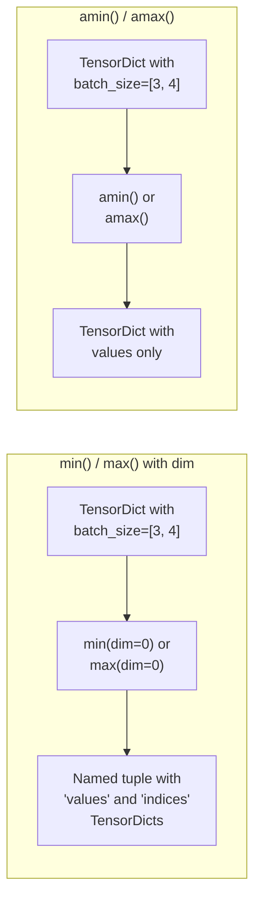
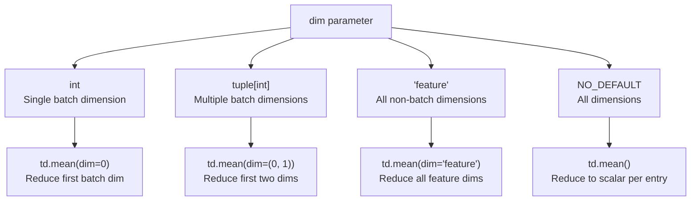
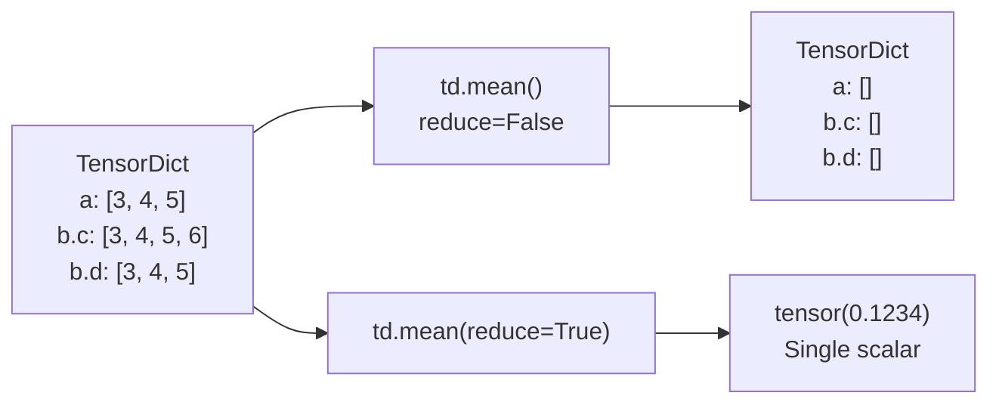
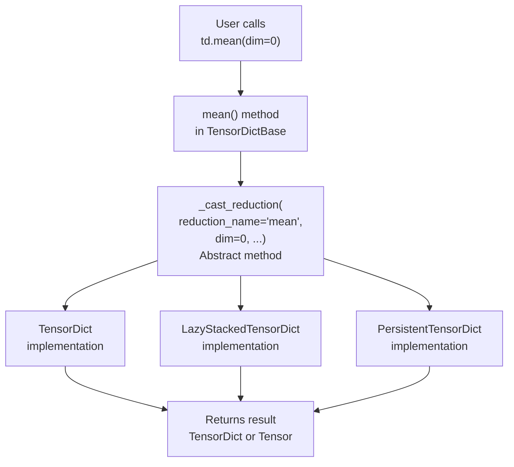

<!-- source: DeepWiki mcp.deepwiki.com · repo pytorch/tensordict · page 6.5 Reduction Operations · fetched 2026-10-21 -->

# Reduction Operations

<details>
<summary>Relevant source files</summary>

The following files were used as context for generating this wiki page:

- [tensordict/base.py](tensordict/base.py)
- [test/test_tensordict.py](test/test_tensordict.py)

</details>


This page documents reduction operations available on TensorDict instances. Reduction operations compute aggregate values (mean, sum, min, max, etc.) over tensor elements while preserving or modifying the TensorDict structure. For shape manipulation operations that do not aggregate values, see [Shape Operations and Transformations](#2.4).

---

## Overview

Reduction operations in TensorDict allow you to:
- Compute statistics across batch dimensions (e.g., mean over time steps)
- Aggregate across feature dimensions (e.g., sum all features)
- Reduce all values to a single scalar tensor
- Preserve the nested TensorDict structure during reduction

All reduction operations support:
- Optional dimension specification via `dim` parameter
- Keeping or collapsing dimensions via `keepdim`
- Reducing across all entries to a single tensor via `reduce=True`
- Preserving nested structure by default

Sources: [tensordict/base.py:694-2583]()

---

## Reduction Operation Categories

```mermaid
graph TB
    subgraph "Statistical Reductions"
        MEAN["mean() / nanmean()"]
        STD["std()"]
        VAR["var()"]
        QUANT["quantile()"]
    end
    
    subgraph "Extrema Operations"
        MIN["min() / amin()"]
        MAX["max() / amax()"]
        CUMMIN["cummin()"]
        CUMMAX["cummax()"]
    end
    
    subgraph "Aggregation Operations"
        SUM["sum() / nansum()"]
        PROD["prod()"]
    end
    
    subgraph "Boolean Operations"
        ALL["all()"]
        ANY["any()"]
    end
    
    subgraph "Element-wise Testing"
        ISFINITE["isfinite()"]
        ISNAN["isnan()"]
        ISNEGINF["isneginf()"]
        ISPOSINF["isposinf()"]
        ISREAL["isreal()"]
    end
    
    BASE[TensorDictBase] --> MEAN
    BASE --> STD
    BASE --> VAR
    BASE --> QUANT
    BASE --> MIN
    BASE --> MAX
    BASE --> CUMMIN
    BASE --> CUMMAX
    BASE --> SUM
    BASE --> PROD
    BASE --> ALL
    BASE --> ANY
    BASE --> ISFINITE
    BASE --> ISNAN
    BASE --> ISNEGINF
    BASE --> ISPOSINF
    BASE --> ISREAL
```



Sources: [tensordict/base.py:694-2813]()

---

## Statistical Reductions

### Mean Operations

The `mean()` method computes the arithmetic mean of tensor elements. The `nanmean()` variant ignores NaN values.

**Method Signature:**
```python
def mean(
    self,
    dim: int | Tuple[int] | Literal["feature"] = NO_DEFAULT,
    keepdim: bool = NO_DEFAULT,
    *,
    dtype: torch.dtype | None = None,
    reduce: bool | None = None,
    key_transform: Callable[[NestedKey], NestedKey] | None = None,
) -> Self | torch.Tensor
```

**Parameters:**
- `dim`: Dimension(s) to reduce over. Can be an integer, tuple of integers, or `"feature"` to reduce over all non-batch dimensions
- `keepdim`: Whether to retain the reduced dimension with size 1
- `dtype`: Optional dtype for the output
- `reduce`: If `True`, returns a single tensor aggregating all TensorDict values
- `key_transform`: Optional function to transform keys in the result

**Example Usage:**
```python
td = TensorDict(
    a=torch.randn(3, 4, 5),
    b=TensorDict(
        c=torch.randn(3, 4, 5, 6),
        d=torch.randn(3, 4, 5),
        batch_size=(3, 4, 5),
    ),
    batch_size=(3, 4)
)

# Reduce over dimension 0
td.mean(dim=0)  # Returns TensorDict with batch_size=[4]

# Reduce to scalar per entry
td.mean()  # Returns TensorDict with batch_size=[]

# Reduce all values to single scalar
td.mean(reduce=True)  # Returns tensor scalar

# Reduce over feature dimensions
td.mean(dim="feature")  # Returns TensorDict with batch_size=[3, 4]
```

Sources: [tensordict/base.py:1390-1559]()

---

### Standard Deviation and Variance

The `std()` and `var()` methods compute standard deviation and variance respectively. Both support Bessel's correction via the `correction` parameter.

**Method Signature:**
```python
def std(
    self,
    dim: int | Tuple[int] | Literal["feature"] = NO_DEFAULT,
    keepdim: bool = NO_DEFAULT,
    *,
    correction: int = 1,
    reduce: bool | None = None,
    key_transform: Callable[[NestedKey], NestedKey] | None = None,
) -> Self | torch.Tensor
```

**Parameters:**
- `correction`: Difference between sample size and degrees of freedom (default: 1, Bessel's correction)
- Other parameters are the same as `mean()`

Sources: [tensordict/base.py:2121-2413]()

---

### Quantile Operation

The `quantile()` method computes quantiles (e.g., median, quartiles) of tensor elements.

**Method Signature:**
```python
def quantile(
    self,
    q: float | torch.Tensor,
    dim: int | Tuple[int] | Literal["feature"] = NO_DEFAULT,
    keepdim: bool = NO_DEFAULT,
    *,
    interpolation: str = "linear",
    reduce: bool | None = None,
    key_transform: Callable[[NestedKey], NestedKey] | None = None,
) -> Self | torch.Tensor
```

**Parameters:**
- `q`: Quantile(s) to compute, between 0 and 1. Can be a scalar or tensor for multiple quantiles
- `interpolation`: Method for interpolation between data points: `'linear'`, `'lower'`, `'higher'`, `'midpoint'`, or `'nearest'`

Sources: [tensordict/base.py:2415-2568]()

---

## Extrema Operations

### Min and Max Operations



The `min()` and `max()` methods find minimum and maximum values. When a dimension is specified, they can return both values and indices.

**Method Signature:**
```python
def min(
    self,
    dim: int | NO_DEFAULT = NO_DEFAULT,
    keepdim: bool = False,
    *,
    reduce: bool | None = None,
    return_indices: bool = True,
) -> Self | torch.Tensor
```

**Parameters:**
- `return_indices`: If `True` and `dim` is specified, returns a named tuple with `values` and `indices` TensorDicts

**Return Value:**
- When `dim` is specified and `return_indices=True`: Returns `torch.return_types.min` or `max` named tuple
- When `return_indices=False`: Returns TensorDict with values only (equivalent to `amin()`/`amax()`)
- When `reduce=True`: Returns a single scalar tensor

**Example:**
```python
result = td.min(dim=0)
# result.values is a TensorDict
# result.indices is a TensorDict with indices

values_only = td.amin(dim=0)
# Only values, no indices
```

Sources: [tensordict/base.py:814-1148]()

---

### Cumulative Extrema

The `cummin()` and `cummax()` methods compute cumulative minimum and maximum along a dimension.

**Method Signature:**
```python
def cummin(
    self,
    dim: int,
    *,
    reduce: bool | None = None,
    return_indices: bool = True,
) -> Self | torch.Tensor
```

**Note:** Unlike `min()`/`max()`, `cummin()`/`cummax()` require a dimension to be specified and do not change the batch size.

Sources: [tensordict/base.py:1150-1388]()

---

## Aggregation Operations

### Sum Operation

The `sum()` method computes the sum of tensor elements. The `nansum()` variant ignores NaN values.

**Method Signature:**
```python
def sum(
    self,
    dim: int | Tuple[int] | Literal["feature"] = NO_DEFAULT,
    keepdim: bool = NO_DEFAULT,
    *,
    dtype: torch.dtype | None = None,
    reduce: bool | None = None,
    key_transform: Callable[[NestedKey], NestedKey] | None = None,
) -> Self | torch.Tensor
```

Sources: [tensordict/base.py:1836-2119]()

---

### Product Operation

The `prod()` method computes the product of tensor elements.

**Method Signature:**
```python
def prod(
    self,
    dim: int | Tuple[int] | Literal["feature"] = NO_DEFAULT,
    keepdim: bool = NO_DEFAULT,
    *,
    dtype: torch.dtype | None = None,
    reduce: bool | None = None,
) -> Self | torch.Tensor
```

**Note:** The `keepdim` handling for `prod()` is slightly different - it manually unsqueezes dimensions when needed rather than passing `keepdim` directly to the underlying operation.

Sources: [tensordict/base.py:1694-1834]()

---

## Boolean Operations

### All and Any

The `all()` and `any()` methods test whether all or any elements are True/non-zero.

**Method Signature:**
```python
def all(self, dim: int | None = None) -> bool | TensorCollection
def any(self, dim: int | None = None) -> bool | TensorCollection
```

**Parameters:**
- `dim`: If `None`, returns a boolean indicating if all/any tensors satisfy the condition. If an integer, reduces along that dimension.

Sources: [tensordict/base.py:694-719]()

---

### Element-wise Testing

The following methods return new TensorDicts with boolean tensors indicating which elements satisfy a condition:

| Method | Purpose |
|--------|---------|
| `isfinite()` | Tests if elements are finite (not NaN, inf, or -inf) |
| `isnan()` | Tests if elements are NaN |
| `isneginf()` | Tests if elements are negative infinity |
| `isposinf()` | Tests if elements are positive infinity |
| `isreal()` | Tests if elements are real-valued |

These methods return a TensorDict with the same structure but with boolean tensors.

**Example:**
```python
td = TensorDict(a=torch.tensor([1.0, float('nan'), float('inf')]))
result = td.isnan()  # Returns TensorDict with boolean tensor [False, True, False]
```

Sources: [tensordict/base.py:721-812]()

---

## Dimension Handling

### Dimension Types



**Batch Dimensions vs Feature Dimensions:**
- **Batch dimensions**: Dimensions specified by the TensorDict's `batch_size`
- **Feature dimensions**: All dimensions beyond the batch dimensions

**Example:**
```python
td = TensorDict(
    a=torch.randn(3, 4, 5),  # 5 is feature dimension
    batch_size=(3, 4)
)

# Reduce over batch dimension
td.mean(dim=0)  # batch_size becomes [4]

# Reduce over feature dimensions
td.mean(dim="feature")  # batch_size stays [3, 4], tensor becomes shape [3, 4]
```

Sources: [tensordict/base.py:1420-1559]()

---

### The keepdim Parameter

The `keepdim` parameter controls whether reduced dimensions are retained with size 1.

**Example:**
```python
td = TensorDict(a=torch.randn(3, 4, 5), batch_size=(3, 4))

# Without keepdim (default)
result = td.mean(dim=0)  # batch_size = [4]

# With keepdim
result = td.mean(dim=0, keepdim=True)  # batch_size = [1, 4]
```

---

## The reduce Parameter

The `reduce` parameter enables aggregating all TensorDict values into a single scalar tensor, rather than maintaining the structure.



**When reduce=False (default):**
- Returns a TensorDict with the same structure
- Each entry is independently reduced
- Keys are preserved (can be transformed with `key_transform`)

**When reduce=True:**
- All values are flattened and aggregated
- Returns a single `torch.Tensor`
- Can be combined with `dim` to reduce over specific dimensions

**Example:**
```python
td = TensorDict(
    a=torch.ones(3, 4, 5),
    b=TensorDict(
        c=torch.ones(3, 4, 5),
        d=torch.ones(3, 4, 5),
        batch_size=(3, 4, 5),
    ),
    batch_size=(3, 4)
)

# Structure-preserving reduction
result = td.mean()  # TensorDict with scalar entries

# Full reduction to single value
result = td.mean(reduce=True)  # tensor(1.0)

# Dimension-specific reduction with reduce=True
result = td.mean(reduce=True, dim=0)  # tensor of shape [4, 5]

# Feature dimension reduction with reduce=True
result = td.mean(reduce=True, dim="feature")  # tensor of shape [3, 4]
```

Sources: [tensordict/base.py:1420-1559]()

---

## Key Transformation

The `key_transform` parameter allows transforming keys in the output TensorDict. This is useful for adding prefixes or modifying key names during reduction.

**Example:**
```python
td = TensorDict(
    a=torch.randn(3, 4, 5),
    b=TensorDict(
        c=torch.randn(3, 4, 5),
        batch_size=(3, 4, 5),
    ),
    batch_size=(3, 4)
)

# Add prefix to all keys
result = td.mean(key_transform=lambda key: f"avg_{key}")
# result has keys "avg_a" and "avg_b"
# result["avg_b"] has key "avg_c"
```

**Note:** `key_transform` is only applied when `reduce=False`.

Sources: [tensordict/base.py:1450-1559]()

---

## Implementation Architecture

### The _cast_reduction Method

All reduction operations in TensorDict delegate to an abstract `_cast_reduction()` method that concrete implementations override.



**Method Signature:**
```python
@abc.abstractmethod
def _cast_reduction(
    self,
    *,
    reduction_name: str,
    dim=NO_DEFAULT,
    keepdim=NO_DEFAULT,
    dtype=None,
    tuple_ok=True,
    further_reduce: bool,
    **kwargs,
) -> Self | torch.Tensor:
    raise NotImplementedError
```

**Parameters:**
- `reduction_name`: String name of the reduction (e.g., `"mean"`, `"sum"`, `"min"`)
- `dim`: Dimension specification
- `keepdim`: Whether to keep dimensions
- `dtype`: Optional dtype for output
- `tuple_ok`: Whether the operation can return tuples (e.g., min/max with indices)
- `further_reduce`: The value of the `reduce` parameter
- `**kwargs`: Operation-specific parameters (e.g., `correction` for std/var)

Sources: [tensordict/base.py:2570-2582]()

---

## Common Reduction Patterns

### Pattern 1: Batch Statistics

Computing statistics over batch dimensions while preserving structure:

```python
# Compute mean over batch dimension 0
batch_mean = td.mean(dim=0)

# Compute std over time dimension (dim 1)
temporal_std = td.std(dim=1)
```

### Pattern 2: Feature Aggregation

Reducing feature dimensions to get per-sample aggregates:

```python
# Sum all features per sample
feature_sum = td.sum(dim="feature")

# Mean of all features per sample
feature_mean = td.mean(dim="feature")
```

### Pattern 3: Complete Reduction

Reducing all values to a single metric:

```python
# Total sum across all entries and dimensions
total = td.sum(reduce=True)

# Overall mean
global_mean = td.mean(reduce=True)

# Maximum value in the entire structure
max_val = td.max(reduce=True)
```

### Pattern 4: Multi-Dimensional Reduction

Reducing over multiple dimensions simultaneously:

```python
# Reduce over first two batch dimensions
result = td.mean(dim=(0, 1))

# Compute variance over dimensions 0 and 2
result = td.var(dim=(0, 2))
```

Sources: [tensordict/base.py:1455-1559](), [test/test_tensordict.py:1-500]()

---

## Return Type Summary

| Operation | `dim=None` | `dim=int` (default) | `dim=int` + `reduce=True` | `return_indices` |
|-----------|-----------|---------------------|---------------------------|------------------|
| `mean()` | TensorDict | TensorDict | Tensor | N/A |
| `sum()` | TensorDict | TensorDict | Tensor | N/A |
| `min()` | TensorDict | Named tuple (values, indices) | Tensor | Yes (default) |
| `amin()` | TensorDict | TensorDict | Tensor | N/A |
| `max()` | TensorDict | Named tuple (values, indices) | Tensor | Yes (default) |
| `amax()` | TensorDict | TensorDict | Tensor | N/A |
| `std()` | TensorDict | TensorDict | Tensor | N/A |
| `var()` | TensorDict | TensorDict | Tensor | N/A |
| `prod()` | TensorDict | TensorDict | Tensor | N/A |
| `quantile()` | TensorDict | TensorDict | Tensor | N/A |
| `cummin()` | Error | Named tuple (values, indices) | Named tuple | Yes (default) |
| `cummax()` | Error | Named tuple (values, indices) | Named tuple | Yes (default) |
| `all()` | bool | TensorDict | N/A | N/A |
| `any()` | bool | TensorDict | N/A | N/A |

Sources: [tensordict/base.py:814-2568]()

---

