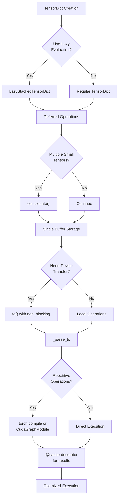
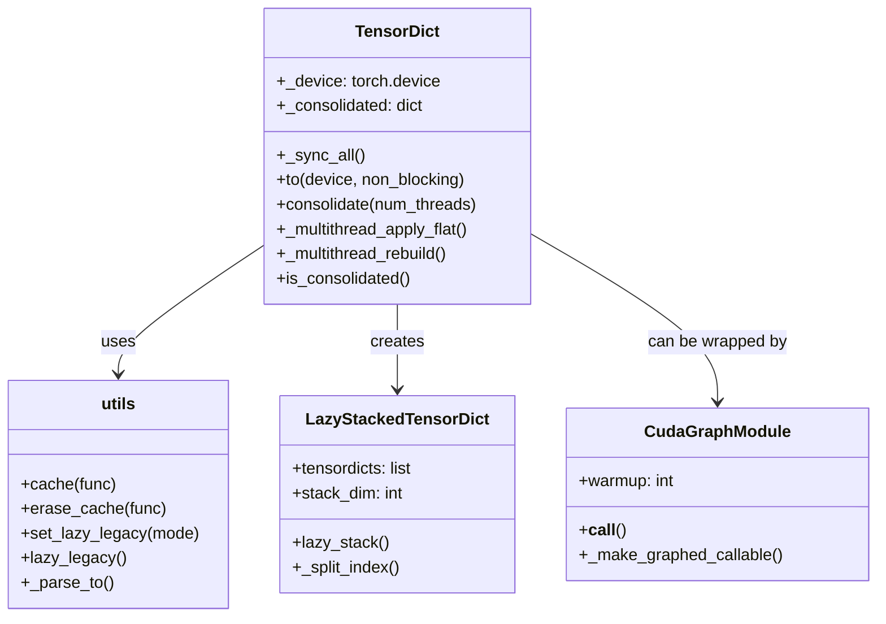
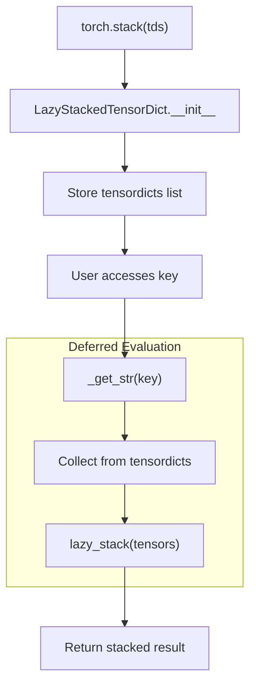
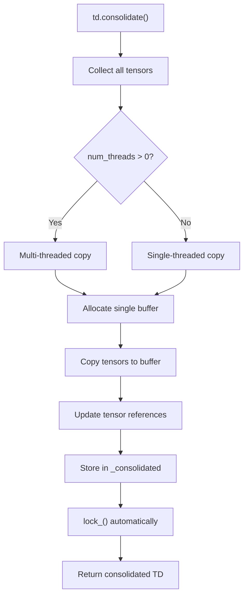
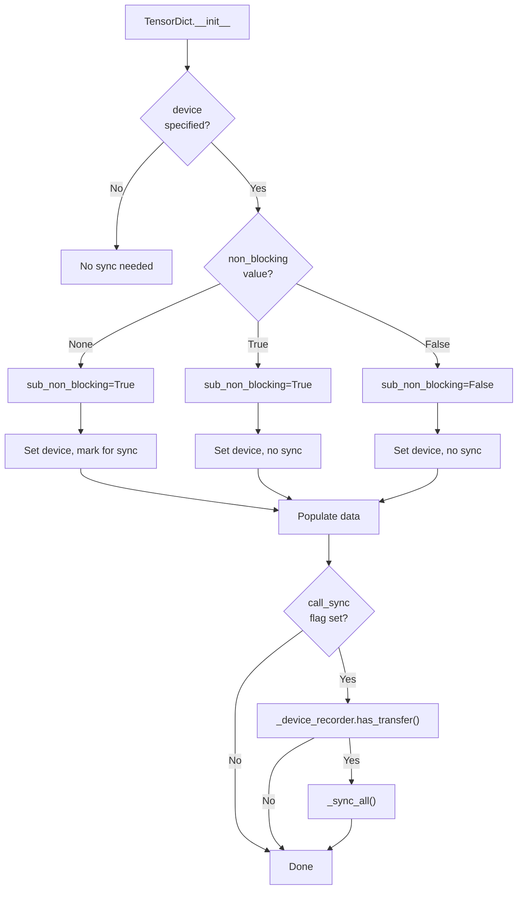
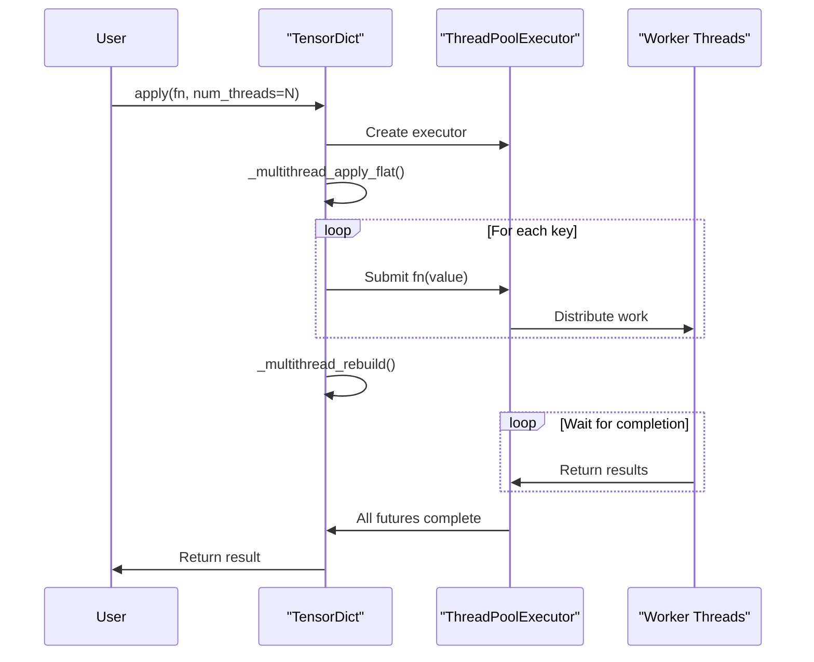
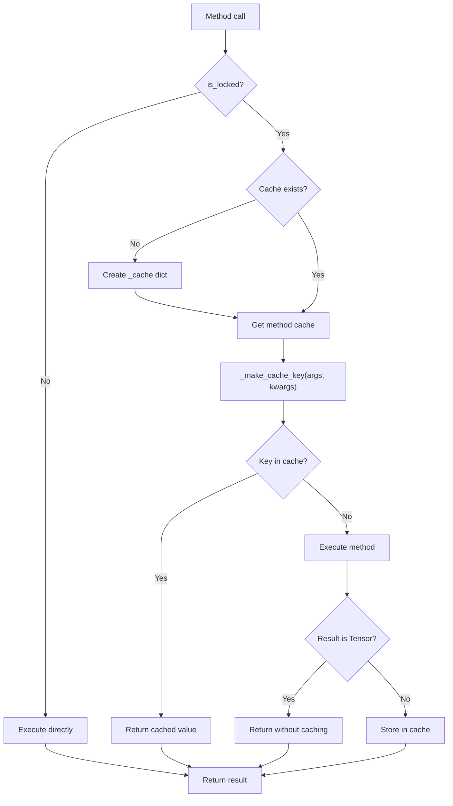

<!-- source: DeepWiki mcp.deepwiki.com · repo pytorch/tensordict · page 7 Performance and Optimization · fetched 2026-10-21 -->

# Performance and Optimization

<details>
<summary>Relevant source files</summary>

The following files were used as context for generating this wiki page:

- [tensordict/_lazy.py](tensordict/_lazy.py)
- [tensordict/_td.py](tensordict/_td.py)
- [tensordict/base.py](tensordict/base.py)
- [test/test_tensordict.py](test/test_tensordict.py)

</details>


This page covers performance optimization techniques and best practices for TensorDict operations. TensorDict provides multiple strategies to optimize for speed and memory efficiency, from lazy evaluation to asynchronous device transfers and compilation.

The main optimization strategies are:

- **Lazy Operations** (Page 7.1): Deferred evaluation using `LazyStackedTensorDict` and the `set_lazy_legacy` context manager
- **Asynchronous Device Transfers** (Page 7.2): Non-blocking device movements and synchronization control
- **Compilation and CUDA Graphs** (Page 7.3): Using `torch.compile` and `CudaGraphModule` for GPU acceleration
- **Caching and Performance Patterns** (Page 7.4): The `@cache` decorator and performance best practices

## Overview of Optimization Strategies

TensorDict optimization involves understanding when operations are executed, how data moves between devices, and when to consolidate tensors into contiguous memory. The following diagram shows the main optimization points:

**TensorDict Optimization Pipeline**



Sources: [tensordict/_lazy.py:176-225](), [tensordict/utils.py:1069-1115](), [tensordict/utils.py:781-824](), [test/test_tensordict.py:423-543]()

## Key Components and Their Roles

The main classes and functions involved in TensorDict optimization are shown below:

**Core Optimization Components**



Sources: [tensordict/_td.py:150-479](), [tensordict/_lazy.py:176-533](), [tensordict/utils.py:781-824](), [test/test_tensordict.py:423-543]()

## Lazy Operations and LazyStackedTensorDict

The `LazyStackedTensorDict` class defers stacking operations until data is accessed. This is created automatically by `torch.stack` when stacking TensorDict instances.

```python
# Creating a lazy stack
tds = [TensorDict({'a': torch.randn(3, 4)}, batch_size=[3]) for _ in range(10)]
td_stack = torch.stack(tds, -1)  # Returns LazyStackedTensorDict
```

The lazy stack only materializes data when specific keys are accessed via `_get_str`, which calls `lazy_stack` on the collected tensors.

**LazyStackedTensorDict Data Flow**



The `set_lazy_legacy` context manager controls whether certain operations like `view`, `permute`, and `unsqueeze` return lazy representations:

```python
from tensordict.utils import set_lazy_legacy

with set_lazy_legacy(True):
    td_lazy = td.view(-1)  # Returns lazy view
```

Sources: [tensordict/_lazy.py:176-304](), [tensordict/_lazy.py:1299-1411](), [tensordict/_lazy.py:1429-1568](), [tensordict/utils.py:1779-1823]()

## Consolidation for Memory and I/O Optimization

The `consolidate()` method is a key optimization that stores all tensors in a single contiguous buffer. This significantly improves I/O performance and reduces memory fragmentation.

```python
# Consolidate into single buffer
td_consolidated = td.consolidate()

# Consolidate with multiple threads
td_consolidated = td.consolidate(num_threads=8)

# Consolidate to memory-mapped file
td_consolidated = td.consolidate(filename="data.mmap")

# Check consolidation status
assert td_consolidated.is_consolidated()
```

**Consolidation automatically locks the TensorDict** to prevent structural modifications that would invalidate the shared buffer. The consolidated metadata is stored in the `_consolidated` attribute:

```python
storage = td_consolidated._consolidated["storage"]  # The shared buffer
```

**Consolidation Process**



Consolidated TensorDicts maintain the single-buffer layout during device transfers, making them extremely efficient for CPU-to-GPU operations:

```python
# Fast transfer: consolidated data moves as one block
td_gpu = td.consolidate().to('cuda')
```

Sources: [test/test_tensordict.py:423-543](), [test/test_tensordict.py:572-621](), [test/test_tensordict.py:549-570]()

## Device Transfer Optimization

TensorDict's `to()` method supports asynchronous transfers through the `non_blocking` parameter. The `_parse_to` function handles device and dtype parsing:

```python
# Non-blocking transfer
td_gpu = td.to('cuda', non_blocking=True)

# With multiple threads
td_gpu = td.to('cuda', num_threads=4)

# Optimal: consolidate first for fastest transfer
td_gpu = td.consolidate().to('cuda')
```

The `__init__` method in `TensorDict` handles synchronization logic based on the `non_blocking` parameter. When `non_blocking=None` (default), it uses asynchronous transfers but calls `_sync_all()` if needed.

**Device Transfer Flow in TensorDict.__init__**



Sources: [tensordict/_td.py:250-322](), [tensordict/utils.py:1069-1115](), [test/test_tensordict.py:549-570]()

## Multithreaded Operations

TensorDict supports multithreaded execution for operations like `apply`, `memmap`, and device transfers. The key methods are `_multithread_apply_flat` and `_multithread_rebuild`.

**Multithreaded Apply Pattern**



The `_multithread_apply_flat` method submits each leaf value to the executor, while `_multithread_rebuild` collects the results and reconstructs the TensorDict structure.

Sources: [tensordict/_td.py:1175-1232](), [tensordict/_td.py:1233-1395]()

## Caching with the @cache Decorator

The `@cache` decorator in `tensordict/utils.py` caches method results on locked TensorDicts. This is particularly useful for expensive operations like `keys(include_nested=True)`:

```python
from tensordict import TensorDict
from tensordict.utils import cache

class CustomTensorDict(TensorDict):
    @cache
    def expensive_operation(self):
        # Expensive computation
        return result

td = CustomTensorDict({"a": torch.randn(3, 4)}, batch_size=[3])
td.lock_()  # Cache only works on locked tensordicts
result1 = td.expensive_operation()  # Computed
result2 = td.expensive_operation()  # Retrieved from cache
```

The cache is stored in `_cache` as a `defaultdict(dict)` and is keyed by function name and arguments. The `_make_cache_key` function creates cache keys from arguments.

**Cache Decorator Logic**



Sources: [tensordict/utils.py:781-824](), [tensordict/utils.py:767-778]()

## Compilation and CUDA Graphs

For details on `torch.compile` integration and `CudaGraphModule`, see Page 7.3. The key points are:

- TensorDict works with `torch.compile` for JIT optimization
- `CudaGraphModule` captures and replays CUDA operations
- Both are compatible with `TensorDictModule` and neural network workflows

## Performance Patterns and Best Practices

Based on the implementation in the core files, here are key performance patterns:

### 1. Consolidation for I/O and Transfer Performance

Use `consolidate()` before I/O operations or device transfers to store all tensors in a single buffer:

```python
# Before saving or transferring
td_consolidated = td.consolidate()

# Fast save to memory-mapped file
td_consolidated.consolidate(filename="model.mmap")

# Fast device transfer
td_gpu = td.consolidate().to('cuda')
```

**Key behavior**: Consolidation automatically locks the TensorDict to prevent modifications that would invalidate the shared buffer. Use `unlock_()` to remove consolidation and allow modifications:

```python
td_consolidated.unlock_()  # Removes consolidation and lock
assert not td_consolidated.is_consolidated()
td_consolidated["new_key"] = torch.ones(1)  # Now allowed
```

Sources: [test/test_tensordict.py:423-543](), [test/test_tensordict.py:572-621]()

### 2. Lazy Stack for Deferred Operations

Use `LazyStackedTensorDict` when you need to stack tensordicts but don't need immediate access to all data:

```python
# Efficient for large collections
td_stack = torch.stack([td1, td2, td3], dim=0)  # Lazy by default
value = td_stack.get("key")  # Only materializes when needed
```

The `_split_index` method efficiently handles indexing into lazy stacks by computing which sub-tensordicts need to be accessed.

Sources: [tensordict/_lazy.py:824-1008]()

### 3. Non-blocking Device Transfers

The `_parse_to` function supports three modes for `non_blocking`:
- `None`: Asynchronous transfer with sync if needed (default)
- `True`: Fully asynchronous
- `False`: Synchronous

```python
# Fastest for CPU->CUDA
td_gpu = td.to('cuda', non_blocking=True)

# Safest (default)
td_gpu = td.to('cuda')  # non_blocking=None

# With consolidation (recommended)
td_gpu = td.consolidate().to('cuda')
```

Sources: [tensordict/utils.py:1069-1115](), [tensordict/_td.py:273-293](), [test/test_tensordict.py:549-570]()

### 4. Cache Decorator for Expensive Operations

Lock the TensorDict before using cached methods to avoid recomputation:

```python
td.lock_()
keys = td.keys(include_nested=True)  # If cached, instant return
```

The cache is cleared by operations that modify the TensorDict through the `@erase_cache` decorator.

Sources: [tensordict/utils.py:781-824](), [tensordict/utils.py:827-835]()

### 5. Multithreading for Bulk Operations

Use `num_threads` parameter for operations on large tensordicts:

```python
# Fast memmap conversion
td_memmap = td.memmap(num_threads=16)

# Fast consolidation
td_consolidated = td.consolidate(num_threads=8)

# Fast device transfer
td_gpu = td.to('cuda', num_threads=8)
```

Sources: [tensordict/_td.py:1175-1395](), [test/test_tensordict.py:423-543]()

## Common Performance Patterns Summary

| Pattern | Use Case | Key Method/Class |
|---------|----------|------------------|
| Consolidation | Fast I/O and device transfers | `consolidate(num_threads=N)` |
| Lazy stacking | Stacking many tensordicts | `LazyStackedTensorDict.lazy_stack` |
| Cached operations | Repeated key queries | `@cache` decorator |
| Async transfers | CPU to GPU | `to(device, non_blocking=True)` |
| Multithreading | Bulk transformations | `apply(..., num_threads=N)` |
| Lazy legacy ops | View/reshape chains | `set_lazy_legacy(True)` |

Sources: [test/test_tensordict.py:423-543](), [tensordict/_lazy.py:1429-1568](), [tensordict/utils.py:781-824](), [tensordict/_td.py:250-322](), [tensordict/_td.py:1175-1232](), [tensordict/utils.py:1779-1823]()

## Best Practices for Performance

Based on the benchmarks and implementation, here are some best practices for optimizing TensorDict performance:

1. **Use consolidation before device transfers and I/O**:
   ```python
   # Fast CPU to GPU transfer
   td_gpu = td.consolidate().to('cuda')
   
   # Fast save to disk
   td.consolidate(filename="data.mmap")
   
   # With multithreading for large data
   td_consolidated = td.consolidate(num_threads=16)
   ```

2. **Understand consolidation locking behavior**:
   ```python
   # Consolidation automatically locks the tensordict
   td_consolidated = td.consolidate()
   assert td_consolidated.is_locked
   
   # In-place modifications still allowed
   td_consolidated.set("key", new_value, inplace=True)
   
   # Unlock to allow structural changes
   with td_consolidated.unlock_():
       td_consolidated["new_key"] = torch.ones(1)
   
   # Or permanently unlock (removes consolidation)
   td_consolidated.unlock_()
   assert not td_consolidated.is_consolidated()
   ```

3. **Leverage multithreading for large data**:
   ```python
   # Faster conversions with multithreading
   td_memmap = td.memmap(num_threads=32)
   td_cuda = td.to('cuda', num_threads=16)
   td_consolidated = td.consolidate(num_threads=8)
   ```

4. **Consider memory-mapped tensors for large models**:
   ```python
   # Save model parameters as memory-mapped tensors
   model_params = TensorDict.from_module(model).memmap()
   ```

5. **Use CUDA graphs for repetitive operations**:
   ```python
   # Wrap inference function in CudaGraphModule
   inference_module = CudaGraphModule(inference_func)
   ```

6. **Compile functions for complex operations**:
   ```python
   # Compile data processing pipeline
   compiled_pipeline = torch.compile(processing_pipeline)
   ```

7. **Choose appropriate operations based on your data structure**:
   - For nested data, TensorDict's own methods (`reshape`, `view`, etc.) are often faster than equivalent PyTree operations.
   - For simple tensor operations, direct tensor operations may be faster.

Sources: [test/test_tensordict.py:423-543](), [test/test_tensordict.py:572-621](), [test/test_tensordict.py:623-678](), [test/test_tensordict.py:680-709]()

## Performance Monitoring

When optimizing TensorDict operations, it's important to measure performance impacts. The benchmarks in the TensorDict repository provide examples of how to measure performance for various operations.

```python
import time

# Measure execution time
start_time = time.time()
result = td.consolidate(num_threads=8).to('cuda')
elapsed = time.time() - start_time
print(f"Execution time: {elapsed:.4f} seconds")

# For more precise benchmarking, consider using Python's timeit
# module or pytest-benchmark as used in the TensorDict tests
```

Sources: [benchmarks/common/h2d_test.py:180-184]()

---

