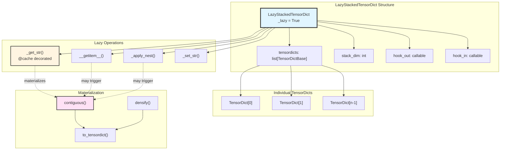
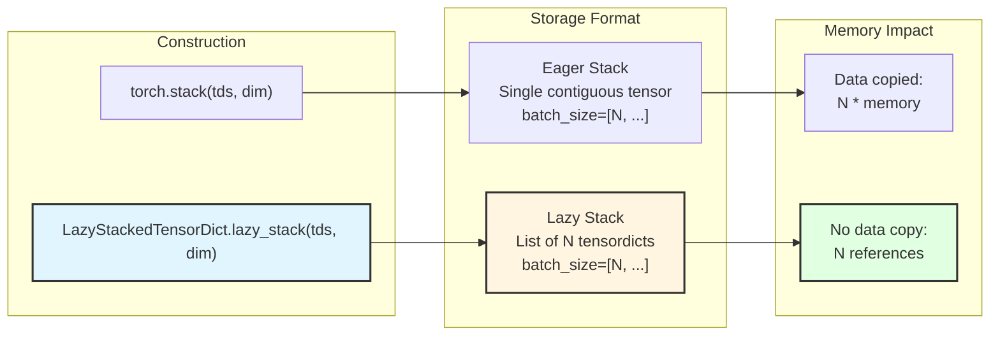
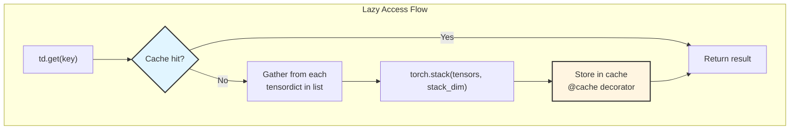
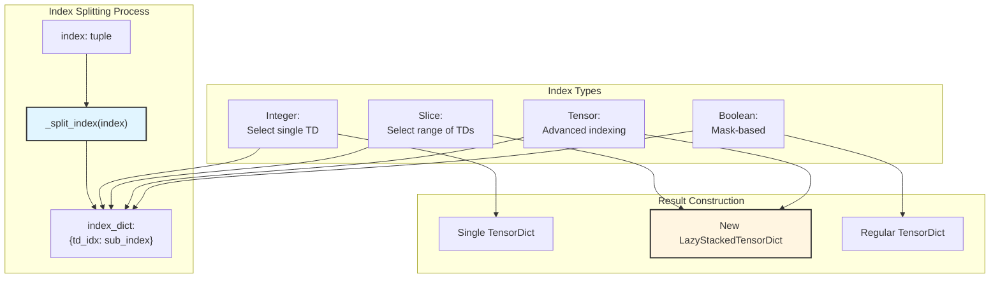
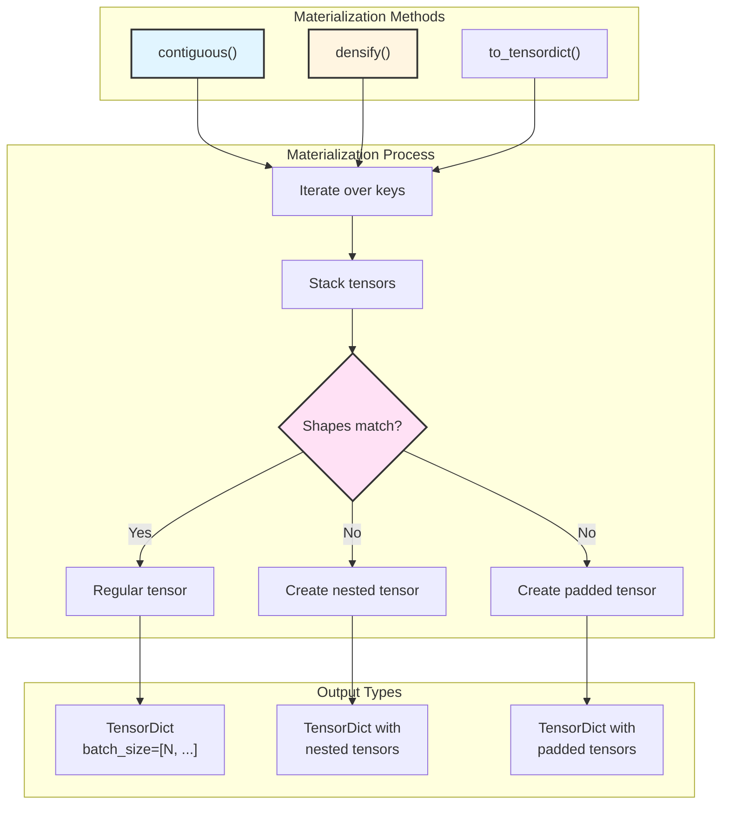
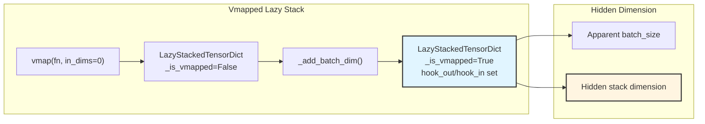
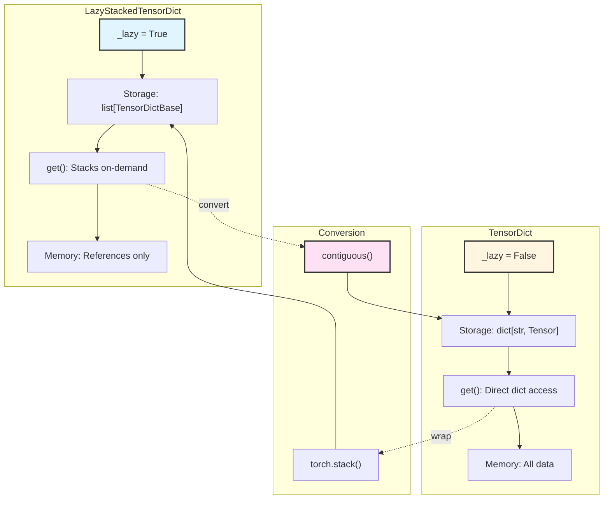

<!-- source: DeepWiki mcp.deepwiki.com · repo pytorch/tensordict · page 7.1 Lazy Operations and Evaluation · fetched 2026-10-21 -->

# Lazy Operations and Evaluation

<details>
<summary>Relevant source files</summary>

The following files were used as context for generating this wiki page:

- [tensordict/_lazy.py](tensordict/_lazy.py)
- [tensordict/_td.py](tensordict/_td.py)

</details>


This document describes how TensorDict implements lazy operations to optimize memory usage and defer computation until necessary. The primary mechanism is `LazyStackedTensorDict`, which maintains a collection of tensordicts without immediately materializing them into a single contiguous structure.

For information about memory management strategies including consolidation and memory mapping, see [Memory Management Strategies](#5.3). For details about PyTorch ecosystem integration including vmap, see [Functorch Integration and vmap](#6.1).

---

## Overview

Lazy evaluation in TensorDict allows operations to be deferred rather than executed immediately. This provides several benefits:

| Benefit | Description |
|---------|-------------|
| **Memory Efficiency** | Avoids copying data until actually needed |
| **Performance** | Defers expensive operations like stacking until required |
| **Flexibility** | Enables operations on heterogeneous data structures |
| **Caching** | Results are memoized to avoid recomputation |

The lazy evaluation system is built around two main concepts:
- **Lazy Stacking**: Collections of tensordicts maintained as lists rather than stacked tensors
- **Deferred Materialization**: Converting lazy structures to contiguous tensors only when necessary

**Sources**: [tensordict/_lazy.py:1-250]()

---

## LazyStackedTensorDict Architecture



The `LazyStackedTensorDict` class maintains references to multiple tensordicts without immediately combining them. This structure consists of:

- **tensordicts**: A list of `TensorDictBase` instances that remain separate
- **stack_dim**: The dimension along which the tensordicts would be stacked if materialized
- **hook_out/hook_in**: Optional transformation functions for vmap integration
- **_lazy attribute**: Set to `True` to identify lazy instances

**Sources**: [tensordict/_lazy.py:176-303](), [tensordict/_lazy.py:253]()

---

## Lazy Stacking Mechanism



The `lazy_stack` classmethod creates a `LazyStackedTensorDict` without materializing the data:

```python
# Usage pattern
tds = [TensorDict({'a': torch.randn(3, 4)}, batch_size=[3]) for _ in range(10)]
td_stack = torch.stack(tds, -1)  # Returns LazyStackedTensorDict by default
```

The lazy stacking process:

1. **Validation**: Checks that all tensordicts have compatible batch sizes (unless `strict_shape=False`)
2. **Storage**: Stores references to the original tensordicts in the `tensordicts` list
3. **Batch Size Computation**: Calculates the combined batch size by inserting the stack dimension
4. **Metadata Setup**: Configures `stack_dim` and optional `stack_dim_name`

**Key Implementation Details**:
- [tensordict/_lazy.py:1428-1569]() - `lazy_stack` classmethod implementation
- [tensordict/_lazy.py:688-721]() - `_reset_batch_size` method for shape validation
- [tensordict/_lazy.py:723-729]() - `_compute_batch_size` static method

**Sources**: [tensordict/_lazy.py:1428-1569](), [tensordict/_lazy.py:688-729]()

---

## Deferred Materialization and Caching



The `_get_str` method implements lazy retrieval with caching:

| Stage | Operation | Location |
|-------|-----------|----------|
| 1. Cache Check | Check if result exists via `@cache` decorator | [tensordict/_lazy.py:1299]() |
| 2. Collection | Iterate through `tensordicts` list and retrieve key | [tensordict/_lazy.py:1314-1327]() |
| 3. Stacking | Call `lazy_stack` recursively on collected items | [tensordict/_lazy.py:1361-1372]() |
| 4. Hook Application | Apply `hook_out` if vmapped | [tensordict/_lazy.py:1396-1397]() |
| 5. Return | Return stacked result (now cached) | [tensordict/_lazy.py:1398]() |

The caching mechanism uses the `@cache` decorator from `tensordict.utils`, which creates a weakref-based cache. This means:
- Results are memoized for fast repeated access
- Cache entries can be garbage collected when memory is needed
- Cache can be manually cleared with `erase_cache` decorator

**Special Cases**:

1. **Ragged Tensors**: When tensor shapes don't match, special handling is required:
   - `as_list=True`: Returns list instead of stacking ([tensordict/_lazy.py:1335-1342]())
   - `as_nested_tensor=True`: Creates nested tensor ([tensordict/_lazy.py:1344-1349]())
   - `as_padded_tensor=True`: Pads tensors to same shape ([tensordict/_lazy.py:1351-1359]())

2. **Default Handling**: If a default value is encountered and it's not stackable, returns immediately ([tensordict/_lazy.py:1328-1334]())

**Sources**: [tensordict/_lazy.py:1299-1412](), [tensordict/utils.py]() (cache decorator)

---

## Operations on Lazy Stacks

### Indexing Operations



The `__getitem__` method handles indexing by splitting the index across the stack dimension:

1. **Index Analysis**: `_split_index` method parses the index tuple and determines:
   - Which tensordicts are affected
   - How to index within each tensordict
   - Whether result should be lazy or materialized

2. **Dispatch Logic**: Based on index type:
   - **Integer index on stack_dim**: Returns single tensordict ([tensordict/_lazy.py:2596-2605]())
   - **Slice/range on stack_dim**: Returns new lazy stack ([tensordict/_lazy.py:2606-2619]())
   - **Boolean mask**: May return concatenated result ([tensordict/_lazy.py:2541-2569]())
   - **N-D tensor index**: Creates nested lazy structure ([tensordict/_lazy.py:2570-2593]())

**Sources**: [tensordict/_lazy.py:2515-2619](), [tensordict/_lazy.py:824-1008]()

### Set Operations

Setting values on a lazy stack unbinds the value along the stack dimension and distributes to each tensordict:

```python
# Example: Setting a value
lazy_td = torch.stack([td0, td1, td2], dim=0)
lazy_td["key"] = torch.randn(3, 4, 5)  # Unbinds along dim 0 and sets in each TD
```

The implementation:
- Validates value shape matches expected batch size ([tensordict/_lazy.py:749-754]())
- Unbinds value along stack dimension ([tensordict/_lazy.py:764]())
- Distributes to each tensordict ([tensordict/_lazy.py:765-773]())

**Sources**: [tensordict/_lazy.py:731-774]()

### Apply Operations

The `_apply_nest` method applies functions to lazy stacks while maintaining laziness when possible:

| Scenario | Behavior |
|----------|----------|
| `inplace=True` | Applies to each tensordict in-place, returns same lazy stack |
| `batch_size` changes | Materializes to regular TensorDict |
| `call_on_nested=True` | Applies to each tensordict separately, rebuilds lazy stack |
| Default | Applies and returns new lazy stack |

**Sources**: [tensordict/_lazy.py:2216-2345]()

---

## Materialization Strategies



### contiguous()

Materializes the lazy stack into a regular `TensorDict` with contiguous tensors:

- Iterates over all key-value pairs ([tensordict/_lazy.py:1811]())
- Stacks each value along the stack dimension
- Creates new `TensorDict` with combined batch size ([tensordict/_lazy.py:1814-1821]())
- Preserves device, names, and lock status

**Use Case**: When you need actual stacked tensors (e.g., for saving, certain operations)

**Sources**: [tensordict/_lazy.py:1807-1821]()

### densify()

Attempts to represent the lazy stack with contiguous or nested tensors:

1. **For uniform shapes**: Uses `torch.stack` ([tensordict/_lazy.py:1867]())
2. **For ragged shapes**: 
   - Creates nested tensors if `stack_dim=0` ([tensordict/_lazy.py:1870-1872]())
   - Raises error if `stack_dim != 0` ([tensordict/_lazy.py:1874-1876]())
3. **For exclusive keys**: Fills missing entries with zero-shaped tensors ([tensordict/_lazy.py:1847-1865]())

**Use Case**: When you want efficient representation but can handle nested tensors

**Sources**: [tensordict/_lazy.py:1823-1886]()

### to_tensordict()

Inherited from `TensorDictBase`, calls `contiguous()` to fully materialize:

**Sources**: [tensordict/base.py]()

---

## Integration with PyTorch Features

### Functorch vmap Integration



When a lazy stack is vmapped along its stack dimension, special handling occurs:

1. **Dimension Hiding**: The stack dimension is removed from `batch_size` ([tensordict/_lazy.py:1660-1662]())
2. **Hook Installation**: 
   - `hook_out`: Adds the batch dimension back when retrieving values ([tensordict/_lazy.py:1640-1643]())
   - `hook_in`: Removes batch dimension when setting values ([tensordict/_lazy.py:1647-1655]())
3. **Flag Setting**: `_is_vmapped=True` marks the vmapped state ([tensordict/_lazy.py:1659]())

This allows the lazy stack to participate in vmapped computations without materialization.

**Sources**: [tensordict/_lazy.py:1591-1663](), [tensordict/_lazy.py:1633-1663]()

### Caching for Performance

The `@cache` decorator (from `tensordict.utils`) is applied to several methods:

| Method | Purpose | Cache Key |
|--------|---------|-----------|
| `_get_str` | Lazy value retrieval | Key name + arguments |
| `_add_batch_dim` | Vmap dimension handling | in_dim, vmap_level |
| `_remove_batch_dim` | Vmap dimension restoration | vmap_level, batch_size, out_dim |
| `_maybe_remove_batch_dim` | Conditional dimension restoration | funcname, vmap_level, batch_size, out_dim |
| `_key_list` | Available keys | (no args) |

The cache is weakref-based, meaning cached results are eligible for garbage collection when memory pressure increases.

**Sources**: [tensordict/_lazy.py:1299](), [tensordict/_lazy.py:1591](), [tensordict/_lazy.py:1665](), [tensordict/_lazy.py:1705](), [tensordict/_lazy.py:2052]()

---

## Performance Considerations

### Memory Efficiency Pattern

```mermaid
graph TB
    subgraph "Lazy Pattern - Low Memory"
        CREATE_L["Create 10 TensorDicts<br/>10 MB each"]
        STACK_L["torch.stack(tds)<br/>returns LazyStackedTensorDict"]
        USE_L["Access specific indices<br/>Only loads needed data"]
        MEM_L["Memory: ~10 MB<br/>(Only loaded TDs)"]
    end
    
    subgraph "Eager Pattern - High Memory"
        CREATE_E["Create 10 TensorDicts<br/>10 MB each"]
        STACK_E["Materialize stack<br/>torch.cat or contiguous()"]
        USE_E["Access data<br/>All data in memory"]
        MEM_E["Memory: ~100 MB<br/>(All TDs loaded)"]
    end
    
    CREATE_L --> STACK_L
    STACK_L --> USE_L
    USE_L --> MEM_L
    
    CREATE_E --> STACK_E
    STACK_E --> USE_E
    USE_E --> MEM_E
    
    style STACK_L fill:#e1f5ff,stroke:#333,stroke-width:2px
    style MEM_L fill:#e1ffe1,stroke:#333,stroke-width:2px
    style MEM_E fill:#ffe1e1,stroke:#333,stroke-width:2px
```



### When to Use Lazy Stacks

**Advantages**:
- No immediate memory allocation for stacked data
- Efficient for large collections where only subset is accessed
- Preserves original tensordict references (useful for in-place updates)
- Defers expensive stacking operations

**Disadvantages**:
- Overhead from indirection through list
- Some operations require materialization
- Cache memory can accumulate
- Not all operations are optimized for lazy stacks

### Performance Guidelines

| Operation Type | Recommendation |
|----------------|----------------|
| **Index-based access** | Excellent with lazy stacks - only accesses needed TDs |
| **Full iteration** | Consider materializing first with `contiguous()` |
| **Repeated access to same keys** | Excellent - benefits from caching |
| **Shape operations** | Good - maintains laziness when possible |
| **Reductions** | May require materialization for cross-TD operations |
| **Save/serialize** | Requires materialization via `contiguous()` |

**Sources**: [tensordict/_lazy.py:176-225]() (docstring), Performance characteristics inferred from implementation

### Cache Management

To clear accumulated cache entries:

```python
from tensordict.utils import erase_cache

# Manual cache clearing
lazy_td.erase_cache()  # Clears cache for this instance and nested TDs
```

The cache uses weak references, so entries are automatically cleared when:
- Memory pressure triggers garbage collection
- No strong references exist to the lazy stack
- Explicit cache clearing is called

**Sources**: [tensordict/utils.py]() (cache utilities)

---

## Key Differences: LazyStackedTensorDict vs TensorDict



| Aspect | LazyStackedTensorDict | TensorDict |
|--------|----------------------|------------|
| **Storage** | List of tensordict references | Dictionary of tensors |
| **Memory Pattern** | Deferred - data stays in original locations | Immediate - all data accessible |
| **Access Speed** | Variable - fast with cache, slower on first access | Consistent - direct dictionary lookup |
| **Modification** | Distributes to component tensordicts | Direct in-place modification |
| **Batch Size** | Computed from components + stack dim | Directly specified |
| **_lazy attribute** | True | False (default) |

**Sources**: [tensordict/_lazy.py:253](), [tensordict/_td.py:245-248]()

---

