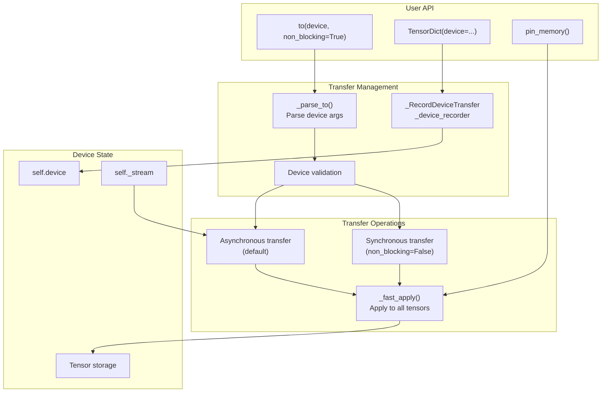
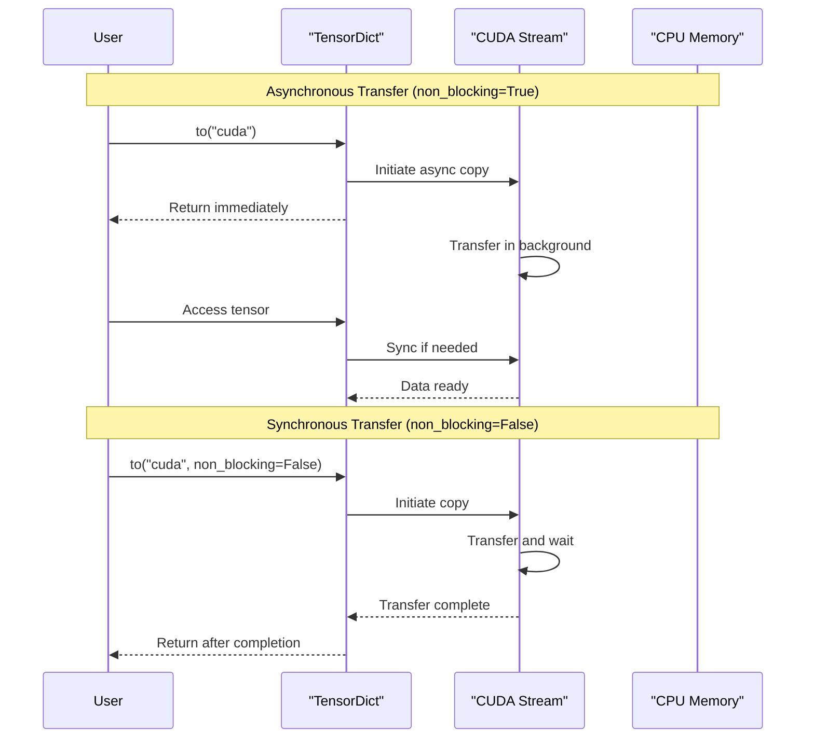
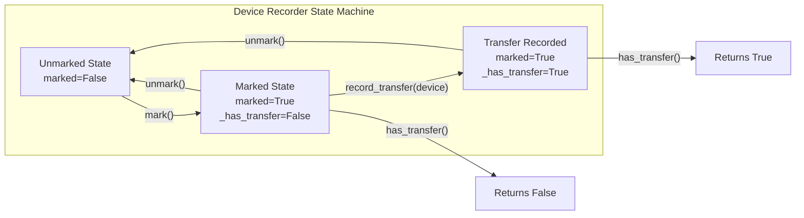
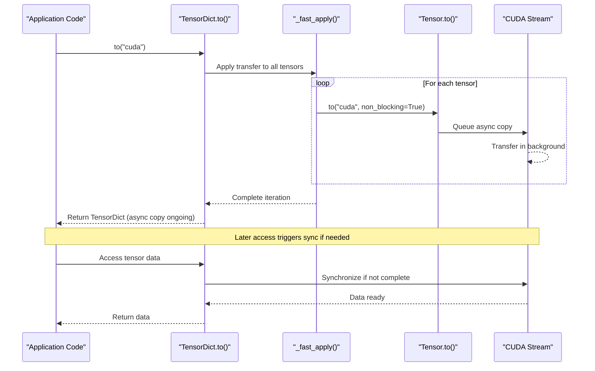
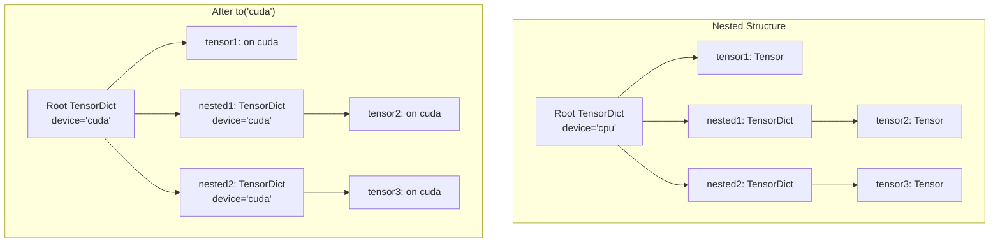
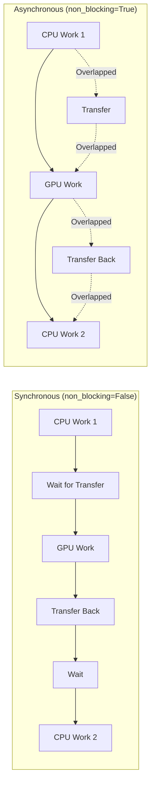
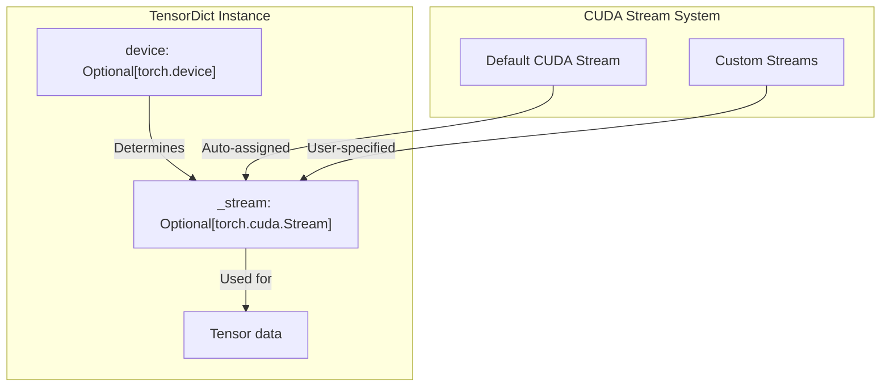

<!-- source: DeepWiki mcp.deepwiki.com · repo pytorch/tensordict · page 7.2 Consolidation and Asynchronous Transfers · fetched 2026-10-21 -->

# Asynchronous Device Transfers

<details>
<summary>Relevant source files</summary>

The following files were used as context for generating this wiki page:

- [tensordict/base.py](tensordict/base.py)
- [test/test_tensordict.py](test/test_tensordict.py)

</details>


## Purpose and Scope

This page documents TensorDict's asynchronous device transfer capabilities, including the `non_blocking` parameter for the `to()` method, device management strategies, and optimizing data movement between CPU and GPU. For information about different storage backends (memory-mapped tensors, shared memory), see [Memory Management Strategies](#5.3). For compilation and CUDA graph support, see [Compilation and CUDA Graphs](#7.3).

## Overview

TensorDict optimizes device transfers by making them asynchronous by default, enabling efficient data movement between CPU and GPU without unnecessary synchronization points. This design allows overlapping of data transfers with computation, significantly improving performance in GPU-accelerated workloads. The library automatically manages synchronization points when operations require it, while still allowing users to force synchronous transfers when needed for specific use cases.

Sources: [README.md:68-78](), [tensordict/base.py:219-244]()

## Device Transfer Architecture

The device transfer system in TensorDict consists of several key components that work together to provide safe and efficient asynchronous transfers:



**Diagram: Device Transfer Control Flow** - Shows how device transfer requests flow through the system, from user API calls through parsing and validation to the actual tensor transfer operations.

Sources: [tensordict/base.py:219-244](), [tensordict/base.py:300-311]()

## The Device Transfer API

### The `to()` Method

The primary interface for device transfers is the `to()` method, which accepts device specifications and transfer options. The method signature follows PyTorch's conventions while adding TensorDict-specific optimizations.

**Basic Usage:**
```python
# Asynchronous transfer to CUDA (default behavior)
td_cuda = td.to("cuda")

# Asynchronous transfer back to CPU
td_cpu = td_cuda.to("cpu")

# Force synchronous transfer
td_cpu_sync = td_cuda.to("cpu", non_blocking=False)

# Specify device index
td_cuda_0 = td.to("cuda:0")
```

The `to()` method in TensorDict handles nested structures automatically, applying the transfer recursively to all tensors within the collection, including those in nested TensorDicts.

Sources: [README.md:68-78]()

### The `non_blocking` Parameter

The `non_blocking` parameter controls whether device transfers should be asynchronous. When `True` (the default), transfers are initiated without waiting for completion. When `False`, the method blocks until all tensors have been copied to the target device.

| Parameter Value | Behavior | Use Case |
|----------------|----------|----------|
| `True` (default) | Asynchronous transfer with automatic synchronization | Most common case; maximum performance |
| `False` | Synchronous transfer; blocks until complete | When immediate availability is required |
| Not specified | Defaults to `True` | Recommended for typical usage |

**Transfer Mode Comparison:**



**Diagram: Asynchronous vs Synchronous Transfer Timeline** - Illustrates the key difference in execution flow between asynchronous and synchronous device transfers.

Sources: [README.md:68-78]()

### Device Specification Formats

TensorDict accepts multiple device specification formats, following PyTorch conventions:

**Supported Formats:**
```python
# String format
td.to("cuda")
td.to("cuda:0")
td.to("cpu")

# torch.device format
td.to(torch.device("cuda:0"))

# Integer (for CUDA devices)
td.to(0)  # Equivalent to "cuda:0"

# During initialization
td = TensorDict(data, device="cuda")
td = TensorDict(data, device=torch.device("cuda:0"))
```

The device parser handles these formats through the `_parse_to()` utility function, which normalizes device specifications before applying transfers.

Sources: [tensordict/base.py:300-311](), [test/test_tensordict.py:757-829]()

## Device Recording and Transfer Tracking

### The `_RecordDeviceTransfer` Class

TensorDict uses a global `_device_recorder` instance to track device transfers during initialization and operations. This mechanism ensures consistency and enables optimizations.



**Diagram: Device Recorder State Machine** - The recorder tracks whether device transfers occur during TensorDict operations.

**Key Methods:**

- `mark()`: Begin tracking transfers for a TensorDict operation
- `record_transfer(device)`: Record that a transfer to `device` occurred
- `has_transfer()`: Check if any transfers were recorded
- `unmark()`: Stop tracking and reset state

The recorder can only track one operation at a time. Attempting to `mark()` when already marked raises a `RuntimeError`.

Sources: [tensordict/base.py:219-244]()

### Device Consistency and Validation

When a TensorDict has a specified device, all tensors added to it are automatically transferred to that device:

```python
# Create TensorDict with device specification
td = TensorDict({}, batch_size=[5], device="cuda:0")

# Tensors are automatically moved to device
td.set("a", torch.randn(5, 1))  # Automatically moved to cuda:0
assert td.get("a").device == torch.device("cuda:0")
```

This automatic transfer behavior applies to:
- Direct assignment via `set()`
- Dictionary-style assignment `td["key"] = value`
- Updates via `update()` method
- Stacked TensorDicts with specified device

Sources: [test/test_tensordict.py:757-829]()

## Asynchronous Transfer Behavior

### Default Asynchronous Mode

By default, all device transfers in TensorDict are asynchronous. This means:

1. **Non-blocking initiation**: The `to()` method returns immediately after initiating the transfer
2. **Background execution**: Actual data movement occurs in CUDA streams
3. **Automatic synchronization**: TensorDict synchronizes when operations require it

**Asynchronous Transfer Flow:**



**Diagram: Asynchronous Transfer with Deferred Synchronization** - Shows how transfers are queued and executed asynchronously, with synchronization deferred until data access.

Sources: [README.md:68-78]()

### Synchronization Points

TensorDict automatically synchronizes device transfers at certain points to ensure correctness:

**Automatic Synchronization Occurs When:**

| Operation | Reason | Example |
|-----------|--------|---------|
| Data access | Ensure data is available | `value = td["key"]` |
| In-place operations | Prevent race conditions | `td["key"].add_(1)` |
| CPU operations | Data must be on CPU | Operations on CPU tensors |
| Indexing | Need consistent view | `td[0]` |
| Shape operations | Structural changes | `td.reshape(...)` |

The synchronization is handled transparently by PyTorch's CUDA stream system. Users typically don't need to manually synchronize unless working with raw CUDA operations.

Sources: [tensordict/base.py:300-311]()

### Forcing Synchronous Transfers

In certain scenarios, synchronous transfers are necessary or desirable:

**When to Use `non_blocking=False`:**

1. **Debugging**: To eliminate timing-related issues
2. **Profiling**: To measure actual transfer time
3. **Resource management**: To ensure memory is freed immediately
4. **External synchronization**: When coordinating with non-PyTorch code

```python
# Force synchronous transfer for debugging
td_sync = td.to("cpu", non_blocking=False)
# At this point, all tensors are guaranteed to be on CPU

# Asynchronous (default) - may still be transferring
td_async = td.to("cpu")
# Transfer may still be in progress here
```

Sources: [README.md:68-78]()

## Device Management Patterns

### Pattern 1: Fast Model Input Preparation

```python
# Prepare batch on GPU asynchronously
batch = TensorDict(
    observations=observations,  # CPU tensors
    actions=actions,
    device="cuda"
)
# Transfer initiated, computation can overlap

# Model forward pass
output = model(batch)  # Auto-syncs if needed
```

### Pattern 2: Efficient Data Collection

```python
# Collect data on CPU, periodically move to GPU
cpu_buffer = TensorDict({}, batch_size=[buffer_size], device="cpu")

for i in range(buffer_size):
    cpu_buffer[i] = collect_sample()

# Single async transfer of entire buffer
gpu_buffer = cpu_buffer.to("cuda")
```

### Pattern 3: Pinned Memory for Faster Transfers

Using pinned (page-locked) memory can significantly speed up transfers:

```python
# Pin memory for faster CPU->GPU transfers
td_pinned = td.pin_memory()

# Subsequent transfers are faster
td_cuda = td_pinned.to("cuda")  # Faster than unpinned
```

The `pin_memory()` method uses PyTorch's pinned memory allocation, which allows direct memory access (DMA) transfers to GPU.

Sources: [tensordict/base.py:300-311]()

### Pattern 4: Device-Aware TensorDict Creation

When creating TensorDicts with large amounts of data, specifying the device during initialization is more efficient than creating on CPU and transferring:

```python
# Efficient: Direct creation on device
td = TensorDict(
    {
        "feature1": torch.randn(1000, 256, device="cuda"),
        "feature2": torch.randn(1000, 128, device="cuda"),
    },
    device="cuda",
    batch_size=[1000]
)

# Less efficient: Create on CPU then transfer
td_cpu = TensorDict({...}, device="cpu")
td_cuda = td_cpu.to("cuda")
```

Sources: [test/test_tensordict.py:757-829]()

## Nested TensorDict Device Transfers

Device transfers automatically propagate through nested TensorDict structures:



**Diagram: Recursive Device Transfer in Nested TensorDicts** - Shows how device transfers propagate through the entire structure hierarchy.

The transfer operation recursively visits all nested TensorDicts and applies the device transfer to every tensor, maintaining structural consistency.

Sources: [tensordict/base.py:300-311]()

## Performance Considerations

### Benefits of Asynchronous Transfers

| Benefit | Description | Impact |
|---------|-------------|--------|
| **Overlapping execution** | Transfer occurs while CPU computes | Can hide transfer latency completely |
| **Pipeline efficiency** | Multiple batches can be in flight | Higher GPU utilization |
| **Reduced blocking** | Application doesn't wait for transfer | Better throughput |
| **Stream optimization** | CUDA manages concurrent operations | Automatic hardware utilization |

### Performance Impact Comparison



**Diagram: Execution Timeline Comparison** - Illustrates how asynchronous transfers enable work overlap, reducing total execution time.

Sources: [README.md:68-78]()

### When to Use Synchronous Transfers

While asynchronous transfers are generally preferred, synchronous transfers (`non_blocking=False`) are appropriate for:

1. **Debugging race conditions**: Eliminate timing-sensitive bugs
2. **Profiling transfer time**: Measure actual data movement cost
3. **Memory-constrained scenarios**: Ensure buffers are freed before allocating new ones
4. **Correctness verification**: Confirm operations complete in expected order

### Optimization Guidelines

**Best Practices:**

1. **Batch transfers**: Transfer entire TensorDicts rather than individual tensors
2. **Use pinned memory**: For repeated CPU↔GPU transfers
3. **Avoid round-trips**: Minimize CPU-GPU-CPU transfer cycles
4. **Preallocate on device**: Create tensors directly on target device when possible
5. **Profile carefully**: Use `torch.cuda.synchronize()` when profiling

**Anti-patterns to Avoid:**

```python
# ❌ Bad: Transferring tensors individually
for key in td.keys():
    td[key] = td[key].to("cuda")

# ✅ Good: Transfer entire TensorDict
td = td.to("cuda")

# ❌ Bad: Unnecessary round-trip
gpu_result = model(td.to("cuda")).to("cpu").to("cuda")

# ✅ Good: Keep on device
gpu_result = model(td.to("cuda"))
```

Sources: [README.md:68-78]()

## Stream Management

TensorDict maintains an internal `_stream` attribute to track CUDA streams associated with asynchronous operations. While typically managed automatically, advanced users can interact with stream management for fine-grained control.



**Diagram: Stream Management Architecture** - Shows how TensorDict tracks CUDA streams for asynchronous operations.

The `_stream` attribute is initialized to `None` and is set when operations requiring stream management occur. Users typically don't need to interact with this directly, as PyTorch's stream system handles synchronization automatically.

Sources: [tensordict/base.py:311]()

## Device Transfer and Consolidation

When used with consolidated TensorDicts (see [Memory Management Strategies](#5.3)), device transfers maintain the consolidated memory layout:

```python
# Consolidated TensorDict on CPU
td = TensorDict({
    "a": torch.zeros(1, 1),
    "b": {"c": torch.zeros(1, 1)},
}, device="cpu", batch_size=[1])
td_consolidated = td.consolidate()

# Transfer maintains consolidated structure
td_cuda = td_consolidated.to("cuda")
assert td_cuda.is_consolidated()  # Still consolidated
assert td_cuda.device == torch.device("cuda:0")
```

This is particularly efficient because the entire consolidated storage block is transferred in a single operation, rather than transferring each tensor individually.

Sources: [test/test_tensordict.py:555-604]()

## Summary

Asynchronous device transfers in TensorDict provide:

- **Default asynchronous behavior** for optimal performance with automatic synchronization
- **Explicit control** via `non_blocking` parameter when synchronous transfers are needed  
- **Automatic propagation** through nested structures and all tensors
- **Stream management** that integrates with PyTorch's CUDA system
- **Consistency guarantees** through device recording and validation
- **Performance optimizations** including support for pinned memory and consolidated transfers

The design prioritizes safety and ease of use while providing the performance benefits of asynchronous execution. For most use cases, the default asynchronous behavior with automatic synchronization provides the best balance of performance and correctness.

Sources: [README.md:68-78](), [tensordict/base.py:219-244](), [tensordict/base.py:300-311](), [test/test_tensordict.py:757-829]()

---

