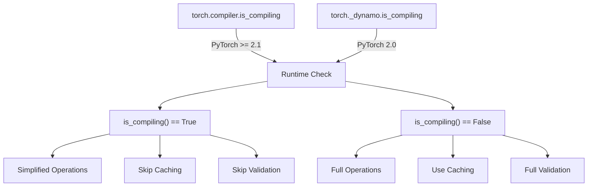
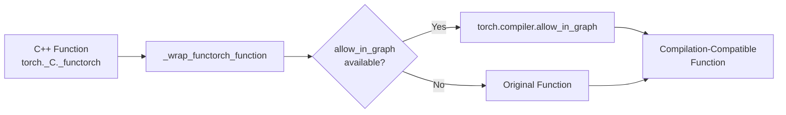
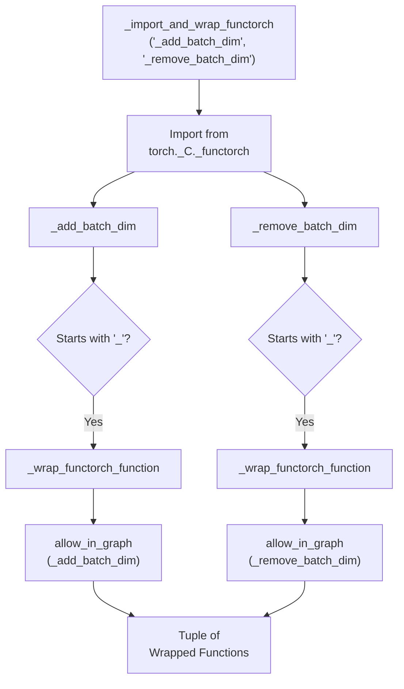
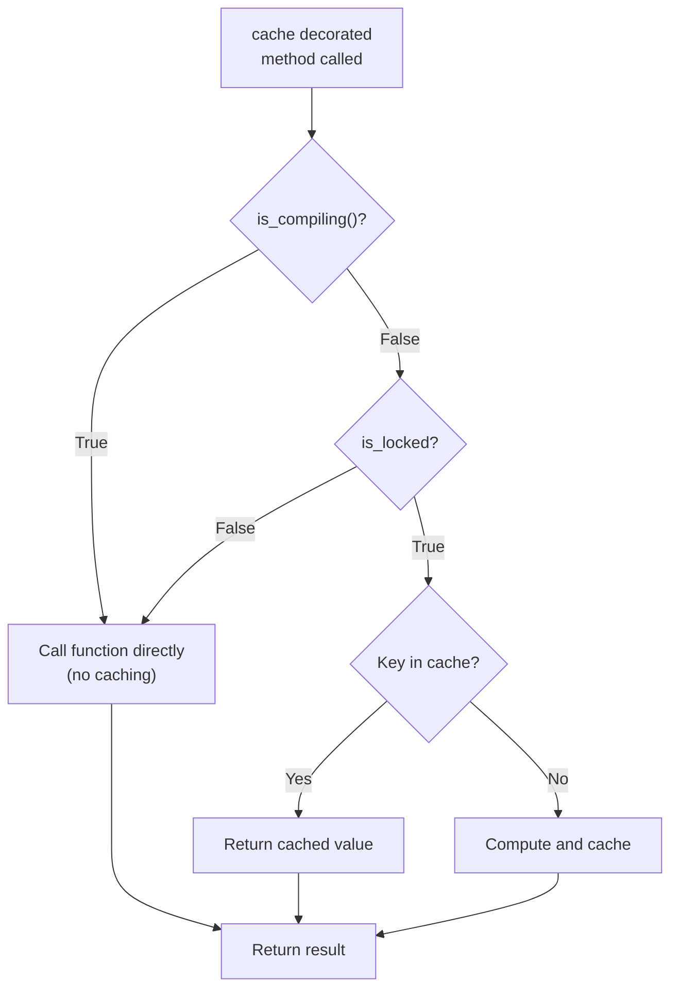
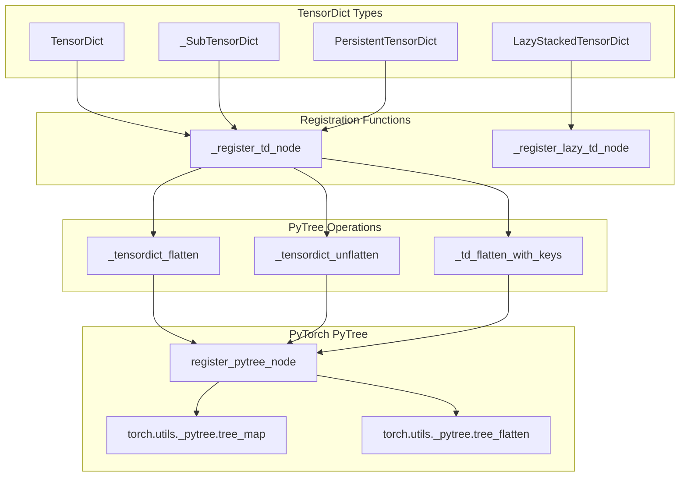
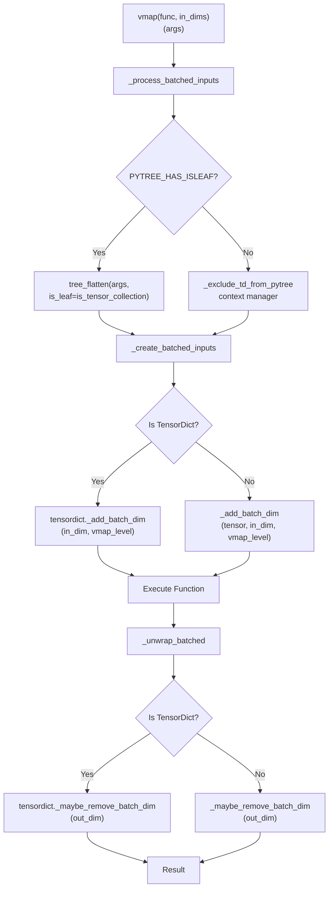
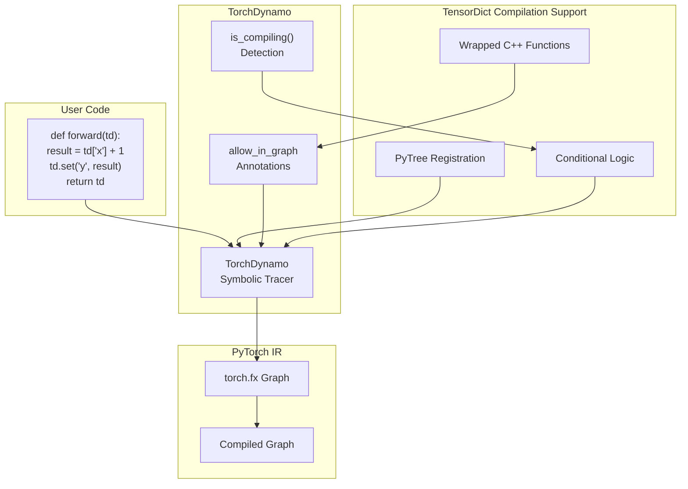

<!-- source: DeepWiki mcp.deepwiki.com · repo pytorch/tensordict · page 7.3 Compilation Support · fetched 2026-10-21 -->

# Compilation Support

<details>
<summary>Relevant source files</summary>

The following files were used as context for generating this wiki page:

- [tensordict/_pytree.py](tensordict/_pytree.py)
- [tensordict/nn/functional_modules.py](tensordict/nn/functional_modules.py)
- [tensordict/utils.py](tensordict/utils.py)
- [test/test_functorch.py](test/test_functorch.py)

</details>


This page documents TensorDict's compatibility with PyTorch's `torch.compile` and TorchDynamo compilation infrastructure. It covers the mechanisms that enable TensorDict operations to be traced and optimized by the compiler, including C++ function wrapping, runtime behavior detection, and conditional logic during compilation.

For information about lazy operations and deferred evaluation strategies, see [Lazy Operations and Evaluation](#7.1). For details on caching mechanisms, see [Caching and Performance Patterns](#7.4).

## Overview

TensorDict provides seamless integration with PyTorch's compilation infrastructure through several key mechanisms:

- **C++ Function Wrapping**: Functorch C++ functions are wrapped with `allow_in_graph` to enable compilation through these functions
- **Runtime Detection**: The `is_compiling()` utility detects when code is being traced by TorchDynamo
- **Conditional Behavior**: Certain operations are simplified or skipped during compilation to ensure traceability
- **PyTree Registration**: TensorDict types are registered as PyTree nodes, enabling tree operations during compilation

Sources: [tensordict/utils.py:70-124]()

## Core Compilation Infrastructure

### Compilation Detection

TensorDict imports and uses PyTorch's compilation detection utilities to determine when code is being traced by the compiler:

```python
from torch.compiler import assume_constant_result, is_compiling
```

For PyTorch 2.0 compatibility, these are imported from `torch._dynamo` as a fallback.

The `is_compiling()` function is used throughout the codebase to conditionally alter behavior during compilation. When `True`, certain operations that are difficult to trace are skipped or simplified.

**Compilation Detection Flow**



Sources: [tensordict/utils.py:70-72]()

### Conditional Compilation Logic

Several critical functions check `is_compiling()` to alter their behavior:

| Function | Line Range | Compilation Behavior |
|----------|------------|---------------------|
| `cache` | [tensordict/utils.py:807]() | Bypasses cache when compiling |
| `_is_tensorclass` | [tensordict/utils.py:751-752]() | Skips memoization during compilation |
| `_parse_to` | [tensordict/utils.py:1075-1093]() | Uses simplified device/dtype parsing |
| `_check_keys` | [tensordict/utils.py:1464]() | Avoids set operations on arbitrary objects |

Sources: [tensordict/utils.py:751-752](), [tensordict/utils.py:807-808](), [tensordict/utils.py:1075-1093](), [tensordict/utils.py:1464-1468]()

## C++ Function Wrapping for Compilation

### The `allow_in_graph` Pattern

PyTorch's Dynamo compiler cannot directly trace C++ functions from `torch._C._functorch`. To enable compilation through these functions, TensorDict provides a wrapping mechanism using `torch.compiler.allow_in_graph`.

**Wrapper Function Implementation**



The `_wrap_functorch_function` utility wraps a single C++ function:

```python
def _wrap_functorch_function(func):
    """Wrap a functorch C++ function to make it compatible with torch.compile."""
    try:
        from torch.compiler import allow_in_graph
        return allow_in_graph(func)
    except (ImportError, AttributeError):
        # Fallback for older PyTorch versions without allow_in_graph
        return func
```

Sources: [tensordict/utils.py:104-123]()

### Batch Import and Wrapping

The `_import_and_wrap_functorch` utility handles importing and wrapping multiple functorch functions in a single call:

```python
def _import_and_wrap_functorch(*names, wrap_names=None):
    """Import functorch C++ functions and optionally wrap them for torch.compile."""
```

**Default Wrapping Policy**: By default, all private functions (starting with `_`) are wrapped with `allow_in_graph`, as these are typically the low-level functions that need compilation support.

**Available Functions for Import**:
- `_add_batch_dim`: Adds a batch dimension to tensors for vmap operations
- `_remove_batch_dim`: Removes batch dimensions after vmap
- `get_unwrapped`: Unwraps batched tensors
- `is_batchedtensor`: Checks if a tensor is batched

**Import and Wrapping Flow**



Sources: [tensordict/utils.py:126-178](), [tensordict/utils.py:182-186]()

### Current Usage

The library currently imports and wraps `_add_batch_dim` for vmap support:

```python
_add_batch_dim_c = None
try:
    _add_batch_dim_c = _import_and_wrap_functorch("_add_batch_dim")
except ImportError:
    pass
```

This enables TensorDict's vmap integration to work seamlessly with `torch.compile`.

Sources: [tensordict/utils.py:182-186]()

## Runtime Behavior Detection

### The `is_compiling()` Guard

Many operations in TensorDict check `is_compiling()` to determine whether to execute full logic or simplified tracing-compatible logic:

**Cache Decorator Behavior**



The `@cache` decorator explicitly checks compilation status:

```python
@wraps(fun)
def newfun(_self: "TensorDictBase", *args, **kwargs):
    if not _self.is_locked or is_compiling():
        return fun(_self, *args, **kwargs)
    # ... caching logic
```

During compilation, caching is disabled because:
1. Cache state is not part of the traced graph
2. Cache lookups add tracing complexity
3. Different traces may have different cache states

Sources: [tensordict/utils.py:805-823]()

### Device and Dtype Parsing

The `_parse_to` function handles device and dtype conversion with compilation-aware logic:

```python
def _parse_to(*args, **kwargs):
    # ... extract parameters
    if not is_compiling():
        device, dtype, non_blocking, convert_to_format = torch._C._nn._parse_to(
            *args, **kwargs
        )
    else:
        # Simplified parsing during compilation
        non_blocking = kwargs.get("non_blocking", False)
        # ... manual device/dtype extraction
```

During compilation, the function uses simplified logic to avoid calling into C++ parsing functions that may not be traceable.

Sources: [tensordict/utils.py:1069-1115]()

### Type Checking Optimization

The `_is_tensorclass` function implements memoization with compilation awareness:

```python
def _is_tensorclass(cls: type) -> bool:
    out = _TENSORCLASS_MEMO.get(cls)
    if out is None:
        out = getattr(cls, "_is_tensorclass", False)
        if not is_compiling():
            _TENSORCLASS_MEMO[cls] = out
    return out
```

During compilation, the memoization cache is not updated because:
1. The cache dictionary would need to be constant-folded
2. Different compilation contexts may see different type sets

Sources: [tensordict/utils.py:747-753]()

## PyTree Integration for Compilation

TensorDict types are registered as PyTree nodes to enable tree-based operations during compilation. This integration is critical for `vmap` and `tree_map` operations.

**PyTree Registration Architecture**



### Flatten and Unflatten Operations

The PyTree registration defines how TensorDict instances are decomposed (flattened) and reconstructed (unflattened) during tree operations:

**Flatten Context**:
- `keys`: List of string keys
- `batch_size`: Batch dimensions
- `names`: Dimension names (if present)
- `device`: Device location
- `constructor`: Constructor function for unflatten
- `non_tensor_data`: Non-tensor items
- `cls`: Original class type

**Unflatten Process**:
1. Extract values and context from flattened representation
2. Validate batch sizes match across all values
3. Call appropriate constructor to rebuild TensorDict
4. Restore non-tensor data

Sources: [tensordict/_pytree.py:85-148]()

### Compilation with PyTree Operations

The `is_leaf` parameter in `tree_map` determines whether TensorDict instances are treated as leaves or further decomposed:

```python
# PyTree supports is_leaf in PyTorch >= 2.3
PYTREE_HAS_ISLEAF = "is_leaf" in signature(torch.utils._pytree.tree_map).parameters
```

When `is_leaf=is_tensor_collection` is specified, TensorDict instances are treated as atomic units rather than being decomposed into their constituent tensors.

Sources: [tensordict/nn/functional_modules.py:31]()

## Vmap Integration with Compilation

TensorDict provides custom vmap integration that is compilation-compatible. The integration modifies functorch's internal processing to handle TensorDict instances specially.

**Vmap Processing Flow**



The monkey-patched functions in `functional_modules.py` ensure that:

1. **Input Processing**: TensorDict instances are recognized during PyTree flattening
2. **Batch Dimension Addition**: TensorDict's custom `_add_batch_dim` method is called
3. **Batch Dimension Removal**: TensorDict's custom `_maybe_remove_batch_dim` method is called after execution

This design enables vmap to work seamlessly with compiled functions that operate on TensorDict instances.

Sources: [tensordict/nn/functional_modules.py:148-308]()

## Best Practices for Compilation

### Guidelines for TensorDict Operations

1. **Avoid Dynamic Operations**: Operations that depend on runtime values (like dynamic key creation) should be guarded with `is_compiling()` checks

2. **Use Simplified Logic**: When implementing custom operations, provide a simplified code path for compilation:
   ```python
   if is_compiling():
       # Simple, traceable logic
   else:
       # Complex logic with validation
   ```

3. **Disable Caching**: Caching mechanisms should be disabled during compilation unless the cache is part of the traced graph

4. **Constant Results**: Use `assume_constant_result` for values that should be treated as constants during tracing

### Common Patterns

**Pattern: Conditional Validation**

```python
if not is_compiling():
    # Expensive validation that doesn't affect semantics
    validate_tensors(...)
```

**Pattern: Memoization Bypass**

```python
if not is_compiling():
    cache[key] = result
```

**Pattern: Simplified Parsing**

```python
if is_compiling():
    # Simple extraction
    device = torch.device(args[0])
else:
    # Full C++ parsing
    device = torch._C._nn._parse_to(*args, **kwargs)[0]
```

Sources: [tensordict/utils.py:807](), [tensordict/utils.py:751-752](), [tensordict/utils.py:1075-1093]()

## Compilation Support Matrix

| Feature | Compilation Support | Notes |
|---------|-------------------|-------|
| Basic operations (get, set) | ✓ Full | Core operations are fully traceable |
| Nested TensorDict | ✓ Full | PyTree registration enables nested structures |
| vmap integration | ✓ Full | Custom _add_batch_dim/_remove_batch_dim methods |
| Caching | ⚠ Disabled | Cache bypassed during compilation |
| Dynamic key creation | ⚠ Limited | Requires compile-time constant keys |
| Memory mapping | ⚠ Limited | File I/O operations not traceable |
| Distributed operations | ⚠ Limited | Communication primitives may not trace |
| LazyStackedTensorDict | ✓ Full | PyTree registration for lazy stacking |

Sources: [tensordict/utils.py:70-186](), [tensordict/_pytree.py:1-273](), [tensordict/nn/functional_modules.py:1-343]()

## Integration with PyTorch Compiler Stack

**Compiler Integration Points**



The compilation support infrastructure enables TensorDict operations to be:
1. Traced by TorchDynamo's symbolic execution
2. Represented in torch.fx intermediate representation
3. Optimized by backend compilers (TorchInductor, etc.)

Sources: [tensordict/utils.py:70-186](), [tensordict/_pytree.py:1-273]()

---

