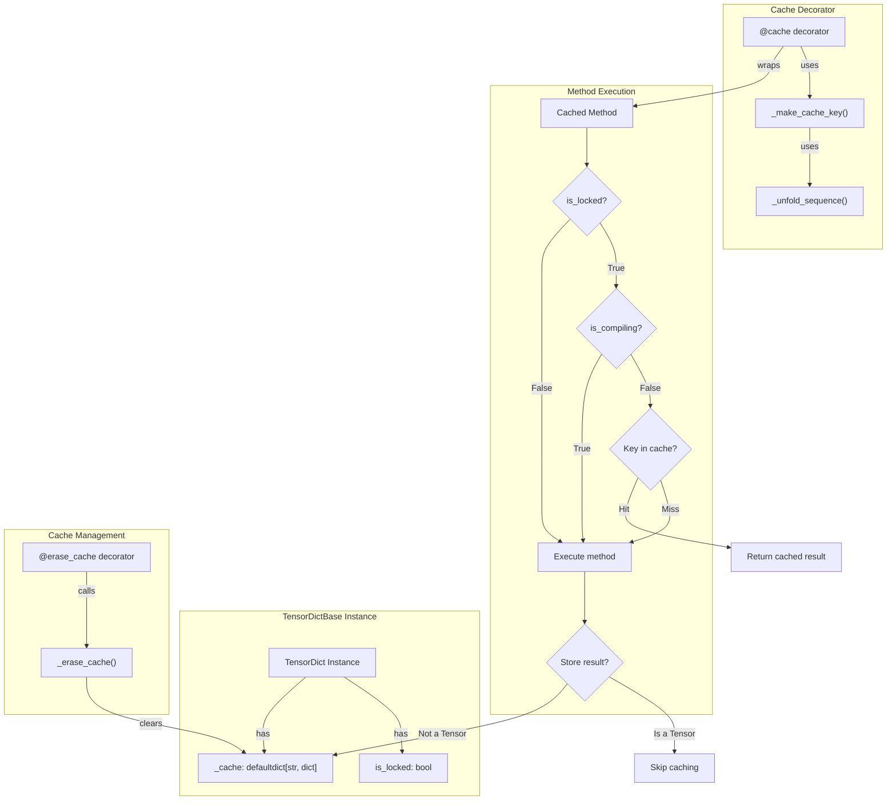
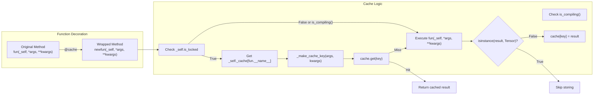
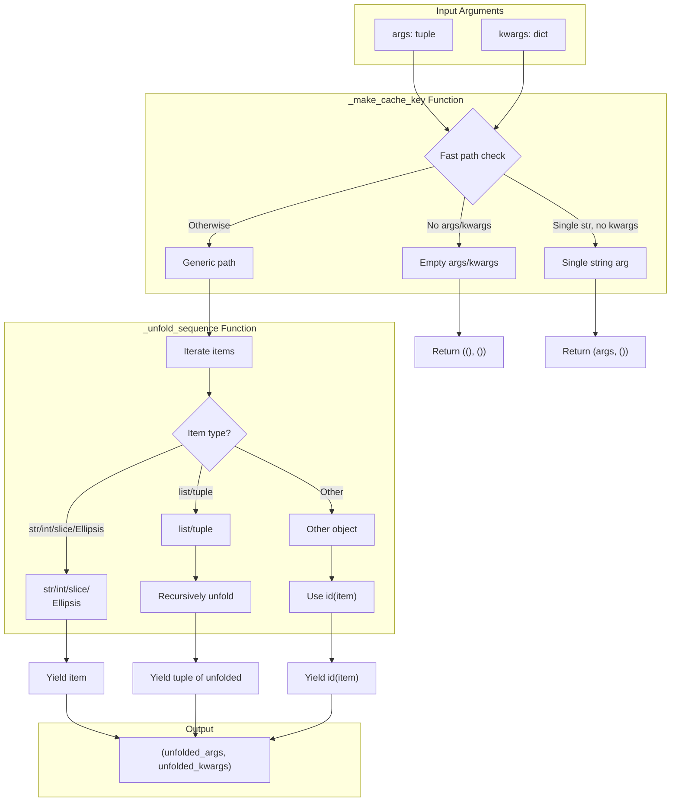
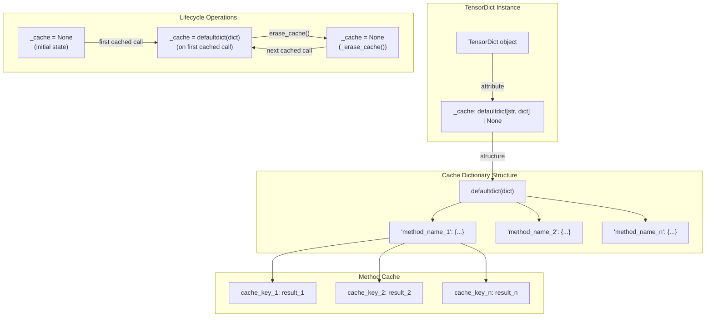
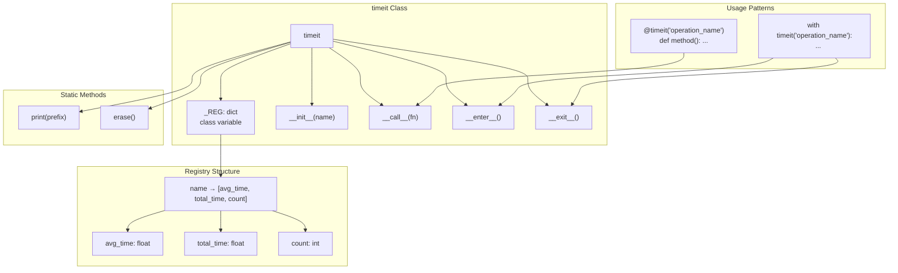
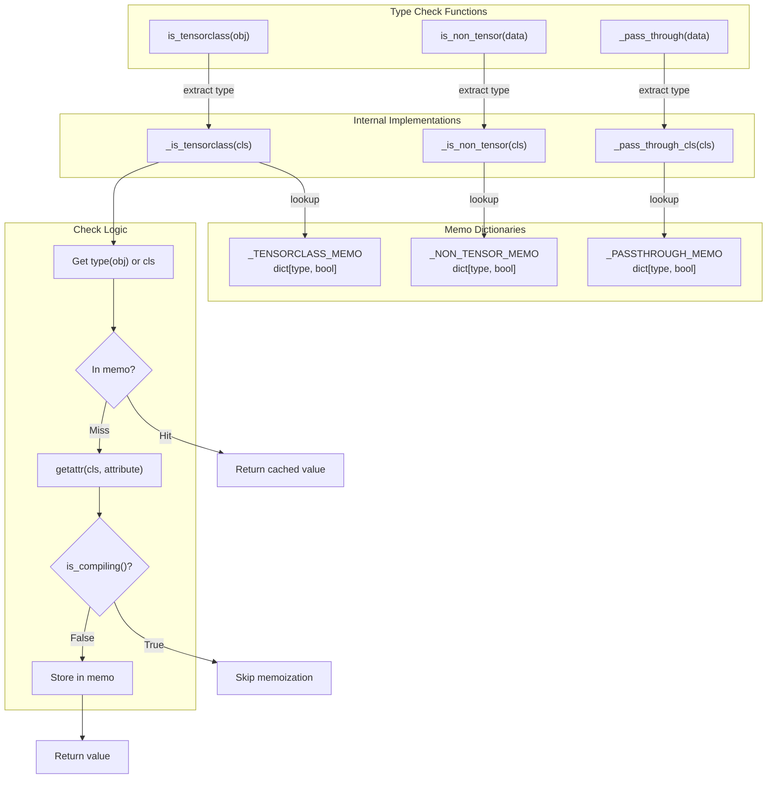
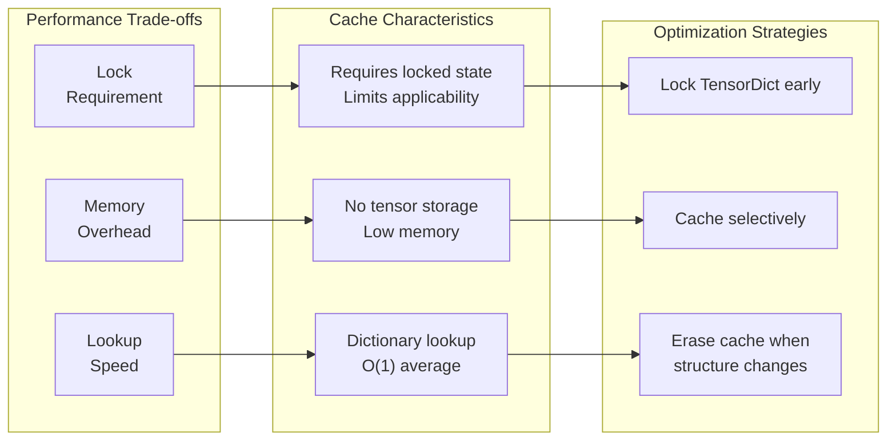
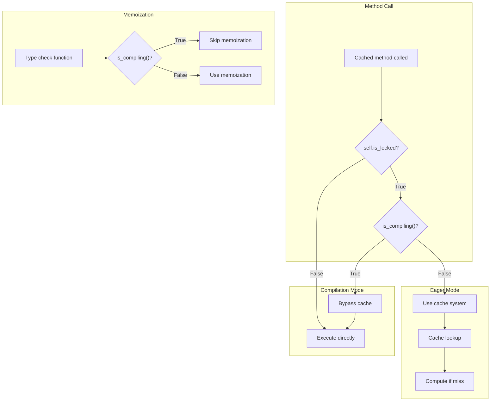

<!-- source: DeepWiki mcp.deepwiki.com · repo pytorch/tensordict · page 7.4 Caching and Performance Patterns · fetched 2026-10-21 -->

# Caching and Performance Patterns

<details>
<summary>Relevant source files</summary>

The following files were used as context for generating this wiki page:

- [tensordict/utils.py](tensordict/utils.py)

</details>


## Purpose and Scope

This document covers the caching mechanisms and performance optimization patterns used in TensorDict to minimize redundant computations and improve execution speed. It focuses on the `@cache` decorator system for method-level caching, the `timeit` profiling utility, and memoization patterns for type checking. 

For information about lazy evaluation strategies and deferred operations, see [Lazy Operations and Evaluation](#7.1). For details on memory layout optimization and asynchronous transfers, see [Consolidation and Asynchronous Transfers](#7.2). For torch.compile compatibility, see [Compilation Support](#7.3).

---

## Overview of Caching Architecture

TensorDict implements a sophisticated caching system that stores computed results within the TensorDict instance itself. The cache is automatically managed based on the lock state and can significantly improve performance for expensive operations like key traversal and nested structure analysis.

### Caching System Components



**Sources:** [tensordict/utils.py:781-836]()

---

## The Cache Decorator

The `@cache` decorator provides automatic memoization for TensorDict methods. It only caches results when the TensorDict is locked, ensuring cache consistency and avoiding stale data.

### Cache Decorator Implementation



**Key Implementation Details:**

The decorator is defined at [tensordict/utils.py:781-824]() and has several important characteristics:

1. **Lock-dependent behavior**: Caching only occurs when `_self.is_locked` is `True`
2. **Compilation awareness**: Bypasses caching during `torch.compile()` execution
3. **Selective storage**: Does not cache `Tensor` instances to prevent memory bloat
4. **Per-instance storage**: Cache is stored in the TensorDict instance's `_cache` attribute

**Sources:** [tensordict/utils.py:781-824]()

### Usage Example Pattern

```python
from tensordict import TensorDict
from tensordict.utils import cache

class SomeOtherTd(TensorDict):
    @cache
    def all_keys(self):
        return set(self.keys(include_nested=True))

td = SomeOtherTd({("a", "b", "c", "d", "e", "f", "g"): 1.0}, [])
td.lock_()

# First call: computes and caches result
keys1 = td.all_keys()  

# Second call: returns cached result (much faster)
keys2 = td.all_keys()
```

According to the docstring at [tensordict/utils.py:790-802](), this pattern can provide approximately 10-12x speedup for expensive operations like nested key enumeration.

**Sources:** [tensordict/utils.py:790-802]()

---

## Cache Key Generation

The cache key generation system minimizes memory footprint while ensuring uniqueness and fast lookup.

### Cache Key Generation Flow



**Key Generation Strategy:**

The `_make_cache_key` function at [tensordict/utils.py:767-778]() employs three optimization paths:

1. **Empty path**: Returns `((), ())` for no arguments
2. **Single string path**: Returns `(args, ())` for a single string argument with no kwargs
3. **Generic path**: Uses `_unfold_sequence` to recursively process arguments

The `_unfold_sequence` helper at [tensordict/utils.py:756-764]() handles complex nested structures by:
- Preserving primitive types (str, int, slice, Ellipsis) directly
- Recursively unfolding nested lists/tuples
- Using `id()` for other objects to minimize memory usage

**Sources:** [tensordict/utils.py:756-778]()

---

## Cache Storage and Lifecycle

The cache is stored as a nested dictionary structure within each TensorDict instance, with automatic lifecycle management tied to the lock state.

### Cache Storage Structure



**Cache Initialization:**

At [tensordict/utils.py:809-812](), the cache is lazily initialized:
```python
cache = _self._cache
if cache is None:
    cache = _self._cache = defaultdict(dict)
cache = cache[fun.__name__]
```

**Cache Clearing:**

The `_erase_cache` method (referenced at line 832) sets `_cache = None`, deallocating all cached data. The `@erase_cache` decorator at [tensordict/utils.py:827-836]() automatically clears the cache before method execution:

```python
@wraps(fun)
def new_fun(self, *args, **kwargs):
    self._erase_cache()
    return fun(self, *args, **kwargs)
```

**Sources:** [tensordict/utils.py:809-812](), [tensordict/utils.py:827-836]()

---

## Performance Profiling with timeit

The `timeit` class provides a lightweight profiling mechanism for tracking method execution times across the codebase.

### timeit Architecture



**timeit Implementation:**

The `timeit` class at [tensordict/utils.py:648-695]() tracks execution statistics using a class-level registry `_REG`:

1. **As a decorator**: Wraps functions to automatically time each call
2. **As a context manager**: Times code blocks within `with` statements
3. **Statistics tracking**: Maintains running average, total time, and call count

**Key Methods:**

| Method | Purpose | Line Reference |
|--------|---------|----------------|
| `__init__(name)` | Initialize with a timing label | [648-654]() |
| `__call__(fn)` | Decorator pattern - wraps function | [656-663]() |
| `__enter__()` | Context manager entry - start timer | [665-666]() |
| `__exit__()` | Context manager exit - update stats | [668-676]() |
| `print(prefix)` | Display timing statistics | [678-689]() |
| `erase()` | Reset all timing data | [691-694]() |

**Statistics Calculation:**

At [tensordict/utils.py:672-676](), running average is computed incrementally:
```python
count = val[2]
N = count + 1
val[0] = val[0] * (count / N) + t / N  # Running average
val[1] += t                              # Total time
val[2] = N                               # Update count
```

**Sources:** [tensordict/utils.py:648-695]()

---

## Memoization for Type Checking

TensorDict uses aggressive memoization for frequently-called type checking operations to avoid repeated attribute lookups and `getattr()` calls.

### Type Check Memoization System



**Memoization Pattern:**

Three global dictionaries cache type check results:

| Memo Dictionary | Purpose | Line Reference |
|----------------|---------|----------------|
| `_TENSORCLASS_MEMO` | Cache for `_is_tensorclass()` checks | [tensordict/utils.py:744]() |
| `_NON_TENSOR_MEMO` | Cache for `_is_non_tensor()` checks | [tensordict/utils.py:2413]() |
| `_PASSTHROUGH_MEMO` | Cache for `_pass_through_cls()` checks | [tensordict/utils.py:2428]() |

**Implementation Pattern:**

All three follow the same pattern (shown for `_is_tensorclass` at [tensordict/utils.py:747-754]()):

```python
def _is_tensorclass(cls: type) -> bool:
    out = _TENSORCLASS_MEMO.get(cls)  # Check cache
    if out is None:
        out = getattr(cls, "_is_tensorclass", False)  # Compute
        if not is_compiling():
            _TENSORCLASS_MEMO[cls] = out  # Store if not compiling
    return out
```

**Compilation-Aware Memoization:**

The pattern avoids memoization during `torch.compile()` execution (lines 751-752, 2418-2424, 2433-2441) because:
1. Compiled graphs may need different behavior
2. Weakref-based caching doesn't work in compiled mode
3. Global state changes aren't captured by the compiler

**Sources:** [tensordict/utils.py:744-754](), [tensordict/utils.py:2413-2426](), [tensordict/utils.py:2428-2443]()

---

## Best Practices and Performance Patterns

### When to Use Caching

| Use Case | Recommendation | Rationale |
|----------|---------------|-----------|
| Expensive key traversal | ✅ Use `@cache` | Key enumeration is O(n) and frequently repeated |
| Nested structure analysis | ✅ Use `@cache` | Structure rarely changes after locking |
| Tensor computations | ❌ Avoid `@cache` | Results are tensors (explicitly not cached) |
| Dynamic operations | ❌ Avoid `@cache` | Only works on locked TensorDicts |
| Frequently-called type checks | ✅ Use memoization | Attribute lookup is expensive |

### Cache Performance Considerations



**Key Recommendations:**

1. **Lock early for maximum benefit**: Cache only works on locked TensorDicts
2. **Don't cache tensors**: The decorator explicitly skips tensor results at [tensordict/utils.py:816-818]()
3. **Use `@erase_cache` for modifying operations**: Prevents stale cache data
4. **Profile with `timeit`**: Identify bottlenecks before adding cache decorators
5. **Be aware of compilation**: Cache is bypassed during `torch.compile()`

**Sources:** [tensordict/utils.py:816-818]()

### Memory-Efficient Key Generation

The `_unfold_sequence` pattern at [tensordict/utils.py:756-764]() minimizes memory by:

- Using object IDs instead of storing full objects
- Preserving primitive types directly (no wrapper overhead)
- Recursively handling nested structures without duplication

**Example:**
```python
# Instead of storing the full object in the key
cache_key = (args[0], args[1], large_object)  # ❌ High memory

# Use ID for non-primitives
cache_key = (args[0], args[1], id(large_object))  # ✅ Low memory
```

**Sources:** [tensordict/utils.py:756-764]()

---

## Integration with torch.compile

TensorDict's caching system is aware of `torch.compile` and adapts its behavior accordingly.

### Compilation-Aware Caching Flow



**Compilation Detection:**

The system uses `is_compiling()` from [tensordict/utils.py:70-72]() to detect TorchDynamo execution:

```python
try:
    from torch.compiler import is_compiling
except ImportError:  # torch 2.0
    from torch._dynamo import is_compiling
```

**Cache Behavior During Compilation:**

At [tensordict/utils.py:807-808](), the cache decorator checks compilation state:
```python
if not _self.is_locked or is_compiling():
    return fun(_self, *args, **kwargs)
```

Similarly, memoization is skipped during compilation at [tensordict/utils.py:751-752](), [tensordict/utils.py:2418-2424](), and [tensordict/utils.py:2433-2441]().

**Rationale:**

1. **Graph tracing**: TorchDynamo needs to trace actual operations, not cached results
2. **Weak references**: The cache uses weakrefs which don't work in compiled graphs
3. **Global state**: Compiled graphs can't capture changes to global memo dictionaries
4. **Correctness**: Ensures compiled and eager mode produce identical results

**Sources:** [tensordict/utils.py:70-72](), [tensordict/utils.py:807-808](), [tensordict/utils.py:751-752](), [tensordict/utils.py:2418-2424](), [tensordict/utils.py:2433-2441]()

---

## Performance Profiling Example

Here's a complete example demonstrating the profiling and caching system in action:

```python
from tensordict import TensorDict
from tensordict.utils import cache, timeit

class ProfiledTensorDict(TensorDict):
    @timeit("expensive_operation")
    @cache
    def get_all_nested_keys(self):
        """Returns all nested keys (expensive without caching)."""
        return set(self.keys(include_nested=True, leaves_only=True))
    
    @timeit("shape_analysis")
    def analyze_shapes(self):
        """Analyze all tensor shapes in the structure."""
        shapes = {}
        for key in self.keys(include_nested=True):
            item = self.get(key)
            if isinstance(item, torch.Tensor):
                shapes[key] = item.shape
        return shapes

# Create and use the profiled TensorDict
td = ProfiledTensorDict({
    "a": torch.randn(10, 20),
    ("nested", "b"): torch.randn(5, 5),
    ("nested", "c"): torch.randn(3, 3),
}, batch_size=[])

td.lock_()  # Enable caching

# First call: computed and timed
keys1 = td.get_all_nested_keys()  # Computes and caches

# Second call: cached result (much faster)
keys2 = td.get_all_nested_keys()  # Returns cached

# Uncached operation for comparison
shapes = td.analyze_shapes()  # Always computed

# Print timing statistics
timeit.print(prefix="Performance Report")
# Output example:
# Performance Report -- expensive_operation took 0.15 msec (total = 0.15 sec)
# Performance Report -- shape_analysis took 0.08 msec (total = 0.08 sec)
```

**Sources:** [tensordict/utils.py:648-695](), [tensordict/utils.py:781-824]()

---

