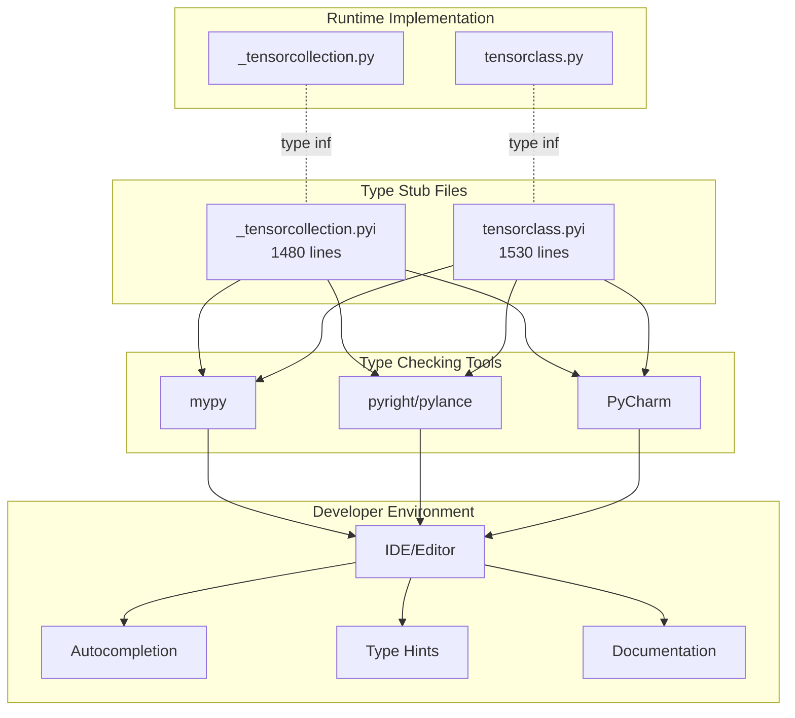
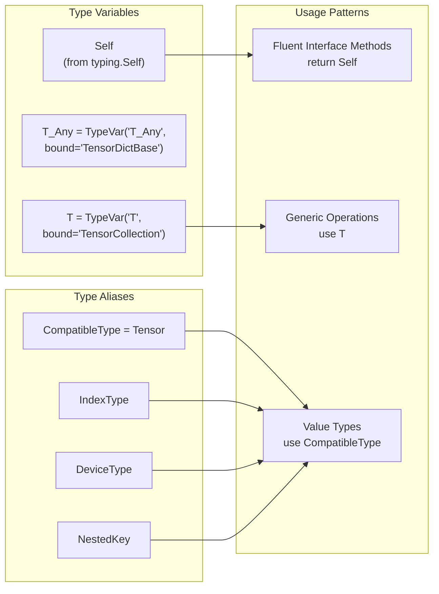
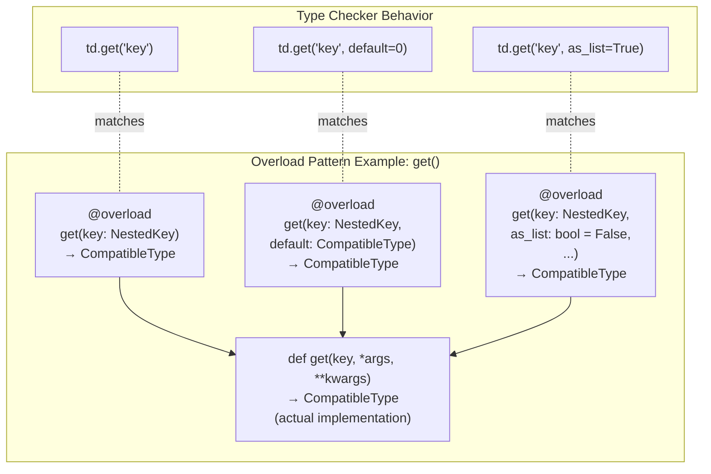
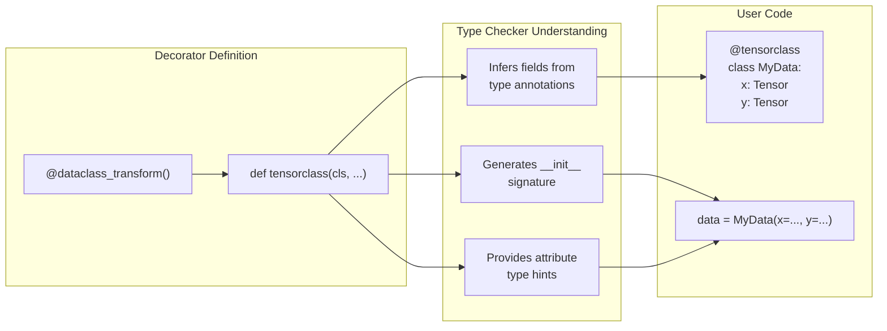
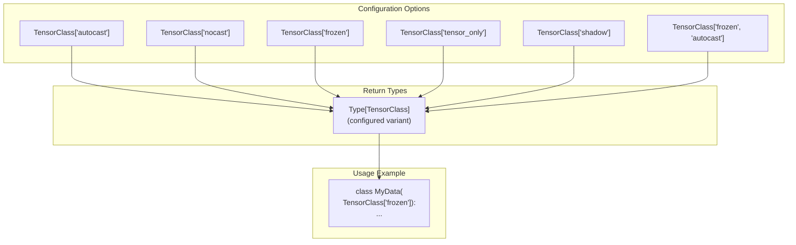
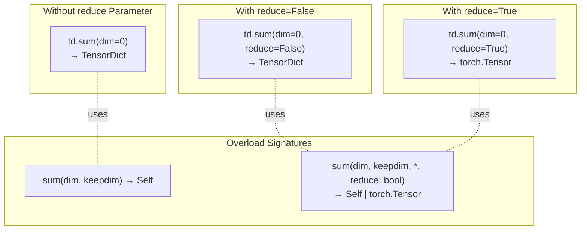
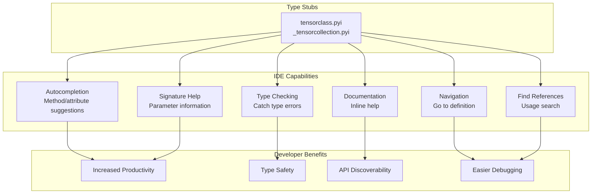
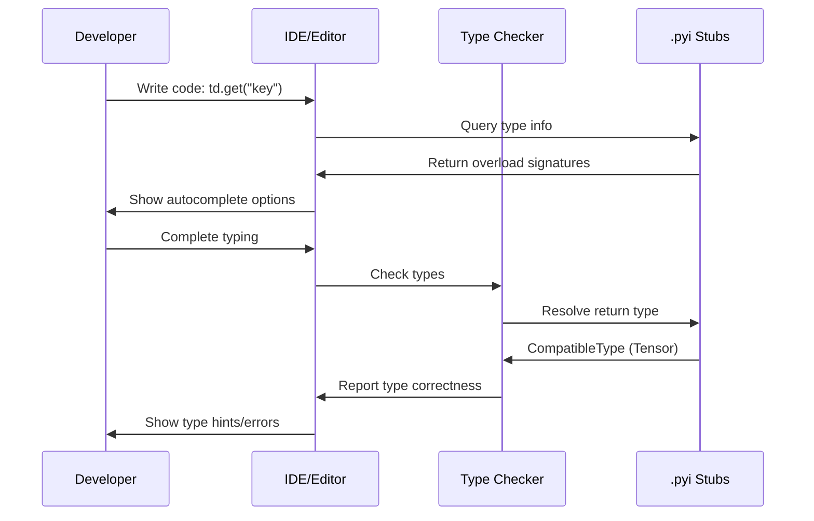

<!-- source: DeepWiki mcp.deepwiki.com · repo pytorch/tensordict · page 8 Type System and IDE Support · fetched 2026-10-21 -->

# Type System and IDE Support

<details>
<summary>Relevant source files</summary>

The following files were used as context for generating this wiki page:

- [tensordict/_tensorcollection.pyi](tensordict/_tensorcollection.pyi)
- [tensordict/tensorclass.pyi](tensordict/tensorclass.pyi)

</details>


## Purpose and Scope

This page documents TensorDict's type system infrastructure and IDE integration capabilities. TensorDict provides comprehensive type stub files (`.pyi`) that enable static type checking, IDE autocompletion, and documentation lookup for all major classes and methods. These stubs are critical for developer productivity when working with TensorDict's complex API surface.

For detailed information about specific type annotation patterns and stub file implementation, see [Type Annotations and Stubs](#8.1).

## Type Stub Architecture

TensorDict's type system is implemented through Python type stub files that parallel the runtime implementation. These stub files provide complete type information without requiring runtime type checking overhead.



**Sources:** [tensordict/_tensorcollection.pyi:1-1514](), [tensordict/tensorclass.pyi:1-1530]()

### Core Stub Files

| File | Lines | Purpose | Key Classes |
|------|-------|---------|-------------|
| `_tensorcollection.pyi` | 1,480 | Base collection types | `TensorCollection`, `NonTensorStack` |
| `tensorclass.pyi` | 1,530 | TensorClass decorator and subclass | `TensorClass`, `NonTensorData`, `NonTensorDataBase` |

Both stub files provide comprehensive type information for:
- Constructor signatures
- Property types and setters
- Method overloads for polymorphic operations
- Distributed operations
- Conversion methods
- Arithmetic operations

**Sources:** [tensordict/_tensorcollection.pyi:1-100](), [tensordict/tensorclass.pyi:1-100]()

## Type Variable System

TensorDict uses a sophisticated type variable system to maintain type safety across method chains and transformations.



**Sources:** [tensordict/_tensorcollection.pyi:67-72](), [tensordict/tensorclass.pyi:75-86]()

### Primary Type Variables

**`T` - Generic Collection Type**
```python
T = TypeVar("T", bound="TensorCollection")
```
Used for methods that accept and return generic TensorCollection-like objects, preserving the exact type through operations.

**Sources:** [tensordict/_tensorcollection.pyi:67](), [tensordict/tensorclass.pyi:79]()

**`Self` - Fluent Interface Type**
```python
if TYPE_CHECKING:
    from typing import Self
else:
    Self = Any
```
Used for methods that return the same type as the instance, enabling fluent method chaining with correct type inference.

**Sources:** [tensordict/_tensorcollection.pyi:69-72](), [tensordict/tensorclass.pyi:61-64, 83-86]()

**`CompatibleType` - Value Type Alias**
```python
CompatibleType = Tensor
```
Represents types that can be stored in TensorDict/TensorClass instances.

**Sources:** [tensordict/_tensorcollection.pyi:65](), [tensordict/tensorclass.pyi:77]()

## Method Overloading Pattern

TensorDict extensively uses `@overload` decorators to provide precise type hints for polymorphic methods. This enables IDEs to show correct return types based on arguments.



**Sources:** [tensordict/tensorclass.pyi:884-914]()

### Common Overload Scenarios

**1. Optional Return Type Based on `reduce` Parameter**

Methods like `mean()`, `sum()`, and `min()` return either `Self` or `torch.Tensor` depending on whether reduction is requested:

```python
@overload
def mean(self, dim: int = ..., keepdim: bool = ...) -> Self: ...

@overload
def mean(self, dim: int = ..., keepdim: bool = ..., *, reduce: bool) -> Self | torch.Tensor: ...
```

**Sources:** [tensordict/tensorclass.pyi:268-291]()

**2. Shape Transformation Methods**

Methods like `reshape()`, `view()`, and `expand()` accept either variadic arguments or a single sequence:

```python
@overload
def reshape(self, *shape: int) -> Self: ...

@overload
def reshape(self, shape: Sequence[int] | torch.Size) -> Self: ...
```

**Sources:** [tensordict/tensorclass.pyi:628-630]()

**3. Device/Dtype Conversion**

The `to()` method has multiple overloads for different conversion patterns:

```python
@overload
def to(self, device: int | torch.device | None = ..., dtype: torch.dtype | None = ...) -> Self: ...

@overload
def to(self, dtype: torch.dtype, non_blocking: bool = ...) -> Self: ...

@overload
def to(self, tensor: Tensor, non_blocking: bool = ...) -> Self: ...

@overload
def to(self, *, batch_size: torch.Size) -> Self: ...
```

**Sources:** [tensordict/tensorclass.pyi:1449-1465]()

## Dataclass Transform Decorator

The `@tensorclass` decorator uses PEP 681's `@dataclass_transform()` to signal to type checkers that it transforms classes similarly to `@dataclass`.



**Sources:** [tensordict/tensorclass.pyi:1503-1513]()

The decorator signature includes all configuration options:

```python
@dataclass_transform()
def tensorclass(
    cls: T = None,
    /,
    *,
    autocast: bool = False,
    frozen: bool = False,
    nocast: bool = False,
    shadow: bool = False,
    tensor_only: bool = False,
) -> T: ...
```

This enables IDEs to:
- Infer constructor parameters from class attributes
- Provide autocomplete for field names
- Type-check attribute access
- Validate initialization arguments

**Sources:** [tensordict/tensorclass.pyi:1503-1513]()

## Generic Class Item Access

TensorClass supports multiple indexing modes through `__class_getitem__`, enabling type-safe configuration selection:



**Sources:** [tensordict/tensorclass.pyi:93-109]()

The type system defines overloads for both single and multiple configuration options:

```python
@overload
def __class_getitem__(cls, item: Literal["autocast"]) -> Type["TensorClass"]: ...

@overload
def __class_getitem__(cls, item: Literal["frozen"]) -> Type["TensorClass"]: ...

@overload
def __class_getitem__(
    cls, 
    item: tuple[Literal["autocast", "nocast", "frozen", "tensor_only", "shadow"], ...]
) -> Type["TensorClass"]: ...
```

**Sources:** [tensordict/tensorclass.pyi:93-109]()

## Type-Safe Reduction Operations

Reduction operations use a sophisticated overload pattern to maintain type safety while supporting both dimension-preserving and dimension-reducing behaviors.



**Sources:** [tensordict/tensorclass.pyi:343-366]()

This pattern applies to all reduction operations:
- `sum()`, `nansum()`
- `mean()`, `nanmean()`
- `prod()`
- `std()`, `var()`
- `amin()`, `amax()`
- `min()`, `max()`
- `cummin()`, `cummax()`
- `quantile()`

**Sources:** [tensordict/tensorclass.pyi:158-493]()

## Type Hints for Distributed Operations

Distributed operations have precise type signatures that indicate return value optionality based on rank:

```python
def gather_and_stack(
    self, 
    dst: int, 
    group: "dist.ProcessGroup" | None = None
) -> Self | None: ...
```

The `Self | None` return type reflects that only the destination rank receives the gathered data, while other ranks return `None`.

**Sources:** [tensordict/tensorclass.pyi:991-993]()

### Communication Primitives Type Signatures

| Method | Return Type | Meaning |
|--------|-------------|---------|
| `send()` | `None` | Blocking send, no return value |
| `recv()` | `int` | Returns number of tensors received |
| `isend()` | `int` | Returns tag for async send |
| `irecv()` | `tuple[int, list[torch.Future]] \| list[torch.Future] \| None` | Returns futures for async receive |
| `reduce()` | `Self` | Returns reduced tensordict |
| `gather_and_stack()` | `Self \| None` | Returns gathered data on dst rank only |

**Sources:** [tensordict/tensorclass.pyi:994-1047]()

## Conditional Imports and TYPE_CHECKING

The stub files use `TYPE_CHECKING` to conditionally import types that are only needed for static analysis:

```python
if TYPE_CHECKING:
    from typing import Self
else:
    Self = Any
```

This pattern allows using modern typing features (like `Self` from Python 3.11+) while maintaining backward compatibility at runtime.

**Sources:** [tensordict/tensorclass.pyi:61-64](), [tensordict/_tensorcollection.pyi:69-72]()

### Incomplete Type Placeholders

For complex types that would create circular imports or are implementation details, the stubs use `Incomplete` from `_typeshed`:

```python
from _typeshed import Incomplete

def consolidate(
    self,
    filename: Path | str | None = None,
    *,
    batch_size: Incomplete | None = None,
    device: Incomplete | None = None,
    ...
) -> Self: ...
```

**Sources:** [tensordict/tensorclass.pyi:32](), [tensordict/tensorclass.pyi:747-760]()

## IDE Features Enabled

The comprehensive type stub system enables the following IDE capabilities:



### Autocompletion Examples

**Method Chaining:**
When typing `td.`, IDEs suggest all available methods with correct signatures based on the `Self` return type.

**Parameter Suggestions:**
When calling `td.to(`, IDEs show all overloaded variants and suggest appropriate parameter combinations.

**Attribute Access:**
For TensorClass instances, IDEs autocomplete field names defined in the class annotation.

**Sources:** [tensordict/tensorclass.pyi:1-1530]()

## Type Checking Integration

TensorDict's type stubs work with all major Python type checkers:

| Type Checker | Support Level | Notes |
|--------------|--------------|-------|
| **mypy** | Full | All features supported |
| **pyright/pylance** | Full | Used by VS Code Python extension |
| **PyCharm** | Full | Native type inference |
| **pytype** | Partial | Some advanced features may not work |

### Type Checking Example Workflow



**Sources:** [tensordict/tensorclass.pyi:884-914]()

## Specialized Type Annotations

### NonTensorData Types

For heterogeneous data storage, TensorDict provides specialized type annotations:

```python
class NonTensorDataBase(TensorClass): ...
class NonTensorData(NonTensorDataBase): ...
class MetaData(NonTensorDataBase): ...
class NonTensorStack(TensorDictBase): ...
```

These enable type-safe storage of non-tensor data alongside tensors.

**Sources:** [tensordict/tensorclass.pyi:1498-1501]()

### NO_DEFAULT Sentinel

A special sentinel type for distinguishing between "no default provided" and "default is None":

```python
class _NoDefault(enum.IntEnum):
    ZERO = 0

NO_DEFAULT: Incomplete
```

Used in method signatures like:

```python
def amin(self, dim: int | NO_DEFAULT = ..., keepdim: bool = False) -> Self: ...
```

**Sources:** [tensordict/tensorclass.pyi:66-69]()

### BEST_ATTEMPT_INPLACE

A special type for methods that attempt in-place operations but may fall back to copying:

```python
class _BEST_ATTEMPT_INPLACE:
    def __bool__(self) -> bool: ...

BEST_ATTEMPT_INPLACE: Incomplete
```

**Sources:** [tensordict/tensorclass.pyi:71-74]()

---

**Overall Sources:**
- [tensordict/tensorclass.pyi:1-1530]()
- [tensordict/_tensorcollection.pyi:1-1514]()

---

