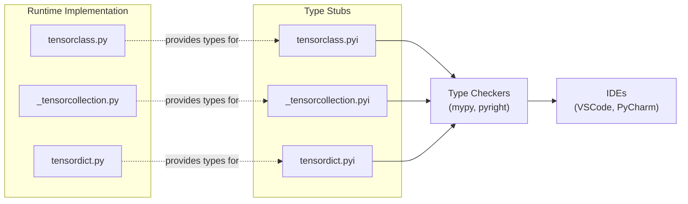
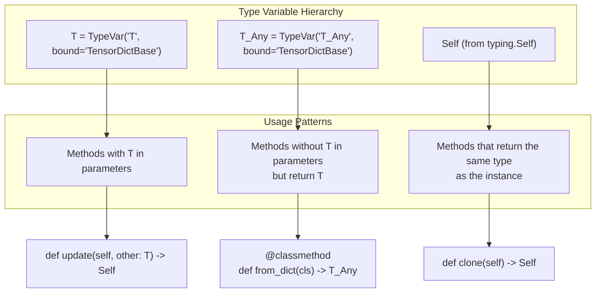
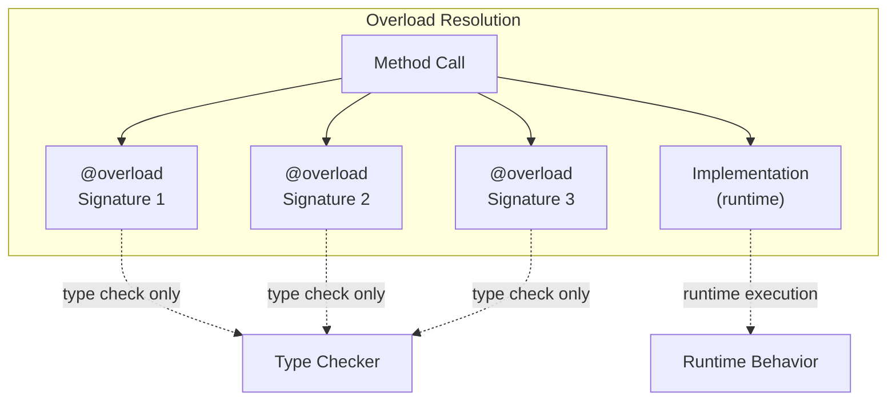
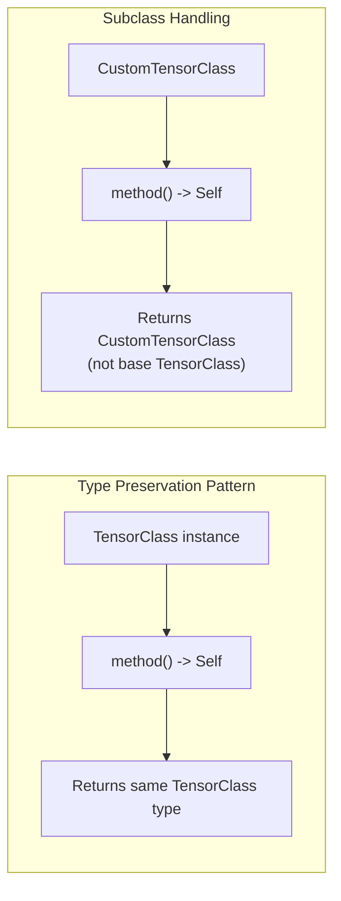
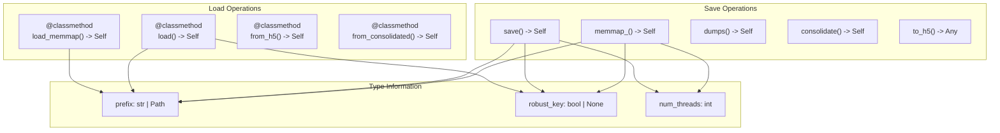
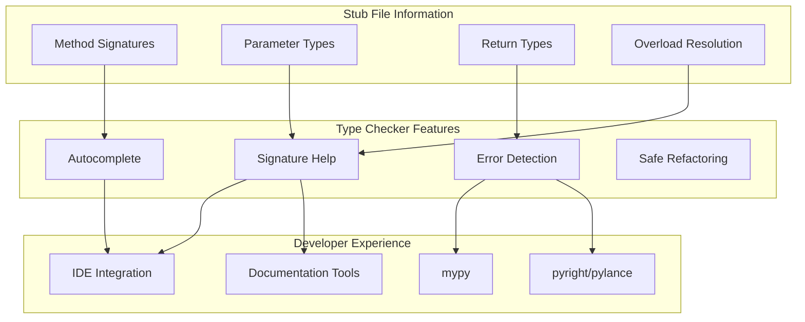

<!-- source: DeepWiki mcp.deepwiki.com · repo pytorch/tensordict · page 8.1 Type Annotations and Stubs · fetched 2026-10-21 -->

# Type Annotations and Stubs

<details>
<summary>Relevant source files</summary>

The following files were used as context for generating this wiki page:

- [tensordict/_tensorcollection.pyi](tensordict/_tensorcollection.pyi)
- [tensordict/tensorclass.pyi](tensordict/tensorclass.pyi)

</details>


This page documents the type annotation system in TensorDict, including stub files (`.pyi`), type hints, and how they enable IDE support and static type checking. For information about the actual runtime behavior of TensorDict classes, see [Core TensorDict System](#2). For API-level details, see [API Reference](#10).

## Purpose and Scope

TensorDict provides comprehensive type annotations through Python stub files (`.pyi`) that describe the types of all public APIs without containing implementation code. These stubs enable:

- **IDE autocomplete and IntelliSense** for method signatures, return types, and parameters
- **Static type checking** with tools like `mypy`, `pyright`, and `pylance`
- **Documentation generation** from type hints
- **Type inference** for complex operations and transformations

The stub files mirror the structure of the runtime Python modules but contain only type signatures, not executable code.

## Stub File Organization

TensorDict's type stubs are located alongside their corresponding implementation files:



**Key Stub Files:**

| Stub File | Purpose | Key Classes |
|-----------|---------|-------------|
| `tensorclass.pyi` | TensorClass type annotations | `TensorClass`, `NonTensorData`, `NonTensorStack` |
| `_tensorcollection.pyi` | Base collection types | `TensorCollection`, type aliases |
| `tensordict.pyi` | TensorDict implementations | `TensorDictBase`, `TensorDict`, `LazyStackedTensorDict` |

Sources: [tensordict/tensorclass.pyi:1-1530](), [tensordict/_tensorcollection.pyi:1-1514]()

## Type Variable System

### Generic Type Variables

TensorDict uses Python's `TypeVar` to enable generic typing that preserves type information through operations:



**Type Variable Definitions:**

[tensordict/tensorclass.pyi:79-86]()
```python
T = TypeVar("T", bound="TensorDictBase")
# Use Any for methods that don't have T in their parameters but return T
T_Any = TypeVar("T_Any", bound="TensorDictBase")

if TYPE_CHECKING:
    from typing import Self
else:
    Self = Any
```

The `Self` type (PEP 673) is used for methods that return instances of the same type as the receiver, enabling proper type inference in subclasses.

Sources: [tensordict/tensorclass.pyi:79-86](), [tensordict/_tensorcollection.pyi:67-72]()

## Method Overloading with @overload

### Overload Patterns

TensorDict extensively uses `@overload` decorators to provide multiple type signatures for methods that accept different parameter combinations:



### Example: Reduction Operations

The `sum()` method demonstrates complex overloading based on the `reduce` parameter:

[tensordict/tensorclass.pyi:342-366]()
```python
@overload
def sum(
    self,
    dim: int | tuple[int] = ...,
    keepdim: bool = ...,
    *,
    dtype: torch.dtype | None = None,
) -> Self: ...  # Returns TensorClass when reduce not specified

@overload
def sum(
    self,
    dim: int | tuple[int] = ...,
    keepdim: bool = ...,
    *,
    dtype: torch.dtype | None = None,
    reduce: bool,
) -> Self | torch.Tensor: ...  # Returns either type based on reduce value
```

**Common Overload Patterns:**

| Pattern | Use Case | Example Methods |
|---------|----------|-----------------|
| Optional `reduce` parameter | Control aggregation behavior | `sum`, `mean`, `std`, `var`, `min`, `max` |
| Multiple constructors | Different initialization paths | `expand(*shape)`, `expand(shape)` |
| Default vs explicit parameters | Better type inference | `get(key)`, `get(key, default)` |
| Shape specifications | Flexible dimension handling | `reshape(*shape)`, `reshape(shape)` |

Sources: [tensordict/tensorclass.pyi:342-366](), [tensordict/tensorclass.pyi:157-248]()

## Type Aliases and Compatible Types

### Core Type Definitions

[tensordict/tensorclass.pyi:75-77]()
```python
from typing import TypeAlias

CompatibleType: TypeAlias = Tensor
```

The `CompatibleType` alias represents types that can be stored in TensorDict structures. Currently aliased to `torch.Tensor`, this provides a single point to extend supported types.

### Nested Key Types

[tensordict/_nestedkey.py imports]()
```python
from tensordict._nestedkey import NestedKey
```

`NestedKey` is a type that accepts:
- Single strings: `"key"`
- Tuples of strings: `("nested", "key")`
- Mixed hierarchical keys for accessing nested TensorDict structures

### Index Types

```python
IndexType  # Defined in utils, represents valid indexing operations
DeviceType  # torch.device or device specifications
```

Sources: [tensordict/tensorclass.pyi:75-77](), [tensordict/tensorclass.pyi:29-57]()

## Special Type Constructs

### NO_DEFAULT Sentinel

[tensordict/tensorclass.pyi:66-69]()
```python
class _NoDefault(enum.IntEnum):
    ZERO = 0

NO_DEFAULT: Incomplete
```

The `NO_DEFAULT` sentinel distinguishes between:
- No argument provided (use default behavior)
- Explicit `None` provided (different semantic meaning)

Used in methods like reduction operations where dimension specifications are optional.

### BEST_ATTEMPT_INPLACE

[tensordict/tensorclass.pyi:71-74]()
```python
class _BEST_ATTEMPT_INPLACE:
    def __bool__(self) -> bool: ...

BEST_ATTEMPT_INPLACE: Incomplete
```

A special flag that signals operations should attempt in-place modification but fall back to out-of-place if necessary. The `__bool__` method enables truthiness checks.

Sources: [tensordict/tensorclass.pyi:66-74]()

## TensorClass Stub Structure

### Class Configuration via __class_getitem__

[tensordict/tensorclass.pyi:93-109]()
```python
class TensorClass:
    _autocast: bool = False
    _nocast: bool = False
    _frozen: bool = False

    @overload
    def __class_getitem__(cls, item: Literal["autocast"]) -> Type["TensorClass"]: ...
    @overload
    def __class_getitem__(cls, item: Literal["nocast"]) -> Type["TensorClass"]: ...
    @overload
    def __class_getitem__(cls, item: Literal["frozen"]) -> Type["TensorClass"]: ...
    @overload
    def __class_getitem__(cls, item: Literal["tensor_only"]) -> Type["TensorClass"]: ...
    @overload
    def __class_getitem__(cls, item: tuple[Literal[...], ...]) -> Type["TensorClass"]: ...
```

This enables the syntax `TensorClass["autocast"]` or `TensorClass["frozen", "nocast"]` for creating configured variants, with proper type checking.

### Return Type Preservation

Methods that return the same type use `Self`:



Examples: `clone()`, `to()`, `apply()`, `reshape()`, all return `Self`.

Sources: [tensordict/tensorclass.pyi:88-149](), [tensordict/tensorclass.pyi:93-109]()

## Comprehensive Method Signatures

### Factory Methods with Overloads

[tensordict/tensorclass.pyi:567-623]()
```python
@overload
def expand(self, *shape: int) -> Self: ...
@overload
def expand(self, shape: torch.Size | Sequence[int]) -> Self: ...

def new_zeros(
    self,
    *size: torch.Size,
    dtype: torch.dtype = None,
    device: DeviceType = ...,
    requires_grad: bool = False,
    layout: torch.layout = ...,
    pin_memory: bool | None = None,
    empty_lazy: bool = False,
) -> Self: ...
```

Factory methods (`new_zeros`, `new_ones`, `new_empty`, `new_full`, `new_tensor`) are fully typed with all PyTorch tensor creation parameters.

### Conditional Return Types

[tensordict/tensorclass.pyi:1449-1465]()
```python
@overload
def to(
    self,
    device: int | torch.device | None = ...,
    dtype: torch.dtype | None = ...,
    non_blocking: bool = ...,
    inplace: bool = False,
) -> Self: ...
@overload
def to(self, dtype: torch.dtype, non_blocking: bool = ...) -> Self: ...
@overload
def to(self, tensor: Tensor, non_blocking: bool = ...) -> Self: ...
@overload
def to(self, *, other: T, non_blocking: bool = ...) -> Self: ...
@overload
def to(self, *, batch_size: torch.Size) -> Self: ...
```

The `.to()` method has 5 overloads covering device movement, dtype conversion, tensor matching, and batch size changes.

Sources: [tensordict/tensorclass.pyi:567-623](), [tensordict/tensorclass.pyi:1449-1465]()

## Dataclass Transform Decorator

### Type-Safe TensorClass Creation

[tensordict/tensorclass.pyi:1503-1513]()
```python
@dataclass_transform()
def tensorclass(
    cls: T = None,
    /,
    *,
    autocast: bool = False,
    frozen: bool = False,
    nocast: bool = False,
    shadow: bool = False,
    tensor_only: bool = False,
) -> T: ...
```

The `@dataclass_transform` decorator (PEP 681) signals to type checkers that `@tensorclass` creates a dataclass-like type with fields inferred from annotations:

```python
@tensorclass
class MyData:
    observation: torch.Tensor
    action: torch.Tensor
    reward: float  # Non-tensor data
```

Type checkers understand:
- Field names and types from annotations
- Generated `__init__` signature
- Attribute access types

Sources: [tensordict/tensorclass.pyi:1503-1513]()

## PyTorch Integration Stubs

### Torch Function Protocol

[tensordict/tensorclass.pyi:142-149]()
```python
@classmethod
def __torch_function__(
    cls,
    func: Callable,
    types: tuple[type, ...],
    args: tuple[Any, ...] = (),
    kwargs: dict[str, Any] | None = None,
) -> Callable: ...
```

This stub indicates TensorClass implements PyTorch's `__torch_function__` protocol, enabling it to intercept and customize behavior for PyTorch operations.

### Mathematical Operations

Comprehensive stubs for element-wise operations:

| Category | Methods | Return Type |
|----------|---------|-------------|
| Arithmetic | `add`, `sub`, `mul`, `div`, `pow` | `Self` |
| In-place | `add_`, `sub_`, `mul_`, `div_` | `Self` |
| Trigonometric | `sin`, `cos`, `tan`, `asin`, `acos`, `atan` | `Self` |
| Logarithmic | `log`, `log10`, `log1p`, `log2`, `exp`, `expm1` | `Self` |
| Rounding | `ceil`, `floor`, `round`, `trunc` | `Self` |
| Special | `sigmoid`, `erf`, `erfc`, `lgamma` | `Self` |

All operations preserve the TensorClass type through return type `Self`.

Sources: [tensordict/tensorclass.pyi:142-149](), [tensordict/tensorclass.pyi:1127-1190]()

## Iterator and Container Protocols

### Iteration Type Signatures

[tensordict/tensorclass.pyi:132-141]()
```python
def __iter__(self) -> Generator: ...
def __len__(self) -> int: ...
def __contains__(self, key: NestedKey) -> bool: ...
def __getitem__(
    self, index: IndexType
) -> Self | Tensor | TensorCollection | Any: ...
```

The `__getitem__` return type union indicates that indexing can return:
- `Self`: When slicing/indexing batch dimensions
- `Tensor`: When accessing a specific tensor by key
- `TensorCollection`: When accessing nested structures
- `Any`: For non-tensor data

### Dictionary-like Methods

[tensordict/tensorclass.pyi:955-989]()
```python
def items(
    self,
    include_nested: bool = False,
    leaves_only: bool = False,
    is_leaf: Incomplete | None = None,
    *,
    sort: bool = False,
) -> Iterator[tuple[str, CompatibleType]]: ...

def values(
    self,
    include_nested: bool = False,
    leaves_only: bool = False,
    is_leaf: Incomplete | None = None,
    *,
    sort: bool = False,
) -> Iterator[CompatibleType]: ...

def keys(
    self,
    include_nested: bool = False,
    leaves_only: bool = False,
    is_leaf: Callable[[type], bool] | None = None,
    *,
    sort: bool = False,
) -> Iterator[NestedKey]: ...
```

Sources: [tensordict/tensorclass.pyi:132-141](), [tensordict/tensorclass.pyi:955-989]()

## Serialization and I/O Stubs

### Persistence Methods



[tensordict/tensorclass.pyi:764-858]()
```python
def memmap_(
    self,
    prefix: str | None = None,
    copy_existing: bool = False,
    *,
    num_threads: int = 0,
    return_early: bool = False,
    share_non_tensor: bool = False,
    existsok: bool = True,
    robust_key: bool | None = None,
) -> Self: ...

@classmethod
def load_memmap(
    cls,
    prefix: str | Path,
    device: torch.device | None = None,
    non_blocking: bool = False,
    *,
    out: TensorCollection | None = None,
    robust_key: bool | None = None,
) -> Self: ...
```

All persistence methods return `Self` or class methods return `T_Any` to preserve type information.

Sources: [tensordict/tensorclass.pyi:764-858]()

## Distributed Computing Stubs

### Communication Primitives

[tensordict/tensorclass.pyi:991-1047]()
```python
def gather_and_stack(
    self, dst: int, group: "dist.ProcessGroup" | None = None
) -> Self | None: ...

def send(
    self,
    dst: int,
    *,
    group: dist.ProcessGroup | None = None,
    init_tag: int = 0,
    pseudo_rand: bool = False,
) -> None: ...

def recv(
    self,
    src: int,
    *,
    group: dist.ProcessGroup | None = None,
    init_tag: int = 0,
    pseudo_rand: bool = False,
) -> int: ...

def reduce(
    self,
    dst,
    op: Incomplete | None = None,
    async_op: bool = False,
    return_premature: bool = False,
    group: Incomplete | None = None,
) -> Self: ...
```

Distributed operations use forward references (`"dist.ProcessGroup"`) to avoid circular imports while maintaining type safety.

Sources: [tensordict/tensorclass.pyi:991-1047]()

## Type Checker Benefits

### Static Analysis Capabilities



**Concrete Examples:**

1. **Method Completion**: When typing `td.`, IDE shows all available methods with parameter hints
2. **Type Errors**: `td.get("key", default=5)` - type checker warns if `5` doesn't match tensor type
3. **Return Type Inference**: `result = td.sum()` - type checker knows `result` is same type as `td`
4. **Overload Selection**: `td.reshape(2, 3, 4)` vs `td.reshape((2, 3, 4))` - both type check correctly

### Integration with Development Tools

| Tool | Capability | Stub Usage |
|------|------------|------------|
| **mypy** | Static type checking | Validates all type annotations, catches type mismatches |
| **pyright** | Fast type analysis | Powers VS Code Pylance, real-time type checking |
| **pylance** | IDE IntelliSense | Provides autocomplete, signature help, hover information |
| **pydantic** | Runtime validation | Can use stubs for model generation |
| **sphinx** | Documentation | Extracts type information for API docs |

Sources: [tensordict/tensorclass.pyi:1-1530](), [tensordict/_tensorcollection.pyi:1-1514]()

## Advanced Type Patterns

### Callable Types for Transformations

[tensordict/tensorclass.pyi:1048-1096]()
```python
def apply(
    self,
    fn: Callable,
    *others: T,
    batch_size: Sequence[int] | None = None,
    device: torch.device | None = ...,
    names: Sequence[str] | None = ...,
    inplace: bool = False,
    default: Any = ...,
    filter_empty: bool | None = None,
    propagate_lock: bool = False,
    call_on_nested: bool = False,
    out: TensorCollection | None = None,
    **constructor_kwargs,
) -> Self | None: ...

def map(
    self,
    fn: Callable[[TensorDictBase], TensorDictBase | None],
    dim: int = 0,
    num_workers: int | None = None,
    *,
    out: TensorCollection | None = None,
    chunksize: int | None = None,
    num_chunks: int | None = None,
    pool: mp.Pool | None = None,
    generator: torch.Generator | None = None,
    max_tasks_per_child: int | None = None,
    worker_threads: int = 1,
    index_with_generator: bool = False,
    pbar: bool = False,
    mp_start_method: str | None = None,
) -> Self: ...
```

The `map` method specifies exact callable signature: `Callable[[TensorDictBase], TensorDictBase | None]`, enabling type checkers to validate the function passed.

### Incomplete Type Placeholders

[tensordict/tensorclass.pyi:32]()
```python
from _typeshed import Incomplete
```

The `Incomplete` type from `_typeshed` marks parameters or return types where:
- Full typing is complex or circular
- Implementation details are intentionally hidden
- Backward compatibility requires flexibility

Example: `destination: Incomplete | None = None` in state_dict methods.

Sources: [tensordict/tensorclass.pyi:1048-1096](), [tensordict/tensorclass.pyi:32]()

## Stub Maintenance Patterns

### Version Compatibility

The stubs use `TYPE_CHECKING` guards for conditional imports:

[tensordict/tensorclass.pyi:61-64]()
```python
if TYPE_CHECKING:
    from typing import Self
else:
    Self = Any
```

This pattern:
- Uses `Self` type in Python 3.11+
- Falls back to `Any` in older versions
- Maintains runtime compatibility while enabling advanced type checking

### Literal Types for Configuration

[tensordict/tensorclass.pyi:1306-1311]()
```python
def to_dict(
    self,
    *,
    retain_none: bool = True,
    convert_tensors: bool | Literal["numpy"] = False,
    tolist_first: bool = False,
) -> dict[str, Any]: ...
```

Using `bool | Literal["numpy"]` precisely specifies that `convert_tensors` accepts:
- `True` (convert to Python scalars)
- `False` (keep as tensors)
- `"numpy"` (convert to NumPy arrays)

Sources: [tensordict/tensorclass.pyi:61-64](), [tensordict/tensorclass.pyi:1306-1311]()

## Summary Table: Key Type Constructs

| Construct | Location | Purpose | Example |
|-----------|----------|---------|---------|
| `TypeVar T` | tensorclass.pyi:79 | Generic type preservation | `def update(self, other: T) -> Self` |
| `Self` | tensorclass.pyi:84 | Same-type returns | `def clone(self) -> Self` |
| `@overload` | Throughout | Multiple signatures | `sum()` with/without `reduce` |
| `CompatibleType` | tensorclass.pyi:77 | Stored value types | `TypeAlias = Tensor` |
| `NestedKey` | imports | Hierarchical keys | `str | tuple[str, ...]` |
| `NO_DEFAULT` | tensorclass.pyi:69 | Sentinel value | Optional dimension specs |
| `Incomplete` | imports | Flexible typing | Complex internal types |
| `Literal` | Throughout | Exact string values | `Literal["autocast"]` |
| `@dataclass_transform` | tensorclass.pyi:1503 | Dataclass-like typing | `@tensorclass` decorator |

Sources: [tensordict/tensorclass.pyi:1-1530](), [tensordict/_tensorcollection.pyi:1-1514]()

---

