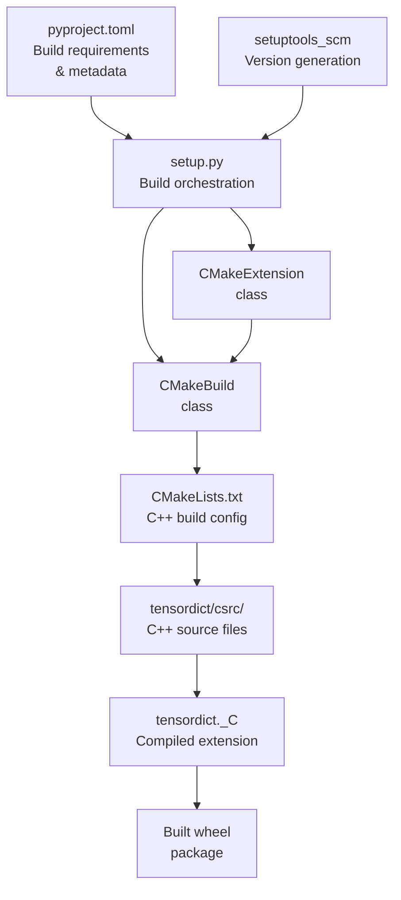
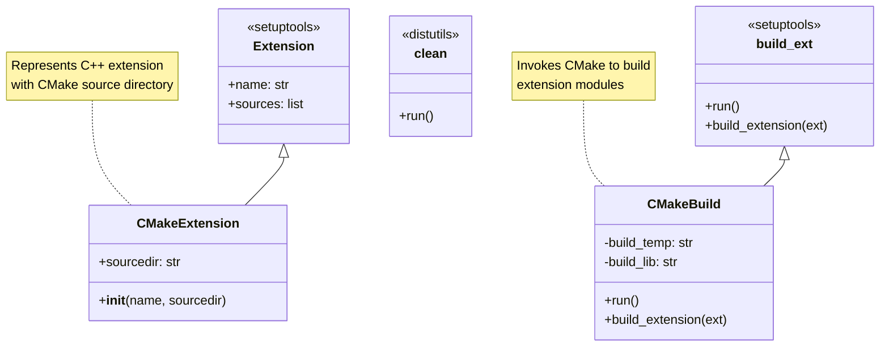
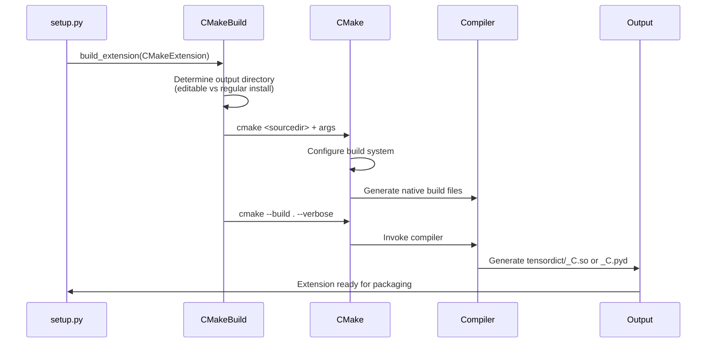
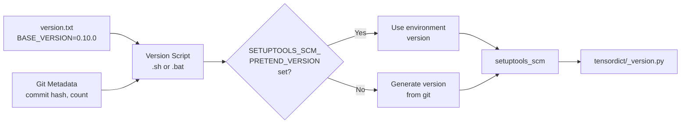

<!-- source: DeepWiki mcp.deepwiki.com · repo pytorch/tensordict · page 9.1 Build System and C++ Extensions · fetched 2026-10-21 -->

# Build System and C++ Extensions

<details>
<summary>Relevant source files</summary>

The following files were used as context for generating this wiki page:

- [README.md](README.md)
- [setup.py](setup.py)
- [version.txt](version.txt)

</details>


This document explains the build system architecture for TensorDict, focusing on how C++ extensions are compiled and integrated with the Python package. It covers the CMake-based build system, setuptools integration, and platform-specific compilation details.

## Build System Architecture

TensorDict uses a hybrid build system that combines Python setuptools with CMake for C++ extension compilation. The build process is orchestrated by `setup.py`, which invokes CMake to build C++ extensions that are then bundled with the Python package.

**High-Level Build System Architecture**



The build system consists of three main layers:

| Layer | Components | Purpose |
|-------|-----------|---------|
| **Configuration** | `pyproject.toml`, `setup.py` | Declare dependencies, metadata, and build configuration |
| **Build Orchestration** | `CMakeExtension`, `CMakeBuild` classes | Bridge Python setuptools to CMake |
| **C++ Compilation** | CMake, C++ source files | Compile native extensions |

Sources: [setup.py:1-123](), [pyproject.toml:1-79]()

## setuptools and CMake Integration

The `setup.py` file defines custom setuptools commands to integrate CMake-based C++ compilation into the Python package build process.

**CMakeExtension and CMakeBuild Class Hierarchy**



### CMakeExtension Class

The `CMakeExtension` class extends setuptools' `Extension` to represent C++ extensions built with CMake:

- Defined at [setup.py:49-53]()
- Takes a `name` and `sourcedir` parameter
- Sets `sources=[]` since CMake handles source discovery

### CMakeBuild Class

The `CMakeBuild` class extends setuptools' `build_ext` command to invoke CMake:

- Defined at [setup.py:55-88]()
- Handles both editable (`pip install -e`) and regular installs
- Configures CMake with Python executable paths
- Invokes CMake configuration and build commands

**Key CMake configuration arguments** (from [setup.py:68-75]()):

| Argument | Purpose |
|----------|---------|
| `CMAKE_LIBRARY_OUTPUT_DIRECTORY` | Where to place compiled `.so`/`.pyd` files |
| `CMAKE_RUNTIME_OUTPUT_DIRECTORY` | Where to place runtime dependencies |
| `PYTHON_EXECUTABLE` | Path to Python interpreter |
| `Python3_EXECUTABLE` | Alternative Python 3 path variable |
| `CMAKE_BUILD_TYPE` | Set to `Release` for optimized builds |

Sources: [setup.py:49-88]()

## C++ Extension Structure

The C++ extensions are located in `tensordict/csrc/` directory. The `get_extensions()` function in `setup.py` specifies which extensions to build:

```python
# From setup.py:90-92
def get_extensions():
    extensions_dir = os.path.join(ROOT_DIR, "tensordict", "csrc")
    return [CMakeExtension("tensordict._C", sourcedir=extensions_dir)]
```

This creates a single C++ extension module named `tensordict._C` that is compiled from the sources in `tensordict/csrc/`. The compiled extension is imported by Python code as `tensordict._C`.

**C++ Extension Build Flow**



Sources: [setup.py:90-92]()

## Version Management with setuptools_scm

TensorDict uses `setuptools_scm` to automatically generate version numbers from git metadata. The version management system is configured in `pyproject.toml` and controlled by version scripts.

**Version Management Configuration** (from [pyproject.toml:74-78]()):

```toml
[tool.setuptools_scm]
version_scheme = "post-release"
local_scheme = "node-and-date"
version_file = "tensordict/_version.py"
```

### Version Determination Logic

The version scripts [.github/scripts/version_script.sh:9-40]() and [.github/scripts/version_script.bat:6-61]() implement the following logic:

| Condition | Version Format | Example |
|-----------|----------------|---------|
| **Release branch or RC tag** | Static version from `BASE_VERSION` | `0.10.0` |
| **Development build** | `BASE_VERSION.dev<commits>+g<hash>.d<date>` | `0.10.0.dev123+gabcd1234.d20240115` |

The `SETUPTOOLS_SCM_PRETEND_VERSION` environment variable overrides automatic version detection. The `set_version()` context manager in [setup.py:95-108]() reads from `version.txt` and sets this environment variable if not already set.

**Version Generation Flow**



Sources: [setup.py:95-108](), [pyproject.toml:74-78](), [.github/scripts/version_script.sh:6-40](), [.github/scripts/version_script.bat:3-61]()

## Platform-Specific Build Configuration

The build system handles platform-specific differences in CMake invocation and compiler setup.

### Editable vs Regular Installs

The `CMakeBuild` class detects the installation mode and places extensions accordingly:

**From [setup.py:61-67]()**:
- **Editable install** (`pip install -e .`): Extensions placed in `ROOT_DIR/tensordict/`
- **Regular install**: Extensions placed in `build_lib/tensordict/`

This allows editable installs to work without copying files to site-packages.

### Windows-Specific Configuration

On Windows, the build process:

1. Appends `--config Release` to build arguments [setup.py:80-81]()
2. Requires Visual Studio environment setup via `version_script.bat`
3. Uses `vswhere.exe` to locate Visual Studio installation [.github/scripts/version_script.bat:88-94]()
4. Sets `DISTUTILS_USE_SDK=1` [.github/scripts/version_script.bat:107]()

The Visual Studio version is determined by `VC_VERSION_LOWER` and `VC_VERSION_UPPER` variables [.github/scripts/version_script.bat:77-86]():

| VS Version | VC_VERSION_LOWER | VC_VERSION_UPPER |
|------------|------------------|------------------|
| 2022       | 17               | 18               |
| 2019       | 16               | 17               |
| 2017       | 15               | 16               |

### macOS Configuration

macOS builds set `MACOSX_DEPLOYMENT_TARGET` to control the minimum supported macOS version [.github/scripts/version_script.sh:43]():

```bash
export MACOSX_DEPLOYMENT_TARGET=14.0
```

### Conda vs pip Environments

The version scripts detect conda environments and use appropriate commands:

**From [.github/scripts/version_script.sh:45-71]()**:
- If `CONDA_RUN` is not set: Use `pip` directly
- If `CONDA_RUN` is set: Use `${CONDA_RUN}` prefix for pip and conda commands

Sources: [setup.py:61-88](), [.github/scripts/version_script.sh:43-71](), [.github/scripts/version_script.bat:77-107]()

## Build Dependencies

The build dependencies are declared in `pyproject.toml` in the `[build-system]` section.

**Build-time Dependencies** (from [pyproject.toml:1-3]()):

```toml
[build-system]
requires = ["setuptools", "wheel", "pybind11[global]", "setuptools_scm"]
build-backend = "setuptools.build_meta"
```

| Dependency | Purpose |
|------------|---------|
| `setuptools` | Python package building framework |
| `wheel` | Wheel package format support |
| `pybind11[global]` | C++ to Python binding library |
| `setuptools_scm` | Version generation from git metadata |

**Runtime Dependencies** (from [pyproject.toml:36-45]()):

```python
dependencies = [
    "torch",           # PyTorch framework
    "numpy",           # Numerical computing
    "cloudpickle",     # Enhanced pickling
    "packaging",       # Version parsing
    "importlib_metadata",  # Metadata access
    'orjson ; python_version < "3.13"',  # JSON serialization
    "pyvers (>=0.1.0,<0.2.0)",  # Version utilities
]
```

The build system automatically installs `pybind11` and `setuptools_scm` before building in the version scripts [.github/scripts/version_script.sh:53-57]().

### Free-Threaded Python Support

For Python 3.13t (free-threaded), the version scripts set an environment variable for `orjson`:

```bash
export UNSAFE_PYO3_BUILD_FREE_THREADED=1
```

This is set at [.github/scripts/version_script.sh:51]() and [.github/scripts/version_script.bat:63]().

Sources: [pyproject.toml:1-45](), [.github/scripts/version_script.sh:48-71]()

## Custom Clean Command

The `setup.py` defines a custom `clean` command that extends the default distutils clean behavior to remove C++ extension files and build artifacts.

**From [setup.py:32-47]()**:

```python
class clean(distutils.command.clean.clean):
    def run(self):
        # Run default behavior first
        distutils.command.clean.clean.run(self)
        
        # Remove tensordict extension
        for path in (ROOT_DIR / "tensordict").glob("**/*.so"):
            logging.info(f"removing '{path}'")
            path.unlink()
        # Remove build directory
        build_dirs = [ROOT_DIR / "build"]
        for path in build_dirs:
            if path.exists():
                logging.info(f"removing '{path}' (and everything under it)")
                shutil.rmtree(str(path), ignore_errors=True)
```

This command:
1. Runs the default clean behavior
2. Removes all `.so` files from the `tensordict` directory
3. Removes the entire `build` directory

Sources: [setup.py:32-47]()

## Building TensorDict Locally

To build TensorDict locally:

1. Clone the repository:
   ```bash
   git clone https://github.com/pytorch/tensordict.git
   cd tensordict
   ```

2. Install build dependencies:
   ```bash
   pip install setuptools wheel torch
   ```

3. Build the package:
   ```bash
   python setup.py bdist_wheel
   ```

### Setting Version Information

The version is specified in `version.txt` at the root of the repository. When building locally, you can set the version environment variable:

- **Linux/macOS**:
  ```bash
  export TENSORDICT_BUILD_VERSION=$(cat version.txt)
  ```

- **Windows**:
  ```batch
  set TENSORDICT_BUILD_VERSION=0.8.0
  ```

Sources: [version.txt:1](), [.github/scripts/version_script.sh:3](), [.github/scripts/version_script.bat:2]()

## Conclusion

TensorDict uses a comprehensive build system leveraging GitHub Actions to ensure consistent builds across multiple platforms and Python versions. The system includes platform-specific build processes, binary relocation for Windows, and smoke tests to verify functionality.

The build workflows are triggered automatically for pull requests, pushes to important branches, and release tags, providing continuous integration and delivery capabilities for the project.

---

