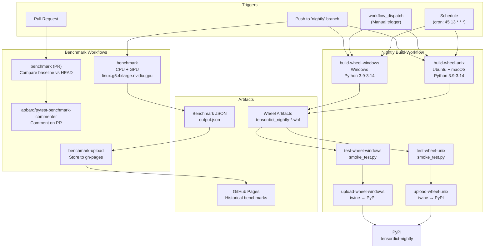
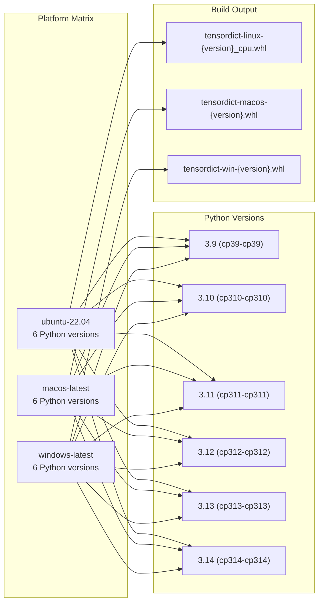
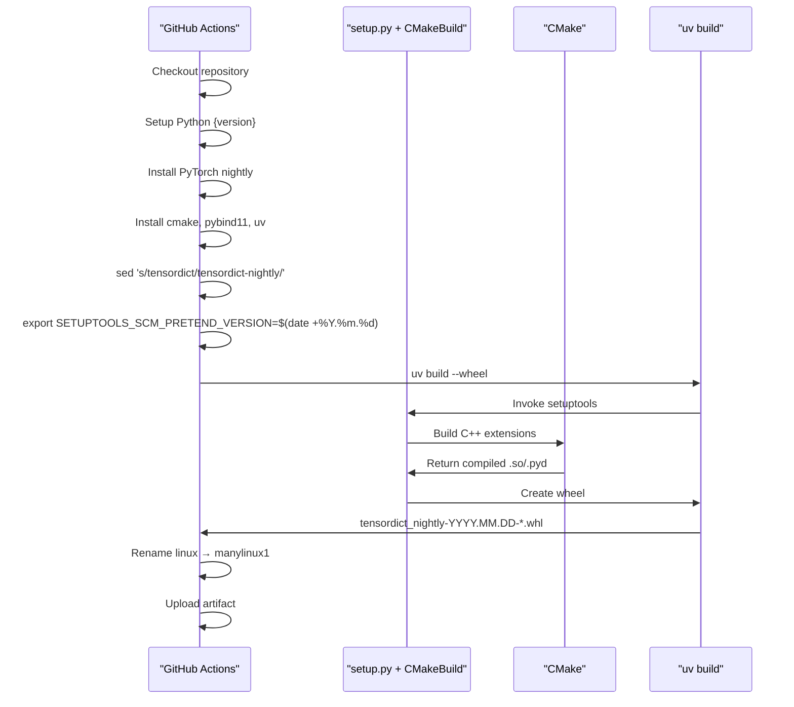
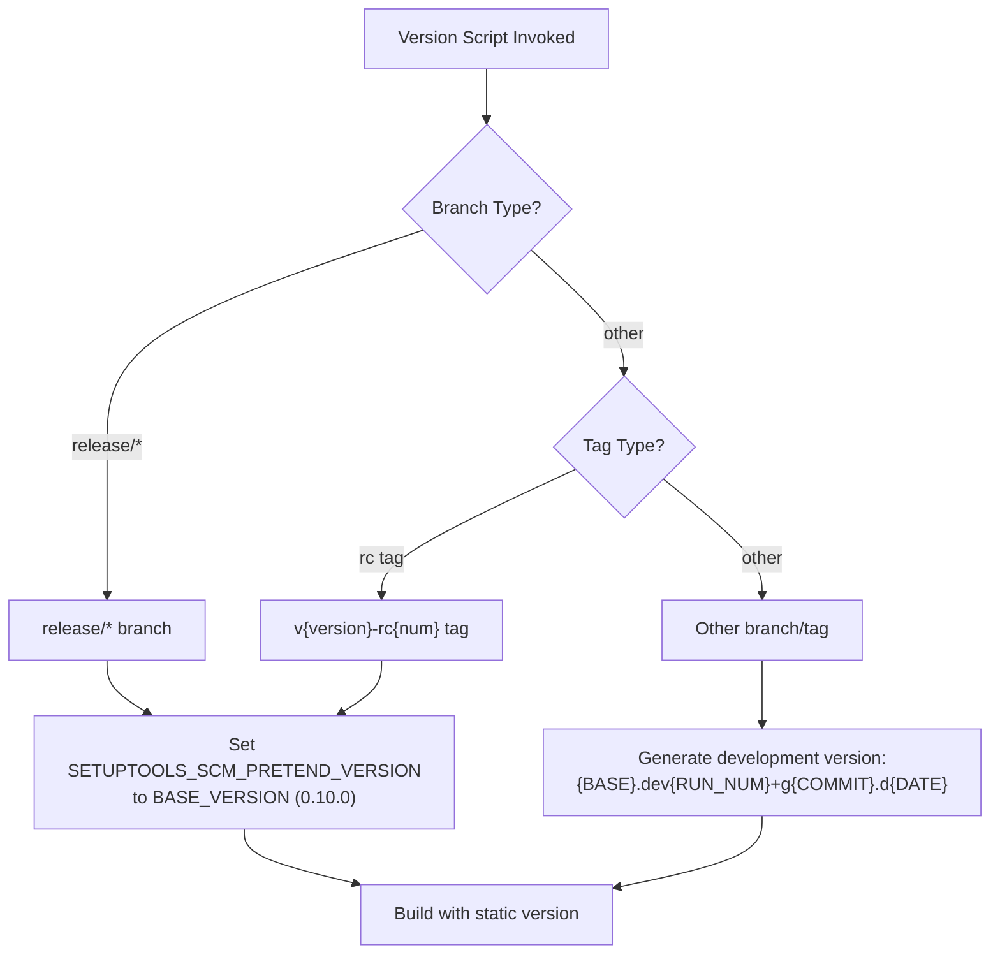
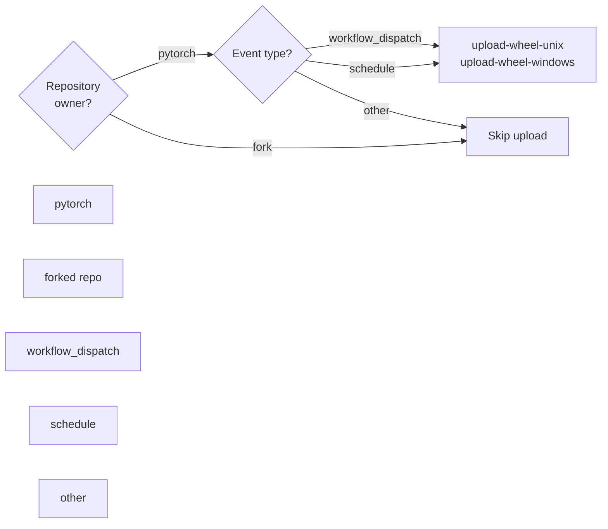
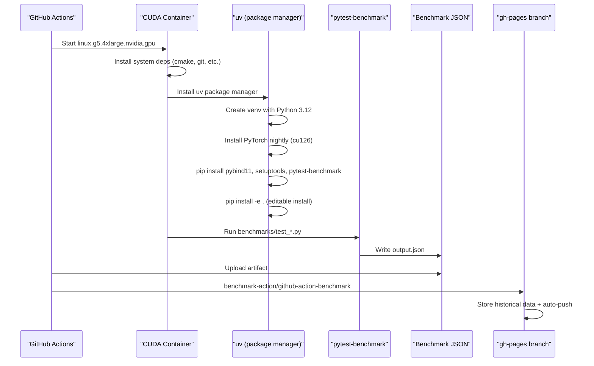

<!-- source: DeepWiki mcp.deepwiki.com · repo pytorch/tensordict · page 9.2 CI/CD Pipeline and Release Process · fetched 2026-10-21 -->

# CI/CD Pipeline and Release Process

<details>
<summary>Relevant source files</summary>

The following files were used as context for generating this wiki page:

- [.github/workflows/benchmarks.yml](.github/workflows/benchmarks.yml)
- [.github/workflows/benchmarks_pr.yml](.github/workflows/benchmarks_pr.yml)
- [.github/workflows/nightly_build.yml](.github/workflows/nightly_build.yml)
- [.gitignore](.gitignore)

</details>


This document describes the automated continuous integration and continuous deployment (CI/CD) infrastructure for TensorDict, including nightly builds, wheel distribution, PyPI uploads, versioning strategy, and continuous benchmarking. This covers the GitHub Actions workflows and scripts that ensure cross-platform compatibility and performance tracking.

For information about the build system and C++ extension compilation, see [Build System and C++ Extensions](#9.1). For details about testing strategies, see [Testing Strategy and Benchmarks](#9.3).

## Overview

The TensorDict CI/CD infrastructure consists of three primary workflows:

1. **Nightly builds** - Automated daily builds and PyPI uploads of `tensordict-nightly` packages
2. **Continuous benchmarking** - Performance tracking on both CPU and GPU platforms
3. **PR benchmarks** - Comparative performance analysis for pull requests

All workflows target multiple Python versions (3.9, 3.10, 3.11, 3.12, 3.13, 3.14) and platforms (Ubuntu, macOS, Windows), ensuring broad compatibility with the PyTorch ecosystem.

## CI/CD Pipeline Architecture



Sources: [.github/workflows/nightly_build.yml:1-351](), [.github/workflows/benchmarks.yml:1-184](), [.github/workflows/benchmarks_pr.yml:1-118]()

## Nightly Build Workflow

The `Push Binary Nightly` workflow executes daily at 13:45 UTC and builds wheel distributions for all supported platforms and Python versions.

### Workflow Configuration

| Trigger | Description |
|---------|-------------|
| `schedule: '45 13 * * *'` | Daily automated builds |
| `workflow_dispatch` | Manual trigger for ad-hoc builds |
| `push: branches: nightly` | Automatic trigger on nightly branch updates |
| `pull_request` | Test builds without upload |

**Concurrency Control**: The workflow uses a concurrency group to prevent parallel executions and cancel in-progress runs when new commits arrive, except on the main branch where all builds complete for debugging purposes.

Sources: [.github/workflows/nightly_build.yml:6-29]()

### Build Matrix



Sources: [.github/workflows/nightly_build.yml:38-49](), [.github/workflows/nightly_build.yml:206-214]()

### Unix Build Process

The Unix build job (`build-wheel-unix`) targets both Ubuntu and macOS:

**Key Build Steps**:

1. **Install PyTorch nightly**: Downloads the latest nightly PyTorch build from the PyPI index
2. **Install build dependencies**: Installs CMake, `pybind11[global]`, and `uv` package manager
3. **Modify package name**: Changes `name = "tensordict"` to `name = "tensordict-nightly"` in `pyproject.toml`
4. **Set version**: Uses `SETUPTOOLS_SCM_PRETEND_VERSION` environment variable with date-based version (`YYYY.MM.DD`)
5. **Build wheel**: Executes `uv build --wheel` to create the distribution
6. **Platform tag conversion**: Renames Linux wheels from `linux_*` to `manylinux1_*` for PyPI compatibility



Sources: [.github/workflows/nightly_build.yml:51-86](), [.github/workflows/nightly_build.yml:63-79]()

### Windows Build Process

The Windows build job (`build-wheel-windows`) follows a similar pattern but uses platform-specific tools:

- **CMake setup**: Uses `jwlawson/actions-setup-cmake@v2` action for CMake installation
- **Build tool**: Uses Python's built-in `build` module instead of `uv` for better Windows reliability
- **Sed command**: Uses bash-compatible `sed` for file modification even on Windows

Sources: [.github/workflows/nightly_build.yml:200-252]()

## Versioning Strategy

The versioning system differentiates between release builds and development builds using version generation scripts.

### Version Generation Logic



**Version Components**:

| Component | Source | Example |
|-----------|--------|---------|
| `BASE_VERSION` | Hard-coded in script | `0.10.0` |
| `GIT_COMMIT` | `${GITHUB_SHA:0:9}` | `a1b2c3d4e` |
| `GIT_COMMIT_COUNT` | `${GITHUB_RUN_NUMBER}` | `1234` |
| `DATE_STR` | `$(date +%Y%m%d)` | `20240315` |

**Development Version Format**: `0.10.0.dev1234+ga1b2c3d4e.d20240315`

Sources: [.github/scripts/version_script.sh:1-72](), [.github/scripts/version_script.bat:1-126]()

### Version Script Implementation

The Unix version script [.github/scripts/version_script.sh:6-40]() implements the following logic:

1. **Base version**: Read from hard-coded value `BASE_VERSION=0.10.0`
2. **Release detection**: Check if `GITHUB_REF_NAME` matches `release/*` or `v*-rc*` pattern
3. **Development version**: Generate from GitHub environment variables:
   - Commit hash from `${GITHUB_SHA:0:9}`
   - Commit count from `${GITHUB_RUN_NUMBER}`
   - Date string from `$(date +%Y%m%d)`
4. **Export**: Set `SETUPTOOLS_SCM_PRETEND_VERSION` for `setuptools_scm` consumption

The `setuptools_scm` configuration in [pyproject.toml:74-78]() specifies:
- `version_scheme = "post-release"`
- `local_scheme = "node-and-date"`
- `version_file = "tensordict/_version.py"`

This integrates with `setup.py` via the `set_version()` context manager [setup.py:95-107]() which reads `version.txt` if `SETUPTOOLS_SCM_PRETEND_VERSION` is not set.

Sources: [.github/scripts/version_script.sh:1-72](), [.github/scripts/version_script.bat:1-126](), [pyproject.toml:74-78](), [setup.py:95-107]()

## Wheel Testing

Before uploading to PyPI, all wheels undergo smoke testing to verify basic functionality.

### Test Jobs

The `test-wheel-unix` and `test-wheel-windows` jobs:

1. **Download artifacts**: Retrieve built wheels from the build job
2. **Install PyTorch nightly**: Ensure latest PyTorch compatibility
3. **Install dependencies**: `numpy`, `pytest`, `pillow`, `scipy`, `networkx`, `expecttest`, `pyyaml`
4. **Install wheel**: Use `python -m pip install /tmp/wheels/*`
5. **Version verification**: Import and print `tensordict.__version__`
6. **Run smoke tests**: Execute `pytest test/smoke_test.py -v --durations 200`

**Important**: The test job deletes the source `tensordict/` directory [.github/workflows/nightly_build.yml:140]() to ensure tests import from the installed wheel rather than local source.

Sources: [.github/workflows/nightly_build.yml:89-153](), [.github/workflows/nightly_build.yml:253-313]()

## PyPI Upload Process

After successful testing, wheels are uploaded to PyPI as the `tensordict-nightly` package.

### Upload Conditions



**Upload Mechanism**: Uses `twine` with token authentication:

```bash
python -m twine upload \
    --username __token__ \
    --password "$PYPI_TOKEN" \
    --skip-existing \
    /tmp/wheels/tensordict_nightly-*.whl \
    --verbose
```

The `--skip-existing` flag prevents failures when a version already exists on PyPI, which can happen with date-based versioning if multiple builds occur on the same day.

Sources: [.github/workflows/nightly_build.yml:155-196](), [.github/workflows/nightly_build.yml:315-350]()

## Continuous Benchmarking

The benchmark infrastructure tracks performance regressions and improvements across commits.

### Benchmark Execution Environment

**Hardware**: `linux.g5.4xlarge.nvidia.gpu` runner with NVIDIA GPUs  
**Container**: `nvidia/cuda:12.3.0-runtime-ubuntu22.04` with `--gpus all` option  
**Python Version**: 3.12  
**Configurations**: Both CPU and GPU (controlled by `CUDA_VISIBLE_DEVICES`)

### Benchmark Workflow Steps



**Environment Variables**:
- `TORCHDYNAMO_INLINE_INBUILT_NN_MODULES=1` - Enable PyTorch Dynamo optimizations
- `TD_GET_DEFAULTS_TO_NONE=1` - TensorDict behavior flag
- `CUDA_VISIBLE_DEVICES=` (for CPU tests) - Disable GPU visibility

Sources: [.github/workflows/benchmarks.yml:23-106]()

### Benchmark Storage and Alerting

The `benchmark-upload` job stores results to the `gh-pages` branch using `benchmark-action/github-action-benchmark@v1`:

**Configuration**:
- **Tool**: `pytest` (pytest-benchmark JSON format)
- **Alert threshold**: 200% performance degradation
- **Alert recipient**: `@vmoens`
- **Auto-push**: Enabled (commits to gh-pages automatically)
- **Comment style**: `github` (regular comments, not PR reviews)

Results are stored separately for CPU and GPU configurations, allowing independent tracking of performance on each platform.

Sources: [.github/workflows/benchmarks.yml:116-183]()

### Pull Request Benchmarks

The PR benchmark workflow [.github/workflows/benchmarks_pr.yml:1-118]() provides comparative analysis:

1. **Checkout base commit**: `git checkout ${{ github.event.pull_request.base.sha }}`
2. **Run baseline benchmarks**: Record baseline performance
3. **Checkout PR commit**: `git checkout ${{ github.event.pull_request.head.sha }}`
4. **Run contender benchmarks**: Record PR performance
5. **Post comparison**: Use `apbard/pytest-benchmark-commenter@v3` to comment on PR

The commenter action [.github/workflows/benchmarks_pr.yml:108-117]() compares:
- **Metrics**: `name`, `max`, `mean`, `ops` (operations per second)
- **Comparison metric**: `ops` (higher is better)
- **Threshold**: 5% change triggers highlighting

Sources: [.github/workflows/benchmarks_pr.yml:1-118]()

## Platform-Specific Implementation Details

### macOS Build Configuration

- **Deployment target**: `MACOSX_DEPLOYMENT_TARGET=14.0` [.github/scripts/version_script.sh:43]()
- **CMake installation**: `brew install cmake || true` [.github/workflows/nightly_build.yml:68]()
- **Python path**: Uses `/opt/python/{version}/bin` when available

### Windows Build Configuration

- **Visual Studio setup**: Uses `vswhere.exe` to locate VS installation [.github/scripts/version_script.bat:88-93]()
- **VC version support**: VS 2017 (v15), VS 2019 (v16), VS 2022 (v17)
- **Build type**: Always `Release` via `CMAKE_BUILD_TYPE=Release` [setup.py:74]()
- **Distutils SDK**: `DISTUTILS_USE_SDK=1` [.github/scripts/version_script.bat:107]()

### CMake Extension Building

The `CMakeBuild` class in [setup.py:55-87]() handles cross-platform C++ compilation:

**Key parameters**:
- `CMAKE_LIBRARY_OUTPUT_DIRECTORY`: Points to `tensordict/` directory
- `PYTHON_EXECUTABLE`: Ensures correct Python interpreter for pybind11
- Platform detection: `sys.platform == "win32"` triggers Windows-specific build args

**Editable installs**: Detected via `self.inplace` and places extensions directly in source directory [setup.py:61-67]()

Sources: [setup.py:55-87](), [.github/scripts/version_script.sh:43](), [.github/scripts/version_script.bat:77-101]()

## Dependency Management

### Build Dependencies

Specified in [pyproject.toml:2]():
- `setuptools` - Build backend
- `wheel` - Wheel format support
- `pybind11[global]` - C++ binding generation
- `setuptools_scm` - Version management from git

### Runtime Dependencies

Core dependencies [pyproject.toml:36-45]():
- `torch` - PyTorch framework
- `numpy` - Array operations
- `cloudpickle` - Enhanced pickling
- `packaging` - Version parsing
- `importlib_metadata` - Metadata access
- `orjson` (Python < 3.13) - Fast JSON serialization
- `pyvers` (0.1.0-0.2.0) - Version utilities

### Optional Dependencies

| Group | Purpose | Packages |
|-------|---------|----------|
| `tests` | Test execution | `pytest`, `pyyaml`, `pytest-instafail`, `pytest-rerunfailures`, `pytest-benchmark` |
| `h5` | HDF5 support | `h5py>=3.8` |
| `dev` | Development | `pybind11`, `ninja` |
| `typecheck` | Type checking | `mypy>=1.0.0` |

Sources: [pyproject.toml:1-61]()

## Concurrency and Caching

### Workflow Concurrency

All workflows implement concurrency control [.github/workflows/nightly_build.yml:25-29]():

```yaml
concurrency:
  group: ${{ github.workflow }}-${{ github.ref == 'refs/heads/main' && format('ci-master-{0}', github.sha) || format('ci-{0}', github.ref) }}
  cancel-in-progress: true
```

This ensures:
- **Branch isolation**: Different branches run independently
- **Main branch preservation**: Each main branch build gets unique group ID to prevent cancellation
- **Resource optimization**: Cancels outdated builds when new commits arrive

### Artifact Management

Artifacts follow structured naming:
- **Unix wheels**: `tensordict-linux-{python_version}_{cuda}.whl` or `tensordict-macos-{python_version}.whl`
- **Windows wheels**: `tensordict-win-{python_version}.whl`
- **Benchmark results**: `{CPU|GPU}-benchmark-results` containing `output.json`

Artifacts are retained between jobs via `actions/upload-artifact@v4` and `actions/download-artifact@v4`.

Sources: [.github/workflows/nightly_build.yml:25-29](), [.github/workflows/nightly_build.yml:82-86]()

## Repository Owner Checks

All upload jobs include repository ownership checks to prevent forks from attempting PyPI uploads:

```yaml
if: github.repository_owner == 'pytorch'
```

This appears in:
- `build-wheel-unix` [.github/workflows/nightly_build.yml:35]()
- `test-wheel-unix` [.github/workflows/nightly_build.yml:91]()
- `upload-wheel-unix` [.github/workflows/nightly_build.yml:157]()
- All Windows jobs [.github/workflows/nightly_build.yml:202](), [.github/workflows/nightly_build.yml:255](), [.github/workflows/nightly_build.yml:317]()

Additionally, upload jobs verify event type to restrict uploads to scheduled and manual runs:

```yaml
if: ${{ github.repository_owner == 'pytorch' && (github.event_name == 'workflow_dispatch' || github.event_name == 'schedule') }}
```

Sources: [.github/workflows/nightly_build.yml:35](), [.github/workflows/nightly_build.yml:157]()

---

