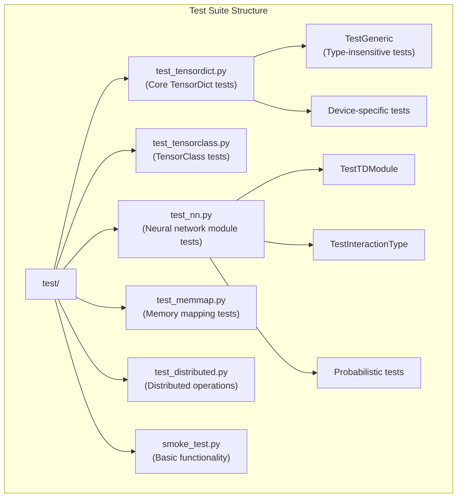
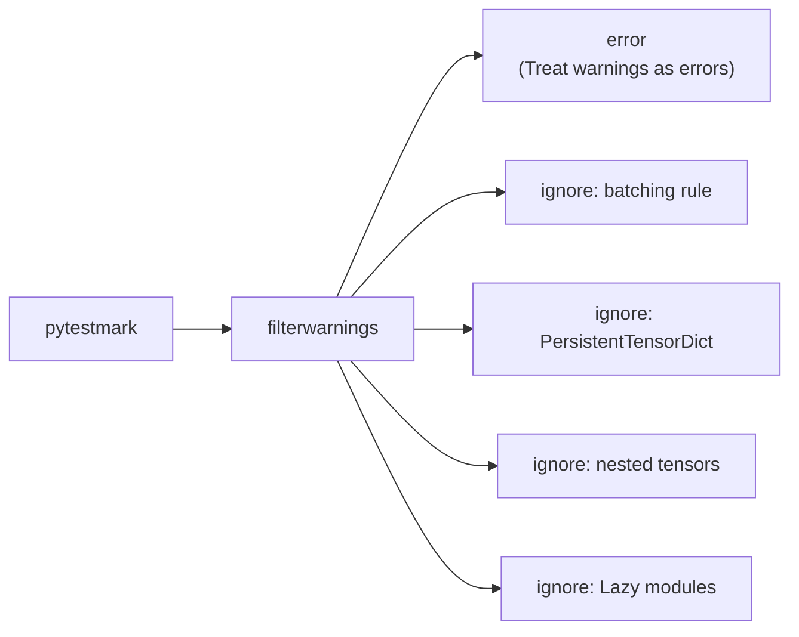
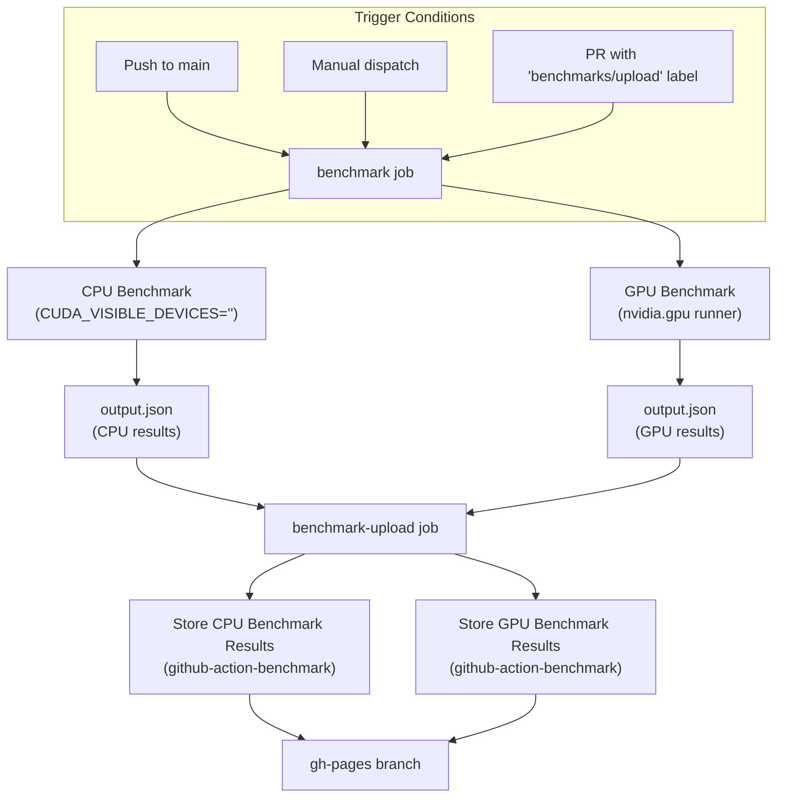
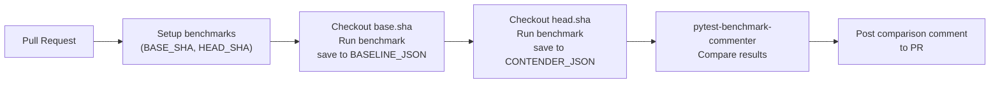
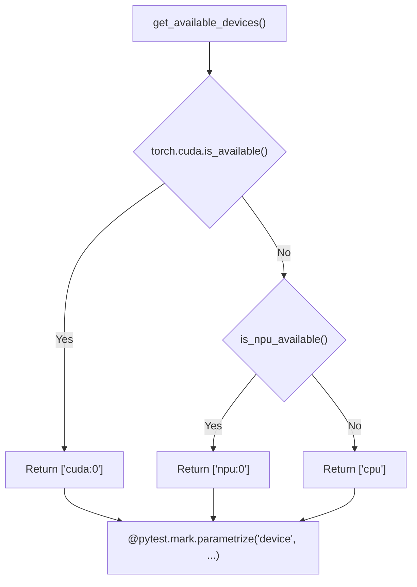
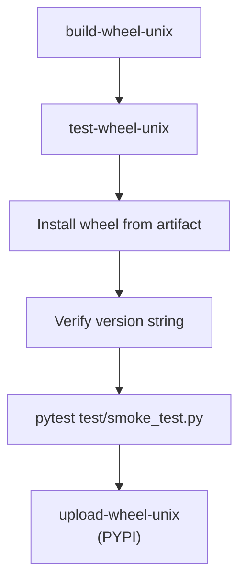

<!-- source: DeepWiki mcp.deepwiki.com · repo pytorch/tensordict · page 9.3 Testing Strategy and Benchmarks · fetched 2026-10-21 -->

# Testing Strategy and Benchmarks

<details>
<summary>Relevant source files</summary>

The following files were used as context for generating this wiki page:

- [.github/workflows/benchmarks.yml](.github/workflows/benchmarks.yml)
- [.github/workflows/benchmarks_pr.yml](.github/workflows/benchmarks_pr.yml)
- [.github/workflows/nightly_build.yml](.github/workflows/nightly_build.yml)
- [.gitignore](.gitignore)
- [tensordict/base.py](tensordict/base.py)
- [tensordict/nn/common.py](tensordict/nn/common.py)
- [tensordict/nn/distributions/composite.py](tensordict/nn/distributions/composite.py)
- [tensordict/nn/probabilistic.py](tensordict/nn/probabilistic.py)
- [tensordict/nn/sequence.py](tensordict/nn/sequence.py)
- [test/test_nn.py](test/test_nn.py)
- [test/test_tensordict.py](test/test_tensordict.py)

</details>


This document describes the testing framework, benchmark workflows, performance tracking mechanisms, and testing best practices for the TensorDict library. It provides developers with information on test organization, running tests locally, and understanding the automated testing and benchmarking pipelines.

## Test Organization and Structure

TensorDict's test suite is organized into several main test files, each focusing on different aspects of the library:

**Test Organization Diagram**



Sources: [test/test_tensordict.py:1-100](), [test/test_nn.py:1-100]()

### Core Test Classes

The main test suite in `test/test_tensordict.py` includes:

- **`TestGeneric`**: Type-insensitive tests that validate core TensorDict functionality like batch size operations, indexing, consolidation, and data manipulation
- **Device-specific test classes**: Tests parameterized across CPU, CUDA, and NPU devices using `get_available_devices()` fixture
- **Storage tests**: Tests for memory-mapped tensors, persistent storage, and serialization

Sources: [test/test_tensordict.py:207-334]()

### Test Configuration and Fixtures

**pytest Configuration**

The test suite uses pytest with extensive filtering of warnings:



Sources: [test/test_tensordict.py:134-161](), [test/test_nn.py:93-105]()

**Device Fixture**

The `device_fixture` sets the default PyTorch device for testing:

```python
@pytest.fixture
def device_fixture():
    device = torch.get_default_device()
    if torch.cuda.is_available():
        torch.set_default_device(torch.device("cuda:0"))
    elif is_npu_available():
        torch.set_default_device(torch.device("npu:0"))
    yield
    torch.set_default_device(device)
```

Sources: [test/test_tensordict.py:173-183]()

### Test Parametrization

Tests use `@pytest.mark.parametrize` extensively to run the same test logic across multiple configurations:

**Common Parametrization Patterns**

| Parameter | Values | Purpose |
|-----------|--------|---------|
| `device` | `get_available_devices()` | Test across CPU, CUDA, NPU |
| `lazy` | `[True, False]` | Test with/without lazy modules |
| `recurse` | `[True, False]` | Test recursive vs non-recursive operations |
| `inplace` | `[True, False]` | Test in-place vs out-of-place operations |
| `num_threads` | `[0, 1, 2]` | Test multi-threaded operations |

Sources: [test/test_tensordict.py:336-423](), [test/test_nn.py:408-521]()

## Benchmark Strategy

TensorDict uses `pytest-benchmark` to track performance metrics across CPU and GPU configurations. Benchmarks run automatically on the main branch and for pull requests with the `benchmarks/upload` label.

**Benchmark Workflow Architecture**



Sources: [.github/workflows/benchmarks.yml:1-184]()

### Benchmark Execution Environment

**Environment Setup**

The benchmark workflow uses:
- **Container**: `nvidia/cuda:12.3.0-runtime-ubuntu22.04` with GPU access
- **Python**: 3.12
- **PyTorch**: Nightly build from `https://download.pytorch.org/whl/nightly/cu126`
- **Runner**: `linux.g5.4xlarge.nvidia.gpu` for GPU benchmarks

**Environment Variables**:
- `TORCHDYNAMO_INLINE_INBUILT_NN_MODULES=1`: Enables inlining for compilation
- `TD_GET_DEFAULTS_TO_NONE=1`: Sets default behavior for `get()` method

Sources: [.github/workflows/benchmarks.yml:33-105]()

### PR-Specific Benchmarks

The `benchmarks_pr.yml` workflow runs comparative benchmarks on pull requests:

**PR Benchmark Comparison Flow**



The comparison uses `apbard/pytest-benchmark-commenter@v3` with:
- **Metrics**: `name`, `max`, `mean`, `ops`
- **Comparison metric**: `ops` (operations per second)
- **Threshold**: 5% performance change triggers alert

Sources: [.github/workflows/benchmarks_pr.yml:83-118]()

## Performance Tracking

Performance results are tracked using the `benchmark-action/github-action-benchmark` action, which stores historical benchmark data in the `gh-pages` branch.

**Performance Alert Configuration**

| Setting | Value | Description |
|---------|-------|-------------|
| `fail-on-alert` | `true` | Fail workflow on performance regression |
| `alert-threshold` | `200%` | Alert if performance degrades by 200% |
| `alert-comment-cc-users` | `@vmoens` | CC maintainer on alerts |
| `comment-on-alert` | `false` | Disabled to avoid permission issues |
| `auto-push` | `true` | Automatically push results to gh-pages |

Sources: [.github/workflows/benchmarks.yml:151-183]()

### Benchmark Artifacts

For each benchmark run, two artifacts are uploaded:
- **CPU-benchmark-results**: Results from CPU-only execution
- **GPU-benchmark-results**: Results from GPU execution

These artifacts contain `output.json` files in pytest-benchmark format with detailed timing statistics.

Sources: [.github/workflows/benchmarks.yml:108-113]()

## Testing Best Practices

### Warning Management

TensorDict uses a comprehensive warning filter system to ensure meaningful test failures:

```python
pytestmark = [
    pytest.mark.filterwarnings("error"),  # Treat warnings as errors
    pytest.mark.filterwarnings("ignore:batching rule"),
    pytest.mark.filterwarnings("ignore:PersistentTensorDict"),
    pytest.mark.filterwarnings("ignore:nested tensors"),
]
```

This ensures that:
1. Unexpected warnings cause test failures
2. Known, acceptable warnings are explicitly ignored
3. The test suite remains clean and maintainable

Sources: [test/test_tensordict.py:134-161]()

### Device-Agnostic Testing

Tests use helper functions to support multiple device types:

**Device Detection Pattern**



Sources: [test/test_tensordict.py:166-170]()

### Nested Tensor Handling

Tests that involve nested tensors use the `_NESTED_TENSORS_AS_LISTS` flag for proper leaf detection:

```python
td._fast_apply(
    func,
    is_leaf=_NESTED_TENSORS_AS_LISTS,
    propagate_lock=True,
)
```

Sources: [test/test_tensordict.py:423-544](), [tensordict/base.py:52]()

### Test Data Generation

Tests use deterministic seeding for reproducibility:

```python
torch.manual_seed(1)
td = TensorDict({
    "a": torch.randn(4, 5, 6, device=device),
    "b": torch.randn(4, 5, 10, device=device),
}, batch_size=[4, 5])
```

Sources: [test/test_tensordict.py:337-344]()

### Probabilistic Testing Patterns

Neural network tests use the `InteractionType` enum to test different sampling strategies:

```python
@pytest.mark.parametrize("it", [
    InteractionType.MODE, 
    InteractionType.RANDOM, 
    None
])
def test_probabilistic(self, it):
    with set_interaction_type(it):
        tensordict_module(td)
```

Sources: [test/test_nn.py:637-672](), [tensordict/nn/probabilistic.py:59-157]()

## CI Integration

### Nightly Builds

The nightly build workflow (`nightly_build.yml`) includes a testing phase after wheel building:

**Nightly Build Test Flow**



The smoke test validates:
- Package imports correctly
- `TensorDictModule` can be instantiated
- Basic torch integration works

Sources: [.github/workflows/nightly_build.yml:89-154]()

### Test Isolation

Tests use `IN_CI=1` environment variable to adjust behavior in CI environments:

```bash
export IN_CI=1
pytest test/smoke_test.py -v --durations 200
```

Sources: [.github/workflows/nightly_build.yml:146-152]()

## Testing Framework

TensorDict uses a smoke test as part of the CI pipeline to verify the basic functionality of built wheels. The smoke test is located at `test/smoke_test.py` and is executed after the wheel building process is complete.

The smoke test verifies:
1. The built wheel can be imported correctly
2. Basic functionality works as expected
3. Integration with PyTorch is functioning

Sources: [.github/workflows/build-wheels-linux.yml:35-36](), [.github/workflows/build-wheels-windows.yml:38-39](), [.github/workflows/build-wheels-m1.yml:36-37]()

## Binary Relocation Process

For Windows builds, a special binary relocation process is implemented in `packaging/wheel/relocate.py`. This script:

1. Finds all wheel files in the `dist` directory
2. Unzips each wheel to a temporary directory
3. Updates the RECORD file with correct file hashes and sizes
4. Recompresses the wheel with the updated RECORD file

This process ensures that file hashes and metadata in the wheel packages are correct after building.

Sources: [packaging/wheel/relocate.py:23-139]()

## Building TensorDict Locally

To build TensorDict locally:

1. Clone the repository:
   ```bash
   git clone https://github.com/pytorch/tensordict.git
   cd tensordict
   ```

2. Install build dependencies:
   ```bash
   pip install setuptools wheel torch
   ```

3. Build the package:
   ```bash
   python setup.py bdist_wheel
   ```

### Setting Version Information

The version is specified in `version.txt` at the root of the repository. When building locally, you can set the version environment variable:

- **Linux/macOS**:
  ```bash
  export TENSORDICT_BUILD_VERSION=$(cat version.txt)
  ```

- **Windows**:
  ```batch
  set TENSORDICT_BUILD_VERSION=0.8.0
  ```

Sources: [version.txt:1](), [.github/scripts/version_script.sh:3](), [.github/scripts/version_script.bat:2]()

## Conclusion

TensorDict uses a comprehensive build system leveraging GitHub Actions to ensure consistent builds across multiple platforms and Python versions. The system includes platform-specific build processes, binary relocation for Windows, and smoke tests to verify functionality.

The build workflows are triggered automatically for pull requests, pushes to important branches, and release tags, providing continuous integration and delivery capabilities for the project.

---

