# Page: Overview

# Overview

<details>
<summary>Relevant source files</summary>

The following files were used as context for generating this wiki page:

- [README.md](README.md)
- [setup.py](setup.py)
- [tensordict/base.py](tensordict/base.py)
- [tensordict/tensordict.py](tensordict/tensordict.py)
- [test/_utils_internal.py](test/_utils_internal.py)
- [test/test_tensordict.py](test/test_tensordict.py)
- [version.txt](version.txt)

</details>


This document provides a high-level introduction to the TensorDict library, its architecture, and its role as a PyTorch extension for structured tensor collections. TensorDict provides dictionary-like containers that inherit tensor semantics, enabling efficient manipulation of collections of tensors with batch dimensions, device management, and deep integration with PyTorch's functional and distributed computing features.

For detailed information about specific subsystems, see:
- Core data structures and operations: [Core TensorDict System](#2)
- The `@tensorclass` decorator and dataclass-like interface: [TensorClass System](#3)
- Neural network integration: [Neural Network Integration](#4)
- Persistence mechanisms: [Storage and Persistence](#5)
- Advanced functional and distributed features: [Advanced Features](#6)

## Purpose and Scope

TensorDict is a library that extends PyTorch by providing a data structure for managing collections of tensors. It treats dictionaries of tensors as first-class objects that support tensor-like operations (indexing, slicing, shape manipulation) while maintaining the nested structure of the data. The library is designed to:

- **Simplify code** by abstracting away operations on collections of tensors
- **Improve performance** through optimizations like consolidation, asynchronous transfers, and compilation support
- **Enable modularity** in machine learning workflows by treating data as structured objects
- **Integrate seamlessly** with PyTorch's ecosystem (functorch, distributed, compilation)

**Sources:** [README.md:1-179](), [tensordict/base.py:300-302]()

## What is TensorDict?

A `TensorDict` is a dictionary-like container that maps string keys (or nested tuples of strings) to tensors or other TensorDicts. Unlike a standard Python dictionary, a TensorDict has a **batch size** that constrains the leading dimensions of all contained tensors, and supports **tensor-like operations** that are broadcast across all entries.

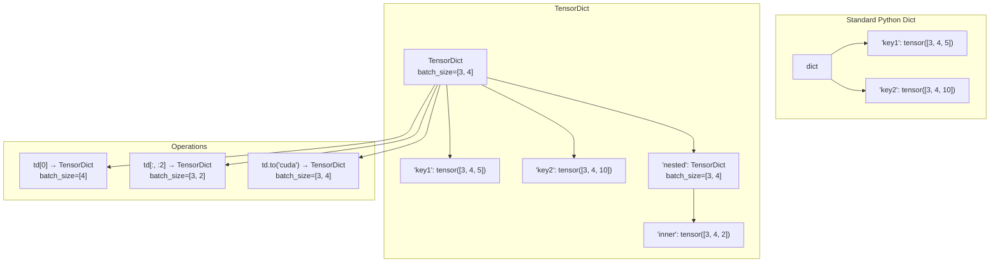

**Key Properties:**
- **Batch semantics**: All tensors must have leading dimensions compatible with the batch size
- **Nested structure**: TensorDicts can contain other TensorDicts, forming hierarchies
- **Device management**: Entire collections can be moved between devices atomically
- **Indexing**: Standard tensor indexing operations apply to all tensors simultaneously

**Sources:** [tensordict/base.py:300-571](), [README.md:30-60](), [test/test_tensordict.py:210-295]()

## Architecture Overview

The TensorDict library follows a layered architecture with clear separation between abstract interfaces, concrete implementations, and integration layers.

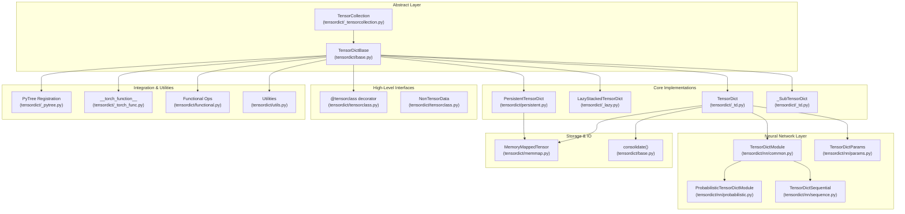

**Sources:** [tensordict/tensordict.py:1-37](), [tensordict/base.py:1-53](), Diagram 3 from provided context

## Core Components

### TensorDictBase: The Abstract Interface

`TensorDictBase` is the abstract base class that defines the contract for all TensorDict implementations. It inherits from both `MutableMapping` (Python's dict-like interface) and `TensorCollection` (custom PyTorch-compatible interface).

**Key responsibilities:**
- Define abstract methods for indexing, setting, and iteration
- Implement common operations that work across all implementations
- Manage batch size, device, and locking state
- Provide PyTree and `__torch_function__` integration

**Sources:** [tensordict/base.py:300-324]()

### TensorDict: The Main Implementation

`TensorDict` is the primary concrete implementation stored in [tensordict/_td.py](). It uses an internal dictionary (`_tensordict`) to store tensors and nested TensorDicts.

**Key features:**
- Direct storage of tensors in memory
- Fast indexing and modification
- Support for consolidation (single-buffer storage)
- Memory-mapping capabilities
- Locking mechanism for thread safety

**Sources:** [tensordict/_td.py]() (referenced but not provided in full), [tensordict/base.py:314-322]()

### LazyStackedTensorDict: Deferred Materialization

`LazyStackedTensorDict` represents a stack of TensorDicts without immediately copying data. It stores references to the original TensorDicts and only materializes the stacked view when necessary.

**Use cases:**
- Efficient batching of data without memory duplication
- Lazy evaluation pipelines
- Memory-efficient data loading

**Sources:** [tensordict/_lazy.py]() (referenced), [test/test_tensordict.py:39,261-271,885-918]()

### TensorClass: Dataclass-like Interface

The `@tensorclass` decorator transforms Python dataclasses into TensorDict-backed objects with attribute access syntax.

```python
@tensorclass
class MyData:
    observation: torch.Tensor
    action: torch.Tensor
    reward: torch.Tensor
```

**Sources:** [tensordict/tensorclass.py]() (referenced), [test/test_tensordict.py:44,57-63]()

## Integration with PyTorch Ecosystem

TensorDict integrates deeply with PyTorch's core features through multiple mechanisms:

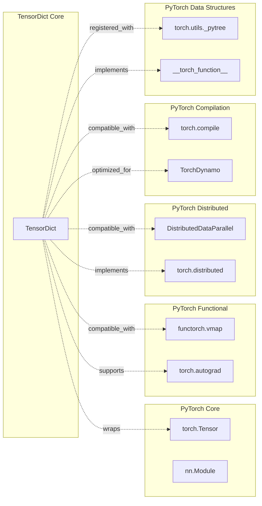

### PyTree Registration

TensorDict registers with PyTorch's PyTree system, enabling it to work with `torch.utils._pytree.tree_map` and other tree-traversal utilities. This is crucial for compatibility with `functorch.vmap`.

**Implementation:** [tensordict/_pytree.py]()

**Sources:** [tensordict/base.py:676-691](), Diagram 4 from provided context

### __torch_function__ Protocol

TensorDict implements the `__torch_function__` protocol, allowing it to intercept PyTorch function calls and provide custom behavior. This enables operations like `torch.cat`, `torch.stack`, and `torch.zeros_like` to work directly on TensorDict instances.

**Implementation:** [tensordict/_torch_func.py]()

**Sources:** [tensordict/base.py:676-691]()

### Distributed Operations

TensorDict implements distributed communication primitives that integrate with `torch.distributed`:
- `send()`, `recv()`: Point-to-point communication
- `gather_and_stack()`: Collective gathering
- `reduce()`: Reduction operations

**Sources:** [tensordict/base.py]() (methods not shown in excerpt), Diagram 4 from provided context

### Compilation Support

TensorDict is designed to work with `torch.compile` and TorchDynamo. The implementation avoids dynamic behavior in hot paths and uses compile-friendly patterns.

**Sources:** [tensordict/base.py:124-127]() (is_compiling import), Diagram 4 from provided context

## Package Structure

The codebase is organized into focused modules:

| Module | Purpose | Key Files |
|--------|---------|-----------|
| **Core** | Abstract interface and main implementation | `base.py`, `_td.py`, `_lazy.py` |
| **High-level** | User-friendly interfaces | `tensorclass.py`, `tensorclass.pyi` |
| **Neural Network** | ML workflow integration | `nn/common.py`, `nn/probabilistic.py`, `nn/sequence.py`, `nn/params.py` |
| **Storage** | Persistence and memory management | `memmap.py`, `persistent.py` |
| **Integration** | PyTorch ecosystem hooks | `_pytree.py`, `_torch_func.py` |
| **Functional** | Utility operations | `functional.py` |
| **Utilities** | Helper functions | `utils.py` |

**Public API Entry Point:** [tensordict/tensordict.py:1-37]() re-exports the primary classes and functions.

**Sources:** [tensordict/tensordict.py:1-37](), [setup.py:117-122](), Diagram 3 from provided context

## Memory Management and Storage

TensorDict provides multiple strategies for memory management and data persistence:

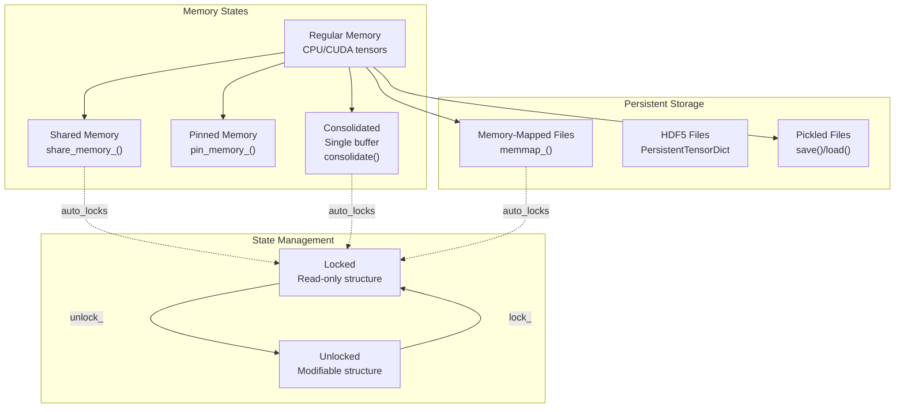

### Consolidation

The `consolidate()` method reorganizes tensors to occupy a single contiguous memory buffer, improving I/O performance and enabling efficient serialization. Consolidated TensorDicts are automatically locked to prevent structural modifications.

**Sources:** [test/test_tensordict.py:423-544,572-734]()

### Memory-Mapped Tensors

`MemoryMappedTensor` enables zero-copy sharing of tensors across processes and out-of-core computation for datasets larger than RAM.

**Sources:** [tensordict/memmap.py]() (referenced), [test/test_tensordict.py:54]()

### Persistent Storage

`PersistentTensorDict` provides HDF5-backed storage for large datasets with lazy loading support.

**Sources:** [tensordict/persistent.py]() (referenced), [test/test_tensordict.py:41]()

## Common Usage Patterns

### Creating TensorDicts

```python
# From dictionary
td = TensorDict({"a": torch.randn(3, 4), "b": torch.randn(3, 4, 5)}, batch_size=[3, 4])

# From module parameters
td = TensorDict.from_module(model)

# From HDF5 file (if h5py available)
td = PersistentTensorDict.from_h5("data.h5")
```

**Factory methods:** `from_dict()`, `from_module()`, `from_h5()`, `from_consolidated()`

**Sources:** [tensordict/base.py]() (method signatures referenced but not shown in excerpt), [test/test_tensordict.py:211-295]()

### Indexing and Slicing

TensorDicts support standard tensor indexing, which applies to all contained tensors:

```python
td[0]           # Index first element
td[:, :2]       # Slice first two along dimension 1
td[mask]        # Boolean indexing
td["key"]       # Access by key
td["nested", "key"]  # Access nested key
```

**Sources:** [tensordict/base.py:573-628]()

### Shape Operations

TensorDicts support tensor-like shape manipulation:

```python
td.expand(10, 3, 4)      # Expand batch dimensions
td.unsqueeze(0)          # Add dimension
td.squeeze()             # Remove singleton dimensions
td.reshape(-1)           # Reshape batch dimensions
td.permute(1, 0)         # Permute dimensions
```

**Sources:** [test/test_tensordict.py:1010-1027,867-918]()

### Device Transfer

```python
td_cuda = td.to("cuda")                    # Move to GPU
td_cpu = td.to("cpu", non_blocking=False)  # Synchronous CPU transfer
```

**Sources:** [README.md:68-78]()

### Neural Network Integration

```python
from tensordict.nn import TensorDictModule

# Wrap a module
module = TensorDictModule(
    nn.Linear(4, 5),
    in_keys=["observation"],
    out_keys=["action"]
)

# Process TensorDict
output = module(input_td)  # Reads "observation", writes "action"
```

**Sources:** [tensordict/nn]() (referenced), [test/test_tensordict.py:56]()

## Build and Distribution

The package uses setuptools with CMake for building C++ extensions:

- **Build system:** [setup.py:1-123]()
- **C++ extensions:** Compiled via CMake from `tensordict/csrc/`
- **Version management:** [version.txt:1-2]() with setuptools_scm
- **Distribution:** PyPI (stable and nightly) and conda-forge

**Sources:** [setup.py:1-123](), [version.txt:1-2](), [README.md:128-153]()

## Design Principles

1. **Composability**: Operations on TensorDict mirror operations on individual tensors
2. **Performance**: Lazy evaluation, consolidation, and compilation support minimize overhead
3. **Type Safety**: Type stubs and IDE support via `.pyi` files
4. **Modularity**: Clear separation between core, high-level interfaces, and integration layers
5. **PyTorch Native**: Deep integration with PyTorch's functional and distributed features

**Sources:** [README.md:42-60](), [tensordict/base.py:300-324]()

---

# Page: Core TensorDict System

# Core TensorDict System

<details>
<summary>Relevant source files</summary>

The following files were used as context for generating this wiki page:

- [tensordict/_lazy.py](tensordict/_lazy.py)
- [tensordict/_td.py](tensordict/_td.py)
- [tensordict/base.py](tensordict/base.py)
- [test/test_tensordict.py](test/test_tensordict.py)

</details>


## Purpose and Scope

This document describes the fundamental TensorDict data structure system, including the abstract `TensorDictBase` interface and its core implementations (`TensorDict` and `LazyStackedTensorDict`). It covers the architectural design, internal data structures, and key concepts like batch semantics and device management.

For specific operations and methods:
- Creating and initializing TensorDicts: see [Creating and Initializing TensorDicts](#2.2)
- Accessing and modifying data: see [Accessing and Modifying Data](#2.3)
- Shape operations: see [Shape Operations and Transformations](#2.4)
- Storage and persistence: see [Storage and Persistence](#5)
- Neural network integration: see [Neural Network Integration](#4)

## System Architecture

The TensorDict system is built on an abstract interface pattern with multiple specialized implementations. The core hierarchy provides different storage and evaluation strategies while maintaining a consistent API.

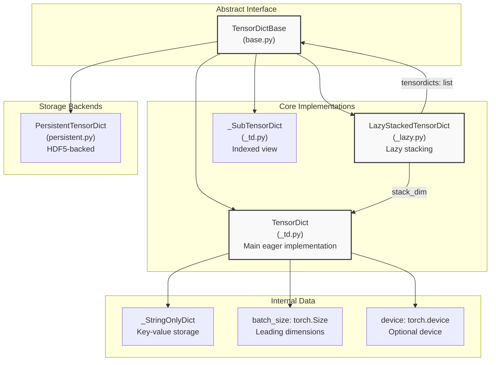

**Sources:** [tensordict/base.py:300-331](), [tensordict/_td.py:150-243](), [tensordict/_lazy.py:176-225]()

The system uses a layered architecture:

| Layer | Component | File | Responsibility |
|-------|-----------|------|----------------|
| Abstract Interface | `TensorDictBase` | `base.py` | Defines API contract for all implementations |
| Primary Implementation | `TensorDict` | `_td.py` | Eager tensor storage with dictionary semantics |
| Lazy Evaluation | `LazyStackedTensorDict` | `_lazy.py` | Deferred stacking of multiple TensorDicts |
| Indexed Views | `_SubTensorDict` | `_td.py` | Lazy indexed view over parent TensorDict |
| Persistence | `PersistentTensorDict` | `persistent.py` | Memory-mapped HDF5 storage |

## TensorDictBase Abstract Interface

`TensorDictBase` is the abstract base class that defines the contract for all TensorDict implementations. It inherits from `MutableMapping` and `TensorCollection`, providing dictionary-like semantics for tensor containers.

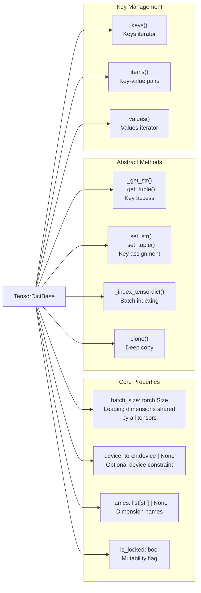

**Sources:** [tensordict/base.py:300-310](), [tensordict/base.py:559-648]()

### Key Characteristics

The abstract interface enforces several invariants:

1. **Batch Semantics**: All tensors must share the first `N` dimensions defined by `batch_size` [tensordict/base.py:301-302]()
2. **Device Consistency**: When a device is set, all tensors must reside on that device [tensordict/_td.py:254-257]()
3. **Nested Keys**: Keys can be strings or tuples of strings for nested access [tensordict/base.py:559-571]()
4. **Immutability Control**: Locking prevents structural modifications while allowing in-place updates [tensordict/base.py:307]()

### Critical Abstract Methods

Implementations must provide these core methods:

| Method | Purpose | Signature |
|--------|---------|-----------|
| `_get_str()` | Retrieve value by string key | `(key: str, default) -> Any` |
| `_get_tuple()` | Retrieve nested value | `(key: tuple, default) -> Any` |
| `_set_str()` | Set value by string key | `(key, value, inplace, validated) -> Self` |
| `_set_tuple()` | Set nested value | `(key, value, inplace, validated) -> Self` |
| `_index_tensordict()` | Index along batch dimensions | `(index: IndexType) -> Self` |

**Sources:** [tensordict/base.py:639-648]()

## TensorDict: Main Implementation

`TensorDict` is the primary concrete implementation that stores tensors in an eager dictionary-like structure. It uses `_StringOnlyDict` for internal storage, which enforces string-only keys at the top level.

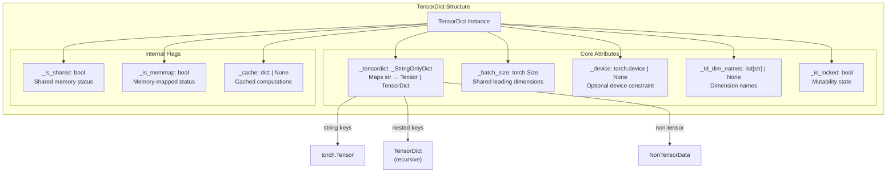

**Sources:** [tensordict/_td.py:150-259](), [tensordict/_td.py:266-267]()

### Initialization and Construction

The `TensorDict.__init__()` method handles several initialization patterns:

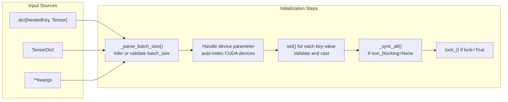

**Sources:** [tensordict/_td.py:250-322]()

Key initialization behaviors:

1. **Device Auto-indexing**: CUDA devices without explicit index use `torch.cuda.current_device()` [tensordict/_td.py:280-286]()
2. **Asynchronous Transfers**: `non_blocking=None` enables async transfer with sync after init [tensordict/_td.py:272-294]()
3. **Batch Size Parsing**: Can infer from source or require explicit specification [tensordict/_td.py:304]()
4. **Recursive Construction**: Nested dicts become nested TensorDicts [tensordict/_td.py:309-310]()

### Internal Storage: _StringOnlyDict

The `_StringOnlyDict` class provides string-only key enforcement at the top level, while nested structures handle tuples through recursive descent.

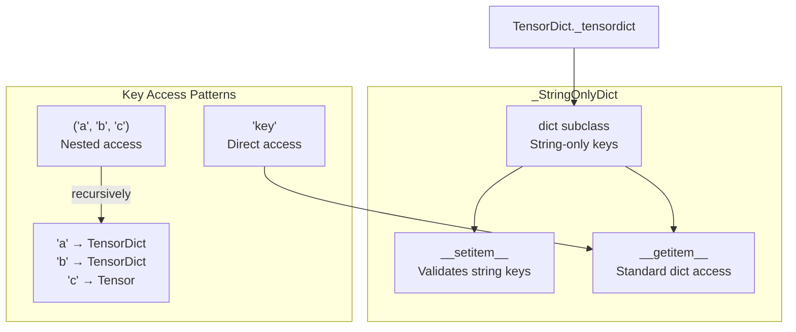

**Sources:** [tensordict/utils.py]() (referenced in imports), [tensordict/_td.py:266]()

### Value Validation and Setting

The `_set_str()` method performs validation and type conversion:

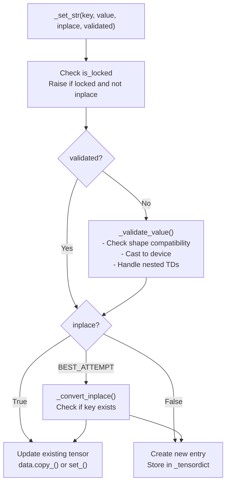

**Sources:** [tensordict/_td.py]() (methods distributed across file), [tensordict/base.py]() (validation logic)

Key validation steps:
- **Shape Validation**: Ensure tensor shape matches or is compatible with `batch_size` [tensordict/base.py]()
- **Device Casting**: Convert tensors to tensordict's device if specified [tensordict/_td.py:310]()
- **Type Conversion**: Handle Python primitives, NumPy arrays, nested dicts [tensordict/base.py]()
- **Nested Structure**: Recursively convert nested dicts to nested TensorDicts [tensordict/_td.py:372-380]()

## LazyStackedTensorDict: Deferred Stacking

`LazyStackedTensorDict` provides a lazy view over a stack of TensorDicts without materializing the stacked tensors until accessed. This enables memory-efficient operations on collections of TensorDicts.

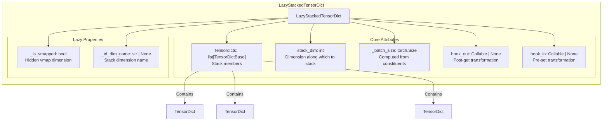

**Sources:** [tensordict/_lazy.py:176-225](), [tensordict/_lazy.py:255-303]()

### Stack Dimension and Batch Size

The batch size is computed by inserting the stack length at `stack_dim`:

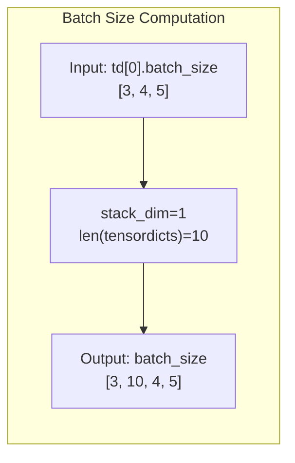

Formula: `batch_size = (*batch_size[:stack_dim], len(tensordicts), *batch_size[stack_dim:])`

**Sources:** [tensordict/_lazy.py:723-729]()

### Lazy Get Operation

The `_get_str()` method defers stacking until access:

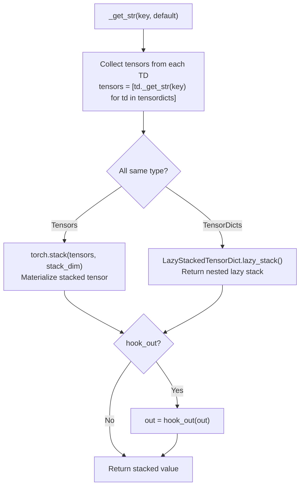

**Sources:** [tensordict/_lazy.py:1299-1412]()

Key behaviors:
- **Deferred Materialization**: Tensors only stacked when accessed [tensordict/_lazy.py:1313-1327]()
- **Nested Lazy Stacks**: TensorDict values result in nested LazyStackedTensorDict [tensordict/_lazy.py:1362-1378]()
- **Hook Integration**: `hook_out` applied after stacking for vmap support [tensordict/_lazy.py:1396-1398]()
- **Error Handling**: Shape mismatches raise informative errors [tensordict/_lazy.py:1399-1411]()

### Lazy Set Operation

Setting values on a lazy stack unbinds the value and distributes to constituents:

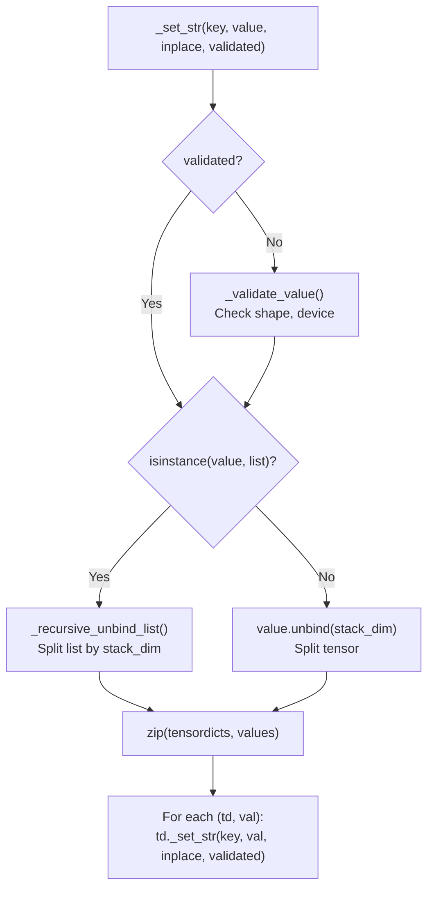

**Sources:** [tensordict/_lazy.py:731-774]()

The distribution logic:
1. **List Handling**: Lists split according to stack_dim structure [tensordict/_lazy.py:759-762]()
2. **Tensor Unbinding**: Tensors unbind along stack_dim [tensordict/_lazy.py:764]()
3. **In-place Propagation**: `inplace` flag propagated to constituents [tensordict/_lazy.py:766-773]()

### Exclusive Keys and Heterogeneous Stacks

LazyStackedTensorDict tracks whether constituent TensorDicts have different keys:

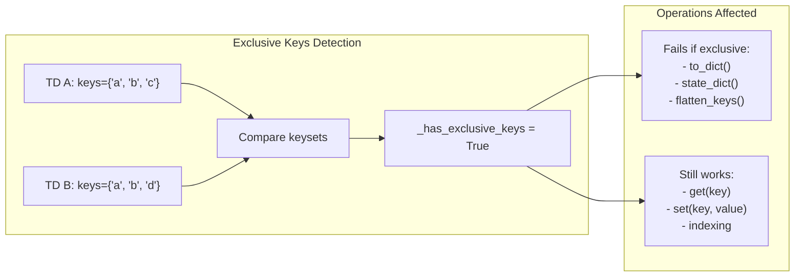

**Sources:** [tensordict/_lazy.py:444-456](), [tensordict/_lazy.py:161-173]()

## Batch Size and Device Semantics

### Batch Size Invariants

All tensors in a TensorDict must share the leading `N` dimensions defined by `batch_size`:

| TensorDict State | Tensor Shape Requirements | Example |
|------------------|---------------------------|---------|
| `batch_size=[3, 4]` | All tensors start with `[3, 4, ...]` | `[3, 4, 5]`, `[3, 4]`, `[3, 4, 10, 20]` |
| `batch_size=[]` | Tensors can have any shape | `[]`, `[5]`, `[10, 20]` |
| Nested TD | Nested TD must have compatible batch_size | Parent `[3, 4]`, child `[3, 4]` or `[3, 4, 5]` |

**Sources:** [tensordict/base.py:301-302]()

### Device Management

Device behavior depends on whether a device is specified:

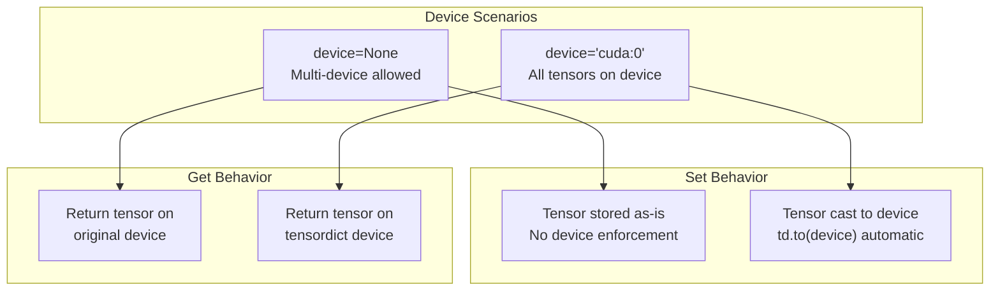

**Sources:** [tensordict/_td.py:254-257](), [tensordict/_td.py:778-794]()

Device auto-indexing for CUDA:
- `device="cuda"` → `device="cuda:X"` where X is `torch.cuda.current_device()` [tensordict/_td.py:280-286]()
- Other device types (cpu, meta) handled without indexing [tensordict/_td.py:285-286]()

## Nested Keys and Recursive Structure

TensorDict supports nested structures through tuple keys:

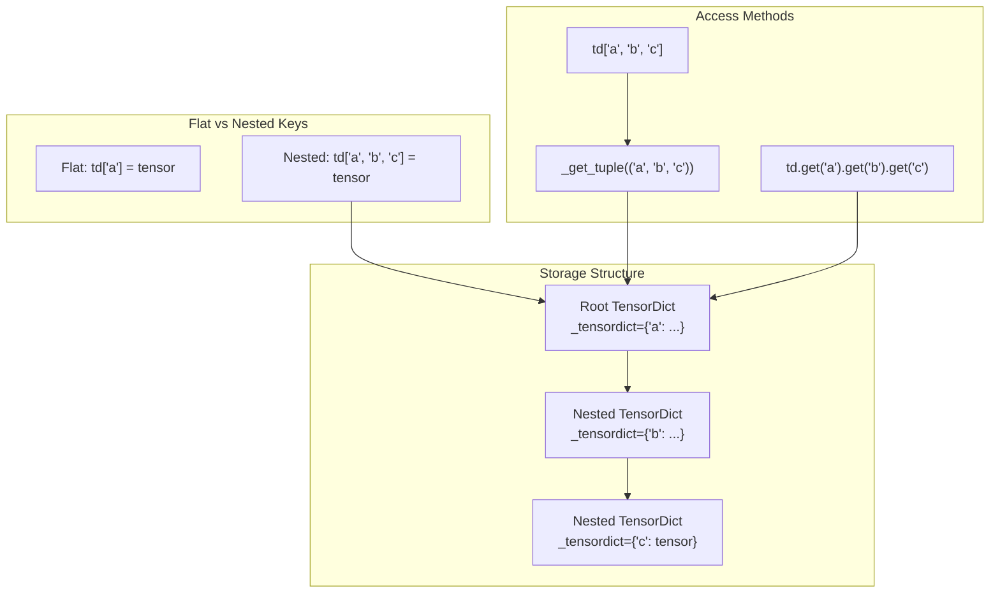

**Sources:** [tensordict/base.py:559-571](), [tensordict/_td.py:843-857]()

Key access patterns:
- **String Key**: `td["key"]` → direct lookup in `_tensordict` [tensordict/_td.py]()
- **Tuple Key**: `td["a", "b"]` → recursive descent: `td.get("a").get("b")` [tensordict/base.py]()
- **Tuple of Length 1**: `td[("key",)]` → treated as string key [tensordict/base.py]()

## Internal State and Flags

TensorDict maintains several boolean flags to track state:

| Flag | Purpose | Set By | Effect |
|------|---------|--------|--------|
| `_is_locked` | Prevents structural changes | `lock_()` | Blocks new keys, allows in-place updates |
| `_is_shared` | Shared memory status | `share_memory_()` | Marks tensors in shared memory |
| `_is_memmap` | Memory-mapped status | `memmap_()` | Marks tensors as memory-mapped |
| `_is_vmapped` | Hidden vmap dimension | `_add_batch_dim()` | For functorch vmap integration |
| `_cache` | Cached computations | Various | Memoization of expensive operations |

**Sources:** [tensordict/_td.py:246-248](), [tensordict/base.py:303-312]()

### Locking Behavior

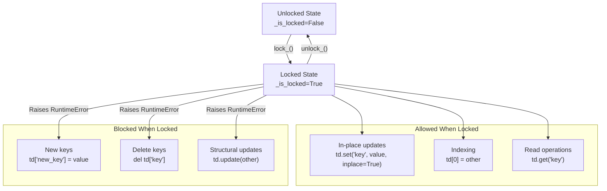

**Sources:** [tensordict/base.py:307](), [tensordict/utils.py]() (_LOCK_ERROR constant)

## SubTensorDict: Indexed Views

`_SubTensorDict` provides a lazy indexed view over a parent TensorDict without copying data:

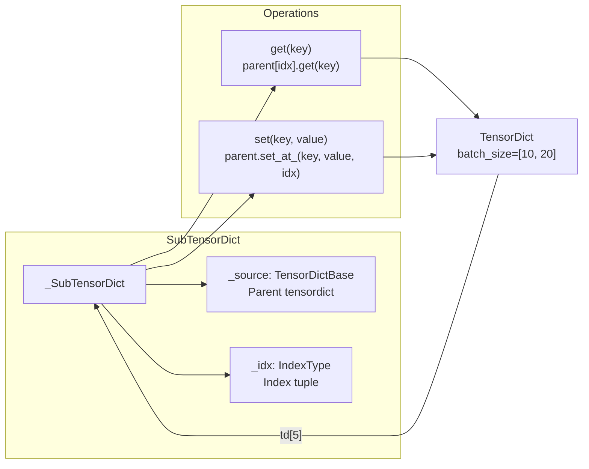

**Sources:** [tensordict/_td.py]() (_SubTensorDict class), [tensordict/base.py:633-637]()

SubTensorDict behavior:
- **Lazy Evaluation**: No data copied until materialized [tensordict/base.py:633-637]()
- **Pass-through Writes**: Sets propagate to parent via indexed assignment [tensordict/_td.py]()
- **Batch Size**: Computed from parent batch_size and index [tensordict/utils.py]() (_getitem_batch_size)

## Key Design Decisions

### 1. Eager vs Lazy Evaluation

| Implementation | Strategy | Use Case |
|----------------|----------|----------|
| `TensorDict` | Eager | General-purpose, small-medium data |
| `LazyStackedTensorDict` | Lazy stacking | Collections of TensorDicts, memory efficiency |
| `_SubTensorDict` | Lazy indexing | Views without copying |
| `PersistentTensorDict` | Lazy loading | Large datasets on disk |

**Sources:** [tensordict/_td.py:150-243](), [tensordict/_lazy.py:176-225]()

### 2. String-Only Top-Level Keys

Top-level keys must be strings, but nested access uses tuples:

```python
td["key"]           # Valid: string key
td[("a", "b")]      # Valid: nested tuple key
td[(0, "a")]        # Invalid: mixed type
```

This design prevents ambiguity between batch indexing and key access.

**Sources:** [tensordict/utils.py]() (_StringOnlyDict), [tensordict/base.py:559-571]()

### 3. Inplace Semantics

The `inplace` parameter has three modes:
- `inplace=False`: Always create new tensor (default for new keys)
- `inplace=True`: Must modify existing tensor (raises if key missing)
- `inplace=BEST_ATTEMPT_INPLACE`: Modify if exists, create if not

**Sources:** [tensordict/base.py:171-178]()

### 4. Validation and Type Coercion

Values undergo validation and coercion:
1. Python primitives → `torch.Tensor`
2. NumPy arrays → `torch.Tensor`
3. Dicts → nested `TensorDict`
4. Device casting if tensordict has device
5. Shape validation against `batch_size`

**Sources:** [tensordict/base.py]() (_validate_value methods)

---

**Primary Sources:**
- [tensordict/base.py:1-2000]()
- [tensordict/_td.py:1-2000]()
- [tensordict/_lazy.py:1-2000]()
- [test/test_tensordict.py:1-1000]()

---

# Page: TensorDictBase Interface and Core Concepts

# TensorDictBase Interface and Core Concepts

<details>
<summary>Relevant source files</summary>

The following files were used as context for generating this wiki page:

- [tensordict/_lazy.py](tensordict/_lazy.py)
- [tensordict/_td.py](tensordict/_td.py)
- [tensordict/base.py](tensordict/base.py)
- [test/test_tensordict.py](test/test_tensordict.py)

</details>


## Purpose and Scope

This document explains the abstract `TensorDictBase` interface that defines the core contract for all TensorDict implementations, along with fundamental concepts like batch semantics, device management, and the key-value storage model. Understanding these concepts is essential for working with any TensorDict variant.

For specific implementations and their factory methods, see [Creating and Initializing TensorDicts](#2.2). For operations on data within tensordicts, see [Accessing and Modifying Data](#2.3) and [Shape Operations and Transformations](#2.4). For the `@tensorclass` decorator which provides a dataclass-like interface over TensorDict, see [TensorClass System](#3).

## Abstract Interface Overview

`TensorDictBase` is an abstract base class that establishes the contract for all TensorDict implementations. It inherits from both `MutableMapping` (providing dict-like semantics) and `TensorCollection` (providing tensor-specific operations).

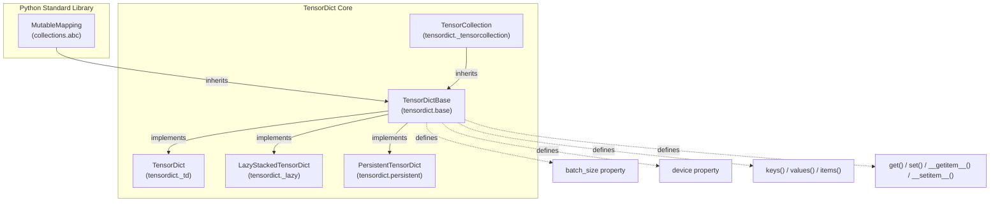

**Sources:** [tensordict/base.py:300-302](), [tensordict/_td.py:150](), [tensordict/_lazy.py:176]()

### Key Characteristics

The abstract interface defines several critical attributes that all implementations inherit:

| Attribute | Type | Purpose |
|-----------|------|---------|
| `_safe` | `bool` | Controls validation behavior during tensor assignment |
| `_lazy` | `bool` | Indicates if the implementation uses lazy evaluation |
| `_inplace_set` | `bool` | Controls default inplace modification behavior |
| `_is_locked` | `bool` | Prevents structural modifications when True |
| `_cache` | `bool \| None` | Controls caching of computed properties |
| `is_meta` | `bool` | Indicates if tensors are meta tensors (no storage) |
| `_is_non_tensor` | `bool` | Marks non-tensor data containers |

**Sources:** [tensordict/base.py:303-312]()

## Batch Semantics

The fundamental concept in TensorDict is **batch semantics**: all tensors stored in a TensorDict share the same leading dimensions, called the **batch size**. This allows treating collections of tensors as batched data structures.

```mermaid
graph LR
    subgraph "TensorDict with batch_size=[3, 4]"
        KEY_A["key: 'a'<br/>shape: [3, 4, 5]"]
        KEY_B["key: 'b'<br/>shape: [3, 4, 10]"]
        KEY_C["key: ('nested', 'c')<br/>shape: [3, 4, 2, 3]"]
    end
    
    BATCH["batch dimensions: [3, 4]<br/>All tensors must share<br/>these leading dimensions"]
    
    BATCH -.->|validates| KEY_A
    BATCH -.->|validates| KEY_B
    BATCH -.->|validates| KEY_C
    
    KEY_A -.->|extra dims: [5]| FEATURE_A["feature dimensions"]
    KEY_B -.->|extra dims: [10]| FEATURE_B["feature dimensions"]
    KEY_C -.->|extra dims: [2, 3]| FEATURE_C["feature dimensions"]
```

**Sources:** [tensordict/_td.py:150-176](), [tensordict/base.py:547-553]()

### Batch Size Properties

The `batch_size` property is fundamental to all TensorDict operations:

- **Immutable as `torch.Size`**: The batch size is stored as a `torch.Size` object
- **Settable with validation**: Can be modified if all tensors are compatible with the new size
- **Determines iteration**: `len(tensordict)` returns `batch_size[0]` if non-empty, else 0
- **Affects indexing**: Shape operations respect batch dimensions

The batch size can be dynamically reset if compatible:

**Sources:** [tensordict/base.py:547-553](), [test/test_tensordict.py:210-283]()

### Batch Dimensions Terminology

| Term | Definition | Example |
|------|------------|---------|
| `batch_size` | The leading shape shared by all tensors | `torch.Size([3, 4])` |
| `batch_dims` | Number of batch dimensions | `2` for batch_size `[3, 4]` |
| `ndim` | Alias for `batch_dims` | `2` |
| `shape` | Alias for `batch_size` | `torch.Size([3, 4])` |
| Feature dimensions | Dimensions after batch dimensions in each tensor | Varies per tensor |

**Sources:** [tensordict/base.py:547-553]()

## Device Management

TensorDict supports device placement similar to PyTorch tensors, but with important differences for heterogeneous device support.

```mermaid
graph TB
    subgraph "Device Placement Options"
        NO_DEV["device=None<br/>Heterogeneous: tensors<br/>can be on different devices"]
        SINGLE_DEV["device='cuda:0'<br/>Homogeneous: all tensors<br/>must be on specified device"]
    end
    
    subgraph "Device Operations"
        TO["to(device)<br/>Move all tensors"]
        CPU["cpu()<br/>Move to CPU"]
        CUDA["cuda(device_id)<br/>Move to CUDA"]
        CLEAR["clear_device_()<br/>Allow heterogeneous devices"]
    end
    
    NO_DEV -->|".to('cuda')"| SINGLE_DEV
    SINGLE_DEV -->|".clear_device_()"| NO_DEV
    
    TO -.-> CPU
    TO -.-> CUDA
    TO -.-> CLEAR
```

**Sources:** [tensordict/base.py:219-244](), [tensordict/_td.py:250-322]()

### Device Semantics

When a TensorDict has a specified device:
1. All new tensors are automatically moved to that device during `set()` operations
2. The `device` property returns the common device
3. Device transfers can be synchronous or asynchronous (controlled by `non_blocking` parameter)

When `device=None`:
1. Tensors can reside on different devices
2. The `device` property returns `None`
3. No automatic device casting occurs

**Sources:** [tensordict/_td.py:270-322](), [test/test_tensordict.py:777-848]()

### Device Transfer Recording

The `_RecordDeviceTransfer` mechanism tracks device movements during initialization to optimize synchronization:

**Sources:** [tensordict/base.py:219-244]()

## Key-Value Storage Model

TensorDicts implement a hierarchical key-value storage model supporting both flat and nested keys.

### Key Types

```mermaid
graph TB
    subgraph "Key Types"
        STR["String Key<br/>'my_key'"]
        TUPLE["Nested Key (Tuple)<br/>('parent', 'child')"]
        NESTED["NestedKey Type<br/>Union[str, Tuple[str, ...]]"]
    end
    
    subgraph "Value Types"
        TENSOR["torch.Tensor"]
        TD_VAL["TensorDictBase<br/>(nested tensordict)"]
        NON_TENSOR["NonTensorData<br/>(strings, lists, etc)"]
    end
    
    NESTED -.->|key type| STR
    NESTED -.->|key type| TUPLE
    
    STR -->|maps to| TENSOR
    STR -->|maps to| TD_VAL
    STR -->|maps to| NON_TENSOR
    
    TUPLE -->|maps to| TENSOR
    TUPLE -->|maps to| TD_VAL
    TUPLE -->|maps to| NON_TENSOR
```

**Sources:** [tensordict/base.py:559-572](), [tensordict/_nestedkey.py]()

### Nested Key Handling

Nested keys are tuples of strings that represent hierarchical paths:

```python
# These are equivalent
td[("parent", "child", "leaf")]
td["parent"]["child"]["leaf"]
td.get(("parent", "child", "leaf"))
```

The base implementation provides methods for nested key operations:
- `_get_str(key, default)`: Get a single string key
- `_get_tuple(key, default)`: Get a nested (tuple) key
- `_set_str(key, value, ...)`: Set a single string key
- `_set_tuple(key, value, ...)`: Set a nested (tuple) key

**Sources:** [tensordict/base.py:573-628](), [tensordict/_td.py:836-857]()

## Core Implementations

The TensorDict library provides three main implementations of `TensorDictBase`:

```mermaid
graph TB
    subgraph "TensorDict Implementations"
        TD["TensorDict<br/>(tensordict._td.TensorDict)"]
        LTD["LazyStackedTensorDict<br/>(tensordict._lazy.LazyStackedTensorDict)"]
        PTD["PersistentTensorDict<br/>(tensordict.persistent.PersistentTensorDict)"]
    end
    
    subgraph "Storage Backends"
        DICT["_StringOnlyDict<br/>In-memory dictionary"]
        LAZY_LIST["List[TensorDictBase]<br/>Stacked tensordicts"]
        H5["HDF5 File<br/>h5py.File"]
    end
    
    subgraph "Use Cases"
        STANDARD["Standard Operations<br/>• Dense storage<br/>• Direct access"]
        STACKING["Lazy Stacking<br/>• Memory efficient<br/>• Deferred materialization"]
        PERSIST["Persistence<br/>• Disk-backed<br/>• Large datasets"]
    end
    
    TD -->|uses| DICT
    LTD -->|uses| LAZY_LIST
    PTD -->|uses| H5
    
    STANDARD -.->|implemented by| TD
    STACKING -.->|implemented by| LTD
    PERSIST -.->|implemented by| PTD
```

**Sources:** [tensordict/_td.py:150](), [tensordict/_lazy.py:176](), [tensordict/persistent.py]()

### TensorDict (Main Implementation)

The primary implementation stores tensors in a `_StringOnlyDict` for efficient string-based lookups:

- **Storage**: `self._tensordict` is a `_StringOnlyDict` mapping keys to values
- **Eager evaluation**: All operations materialize results immediately
- **Device enforcement**: When device is set, validates all tensors are on that device
- **Constructor parameters**: `source`, `batch_size`, `device`, `names`, `non_blocking`, `lock`

**Sources:** [tensordict/_td.py:150-322](), [tensordict/_td.py:266]()

### LazyStackedTensorDict

Represents a stack of tensordicts without materializing the stack:

- **Storage**: `self.tensordicts` is a list of `TensorDictBase` instances
- **Lazy evaluation**: Operations on stacked data are deferred until necessary
- **Stack dimension**: `self.stack_dim` specifies which dimension represents the stack
- **Memory efficient**: Avoids copying data when stacking

**Sources:** [tensordict/_lazy.py:176-304](), [tensordict/_lazy.py:255-266]()

### PersistentTensorDict

Backed by HDF5 files for disk-based storage:

- **Storage**: Data stored in HDF5 file format
- **Lazy loading**: Tensors loaded from disk on access
- **Large dataset support**: Enables working with datasets larger than memory

**Sources:** Referenced in [tensordict/base.py:139]()

## Fundamental Operations

All `TensorDictBase` implementations must support core operations divided into categories:

### Comparison Operations

```mermaid
graph LR
    subgraph "Abstract Comparison Methods"
        EQ["__eq__(other)<br/>Element-wise equality"]
        NE["__ne__(other)<br/>Element-wise inequality"]
        LT["__lt__(other)<br/>Element-wise less than"]
        LE["__le__(other)<br/>Element-wise less or equal"]
        GT["__gt__(other)<br/>Element-wise greater than"]
        GE["__ge__(other)<br/>Element-wise greater or equal"]
    end
    
    subgraph "Logical Operations"
        AND["__and__(other)<br/>Bitwise AND"]
        OR["__or__(other)<br/>Bitwise OR"]
        XOR["__xor__(other)<br/>Bitwise XOR"]
        INVERT["__invert__()<br/>Bitwise NOT"]
    end
    
    subgraph "Result Type"
        RESULT["Returns TensorDict with<br/>boolean tensors"]
    end
    
    EQ --> RESULT
    NE --> RESULT
    LT --> RESULT
    LE --> RESULT
    GT --> RESULT
    GE --> RESULT
    AND --> RESULT
    OR --> RESULT
    XOR --> RESULT
    INVERT --> RESULT
```

**Sources:** [tensordict/base.py:351-524](), [tensordict/_td.py:646-834]()

### Reduction Operations

Abstract methods for computing reductions across tensors:

| Method | Purpose | Returns |
|--------|---------|---------|
| `all(dim)` | Check if all elements are True | `bool` or `TensorCollection` |
| `any(dim)` | Check if any elements are True | `bool` or `TensorCollection` |
| `min(dim, keepdim, reduce)` | Minimum values | TensorDict or scalar |
| `max(dim, keepdim, reduce)` | Maximum values | TensorDict or scalar |
| `sum(dim, keepdim, reduce)` | Sum of elements | TensorDict or scalar |
| `mean(dim, keepdim, reduce)` | Mean of elements | TensorDict or scalar |

When `dim` is specified, reductions occur along that batch dimension. When `reduce=True`, a single scalar is returned across all entries.

**Sources:** [tensordict/base.py:693-1148](), [tensordict/_td.py:917-1173]()

### Indexing and Item Access

```mermaid
graph TB
    subgraph "Access Patterns"
        GETITEM["__getitem__(index)<br/>• NestedKey → returns value<br/>• int/slice → returns sub-tensordict"]
        GET["get(key, default)<br/>Dict-like access with default"]
        GETATTR["__getattr__(key)<br/>Attribute-style access"]
    end
    
    subgraph "Modification Patterns"
        SETITEM["__setitem__(index, value)<br/>• NestedKey → sets value<br/>• int/slice → updates sub-tensordict"]
        SET["set(key, value, inplace)<br/>Sets value with validation"]
        SET_["set_(key, value)<br/>Inplace modification"]
    end
    
    subgraph "Index Types"
        KEY["NestedKey<br/>(string or tuple)"]
        INT["int"]
        SLICE["slice"]
        TENSOR["Tensor<br/>(boolean or integer)"]
        TUPLE_IDX["Tuple of indices"]
    end
    
    KEY --> GETITEM
    INT --> GETITEM
    SLICE --> GETITEM
    TENSOR --> GETITEM
    TUPLE_IDX --> GETITEM
    
    KEY --> SETITEM
    INT --> SETITEM
    SLICE --> SETITEM
    TENSOR --> SETITEM
    TUPLE_IDX --> SETITEM
```

**Sources:** [tensordict/base.py:573-628](), [tensordict/_td.py:836-916]()

### Locking Mechanism

TensorDicts can be locked to prevent structural modifications:

- **Purpose**: Ensure immutability of structure (keys and shapes) while allowing in-place value updates
- **Methods**: `lock_()` to lock, `unlock_()` to unlock, `is_locked` property
- **Behavior**: Locked tensordicts raise errors on structural modifications but allow `set(..., inplace=True)`
- **Context manager**: `with td.unlock_():` temporarily unlocks for modifications
- **Automatic locking**: Occurs when consolidating, sharing memory, or memory-mapping

**Sources:** [tensordict/base.py:307](), [test/test_tensordict.py:572-734]()

## Abstract vs. Concrete Methods

The interface distinguishes between methods that must be implemented and those with default implementations:

### Must Implement (Abstract)

- Comparison operators: `__eq__`, `__ne__`, `__lt__`, `__le__`, `__gt__`, `__ge__`
- Logical operators: `__xor__`, `__or__`
- Access: `__setitem__`
- Reductions: `all`, `any`

### Default Implementation Provided

- Arithmetic: `__abs__`, `__neg__`
- Logical: `__and__`, `__invert__`
- Validity checks: `isfinite`, `isnan`, `isreal`, `isneginf`, `isposinf`
- Container: `__contains__`, `__len__`, `__iter__`, `__getitem__`
- Representation: `__repr__`

**Sources:** [tensordict/base.py:300-1000]()

## Type System Integration

`TensorDictBase` integrates with Python's type system and PyTorch's dispatch mechanism:

```mermaid
graph TB
    subgraph "Type System Integration"
        TC["TensorCollection<br/>Protocol"]
        MM["MutableMapping<br/>ABC"]
        TDB["TensorDictBase"]
        TORCH_FUNC["__torch_function__<br/>PyTorch dispatch"]
    end
    
    subgraph "Special Methods"
        DEEPCOPY["__deepcopy__<br/>Returns clone()"]
        GETSTATE["__getstate__<br/>Pickle support"]
        SETSTATE["__setstate__<br/>Unpickle support"]
        BOOL["__bool__<br/>Raises error"]
    end
    
    TC --> TDB
    MM --> TDB
    TDB --> TORCH_FUNC
    TDB --> DEEPCOPY
    TDB --> GETSTATE
    TDB --> SETSTATE
    TDB --> BOOL
```

**Sources:** [tensordict/base.py:300-302](), [tensordict/base.py:323-325](), [tensordict/base.py:554-558](), [tensordict/base.py:650-674](), [tensordict/base.py:676-692]()

The `__torch_function__` implementation allows TensorDict to participate in PyTorch's tensor dispatch system, enabling operations like `torch.stack([td1, td2])` and `torch.cat([td1, td2])`.

**Sources:** [tensordict/base.py:676-692](), [tensordict/_torch_func.py]()

---

# Page: Creating and Initializing TensorDicts

# Creating and Initializing TensorDicts

<details>
<summary>Relevant source files</summary>

The following files were used as context for generating this wiki page:

- [tensordict/base.py](tensordict/base.py)
- [tensordict/tensordict.py](tensordict/tensordict.py)
- [test/_utils_internal.py](test/_utils_internal.py)
- [test/test_tensordict.py](test/test_tensordict.py)

</details>


This page documents all methods for creating and initializing TensorDict instances, including the main constructor, factory methods like `from_dict`, `from_module`, and `from_h5`, as well as batch size inference and device management during initialization.

For information about TensorDictBase interface and core concepts, see [TensorDictBase Interface and Core Concepts](#2.1). For details on accessing and modifying data after creation, see [Accessing and Modifying Data](#2.3).

## Overview of Creation Methods

TensorDict instances can be created through multiple pathways, each suited for different use cases:

```mermaid
graph TB
    subgraph "Factory Methods"
        DICT["TensorDict()"]
        FROM_DICT["TensorDict.from_dict()"]
        FROM_MODULE["TensorDict.from_module()"]
        FROM_H5["PersistentTensorDict()"]
        FROM_KEYS["TensorDict.fromkeys()"]
        FROM_ANY["TensorDict.from_any()"]
        FROM_DATACLASS["TensorDict.from_dataclass()"]
        MAKE_TD["make_tensordict()"]
    end
    
    subgraph "Input Sources"
        PYDICT["Python dict"]
        KWARGS["Keyword arguments"]
        MODULE["torch.nn.Module"]
        H5FILE["HDF5 file"]
        PYTREE["PyTree structure"]
        DATACLASS["dataclass instance"]
        KEYS["Set of keys"]
        NUMPY["NumPy arrays"]
    end
    
    subgraph "TensorDict Instance"
        TD["TensorDict"]
        PTD["PersistentTensorDict"]
    end
    
    PYDICT --> DICT
    KWARGS --> DICT
    PYDICT --> FROM_DICT
    MODULE --> FROM_MODULE
    H5FILE --> FROM_H5
    PYTREE --> FROM_ANY
    DATACLASS --> FROM_DATACLASS
    KEYS --> FROM_KEYS
    PYDICT --> MAKE_TD
    NUMPY --> FROM_DICT
    
    DICT --> TD
    FROM_DICT --> TD
    FROM_MODULE --> TD
    FROM_KEYS --> TD
    FROM_ANY --> TD
    FROM_DATACLASS --> TD
    MAKE_TD --> TD
    FROM_H5 --> PTD
```

**Sources:** [tensordict/_td.py:250-322](), [tensordict/base.py:1269-1340](), [test/test_tensordict.py:718-721]()

## The Main Constructor

The primary way to create a TensorDict is through its constructor, which accepts either a source dictionary or keyword arguments.

### Constructor Signature

```python
TensorDict(
    source: dict | TensorDictBase | None = None,
    batch_size: Sequence[int] | torch.Size | int | None = None,
    device: torch.device | str | None = None,
    names: Sequence[str] | None = None,
    non_blocking: bool | None = None,
    lock: bool = False,
    **kwargs: Any
)
```

### Constructor Flow

```mermaid
graph TB
    START["TensorDict.__init__"]
    CHECK_ARGS{"source and<br/>kwargs both<br/>provided?"}
    ERROR1["Raise ValueError"]
    MERGE["source = kwargs"]
    INIT_DICT["Initialize<br/>self._tensordict = _StringOnlyDict()"]
    PARSE_DEVICE["Parse and normalize device"]
    PARSE_BS["_parse_batch_size()<br/>Infer or validate batch_size"]
    SET_NAMES["Set dimension names"]
    LOOP_SET["Loop: self.set(key, value)<br/>for each item"]
    SYNC{"non_blocking=None<br/>and had transfer?"}
    CALL_SYNC["_sync_all()"]
    LOCK{"lock=True?"}
    LOCK_TD["self.lock_()"]
    END["Return TensorDict"]
    
    START --> CHECK_ARGS
    CHECK_ARGS -->|Yes| ERROR1
    CHECK_ARGS -->|No| MERGE
    MERGE --> INIT_DICT
    INIT_DICT --> PARSE_DEVICE
    PARSE_DEVICE --> PARSE_BS
    PARSE_BS --> SET_NAMES
    SET_NAMES --> LOOP_SET
    LOOP_SET --> SYNC
    SYNC -->|Yes| CALL_SYNC
    SYNC -->|No| LOCK
    CALL_SYNC --> LOCK
    LOCK -->|Yes| LOCK_TD
    LOCK -->|No| END
    LOCK_TD --> END
```

**Sources:** [tensordict/_td.py:250-322]()

### Basic Usage Examples

```python
# Empty TensorDict with specified batch size
td = TensorDict({}, batch_size=[3, 4])

# From dictionary
td = TensorDict({
    "a": torch.randn(3, 4),
    "b": torch.zeros(3, 4, 5)
}, batch_size=[3, 4])

# Using keyword arguments
td = TensorDict(
    a=torch.randn(3, 4),
    b=torch.zeros(3, 4, 5),
    batch_size=[3, 4]
)

# With device
td = TensorDict({
    "a": torch.randn(3, 4)
}, batch_size=[3], device="cuda:0")

# With dimension names
td = TensorDict({
    "a": torch.randn(3, 4)
}, batch_size=[3, 4], names=["batch", "time"])
```

**Sources:** [tensordict/_td.py:250-259](), [test/test_tensordict.py:718-723]()

### Parameter Details

| Parameter | Type | Description |
|-----------|------|-------------|
| `source` | `dict \| TensorDictBase \| None` | Source data as dictionary or another TensorDict |
| `batch_size` | `Sequence[int] \| torch.Size \| int \| None` | Batch dimensions. If `None`, empty batch size is assumed |
| `device` | `torch.device \| str \| None` | Device for all tensors. If `None`, tensors can be on different devices |
| `names` | `Sequence[str] \| None` | Names for batch dimensions |
| `non_blocking` | `bool \| None` | If `True`, asynchronous device transfer. If `None`, async with final sync |
| `lock` | `bool` | If `True`, lock the TensorDict after creation |

**Sources:** [tensordict/_td.py:250-259]()

## Batch Size Inference and Management

### Batch Size Parsing

During construction, the batch size is parsed and validated against the provided data:

```mermaid
graph TB
    START["_parse_batch_size(source, batch_size)"]
    CHECK_BS{"batch_size<br/>provided?"}
    CHECK_SOURCE{"source is<br/>TensorDict?"}
    RETURN_SOURCE_BS["return source.batch_size"]
    INFER{"source is<br/>empty dict?"}
    EMPTY_BS["return torch.Size([])"]
    INFER_BS["Infer from first tensor shape"]
    VALIDATE["Validate batch_size<br/>against all tensors"]
    ERROR["Raise RuntimeError<br/>if incompatible"]
    RETURN_BS["return torch.Size(batch_size)"]
    
    START --> CHECK_BS
    CHECK_BS -->|No| CHECK_SOURCE
    CHECK_BS -->|Yes| VALIDATE
    CHECK_SOURCE -->|Yes| RETURN_SOURCE_BS
    CHECK_SOURCE -->|No| INFER
    INFER -->|Yes| EMPTY_BS
    INFER -->|No| INFER_BS
    VALIDATE -->|OK| RETURN_BS
    VALIDATE -->|Fail| ERROR
```

**Sources:** [tensordict/_td.py:304](), [test/test_tensordict.py:199-260]()

### Automatic Batch Size Inference

Use `auto_batch_size_()` to automatically infer and set the batch size:

```python
# Create without batch size, then infer
td = TensorDict({"a": torch.randn(3, 4, 5)})
td.auto_batch_size_()  # Sets batch_size to [3, 4]

# Or use from_dict with auto_batch_size
td = TensorDict.from_dict(
    {"a": torch.randn(3, 4, 5)},
    auto_batch_size=True
)  # batch_size is [3, 4]
```

**Sources:** [tensordict/base.py:1269-1340]()

### Batch Size Modification

After creation, the batch size can be modified if compatible with existing tensors:

```python
td = TensorDict({
    "a": torch.randn(3, 4, 5, 6),
    "b": torch.randn(3, 4, 5)
}, batch_size=[3, 4])

# Expand batch size
td.batch_size = torch.Size([3, 4, 5])  # OK

# Incompatible batch size
td.batch_size = [3, 5]  # RuntimeError
```

**Sources:** [test/test_tensordict.py:199-260]()

## Creating from Python Dictionaries

### TensorDict.from_dict()

The `from_dict` class method provides more control over dictionary-to-TensorDict conversion:

```python
@classmethod
def from_dict(
    cls,
    input_dict: dict,
    batch_size: torch.Size | None = None,
    device: torch.device | None = None,
    batch_dims: int | None = None,
    auto_batch_size: bool = False
) -> TensorDict
```

#### Usage Examples

```python
# Basic usage
data = {
    "a": torch.zeros(3, 4, 5),
    "b": {"c": torch.zeros(3, 4, 5, 6)}
}
td = TensorDict.from_dict(data, batch_size=[3, 4])

# Auto-infer batch size
td = TensorDict.from_dict(data, auto_batch_size=True)  # batch_size=[3, 4]

# Using batch_dims instead of batch_size
td = TensorDict.from_dict(data, batch_dims=2)  # batch_size=[3, 4]

# Nested keys in dictionary
data = {
    "a": torch.zeros(3, 4, 5),
    ("b", "c"): torch.zeros(3, 4, 5, 6),
    ("b", "f"): torch.zeros(3, 4, 5, 5)
}
td = TensorDict.from_dict(data, batch_size=[3, 4])
```

**Sources:** [tensordict/base.py:1269-1340](), [test/test_tensordict.py:1266-1340]()

### Nested Dictionary Handling

`from_dict` automatically creates nested TensorDict structures:

```python
data = {
    "a": torch.zeros(3, 4, 5),
    "b": {
        "c": torch.zeros(3, 4, 5, 6),
        "d": torch.zeros(3, 4, 5)
    }
}
td = TensorDict.from_dict(data, batch_size=[3, 4])
# td["b"] is itself a TensorDict
```

**Sources:** [test/test_tensordict.py:1266-1340]()

## Creating from PyTorch Modules

### TensorDict.from_module()

Extract parameters and buffers from a `torch.nn.Module` into a TensorDict:

```python
@classmethod
def from_module(
    cls,
    module: torch.nn.Module,
    as_module: bool = False,
    lock: bool = False,
    use_state_dict: bool = False,
    filter_empty: bool = True
) -> TensorDict | TensorDictParams
```

### Module Extraction Flow

```mermaid
graph TB
    START["from_module(module)"]
    CHECK_TDP{"module is<br/>TensorDictParams?"}
    RETURN_MODULE["return module"]
    CALL_FROM["_from_module(module)"]
    EXTRACT_PARAMS["Extract _parameters<br/>and _buffers"]
    USE_SD{"use_state_dict<br/>=True?"}
    STATE_DICT["Use module.state_dict()"]
    DIRECT["Direct access to<br/>_parameters, _buffers"]
    RECURSE["Recurse into<br/>child modules"]
    BUILD_TD["Build TensorDict<br/>with nested structure"]
    AS_MODULE{"as_module<br/>=True?"}
    WRAP_TDP["Wrap in<br/>TensorDictParams"]
    LOCK{"lock=True?"}
    LOCK_TD["td.lock_()"]
    RETURN["return TensorDict"]
    
    START --> CHECK_TDP
    CHECK_TDP -->|Yes| RETURN_MODULE
    CHECK_TDP -->|No| CALL_FROM
    CALL_FROM --> USE_SD
    USE_SD -->|Yes| STATE_DICT
    USE_SD -->|No| DIRECT
    STATE_DICT --> RECURSE
    DIRECT --> EXTRACT_PARAMS
    EXTRACT_PARAMS --> RECURSE
    RECURSE --> BUILD_TD
    BUILD_TD --> AS_MODULE
    AS_MODULE -->|Yes| WRAP_TDP
    AS_MODULE -->|No| LOCK
    WRAP_TDP --> LOCK
    LOCK -->|Yes| LOCK_TD
    LOCK -->|No| RETURN
    LOCK_TD --> RETURN
```

**Sources:** [tensordict/_td.py:393-479]()

### Usage Examples

```python
import torch.nn as nn

# Create a module
module = nn.Sequential(
    nn.Linear(10, 20),
    nn.ReLU(),
    nn.Linear(20, 5)
)

# Extract parameters and buffers
td = TensorDict.from_module(module)
# Creates nested structure:
# {
#   "0": {"weight": ..., "bias": ...},
#   "2": {"weight": ..., "bias": ...}
# }

# As TensorDictParams for use with optimizers
params = TensorDict.from_module(module, as_module=True)

# Using state_dict (includes hooks)
td = TensorDict.from_module(module, use_state_dict=True)

# Locked TensorDict
td = TensorDict.from_module(module, lock=True)
```

**Sources:** [tensordict/_td.py:393-412]()

### Filtering Empty Modules

The `filter_empty` parameter controls whether modules with no parameters/buffers are included:

```python
class EmptyModule(nn.Module):
    def __init__(self):
        super().__init__()

class ModuleWithEmpty(nn.Module):
    def __init__(self):
        super().__init__()
        self.linear = nn.Linear(10, 5)
        self.empty = EmptyModule()

module = ModuleWithEmpty()

# filter_empty=True (default): empty submodules excluded
td = TensorDict.from_module(module, filter_empty=True)
# Only contains "linear"

# filter_empty=False: all submodules included
td = TensorDict.from_module(module, filter_empty=False)
# Contains "linear" and "empty"
```

**Sources:** [tensordict/_td.py:399-421]()

## Creating from HDF5 Files

### PersistentTensorDict

For datasets larger than RAM, use `PersistentTensorDict` which stores data in HDF5 files:

```python
from tensordict import PersistentTensorDict

# Create new persistent tensordict
td = PersistentTensorDict.from_dict(
    {
        "a": torch.randn(1000, 100),
        "b": {"c": torch.randn(1000, 50)}
    },
    filename="data.h5",
    batch_size=[1000]
)

# Load existing HDF5 file
td = PersistentTensorDict.from_h5("existing_data.h5")
```

See [PersistentTensorDict and HDF5 Storage](#5.2) for detailed documentation on persistent storage.

**Sources:** [test/test_tensordict.py:1195-1238]()

## Other Factory Methods

### fromkeys()

Create a TensorDict with specified keys and default value:

```python
# All keys initialized to 0
td = TensorDict.fromkeys({"a", "b", "c"})
assert td["a"] == 0

# Custom default value
td = TensorDict.fromkeys({"a", "b", "c"}, 1)
assert td["a"] == 1
```

**Sources:** [test/test_tensordict.py:1189-1194]()

### from_any()

Convert arbitrary Python structures (PyTrees, dataclasses, etc.) to TensorDict:

```python
from dataclasses import dataclass

@dataclass
class MyClass:
    a: int

# From nested structure
pytree = (
    [[-1, 0, 1], [2, 3, 4]],
    {
        "tensor": torch.randn(2,),
        "td": TensorDict({"one": 1}),
        "tuple": (1, 2, 3),
    },
    {"dataclass": MyClass(a=0)},
)

td = TensorDict.from_any(pytree)
# Creates nested TensorDict preserving structure
```

**Sources:** [test/test_tensordict.py:1195-1238]()

### from_dataclass()

Convert a dataclass instance to TensorDict or TensorClass:

```python
@dataclass
class MyClass:
    a: int
    b: Any

obj = MyClass(a=0, b=1)

# As TensorDict
td = TensorDict.from_dataclass(obj)

# As TensorClass
tc = TensorDict.from_dataclass(obj, as_tensorclass=True)
```

**Sources:** [test/test_tensordict.py:1254-1264]()

### make_tensordict()

Functional interface for creating TensorDicts:

```python
from tensordict import make_tensordict

td = make_tensordict(
    a=torch.randn(3, 4),
    b=torch.zeros(3, 4, 5)
)
# Automatically infers batch_size=[3, 4]
```

**Sources:** [test/test_tensordict.py:40]()

## Device Management

### Device Parameter Behavior

The `device` parameter controls where tensors are stored and how they are moved during initialization:

| `device` Value | Behavior |
|----------------|----------|
| `None` (default) | Tensors remain on their original devices |
| `"cuda:0"`, `"cpu"`, etc. | All tensors moved to specified device |

**Sources:** [tensordict/_td.py:270-294]()

### Device Transfer Flow

```mermaid
graph TB
    START["TensorDict.__init__(device=...)"]
    CHECK_DEVICE{"device<br/>is None?"}
    NO_DEVICE["self._device = None<br/>Tensors keep original device"]
    PARSE_DEVICE["torch.device(device)"]
    AUTO_INDEX{"device.index<br/>is None?"}
    CUDA{"device.type<br/>== 'cuda'?"}
    SET_INDEX["device.index = torch.cuda.current_device()"]
    OTHER_DEVICE{"device.type<br/>not cpu/meta?"}
    SET_ZERO["device.index = 0"]
    KEEP_INDEX["Keep device as-is"]
    CHECK_NB{"non_blocking<br/>is None?"}
    SET_SYNC["call_sync = True<br/>sub_non_blocking = True"]
    SET_NB["sub_non_blocking = non_blocking<br/>call_sync = False"]
    MARK_RECORDER["_device_recorder.mark()"]
    LOOP["Loop through source items:<br/>self.set(key, value, non_blocking=sub_non_blocking)"]
    CHECK_TRANSFER{"call_sync and<br/>had transfer?"}
    SYNC_ALL["self._sync_all()"]
    UNMARK["_device_recorder.unmark()"]
    END["Store self._device"]
    
    START --> CHECK_DEVICE
    CHECK_DEVICE -->|Yes| NO_DEVICE
    CHECK_DEVICE -->|No| PARSE_DEVICE
    PARSE_DEVICE --> AUTO_INDEX
    AUTO_INDEX -->|Yes| CUDA
    AUTO_INDEX -->|No| END
    CUDA -->|Yes| SET_INDEX
    CUDA -->|No| OTHER_DEVICE
    OTHER_DEVICE -->|Yes| SET_ZERO
    OTHER_DEVICE -->|No| KEEP_INDEX
    SET_INDEX --> CHECK_NB
    SET_ZERO --> CHECK_NB
    KEEP_INDEX --> CHECK_NB
    CHECK_NB -->|Yes| SET_SYNC
    CHECK_NB -->|No| SET_NB
    SET_SYNC --> MARK_RECORDER
    SET_NB --> LOOP
    MARK_RECORDER --> LOOP
    LOOP --> CHECK_TRANSFER
    CHECK_TRANSFER -->|Yes| SYNC_ALL
    CHECK_TRANSFER -->|No| UNMARK
    SYNC_ALL --> UNMARK
    NO_DEVICE --> END
    UNMARK --> END
```

**Sources:** [tensordict/_td.py:270-322](), [tensordict/base.py:219-244]()

### Non-Blocking Device Transfers

The `non_blocking` parameter controls synchronization during device transfers:

| `non_blocking` | Behavior |
|----------------|----------|
| `True` | Fastest: no synchronization, safe only for CPU→CUDA |
| `False` | Slowest: every transfer is synchronous |
| `None` (default) | Balanced: async transfer with final sync if needed |

```python
# Synchronous transfer (slowest, safest)
td = TensorDict(
    {"a": torch.randn(100, 100)},
    batch_size=[100],
    device="cuda:0",
    non_blocking=False
)

# Asynchronous without sync (fastest, unsafe)
td = TensorDict(
    {"a": torch.randn(100, 100)},
    batch_size=[100],
    device="cuda:0",
    non_blocking=True
)

# Asynchronous with final sync (recommended)
td = TensorDict(
    {"a": torch.randn(100, 100)},
    batch_size=[100],
    device="cuda:0",
    non_blocking=None  # or omit
)
```

**Sources:** [tensordict/_td.py:213-221](), [tensordict/_td.py:270-322]()

### Device Auto-Indexing

When a device is specified without an index, TensorDict automatically adds one:

```python
# CUDA device: uses current device
td = TensorDict({}, batch_size=[], device="cuda")
# Equivalent to device="cuda:0" if torch.cuda.current_device() == 0

# CPU and meta: no index needed
td = TensorDict({}, batch_size=[], device="cpu")
td = TensorDict({}, batch_size=[], device="meta")

# Other devices: defaults to index 0
td = TensorDict({}, batch_size=[], device="mps")
# Equivalent to device="mps:0"
```

**Sources:** [tensordict/_td.py:279-286]()

## Locking During Initialization

TensorDicts can be locked immediately after creation to prevent modifications:

```python
# Locked TensorDict
td = TensorDict(
    {"a": torch.randn(3, 4)},
    batch_size=[3, 4],
    lock=True
)

# Cannot add new keys
td["b"] = torch.zeros(3, 4)  # RuntimeError: TensorDict is locked

# Can still modify values in-place
td.set("a", torch.ones(3, 4), inplace=True)  # OK
```

See [Locking and Thread Safety](#6.4) for comprehensive documentation on locking behavior.

**Sources:** [tensordict/_td.py:317-318](), [test/test_tensordict.py:555-605]()

## Internal Constructor: _new_unsafe

For performance-critical code, TensorDict provides an unsafe constructor that skips validation:

```python
@classmethod
def _new_unsafe(
    cls,
    source: dict | None = None,
    batch_size: torch.Size | None = None,
    device: torch.device | None = None,
    names: Sequence[str] | None = None,
    non_blocking: bool | None = None,
    lock: bool = False,
    nested: bool = True,
    is_shared: bool = False,
    is_memmap: bool = False,
    **kwargs
) -> TensorDict
```

This method is used internally for faster TensorDict creation when data is already validated. It directly assigns attributes without checks.

**Sources:** [tensordict/_td.py:323-391]()

## Summary Table

| Method | Primary Use Case | Batch Size | Device |
|--------|------------------|------------|--------|
| `TensorDict()` | General construction | Required or inferred | Optional |
| `from_dict()` | Dictionary conversion | Optional with auto-inference | Optional |
| `from_module()` | Extract module parameters | Auto (empty) | Module's device |
| `PersistentTensorDict()` | Large datasets on disk | Required | Usually CPU |
| `fromkeys()` | Initialize with default values | Optional | Optional |
| `from_any()` | Convert PyTrees/arbitrary structures | Auto-inferred | Optional |
| `from_dataclass()` | Dataclass conversion | Auto-inferred | Optional |
| `make_tensordict()` | Functional interface | Auto-inferred | Optional |

**Sources:** [tensordict/_td.py:150-243](), [tensordict/base.py:1269-1340](), [test/test_tensordict.py:718-1340]()

---

# Page: Accessing and Modifying Data

# Accessing and Modifying Data

<details>
<summary>Relevant source files</summary>

The following files were used as context for generating this wiki page:

- [tensordict/_lazy.py](tensordict/_lazy.py)
- [tensordict/_td.py](tensordict/_td.py)
- [tensordict/base.py](tensordict/base.py)
- [test/test_tensordict.py](test/test_tensordict.py)

</details>


This document covers the mechanisms for reading from and writing to TensorDict instances. It includes basic key access, nested key patterns, indexing operations, and various specialized access methods. For information about creating TensorDict instances, see [Creating and Initializing TensorDicts](#2.2). For shape-related operations like indexing that transform the batch dimensions, see [Shape Operations and Transformations](#2.4).

## Overview of Access Methods

TensorDict provides multiple ways to access and modify data, following a dictionary-like interface while supporting tensor-like indexing. The primary operations are:

- **Dictionary-style access**: `td["key"]` and `td["key"] = value`
- **get/set methods**: `td.get("key")`, `td.set("key", value)`
- **Nested keys**: `td["nested", "key"]` or `td[("nested", "key")]`
- **Index-based access**: `td[0]`, `td[:2]`, `td[torch.tensor([0, 1])]`
- **Combined access**: `td["key", 0]` mixes keys and indices

```mermaid
graph TB
    subgraph "Access Methods"
        GETITEM["__getitem__<br/>(td[key] or td[idx])"]
        SETITEM["__setitem__<br/>(td[key] = val)"]
        GET["get()<br/>(with defaults)"]
        SET["set()<br/>(with validation)"]
    end
    
    subgraph "Internal Routing"
        GET_TUPLE["_get_tuple()"]
        GET_STR["_get_str()"]
        SET_TUPLE["_set_tuple()"]
        SET_STR["_set_str()"]
        INDEX["_index_tensordict()"]
    end
    
    subgraph "Key Types"
        STR["String key:<br/>'a'"]
        TUPLE["Nested key:<br/>('a', 'b')"]
        IDX["Index:<br/>0, :, [0,1]"]
    end
    
    GETITEM --> GET_TUPLE
    GETITEM --> GET_STR
    GETITEM --> INDEX
    
    SETITEM --> SET_TUPLE
    SETITEM --> SET_STR
    
    GET --> GET_TUPLE
    GET --> GET_STR
    
    SET --> SET_TUPLE
    SET --> SET_STR
    
    STR --> GET_STR
    STR --> SET_STR
    TUPLE --> GET_TUPLE
    TUPLE --> SET_TUPLE
    IDX --> INDEX
```

**Sources:** [tensordict/base.py:573-649](), [tensordict/_td.py:836-916]()

## Reading Data with get() and __getitem__

### Basic Key Access

The primary method for reading data is through dictionary-style bracket notation or the `get()` method. When accessing by key, `__getitem__` determines whether the index is a key (string or tuple of strings) or a tensor index.

```mermaid
flowchart TB
    START["td[index]"]
    CHECK_TUPLE{"isinstance(index, tuple)<br/>or isinstance(index, str)?"}
    UNRAVEL["_unravel_key_to_tuple(index)"]
    IS_KEY{"Is it a NestedKey?"}
    GET_KEY["_get_tuple_maybe_non_tensor()<br/>Returns tensor or value"]
    CHECK_ELLIPSIS{"index is Ellipsis<br/>or empty tuple?"}
    RETURN_SELF["return self"]
    CHECK_INT{"isinstance(index, int)?"}
    INDEX_INT["_index_tensordict(index)<br/>Returns sliced TensorDict"]
    CONVERT_ELLIPSIS["convert_ellipsis_to_idx()"]
    INDEX_GENERAL["_index_tensordict(index)<br/>Returns indexed TensorDict"]
    
    START --> CHECK_TUPLE
    CHECK_TUPLE -->|Yes| UNRAVEL
    CHECK_TUPLE -->|No| CHECK_ELLIPSIS
    UNRAVEL --> IS_KEY
    IS_KEY -->|Yes| GET_KEY
    IS_KEY -->|No| CHECK_ELLIPSIS
    CHECK_ELLIPSIS -->|Yes| RETURN_SELF
    CHECK_ELLIPSIS -->|No| CHECK_INT
    CHECK_INT -->|Yes| INDEX_INT
    CHECK_INT -->|No| CONVERT_ELLIPSIS
    CONVERT_ELLIPSIS --> INDEX_GENERAL
```

**Sources:** [tensordict/base.py:573-627](), [tensordict/_td.py:1159-1335]()

The `_get_str()` method handles retrieval of values by string keys:

| Method | Purpose | Returns | Example |
|--------|---------|---------|---------|
| `td["key"]` | Direct access, raises KeyError if missing | Tensor or TensorDict | `td["observation"]` |
| `td.get("key")` | Safe access with optional default | Tensor, TensorDict, or default | `td.get("missing", default=0)` |
| `td.get("key", default=None)` | Returns None if key is missing | Tensor, TensorDict, or None | Common pattern for optional keys |
| `td[("a", "b")]` | Nested key access | Tensor or TensorDict | Access nested structure |

**Sources:** [tensordict/base.py:1946-2064](), [tensordict/_td.py:1159-1233]()

### Nested Key Access

TensorDict supports nested key access through tuples of strings. The key can be specified as a tuple `("parent", "child")` or as separate arguments in some methods.

```mermaid
graph LR
    TD["TensorDict"]
    PARENT["'parent' key"]
    CHILD_TD["TensorDict<br/>(nested)"]
    CHILD["'child' key"]
    TENSOR["Tensor"]
    
    TD -->|"_get_str('parent')"| PARENT
    PARENT --> CHILD_TD
    CHILD_TD -->|"_get_str('child')"| CHILD
    CHILD --> TENSOR
    
    TD -.->|"_get_tuple(('parent', 'child'))"| TENSOR
```

The `_get_tuple()` method recursively traverses the nested structure:

**Sources:** [tensordict/base.py:2066-2123](), [tensordict/_td.py:1235-1290]()

### Default Values and Error Handling

The `get()` method provides flexible default value handling. The global behavior is controlled by `set_get_defaults_to_none()`:

| Configuration | Behavior when key missing and no default | Usage |
|---------------|------------------------------------------|-------|
| `_GET_DEFAULTS_TO_NONE=True` (default) | Returns `None` | Safe access pattern |
| `_GET_DEFAULTS_TO_NONE=False` | Raises `KeyError` | Strict access pattern |
| Explicit `default` argument | Returns provided default | Per-call override |

**Sources:** [tensordict/base.py:193-216](), [tensordict/base.py:1946-2064]()

## Writing Data with set() and __setitem__

### Basic Assignment Operations

Writing data to a TensorDict can be done through bracket notation or the `set()` method. The system validates values and handles device placement automatically.

```mermaid
flowchart TB
    START["td[key] = value or td.set(key, value)"]
    CHECK_LOCKED{"Is td locked?"}
    RAISE_LOCK["Raise RuntimeError:<br/>_LOCK_ERROR"]
    CHECK_INPLACE{"inplace=True?"}
    KEY_EXISTS{"Key exists?"}
    VALIDATE["_validate_value()<br/>- Check shape<br/>- Check device<br/>- Check type"]
    SET_STR["_set_str(key, value)<br/>Store in _tensordict"]
    UPDATE_INPLACE["Update existing tensor<br/>in-place"]
    
    START --> CHECK_LOCKED
    CHECK_LOCKED -->|Yes, not inplace| RAISE_LOCK
    CHECK_LOCKED -->|No or inplace| CHECK_INPLACE
    CHECK_INPLACE -->|Yes| KEY_EXISTS
    CHECK_INPLACE -->|No| VALIDATE
    KEY_EXISTS -->|No| RAISE_LOCK
    KEY_EXISTS -->|Yes| UPDATE_INPLACE
    VALIDATE --> SET_STR
```

**Sources:** [tensordict/base.py:2217-2374](), [tensordict/_td.py:1451-1666]()

### In-place vs Out-of-place Operations

TensorDict distinguishes between modifying operations and creating new structures:

| Operation | Creates New TD | Modifies Existing | Method Suffix | Example |
|-----------|---------------|-------------------|---------------|---------|
| `set()` | No | Yes (adds key) | None | `td.set("key", value)` |
| `set_()` | No | Yes (in-place update) | `_` | `td.set_("key", value, inplace=True)` |
| `update()` | No | Yes (multiple keys) | None | `td.update(other_td)` |
| `update_()` | No | Yes (in-place) | `_` | `td.update_(other_td)` |
| `clone()` | Yes | No | None | `td2 = td.clone()` |

**Sources:** [tensordict/base.py:2217-2374](), [tensordict/_td.py:1668-1803]()

### Value Validation

The `_validate_value()` method ensures that values meet TensorDict requirements:

```mermaid
graph TB
    VALUE["Input Value"]
    CHECK_TYPE{"Type Check"}
    TENSOR["torch.Tensor"]
    TD["TensorDictBase"]
    LIST["list"]
    DICT["dict"]
    OTHER["Other"]
    
    CHECK_BATCH{"Batch Size<br/>Compatible?"}
    CHECK_DEVICE{"Device<br/>Match?"}
    CAST_DEVICE["Cast to<br/>td.device"]
    VALIDATED["Validated Value"]
    
    VALUE --> CHECK_TYPE
    CHECK_TYPE --> TENSOR
    CHECK_TYPE --> TD
    CHECK_TYPE --> LIST
    CHECK_TYPE --> DICT
    CHECK_TYPE --> OTHER
    
    TENSOR --> CHECK_BATCH
    TD --> CHECK_BATCH
    LIST --> CHECK_BATCH
    DICT --> CHECK_BATCH
    
    CHECK_BATCH --> CHECK_DEVICE
    CHECK_DEVICE -->|No match| CAST_DEVICE
    CHECK_DEVICE -->|Match| VALIDATED
    CAST_DEVICE --> VALIDATED
```

**Sources:** [tensordict/base.py:5028-5287]()

### Nested Key Assignment

Setting values with nested keys creates parent TensorDicts automatically if they don't exist:

**Sources:** [tensordict/base.py:2376-2464](), [tensordict/_td.py:1805-1897]()

## Indexing Patterns

### Index Types and Behavior

TensorDict supports various indexing patterns that operate on the batch dimensions:

| Index Type | Example | Returns | Batch Size Change |
|------------|---------|---------|-------------------|
| Integer | `td[0]` | TensorDict | Reduces by 1 dimension |
| Slice | `td[:2]` | TensorDict | First dimension becomes 2 |
| List | `td[[0, 2, 4]]` | TensorDict | First dimension becomes 3 |
| Tensor (int) | `td[torch.tensor([0, 1])]` | TensorDict | First dimension becomes 2 |
| Tensor (bool) | `td[mask]` | TensorDict | Dimension becomes mask.sum() |
| Ellipsis | `td[..., 0]` | TensorDict | Last dimension removed |
| None | `td[None]` | TensorDict | Adds dimension of size 1 |

**Sources:** [tensordict/base.py:573-627](), [tensordict/_td.py:1899-2100]()

### Integer and Slice Indexing

```mermaid
graph TB
    subgraph "Before Indexing: td with batch_size=[4, 3]"
        TD_BEFORE["TensorDict<br/>batch_size=[4, 3]<br/>{'a': tensor([4,3,5])}"]
    end
    
    subgraph "Integer Index: td[0]"
        TD_INT["TensorDict<br/>batch_size=[3]<br/>{'a': tensor([3,5])}"]
    end
    
    subgraph "Slice Index: td[:2]"
        TD_SLICE["TensorDict<br/>batch_size=[2, 3]<br/>{'a': tensor([2,3,5])}"]
    end
    
    subgraph "Multi-dimensional: td[0, :2]"
        TD_MULTI["TensorDict<br/>batch_size=[2]<br/>{'a': tensor([2,5])}"]
    end
    
    TD_BEFORE -->|"[0]"| TD_INT
    TD_BEFORE -->|"[:2]"| TD_SLICE
    TD_BEFORE -->|"[0, :2]"| TD_MULTI
```

**Sources:** [tensordict/_td.py:1899-2100]()

### Advanced Indexing with Tensors

When indexing with tensor indices, TensorDict follows PyTorch's advanced indexing semantics:

**Sources:** [tensordict/_td.py:2102-2300]()

### Boolean Masking

Boolean tensor indexing filters elements along dimensions:

```mermaid
flowchart LR
    TD["TensorDict<br/>batch_size=[10]"]
    MASK["mask = torch.tensor([T,F,T,F,T,...])<br/>size=[10]"]
    RESULT["TensorDict<br/>batch_size=[5]<br/>(sum of True values)"]
    
    TD -->|"td[mask]"| RESULT
    MASK -.->|"used by"| RESULT
```

**Sources:** [tensordict/_td.py:2302-2509]()

## Special Access Methods

### get_at() and set_at_() Methods

These methods combine key access with indexing in a single operation:

```mermaid
graph TB
    subgraph "Equivalent Operations"
        OP1["td.get_at('key', index)"]
        OP2["td['key'][index]"]
        SAME["Both return:<br/>indexed tensor"]
    end
    
    subgraph "set_at_() Variants"
        SET1["td.set_at_('key', value, index)"]
        SET2["td['key'][index] = value"]
        DIFF["set_at_() is often<br/>more efficient"]
    end
    
    OP1 --> SAME
    OP2 --> SAME
    SET1 --> DIFF
    SET2 --> DIFF
```

The methods are defined in the base class with implementations in concrete classes:

| Method | Purpose | In-place | Example |
|--------|---------|----------|---------|
| `get_at(key, index)` | Get indexed value | N/A | `td.get_at("obs", 0)` |
| `set_at_(key, value, index)` | Set at index | Yes | `td.set_at_("obs", val, 0)` |

**Sources:** [tensordict/base.py:2467-2551](), [tensordict/_td.py:2511-2635]()

### Batch Operations: update() and update_()

The `update()` family of methods modifies multiple keys at once:

```mermaid
flowchart TB
    TD1["TensorDict<br/>{'a': tensor1, 'b': tensor2}"]
    TD2["TensorDict<br/>{'b': tensor3, 'c': tensor4}"]
    UPDATE["td1.update(td2)"]
    RESULT["TensorDict<br/>{'a': tensor1, 'b': tensor3, 'c': tensor4}"]
    
    TD1 --> UPDATE
    TD2 --> UPDATE
    UPDATE --> RESULT
    
    NOTE["Note: 'b' was overwritten<br/>'c' was added"]
    UPDATE -.-> NOTE
```

**Behavior differences:**

- `update(other)`: Creates new tensors for updated keys
- `update_(other)`: Modifies tensors in-place where possible
- `update(other, clone=True)`: Clones values from other
- `update(other, inplace=True)`: Only updates existing keys

**Sources:** [tensordict/base.py:4582-4769](), [tensordict/_td.py:3235-3438]()

### fill_() Method

The `fill_()` method sets all values of a key to a scalar:

**Sources:** [tensordict/base.py:3629-3669]()

### rename_key_() Method

Renames a key in-place without copying data:

**Sources:** [tensordict/base.py:4179-4255]()

## Key Iteration and Membership

### Checking Key Existence

```mermaid
graph LR
    subgraph "Membership Operations"
        IN["'key' in td"]
        KEYS["td.keys()"]
        CONTAINS["td.__contains__('key')"]
    end
    
    subgraph "Key Views"
        FLAT["keys(include_nested=False)"]
        NESTED["keys(include_nested=True)"]
        LEAF["keys(leaves_only=True)"]
    end
    
    IN --> CONTAINS
    CONTAINS -.-> KEYS
    
    KEYS --> FLAT
    KEYS --> NESTED
    KEYS --> LEAF
```

**Key iteration patterns:**

| Pattern | Result | Example |
|---------|--------|---------|
| `for key in td.keys()` | Top-level keys only | `['a', 'b', 'c']` |
| `for key in td.keys(True)` | All keys including nested | `['a', 'b', ('c', 'd')]` |
| `for key in td.keys(True, True)` | Leaf keys only | `['a', 'b', ('c', 'd')]` |

**Sources:** [tensordict/base.py:559-571](), [tensordict/base.py:3854-3960]()

## LazyStackedTensorDict Access Patterns

LazyStackedTensorDict has special considerations for access:

```mermaid
graph TB
    LAZY["LazyStackedTensorDict<br/>stack_dim=0<br/>[td0, td1, td2]"]
    
    subgraph "Access Patterns"
        GET_KEY["lazy['key']"]
        GET_INDEX["lazy[0]"]
        GET_BOTH["lazy['key', 0]"]
    end
    
    subgraph "Results"
        STACK_KEY["Stacked tensor or<br/>nested LazyStackedTD"]
        SINGLE_TD["td0<br/>(original TensorDict)"]
        INDEXED["td0['key']<br/>(tensor from first TD)"]
    end
    
    LAZY --> GET_KEY
    LAZY --> GET_INDEX
    LAZY --> GET_BOTH
    
    GET_KEY --> STACK_KEY
    GET_INDEX --> SINGLE_TD
    GET_BOTH --> INDEXED
```

LazyStackedTensorDict can return data in different formats when dimensions mismatch:

| Argument | Effect | Use Case |
|----------|--------|----------|
| `as_list=True` | Returns list of tensors | Heterogeneous shapes |
| `as_padded_tensor=True` | Pads to uniform shape | Sequence data |
| `as_nested_tensor=True` | Returns NestedTensor | Jagged tensors |

**Sources:** [tensordict/_lazy.py:1230-1429]()

## Locking and Access Control

TensorDict instances can be locked to prevent structural modifications:

```mermaid
stateDiagram-v2
    [*] --> Unlocked
    Unlocked --> Locked: lock_()
    Locked --> Unlocked: unlock_()
    
    Unlocked --> Unlocked: set(new_key, value)
    Locked --> Error: set(new_key, value)
    Locked --> Locked: set_(existing_key, value)
    
    note right of Locked
        Locked TensorDicts:
        - Cannot add new keys
        - Cannot delete keys
        - Can modify existing values with inplace=True
    end note
```

**Locking behavior:**

- `td.lock_()`: Locks the TensorDict and all nested TensorDicts
- `td.unlock_()`: Unlocks the TensorDict
- `td.is_locked`: Boolean property
- Locked TensorDicts raise `_LOCK_ERROR` when trying to add/remove keys
- `set(..., inplace=True)` works on locked TensorDicts for existing keys

**Sources:** [tensordict/base.py:4027-4130](), [tensordict/utils.py:883-896]()

## Performance Considerations

### Validation Overhead

The `validated=True` parameter can skip redundant validation:

```python
# Slow: validates multiple times
for i in range(1000):
    td.set("key", value)

# Faster: validate once
value = td._validate_value(value)
for i in range(1000):
    td.set("key", value, validated=True)
```

### Non-blocking Device Transfers

The `non_blocking` parameter controls synchronization during device transfers:

**Sources:** [tensordict/base.py:2217-2374]()

### Direct Access via _tensordict

For performance-critical code, direct dictionary access bypasses validation (not recommended for general use):

```python
# Public API (safe)
value = td.get("key")
td.set("key", value)

# Internal access (fast but unsafe)
value = td._tensordict["key"]
td._tensordict["key"] = value  # No validation!
```

**Sources:** [tensordict/_td.py:266]()

---

# Page: Shape Operations and Transformations

# Shape Operations and Transformations

<details>
<summary>Relevant source files</summary>

The following files were used as context for generating this wiki page:

- [tensordict/_lazy.py](tensordict/_lazy.py)
- [tensordict/_td.py](tensordict/_td.py)
- [tensordict/base.py](tensordict/base.py)
- [test/test_tensordict.py](test/test_tensordict.py)

</details>


This page documents shape manipulation operations available on TensorDict instances. Shape operations allow you to transform the batch dimensions of a TensorDict while preserving the contained data. These operations are fundamental for batch processing, dimension alignment, and data reorganization in machine learning workflows.

**Scope**: This page covers operations that modify the batch_size of a TensorDict: `expand`, `reshape`, `view`, `squeeze`, `unsqueeze`, `transpose`, `permute`, `flatten`, `unflatten`, `chunk`, `split`, and `unbind`. For accessing data within specific batch indices, see [Accessing and Modifying Data](#2.3). For operations that reduce dimensions through aggregation, see [Reduction Operations](#6.5).

## Core Concepts

TensorDict shape operations distinguish between **batch dimensions** (controlled by `batch_size`) and **feature dimensions** (the remaining dimensions of each tensor). Shape operations primarily manipulate batch dimensions, applying the transformation uniformly across all tensors in the TensorDict.

```mermaid
graph TB
    subgraph "TensorDict Structure"
        TD["TensorDict<br/>batch_size=[3, 4]"]
        T1["tensor 'a'<br/>shape=[3, 4, 5]"]
        T2["tensor 'b'<br/>shape=[3, 4, 2, 6]"]
        N["nested 'c'<br/>batch_size=[3, 4]"]
    end
    
    subgraph "Dimension Types"
        B["Batch Dimensions<br/>[3, 4]<br/>Shared across all entries"]
        F1["Feature Dimensions<br/>[5] for 'a'<br/>[2, 6] for 'b'"]
    end
    
    TD --> T1
    TD --> T2
    TD --> N
    
    T1 -.batch.-> B
    T2 -.batch.-> B
    N -.batch.-> B
    
    T1 -.feature.-> F1
    T2 -.feature.-> F1
    
    style TD fill:#e1f5ff
    style B fill:#fff5e1
    style F1 fill:#ffe1f5
```

**Key Principle**: When a shape operation is applied to a TensorDict, it operates on the batch dimensions as if working with a tensor of shape `batch_size`, then applies the transformation to each contained tensor by operating on its first `len(batch_size)` dimensions.

Sources: [tensordict/base.py:150-186](), [test/test_tensordict.py:169-176]()

## Batch Dimension Operations

### expand

The `expand` method broadcasts the TensorDict to a larger batch size. Expansion can only add dimensions or expand singleton dimensions; it cannot change non-singleton dimensions.

```mermaid
graph LR
    subgraph Input
        TD1["TensorDict<br/>batch_size=[4, 5]<br/>tensor 'a': [4, 5, 6]"]
    end
    
    subgraph "expand(3, 7, 4, 5)"
        OP["expand operation"]
    end
    
    subgraph Output
        TD2["TensorDict<br/>batch_size=[3, 7, 4, 5]<br/>tensor 'a': [3, 7, 4, 5, 6]"]
    end
    
    TD1 --> OP
    OP --> TD2
    
    style TD1 fill:#e1f5ff
    style TD2 fill:#e1f5ff
    style OP fill:#fff5e1
```

**Implementation**: The `expand` method expands the batch dimensions while preserving feature dimensions. It handles both regular TensorDict and LazyStackedTensorDict instances.

```python
# Example from test suite
td = TensorDict({"key1": torch.randn(4, 5, 6)}, batch_size=(4, 5))
td_expanded = td.expand(3, 7, 4, 5)
# Result: batch_size=[3, 7, 4, 5], key1.shape=[3, 7, 4, 5, 6]
```

**Key Methods**:
- `expand(*sizes)` - Expands to new batch size
- `expand_as(other)` - Expands to match another TensorDict's shape

**Special Cases**:
- Singleton dimensions can be expanded to any size
- Non-singleton dimensions must match exactly
- Feature dimensions remain unchanged

Sources: [test/test_tensordict.py:1010-1046](), [tensordict/base.py:3914-3977]()

### squeeze and unsqueeze

These operations remove or add singleton dimensions (dimensions of size 1) to the batch size.

```mermaid
graph TB
    subgraph "unsqueeze Operation"
        U1["TensorDict<br/>batch_size=[3, 4]"]
        U2["unsqueeze(-1)"]
        U3["TensorDict<br/>batch_size=[3, 4, 1]"]
        U1 --> U2
        U2 --> U3
    end
    
    subgraph "squeeze Operation"
        S1["TensorDict<br/>batch_size=[3, 1, 4]"]
        S2["squeeze(1)"]
        S3["TensorDict<br/>batch_size=[3, 4]"]
        S1 --> S2
        S2 --> S3
    end
    
    style U1 fill:#e1f5ff
    style U3 fill:#e1f5ff
    style S1 fill:#e1f5ff
    style S3 fill:#e1f5ff
```

**unsqueeze(dim: int)**:
- Adds a singleton dimension at the specified position
- `dim` can be negative (counted from the end)
- Valid range: `-td.batch_dims - 1` to `td.batch_dims`
- Returns a new TensorDict with expanded batch_size

**squeeze(dim: int | None)**:
- Removes a singleton dimension at the specified position
- If `dim=None`, removes all singleton dimensions iteratively
- Only operates on dimensions where `batch_size[dim] == 1`
- Returns a new TensorDict with reduced batch_size

**LazyStackedTensorDict Behavior**: For lazy stacks, squeeze/unsqueeze operations adjust the stack dimension accordingly. If the operation affects the stack dimension itself, the result may be unwrapped.

Sources: [tensordict/base.py:4230-4307](), [tensordict/_lazy.py:1126-1184](), [test/test_tensordict.py:283-294]()

## Reshaping Operations

### view and reshape

The `view` and `reshape` methods change the batch dimensions while preserving the total number of elements.

```mermaid
graph TB
    subgraph "Reshape Example"
        R1["TensorDict<br/>batch_size=[6]<br/>tensor 'a': [6, 4]"]
        R2["reshape(2, 3)"]
        R3["TensorDict<br/>batch_size=[2, 3]<br/>tensor 'a': [2, 3, 4]"]
        R1 --> R2
        R2 --> R3
    end
    
    subgraph "View Example"
        V1["TensorDict<br/>batch_size=[3, 4]<br/>tensor 'b': [3, 4, 5]"]
        V2["view(-1)"]
        V3["TensorDict<br/>batch_size=[12]<br/>tensor 'b': [12, 5]"]
        V1 --> V2
        V2 --> V3
    end
    
    style R1 fill:#e1f5ff
    style R3 fill:#e1f5ff
    style V1 fill:#e1f5ff
    style V3 fill:#e1f5ff
```

**Key Differences**:
- `view()` returns a view when possible (memory shared with original)
- `reshape()` may copy data if necessary for contiguity
- Both accept `-1` as a wildcard dimension to infer size
- Total batch elements must remain constant

**Implementation Details**:
- The methods compute the new batch size using `torch.Size.numel()`
- Each tensor's batch dimensions are reshaped while feature dimensions remain unchanged
- For nested TensorDicts, the operation is applied recursively

Sources: [tensordict/base.py:6196-6296](), [test/test_tensordict.py:836-848]()

### flatten and unflatten

These operations collapse or expand batch dimensions.

```mermaid
graph LR
    subgraph "flatten(start_dim, end_dim)"
        F1["batch_size=[3, 4, 5]"]
        F2["flatten(0, 1)"]
        F3["batch_size=[12, 5]"]
        F1 --> F2
        F2 --> F3
    end
    
    subgraph "unflatten(dim, sizes)"
        U1["batch_size=[12, 5]"]
        U2["unflatten(0, [3, 4])"]
        U3["batch_size=[3, 4, 5]"]
        U1 --> U2
        U2 --> U3
    end
    
    style F1 fill:#e1f5ff
    style F3 fill:#e1f5ff
    style U1 fill:#e1f5ff
    style U3 fill:#e1f5ff
```

**flatten(start_dim, end_dim)**:
- Collapses dimensions from `start_dim` to `end_dim` (inclusive)
- Returns a new TensorDict with reduced dimensionality
- Negative indices are supported
- If start_dim and end_dim are equal, returns self

**unflatten(dim, sizes)**:
- Expands dimension `dim` into multiple dimensions with given sizes
- Product of `sizes` must equal `batch_size[dim]`
- Returns a new TensorDict with expanded dimensionality

**Special Case - Empty Batch**: When a TensorDict has empty batch_size, flatten operations may still be valid depending on the arguments.

Sources: [tensordict/base.py:4056-4186](), [test/test_tensordict.py:1193-1207]()

## Dimension Reordering

### transpose and permute

These operations reorder batch dimensions without changing their sizes.

```mermaid
graph TB
    subgraph "transpose Operation"
        T1["TensorDict<br/>batch_size=[3, 4, 5]<br/>names=['a', 'b', 'c']"]
        T2["transpose(0, 2)"]
        T3["TensorDict<br/>batch_size=[5, 4, 3]<br/>names=['c', 'b', 'a']"]
        T1 --> T2
        T2 --> T3
    end
    
    subgraph "permute Operation"
        P1["TensorDict<br/>batch_size=[3, 4, 5]"]
        P2["permute(2, 0, 1)"]
        P3["TensorDict<br/>batch_size=[5, 3, 4]"]
        P1 --> P2
        P2 --> P3
    end
    
    style T1 fill:#e1f5ff
    style T3 fill:#e1f5ff
    style P1 fill:#e1f5ff
    style P3 fill:#e1f5ff
```

**transpose(dim0, dim1)**:
- Swaps two batch dimensions
- Dimension names are also swapped if present
- Returns a new TensorDict (does not modify in-place)
- Each contained tensor has its corresponding dimensions transposed

**permute(*dims)**:
- Reorders all batch dimensions according to the provided permutation
- Length of `dims` must match `batch_dims`
- Dimension names follow the permutation if present
- All tensors in the TensorDict are permuted consistently

**Implementation Note**: For `LazyStackedTensorDict`, the stack dimension is tracked and adjusted according to the permutation to maintain correct stacking behavior.

Sources: [tensordict/base.py:7169-7249](), [tensordict/base.py:7100-7167]()

## Splitting Operations

### chunk

The `chunk` method splits a TensorDict into a specified number of chunks along a dimension.

```mermaid
graph TB
    subgraph "Chunk Operation"
        C1["TensorDict<br/>batch_size=[12, 4]"]
        C2["chunk(chunks=3, dim=0)"]
        C3["List of TensorDicts"]
        C4["TensorDict 0<br/>batch_size=[4, 4]"]
        C5["TensorDict 1<br/>batch_size=[4, 4]"]
        C6["TensorDict 2<br/>batch_size=[4, 4]"]
        
        C1 --> C2
        C2 --> C3
        C3 --> C4
        C3 --> C5
        C3 --> C6
    end
    
    style C1 fill:#e1f5ff
    style C4 fill:#e1f5ff
    style C5 fill:#e1f5ff
    style C6 fill:#e1f5ff
```

**Method Signature**: `chunk(chunks: int, dim: int = 0)`

**Behavior**:
- Splits the TensorDict into approximately equal chunks
- Returns a tuple of TensorDict instances
- If the dimension size is not evenly divisible, the last chunk may be smaller
- Works with nested tensors through special handling

**Nested Tensor Support**: The implementation handles PyTorch nested tensors (jagged tensors) by chunking them appropriately while preserving their structure.

Sources: [tensordict/base.py:3607-3656](), [test/test_tensordict.py:378-395]()

### split

The `split` method provides more control than chunk by specifying exact split sizes or indices.

**Method Signature**: `split(split_size_or_sections: int | list[int], dim: int = 0)`

**Two Modes**:
1. **Integer split_size**: Splits into chunks of the specified size
2. **List of sizes**: Splits into chunks with specified sizes for each section

**Difference from chunk**: While `chunk` specifies the number of resulting pieces, `split` specifies the size of each piece.

Sources: [tensordict/base.py:7251-7324]()

### unbind

The `unbind` method removes a dimension by splitting along it, returning a tuple of TensorDicts.

```mermaid
graph TB
    subgraph "Unbind Operation"
        U1["TensorDict<br/>batch_size=[3, 4, 5]"]
        U2["unbind(dim=0)"]
        U3["Tuple of 3 TensorDicts"]
        U4["TensorDict 0<br/>batch_size=[4, 5]"]
        U5["TensorDict 1<br/>batch_size=[4, 5]"]
        U6["TensorDict 2<br/>batch_size=[4, 5]"]
        
        U1 --> U2
        U2 --> U3
        U3 --> U4
        U3 --> U5
        U3 --> U6
    end
    
    style U1 fill:#e1f5ff
    style U4 fill:#e1f5ff
    style U5 fill:#e1f5ff
    style U6 fill:#e1f5ff
```

**Method Signature**: `unbind(dim: int)`

**Behavior**:
- Removes the specified batch dimension, returning one TensorDict per element along that dimension
- The returned TensorDicts have `batch_dims` reduced by 1
- Equivalent to iterating over the TensorDict along the specified dimension
- Can be used in iteration: `for td in tensordict.unbind(0): ...`

**LazyStackedTensorDict Special Case**: If unbinding along the stack dimension, returns the original constituent tensordicts directly without creating new objects.

Sources: [tensordict/base.py:7747-7797](), [tensordict/_lazy.py:1186-1200]()

## Shape Operation Hierarchy

The following diagram shows how shape operations are organized in the codebase:

```mermaid
graph TB
    subgraph "TensorDictBase Abstract Interface"
        ABS["TensorDictBase"]
        EXP["expand()"]
        SQZ["squeeze()"]
        UNSQZ["unsqueeze()"]
        VIEW["view()"]
        RESHAPE["reshape()"]
        TRANS["transpose()"]
        PERM["permute()"]
        FLAT["flatten()"]
        UNFLAT["unflatten()"]
        CHUNK["chunk()"]
        SPLIT["split()"]
        UNBIND["unbind()"]
        
        ABS --> EXP
        ABS --> SQZ
        ABS --> UNSQZ
        ABS --> VIEW
        ABS --> RESHAPE
        ABS --> TRANS
        ABS --> PERM
        ABS --> FLAT
        ABS --> UNFLAT
        ABS --> CHUNK
        ABS --> SPLIT
        ABS --> UNBIND
    end
    
    subgraph "TensorDict Implementation"
        TD["TensorDict"]
        TD_IMPL["_apply_nest() framework"]
        TD_FAST["_fast_apply() for tensors"]
        
        TD --> TD_IMPL
        TD --> TD_FAST
    end
    
    subgraph "LazyStackedTensorDict"
        LAZY["LazyStackedTensorDict"]
        LAZY_SQZ["_legacy_squeeze()"]
        LAZY_UNSQZ["_legacy_unsqueeze()"]
        LAZY_UNB["_unbind()"]
        LAZY_STACK["stack_dim tracking"]
        
        LAZY --> LAZY_SQZ
        LAZY --> LAZY_UNSQZ
        LAZY --> LAZY_UNB
        LAZY --> LAZY_STACK
    end
    
    EXP -.implemented by.-> TD_IMPL
    SQZ -.implemented by.-> TD_IMPL
    VIEW -.implemented by.-> TD_IMPL
    UNBIND -.special handling.-> LAZY_UNB
    
    style ABS fill:#e1f5ff
    style TD fill:#fff5e1
    style LAZY fill:#ffe1f5
```

Sources: [tensordict/base.py:300-320](), [tensordict/_td.py:150-243](), [tensordict/_lazy.py:176-225]()

## Implementation Patterns

### The _fast_apply Pattern

Most shape operations in TensorDict use the `_fast_apply` method to uniformly transform all contained tensors:

```mermaid
graph LR
    subgraph "Shape Operation Flow"
        OP["Shape Operation<br/>(e.g., expand, reshape)"]
        COMPUTE["Compute new batch_size"]
        LAMBDA["Create transformation lambda"]
        APPLY["Call _fast_apply()"]
        RESULT["New TensorDict<br/>with transformed tensors"]
        
        OP --> COMPUTE
        COMPUTE --> LAMBDA
        LAMBDA --> APPLY
        APPLY --> RESULT
    end
    
    style OP fill:#fff5e1
    style RESULT fill:#e1f5ff
```

**Pattern Structure**:
1. Compute the new batch_size based on the operation
2. Define a lambda function that performs the operation on individual tensors
3. Call `_fast_apply()` with the lambda, new batch_size, and other parameters
4. Return the resulting TensorDict

**Example from expand implementation**:
```python
def expand(self, *shape):
    # 1. Compute new shape
    shape = infer_size_impl(shape, self.batch_size)
    # 2. Define transformation
    def expand_tensor(tensor):
        return tensor.expand(*shape, *tensor.shape[self.ndim:])
    # 3. Apply transformation
    return self._fast_apply(
        expand_tensor,
        batch_size=shape,
        # ... other params
    )
```

Sources: [tensordict/base.py:3914-3977](), [tensordict/_td.py:1397-1700]()

### Batch Size Validation

Shape operations maintain consistency by validating that the total number of batch elements is preserved (for reshape/view) or that dimensions are compatible (for expand).

**Validation Logic**:
- `reshape`/`view`: Checks that `prod(old_batch_size) == prod(new_batch_size)`
- `expand`: Verifies that non-singleton dimensions match and new dims extend the shape
- `squeeze`: Confirms the target dimension has size 1
- `transpose`/`permute`: Ensures dimension indices are valid

Sources: [tensordict/base.py:6196-6296](), [tensordict/utils.py:2700-2800]()

### LazyStackedTensorDict Considerations

LazyStackedTensorDict requires special handling for shape operations because it maintains a `stack_dim` that must be tracked and adjusted:

```mermaid
graph TB
    subgraph "LazyStack Shape Operation"
        LS["LazyStackedTensorDict<br/>stack_dim=1<br/>batch_size=[3, 4, 5]"]
        CHECK["Check if operation<br/>affects stack_dim"]
        ADJUST["Adjust stack_dim<br/>in result"]
        APPLY["Apply operation to<br/>constituent TensorDicts"]
        RESULT["New LazyStackedTensorDict<br/>with adjusted stack_dim"]
        
        LS --> CHECK
        CHECK -->|"Yes"| ADJUST
        CHECK -->|"No"| APPLY
        ADJUST --> APPLY
        APPLY --> RESULT
    end
    
    style LS fill:#ffe1f5
    style RESULT fill:#ffe1f5
```

**Key Behaviors**:
- Operations before the stack_dim may shift the stack_dim forward
- Operations after the stack_dim may require adjusting dimension indices
- Operations on the stack_dim itself may unwrap the lazy stack
- The stack_dim is tracked through `_td_dim_name` for named dimensions

Sources: [tensordict/_lazy.py:1126-1184](), [tensordict/_lazy.py:226-304]()

## Common Use Cases

### Broadcasting for Batch Processing

Shape operations enable broadcasting patterns common in machine learning:

```python
# Create data with different batch sizes
td_single = TensorDict({"features": torch.randn(1, 10)}, batch_size=[1])
td_batch = TensorDict({"labels": torch.randint(0, 5, (32,))}, batch_size=[32])

# Expand single example to match batch
td_single_expanded = td_single.expand(32)
# Now: batch_size=[32], features.shape=[32, 10]

# Combine with batch data
combined = td_single_expanded.update(td_batch)
```

### Dimension Alignment

Reshape operations align dimensions for different processing stages:

```python
# Sequence processing: [batch, sequence, features]
td_sequence = TensorDict({"seq": torch.randn(8, 10, 64)}, batch_size=[8, 10])

# Flatten for processing: [batch*sequence, features]
td_flat = td_sequence.view(-1)
# Now: batch_size=[80], seq.shape=[80, 64]

# Restore after processing
td_restored = td_flat.view(8, 10)
```

### Data Splitting

Split operations enable parallel processing and data sharding:

```python
# Split dataset for distributed training
dataset = TensorDict({"x": torch.randn(1000, 32)}, batch_size=[1000])
shards = dataset.chunk(chunks=4, dim=0)
# Returns 4 TensorDicts each with batch_size=[250]
```

Sources: [test/test_tensordict.py:1010-1094](), [test/test_tensordict.py:337-367]()

## Performance Considerations

### View vs Copy

Operations that return views (when possible) are more memory-efficient than those that copy data:

- **View operations**: `view()`, `unsqueeze()`, `transpose()`, `unbind()`
- **May copy**: `reshape()`, `expand()`, `permute()`

For LazyStackedTensorDict, many operations are lazy and don't materialize data until necessary.

### Consolidation

For memory-mapped or shared tensordicts, shape operations may be more efficient after consolidation:

```python
td = TensorDict({...}).share_memory_()
td_consolidated = td.consolidate()  # Single buffer
td_reshaped = td_consolidated.reshape(...)  # More efficient
```

Sources: [tensordict/base.py:6196-6296](), [test/test_tensordict.py:423-543]()

## Summary Table

| Operation | Purpose | Returns View | Preserves Elements | LazyStack Support |
|-----------|---------|--------------|-------------------|-------------------|
| `expand` | Broadcast dimensions | Yes | No (increases) | Yes |
| `squeeze` | Remove singleton dims | Yes | Yes | Yes (special) |
| `unsqueeze` | Add singleton dims | Yes | Yes | Yes (special) |
| `view` | Reshape (contiguous) | Yes | Yes | Via consolidate |
| `reshape` | Reshape (any) | Sometimes | Yes | Via consolidate |
| `flatten` | Collapse dims | Yes | Yes | Yes |
| `unflatten` | Expand dims | Yes | Yes | Yes |
| `transpose` | Swap two dims | Yes | Yes | Yes |
| `permute` | Reorder all dims | Yes | Yes | Yes |
| `chunk` | Split into N pieces | No | Yes | Yes |
| `split` | Split by sizes | No | Yes | Yes |
| `unbind` | Remove dimension | No | Yes | Yes (optimized) |

Sources: [tensordict/base.py:300-7800](), [tensordict/_lazy.py:176-1700]()

---

# Page: LazyStackedTensorDict

# LazyStackedTensorDict

<details>
<summary>Relevant source files</summary>

The following files were used as context for generating this wiki page:

- [tensordict/_lazy.py](tensordict/_lazy.py)
- [tensordict/_td.py](tensordict/_td.py)

</details>


## Purpose and Scope

`LazyStackedTensorDict` is a specialized TensorDict implementation that stacks multiple TensorDict instances along a dimension without immediately materializing the stacked result. It enables memory-efficient operations on collections of TensorDicts by deferring tensor concatenation until data is accessed. This class is essential for scenarios where you need to work with batches of TensorDicts without the memory overhead of eagerly stacking all tensors.

For information about the base TensorDict interface, see [TensorDictBase Interface and Core Concepts](#2.1). For shape operations on regular TensorDict instances, see [Shape Operations and Transformations](#2.4). For storage backends and memory management, see [Memory Management Strategies](#5.3).

**Sources:** [tensordict/_lazy.py:176-225]()

---

## Core Concepts

### Lazy Stacking Architecture

LazyStackedTensorDict maintains a list of TensorDict instances (`tensordicts`) and a `stack_dim` along which they are conceptually stacked. Rather than immediately concatenating tensors, it stores references to the original TensorDicts and only performs the actual stacking when data is accessed.

```mermaid
graph TB
    subgraph "Lazy Stack (stack_dim=0)"
        LTD["LazyStackedTensorDict<br/>batch_size=[3, 4]"]
        TD0["TensorDict[0]<br/>batch_size=[4]"]
        TD1["TensorDict[1]<br/>batch_size=[4]"]
        TD2["TensorDict[2]<br/>batch_size=[4]"]
    end
    
    subgraph "Data Access Pattern"
        GET["get('key')"]
        COLLECT["Collect from<br/>each TensorDict"]
        STACK["torch.stack()<br/>along stack_dim"]
        RESULT["Stacked tensor<br/>shape=[3, 4, ...]"]
    end
    
    LTD --> TD0
    LTD --> TD1
    LTD --> TD2
    
    GET --> COLLECT
    COLLECT --> TD0
    COLLECT --> TD1
    COLLECT --> TD2
    COLLECT --> STACK
    STACK --> RESULT
    
    note1["Deferred Evaluation:<br/>Stack only happens<br/>when data accessed"]
    note2["Memory Efficient:<br/>No duplication<br/>of tensor data"]
```

**Sources:** [tensordict/_lazy.py:176-225](), [tensordict/_lazy.py:255-303]()

---

## Creating LazyStackedTensorDict

### Direct Instantiation

The primary way to create a LazyStackedTensorDict is through the constructor, which accepts multiple TensorDict instances:

| Parameter | Type | Description |
|-----------|------|-------------|
| `*tensordicts` | `TensorDictBase` | Variable number of TensorDict instances to stack |
| `stack_dim` | `int` | Dimension along which to stack (default: 0) |
| `hook_out` | `callable` | Function to execute after `get()` operations |
| `hook_in` | `callable` | Function to execute before `set()` operations |
| `batch_size` | `Sequence[int]` | Optional explicit batch size |
| `device` | `torch.device` | Device for the lazy stack |
| `names` | `Sequence[str]` | Dimension names |
| `stack_dim_name` | `str` | Name for the stack dimension |
| `strict_shape` | `bool` | If True, all TensorDicts must have identical shapes |

**Sources:** [tensordict/_lazy.py:255-303]()

### Using lazy_stack Classmethod

The `lazy_stack` classmethod provides a more feature-rich interface with support for ragged tensors:

```mermaid
graph LR
    INPUT["List of<br/>TensorDicts"]
    CHECK["Check types:<br/>all TensorDicts?<br/>all Tensors?<br/>all TensorClass?"]
    TENSOR_PATH["torch.stack()"]
    TD_PATH["LazyStackedTensorDict"]
    TC_PATH["TensorClass with<br/>LazyStackedTensorDict"]
    
    INPUT --> CHECK
    CHECK -->|"Plain Tensors"| TENSOR_PATH
    CHECK -->|"TensorDicts"| TD_PATH
    CHECK -->|"TensorClass"| TC_PATH
    
    RAGGED["Ragged Support:<br/>as_list<br/>as_padded_tensor<br/>as_nested_tensor"]
    RAGGED -.controls.-> TENSOR_PATH
```

**Sources:** [tensordict/_lazy.py:1429-1568]()

---

## Index Splitting and Access Patterns

### The _split_index Method

The `_split_index` method is central to LazyStackedTensorDict's indexing behavior. It takes a complex index and splits it into per-tensordict indices:

```mermaid
graph TB
    subgraph "Input Index"
        IDX["Index Tuple:<br/>(2, :, [0,1,2])"]
    end
    
    subgraph "_split_index Processing"
        CONVERT["Convert ellipsis<br/>Broadcast tensors"]
        TRACK["Track dimensions:<br/>num_single<br/>num_none<br/>stack position"]
        SPLIT_LOGIC["Split along<br/>stack_dim"]
    end
    
    subgraph "Output"
        DICT["index_dict:<br/>{0: (:, [0,1,2])}<br/>{1: (:, [0,1,2])}<br/>{2: (:, [0,1,2])}"]
        META["Metadata:<br/>num_single<br/>isinteger<br/>has_bool<br/>is_nd_tensor"]
    end
    
    IDX --> CONVERT
    CONVERT --> TRACK
    TRACK --> SPLIT_LOGIC
    SPLIT_LOGIC --> DICT
    SPLIT_LOGIC --> META
    
    note["Integer index at stack_dim:<br/>selects single TensorDict<br/>Other dims: distributed<br/>across TensorDicts"]
```

**Key behaviors:**
- **Integer at stack_dim**: Returns single TensorDict (or indexed view)
- **Slice at stack_dim**: Returns subset of TensorDicts in new LazyStackedTensorDict
- **Tensor index**: Complex splitting based on tensor dimensions
- **Boolean mask**: Splits mask across stack dimension

**Sources:** [tensordict/_lazy.py:824-1008]()

### Index Type Handling

| Index Type | At Stack Dim | Other Dims | Result Type |
|------------|--------------|------------|-------------|
| Integer | Single TD selected | Applied to TD | TensorDict or value |
| Slice | Subset of TDs | Applied to each TD | LazyStackedTensorDict |
| Range/List | Subset of TDs | Applied to each TD | LazyStackedTensorDict |
| Boolean Tensor | Split by mask | Applied to each TD | LazyStackedTensorDict or concatenated |
| N-D Tensor | Complex distribution | Complex distribution | LazyStackedTensorDict |

**Sources:** [tensordict/_lazy.py:2515-2619]()

---

## Data Access and Modification

### Getting Values

The `_get_str` method implements lazy data retrieval:

```mermaid
sequenceDiagram
    participant User
    participant LazyStack as LazyStackedTensorDict
    participant TDs as tensordicts list
    participant Stack as torch.stack/lazy_stack
    
    User->>LazyStack: get("key")
    LazyStack->>TDs: Iterate and collect
    loop For each TensorDict
        TDs->>TDs: _get_str("key")
    end
    TDs->>LazyStack: Return list of values
    
    alt All values are Tensors
        LazyStack->>Stack: torch.stack(values, stack_dim)
        Stack->>User: Return stacked tensor
    else Values are TensorDicts
        LazyStack->>Stack: lazy_stack(values, stack_dim)
        Stack->>User: Return LazyStackedTensorDict
    else With as_list=True
        LazyStack->>User: Return list directly
    else With as_padded_tensor=True
        LazyStack->>Stack: pad_sequence(values)
        Stack->>User: Return padded tensor
    else With as_nested_tensor=True
        LazyStack->>Stack: nested.as_nested_tensor(values)
        Stack->>User: Return nested tensor
    end
```

**Sources:** [tensordict/_lazy.py:1300-1411](), [tensordict/_lazy.py:1230-1297]()

### Setting Values

Setting values in a LazyStackedTensorDict requires the value to be split across the constituent TensorDicts:

```mermaid
graph TB
    subgraph "Set Operation"
        SET["set('key', value)"]
        VALIDATE["Validate value shape<br/>matches batch_size"]
        UNBIND["value.unbind(stack_dim)"]
    end
    
    subgraph "Distribution"
        V0["value[0]"]
        V1["value[1]"]
        V2["value[2]"]
    end
    
    subgraph "TensorDicts"
        TD0["TensorDict[0]._set_str()"]
        TD1["TensorDict[1]._set_str()"]
        TD2["TensorDict[2]._set_str()"]
    end
    
    SET --> VALIDATE
    VALIDATE --> UNBIND
    UNBIND --> V0
    UNBIND --> V1
    UNBIND --> V2
    V0 --> TD0
    V1 --> TD1
    V2 --> TD2
```

**Special case:** Lists can be set directly if using `list_to_stack()` context or when lists have the correct structure.

**Sources:** [tensordict/_lazy.py:731-774](), [tensordict/_lazy.py:776-822]()

---

## Ragged Tensor Support

LazyStackedTensorDict provides three ways to handle tensors with mismatched shapes across the stack:

### Comparison of Ragged Handling Methods

| Method | Parameter | Output Type | Use Case |
|--------|-----------|-------------|----------|
| As List | `as_list=True` | `list` | Preserve original structure, no padding |
| As Padded | `as_padded_tensor=True` | `torch.Tensor` | Fixed-size tensor with padding |
| As Nested | `as_nested_tensor=True` | `torch.nested.NestedTensor` | Efficient ragged representation |

**Padded Tensor Options:**
- `padding_value`: Value to use for padding (default: 0.0)
- `padding_side`: `"left"` or `"right"` (default: "right")

**Nested Tensor Options:**
- `layout`: `torch.jagged` or other nested layouts

```mermaid
graph TB
    subgraph "Ragged Data Example"
        TD0["TD[0]: tensor([1, 2])"]
        TD1["TD[1]: tensor([3, 4, 5])"]
    end
    
    subgraph "Output Options"
        LIST["as_list=True<br/>[[1, 2], [3, 4, 5]]"]
        PADDED["as_padded_tensor=True<br/>[[1, 2, 0],<br/> [3, 4, 5]]"]
        NESTED["as_nested_tensor=True<br/>NestedTensor(j2, j3)"]
    end
    
    TD0 --> LIST
    TD1 --> LIST
    TD0 --> PADDED
    TD1 --> PADDED
    TD0 --> NESTED
    TD1 --> NESTED
```

**Sources:** [tensordict/_lazy.py:1230-1297](), [tensordict/_lazy.py:1344-1372]()

---

## Exclusive Keys

LazyStackedTensorDict has a property `_has_exclusive_keys` that indicates whether all constituent TensorDicts share the same keys:

```mermaid
graph TB
    CHECK["Check _has_exclusive_keys"]
    TD0["TD[0]: keys = {a, b, c}"]
    TD1["TD[1]: keys = {a, b, d}"]
    TD2["TD[2]: keys = {a, b, c}"]
    
    EXCLUSIVE["_has_exclusive_keys = True<br/>'d' is exclusive to TD[1]<br/>'c' missing from TD[1]"]
    SHARED["_has_exclusive_keys = False<br/>All TDs have same keys"]
    
    TD0 --> CHECK
    TD1 --> CHECK
    TD2 --> CHECK
    
    CHECK -->|"Keys differ"| EXCLUSIVE
    CHECK -->|"Keys match"| SHARED
    
    BLOCKED["Blocked operations:<br/>to_dict()<br/>state_dict()<br/>flatten_keys()<br/>unflatten_keys()"]
    
    EXCLUSIVE --> BLOCKED
```

**Methods that fail with exclusive keys:**
- `to_dict()` [tensordict/_lazy.py:459-465]()
- `state_dict()` [tensordict/_lazy.py:535-541]()
- `flatten_keys()` [tensordict/_lazy.py:544-549]()
- `unflatten_keys()` [tensordict/_lazy.py:551-552]()

**Sources:** [tensordict/_lazy.py:444-456](), [tensordict/_lazy.py:161-173]()

---

## Batch Dimension Management

### Stack Dimension and Batch Size

The batch size of a LazyStackedTensorDict is computed by inserting the stack count at the `stack_dim`:

```mermaid
graph LR
    subgraph "Input TensorDicts"
        BATCH["Each TD:<br/>batch_size = [4, 5]"]
    end
    
    subgraph "Lazy Stack Configuration"
        COUNT["N = 3 TensorDicts"]
        DIM["stack_dim = 1"]
    end
    
    subgraph "Result"
        RESULT["LazyStackedTensorDict<br/>batch_size = [4, 3, 5]"]
    end
    
    BATCH --> RESULT
    COUNT --> RESULT
    DIM --> RESULT
    
    FORMULA["batch_size[stack_dim] = N<br/>Insert N at position stack_dim"]
```

**Computation:** `_compute_batch_size()` inserts the number of TensorDicts at the stack dimension.

**Heterogeneous shapes:** If TensorDicts have different batch sizes (when `strict_shape=False`), mismatched dimensions are represented as `-1` in the batch size.

**Sources:** [tensordict/_lazy.py:723-729](), [tensordict/_lazy.py:688-721]()

### Changing Batch Size

Changing the batch size of a LazyStackedTensorDict is restricted:

```python
# Constraint: new_size must be at least as long as stack_dim
# because we can't change the number of stacked TensorDicts
```

**Sources:** [tensordict/_lazy.py:1944-1954]()

---

## Functional Operations and Hooks

### Hook System for vmap Integration

LazyStackedTensorDict supports hooks for integration with functorch's `vmap`:

```mermaid
graph TB
    subgraph "Hook Flow"
        IN["Input Value"]
        HOOK_IN["hook_in(value)"]
        STORE["Store in TensorDict"]
        RETRIEVE["Retrieve from TensorDict"]
        HOOK_OUT["hook_out(value)"]
        OUT["Output Value"]
    end
    
    IN --> HOOK_IN
    HOOK_IN --> STORE
    STORE --> RETRIEVE
    RETRIEVE --> HOOK_OUT
    HOOK_OUT --> OUT
    
    subgraph "vmap Use Case"
        VMAP["_is_vmapped = True"]
        ADD_DIM["hook_out adds batch dim"]
        REMOVE_DIM["hook_in removes batch dim"]
    end
    
    VMAP -.enables.-> ADD_DIM
    VMAP -.enables.-> REMOVE_DIM
```

**Key hook methods:**
- `_add_batch_dim()`: Adds a batch dimension for vmap [tensordict/_lazy.py:1592-1631]()
- `_remove_batch_dim()`: Removes a batch dimension after vmap [tensordict/_lazy.py:1665-1703]()
- `_cached_add_batch_dims()`: Creates a vmapped lazy stack with hooks [tensordict/_lazy.py:1633-1663]()

**Sources:** [tensordict/_lazy.py:1592-1746]()

---

## Memory Efficiency and Materialization

### Lazy vs Eager Operations

```mermaid
graph TB
    subgraph "Lazy Stack Benefits"
        MEM["No memory duplication<br/>Original TDs unchanged"]
        DEFER["Stack deferred until<br/>data access"]
        PARTIAL["Partial access only<br/>materializes subset"]
    end
    
    subgraph "When to Materialize"
        CONTIG["contiguous()"]
        DENSIFY["densify()"]
        TO_TD["to_tensordict()"]
    end
    
    subgraph "Materialized Result"
        REGULAR["Regular TensorDict<br/>All tensors stacked<br/>Contiguous memory"]
    end
    
    MEM --> DEFER
    DEFER --> PARTIAL
    
    CONTIG --> REGULAR
    DENSIFY --> REGULAR
    TO_TD --> REGULAR
```

### Contiguous and Densify Operations

| Method | Purpose | Output | When to Use |
|--------|---------|--------|-------------|
| `contiguous()` | Convert to regular TensorDict | TensorDict with stacked tensors | Need contiguous memory |
| `densify()` | Handle ragged with nested tensors | TensorDict with nested/padded tensors | Preserve ragged structure |
| `to_tensordict()` | Alias for contiguous | TensorDict | Compatibility |

**Sources:** [tensordict/_lazy.py:1810-1821](), [tensordict/_lazy.py:1823-1886]()

---

## Specialized Operations

### Unbind Operation

Unbinding a LazyStackedTensorDict returns the original TensorDicts when unbinding along the stack dimension:

```mermaid
graph TB
    LSTD["LazyStackedTensorDict<br/>stack_dim=1<br/>batch_size=[3, 5, 4]"]
    
    UNBIND_STACK["unbind(dim=1)<br/>Stack dimension"]
    UNBIND_OTHER["unbind(dim=0)<br/>Other dimension"]
    
    RESULT_STACK["Returns tuple:<br/>(TD[0], TD[1], ..., TD[4])"]
    RESULT_OTHER["Returns tuple of<br/>LazyStackedTensorDicts"]
    
    LSTD --> UNBIND_STACK
    LSTD --> UNBIND_OTHER
    UNBIND_STACK --> RESULT_STACK
    UNBIND_OTHER --> RESULT_OTHER
```

**Sources:** [tensordict/_lazy.py:1186-1200]()

### Select and Exclude

These operations filter keys while preserving the lazy structure:

```python
# _select(): Keep only specified keys
lazy_stack._select("key1", "key2", inplace=False)

# _exclude(): Remove specified keys  
lazy_stack._exclude("key1", "key2", inplace=False)
```

**Sources:** [tensordict/_lazy.py:2347-2379]()

---

## Apply Operations

### _apply_nest Method

The `_apply_nest` method applies a function across all TensorDicts in the stack:

```mermaid
graph TB
    subgraph "Apply Function Flow"
        FUNC["User Function:<br/>fn(value)"]
        SPLIT["Split other TDs<br/>along stack_dim"]
        ITERATE["For each TD<br/>in tensordicts"]
    end
    
    subgraph "Per TensorDict"
        APPLY["td._apply_nest(fn)"]
        RESULT["Result TD"]
    end
    
    subgraph "Reconstruction"
        COLLECT["Collect all results"]
        RESTACK["LazyStackedTensorDict<br/>(*results, stack_dim)"]
    end
    
    FUNC --> SPLIT
    SPLIT --> ITERATE
    ITERATE --> APPLY
    APPLY --> RESULT
    RESULT --> COLLECT
    COLLECT --> RESTACK
```

**Key parameters:**
- `call_on_nested`: Whether to call on nested TensorDicts
- `inplace`: Modify in place vs return new
- `filter_empty`: Remove None results
- `named`: Pass key names to function
- `is_leaf`: Custom leaf detection

**Sources:** [tensordict/_lazy.py:2216-2345]()

### Multithread Apply

For performance, LazyStackedTensorDict supports multithreaded apply operations:

```mermaid
sequenceDiagram
    participant User
    participant LazyStack
    participant Executor as ThreadPoolExecutor
    participant TDs as TensorDicts
    
    User->>LazyStack: _multithread_apply_flat(fn)
    LazyStack->>Executor: Create thread pool
    
    loop For each TensorDict
        LazyStack->>TDs: Submit td._multithread_apply_flat(fn)
        TDs->>Executor: Create futures
    end
    
    Executor->>Executor: Execute in parallel
    Executor->>LazyStack: Return futures
    LazyStack->>LazyStack: _multithread_rebuild()
    LazyStack->>User: Return reconstructed LazyStack
```

**Sources:** [tensordict/_lazy.py:2094-2149](), [tensordict/_lazy.py:2151-2214]()

---

## Memory-Mapped Storage

### Saving LazyStackedTensorDict to Disk

LazyStackedTensorDict can be memory-mapped, saving each constituent TensorDict in a separate subdirectory:

```
prefix/
├── meta.json          # Contains stack_dim and type info
├── 0/                 # First TensorDict
│   ├── meta.json
│   └── tensors...
├── 1/                 # Second TensorDict
│   ├── meta.json
│   └── tensors...
└── 2/                 # Third TensorDict
    └── ...
```

**Metadata structure:**
```json
{
  "_type": "LazyStackedTensorDict",
  "stack_dim": 0
}
```

**Sources:** [tensordict/_lazy.py:2928-2985](), [tensordict/_lazy.py:2987-3015]()

---

## Comparison Operations

LazyStackedTensorDict supports element-wise comparisons that return new LazyStackedTensorDict instances:

```mermaid
graph LR
    subgraph "Comparison Operators"
        EQ["__eq__"]
        NE["__ne__"]
        LT["__lt__"]
        LE["__le__"]
        GT["__gt__"]
        GE["__ge__"]
        OR["__or__"]
        XOR["__xor__"]
    end
    
    subgraph "Dispatch Logic"
        CHECK["Check other type"]
        TENSORDICT["TensorDict:<br/>Compare element-wise"]
        TENSOR["Tensor/Number:<br/>Broadcast compare"]
    end
    
    subgraph "Result"
        LAZY["LazyStackedTensorDict<br/>of comparison results"]
    end
    
    EQ --> CHECK
    CHECK --> TENSORDICT
    CHECK --> TENSOR
    TENSORDICT --> LAZY
    TENSOR --> LAZY
```

**Sources:** [tensordict/_lazy.py:2621-2681]()

---

## Reduction Operations

LazyStackedTensorDict supports reductions through `_cast_reduction`:

```mermaid
graph TB
    subgraph "Reduction Paths"
        CALL["sum(), mean(), etc."]
        FURTHER["further_reduce<br/>parameter"]
    end
    
    subgraph "Further Reduce = True"
        FLATTEN["Flatten all values"]
        CONCAT["Concatenate"]
        REDUCE["Apply torch reduction"]
    end
    
    subgraph "Further Reduce = False"
        MATERIALIZE["to_tensordict()"]
        TD_REDUCE["TensorDict._cast_reduction()"]
    end
    
    CALL --> FURTHER
    FURTHER -->|"True"| FLATTEN
    FLATTEN --> CONCAT
    CONCAT --> REDUCE
    FURTHER -->|"False"| MATERIALIZE
    MATERIALIZE --> TD_REDUCE
```

**Supported reductions:**
- `all()`, `any()`
- `sum()`, `mean()`, `std()`, `var()`
- `min()`, `max()`
- Along dimensions or across entire structure

**Sources:** [tensordict/_lazy.py:2683-2750](), [tensordict/_lazy.py:2752-2784]()

---

## Key Differences from TensorDict

| Aspect | TensorDict | LazyStackedTensorDict |
|--------|-----------|----------------------|
| **Storage** | Dictionary of tensors | List of TensorDicts |
| **Memory** | All tensors stored | References only |
| **Stacking** | Eager | Deferred |
| **Indexing** | Direct tensor indexing | Split across TensorDicts |
| **Contiguous** | Always | `contiguous()` required |
| **Exclusive Keys** | All entries match schema | Keys may differ across stack |
| **Batch Size Change** | Flexible | Constrained by stack_dim |

**Sources:** [tensordict/_lazy.py:176-225](), [tensordict/_td.py:150-243]()

---

## Code Entity Map

```mermaid
graph TB
    subgraph "Core Classes"
        LSTD["LazyStackedTensorDict<br/>_lazy.py:176"]
        KEYS_VIEW["_LazyStackedTensorDictKeysView<br/>_lazy.py:121"]
    end
    
    subgraph "Key Methods"
        INIT["__init__<br/>_lazy.py:255"]
        LAZY_STACK["lazy_stack<br/>_lazy.py:1429"]
        SPLIT_IDX["_split_index<br/>_lazy.py:824"]
        GET["_get_str<br/>_lazy.py:1300"]
        SET["_set_str<br/>_lazy.py:731"]
        GETITEM["__getitem__<br/>_lazy.py:2515"]
        SETITEM["__setitem__<br/>_lazy.py:2381"]
    end
    
    subgraph "Materialization"
        CONTIGUOUS["contiguous<br/>_lazy.py:1810"]
        DENSIFY["densify<br/>_lazy.py:1823"]
        TO_TD["to_tensordict"]
    end
    
    subgraph "Advanced Features"
        APPLY["_apply_nest<br/>_lazy.py:2216"]
        UNBIND["_unbind<br/>_lazy.py:1186"]
        VMAP["_add_batch_dim<br/>_lazy.py:1592"]
        MEMMAP["_memmap_<br/>_lazy.py:2928"]
    end
    
    LSTD --> INIT
    LSTD --> LAZY_STACK
    LSTD --> SPLIT_IDX
    LSTD --> GET
    LSTD --> SET
    LSTD --> GETITEM
    LSTD --> SETITEM
    LSTD --> CONTIGUOUS
    LSTD --> DENSIFY
    LSTD --> APPLY
    LSTD --> UNBIND
    LSTD --> VMAP
    LSTD --> MEMMAP
    
    LSTD --> KEYS_VIEW
```

**Sources:** [tensordict/_lazy.py:1-3100]()

---

# Page: Utility Functions and Helpers

# Utility Functions and Context Managers

<details>
<summary>Relevant source files</summary>

The following files were used as context for generating this wiki page:

- [tensordict/utils.py](tensordict/utils.py)

</details>


This document covers the utility functions and context managers provided in [tensordict/utils.py](). These utilities support core TensorDict operations including nested key handling, runtime behavior configuration, caching, shape manipulation, and testing utilities.

For storage-related utilities (memory mapping, HDF5), see [5. Storage and Persistence](#5). For locking mechanisms specific to TensorDict operations, see [6.4 Locking and Thread Safety](#6.4).

---

## Overview of Utility Categories

The utilities in [tensordict/utils.py]() fall into several functional categories:

| Category | Purpose | Key Components |
|----------|---------|----------------|
| **Context Managers** | Control runtime behavior globally or within scope | `set_lazy_legacy`, `set_capture_non_tensor_stack`, `set_list_to_stack` |
| **Nested Key Handling** | Process and validate nested key structures | `unravel_key`, `is_nested_key`, `_unravel_key_to_tuple` |
| **Caching** | Optimize repeated operations | `cache` decorator, `erase_cache` decorator |
| **Shape Utilities** | Manipulate tensor shapes and indices | `expand_as_right`, `convert_ellipsis_to_idx`, `_getitem_batch_size` |
| **Type Checking** | Validate types and structures | `is_tensorclass`, `is_nested_key`, `is_non_tensor` |
| **Comparison & Testing** | Compare and validate TensorDict instances | `assert_close`, `isin`, `remove_duplicates` |
| **Internal Helpers** | Low-level utilities for internal use | `_parse_to`, `_split_tensordict`, `_encode_key_for_filesystem` |

Sources: [tensordict/utils.py:1-3243]()

---

## Context Managers for Runtime Control

TensorDict provides several context managers that control behavior globally or within a specific scope. These are implemented as decorators deriving from `_DecoratorContextManager`.

### Context Manager Architecture

```mermaid
graph TB
    subgraph "Context Manager Classes"
        DCTX["_DecoratorContextManager<br/>(from torch.utils._contextlib)"]
        LAZY["set_lazy_legacy<br/>lines:1779-1814"]
        CAPTURE["set_capture_non_tensor_stack<br/>lines:1840-1893"]
        LISTSTACK["set_list_to_stack<br/>lines:1930-1976"]
    end
    
    subgraph "Global State Variables"
        LAZY_OP["_LAZY_OP<br/>os.environ['LAZY_LEGACY_OP']<br/>line:1776"]
        CAPTURE_VAR["_CAPTURE_NONTENSOR_STACK<br/>os.environ['CAPTURE_NONTENSOR_STACK']<br/>line:1837"]
        LIST_VAR["_LIST_TO_STACK<br/>os.environ['LIST_TO_STACK']<br/>line:1927"]
    end
    
    subgraph "Query Functions"
        LAZY_QUERY["lazy_legacy()<br/>lines:1816-1823"]
        CAPTURE_QUERY["capture_non_tensor_stack()<br/>lines:1895-1923"]
        LIST_QUERY["list_to_stack()<br/>lines:1978-2007"]
    end
    
    DCTX --> LAZY
    DCTX --> CAPTURE
    DCTX --> LISTSTACK
    
    LAZY -->|"modifies"| LAZY_OP
    CAPTURE -->|"modifies"| CAPTURE_VAR
    LISTSTACK -->|"modifies"| LIST_VAR
    
    LAZY_QUERY -->|"reads"| LAZY_OP
    CAPTURE_QUERY -->|"reads"| CAPTURE_VAR
    LIST_QUERY -->|"reads"| LIST_VAR
```

Sources: [tensordict/utils.py:1774-2007]()

### set_lazy_legacy

Controls whether certain operations (`view`, `permute`, `transpose`, `squeeze`, `unsqueeze`) use lazy representations via `LazyStackedTensorDict` instead of eager execution.

```python
# As context manager
with set_lazy_legacy(True):
    td_permuted = td.permute(1, 0)  # Returns LazyStackedTensorDict
    
# As decorator
@set_lazy_legacy(False)
def process_data(td):
    return td.view(-1)  # Eager execution

# Persistent setting
set_lazy_legacy(True).set()  # Affects all subsequent calls
```

**Implementation Details:**
- Class: [tensordict/utils.py:1779-1814]()
- Query function: `lazy_legacy()` [tensordict/utils.py:1816-1823]()
- Environment variable: `LAZY_LEGACY_OP`
- Default: `False` [tensordict/utils.py:1775]()

Sources: [tensordict/utils.py:1774-1823]()

### set_capture_non_tensor_stack

Controls how identical non-tensor data is stacked. When `True`, identical values are captured as a single `NonTensorData` with the desired batch size. When `False`, creates a `NonTensorStack`.

```python
from tensordict import NonTensorData

# With capture enabled (default is False)
with set_capture_non_tensor_stack(True):
    result = torch.stack([NonTensorData("a"), NonTensorData("a")])
    # Result: NonTensorData("a", batch_size=[2])

# Without capture
with set_capture_non_tensor_stack(False):
    result = torch.stack([NonTensorData("a"), NonTensorData("a")])
    # Result: NonTensorStack(["a", "a"], stack_dim=0)
```

**Implementation Details:**
- Class: [tensordict/utils.py:1840-1893]()
- Query function: `capture_non_tensor_stack()` [tensordict/utils.py:1895-1923]()
- Environment variable: `CAPTURE_NONTENSOR_STACK`
- Default: `False` [tensordict/utils.py:1836]()

Sources: [tensordict/utils.py:1835-1923]()

### set_list_to_stack

Controls whether lists assigned to TensorDict are automatically stacked along the batch dimension or converted to numpy arrays wrapped in `NonTensorData`.

```python
with set_list_to_stack(True):
    td = TensorDict({"a": [torch.zeros(()), torch.ones(())]}, batch_size=2)
    assert (td["a"] == torch.tensor([0, 1])).all()
    assert td[0]["a"] == 0
    assert td[1]["a"] == 1
```

**Implementation Details:**
- Class: [tensordict/utils.py:1930-1976]()
- Query function: `list_to_stack()` [tensordict/utils.py:1978-2007]()
- Environment variable: `LIST_TO_STACK`
- Default: `"1"` (enabled) [tensordict/utils.py:1926]()

Sources: [tensordict/utils.py:1925-2007]()

---

## Nested Key Handling

TensorDict uses nested keys to represent hierarchical data structures. A `NestedKey` can be a string (flat key) or a tuple of strings (nested key path).

### Key Unraveling Pipeline

```mermaid
graph LR
    subgraph "Input Forms"
        STR["string: 'a'"]
        TUPLE1["tuple: ('a',)"]
        NESTED["nested: (('a', ('b',)))"]
    end
    
    subgraph "Unraveling Functions"
        UNRAVEL_CPP["unravel_key_cpp<br/>(C++ implementation)<br/>line:46"]
        UNRAVEL_PY["unravel_key<br/>(Python fallback)<br/>lines:2504-2525"]
        UNRAVEL_TUPLE["_unravel_key_to_tuple<br/>lines:2494-2502"]
    end
    
    subgraph "Output Forms"
        OUT_STR["string: 'a'"]
        OUT_TUPLE["tuple: ('a', 'b')"]
    end
    
    STR --> UNRAVEL_PY
    TUPLE1 --> UNRAVEL_PY
    NESTED --> UNRAVEL_PY
    
    UNRAVEL_PY -->|"not compiling"| UNRAVEL_CPP
    UNRAVEL_PY -->|"is_compiling()"| OUT_STR
    UNRAVEL_PY -->|"is_compiling()"| OUT_TUPLE
    
    UNRAVEL_CPP --> OUT_STR
    UNRAVEL_CPP --> OUT_TUPLE
```

Sources: [tensordict/utils.py:44-49](), [tensordict/utils.py:2494-2539]()

### Core Key Functions

**unravel_key(key)**

Simplifies nested key structures to their canonical form:
- `"a"` → `"a"`
- `("a",)` → `"a"`
- `(("a", ("b",)))` → `("a", "b")`

Implementation: [tensordict/utils.py:2504-2525]()

**is_nested_key(key)**

Validates if a key is a proper `NestedKey` (string or tuple of strings):

```python
is_nested_key("a")                    # True
is_nested_key(("a", "b", "c"))        # True
is_nested_key(["a", "b"])             # True (lists treated as tuples)
is_nested_key(("a", 123))             # False (non-string element)
is_nested_key({})                     # False
```

Implementation: [tensordict/utils.py:519-526]()

**unravel_keys(*keys)** and **unravel_key_list(keys)**

Process multiple keys at once:
- `unravel_keys("a", ("b",), (("c", "d")))` → `("a", "b", ("c", "d"))`
- `unravel_key_list([("a",), "b"])` → `["a", "b"]`

Implementation: [tensordict/utils.py:2527-2539]()

### C++ Accelerated Functions

For performance, key unraveling has C++ implementations imported from `tensordict._C`:
- `unravel_key_cpp` [tensordict/utils.py:46]()
- `_unravel_key_to_tuple_cpp` [tensordict/utils.py:45]()
- `unravel_key_list_cpp` [tensordict/utils.py:47]()
- `unravel_keys_cpp` [tensordict/utils.py:48]()

These are automatically used when not compiling with `torch.compile`. During compilation, Python fallbacks are used.

Sources: [tensordict/utils.py:44-49](), [tensordict/utils.py:2494-2539]()

---

## Caching System

The caching system optimizes repeated operations on locked TensorDicts by memoizing results based on input arguments.

### Cache Architecture

```mermaid
graph TB
    subgraph "Decorators"
        CACHE["@cache<br/>decorator<br/>lines:781-824"]
        ERASE["@erase_cache<br/>decorator<br/>lines:827-835"]
    end
    
    subgraph "Cache Storage"
        TD_CACHE["TensorDictBase._cache<br/>defaultdict(dict)"]
        FUNC_CACHE["cache[func.__name__]<br/>dict by args/kwargs"]
    end
    
    subgraph "Cache Key Generation"
        MAKE_KEY["_make_cache_key<br/>lines:767-778"]
        UNFOLD["_unfold_sequence<br/>lines:756-764"]
    end
    
    subgraph "Cache Behavior"
        LOCKED["is_locked=True<br/>Enable caching"]
        UNLOCKED["is_locked=False<br/>Bypass cache"]
        COMPILING["is_compiling()=True<br/>Bypass cache"]
    end
    
    CACHE -->|"checks"| LOCKED
    CACHE -->|"checks"| UNLOCKED
    CACHE -->|"checks"| COMPILING
    
    LOCKED -->|"uses"| TD_CACHE
    TD_CACHE -->|"organized by"| FUNC_CACHE
    
    CACHE -->|"uses"| MAKE_KEY
    MAKE_KEY -->|"uses"| UNFOLD
    
    ERASE -->|"clears"| TD_CACHE
```

Sources: [tensordict/utils.py:756-835]()

### Using the Cache Decorator

The `@cache` decorator stores return values for methods on locked TensorDicts:

```python
from tensordict import TensorDict
from tensordict.utils import cache

class CustomTensorDict(TensorDict):
    @cache
    def all_keys(self):
        # Expensive operation: collect all nested keys
        return set(self.keys(include_nested=True))

td = CustomTensorDict({("a", "b", "c", "d", "e", "f", "g"): 1.0}, [])
td.lock_()

# First call computes and caches
keys1 = td.all_keys()

# Subsequent calls retrieve from cache (much faster)
keys2 = td.all_keys()
```

**Behavior:**
- Only caches when `is_locked=True` [tensordict/utils.py:807]()
- Bypasses cache during `torch.compile` [tensordict/utils.py:807]()
- Does not cache `torch.Tensor` objects (to avoid memory issues) [tensordict/utils.py:816-819]()
- Cache keys are computed from arguments using `_make_cache_key` [tensordict/utils.py:813]()

**Cache Key Generation:**

The cache key minimizes memory footprint by:
- Converting tensors to their `id()` [tensordict/utils.py:763]()
- Recursively unfolding nested sequences [tensordict/utils.py:756-764]()
- Handling special cases like empty args/kwargs [tensordict/utils.py:770-771]()

Implementation: [tensordict/utils.py:767-778]()

### Erasing the Cache

The `@erase_cache` decorator clears the cache before executing a method:

```python
from tensordict.utils import erase_cache

class CustomTensorDict(TensorDict):
    @erase_cache
    def update_data(self, key, value):
        self._erase_cache()  # Explicit call
        return self.set(key, value)
```

This is useful when mutations invalidate cached results.

Implementation: [tensordict/utils.py:827-835]()

Sources: [tensordict/utils.py:756-835]()

---

## Shape and Index Utilities

### Shape Manipulation Functions

**expand_as_right(tensor, dest)**

Expands a tensor on the right to match another tensor's shape:

```python
tensor = torch.zeros(3, 4)
dest = torch.zeros(3, 4, 5)
result = expand_as_right(tensor, dest)
assert result.shape == torch.Size([3, 4, 5])
```

Implementation: [tensordict/utils.py:437-474]()

**expand_right(tensor, shape)**

Expands a tensor on the right to match a target shape:

```python
tensor = torch.zeros(3, 4)
shape = (3, 4, 5)
result = expand_right(tensor, shape)
assert result.shape == torch.Size([3, 4, 5])
```

Implementation: [tensordict/utils.py:477-498]()

### Index Processing

**convert_ellipsis_to_idx(idx, batch_size)**

Converts ellipsis (`...`) in indices to explicit `slice(None)`:

```python
idx = (..., 0)
batch_size = [1, 2, 3]
new_index = convert_ellipsis_to_idx(idx, batch_size)
# Result: (slice(None), slice(None), 0)
```

Implementation: [tensordict/utils.py:299-365]()

**_getitem_batch_size(batch_size, index)**

Computes the resulting batch size after indexing without performing the actual indexing:

```python
batch_size = torch.Size([4, 3, 2, 1])
idx = (None, ..., None)
result_size = _getitem_batch_size(batch_size, idx)
# Result: torch.Size([1, 4, 3, 2, 1, 1])
```

This is crucial for lazy operations where computing the actual result would be expensive.

Implementation: [tensordict/utils.py:1682-1771]()

### Size Inference

**infer_size_impl(shape, numel)**

Infers the complete shape when one dimension is `-1`:

```python
shape = [2, -1, 3]
numel = 24
result = infer_size_impl(shape, numel)
# Result: [2, 4, 3]  (since 2 * 4 * 3 = 24)
```

Copied from PyTorch for compatibility. Implementation: [tensordict/utils.py:372-399]()

Sources: [tensordict/utils.py:299-498](), [tensordict/utils.py:1682-1771]()

---

## Type Checking and Validation

### Type Checking Functions

```mermaid
graph TB
    subgraph "Type Check Functions"
        IS_TC["is_tensorclass(obj)<br/>lines:738-742"]
        IS_TC_IMPL["_is_tensorclass(cls)<br/>lines:747-753"]
        IS_NON["is_non_tensor(data)<br/>lines:2404-2406"]
        IS_NON_IMPL["_is_non_tensor(cls)<br/>lines:2416-2425"]
        PASS_THROUGH["_pass_through(data)<br/>lines:2409-2410"]
        PASS_IMPL["_pass_through_cls(cls)<br/>lines:2431-2442"]
    end
    
    subgraph "Memoization"
        TC_MEMO["_TENSORCLASS_MEMO<br/>dict<br/>line:744"]
        NON_MEMO["_NON_TENSOR_MEMO<br/>dict<br/>line:2413"]
        PASS_MEMO["_PASSTHROUGH_MEMO<br/>dict<br/>line:2428"]
    end
    
    subgraph "Class Attributes"
        TC_ATTR["cls._is_tensorclass<br/>bool"]
        NON_ATTR["cls._is_non_tensor<br/>bool"]
        PASS_ATTR["cls._pass_through<br/>bool"]
    end
    
    IS_TC --> IS_TC_IMPL
    IS_NON --> IS_NON_IMPL
    PASS_THROUGH --> PASS_IMPL
    
    IS_TC_IMPL -->|"checks"| TC_ATTR
    IS_TC_IMPL -->|"caches in"| TC_MEMO
    
    IS_NON_IMPL -->|"checks"| NON_ATTR
    IS_NON_IMPL -->|"caches in"| NON_MEMO
    
    PASS_IMPL -->|"checks"| NON_ATTR
    PASS_IMPL -->|"checks"| PASS_ATTR
    PASS_IMPL -->|"caches in"| PASS_MEMO
```

Sources: [tensordict/utils.py:738-753](), [tensordict/utils.py:2404-2442]()

**is_tensorclass(obj)**

Checks if an object or class is a tensorclass:

```python
from tensordict import tensorclass

@tensorclass
class MyClass:
    x: torch.Tensor

is_tensorclass(MyClass)              # True
is_tensorclass(MyClass(x=torch.zeros(3)))  # True
is_tensorclass(torch.Tensor)         # False
```

The check uses memoization (`_TENSORCLASS_MEMO`) to cache results, but bypasses the cache during compilation.

Implementation: [tensordict/utils.py:738-753]()

**is_non_tensor(data)**

Checks if data is a non-tensor type (e.g., `NonTensorData` or `NonTensorStack`):

```python
from tensordict import NonTensorData

is_non_tensor(NonTensorData("hello"))  # True
is_non_tensor(torch.zeros(3))          # False
```

Implementation: [tensordict/utils.py:2404-2425]()

Sources: [tensordict/utils.py:738-753](), [tensordict/utils.py:2404-2442]()

---

## Comparison and Testing Utilities

### assert_close

Tests element-wise equality between two TensorDicts within tolerances:

```python
from tensordict import TensorDict
from tensordict.utils import assert_close

actual = TensorDict({"a": torch.tensor([1.0, 2.0])}, batch_size=[2])
expected = TensorDict({"a": torch.tensor([1.0001, 2.0001])}, batch_size=[2])

assert_close(actual, expected, rtol=1e-3, atol=1e-3)  # Passes
```

**Features:**
- Supports nested TensorDicts recursively [tensordict/utils.py:1302-1315]()
- Handles `LazyStackedTensorDict` by comparing constituent tensordicts [tensordict/utils.py:1258-1278]()
- Can compare intersection of keys with `intersection=True` [tensordict/utils.py:1290-1296]()
- Provides detailed error messages with key paths [tensordict/utils.py:1338-1339]()
- Skips non-tensor data [tensordict/utils.py:1303-1305]()

Implementation: [tensordict/utils.py:1207-1361]()

### isin

Tests if elements in one TensorDict are present in another along a dimension:

```python
td = TensorDict({
    "tensor1": torch.tensor([[1, 2, 3], [4, 5, 6], [1, 2, 3], [7, 8, 9]]),
}, batch_size=[4])

td_ref = TensorDict({
    "tensor1": torch.tensor([[1, 2, 3], [4, 5, 6], [10, 11, 12]]),
}, batch_size=[3])

in_reference = isin(td, td_ref, key="tensor1", dim=0)
# Result: tensor([True, True, True, False])
```

Implementation: [tensordict/utils.py:2160-2236]()

### remove_duplicates

Removes duplicate elements along a dimension based on a specific key:

```python
td = TensorDict({
    "tensor1": torch.tensor([[1, 2, 3], [4, 5, 6], [1, 2, 3], [7, 8, 9]]),
    "tensor2": torch.tensor([[10, 20], [30, 40], [40, 50], [50, 60]]),
}, batch_size=[4])

output = remove_duplicates(td, key="tensor1", dim=0)
# Output batch_size: [3] (duplicate [1,2,3] removed)

# With return_indices
output, indices = remove_duplicates(td, key="tensor1", dim=0, return_indices=True)
```

Implementation: [tensordict/utils.py:2252-2339]()

Sources: [tensordict/utils.py:1207-1361](), [tensordict/utils.py:2160-2339]()

---

## Internal Utilities

### Filesystem Key Encoding

TensorDict provides robust encoding for keys used as filesystem paths (e.g., in `PersistentTensorDict`).

**_encode_key_for_filesystem(key, robust=True)**

Encodes problematic characters using percent-encoding:

```python
_encode_key_for_filesystem("a/b/c")           # "a%2Fb%2Fc"
_encode_key_for_filesystem("key with spaces") # "key%20with%20spaces"
_encode_key_for_filesystem("normal_key")      # "normal_key"
```

Characters encoded include:
- Path separators: `/`, `\`
- Windows reserved: `<`, `>`, `:`, `"`, `|`, `?`, `*`
- Special: space, percent, null, control characters (0-31), DEL (127)

Implementation: [tensordict/utils.py:2541-2587]()

**_decode_key_from_filesystem(encoded_key)**

Reverses the encoding:

```python
_decode_key_from_filesystem("a%2Fb%2Fc")  # "a/b/c"
_decode_key_from_filesystem("key%20with%20spaces")  # "key with spaces"
```

Implementation: [tensordict/utils.py:2642-2679]()

Sources: [tensordict/utils.py:2541-2679]()

### Device and Dtype Utilities

**_parse_to(*args, **kwargs)**

Parses arguments for `.to()` operations, handling:
- Device specification (string, `torch.device`, or index)
- Dtype specification
- Non-blocking transfers
- Batch size updates
- Pin memory settings
- Thread count for operations

Returns a tuple of parsed values for use in device transfer operations.

Implementation: [tensordict/utils.py:1069-1115]()

**Dtype Mappings:**

Global dictionaries for dtype conversion:
- `NUMPY_TO_TORCH_DTYPE_DICT`: Maps NumPy dtypes to PyTorch dtypes [tensordict/utils.py:512]()
- `TORCH_TO_NUMPY_DTYPE_DICT`: Maps PyTorch dtypes to NumPy dtypes [tensordict/utils.py:514-516]()
- `_STR_DTYPE_TO_DTYPE`: Maps string representations to `torch.dtype` [tensordict/utils.py:231]()

Sources: [tensordict/utils.py:1069-1115](), [tensordict/utils.py:501-516]()

### Splitting and Distribution

**_split_tensordict(td, chunksize, num_chunks, num_workers, dim, use_generator, to_tensordict, shuffle)**

Splits a TensorDict for parallel processing:

```python
# Split by number of chunks
splits = _split_tensordict(td, chunksize=None, num_chunks=4, num_workers=4, dim=0)

# Split by chunk size
splits = _split_tensordict(td, chunksize=10, num_chunks=None, num_workers=4, dim=0)

# As generator with shuffling
generator = _split_tensordict(
    td, chunksize=10, num_chunks=None, num_workers=4, dim=0,
    use_generator=True, shuffle=True
)
```

Features:
- Supports both fixed chunk size and fixed number of chunks
- Can return generator for memory efficiency
- Optional shuffling (requires `use_generator=True`)
- Controls materialization with `to_tensordict` flag

Implementation: [tensordict/utils.py:986-1066]()

Sources: [tensordict/utils.py:986-1066]()

### Profiling with timeit

The `timeit` class provides a simple profiling decorator and context manager:

```python
from tensordict.utils import timeit

# As decorator
@timeit("my_function")
def process_data(td):
    return td.apply(lambda x: x * 2)

# As context manager
with timeit("my_operation"):
    result = expensive_operation()

# Print statistics
timeit.print()
# Output: my_function took 1.234 msec (total = 5.678 sec)

# Reset statistics
timeit.erase()
```

The class maintains a registry (`_REG`) that tracks:
- Average time per call
- Total time across all calls
- Call count

Implementation: [tensordict/utils.py:648-694]()

Sources: [tensordict/utils.py:648-694]()

---

## Locking Utilities

**lock_blocked(func)**

Decorator that prevents execution when a TensorDict is locked:

```python
from tensordict.utils import lock_blocked

class MyTensorDict(TensorDict):
    @lock_blocked
    def unsafe_operation(self):
        # This will raise RuntimeError if tensordict is locked
        self._tensordict["new_key"] = value
```

The decorator checks:
- `ignore_lock` kwarg to bypass the check [tensordict/utils.py:889]()
- `is_locked` property [tensordict/utils.py:890]()
- `inplace` kwarg to allow in-place modifications [tensordict/utils.py:891]()

Raises `RuntimeError` with message: `"Cannot modify locked TensorDict. For in-place modification, consider using the set_() method and make sure the key is present."` [tensordict/utils.py:243-246]()

Implementation: [tensordict/utils.py:883-896]()

Sources: [tensordict/utils.py:883-896]()

---

## Summary Table of Key Utilities

| Function/Class | Purpose | Location |
|----------------|---------|----------|
| `set_lazy_legacy` | Control lazy operation mode | [1779-1814]() |
| `set_capture_non_tensor_stack` | Control non-tensor stacking | [1840-1893]() |
| `set_list_to_stack` | Control list-to-stack conversion | [1930-1976]() |
| `cache` | Cache decorator for locked TDs | [781-824]() |
| `unravel_key` | Simplify nested keys | [2504-2525]() |
| `is_nested_key` | Validate nested keys | [519-526]() |
| `expand_as_right` | Expand tensor on right | [437-474]() |
| `convert_ellipsis_to_idx` | Convert ellipsis to slices | [299-365]() |
| `_getitem_batch_size` | Compute result shape | [1682-1771]() |
| `is_tensorclass` | Check tensorclass type | [738-753]() |
| `is_non_tensor` | Check non-tensor type | [2404-2425]() |
| `assert_close` | Compare TensorDicts | [1207-1361]() |
| `isin` | Test element membership | [2160-2236]() |
| `remove_duplicates` | Remove duplicate elements | [2252-2339]() |
| `_encode_key_for_filesystem` | Encode keys for paths | [2541-2587]() |
| `_split_tensordict` | Split for parallel processing | [986-1066]() |
| `timeit` | Profiling decorator | [648-694]() |
| `lock_blocked` | Prevent locked modifications | [883-896]() |

Sources: [tensordict/utils.py:1-3243]()

---

# Page: TensorClass System

# TensorClass System

<details>
<summary>Relevant source files</summary>

The following files were used as context for generating this wiki page:

- [tensordict/_torch_func.py](tensordict/_torch_func.py)
- [tensordict/functional.py](tensordict/functional.py)
- [tensordict/tensorclass.py](tensordict/tensorclass.py)
- [test/test_tensorclass.py](test/test_tensorclass.py)

</details>


## Purpose and Scope

The TensorClass system provides a dataclass-like interface for creating structured tensor collections with type annotations and attribute-based access. It wraps the underlying `TensorDict` functionality with a familiar Python dataclass syntax, enabling users to define custom classes that behave like dataclasses while leveraging TensorDict's batching, indexing, and device management capabilities.

This page covers the TensorClass decorator, configuration options, internal storage architecture, type system, and PyTorch integration. For details about the underlying TensorDict implementation, see [Core TensorDict System](#2). For neural network integration using TensorClass instances, see [Neural Network Integration](#4).

**Sources:** [tensordict/tensorclass.py:770-896](), [tensordict/tensorclass.py:1-50]()

---

## System Overview

TensorClass transforms a Python dataclass into a specialized container that:
- Stores tensor data in an internal `TensorDict` instance
- Stores non-tensor data (strings, lists, custom objects) separately
- Provides attribute-based access (`obj.field`) instead of dictionary-based access (`td["key"]`)
- Inherits all TensorDict operations (indexing, stacking, shape manipulation)
- Integrates seamlessly with PyTorch operations via `__torch_function__`

### Architecture Overview

```mermaid
graph TB
    subgraph "User Interface"
        DECORATOR["@tensorclass decorator"]
        USERCLASS["User-defined class<br/>with type annotations"]
        INSTANCE["TensorClass instance<br/>obj.field access"]
    end
    
    subgraph "Internal Storage"
        TD["_tensordict<br/>TensorDict instance<br/>(tensor data)"]
        NONTD["_non_tensordict<br/>dict<br/>(non-tensor data)"]
    end
    
    subgraph "Type System"
        HINTS["_type_hints<br/>field → type mapping"]
        AUTOCAST["autocast/nocast flags"]
        TENSOR_ONLY["tensor_only flag"]
    end
    
    subgraph "Method Delegation"
        METHOD_FROM_TD["_METHOD_FROM_TD<br/>direct delegation"]
        FALLBACK["_FALLBACK_METHOD_FROM_TD<br/>wrap result"]
        NOWRAP["_FALLBACK_METHOD_FROM_TD_NOWRAP<br/>no wrapping"]
    end
    
    subgraph "PyTorch Integration"
        TORCH_FUNC["__torch_function__<br/>dispatch"]
        TD_PASS["_TD_PASS_THROUGH<br/>supported operations"]
    end
    
    DECORATOR --> USERCLASS
    USERCLASS --> INSTANCE
    
    INSTANCE --> TD
    INSTANCE --> NONTD
    INSTANCE --> HINTS
    
    HINTS --> AUTOCAST
    AUTOCAST --> TENSOR_ONLY
    
    INSTANCE --> METHOD_FROM_TD
    INSTANCE --> FALLBACK
    INSTANCE --> NOWRAP
    
    METHOD_FROM_TD --> TD
    FALLBACK --> TD
    NOWRAP --> TD
    
    INSTANCE --> TORCH_FUNC
    TORCH_FUNC --> TD_PASS
    TD_PASS --> TD
```

**Sources:** [tensordict/tensorclass.py:900-1119](), [tensordict/tensorclass.py:1262-1284]()

---

## The @tensorclass Decorator

The `@tensorclass` decorator is the primary interface for creating TensorClass types. It accepts configuration flags that control type conversion, mutability, and validation behavior.

### Configuration Flags

| Flag | Type | Default | Description |
|------|------|---------|-------------|
| `autocast` | bool | False | Enforces type annotations when setting attributes |
| `frozen` | bool | False | Makes the instance immutable (like dataclass frozen) |
| `nocast` | bool | False | Prevents automatic casting of tensor-compatible types |
| `shadow` | bool | False | Disables validation against TensorDict reserved names |
| `tensor_only` | bool | False | Requires all fields to be tensors (significant performance boost) |

### Usage Patterns

```python
# Basic usage - no arguments
@tensorclass
class MyData:
    x: torch.Tensor
    y: torch.Tensor

# With configuration
@tensorclass(autocast=True, frozen=True)
class ConfiguredData:
    x: torch.Tensor
    label: int  # Will remain as int due to autocast
```

### Decorator Implementation Flow

```mermaid
graph TD
    START["tensorclass() called"]
    CHECK_ARGS{"Arguments<br/>provided?"}
    WRAP_CLASS["wrap(cls)"]
    CALL_DEC["_tensorclass_dec()"]
    
    PROCESS["_tensorclass(cls)"]
    DATACLASS["Apply @dataclass"]
    SETUP_FIELDS["Setup __expected_keys__"]
    VALIDATE["Validate field names<br/>unless shadow=True"]
    
    INIT_WRAP["Wrap __init__"]
    ADD_METHODS["Add methods from TensorDict"]
    REGISTER["Register as TensorClass"]
    PYTREE["Register PyTree node"]
    
    START --> CHECK_ARGS
    CHECK_ARGS -->|No args| PROCESS
    CHECK_ARGS -->|With args| CALL_DEC
    CALL_DEC --> WRAP_CLASS
    WRAP_CLASS --> PROCESS
    
    PROCESS --> DATACLASS
    DATACLASS --> SETUP_FIELDS
    SETUP_FIELDS --> VALIDATE
    VALIDATE --> INIT_WRAP
    INIT_WRAP --> ADD_METHODS
    ADD_METHODS --> REGISTER
    REGISTER --> PYTREE
```

**Sources:** [tensordict/tensorclass.py:770-896](), [tensordict/tensorclass.py:570-629](), [tensordict/tensorclass.py:900-1119]()

---

## Internal Data Storage

TensorClass instances maintain two separate storage backends to handle tensor and non-tensor data efficiently.

### Storage Architecture

```mermaid
graph LR
    subgraph "TensorClass Instance"
        ATTR["Attribute Access<br/>obj.field"]
    end
    
    subgraph "Storage Backends"
        TD["_tensordict: TensorDict<br/>• Tensors<br/>• Nested TensorDicts<br/>• TensorClasses"]
        NONTD["_non_tensordict: dict<br/>• Strings<br/>• Lists<br/>• Custom objects<br/>• NonTensorData"]
    end
    
    subgraph "Access Methods"
        GETATTR["__getattr__"]
        SETATTR["__setattr__"]
        GET["get()"]
        SET["set()"]
    end
    
    ATTR --> GETATTR
    ATTR --> SETATTR
    ATTR --> GET
    ATTR --> SET
    
    GETATTR --> TD
    GETATTR --> NONTD
    SETATTR --> TD
    SETATTR --> NONTD
    GET --> TD
    GET --> NONTD
    SET --> TD
    SET --> NONTD
```

### Attribute Resolution Process

When accessing `obj.field`, the system follows this priority:

1. **Instance `__dict__`**: Check for instance attributes
2. **Class attributes**: Check for class-level attributes (properties, methods)
3. **`_tensordict`**: Check for tensor data
4. **`_non_tensordict`**: Check for non-tensor data
5. **Raise AttributeError**: If not found in any location

### Storage Initialization

During `__init__`, the wrapper creates the storage backends:

```python
# From the initialization wrapper
super(type(self), self).__setattr__(
    "_tensordict",
    TensorDict._new_unsafe(
        {},
        batch_size=torch.Size(batch_size),
        device=device,
        names=names,
    ),
)
self.__setattr_parent__("_non_tensordict", {})
self.__setattr_parent__("_is_initialized", True)
```

**Sources:** [tensordict/tensorclass.py:1262-1284](), [tensordict/tensorclass.py:975-987](), [tensordict/tensorclass.py:1165-1319]()

---

## Type System and Casting Behavior

The TensorClass type system determines how Python values are converted to tensors and how type annotations are enforced.

### Type Annotation Processing

```mermaid
graph TD
    INIT["Field assignment<br/>obj.field = value"]
    
    CHECK_HINTS{"Type hints<br/>available?"}
    GET_HINT["Get type hint<br/>for field"]
    
    CHECK_AUTOCAST{"autocast<br/>enabled?"}
    CHECK_NOCAST{"nocast<br/>enabled?"}
    CHECK_TENSOR_ONLY{"tensor_only<br/>enabled?"}
    
    ENFORCE_TYPE["Enforce type:<br/>cast to hint type"]
    NO_CAST["No casting:<br/>store as-is"]
    DEFAULT_CAST["Default casting:<br/>tensor-compatible → tensor"]
    VALIDATE_TENSOR["Validate:<br/>must be Tensor or None"]
    
    STORE_TD["Store in _tensordict"]
    STORE_NONTD["Store in _non_tensordict"]
    
    INIT --> CHECK_HINTS
    CHECK_HINTS -->|No| DEFAULT_CAST
    CHECK_HINTS -->|Yes| GET_HINT
    
    GET_HINT --> CHECK_TENSOR_ONLY
    CHECK_TENSOR_ONLY -->|Yes| VALIDATE_TENSOR
    CHECK_TENSOR_ONLY -->|No| CHECK_AUTOCAST
    
    CHECK_AUTOCAST -->|Yes| ENFORCE_TYPE
    CHECK_AUTOCAST -->|No| CHECK_NOCAST
    
    CHECK_NOCAST -->|Yes| NO_CAST
    CHECK_NOCAST -->|No| DEFAULT_CAST
    
    ENFORCE_TYPE --> STORE_TD
    ENFORCE_TYPE --> STORE_NONTD
    NO_CAST --> STORE_TD
    NO_CAST --> STORE_NONTD
    DEFAULT_CAST --> STORE_TD
    DEFAULT_CAST --> STORE_NONTD
    VALIDATE_TENSOR --> STORE_TD
```

### Type Hint Retrieval

The `_get_type_hints` function extracts type annotations and handles local class references:

| Situation | Behavior |
|-----------|----------|
| Forward references | Attempts to resolve from parent frames |
| `tensor_only=True` | Validates all types are `torch.Tensor`, tensor subtypes, or `Optional[Tensor]` |
| Type errors | Falls back gracefully, disables auto-mapping in `from_dict` |
| `Any` type | Treated as a special marker, no type enforcement |

### Casting Examples

```python
# autocast=False (default): tensor-compatible types → tensor
@tensorclass
class Default:
    x: torch.Tensor
    
obj = Default(x=1)  # x becomes torch.tensor(1)

# autocast=True: enforce type annotations
@tensorclass(autocast=True)
class Enforced:
    x: int
    
obj = Enforced(x=1)  # x remains int (not a tensor)

# nocast=True: no automatic casting
@tensorclass(nocast=True)
class NoCast:
    x: Any
    
obj = NoCast(x=1)  # x remains int

# tensor_only=True: all fields must be tensors
@tensorclass(tensor_only=True)
class TensorOnly:
    x: torch.Tensor
    y: Optional[torch.Tensor]  # Only Tensor or None allowed
```

**Sources:** [tensordict/tensorclass.py:1331-1449](), [tensordict/tensorclass.py:570-629](), [tensordict/tensorclass.py:1386-1417]()

---

## Non-Tensor Data Handling

TensorClass supports mixed data types by wrapping non-tensor data in special container classes.

### NonTensorData and NonTensorStack

```mermaid
graph TB
    subgraph "Non-Tensor Types"
        STRING["Strings"]
        LIST["Lists"]
        DICT["Dicts"]
        CUSTOM["Custom objects"]
    end
    
    subgraph "Wrapper Classes"
        NTD["NonTensorData<br/>Single non-tensor value<br/>+ batch_size"]
        NTS["NonTensorStack<br/>Stack of NonTensorData<br/>+ stack_dim"]
    end
    
    subgraph "Operations"
        STACK_OP["torch.stack()"]
        INDEX_OP["Indexing [i]"]
        UNBIND_OP["unbind()"]
    end
    
    STRING --> NTD
    LIST --> NTD
    DICT --> NTD
    CUSTOM --> NTD
    
    STACK_OP --> NTS
    NTD --> STACK_OP
    
    NTS --> INDEX_OP
    INDEX_OP --> NTD
    
    NTS --> UNBIND_OP
    UNBIND_OP --> NTD
```

### NonTensorData Structure

`NonTensorData` wraps a single non-tensor value with batch semantics:

- **`data`**: The actual non-tensor value
- **`batch_size`**: The batch dimensions this data applies to
- **`device`**: Device information (always None for non-tensors)

### NonTensorStack Structure

`NonTensorStack` represents a stack of non-tensor values:

- **`tensors`**: List of `NonTensorData` instances or raw values
- **`stack_dim`**: The dimension along which values are stacked

### Indexing Behavior

Non-tensor data has special indexing semantics:

| Operation | Behavior |
|-----------|----------|
| `obj[0].string_field` | Returns the same string (no indexing) |
| `obj[:2].string_field` | Returns the same string |
| `torch.stack([obj1, obj2]).string_field` | Returns `NonTensorStack` if `capture_non_tensor_stack=True` |

### Example Usage

```python
@tensorclass
class MixedData:
    tensor_field: torch.Tensor
    string_field: str
    list_field: list

data = MixedData(
    tensor_field=torch.randn(3, 4),
    string_field="hello",
    list_field=[1, 2, 3],
    batch_size=[3]
)

# Indexing
print(data[0].tensor_field.shape)  # torch.Size([4])
print(data[0].string_field)         # "hello" (same for all indices)

# Stacking with capture enabled
with set_capture_non_tensor_stack(True):
    stacked = torch.stack([data, data.clone()])
    # stacked.string_field is a NonTensorStack
```

**Sources:** [tensordict/tensorclass.py:2127-2532](), [tensordict/tensorclass.py:560-568](), [test/test_tensorclass.py:1102-1138]()

---

## PyTorch Function Integration

TensorClass integrates with PyTorch operations through the `__torch_function__` protocol, enabling operations like `torch.stack`, `torch.cat`, `torch.zeros_like` to work seamlessly with TensorClass instances.

### Function Dispatch Mechanism

```mermaid
graph TD
    TORCH_OP["torch.operation(tensorclass, ...)"]
    
    CHECK_SUPPORTED{"Operation in<br/>_TD_PASS_THROUGH?"}
    CHECK_TYPES{"All types<br/>compatible?"}
    
    EXTRACT["Extract _tensordict<br/>from TensorClass"]
    CONVERT_ARGS["Convert all args<br/>to TensorDict"]
    
    CALL_TD["Call TD_HANDLED_FUNCTIONS[func]"]
    GET_RESULT["Get TensorDict result"]
    
    WRAP_SINGLE["Wrap single result<br/>_from_tensordict_with_copy"]
    WRAP_LIST["Wrap list/tuple results<br/>preserve type"]
    
    RETURN_TC["Return TensorClass<br/>with copied non-tensor data"]
    NOT_IMPL["Return NotImplemented"]
    
    TORCH_OP --> CHECK_SUPPORTED
    CHECK_SUPPORTED -->|No| NOT_IMPL
    CHECK_SUPPORTED -->|Yes| CHECK_TYPES
    CHECK_TYPES -->|No| NOT_IMPL
    CHECK_TYPES -->|Yes| EXTRACT
    
    EXTRACT --> CONVERT_ARGS
    CONVERT_ARGS --> CALL_TD
    CALL_TD --> GET_RESULT
    
    GET_RESULT --> WRAP_SINGLE
    GET_RESULT --> WRAP_LIST
    
    WRAP_SINGLE --> RETURN_TC
    WRAP_LIST --> RETURN_TC
```

### Supported Operations

The `_TD_PASS_THROUGH` dictionary defines supported PyTorch operations:

| Category | Operations |
|----------|------------|
| Creation | `torch.zeros_like`, `torch.ones_like`, `torch.empty_like`, `torch.full_like`, `torch.rand_like`, `torch.randn_like` |
| Stacking | `torch.cat`, `torch.stack` |
| Shape | `torch.squeeze`, `torch.unsqueeze`, `torch.flatten`, `torch.unflatten`, `torch.permute` |
| Indexing | `torch.gather`, `torch.split`, `torch.unbind` |
| Cloning | `torch.clone` |
| Autograd | `torch.autograd.grad` |

### Implementation Details

The `__torch_function__` method:

1. **Validates** the operation is supported and types are compatible
2. **Extracts** the underlying `_tensordict` from TensorClass instances
3. **Delegates** to the corresponding `TD_HANDLED_FUNCTIONS` implementation
4. **Wraps** the result back into a TensorClass with copied non-tensor data
5. **Preserves** list/tuple structures for operations that return multiple results

### Metadata Handling

Special operations clear metadata in their return values:

- **`all()`, `any()`**: Clear non-tensor data in `_CLEAR_METADATA` set
- **Reduction operations**: May remove non-tensor fields depending on context

**Sources:** [tensordict/tensorclass.py:901-933](), [tensordict/tensorclass.py:148-167](), [tensordict/tensorclass.py:1128-1163](), [tensordict/_torch_func.py:1-958]()

---

## Method Delegation to TensorDict

TensorClass delegates most operations to the underlying `_tensordict` instance through a sophisticated method wrapping system.

### Method Categories

```mermaid
graph TB
    subgraph "Method Lists"
        METHOD_TD["_METHOD_FROM_TD<br/>19 methods<br/>Direct delegation"]
        FALLBACK["_FALLBACK_METHOD_FROM_TD<br/>288 methods<br/>Wrap result as TensorClass"]
        NOWRAP["_FALLBACK_METHOD_FROM_TD_NOWRAP<br/>71 methods<br/>Return raw result"]
        FORCE["_FALLBACK_METHOD_FROM_TD_FORCE<br/>5 methods<br/>Always delegate"]
        COPY["_FALLBACK_METHOD_FROM_TD_COPY<br/>3 methods<br/>Copy non-tensor data"]
    end
    
    subgraph "Wrapping Strategy"
        DIRECT["Execute from TD<br/>self → self._tensordict"]
        WRAP_RESULT["Execute from TD<br/>wrap result"]
        NO_WRAP["Execute from TD<br/>return as-is"]
        COPY_META["Execute from TD<br/>copy _non_tensordict"]
    end
    
    METHOD_TD --> DIRECT
    FALLBACK --> WRAP_RESULT
    NOWRAP --> NO_WRAP
    FORCE --> WRAP_RESULT
    COPY --> COPY_META
```

### Method Wrapping Implementation

The `_wrap_td_method` function creates wrapper methods that:

1. **Extract** the underlying `_tensordict`
2. **Call** the method on `_tensordict`
3. **Wrap** the result back into the TensorClass type (if needed)
4. **Preserve** or copy non-tensor data depending on the operation

### Key Method Categories

| Category | Count | Examples | Behavior |
|----------|-------|----------|----------|
| Direct delegation | 19 | `dumps`, `load_`, `memmap`, `save` | Execute from TensorDict, reference to self |
| Standard fallback | 288 | `add`, `clone`, `expand`, `reshape` | Execute from TensorDict, wrap result |
| No wrap | 71 | `batch_size`, `device`, `is_locked`, `shape` | Execute from TensorDict, return raw result |
| Forced | 5 | `__ge__`, `__gt__`, `__le__`, `__lt__` | Always delegate to TensorDict |
| Copy metadata | 3 | `clone`, `copy` | Execute and copy `_non_tensordict` |

### Example Method Wrapping

```python
# Simplified version of _wrap_td_method
def _wrap_td_method(method_name, no_wrap=False, copy_non_tensor=False):
    def wrapper(self, *args, **kwargs):
        # Get the method from TensorDict
        method = getattr(self._tensordict, method_name)
        # Call it
        result = method(*args, **kwargs)
        
        if no_wrap:
            return result
        elif copy_non_tensor:
            return type(self)._from_tensordict(
                result, non_tensordict=dict(self._non_tensordict)
            )
        else:
            return type(self)._from_tensordict(result)
    return wrapper
```

**Sources:** [tensordict/tensorclass.py:169-550](), [tensordict/tensorclass.py:1690-1769](), [tensordict/tensorclass.py:1039-1063]()

---

## TensorClass Construction and Conversion

TensorClass provides multiple pathways for creating instances and converting between TensorClass, TensorDict, and dataclass representations.

### Construction Methods

```mermaid
graph TD
    subgraph "Input Types"
        KWARGS["Keyword arguments"]
        DICT["Python dict"]
        TDBASE["TensorDict/TensorDictBase"]
        DATACLASS["@dataclass instance"]
        DATACLASS_TYPE["@dataclass type"]
    end
    
    subgraph "Construction Methods"
        INIT["__init__(**kwargs)"]
        FROM_DICT["from_dict(dict)"]
        FROM_TD["_from_tensordict(td)"]
        FROM_DC["from_dataclass(obj)"]
    end
    
    subgraph "Conversion Methods"
        TO_TD["to_tensordict()"]
        TO_DICT["to_dict()"]
    end
    
    subgraph "Result"
        TC["TensorClass instance"]
        TD["TensorDict instance"]
        DICT_OUT["dict"]
    end
    
    KWARGS --> INIT
    DICT --> FROM_DICT
    TDBASE --> FROM_TD
    DATACLASS --> FROM_DC
    DATACLASS_TYPE --> FROM_DC
    
    INIT --> TC
    FROM_DICT --> TC
    FROM_TD --> TC
    FROM_DC --> TC
    
    TC --> TO_TD
    TC --> TO_DICT
    
    TO_TD --> TD
    TO_DICT --> DICT_OUT
```

### from_dataclass Function

The `from_dataclass` function converts between dataclass and TensorClass:

```python
# Convert a dataclass type to tensorclass type
MyTensorClass = from_dataclass(MyDataClass, autocast=True)

# Convert a dataclass instance to tensorclass instance
instance = from_dataclass(dataclass_obj, dest_cls=MyTensorClass)

# Modify a dataclass type in-place
from_dataclass(MyDataClass, inplace=True, tensor_only=True)
```

**Function Parameters:**

| Parameter | Type | Description |
|-----------|------|-------------|
| `obj` | Any | Dataclass instance or type |
| `dest_cls` | Type \| None | Target TensorClass type for instances |
| `auto_batch_size` | bool | Automatically compute batch size |
| `batch_dims` | int \| None | Number of batch dimensions |
| `batch_size` | torch.Size \| None | Explicit batch size |
| `frozen` | bool | Make instance immutable |
| `autocast` | bool | Enable type casting |
| `nocast` | bool | Disable type casting |
| `tensor_only` | bool | Require all fields to be tensors |
| `inplace` | bool | Modify dataclass type in-place |
| `device` | torch.device \| None | Device for tensors |

### _from_tensordict Method

The `_from_tensordict` classmethod creates a TensorClass instance from a TensorDict:

```python
@tensorclass
class MyData:
    x: torch.Tensor
    y: str

td = TensorDict({"x": torch.randn(3), "y": "hello"}, batch_size=[3])
tc = MyData._from_tensordict(td, non_tensordict={"y": "hello"})
```

This method:
- Wraps the TensorDict as `_tensordict`
- Accepts optional `non_tensordict` dict for non-tensor fields
- Bypasses `__init__` validation
- Used internally by method delegation system

### Conversion Utilities

**`to_tensordict()`**: Returns the underlying `_tensordict`, optionally including non-tensor data as nested fields.

**`to_dict()`**: Converts the entire TensorClass to a nested dictionary representation.

**Sources:** [tensordict/tensorclass.py:631-767](), [tensordict/tensorclass.py:1451-1530](), [tensordict/tensorclass.py:3224-3236](), [tensordict/tensorclass.py:3237-3242]()

---

## Key Implementation Details

### Field Validation

During decorator application, field names are validated against TensorDict reserved attributes (unless `shadow=True`):

```python
if not shadow:
    for attr in expected_keys:
        if attr in dir(TensorDict) and attr not in ("_is_non_tensor", "data"):
            raise AttributeError(
                f"Attribute name {attr} can't be used with @tensorclass"
            )
```

### Initialization Flow

```mermaid
graph TD
    CALL["__init__(**kwargs)"]
    EXTRACT["Extract batch_size,<br/>device, names, lock"]
    MAP_ARGS["Map positional args<br/>to field names"]
    CHECK_REQUIRED["Check required<br/>parameters"]
    
    CREATE_TD["Create _tensordict<br/>TensorDict._new_unsafe"]
    CREATE_NONTD["Create _non_tensordict<br/>empty dict"]
    
    CALL_ORIG["Call original __init__"]
    APPLY_LOCK{"lock=True?"}
    LOCK_TD["self._tensordict.lock_()"]
    
    DONE["Initialization complete"]
    
    CALL --> EXTRACT
    EXTRACT --> MAP_ARGS
    MAP_ARGS --> CHECK_REQUIRED
    CHECK_REQUIRED --> CREATE_TD
    CREATE_TD --> CREATE_NONTD
    CREATE_NONTD --> CALL_ORIG
    CALL_ORIG --> APPLY_LOCK
    APPLY_LOCK -->|Yes| LOCK_TD
    APPLY_LOCK -->|No| DONE
    LOCK_TD --> DONE
```

### ClassVar Handling

`ClassVar` fields are excluded from `__expected_keys__` and are not stored in `_tensordict` or `_non_tensordict`:

```python
expected_keys = cls.__expected_keys__ = {
    field.name for field in dataclasses.fields(cls)
}
```

The `dataclasses.fields()` function automatically filters out `ClassVar` fields.

### Pickle Support

TensorClass implements custom `__getstate__` and `__setstate__` methods for serialization:

- **`__getstate__`**: Returns a tuple of `(_tensordict, _non_tensordict, type(self))`
- **`__setstate__`**: Reconstructs the instance from the state tuple

### PyTree Registration

TensorClass instances are automatically registered as PyTree nodes, enabling use with `torch.utils._pytree.tree_map` and similar utilities:

```python
_register_td_node(cls)
_pytree._CONSTRUCTORS[cls] = _pytree._tensorclass_constructor
```

**Sources:** [tensordict/tensorclass.py:1165-1319](), [tensordict/tensorclass.py:943-964](), [tensordict/tensorclass.py:3028-3066](), [tensordict/tensorclass.py:1105-1119]()

---

## Performance Considerations

### tensor_only Mode

When `tensor_only=True`, TensorClass uses optimized attribute access methods that skip non-tensor data checks:

```python
if tensor_only:
    cls.__getattr__ = _getattr_tensor_only
else:
    cls.__getattr__ = _getattr
```

This provides **significant performance improvements** for use cases where all fields are guaranteed to be tensors or `None`.

### Method Resolution Order

The attribute resolution process checks locations in this order for optimal performance:

1. Instance `__dict__` (fastest)
2. Class attributes (properties, methods)
3. `_tensordict` (main storage)
4. `_non_tensordict` (fallback)

### Memory Efficiency

TensorClass shares the underlying `_tensordict` when possible:

- **Indexing operations** create views into the same storage
- **Method calls** often return new TensorClass instances that share non-tensor data references
- **Consolidation** can reduce memory fragmentation by storing all tensors in a single buffer

**Sources:** [tensordict/tensorclass.py:974-987](), [tensordict/tensorclass.py:1386-1417]()

---

# Page: Creating and Configuring TensorClasses

# Creating and Configuring TensorClasses

<details>
<summary>Relevant source files</summary>

The following files were used as context for generating this wiki page:

- [tensordict/_torch_func.py](tensordict/_torch_func.py)
- [tensordict/functional.py](tensordict/functional.py)
- [tensordict/tensorclass.py](tensordict/tensorclass.py)
- [test/test_tensorclass.py](test/test_tensorclass.py)

</details>


This document explains how to create tensorclass types using the `@tensorclass` decorator and the `from_dataclass` function, including all configuration options that control type casting, mutability, and field validation behavior.

For information about tensorclass internal storage mechanisms and the type system, see [TensorClass Data Storage and Type System](#3.2). For handling non-tensor data types, see [Mixed Data Types and NonTensorData](#3.3).

---

## The @tensorclass Decorator

The `@tensorclass` decorator transforms a Python dataclass into a tensorclass, which is a specialized dataclass that can execute tensor operations. The decorator is defined in [tensordict/tensorclass.py:770-897]() and can be applied with or without configuration arguments.

### Basic Usage Patterns

The decorator supports three invocation patterns:

```python
# Pattern 1: Direct application (no arguments)
@tensorclass
class MyData:
    x: torch.Tensor
    y: torch.Tensor

# Pattern 2: With empty parentheses
@tensorclass()
class MyData:
    x: torch.Tensor
    y: torch.Tensor

# Pattern 3: With configuration flags
@tensorclass(autocast=True, frozen=False)
class MyData:
    x: torch.Tensor
    y: torch.Tensor
```

All three patterns are handled by the decorator's implementation in [tensordict/tensorclass.py:880-896](), which detects whether arguments are provided based on the first parameter type.

### Decorator Application Flow

```mermaid
graph TB
    UserClass["User-defined class<br/>with type annotations"]
    Decorator["@tensorclass decorator<br/>(tensorclass.py:770)"]
    DecWrapper["_tensorclass_dec wrapper<br/>(tensorclass.py:570-629)"]
    Transform["_tensorclass function<br/>(tensorclass.py:900-1119)"]
    Dataclass["dataclass() decorator<br/>(tensorclass.py:938)"]
    AddMethods["Add TensorDict methods<br/>(tensorclass.py:1039-1063)"]
    Register["Register as tensor class<br/>(tensorclass.py:1105)"]
    FinalClass["Tensorclass type<br/>(behaves like TensorDict)"]
    
    UserClass --> Decorator
    Decorator --> DecWrapper
    DecWrapper --> Transform
    Transform --> Dataclass
    Dataclass --> AddMethods
    AddMethods --> Register
    Register --> FinalClass
    
    ConfigFlags["Configuration Flags:<br/>autocast, frozen, nocast,<br/>shadow, tensor_only"]
    ConfigFlags -.->|"stored as class attributes"| DecWrapper
```

**Diagram: Tensorclass Decorator Transformation Pipeline**

Sources: [tensordict/tensorclass.py:570-629](), [tensordict/tensorclass.py:770-897](), [tensordict/tensorclass.py:900-1119]()

---

## Configuration Flags

The `@tensorclass` decorator accepts five boolean configuration flags that control type casting, mutability, and validation behavior. These flags are processed by `_tensorclass_dec` in [tensordict/tensorclass.py:577-628]().

### Flag Definitions and Effects

| Flag | Default | Purpose | Incompatible With |
|------|---------|---------|-------------------|
| `autocast` | `False` | Enforces type annotations when setting attributes | `nocast`, `tensor_only` |
| `frozen` | `False` | Makes tensorclass immutable after creation | None |
| `nocast` | `False` | Prevents automatic tensor conversion of compatible types | `autocast`, `tensor_only` |
| `shadow` | `False` | Allows field names that conflict with TensorDict attributes | None |
| `tensor_only` | `False` | Requires all fields to be tensors or tensor-compatible | `autocast`, `nocast` |

Sources: [tensordict/tensorclass.py:577-628](), [tensordict/tensorclass.py:788-801]()

### autocast Flag

When `autocast=True`, the tensorclass enforces type annotations when attributes are set. Non-tensor data is stored as-is rather than being converted to tensors.

**Type Hint Processing:** Type hints are extracted in [tensordict/tensorclass.py:1331-1434]() using `get_type_hints()`. The hints are stored in the class's `_type_hints` attribute and used during attribute setting operations.

**Example Behavior:**
```python
@tensorclass(autocast=True)
class Data:
    a: int
    b: torch.Tensor

data = Data(a=0, b=0)
# data.a is int (not converted to tensor)
# data.b is torch.Tensor (converted from int 0)
```

Sources: [tensordict/tensorclass.py:788-790](), [tensordict/tensorclass.py:1331-1434](), [test/test_tensorclass.py:826-840]()

### frozen Flag

When `frozen=True`, the tensorclass becomes immutable after initialization. This is implemented by locking the underlying `_tensordict` in [tensordict/tensorclass.py:1283-1284]().

**Lock Behavior:**
- Prevents modification of existing fields
- Prevents addition of new fields
- Makes the instance hashable (can be used as dictionary keys)
- Compatible with `dataclasses.FrozenInstanceError` semantics

**Implementation:** The frozen flag sets `lock=True` in the `__init__` wrapper [tensordict/tensorclass.py:1205-1206]() and automatically locks the tensordict at [tensordict/tensorclass.py:1283-1284]().

Sources: [tensordict/tensorclass.py:790-792](), [tensordict/tensorclass.py:1205-1206](), [tensordict/tensorclass.py:1283-1284](), [test/test_tensorclass.py:925-968]()

### nocast Flag

When `nocast=True`, tensor-compatible types (int, float, np.ndarray, etc.) are NOT automatically converted to tensors. This preserves the original Python types.

**Example Behavior:**
```python
@tensorclass(nocast=True)
class Data:
    a: Any

data = Data(a=1)
# data.a is int (not converted to tensor)
```

**Mutual Exclusivity:** The decorator validates that `nocast` and `autocast` are not both True in [tensordict/tensorclass.py:606-607]().

Sources: [tensordict/tensorclass.py:793-795](), [tensordict/tensorclass.py:606-607](), [test/test_tensorclass.py:841-851]()

### shadow Flag

When `shadow=False` (default), the decorator validates that field names don't conflict with TensorDict's reserved attributes. Setting `shadow=True` disables this validation.

**Validation Logic:** The check occurs in [tensordict/tensorclass.py:947-954]() and raises `AttributeError` if a field name conflicts with a TensorDict method or property.

**Warning:** Using `shadow=True` can cause unintended consequences if field names clash with TensorDict's API.

Sources: [tensordict/tensorclass.py:796-797](), [tensordict/tensorclass.py:947-954]()

### tensor_only Flag

When `tensor_only=True`, all fields must be tensors or tensor-collections. This is validated in [tensordict/tensorclass.py:1386-1417]() by checking type hints.

**Performance Benefit:** This flag enables optimizations by using specialized `__getattr__` and `__setattr__` implementations [tensordict/tensorclass.py:974-984]() that avoid non-tensor data handling.

**Type Validation:** The validation function `is_tensor_or_optional_tensor()` checks if type hints are `torch.Tensor`, tensor subtypes, tensor collections, or `Optional` versions thereof.

**Mutual Exclusivity:** Cannot be combined with `autocast` or `nocast` [tensordict/tensorclass.py:608-611]().

Sources: [tensordict/tensorclass.py:798-801](), [tensordict/tensorclass.py:974-984](), [tensordict/tensorclass.py:1386-1417](), [tensordict/tensorclass.py:608-611]()

---

## Configuration Flag Interactions

```mermaid
graph TB
    subgraph "Casting Behavior"
        Default["Default<br/>(no flags)"]
        Autocast["autocast=True<br/>(enforce types)"]
        Nocast["nocast=True<br/>(preserve types)"]
        TensorOnly["tensor_only=True<br/>(only tensors)"]
    end
    
    subgraph "Mutability"
        Mutable["frozen=False<br/>(default, mutable)"]
        Frozen["frozen=True<br/>(immutable)"]
    end
    
    subgraph "Validation"
        ValidateNames["shadow=False<br/>(default, validate)"]
        AllowShadow["shadow=True<br/>(allow conflicts)"]
    end
    
    Exclusive1["autocast EXCLUSIVE WITH nocast<br/>(tensorclass.py:606)"]
    Exclusive2["tensor_only EXCLUSIVE WITH<br/>autocast or nocast<br/>(tensorclass.py:608-611)"]
    
    Autocast -.->|"cannot combine"| Exclusive1
    Nocast -.->|"cannot combine"| Exclusive1
    
    TensorOnly -.->|"cannot combine"| Exclusive2
    Autocast -.->|"cannot combine"| Exclusive2
    Nocast -.->|"cannot combine"| Exclusive2
```

**Diagram: Configuration Flag Compatibility Rules**

Sources: [tensordict/tensorclass.py:606-616]()

---

## Creating TensorClass Instances

Once a tensorclass is defined, instances are created through the generated `__init__` method, which is wrapped by `_init_wrapper` in [tensordict/tensorclass.py:1165-1319]().

### Constructor Signature

Every tensorclass constructor automatically receives three additional keyword-only parameters:

```python
def __init__(
    self,
    # ... user-defined fields (positional or keyword) ...
    batch_size: torch.Size | Sequence[int] = (),
    device: torch.device | None = None,
    names: list[str] | None = None
)
```

**Parameter Processing:** The wrapper extracts these parameters in [tensordict/tensorclass.py:1184-1204](), with defaults set to empty batch size, no device, and no dimension names.

Sources: [tensordict/tensorclass.py:1165-1319](), [tensordict/tensorclass.py:1184-1204](), [tensordict/tensorclass.py:1287-1317]()

### Positional and Keyword Arguments

Fields can be passed as positional or keyword arguments. The wrapper in [tensordict/tensorclass.py:1207-1230]() maps positional arguments to field names based on the order in `__dataclass_fields__`.

**Argument Validation:**
- Too many positional arguments raises `TypeError` [tensordict/tensorclass.py:1218-1220]()
- Duplicate specification (both positional and keyword) raises `ValueError` [tensordict/tensorclass.py:1223-1224]()
- Missing required parameters raises `TypeError` [tensordict/tensorclass.py:1253-1260]()

**Compilation Note:** When `torch.compile()` is active, positional arguments are not supported [tensordict/tensorclass.py:1227-1230]().

Sources: [tensordict/tensorclass.py:1207-1230](), [test/test_tensorclass.py:381-407]()

### Default Values and Factories

Tensorclasses support field defaults and default factories through standard dataclass mechanisms:

```python
@tensorclass
class MyData:
    x: torch.Tensor = None
    y: torch.Tensor = torch.ones(3, 4, 5)
    z: torch.Tensor = dataclasses.field(default_factory=lambda: torch.rand(2))
```

**Default Application:** Defaults are applied in [tensordict/tensorclass.py:1232-1251]() before the user's `__init__` is called. Default factories are invoked using `field.default_factory()`.

Sources: [tensordict/tensorclass.py:1232-1251](), [test/test_tensorclass.py:674-712]()

### Internal Initialization Flow

```mermaid
graph TB
    UserCall["User calls<br/>MyClass(..., batch_size=...)"]
    Wrapper["_init_wrapper<br/>(tensorclass.py:1165)"]
    ExtractKwargs["Extract batch_size, device,<br/>names, lock<br/>(tensorclass.py:1184-1204)"]
    MapArgs["Map positional args to fields<br/>(tensorclass.py:1207-1230)"]
    ApplyDefaults["Apply field defaults<br/>(tensorclass.py:1232-1251)"]
    ValidateRequired["Validate required params<br/>(tensorclass.py:1253-1260)"]
    CreateTD["Create empty _tensordict<br/>(tensorclass.py:1262-1270)"]
    CreateNonTD["Create _non_tensordict dict<br/>(tensorclass.py:1273-1274)"]
    CallInit["Call user __init__<br/>(tensorclass.py:1277)"]
    ApplyLock["Apply lock if frozen<br/>(tensorclass.py:1283-1284)"]
    Instance["Tensorclass instance"]
    
    UserCall --> Wrapper
    Wrapper --> ExtractKwargs
    ExtractKwargs --> MapArgs
    MapArgs --> ApplyDefaults
    ApplyDefaults --> ValidateRequired
    ValidateRequired --> CreateTD
    CreateTD --> CreateNonTD
    CreateNonTD --> CallInit
    CallInit --> ApplyLock
    ApplyLock --> Instance
```

**Diagram: Tensorclass Instance Creation Pipeline**

Sources: [tensordict/tensorclass.py:1165-1319]()

---

## Converting from Dataclasses

The `from_dataclass` function in [tensordict/tensorclass.py:631-767]() converts existing dataclass types or instances into tensorclass types or instances.

### Function Signature and Modes

```python
def from_dataclass(
    obj: Any,  # dataclass type or instance
    *,
    dest_cls: Type | None = None,
    auto_batch_size: bool = False,
    batch_dims: int | None = None,
    batch_size: torch.Size | None = None,
    frozen: bool = False,
    autocast: bool = False,
    nocast: bool = False,
    inplace: bool = False,
    shadow: bool = False,
    tensor_only: bool = False,
    device: torch.device | None = None,
) -> Any
```

**Two Operating Modes:**
1. **Type Conversion** (when `obj` is a type): Returns a new tensorclass type [tensordict/tensorclass.py:718-736]()
2. **Instance Conversion** (when `obj` is an instance): Returns a tensorclass instance [tensordict/tensorclass.py:738-766]()

Sources: [tensordict/tensorclass.py:631-767]()

### Type Conversion

When passed a dataclass type, `from_dataclass` creates a new tensorclass type with the specified configuration:

**Type Conversion Logic:**
- Checks if already a tensorclass [tensordict/tensorclass.py:719-720]()
- Creates a new dataclass with suffix `"_tc"` if `inplace=False` [tensordict/tensorclass.py:722-728]()
- Applies `_tensorclass` transformation [tensordict/tensorclass.py:729]()
- Sets configuration flags as class attributes [tensordict/tensorclass.py:730-735]()

**Example:**
```python
@dataclasses.dataclass
class MyDataClass:
    a: int
    b: torch.Tensor

# Convert type
MyTensorClass = from_dataclass(MyDataClass, autocast=True)
# MyTensorClass is now a tensorclass type
```

Sources: [tensordict/tensorclass.py:718-736](), [test/test_tensorclass.py:826-883]()

### Instance Conversion

When passed a dataclass instance, `from_dataclass` creates a tensorclass instance:

**Instance Conversion Logic:**
- Validates input is a dataclass [tensordict/tensorclass.py:738-739]()
- Creates destination class if not provided [tensordict/tensorclass.py:741-756]()
- Extracts data using `dataclasses.asdict()` [tensordict/tensorclass.py:759]()
- Creates instance with extracted data [tensordict/tensorclass.py:759]()
- Applies `auto_batch_size_()` if requested [tensordict/tensorclass.py:760-765]()

**Example:**
```python
obj = MyDataClass(a=0, b=torch.zeros(3))
tc_instance = from_dataclass(obj)
# tc_instance is a tensorclass instance with the data from obj
```

Sources: [tensordict/tensorclass.py:738-766](), [test/test_tensorclass.py:864-883]()

### Configuration Validation

The function validates configuration flag compatibility in [tensordict/tensorclass.py:742-745]():

```python
if tensor_only and (autocast or nocast):
    raise TypeError(
        "tensor_only and autocast or nocast are exclusive features."
    )
```

This mirrors the validation in the `@tensorclass` decorator.

Sources: [tensordict/tensorclass.py:742-745]()

---

## Field Types and ClassVar

### Supported Field Types

Tensorclass fields can have any type annotation, but the behavior depends on configuration flags:

**Without Configuration Flags:**
- Tensor-compatible types (int, float, list, np.ndarray) are converted to tensors
- Tensors remain as tensors
- TensorDict/tensorclass types remain as nested structures
- Non-convertible types are stored in `_non_tensordict`

**With autocast=True:**
- Types are enforced based on annotations
- Non-tensor types are preserved

**With nocast=True:**
- No automatic conversion occurs
- All types are preserved as-is

**With tensor_only=True:**
- Only torch.Tensor and tensor collections are allowed
- Type validation occurs at class definition time [tensordict/tensorclass.py:1386-1417]()

Sources: [tensordict/tensorclass.py:1386-1417]()

### ClassVar Fields

Fields annotated with `ClassVar` are excluded from tensorclass processing. The `__expected_keys__` set is built from `dataclasses.fields()` which excludes `ClassVar` fields [tensordict/tensorclass.py:943-945]().

**ClassVar Behavior:**
- Not included in `__expected_keys__`
- Not processed during initialization
- Not stored in `_tensordict` or `_non_tensordict`
- Accessible as class attributes

**Example:**
```python
@tensorclass
class MyData:
    X: torch.Tensor
    y: ClassVar[float] = 0.5  # Class-level constant

data = MyData(X=torch.ones(3, 4, 5), batch_size=[3, 4])
assert MyData.y == 0.5
assert "y" not in data.__expected_keys__
```

Sources: [tensordict/tensorclass.py:943-945](), [test/test_tensorclass.py:558-613]()

---

## Class Registration and Method Injection

After applying the decorator, the tensorclass is registered with the TensorDict system and receives numerous methods from `TensorDictBase`.

### Registration Flow

```mermaid
graph LR
    DecoratedClass["Decorated class<br/>(has __expected_keys__)"]
    RegisterTC["_register_tensor_class<br/>(base.py)"]
    RegisterPyTree["_register_td_node<br/>(_pytree.py)"]
    RegisterConstructor["Register pytree constructor<br/>(_pytree._CONSTRUCTORS)"]
    FinalClass["Registered tensorclass<br/>(compatible with TensorDict API)"]
    
    DecoratedClass --> RegisterTC
    DecoratedClass --> RegisterPyTree
    RegisterPyTree --> RegisterConstructor
    RegisterTC --> FinalClass
    RegisterConstructor --> FinalClass
```

**Diagram: Tensorclass Registration Process**

Sources: [tensordict/tensorclass.py:1105-1110]()

### Method Categories

Methods are added to the tensorclass in several categories:

**Direct Methods** (from TensorDict) [tensordict/tensorclass.py:1039-1041]():
- `dumps`, `load_`, `memmap`, `memmap_`, `save`, etc.

**Wrapped Methods** (call `_tensordict`) [tensordict/tensorclass.py:1042-1063]():
- Arithmetic operations (`__add__`, `__mul__`, etc.)
- Shape operations (`expand`, `reshape`, `squeeze`, etc.)
- Tensor operations (`clone`, `contiguous`, `to`, etc.)

**Properties** [tensordict/tensorclass.py:1047-1056]():
- `batch_size`, `device`, `shape`, `names`, `dtype`, etc.

**ClassMethods** [tensordict/tensorclass.py:1083-1090]():
- Factory methods from `TensorDictBase` are wrapped to return the correct class type

Sources: [tensordict/tensorclass.py:1039-1118]()

---

## Summary: Configuration Decision Tree

```mermaid
graph TB
    Start["Choose tensorclass configuration"]
    
    NeedFrozen{"Need immutability?"}
    UseFrozen["Use frozen=True"]
    
    NeedTypeEnforce{"Need type enforcement<br/>from annotations?"}
    UseAutocast["Use autocast=True"]
    
    PreserveTypes{"Prevent automatic<br/>tensor conversion?"}
    UseNocast["Use nocast=True"]
    
    OnlyTensors{"Only tensors,<br/>no non-tensor data?"}
    UseTensorOnly["Use tensor_only=True<br/>(for performance)"]
    
    NameConflict{"Have field names<br/>conflicting with TensorDict?"}
    UseShadow["Use shadow=True<br/>(with caution)"]
    
    DefaultConfig["Use default configuration<br/>(automatic tensor conversion)"]
    
    Start --> NeedFrozen
    NeedFrozen -->|Yes| UseFrozen
    NeedFrozen -->|No| NeedTypeEnforce
    
    NeedTypeEnforce -->|Yes| UseAutocast
    NeedTypeEnforce -->|No| PreserveTypes
    
    PreserveTypes -->|Yes| UseNocast
    PreserveTypes -->|No| OnlyTensors
    
    OnlyTensors -->|Yes| UseTensorOnly
    OnlyTensors -->|No| NameConflict
    
    NameConflict -->|Yes| UseShadow
    NameConflict -->|No| DefaultConfig
```

**Diagram: Configuration Flag Selection Guide**

---

Sources: [tensordict/tensorclass.py:570-1119](), [test/test_tensorclass.py:278-968]()

---

# Page: TensorClass Data Storage and Type System

# TensorClass Data Storage and Type System

<details>
<summary>Relevant source files</summary>

The following files were used as context for generating this wiki page:

- [tensordict/_tensorcollection.pyi](tensordict/_tensorcollection.pyi)
- [tensordict/_torch_func.py](tensordict/_torch_func.py)
- [tensordict/functional.py](tensordict/functional.py)
- [tensordict/tensorclass.py](tensordict/tensorclass.py)
- [tensordict/tensorclass.pyi](tensordict/tensorclass.pyi)
- [test/test_tensorclass.py](test/test_tensorclass.py)

</details>


## Purpose and Scope

This page documents the internal storage mechanisms and type system used by TensorClass instances. It covers:
- The dual storage architecture (`_tensordict` and `_non_tensordict`)
- Type conversion flags and their behavior (`autocast`, `nocast`, `tensor_only`, etc.)
- How data is accessed, stored, and type-converted internally
- The relationship between TensorClass and its underlying TensorDict storage

For information about creating and configuring TensorClass instances, see [Creating and Configuring TensorClasses](#3.1). For handling non-tensor data specifically, see [Mixed Data Types and NonTensorData](#3.3).

---

## Storage Architecture Overview

TensorClass uses a dual storage system to maintain both tensor and non-tensor data. The architecture separates concerns: tensor data (including nested TensorDicts) is stored in a `TensorDict` backend, while non-tensor data (strings, lists, custom objects) is stored in a separate dictionary.

### TensorClass Storage Architecture

```mermaid
graph TB
    subgraph "TensorClass Instance"
        TC["TensorClass Object"]
        ATTRS["Class Attributes<br/>_autocast, _nocast,<br/>_frozen, _shadow,<br/>_tensor_only"]
    end
    
    subgraph "Data Storage Backends"
        TD["_tensordict<br/>(TensorDict instance)"]
        NTD["_non_tensordict<br/>(dict)"]
    end
    
    subgraph "Stored in _tensordict"
        TENSORS["torch.Tensor objects"]
        NESTED["Nested TensorDict"]
        NESTED_TC["Nested TensorClass"]
    end
    
    subgraph "Stored in _non_tensordict"
        STRINGS["str"]
        LISTS["list"]
        CUSTOM["Custom objects"]
        NONTENSOR["NonTensorData wrappers"]
    end
    
    TC --> ATTRS
    TC --> TD
    TC --> NTD
    
    TD --> TENSORS
    TD --> NESTED
    TD --> NESTED_TC
    
    NTD --> STRINGS
    NTD --> LISTS
    NTD --> CUSTOM
    NTD --> NONTENSOR
    
    style TC fill:#e1f5ff,stroke:#333,stroke-width:3px
    style TD fill:#fff5e1,stroke:#333,stroke-width:2px
    style NTD fill:#ffe1f5,stroke:#333,stroke-width:2px
```

**Sources:** [tensordict/tensorclass.py:1128-1163](), [tensordict/tensorclass.py:900-1119]()

---

## Dual Storage System

### _tensordict Storage

The `_tensordict` attribute is the primary storage backend for all tensor-compatible data. It is an instance of `TensorDict` that maintains:

| Property | Description |
|----------|-------------|
| **Type** | `TensorDict` instance |
| **Contents** | `torch.Tensor`, nested `TensorDict`, nested `TensorClass` |
| **Access** | Via `self.__dict__["_tensordict"]` |
| **Batch Size** | Shared with TensorClass instance |
| **Device** | Shared with TensorClass instance |

The `_tensordict` backend handles:
- All tensor operations (indexing, slicing, shape manipulation)
- Device management and transfers
- Batch size validation
- Nested structure traversal

**Sources:** [tensordict/tensorclass.py:1209-1240](), [tensordict/tensorclass.py:1417-1429]()

### _non_tensordict Storage

The `_non_tensordict` attribute is a Python dictionary that stores non-tensor data:

```python
_non_tensordict: Dict[str, Any]
```

| Property | Description |
|----------|-------------|
| **Type** | Python `dict` |
| **Contents** | Non-tensor data (strings, lists, custom objects) |
| **Access** | Via `self.__dict__["_non_tensordict"]` |
| **Persistence** | Preserved during cloning and stacking operations |

Non-tensor data includes:
- String values
- List objects
- Custom Python objects
- `NonTensorData` wrapped objects

**Sources:** [tensordict/tensorclass.py:1148-1163](), [tensordict/tensorclass.py:1552-1567]()

### Storage Separation Logic

The decision of where to store data depends on type checking and configuration flags:

```mermaid
graph TD
    INPUT["Data Assignment<br/>tc.field = value"]
    
    CHECK_TYPE{"Is tensor-compatible?<br/>(torch.Tensor, TensorDict,<br/>TensorClass)"}
    
    CHECK_NOCAST{"nocast flag?"}
    CHECK_AUTOCAST{"autocast flag?"}
    CHECK_TENSOR_ONLY{"tensor_only flag?"}
    
    TO_TD["Store in _tensordict"]
    TO_NTD["Store in _non_tensordict"]
    CONVERT["Convert to tensor<br/>then store in _tensordict"]
    WRAP_NT["Wrap in NonTensorData<br/>then store in _tensordict"]
    ERROR["Raise TypeError"]
    
    INPUT --> CHECK_TYPE
    
    CHECK_TYPE -->|Yes| TO_TD
    CHECK_TYPE -->|No| CHECK_NOCAST
    
    CHECK_NOCAST -->|True| TO_NTD
    CHECK_NOCAST -->|False| CHECK_AUTOCAST
    
    CHECK_AUTOCAST -->|True| TO_NTD
    CHECK_AUTOCAST -->|False| CHECK_TENSOR_ONLY
    
    CHECK_TENSOR_ONLY -->|True| ERROR
    CHECK_TENSOR_ONLY -->|False| CONVERT
```

**Sources:** [tensordict/tensorclass.py:577-629](), [tensordict/tensorclass.py:1695-1797]()

---

## Type System and Conversion

### Configuration Flags

TensorClass behavior is controlled by five configuration flags set during class decoration:

| Flag | Type | Default | Description |
|------|------|---------|-------------|
| `_autocast` | `bool` | `False` | When `True`, enforces type hints; non-tensor-compatible types are NOT converted |
| `_nocast` | `bool` | `False` | When `True`, disables all automatic type conversion to tensors |
| `_frozen` | `bool` | `False` | When `True`, makes the instance immutable (auto-locked) |
| `_shadow` | `bool` | `False` | When `True`, allows field names that conflict with TensorDict methods |
| `_tensor_only` | `bool` | `False` | When `True`, expects all data to be tensor-compatible; optimizes performance |

**Mutual Exclusivity:**
- `autocast` and `nocast` cannot both be `True`
- `tensor_only` and (`autocast` or `nocast`) cannot be combined

**Sources:** [tensordict/tensorclass.py:570-629](), [tensordict/tensorclass.py:769-897]()

### Type Conversion Behavior Matrix

The following table shows how data is handled based on configuration flags:

| Input Type | Default | `autocast=True` | `nocast=True` | `tensor_only=True` |
|------------|---------|-----------------|---------------|-------------------|
| `torch.Tensor` | → `_tensordict` | → `_tensordict` | → `_tensordict` | → `_tensordict` |
| `int` / `float` | Convert → `_tensordict` | → `_non_tensordict` | → `_non_tensordict` | Error |
| `np.ndarray` | Convert → `_tensordict` | → `_non_tensordict` | → `_non_tensordict` | Error |
| `str` | → `_non_tensordict` | → `_non_tensordict` | → `_non_tensordict` | Error |
| `list` | → `_non_tensordict` | → `_non_tensordict` | → `_non_tensordict` | Error |
| `TensorDict` | → `_tensordict` | → `_tensordict` | → `_tensordict` | → `_tensordict` |
| Nested TensorClass | → `_tensordict` | → `_tensordict` | → `_tensordict` | → `_tensordict` |

**Sources:** [tensordict/tensorclass.py:631-767]()

### Type Hints Processing

Type hints are extracted and stored during class decoration to guide type conversion:

```mermaid
graph LR
    CLASS["@tensorclass<br/>class definition"]
    GET_HINTS["_get_type_hints()"]
    STORE["Store in<br/>cls._type_hints"]
    
    INIT["__init__ call"]
    CHECK_HINT{"Type hint<br/>available?"}
    VALIDATE["Validate against<br/>expected type"]
    CONVERT["Apply type<br/>conversion"]
    STORE_DATA["Store in<br/>_tensordict or<br/>_non_tensordict"]
    
    CLASS --> GET_HINTS
    GET_HINTS --> STORE
    
    INIT --> CHECK_HINT
    CHECK_HINT -->|Yes| VALIDATE
    CHECK_HINT -->|No| CONVERT
    VALIDATE --> CONVERT
    CONVERT --> STORE_DATA
```

Type hint information is used to:
- Validate input types during assignment
- Determine nested TensorClass types for proper reconstruction
- Support `Optional[T]` and `Union[T1, T2]` type annotations
- Handle `Any` type annotations (bypass strict checking)

**Sources:** [tensordict/tensorclass.py:965](), [tensordict/tensorclass.py:2154-2200]()

---

## Storage Access Mechanisms

### Attribute Access Path

When accessing a TensorClass field, the following path is followed:

```mermaid
graph TD
    ACCESS["tc.field_name"]
    
    GETATTR["__getattr__"]
    CHECK_DICT{"field in<br/>_non_tensordict?"}
    
    GET_NTD["Return from<br/>_non_tensordict"]
    GET_TD["Get from<br/>_tensordict"]
    
    CHECK_NESTED{"Is TensorDict<br/>or TensorClass?"}
    
    WRAP_TC["Wrap as<br/>TensorClass type"]
    RETURN_RAW["Return raw value"]
    
    ACCESS --> GETATTR
    GETATTR --> CHECK_DICT
    
    CHECK_DICT -->|Yes| GET_NTD
    CHECK_DICT -->|No| GET_TD
    
    GET_TD --> CHECK_NESTED
    
    CHECK_NESTED -->|Yes| WRAP_TC
    CHECK_NESTED -->|No| RETURN_RAW
    
    style ACCESS fill:#e1f5ff,stroke:#333,stroke-width:2px
    style WRAP_TC fill:#ffe1f5,stroke:#333,stroke-width:2px
```

**Sources:** [tensordict/tensorclass.py:1522-1616](), [tensordict/tensorclass.py:1618-1686]()

### __getattr__ Implementation

Two versions of `__getattr__` exist depending on the `tensor_only` flag:

**Standard Version (`_getattr`):**
1. Check `_non_tensordict` dictionary first
2. If not found, query `_tensordict`
3. For nested TensorDict/TensorClass, wrap with appropriate type based on type hints
4. Return value

**Tensor-Only Version (`_getattr_tensor_only`):**
1. Query `_tensordict` directly (skips `_non_tensordict` check)
2. Optimized for performance when all data is tensor-compatible
3. Raises AttributeError for non-existent fields

**Sources:** [tensordict/tensorclass.py:974-984](), [tensordict/tensorclass.py:1522-1616](), [tensordict/tensorclass.py:1618-1686]()

### __setattr__ Implementation

Assignment follows a similar dual-path approach:

**Standard Version (`_setattr`):**
1. Check if field is in `__expected_keys__`
2. Determine target storage based on type and flags
3. For tensors: store in `_tensordict` via `_set_str`
4. For non-tensors: store in `_non_tensordict`

**Tensor-Only Version (`_setattr_tensor_only`):**
1. Convert all data to tensors (or raise error)
2. Store directly in `_tensordict`
3. No `_non_tensordict` interaction

**Sources:** [tensordict/tensorclass.py:980-984](), [tensordict/tensorclass.py:1695-1797](), [tensordict/tensorclass.py:1799-1860]()

---

## Memory Layout and Representation

### In-Memory Structure

```mermaid
graph TB
    subgraph "Python Object Space"
        TC_OBJ["TensorClass Instance<br/>(Python object)"]
        DICT["__dict__<br/>(Python dict)"]
    end
    
    subgraph "__dict__ Contents"
        TD_REF["'_tensordict': TensorDict"]
        NTD_REF["'_non_tensordict': dict"]
        FLAGS["Configuration flags<br/>_autocast, _nocast, etc."]
    end
    
    subgraph "TensorDict Memory"
        TD_INTERNAL["TensorDict._dict<br/>(internal storage)"]
        TENSOR_MEM["Tensor memory<br/>(CUDA/CPU)"]
    end
    
    subgraph "Non-Tensor Memory"
        NTD_DICT["Python dict"]
        PY_OBJS["Python objects<br/>(strings, lists, etc.)"]
    end
    
    TC_OBJ --> DICT
    DICT --> TD_REF
    DICT --> NTD_REF
    DICT --> FLAGS
    
    TD_REF --> TD_INTERNAL
    TD_INTERNAL --> TENSOR_MEM
    
    NTD_REF --> NTD_DICT
    NTD_DICT --> PY_OBJS
    
    style TC_OBJ fill:#e1f5ff,stroke:#333,stroke-width:3px
    style TD_INTERNAL fill:#fff5e1,stroke:#333,stroke-width:2px
    style NTD_DICT fill:#ffe1f5,stroke:#333,stroke-width:2px
```

**Memory Characteristics:**

| Aspect | _tensordict | _non_tensordict |
|--------|-------------|-----------------|
| **Memory Location** | GPU/CPU tensor memory | Python heap |
| **Batch Operations** | Vectorized (broadcast, slice, etc.) | Element-wise copying |
| **Device Transfer** | Efficient (via `.to()`, `.cuda()`, etc.) | No-op (remains in Python memory) |
| **Serialization** | Tensor-specific formats (`.pt`, memmap) | Python pickle |
| **Memory Sharing** | Supported (shared memory, memmap) | Copy-on-write via dict copy |

**Sources:** [tensordict/tensorclass.py:1148-1163](), [tensordict/tensorclass.py:2202-2224]()

---

## Relationship with TensorDictBase

TensorClass delegates most operations to its underlying `_tensordict` instance, maintaining interface compatibility with `TensorDictBase`:

### Delegation Architecture

```mermaid
graph LR
    subgraph "TensorClass Layer"
        TC["TensorClass"]
        WRAPPER["Method wrappers<br/>_wrap_td_method()"]
    end
    
    subgraph "Delegation Methods"
        FALLBACK["_FALLBACK_METHOD_FROM_TD"]
        NOWRAP["_FALLBACK_METHOD_FROM_TD_NOWRAP"]
        COPY["_FALLBACK_METHOD_FROM_TD_COPY"]
        METHOD["_METHOD_FROM_TD"]
    end
    
    subgraph "TensorDict Layer"
        TD["self._tensordict"]
        TD_METHODS["TensorDict methods<br/>(expand, reshape, clone, etc.)"]
    end
    
    TC --> WRAPPER
    WRAPPER --> FALLBACK
    WRAPPER --> NOWRAP
    WRAPPER --> COPY
    WRAPPER --> METHOD
    
    FALLBACK --> TD
    NOWRAP --> TD
    COPY --> TD
    METHOD --> TD
    
    TD --> TD_METHODS
    
    style TC fill:#e1f5ff,stroke:#333,stroke-width:2px
    style TD fill:#fff5e1,stroke:#333,stroke-width:2px
```

**Method Categories:**

| Category | Behavior | Examples |
|----------|----------|----------|
| `_METHOD_FROM_TD` | Execute on `_tensordict`, return as TensorDict | `dumps`, `save`, `memmap_` |
| `_FALLBACK_METHOD_FROM_TD` | Execute on `_tensordict`, wrap result as TensorClass | `clone`, `reshape`, `expand` |
| `_FALLBACK_METHOD_FROM_TD_NOWRAP` | Execute on `_tensordict`, return raw result | `batch_size`, `device`, `is_locked` |
| `_FALLBACK_METHOD_FROM_TD_COPY` | Execute on `_tensordict`, copy `_non_tensordict` | `clone`, `copy` |

**Sources:** [tensordict/tensorclass.py:169-558](), [tensordict/tensorclass.py:1039-1063]()

### Wrapping Mechanism

The `_wrap_td_method` function creates wrapper methods that:
1. Call the corresponding method on `self._tensordict`
2. Process the result based on the method category
3. Reconstruct TensorClass instances when needed
4. Preserve `_non_tensordict` data when appropriate

```python
# Simplified wrapping logic
def _wrap_td_method(method_name, no_wrap=False, copy_non_tensor=False):
    def wrapper(self, *args, **kwargs):
        result = getattr(self._tensordict, method_name)(*args, **kwargs)
        
        if no_wrap:
            return result
        
        if isinstance(result, TensorDict):
            if copy_non_tensor:
                non_tensordict = dict(self._non_tensordict)
            else:
                non_tensordict = self._non_tensordict
            return type(self)._from_tensordict(result, non_tensordict)
        
        return result
    return wrapper
```

**Sources:** [tensordict/tensorclass.py:1943-2026]()

---

## Type Conversion Examples

### Example 1: Default Behavior

```python
@tensorclass
class Data:
    x: torch.Tensor
    y: Any
    z: str

data = Data(x=1, y=[1, 2, 3], z="text", batch_size=[])
# x=1 → converted to torch.tensor(1) → stored in _tensordict
# y=[1, 2, 3] → list kept as-is → stored in _non_tensordict  
# z="text" → string kept as-is → stored in _non_tensordict
```

### Example 2: autocast=True

```python
@tensorclass(autocast=True)
class Data:
    x: int
    y: torch.Tensor

data = Data(x=1, y=2, batch_size=[])
# x=1 → kept as int (type hint is int) → stored in _non_tensordict
# y=2 → converted to torch.tensor(2) → stored in _tensordict
```

### Example 3: tensor_only=True

```python
@tensorclass(tensor_only=True)
class Data:
    x: torch.Tensor
    y: torch.Tensor

data = Data(x=torch.tensor(1), y=torch.tensor(2), batch_size=[])
# x → stored in _tensordict
# y → stored in _tensordict
# Any non-tensor assignment would raise TypeError
```

**Sources:** [tensordict/tensorclass.py:769-897](), [test/test_tensorclass.py:826-883]()

---

# Page: Mixed Data Types and NonTensorData

# Mixed Data Types and NonTensorData

<details>
<summary>Relevant source files</summary>

The following files were used as context for generating this wiki page:

- [tensordict/_torch_func.py](tensordict/_torch_func.py)
- [tensordict/functional.py](tensordict/functional.py)
- [tensordict/tensorclass.py](tensordict/tensorclass.py)
- [test/test_tensorclass.py](test/test_tensorclass.py)

</details>


## Introduction

TensorClass instances can store heterogeneous data, mixing tensors with non-tensor types such as strings, lists, dictionaries, or custom Python objects. This is accomplished through two specialized classes: `NonTensorData` for individual non-tensor values and `NonTensorStack` for stacked collections of non-tensor data. These classes implement the `TensorDictBase` interface, allowing non-tensor data to participate in TensorDict operations while maintaining their native Python types.

This page explains how non-tensor data is stored, accessed, and manipulated within TensorClass instances.

Sources: [tensordict/tensorclass.py:560-567](), [tensordict/tensorclass.py:2252-2300]()

## Key Components

The non-tensor data system consists of three main classes:

```mermaid
classDiagram
    class TensorDictBase {
        <<abstract>>
        +batch_size torch.Size
        +device torch.device
        +get(key) Any
        +set(key, value) Self
        +clone() Self
    }
    
    class NonTensorData {
        +data Any
        +_is_non_tensor True
        +batch_size torch.Size
        +device torch.device
        +is_shared() bool
        +is_memmap() bool
        +clone() NonTensorData
        +to(device) NonTensorData
    }
    
    class NonTensorStack {
        +_data list
        +_is_non_tensor True
        +batch_size torch.Size
        +stack_dim int
        +unbind() tuple
        +tolist() list
        +from_nontensordata(list) NonTensorStack
    }
    
    class TensorClass {
        +_tensordict TensorDict
        +_non_tensordict dict
        +__getattr__(item) Any
        +__setattr__(key, value) None
    }
    
    TensorDictBase <|-- NonTensorData
    TensorDictBase <|-- NonTensorStack
    TensorClass o-- NonTensorData : stores in _tensordict
    NonTensorData --* NonTensorStack : stacks into
```

**Diagram: Core Classes for Non-Tensor Data Handling**

Sources: [tensordict/tensorclass.py:2252-2300](), [tensordict/tensorclass.py:2606-2650](), [tensordict/tensorclass.py:1165-1250]()

## NonTensorData Class

`NonTensorData` is a `TensorDictBase` subclass that wraps a single non-tensor value. It implements the full `TensorDictBase` interface so that non-tensor data can be stored, indexed, and manipulated alongside tensors.

### Class Definition and Core Attributes

The `NonTensorData` class is defined at [tensordict/tensorclass.py:2252-2603](). Key attributes:

- `data`: The wrapped Python object (string, list, dict, custom object, etc.)
- `_is_non_tensor`: Class attribute set to `True` for type identification
- `batch_size`: The batch dimensions (typically `torch.Size([])` for scalars)
- `device`: Device attribute (metadata only, not a physical device location)
- `names`: Optional dimension names

### Type Detection

The `is_non_tensor()` function identifies non-tensor data:

```python
def is_non_tensor(obj) -> bool:
    """Check if an object is non-tensor data."""
    return isinstance(obj, (NonTensorDataBase, NonTensorStack))
```

This function is used throughout TensorDict to apply special handling for non-tensor types.

**Diagram: NonTensorData Integration Flow**

```mermaid
flowchart TD
    Input["Python Object\n(str, list, dict, etc.)"] --> Create["NonTensorData(data=obj,\nbatch_size=bs)"]
    Create --> Store["Stored in\nTensorClass._tensordict"]
    Store --> Access["Access via\ntc.attribute"]
    Access --> Check{"is_non_tensor()"}
    Check -->|True| Unwrap["Return obj.data"]
    Check -->|False| Return["Return tensor"]
    
    Store --> Index["Indexing tc[idx]"]
    Index --> CopyNTD["NonTensorData copied\n(data unchanged)"]
```

Sources: [tensordict/tensorclass.py:560-567](), [tensordict/tensorclass.py:2252-2300](), [tensordict/tensorclass.py:1674-1710]()

## Dual Storage Mechanism in TensorClass

TensorClass maintains two separate storage locations for data:

1. **`_tensordict`**: A `TensorDict` instance storing tensors and `NonTensorData` objects
2. **`_non_tensordict`**: A Python dictionary storing non-tensor metadata (used less commonly for special cases)

### Storage Decision Logic

During TensorClass initialization at [tensordict/tensorclass.py:1165-1353](), each attribute is processed:

**Diagram: TensorClass Initialization and Storage**

```mermaid
sequenceDiagram
    participant User
    participant _init_wrapper as "__init__()"
    participant _cast_reduction as "_cast_reduction()"
    participant _tensordict as "_tensordict"
    
    User->>_init_wrapper: TensorClass(x=tensor, y="string", ...)
    _init_wrapper->>_init_wrapper: Create empty _tensordict
    _init_wrapper->>_init_wrapper: Initialize _non_tensordict = {}
    
    loop For each attribute
        _init_wrapper->>_cast_reduction: Process value
        alt Is tensor-compatible
            _cast_reduction-->>_init_wrapper: tensor or NonTensorData
            _init_wrapper->>_tensordict: Set key with value
        else Special metadata
            _init_wrapper->>_init_wrapper: Store in _non_tensordict
        end
    end
    
    _init_wrapper->>User: Return TensorClass instance
```

### Attribute Access

The `_getattr` function at [tensordict/tensorclass.py:1634-1661]() handles attribute retrieval:

```mermaid
flowchart TD
    GetAttr["__getattr__(item)"] --> InFields{"item in\n__expected_keys__?"}
    InFields -->|Yes| CheckNonTD{"item in\n_non_tensordict?"}
    InFields -->|No| CheckTDMethod["Check _tensordict\nfor method/property"]
    
    CheckNonTD -->|Yes| ReturnNonTD["Return _non_tensordict[item]"]
    CheckNonTD -->|No| GetFromTD["Get from _tensordict"]
    
    GetFromTD --> IsNonTensor{"is_non_tensor()"}
    IsNonTensor -->|Yes| UnwrapData["Return obj.data or\nobj.tolist()"]
    IsNonTensor -->|No| ReturnTensor["Return tensor"]
    
    CheckTDMethod --> WrapOrReturn["Wrap method or\nreturn value"]
```

**Diagram: Attribute Access Flow in TensorClass**

Sources: [tensordict/tensorclass.py:1165-1353](), [tensordict/tensorclass.py:1634-1661](), [tensordict/tensorclass.py:1674-1710]()

## Operations on Mixed Data Types

The following table compares how different operations behave for tensor vs. non-tensor data:

| Operation | Tensor Data | NonTensorData |
|-----------|-------------|---------------|
| Storage | `_tensordict` (as Tensor) | `_tensordict` (as NonTensorData) |
| Indexing `tc[idx]` | Tensor indexed: `tensor[idx]` | NonTensorData copied, data unchanged |
| Device transfer `tc.to(device)` | Tensor moved to device | Device attribute updated, data stays in memory |
| Stacking `torch.stack([tc1, tc2])` | Tensors stacked with `torch.stack` | NonTensorData objects stacked into `NonTensorStack` |
| Serialization `.memmap_()` | Memory-mapped to disk | Pickled or JSON-serialized to metadata file |
| Clone `tc.clone()` | Tensor cloned | NonTensorData cloned with `copy.copy(data)` |
| Equality `tc1 == tc2` | Tensor element-wise comparison | Data compared with `==` operator |

### Example: Mixed Data in TensorClass

```python
@tensorclass
class MyData:
    X: torch.Tensor
    label: str
    metadata: dict

# Create instance with mixed types
data = MyData(
    X=torch.randn(3, 4),
    label="sample_001",
    metadata={"source": "sensor_A"},
    batch_size=[3]
)

# X is a tensor, label and metadata are NonTensorData
# Indexing: X is indexed, label/metadata are copied
subset = data[0]  # subset.X.shape == (4,), subset.label == "sample_001"
```

Sources: [tensordict/tensorclass.py:2252-2400](), [tensordict/tensorclass.py:1966-2017](), [test/test_tensorclass.py:195-246]()

## NonTensorStack Class

`NonTensorStack` at [tensordict/tensorclass.py:2606-2995]() handles stacking of multiple `NonTensorData` objects. It represents a collection of non-tensor values along a specified dimension, analogous to stacked tensors.

### Key Attributes

- `_data`: List of `NonTensorData` objects being stacked
- `stack_dim`: The dimension along which stacking occurs
- `batch_size`: Shape including the stacked dimension
- `_is_non_tensor`: Set to `True` for type detection

### Creation and Operations

**Diagram: NonTensorStack Lifecycle**

```mermaid
flowchart TD
    Create["Create NonTensorData instances"] --> Stack["torch.stack([ntd1, ntd2, ntd3],\ndim=0)"]
    Stack --> NTS["NonTensorStack(_data=[ntd1, ntd2, ntd3],\nstack_dim=0)"]
    
    NTS --> Index["Indexing: nts[idx]"]
    Index --> SliceResult{"Index type?"}
    SliceResult -->|"Single int"| ReturnNTD["Return NonTensorData"]
    SliceResult -->|"Slice/list"| ReturnNTS["Return NonTensorStack"]
    
    NTS --> Unbind["nts.unbind()"]
    Unbind --> TupleNTD["tuple(NonTensorData, ...)"]
    
    NTS --> ToList["nts.tolist()"]
    ToList --> ListData["[data1, data2, data3]"]
```

### Usage Example

```python
# Stacking strings
@tensorclass
class DataWithLabel:
    x: torch.Tensor
    label: str

batch = torch.stack([
    DataWithLabel(x=torch.randn(5), label="cat", batch_size=[]),
    DataWithLabel(x=torch.randn(5), label="dog", batch_size=[]),
    DataWithLabel(x=torch.randn(5), label="bird", batch_size=[])
], dim=0)

# batch.label is a NonTensorStack
batch.label.tolist()  # Returns: ["cat", "dog", "bird"]
batch[0].label        # Returns: "cat"
```

Sources: [tensordict/tensorclass.py:2606-2995](), [tensordict/tensorclass.py:560-567]()

## Type Checking and Casting

### is_non_tensor Function

The `is_non_tensor()` function at [tensordict/tensorclass.py:560-567]() identifies non-tensor data:

```python
def is_non_tensor(obj) -> bool:
    return isinstance(obj, (NonTensorDataBase, NonTensorStack))
```

This is used throughout TensorDict to branch logic for non-tensor handling.

### Automatic Type Casting

During TensorClass initialization, the `_cast_reduction()` function at [tensordict/tensorclass.py:1220-1340]() determines how to store each attribute:

**Diagram: Type Casting Decision Tree**

```mermaid
flowchart TD
    Value["Input value"] --> IsTensor{"Is Tensor or\nTensorDictBase?"}
    IsTensor -->|Yes| Return["Return as-is"]
    IsTensor -->|No| CheckNoCast{"_nocast=True?"}
    
    CheckNoCast -->|Yes| WrapNonTensor["Wrap in NonTensorData"]
    CheckNoCast -->|No| CheckAutocast{"_autocast=True?"}
    
    CheckAutocast -->|Yes| CheckType{"Type hint\navailable?"}
    CheckAutocast -->|No| TryConvert["Try convert to tensor"]
    
    CheckType -->|Yes| CastToType["Cast to type hint"]
    CheckType -->|No| TryConvert
    
    TryConvert --> Convertible{"Conversion\nsucceeds?"}
    Convertible -->|Yes| Return
    Convertible -->|No| WrapNonTensor
    
    CastToType --> Return
    WrapNonTensor --> Return
```

Sources: [tensordict/tensorclass.py:560-567](), [tensordict/tensorclass.py:1220-1340]()

## TensorClass Handling of Mixed Data Types

When using TensorClass, non-tensor attributes are automatically identified and properly handled:

```mermaid
classDiagram
    class TensorClass {
        +_tensordict: TensorDict
        +_non_tensordict: dict
        +_is_initialized: bool
        +set(key, value)
        +get(key)
        +__getattr__(item)
        +__setattr__(key, value)
    }
    
    class _tensordict {
        +tensor_attrs: Tensors
    }
    
    class _non_tensordict {
        +non_tensor_attrs: Any
    }
    
    TensorClass o-- _tensordict : "tensor storage"
    TensorClass o-- _non_tensordict : "non-tensor storage"
```

Sources: [tensordict/tensorclass.py:1634-1661](), [tensordict/tensorclass.py:1674-1706]()

### Attribute Access Methods

The `__getattr__` method in TensorClass is carefully designed to check both tensor and non-tensor storage:

```python
def _getattr(self, item: str, **kwargs) -> Any:
    __dataclass_fields__ = type(self).__expected_keys__

    if item in __dataclass_fields__:
        _non_tensordict = self._non_tensordict
        if _non_tensordict:
            out = _non_tensordict.get(item, NO_DEFAULT)
            if out is not NO_DEFAULT:
                if (
                    isinstance(self, NonTensorData)
                    and item == "data"
                    and (self._is_shared or self._is_memmap)
                ):
                    return _from_shared_nontensor(out)
                return out
        out = self._tensordict._get_str(item, NO_DEFAULT, **kwargs)
        if is_non_tensor(out):
            return out.data if not isinstance(out, NonTensorStack) else out.tolist()
        return out

    out = getattr(self._tensordict, item, NO_DEFAULT)
    if out is not NO_DEFAULT:
        if not callable(out) and not is_non_tensor(out):
            return out
        if is_non_tensor(out):
            return out.data if hasattr(out, "data") else out.tolist()
        return _wrap_method(self, item, out)
    raise AttributeError(item)
```

Similarly, the `__setattr__` method handles both tensor and non-tensor data appropriately.

Sources: [tensordict/tensorclass.py:1634-1661](), [tensordict/tensorclass.py:1674-1706]()

## Serialization and Persistence

NonTensorData requires special handling during serialization because it contains arbitrary Python objects.

### Memory Mapping

When calling `.memmap_()` on a TensorClass at [tensordict/tensorclass.py:2083-2119]():

**Diagram: NonTensorData Serialization Flow**

```mermaid
flowchart TD
    Memmap["tc.memmap_(prefix)"] --> IterateKeys["Iterate over _tensordict keys"]
    IterateKeys --> CheckType{"Value type?"}
    
    CheckType -->|"Tensor"| MemmapTensor["Memory-map to disk"]
    CheckType -->|"NonTensorData"| ProcessNTD["Process non-tensor data"]
    CheckType -->|"Nested TensorDict"| Recurse["Recursively memmap"]
    
    ProcessNTD --> JSONCheck{"_is_json_serializable()?"}
    JSONCheck -->|Yes| WriteJSON["Write to meta.json"]
    JSONCheck -->|No| WritePickle["Write to other.pickle"]
    
    MemmapTensor --> Complete["Complete memmap"]
    WriteJSON --> Complete
    WritePickle --> Complete
    Recurse --> Complete
```

### Pickle Serialization

For `torch.save()` and `pickle`, the `_getstate()` and `_setstate()` methods at [tensordict/tensorclass.py:1479-1564]() handle serialization:

- `_getstate()`: Captures both `_tensordict` and `_non_tensordict`
- `_setstate()`: Reconstructs the TensorClass from serialized state
- NonTensorData objects are pickled with their wrapped data

Sources: [tensordict/tensorclass.py:2083-2119](), [tensordict/tensorclass.py:1479-1564](), [tensordict/utils.py:1070-1120]()

## Indexing Behavior

Indexing a TensorClass follows different rules for tensors and non-tensor data.

### Indexing Implementation

The `_getitem` function at [tensordict/tensorclass.py:1966-2017]() handles indexing:

**Diagram: TensorClass Indexing Logic**

```mermaid
flowchart TD
    Index["tc[idx]"] --> IndexTD["_tensordict[idx]"]
    IndexTD --> IterateResults["Iterate over indexed results"]
    
    IterateResults --> CheckValue{"Value type?"}
    CheckValue -->|"Tensor"| KeepTensor["Keep indexed tensor"]
    CheckValue -->|"NonTensorData"| CheckDim{"batch_dims > 0?"}
    CheckValue -->|"Nested TensorDict"| KeepNested["Keep indexed nested TD"]
    
    CheckDim -->|Yes| KeepNTD["Keep NonTensorData\n(may have updated batch_size)"]
    CheckDim -->|No| UnwrapScalar["Unwrap to data value"]
    
    KeepTensor --> Construct["Construct new TensorClass"]
    KeepNTD --> Construct
    UnwrapScalar --> Construct
    KeepNested --> Construct
    
    Construct --> Result["Indexed TensorClass instance"]
```

### Key Behavior

1. **Tensors**: Indexed normally, shape changes according to index
2. **NonTensorData with batch_dims > 0**: Copied with potentially updated batch_size
3. **NonTensorData scalars (batch_dims == 0)**: Unwrapped to raw data
4. **NonTensorStack**: Indexed to return subset or single NonTensorData

### Example

```python
@tensorclass
class Example:
    values: torch.Tensor
    label: str

batch = Example(
    values=torch.randn(5, 3),
    label="test",
    batch_size=[5]
)

# Indexing
single = batch[0]  # values: (3,), label: "test" (unchanged)
subset = batch[1:3]  # values: (2, 3), label: "test" (unchanged)
```

Sources: [tensordict/tensorclass.py:1966-2017](), [tensordict/tensorclass.py:2252-2400]()

## Configuration Options

### Capture Non-Tensor Stack

The `set_capture_non_tensor_stack()` context manager controls stacking behavior:

```python
from tensordict import set_capture_non_tensor_stack

# Enable NonTensorStack creation during stacking
with set_capture_non_tensor_stack(True):
    batch = torch.stack([tc1, tc2, tc3])
    # Non-tensor fields become NonTensorStack instances
    
# Default behavior: non-tensor data is shared (not stacked)
batch = torch.stack([tc1, tc2, tc3])
# Non-tensor fields maintain single value
```

### TensorClass Configuration Flags

When defining a TensorClass, three flags affect non-tensor handling:

| Flag | Effect |
|------|--------|
| `autocast=True` | Type hints are enforced, non-castable values become NonTensorData |
| `nocast=True` | All values remain as-is, wrapped in NonTensorData if not tensors |
| `tensor_only=True` | Only tensor types allowed, non-tensor types raise errors |

```python
@tensorclass(nocast=True)
class NocastExample:
    data: Any  # Keeps original type, wrapped in NonTensorData

@tensorclass(autocast=True)
class AutocastExample:
    value: int  # Casts to int, wraps in NonTensorData if necessary
```

Sources: [tensordict/utils.py:538-580](), [tensordict/tensorclass.py:570-628](), [tensordict/tensorclass.py:1220-1340]()

## Common Use Cases

### 1. Dataset Labels and Metadata

```python
@tensorclass
class LabeledImage:
    image: torch.Tensor
    label: str
    metadata: dict

sample = LabeledImage(
    image=torch.randn(3, 224, 224),
    label="cat",
    metadata={"camera_id": "A1", "timestamp": "2024-01-01"},
    batch_size=[]
)
```

### 2. Mixed Feature Types

```python
@tensorclass
class MixedFeatures:
    numeric_features: torch.Tensor
    categorical_labels: list
    text_data: str

data = MixedFeatures(
    numeric_features=torch.randn(10, 5),
    categorical_labels=["A", "B", "C", ...],
    text_data="description",
    batch_size=[10]
)
```

### 3. Model Outputs with Explanations

```python
@tensorclass
class PredictionWithMeta:
    logits: torch.Tensor
    prediction_class: str
    confidence: torch.Tensor
    explanation: dict

output = PredictionWithMeta(
    logits=torch.randn(1000),
    prediction_class="dog",
    confidence=torch.tensor(0.95),
    explanation={"top_features": [...], "reasoning": "..."},
    batch_size=[]
)
```

### 4. Heterogeneous Batching

```python
# Stack multiple samples with mixed types
batch = torch.stack([sample1, sample2, sample3], dim=0)
# Tensor fields are stacked normally
# Non-tensor fields become NonTensorStack or are shared
```

Sources: [test/test_tensorclass.py:195-246](), [test/test_tensorclass.py:519-555]()

## Integration Points

NonTensorData integrates with the TensorDict ecosystem at multiple levels:

**Diagram: NonTensorData in TensorDict Ecosystem**

```mermaid
flowchart TD
    subgraph Creation["Creation Methods"]
        Init["TensorClass.__init__()"]
        FromDict["TensorClass.from_dict()"]
        FromModule["TensorClass.from_module()"]
    end
    
    subgraph Storage["Storage Layer"]
        TD["_tensordict: TensorDict"]
        NTD["NonTensorData instances"]
    end
    
    subgraph Operations["Operations"]
        Index["Indexing: tc[idx]"]
        Stack["Stacking: torch.stack()"]
        Clone["Cloning: tc.clone()"]
        Device["Device: tc.to(device)"]
    end
    
    subgraph Output["Output Methods"]
        GetAttr["Attribute access: tc.attr"]
        ToDict["tc.to_dict()"]
        StateDict["tc.state_dict()"]
    end
    
    Init --> NTD
    FromDict --> NTD
    FromModule --> TD
    
    NTD --> TD
    TD --> Index
    TD --> Stack
    TD --> Clone
    TD --> Device
    
    Index --> GetAttr
    Stack --> GetAttr
    Clone --> GetAttr
    Device --> GetAttr
    
    GetAttr --> ToDict
    GetAttr --> StateDict
```

### Compatibility Notes

- **TensorDictModule**: Works with TensorClass containing NonTensorData, but only operates on tensor fields
- **LazyStackedTensorDict**: Can contain NonTensorStack when lazy-stacking TensorClass instances
- **Distributed Operations**: NonTensorData is serialized during `send()`/`recv()` operations
- **Device transfers**: NonTensorData device attribute is updated but data remains in CPU memory

Sources: [tensordict/tensorclass.py:1165-1353](), [tensordict/tensorclass.py:1966-2017](), [tensordict/tensorclass.py:2252-2603]()

## Advanced Operations: Memory Mapping and Sharing

TensorDict provides sophisticated mechanisms for memory mapping and sharing that accommodate mixed data types:

```mermaid
flowchart TD
    TC["TensorClass with mixed data"] --> MemMap["memmap_()"]
    
    MemMap --> NonTensorHandle{"Is memmap\nenabled?"}
    
    NonTensorHandle -->|Yes| SaveMetadata["Save non-tensor metadata"]
    NonTensorHandle -->|No| SkipMetadata["Skip metadata saving"]
    
    SaveMetadata --> JSONSerializable{"JSON\nserializable?"}
    JSONSerializable -->|Yes| WriteJSON["Write to meta.json"]
    JSONSerializable -->|No| WritePickle["Write to other.pickle"]
    
    WriteJSON --> MemmapTensorDict["Memmap _tensordict"]
    WritePickle --> MemmapTensorDict
    SkipMetadata --> MemmapTensorDict
    
    MemmapTensorDict --> ResultTC["Memory-mapped TensorClass"]
```

Sources: [tensordict/tensorclass.py:1479-1564]()

---

# Page: PyTorch Function Overrides

# PyTorch Function Overrides

<details>
<summary>Relevant source files</summary>

The following files were used as context for generating this wiki page:

- [tensordict/_torch_func.py](tensordict/_torch_func.py)
- [tensordict/functional.py](tensordict/functional.py)
- [tensordict/tensorclass.py](tensordict/tensorclass.py)
- [test/test_tensorclass.py](test/test_tensorclass.py)

</details>


## Purpose and Scope

This document describes how TensorClass instances integrate with PyTorch's function dispatch system through the `__torch_function__` protocol. This enables standard PyTorch operations like `torch.cat`, `torch.stack`, `torch.zeros_like`, and others to work seamlessly with tensorclass instances. The implementation allows tensorclasses to behave like native PyTorch tensors while maintaining their structured data semantics.

For information about how TensorDict implements these operations, see the core implementation in `_torch_func.py`. For general TensorClass concepts, see [Creating and Configuring TensorClasses](#3.1).

## Dispatch Mechanism Overview

When a PyTorch function is called with a tensorclass argument, Python's dispatch system invokes the `__torch_function__` method on the tensorclass. This method determines whether the operation is supported and routes it to the appropriate implementation.

```mermaid
graph TD
    UserCode["User Code<br/>torch.cat([tc1, tc2])"]
    PyTorchDispatch["PyTorch Dispatch System"]
    TorchFunc["__torch_function__<br/>tensorclass.py:901-932"]
    CheckPassThrough["Check if func in<br/>_TD_PASS_THROUGH"]
    ConvertToTD["Convert tensorclass args<br/>to TensorDict<br/>_arg_to_tensordict"]
    LookupImpl["Lookup implementation in<br/>TD_HANDLED_FUNCTIONS"]
    ExecuteImpl["Execute TensorDict<br/>implementation"]
    ConvertBack["Convert result back<br/>to tensorclass<br/>_from_tensordict_with_copy"]
    ReturnNotImpl["Return NotImplemented"]
    
    UserCode --> PyTorchDispatch
    PyTorchDispatch --> TorchFunc
    TorchFunc --> CheckPassThrough
    CheckPassThrough -->|"Yes"| ConvertToTD
    CheckPassThrough -->|"No"| ReturnNotImpl
    ConvertToTD --> LookupImpl
    LookupImpl --> ExecuteImpl
    ExecuteImpl --> ConvertBack
    ConvertBack --> UserCode
```

**Dispatch Flow for TensorClass Operations**

Sources: [tensordict/tensorclass.py:901-932](), [tensordict/tensorclass.py:1128-1146]()

## The `__torch_function__` Implementation

The `__torch_function__` method is defined during tensorclass creation and serves as the entry point for PyTorch function dispatch. It follows a standard pattern:

1. **Validation**: Check if the function is supported and all types are compatible
2. **Conversion**: Extract underlying `_tensordict` from tensorclass instances
3. **Delegation**: Call the corresponding TensorDict implementation
4. **Reconstruction**: Wrap the result back into the original tensorclass type

```mermaid
graph LR
    subgraph "Function Arguments"
        TC1["tensorclass instance"]
        TC2["tensorclass instance"]
        TorchArg["torch.Tensor or other"]
    end
    
    subgraph "__torch_function__ Processing"
        TypeCheck["Validate types:<br/>Tensor, tensorclass,<br/>or TensorDictBase"]
        ExtractTD["Extract _tensordict<br/>from each instance"]
        CallImpl["TD_HANDLED_FUNCTIONS[func]"]
    end
    
    subgraph "Result Processing"
        SingleResult["Single result"]
        ListResult["List/tuple result"]
        WrapSingle["_from_tensordict_with_copy"]
        WrapMultiple["type(result)(wrap each item)"]
    end
    
    TC1 --> TypeCheck
    TC2 --> TypeCheck
    TorchArg --> TypeCheck
    TypeCheck --> ExtractTD
    ExtractTD --> CallImpl
    CallImpl --> SingleResult
    CallImpl --> ListResult
    SingleResult --> WrapSingle
    ListResult --> WrapMultiple
```

**Argument Processing and Result Conversion Flow**

The implementation at [tensordict/tensorclass.py:901-932]() handles this dispatch:

```python
def __torch_function__(
    cls,
    func: Callable,
    types: tuple[type, ...],
    args: tuple[Any, ...] = (),
    kwargs: dict[str, Any] | None = None,
) -> Callable:
```

Key checks performed:
- Function must be in `_TD_PASS_THROUGH` dictionary
- All types must be `Tensor`, tensorclass, or `TensorDictBase` subclasses
- If checks fail, returns `NotImplemented` to allow other dispatch handlers

Sources: [tensordict/tensorclass.py:901-932](), [tensordict/tensorclass.py:1128-1154]()

## Supported Operations

The `_TD_PASS_THROUGH` dictionary at [tensordict/tensorclass.py:148-167]() defines which PyTorch functions are supported for tensorclass instances:

| Category | Functions |
|----------|-----------|
| **Creation-like** | `torch.empty_like`, `torch.full_like`, `torch.ones_like`, `torch.zeros_like`, `torch.rand_like`, `torch.randn_like` |
| **Stacking/Concatenation** | `torch.cat`, `torch.stack`, `torch.split`, `torch.unbind` |
| **Shape Operations** | `torch.squeeze`, `torch.unsqueeze`, `torch.flatten`, `torch.unflatten`, `torch.permute` |
| **Indexing/Selection** | `torch.gather` |
| **Cloning** | `torch.clone` |
| **Autograd** | `torch.autograd.grad` |

```mermaid
graph TD
    subgraph "Shape Operations"
        Squeeze["torch.squeeze<br/>Remove singleton dims"]
        Unsqueeze["torch.unsqueeze<br/>Add dimension"]
        Flatten["torch.flatten<br/>Collapse dimensions"]
        Unflatten["torch.unflatten<br/>Expand dimension"]
        Permute["torch.permute<br/>Reorder dimensions"]
    end
    
    subgraph "Collection Operations"
        Cat["torch.cat<br/>Concatenate along dim"]
        Stack["torch.stack<br/>Stack along new dim"]
        Split["torch.split<br/>Split into chunks"]
        Unbind["torch.unbind<br/>Remove dimension"]
    end
    
    subgraph "Element-wise Creation"
        ZerosLike["torch.zeros_like<br/>Create zeros"]
        OnesLike["torch.ones_like<br/>Create ones"]
        FullLike["torch.full_like<br/>Fill with value"]
        EmptyLike["torch.empty_like<br/>Uninitialized"]
        RandLike["torch.rand_like<br/>Random uniform"]
        RandnLike["torch.randn_like<br/>Random normal"]
    end
    
    subgraph "Other Operations"
        Clone["torch.clone<br/>Deep copy"]
        Gather["torch.gather<br/>Index selection"]
        Grad["torch.autograd.grad<br/>Compute gradients"]
    end
```

**Categorization of Supported PyTorch Operations**

Sources: [tensordict/tensorclass.py:148-167]()

## Function Registration System

The registration system uses decorators to associate PyTorch functions with their TensorDict implementations. This system is defined in [tensordict/_torch_func.py]().

```mermaid
graph TB
    subgraph "Registration"
        Decorator["@implements_for_td<br/>decorator"]
        Register["Add func -> impl<br/>to TD_HANDLED_FUNCTIONS"]
    end
    
    subgraph "Registry Dictionaries"
        TDHandled["TD_HANDLED_FUNCTIONS<br/>_torch_func.py:48"]
        LazyHandled["LAZY_TD_HANDLED_FUNCTIONS<br/>_torch_func.py:49"]
    end
    
    subgraph "Implementations"
        CatImpl["_cat()<br/>line 339-418"]
        StackImpl["_stack()<br/>line 494-740"]
        ZerosImpl["_zeros_like()<br/>line 189-211"]
        OnesImpl["_ones_like()<br/>line 214-236"]
        GatherImpl["_gather()<br/>line 104-159"]
        UnbindImpl["_unbind()<br/>line 84-86"]
    end
    
    Decorator --> Register
    Register --> TDHandled
    Register --> LazyHandled
    
    TDHandled --> CatImpl
    TDHandled --> StackImpl
    TDHandled --> ZerosImpl
    TDHandled --> OnesImpl
    TDHandled --> GatherImpl
    TDHandled --> UnbindImpl
```

**Function Registration and Implementation Mapping**

The `implements_for_td` decorator at [tensordict/_torch_func.py:62-70]() registers implementations:

```python
def implements_for_td(torch_function: Callable) -> Callable[[Callable], Callable]:
    """Register a torch function override for TensorDict."""
    @functools.wraps(torch_function)
    def decorator(func: Callable) -> Callable:
        TD_HANDLED_FUNCTIONS[torch_function] = func
        return func
    return decorator
```

Example registration pattern:
```python
@implements_for_td(torch.cat)
def _cat(list_of_tensordicts, dim=0, device=None, out=None):
    # Implementation
```

Sources: [tensordict/_torch_func.py:62-70](), [tensordict/_torch_func.py:48-49]()

## Implementation Patterns

### Pattern 1: Element-wise Operations

Operations like `zeros_like`, `ones_like`, and `full_like` apply transformations to each tensor in the tensordict using `_fast_apply`:

```mermaid
graph LR
    Input["Input tensorclass"]
    Extract["Extract _tensordict"]
    FastApply["_fast_apply<br/>with transformation"]
    Transform["Apply torch.zeros_like<br/>to each tensor"]
    Result["Result TensorDict"]
    Wrap["Wrap back to<br/>tensorclass"]
    
    Input --> Extract
    Extract --> FastApply
    FastApply --> Transform
    Transform --> Result
    Result --> Wrap
```

**Element-wise Operation Pattern**

Implementation at [tensordict/_torch_func.py:189-211]():
- Extract device and dtype kwargs
- Define transformation function
- Apply to all tensors via `_fast_apply`
- Preserve metadata (lock state, device)

Sources: [tensordict/_torch_func.py:189-236](), [tensordict/_torch_func.py:239-286]()

### Pattern 2: Stacking Operations

`torch.stack` and `torch.cat` handle collections of tensordicts:

```mermaid
graph TD
    Input["List of tensorclasses"]
    ExtractTDs["Extract _tensordict<br/>from each"]
    CheckKeys["Verify compatible keys<br/>_check_keys"]
    StackTensors["Stack corresponding<br/>tensors by key"]
    BuildResult["Build result TensorDict"]
    WrapResult["Wrap as tensorclass<br/>_from_tensordict"]
    
    Input --> ExtractTDs
    ExtractTDs --> CheckKeys
    CheckKeys --> StackTensors
    StackTensors --> BuildResult
    BuildResult --> WrapResult
```

**Collection Operation Pattern (torch.stack)**

The `_stack` implementation at [tensordict/_torch_func.py:494-740]() is complex and handles:
- Heterogeneous batch sizes (creates `LazyStackedTensorDict`)
- Nested tensorclasses
- Uninitialized parameters
- Output tensor specification
- Lazy vs eager stacking based on `lazy_legacy()` setting

Key logic:
1. Validate all tensordicts have compatible structures
2. Group tensors by key
3. Stack each group using `torch.stack`
4. Build result with correct batch_size

Sources: [tensordict/_torch_func.py:494-740](), [tensordict/_torch_func.py:339-418]()

### Pattern 3: Indexing Operations

`torch.gather` performs advanced indexing across all tensors:

```mermaid
graph TD
    Input["Input tensorclass"]
    ValidateDim["Validate dim<br/>within batch_dims"]
    DefineGather["Define _gather_tensor<br/>helper function"]
    ExpandIndex["Expand index to<br/>match tensor shape"]
    ApplyGather["Apply torch.gather<br/>to each tensor"]
    BuildResult["Build result with<br/>gathered tensors"]
    
    Input --> ValidateDim
    ValidateDim --> DefineGather
    DefineGather --> ExpandIndex
    ExpandIndex --> ApplyGather
    ApplyGather --> BuildResult
```

**Indexing Operation Pattern (torch.gather)**

Implementation at [tensordict/_torch_func.py:104-159]():
- Validates dimension is within batch dimensions
- Expands index tensor to match each tensor's shape
- Applies `torch.gather` to each leaf tensor
- Preserves structure while modifying contents

Sources: [tensordict/_torch_func.py:104-159]()

## Argument Conversion

The `_arg_to_tensordict` helper function at [tensordict/tensorclass.py:1128-1146]() converts tensorclass instances in arguments to their underlying tensordicts:

```mermaid
graph LR
    Arg["Function argument"]
    CheckType["Check type"]
    IsTensorclass["Is tensorclass?"]
    IsList["Is list/tuple of<br/>tensorclasses?"]
    ExtractTD["Extract _tensordict"]
    ExtractList["Extract _tensordict<br/>from each item"]
    Return["Return converted"]
    
    Arg --> CheckType
    CheckType --> IsTensorclass
    CheckType --> IsList
    CheckType --> Return
    IsTensorclass --> ExtractTD
    IsList --> ExtractList
    ExtractTD --> Return
    ExtractList --> Return
```

**Argument Conversion Logic**

This handles:
- Single tensorclass instances: returns `instance._tensordict`
- Lists/tuples of tensorclasses: returns same collection type with extracted tensordicts
- Other types: returns unchanged

Sources: [tensordict/tensorclass.py:1128-1146]()

## Result Reconstruction

After executing the TensorDict implementation, results must be converted back to tensorclass instances. The `_from_tensordict_with_copy` function at [tensordict/tensorclass.py:1148-1154]() handles this:

```python
def _from_tensordict_with_copy(tc, tensordict):
    return type(tc)._from_tensordict(
        tensordict=tensordict, 
        non_tensordict=dict(tc._non_tensordict)
    )
```

This preserves:
- The original tensorclass type
- Non-tensor data stored in `_non_tensordict`
- Structural metadata

For operations returning multiple results (like `torch.split` or `torch.unbind`), the implementation at [tensordict/tensorclass.py:926-932]() wraps each result:

```python
if isinstance(result, (list, tuple)):
    return type(result)(
        _from_tensordict_with_copy(tensorclass_instance, tensordict_result)
        for tensordict_result in result
    )
```

Sources: [tensordict/tensorclass.py:1148-1154](), [tensordict/tensorclass.py:926-932]()

## Non-Tensor Data Handling

Non-tensor data stored in tensorclass instances (strings, lists, custom objects via `NonTensorData`) requires special handling during operations:

| Operation Type | Non-Tensor Behavior |
|----------------|---------------------|
| **Element-wise** (`zeros_like`, `ones_like`) | Preserved unchanged |
| **Stacking** (`stack`, `cat`) | Checked for consistency, preserved from first element |
| **Cloning** (`clone`) | Deep copied via `dict(tc._non_tensordict)` |
| **Shape ops** (`squeeze`, `unsqueeze`) | Preserved unchanged (not affected by shape) |
| **Indexing** (`gather`, `__getitem__`) | Preserved unchanged (not indexed) |

The `_CLEAR_METADATA` set at [tensordict/tensorclass.py:146]() specifies operations that should clear non-tensor data:

```python
_CLEAR_METADATA = {"all", "any"}
```

These operations return boolean tensors that don't preserve the original structure's metadata.

Sources: [tensordict/tensorclass.py:146](), [tensordict/tensorclass.py:1148-1163]()

## Lazy Stacking Support

Some operations have separate implementations for `LazyStackedTensorDict`. The `implements_for_lazy_td` decorator at [tensordict/_torch_func.py:73-81]() registers these:

```mermaid
graph TB
    Input["torch.cat([lazy_td1, lazy_td2])"]
    CheckType["Check if LazyStackedTensorDict"]
    UseLazy["Use LAZY_TD_HANDLED_FUNCTIONS"]
    UseRegular["Use TD_HANDLED_FUNCTIONS"]
    LazyCat["_lazy_cat<br/>line 421-491"]
    RegularCat["_cat<br/>line 339-418"]
    
    Input --> CheckType
    CheckType -->|"Yes"| UseLazy
    CheckType -->|"No"| UseRegular
    UseLazy --> LazyCat
    UseRegular --> RegularCat
```

**Lazy vs Regular Implementation Selection**

The `_lazy_cat` implementation at [tensordict/_torch_func.py:421-491]() optimizes concatenation for lazy-stacked tensordicts by:
- Avoiding materialization when possible
- Handling stack_dim specially (just concatenates the internal list)
- Falling back to regular `_cat` for incompatible stack dimensions

Sources: [tensordict/_torch_func.py:73-81](), [tensordict/_torch_func.py:421-491]()

## Type Validation

The `__torch_function__` implementation validates that all types in the operation are compatible. The check at [tensordict/tensorclass.py:908-911]():

```python
if func not in _TD_PASS_THROUGH or not all(
    issubclass(t, (Tensor, cls, TensorDictBase)) for t in types
):
    return NotImplemented
```

This ensures:
- Only registered functions are dispatched
- All arguments are tensors, tensorclasses of the same type, or TensorDictBase instances
- Mixed types that don't make sense return `NotImplemented`, allowing Python's dispatch to try other handlers

Sources: [tensordict/tensorclass.py:908-911]()

## Extension Points

To add support for a new PyTorch function:

1. **Register the function** in `_TD_PASS_THROUGH` at [tensordict/tensorclass.py:148-167]()
2. **Implement the operation** in `_torch_func.py` using `@implements_for_td` decorator
3. **Test the implementation** in `test/test_tensorclass.py`

Example template:

```python
# In _torch_func.py
@implements_for_td(torch.my_new_function)
def _my_new_function(td: T, *args, **kwargs) -> T:
    # Implementation that operates on TensorDict
    return td.my_method(*args, **kwargs)

# In tensorclass.py
_TD_PASS_THROUGH = {
    # ... existing entries
    torch.my_new_function: True,
}
```

Requirements for implementations:
- Must preserve batch_size semantics
- Should handle nested tensordicts correctly
- Must preserve device and dtype where appropriate
- Should handle non-tensor data appropriately

Sources: [tensordict/_torch_func.py:62-70](), [tensordict/tensorclass.py:148-167]()

---

# Page: Neural Network Integration

# Neural Network Integration

<details>
<summary>Relevant source files</summary>

The following files were used as context for generating this wiki page:

- [tensordict/nn/common.py](tensordict/nn/common.py)
- [tensordict/nn/distributions/composite.py](tensordict/nn/distributions/composite.py)
- [tensordict/nn/probabilistic.py](tensordict/nn/probabilistic.py)
- [tensordict/nn/sequence.py](tensordict/nn/sequence.py)
- [test/test_nn.py](test/test_nn.py)

</details>


## Purpose and Scope

This page provides an overview of how TensorDict integrates with PyTorch's `nn.Module` system to enable ML workflows. The neural network integration layer allows standard PyTorch modules to read from and write to TensorDict instances through a declarative interface based on `in_keys` and `out_keys`. This design enables modular composition, functional programming patterns, and probabilistic modeling.

For details on specific components:
- **TensorDictModule and dispatch mechanism**: See [4.1](#4.1)
- **Sequential composition and module chaining**: See [4.2](#4.2)
- **Probabilistic neural networks and sampling strategies**: See [4.3](#4.3)
- **Parameter management**: See [4.4](#4.4)
- **Module conversion utilities**: See [4.5](#4.5)

For core TensorDict operations without neural networks, see [2](#2). For functional transformations like vmap, see [6.1](#6.1).

## Architecture Overview

The neural network integration system consists of four main component categories:

1. **Module Wrappers**: `TensorDictModule` and `TensorDictModuleBase` wrap `nn.Module` instances to provide TensorDict-aware interfaces
2. **Composition Primitives**: `TensorDictSequential` chains multiple modules together
3. **Probabilistic Modules**: `ProbabilisticTensorDictModule` and `ProbabilisticTensorDictSequential` handle distribution sampling
4. **Parameter Management**: `TensorDictParams` wraps module parameters as TensorDict for functional programming

All these components follow a common pattern: they declare `in_keys` (what to read from the input TensorDict) and `out_keys` (what to write to the output TensorDict), enabling automatic data routing and modular composition.

**Sources**: [tensordict/nn/common.py:1-64](), [tensordict/nn/sequence.py:1-56](), [tensordict/nn/probabilistic.py:1-57]()

## Class Hierarchy and Relationships

```mermaid
graph TB
    subgraph "PyTorch Base Classes"
        MODULE["nn.Module"]
        DIST["torch.distributions.Distribution"]
    end
    
    subgraph "TensorDict Module Base"
        TDMBASE["TensorDictModuleBase<br/>in_keys, out_keys<br/>select_out_keys()<br/>reset_parameters_recursive()"]
    end
    
    subgraph "Core Wrappers"
        TDM["TensorDictModule<br/>wraps nn.Module<br/>dispatch support"]
        WRAP["WrapModule<br/>wraps non-TD callables"]
    end
    
    subgraph "Sequential Composition"
        TDSEQ["TensorDictSequential<br/>chains modules<br/>partial_tolerant<br/>select_subsequence()"]
    end
    
    subgraph "Probabilistic"
        PTDM["ProbabilisticTensorDictModule<br/>distribution_class<br/>default_interaction_type<br/>get_dist()"]
        PTDSEQ["ProbabilisticTensorDictSequential<br/>return_composite<br/>get_dist()"]
        COMPDIST["CompositeDistribution<br/>groups distributions<br/>log_prob_composite()"]
    end
    
    MODULE --> TDMBASE
    TDMBASE --> TDM
    TDMBASE --> WRAP
    TDM --> TDSEQ
    TDMBASE --> PTDM
    TDSEQ --> PTDSEQ
    DIST -.-> COMPDIST
    
    style TDMBASE fill:#e1f5ff,stroke:#333,stroke-width:3px
    style TDM fill:#fff5e1,stroke:#333,stroke-width:2px
    style PTDM fill:#ffe1f5,stroke:#333,stroke-width:2px
    style TDSEQ fill:#e1ffe1,stroke:#333,stroke-width:2px
```

**Sources**: [tensordict/nn/common.py:477-541](), [tensordict/nn/common.py:800-803](), [tensordict/nn/sequence.py:57-189](), [tensordict/nn/probabilistic.py:159-346](), [tensordict/nn/probabilistic.py:771-828]()

## Core Module Components

| Component | File | Purpose | Key Features |
|-----------|------|---------|--------------|
| `TensorDictModuleBase` | [tensordict/nn/common.py:477-798]() | Abstract base class | `in_keys`/`out_keys` properties, `select_out_keys()`, `reset_parameters_recursive()` |
| `TensorDictModule` | [tensordict/nn/common.py:800-1300+]() | Main wrapper class | Wraps any `nn.Module` or callable, supports `@dispatch` decorator |
| `dispatch` | [tensordict/nn/common.py:66-377]() | Decorator/wrapper | Enables calling modules with kwargs instead of TensorDict |
| `TensorDictSequential` | [tensordict/nn/sequence.py:57-692]() | Sequential composition | Chains modules, computes aggregate keys, `select_subsequence()` |
| `ProbabilisticTensorDictModule` | [tensordict/nn/probabilistic.py:159-769]() | Probabilistic wrapper | Wraps distributions, sampling strategies, log-prob computation |
| `InteractionType` | [tensordict/nn/probabilistic.py:59-94]() | Sampling strategy enum | `MODE`, `MEAN`, `MEDIAN`, `RANDOM`, `DETERMINISTIC` |
| `CompositeDistribution` | [tensordict/nn/distributions/composite.py:24-567]() | Multi-distribution | Groups distributions, returns TensorDict samples |

**Sources**: [tensordict/nn/common.py:60-64](), [tensordict/nn/sequence.py:54](), [tensordict/nn/probabilistic.py:56]()

## Data Flow Through Neural Network Modules

```mermaid
graph LR
    subgraph "Input"
        TD_IN["TensorDict<br/>{a, b, c}"]
        KWARGS["kwargs<br/>a=..., b=..."]
    end
    
    subgraph "TensorDictModule"
        DISPATCH["@dispatch<br/>decorator"]
        IN_KEYS["in_keys=['a','b']"]
        MODULE["wrapped<br/>nn.Module"]
        OUT_KEYS["out_keys=['d']"]
    end
    
    subgraph "Processing"
        READ["read tensors<br/>from TD"]
        CALL["module(*inputs)"]
        WRITE["write results<br/>to TD"]
    end
    
    subgraph "Output"
        TD_OUT["TensorDict<br/>{a, b, c, d}"]
        RETURN["return d<br/>(if dispatched)"]
    end
    
    TD_IN --> READ
    KWARGS --> DISPATCH
    DISPATCH --> READ
    READ --> IN_KEYS
    IN_KEYS --> CALL
    CALL --> MODULE
    MODULE --> OUT_KEYS
    OUT_KEYS --> WRITE
    WRITE --> TD_OUT
    TD_OUT --> RETURN
    
    style IN_KEYS fill:#e1f5ff
    style OUT_KEYS fill:#e1f5ff
    style MODULE fill:#fff5e1
```

**Sources**: [tensordict/nn/common.py:1000-1200](), [tensordict/nn/common.py:266-329](), [test/test_nn.py:340-439]()

## TensorDictModule: Key Concepts

### Input and Output Keys

`TensorDictModule` instances declare what they read and write through `in_keys` and `out_keys`:

- **`in_keys`**: List of keys (or dictionary mapping) specifying which tensors to read from the input TensorDict
- **`out_keys`**: List of keys specifying where to write the module's outputs

The module automatically extracts inputs based on `in_keys`, passes them to the wrapped module, and writes outputs to `out_keys`.

**Sources**: [tensordict/nn/common.py:811-822](), [test/test_nn.py:371-407]()

### Dictionary-Based Input Mapping

When `in_keys` is a dictionary, it maps TensorDict keys to function argument names:

```python
# in_keys={'arg_name': 'td_key', 'other_arg': 'other_key'}
# Reads tensordict['td_key'] and passes it as arg_name=...
```

The `out_to_in_map` parameter controls the mapping direction (defaults to `True`).

**Sources**: [tensordict/nn/common.py:815-819](), [test/test_nn.py:450-497]()

### Dispatch Mechanism

The `@dispatch` decorator enables calling modules with keyword arguments instead of TensorDict:

```python
# Standard call: module(tensordict)
# Dispatched call: module(a=tensor1, b=tensor2)
```

The decorator:
- Constructs a TensorDict from kwargs based on `in_keys`
- Calls the module
- Returns individual tensors (or tuple) instead of TensorDict

For nested keys like `("path", "to", "key")`, the separator (default `"_"`) joins them: `path_to_key=...`

**Sources**: [tensordict/nn/common.py:66-377](), [test/test_nn.py:874-1016]()

## Sequential Module Composition

### TensorDictSequential

`TensorDictSequential` chains multiple `TensorDictModuleBase` instances, automatically computing aggregate `in_keys` and `out_keys`:

- **Input keys**: Keys required by any module that are not produced by earlier modules
- **Output keys**: All keys produced by any module (deduplicated)

**Key features**:

| Feature | Description |
|---------|-------------|
| `partial_tolerant` | If `True`, skips modules whose inputs are unavailable |
| `selected_out_keys` | Filters which outputs to keep in final TensorDict |
| `select_subsequence()` | Extracts subgraph based on desired inputs/outputs |
| `inplace` | Controls whether input TensorDict is modified (`True`/`False`/`"empty"`) |

**Sources**: [tensordict/nn/sequence.py:57-280](), [tensordict/nn/sequence.py:343-577](), [test/test_nn.py:91-167]()

### Module Chaining and Key Propagation

```mermaid
graph LR
    subgraph "Module 1"
        IN1["in_keys=['x']"]
        OUT1["out_keys=['y']"]
    end
    
    subgraph "Module 2"
        IN2["in_keys=['y']"]
        OUT2["out_keys=['z']"]
    end
    
    subgraph "Module 3"
        IN3["in_keys=['x']"]
        OUT3["out_keys=['w']"]
    end
    
    subgraph "TensorDictSequential"
        AGG_IN["in_keys=['x']<br/>(y is intermediate)"]
        AGG_OUT["out_keys=['y','z','w']"]
    end
    
    IN1 --> OUT1
    OUT1 --> IN2
    IN2 --> OUT2
    IN3 --> OUT3
    
    IN1 -.-> AGG_IN
    IN3 -.-> AGG_IN
    OUT1 -.-> AGG_OUT
    OUT2 -.-> AGG_OUT
    OUT3 -.-> AGG_OUT
```

**Sources**: [tensordict/nn/sequence.py:297-317](), [test/test_nn.py:92-167]()

## Probabilistic Neural Networks

### ProbabilisticTensorDictModule

`ProbabilisticTensorDictModule` wraps distribution constructors to sample from probability distributions:

**Key parameters**:

| Parameter | Type | Purpose |
|-----------|------|---------|
| `in_keys` | List or Dict | Keys containing distribution parameters |
| `out_keys` | List | Keys where samples will be written |
| `distribution_class` | Type | Distribution class (e.g., `Normal`, `Categorical`) |
| `distribution_kwargs` | Dict | Static kwargs for distribution constructor |
| `default_interaction_type` | InteractionType | Default sampling strategy |
| `return_log_prob` | bool | Whether to compute and store log-probabilities |
| `log_prob_key` / `log_prob_keys` | NestedKey(s) | Where to write log-probabilities |

**Sources**: [tensordict/nn/probabilistic.py:191-361](), [test/test_nn.py:638-712]()

### InteractionType System

The `InteractionType` enum controls how samples are drawn from distributions:

| Type | Behavior | Use Case |
|------|----------|----------|
| `MODE` | Returns `dist.mode` | Deterministic, most likely value |
| `MEAN` | Returns `dist.mean` | Deterministic, average value |
| `MEDIAN` | Returns `dist.median` | Deterministic, median value |
| `RANDOM` | Calls `dist.rsample()` or `dist.sample()` | Stochastic sampling |
| `DETERMINISTIC` | Uses `dist.deterministic_sample` with fallbacks | Generic deterministic |

The active interaction type is determined by:
1. Global `interaction_type()` (set via `set_interaction_type()` context manager)
2. Module's `default_interaction_type` (if global is `None`)

**Sources**: [tensordict/nn/probabilistic.py:59-157](), [tensordict/nn/probabilistic.py:672-768](), [test/test_nn.py:131-193]()

### Sampling and Log-Probability Computation

```mermaid
graph TB
    subgraph "Input TensorDict"
        PARAMS["loc, scale<br/>(distribution params)"]
    end
    
    subgraph "ProbabilisticTensorDictModule"
        GET_DIST["get_dist()<br/>builds Distribution"]
        CHECK_IT["check interaction_type()"]
        SAMPLE["_dist_sample()<br/>MODE/MEAN/RANDOM"]
        LOG_PROB["dist.log_prob()<br/>(if return_log_prob)"]
    end
    
    subgraph "Output TensorDict"
        SAMPLE_OUT["action<br/>(sample)"]
        LP_OUT["action_log_prob<br/>(log-prob)"]
    end
    
    PARAMS --> GET_DIST
    GET_DIST --> CHECK_IT
    CHECK_IT --> SAMPLE
    SAMPLE --> SAMPLE_OUT
    SAMPLE --> LOG_PROB
    LOG_PROB --> LP_OUT
    
    style GET_DIST fill:#e1f5ff
    style SAMPLE fill:#fff5e1
    style LOG_PROB fill:#ffe1f5
```

**Sources**: [tensordict/nn/probabilistic.py:509-542](), [tensordict/nn/probabilistic.py:603-670](), [tensordict/nn/probabilistic.py:672-768]()

### CompositeDistribution

`CompositeDistribution` groups multiple distributions and operates on TensorDict samples:

**Key methods**:

| Method | Returns | Purpose |
|--------|---------|---------|
| `sample()` / `rsample()` | TensorDict | Sample from all distributions |
| `log_prob()` | Tensor or TensorDict | Compute (summed) log-probabilities |
| `log_prob_composite()` | TensorDict | Individual log-probs per distribution |
| `entropy()` / `entropy_composite()` | Tensor or TensorDict | Compute entropies |
| `mode` / `mean` / `deterministic_sample` | TensorDict | Deterministic samples |

The behavior is controlled by `composite_lp_aggregate()`:
- If `True`: Returns aggregated single tensor for log-prob/entropy
- If `False`: Returns TensorDict with individual values per distribution

**Sources**: [tensordict/nn/distributions/composite.py:24-567](), [tensordict/nn/probabilistic.py:548-598](), [test/test_nn.py:64-118]()

## ProbabilisticTensorDictSequential

`ProbabilisticTensorDictSequential` extends `TensorDictSequential` for sequences containing probabilistic modules:

**Key features**:

- **`return_composite`**: If `True` and multiple probabilistic modules exist, returns `CompositeDistribution` from `get_dist()`
- **`get_dist()`**: Returns distribution object(s) without sampling
- Supports conditional probability chains (log-probs are conditional on earlier samples)

**Sources**: [tensordict/nn/probabilistic.py:771-1100+](), [test/test_nn.py:638-805]()

## Integration with PyTorch Ecosystem

### Functional Programming with vmap

TensorDict modules work seamlessly with `torch.vmap` (or `functorch.vmap`):

```python
# modules support batched execution via vmap
params = TensorDict.from_module(module).expand(batch_size)
def func(td, params):
    with params.to_module(module):
        return module(td)
vmapped_output = vmap(func, (None, 0))(input_td, params)
```

**Sources**: [tensordict/nn/common.py:963-987](), [test/test_nn.py:830-842](), [test/test_nn.py:168-187]()

### Compilation Support

Modules are compatible with `torch.compile` for optimized execution:

- `TensorDictModule` and subclasses work with TorchDynamo
- `@dispatch` decorator is compile-aware
- See [7.3](#7.3) for compilation best practices

**Sources**: [tensordict/nn/common.py:42-44](), [tensordict/nn/sequence.py:41-44]()

### Parameter Management

Modules integrate with TensorDict's parameter management:

| Operation | Description |
|-----------|-------------|
| `TensorDict.from_module(module)` | Extract parameters/buffers into TensorDict |
| `params.to_module(module)` | Context manager for functional execution |
| `module.reset_parameters_recursive(params)` | Functionally reset parameters |

See [4.4](#4.4) for `TensorDictParams` and [4.5](#4.5) for detailed parameter conversion utilities.

**Sources**: [tensordict/nn/common.py:724-789](), [test/test_nn.py:499-592]()

### Dispatch Control

The `dispatch` behavior can be globally controlled:

```python
from tensordict.nn.utils import _set_dispatch_td_nn_modules

# Enable/disable dispatch decorator
with _set_dispatch_td_nn_modules(True):
    result = module(a=tensor1, b=tensor2)  # dispatched call
```

By default, dispatch is enabled.

**Sources**: [tensordict/nn/common.py:32](), [test/test_nn.py:857-873]()

## Module Configuration and Behavior

### Inplace vs Non-Inplace Execution

Modules support three `inplace` modes:

| Mode | Behavior |
|------|----------|
| `True` | Modifies input TensorDict in-place |
| `False` | Creates new empty TensorDict for output |
| `"empty"` | Uses `input.empty()` (preserves type/device/batch-size) |
| `None` | Defers to sub-module settings (for Sequential) |

**Sources**: [tensordict/nn/common.py:828-844](), [tensordict/nn/sequence.py:83-84]()

### Strict Mode

When `strict=True`, modules raise `KeyError` if required `in_keys` are missing from input. When `False`, `None` is passed as a placeholder.

**Sources**: [tensordict/nn/common.py:848-849](), [test/test_nn.py:713-728]()

### Output Key Selection

Use `select_out_keys()` to filter which keys are written to the output:

```python
# Original out_keys: ["a", "b", "c"]
module.select_out_keys("b", "c")
# Now only writes "b" and "c"
```

This works with both direct calls and dispatch. Use `reset_out_keys()` to restore original keys.

**Sources**: [tensordict/nn/common.py:572-683](), [tensordict/nn/common.py:685-722](), [test/test_nn.py:589-665]()

### Method Selection and Kwargs

Specify which method to call on the wrapped module:

```python
TensorDictModule(
    module=my_net,
    in_keys=["input"],
    out_keys=["output"],
    method="my_method",  # call my_net.my_method() instead of __call__
    method_kwargs={"arg": value}  # static kwargs
)
```

**Sources**: [tensordict/nn/common.py:846-847](), [test/test_nn.py:340-360]()

## Summary of Key Design Patterns

| Pattern | Implementation | Benefit |
|---------|----------------|---------|
| Declarative I/O | `in_keys` + `out_keys` | Clear data dependencies, automatic routing |
| Modular composition | `TensorDictSequential` | Build complex pipelines from simple components |
| Flexible invocation | `@dispatch` decorator | Call with TensorDict or kwargs interchangeably |
| Probabilistic modeling | `ProbabilisticTensorDictModule` | Unified interface for distribution sampling |
| Interaction control | `InteractionType` enum | Switch between deterministic/stochastic easily |
| Functional programming | `from_module()` / `to_module()` | Separate parameters from computation |
| Partial execution | `partial_tolerant` mode | Handle incomplete data gracefully |
| Graph extraction | `select_subsequence()` | Extract relevant sub-pipelines |

**Sources**: [tensordict/nn/common.py:477-798](), [tensordict/nn/sequence.py:57-692](), [tensordict/nn/probabilistic.py:159-769]()

---

# Page: TensorDictModule

# TensorDictModule

<details>
<summary>Relevant source files</summary>

The following files were used as context for generating this wiki page:

- [tensordict/nn/common.py](tensordict/nn/common.py)
- [tensordict/nn/distributions/composite.py](tensordict/nn/distributions/composite.py)
- [tensordict/nn/probabilistic.py](tensordict/nn/probabilistic.py)
- [tensordict/nn/sequence.py](tensordict/nn/sequence.py)
- [test/test_nn.py](test/test_nn.py)

</details>


## Purpose and Scope

`TensorDictModule` is a wrapper class that adapts standard PyTorch `nn.Module` instances to read from and write to `TensorDict` objects. It serves as the foundational building block for integrating neural networks into TensorDict-based workflows, enabling seamless composition of modules that communicate via dictionary-like tensor containers rather than positional arguments.

For information about sequencing multiple TensorDictModules, see [TensorDictSequential and Composition](#4.2). For probabilistic modules that sample from distributions, see [Probabilistic Neural Networks](#4.3).

**Sources:** [tensordict/nn/common.py:800-1200]()

---

## Core Architecture

### Class Hierarchy

```mermaid
graph TD
    Module["nn.Module<br/>(PyTorch base)"]
    TDModuleBase["TensorDictModuleBase<br/>Abstract interface<br/>in_keys, out_keys"]
    TDModule["TensorDictModule<br/>Wraps nn.Module<br/>Maps keys to args"]
    TDModuleWrapper["TensorDictModuleWrapper<br/>Deprecated wrapper"]
    WrapModule["WrapModule<br/>Internal adapter"]
    
    Module --> TDModuleBase
    TDModuleBase --> TDModule
    TDModuleBase --> TDModuleWrapper
    TDModuleBase --> WrapModule
    
    TDModule -->|contains| WrappedModule["Wrapped nn.Module<br/>or callable"]
    
    style TDModuleBase fill:#e1f5ff,stroke:#333,stroke-width:2px
    style TDModule fill:#fff5e1,stroke:#333,stroke-width:3px
```

**Sources:** [tensordict/nn/common.py:477-798](), [tensordict/nn/common.py:800-1200]()

---

### Component Relationships

```mermaid
graph LR
    subgraph "Input"
        TD_IN["TensorDict<br/>{in_keys}"]
    end
    
    subgraph "TensorDictModule"
        EXTRACT["Extract values<br/>via in_keys"]
        WRAPPED["Wrapped Module<br/>or callable"]
        WRITE["Write results<br/>via out_keys"]
    end
    
    subgraph "Output"
        TD_OUT["TensorDict<br/>{in_keys + out_keys}"]
    end
    
    TD_IN --> EXTRACT
    EXTRACT -->|"*args or **kwargs"| WRAPPED
    WRAPPED -->|"tensor(s) or dict"| WRITE
    WRITE --> TD_OUT
    
    style TD_IN fill:#e1f5ff
    style TD_OUT fill:#fff5e1
    style WRAPPED fill:#ffe1f5
```

**Sources:** [tensordict/nn/common.py:1001-1153]()

---

## TensorDictModuleBase

`TensorDictModuleBase` is the abstract base class that defines the core interface for all TensorDict-compatible modules. It establishes the contract for `in_keys` and `out_keys` attributes that control input/output key mappings.

### Key Features

| Feature | Description | Implementation |
|---------|-------------|----------------|
| `in_keys` | List of keys to read from input TensorDict | Property with automatic unraveling |
| `out_keys` | List of keys to write to output TensorDict | Property with selective filtering |
| `select_out_keys()` | Filter which keys appear in output | Registers forward hook |
| `reset_out_keys()` | Restore original out_keys | Removes selection hooks |
| `reset_parameters_recursive()` | Recursively reset module parameters | Functional and stateful modes |

**Sources:** [tensordict/nn/common.py:477-798]()

### Key Unraveling

The base class automatically unravels nested key tuples containing single-element tuples to canonical form:

```python
# Input: ["a", ("b",), ("c", ("d",))]
# After unraveling: ["a", "b", ("c", "d")]
```

This normalization happens in `__new__` for class attributes and via `unravel_key_list()` for instance attributes.

**Sources:** [tensordict/nn/common.py:520-571]()

---

## TensorDictModule

`TensorDictModule` is the primary implementation that wraps any callable (typically an `nn.Module`) and manages the mapping between TensorDict keys and function arguments.

### Constructor Parameters

```mermaid
graph TD
    TDM["TensorDictModule"]
    
    TDM --> MODULE["module: Callable<br/>The wrapped function/module"]
    TDM --> IN_KEYS["in_keys: List[NestedKey] | Dict<br/>Keys to read from input"]
    TDM --> OUT_KEYS["out_keys: List[NestedKey]<br/>Keys to write to output"]
    
    TDM --> OPT["Optional Parameters"]
    OPT --> INPLACE["inplace: bool | 'empty'<br/>Modify input or create new TD"]
    OPT --> METHOD["method: str<br/>Method name to call on module"]
    OPT --> METHOD_KWARGS["method_kwargs: dict<br/>Additional kwargs for method"]
    OPT --> STRICT["strict: bool<br/>Require all in_keys present"]
    OPT --> OUT_TO_IN["out_to_in_map: bool<br/>Reverse in_keys dict mapping"]
    OPT --> GET_KWARGS["get_kwargs: dict<br/>Kwargs for tensordict.get()"]
    
    style TDM fill:#fff5e1,stroke:#333,stroke-width:3px
```

**Sources:** [tensordict/nn/common.py:800-1000]()

---

## Input Key Specification

`TensorDictModule` supports three modes for specifying input keys:

### Mode 1: List of Keys (Standard)

```python
# Keys extracted in order, passed as positional args
TensorDictModule(
    module=lambda x, y: x + y,
    in_keys=["a", "b"],
    out_keys=["c"]
)
```

### Mode 2: Dictionary (Keyword Mapping - Default)

```python
# Keys map to function argument names
# Format: {td_key: func_arg_name}
TensorDictModule(
    module=lambda x, *, y: x + y,
    in_keys={"key1": "x", "key2": "y"},
    out_keys=["result"],
    out_to_in_map=False  # Default: dict keys are TD keys
)
```

### Mode 3: Dictionary (Inverted Mapping)

```python
# Keys map from function args to TD keys
# Format: {func_arg_name: td_key}
TensorDictModule(
    module=lambda x, *, y: x + y,
    in_keys={"x": "key1", "y": "key2"},
    out_keys=["result"],
    out_to_in_map=True  # Invert: dict keys are func args
)
```

**Sources:** [tensordict/nn/common.py:1001-1100](), [test/test_nn.py:408-498]()

---

## Forward Pass Mechanism

```mermaid
graph TB
    START["forward(tensordict)"]
    
    START --> CHECK_INPLACE{"inplace setting?"}
    CHECK_INPLACE -->|"True"| USE_INPUT["tensordict_out = tensordict"]
    CHECK_INPLACE -->|"False"| NEW_TD["tensordict_out = TensorDict()"]
    CHECK_INPLACE -->|"'empty'"| EMPTY_TD["tensordict_out = tensordict.empty()"]
    
    USE_INPUT --> EXTRACT
    NEW_TD --> EXTRACT
    EMPTY_TD --> EXTRACT
    
    EXTRACT["Extract values via in_keys"]
    EXTRACT --> CHECK_STRICT{"strict mode?"}
    CHECK_STRICT -->|"Yes + missing key"| ERROR["Raise KeyError"]
    CHECK_STRICT -->|"No + missing key"| USE_NONE["Use None placeholder"]
    CHECK_STRICT -->|"All keys present"| PREPARE_ARGS["Prepare args/kwargs"]
    
    USE_NONE --> PREPARE_ARGS
    
    PREPARE_ARGS --> CHECK_METHOD{"method specified?"}
    CHECK_METHOD -->|"Yes"| CALL_METHOD["Call module.method()"]
    CHECK_METHOD -->|"No"| CALL_MODULE["Call module()"]
    
    CALL_METHOD --> MERGE_KWARGS["Merge method_kwargs"]
    MERGE_KWARGS --> EXECUTE
    CALL_MODULE --> EXECUTE["Execute wrapped callable"]
    
    EXECUTE --> PROCESS_OUTPUT["Process output"]
    PROCESS_OUTPUT --> CHECK_OUT_TYPE{"Output type?"}
    
    CHECK_OUT_TYPE -->|"Single tensor"| SINGLE["Write to out_keys[0]"]
    CHECK_OUT_TYPE -->|"Tuple of tensors"| TUPLE["Write each to out_keys[i]"]
    CHECK_OUT_TYPE -->|"Dict/TensorDict"| DICT["Update with dict contents"]
    
    SINGLE --> WRITE_OUT
    TUPLE --> WRITE_OUT
    DICT --> WRITE_OUT
    
    WRITE_OUT["Write to tensordict_out"]
    WRITE_OUT --> RETURN["Return tensordict_out"]
    
    style START fill:#e1f5ff
    style RETURN fill:#fff5e1
    style EXECUTE fill:#ffe1f5
```

**Sources:** [tensordict/nn/common.py:1001-1153]()

---

## The dispatch Decorator

The `dispatch` decorator enables calling TensorDictModules using keyword arguments or positional tensors instead of TensorDict objects. It automatically constructs a TensorDict from the arguments and unpacks the results.

### Dispatch Mechanism

```mermaid
graph LR
    subgraph "Without dispatch"
        TD1["TensorDict input"] --> MOD1["module(td)"] --> TD2["TensorDict output"]
    end
    
    subgraph "With dispatch"
        KWARGS["**kwargs or *args"] --> BUILD["Build TensorDict"] --> MOD2["module(td)"]
        MOD2 --> EXTRACT["Extract out_keys"] --> TENSORS["Return tensor(s)"]
    end
    
    style BUILD fill:#ffe1f5
    style EXTRACT fill:#ffe1f5
```

**Sources:** [tensordict/nn/common.py:66-377]()

### Dispatch Configuration

| Parameter | Default | Description |
|-----------|---------|-------------|
| `separator` | `"_"` | Joins nested key tuples (e.g., `("a", "b")` → `"a_b"`) |
| `source` | `"in_keys"` | Attribute name or list containing input keys |
| `dest` | `"out_keys"` | Attribute name or list containing output keys |
| `auto_batch_size` | `True` | Automatically infer batch size from inputs |

**Sources:** [tensordict/nn/common.py:210-241]()

### Nested Key Handling

For nested keys, the separator joins tuple elements:

```python
# With default separator "_":
# in_keys = [("a", "c")]
# Expects kwarg: a_c=tensor

# With custom separator "sep":
# in_keys = [("a", "c")]  
# Expects kwarg: asepc=tensor
```

**Sources:** [tensordict/nn/common.py:143-173](), [test/test_nn.py:889-995]()

---

## Output Key Selection

The `select_out_keys()` method dynamically filters which keys appear in the output TensorDict. This is implemented via a forward hook that intercepts the module output.

```mermaid
graph TD
    MODULE["TensorDictModule<br/>out_keys = ['a', 'b', 'c']"]
    
    MODULE --> SELECT["select_out_keys('b', 'c')"]
    SELECT --> HOOK["Register _OutKeysSelect hook"]
    
    HOOK --> EXECUTION["Forward pass"]
    EXECUTION --> HOOK_INTERCEPT["Hook intercepts output"]
    
    HOOK_INTERCEPT --> CHECK{"dispatch mode?"}
    CHECK -->|"Yes"| FILTER_TUPLE["Filter tuple output"]
    CHECK -->|"No"| FILTER_TD["td.select('b', 'c')"]
    
    FILTER_TUPLE --> OUTPUT1["Return ('b_val', 'c_val')"]
    FILTER_TD --> OUTPUT2["TensorDict({'b': ..., 'c': ...})"]
    
    style SELECT fill:#ffe1f5
    style HOOK fill:#ffe1f5
```

**Sources:** [tensordict/nn/common.py:572-683](), [tensordict/nn/common.py:379-475]()

---

## Method Invocation

Instead of calling the module's `__call__` method, you can specify a different method to invoke:

```python
class MyNet(nn.Module):
    def my_func(self, tensor: torch.Tensor, *, an_integer: int):
        return tensor + an_integer

module = TensorDictModule(
    MyNet(),
    in_keys=["input"],
    out_keys=["output"],
    method="my_func",
    method_kwargs={"an_integer": 2}
)
```

This exposes the module's parameters and buffers while allowing non-standard forward signatures.

**Sources:** [tensordict/nn/common.py:1001-1051](), [test/test_nn.py:340-360]()

---

## Parameter Management

### reset_parameters_recursive()

This method recursively resets all parameters in the module hierarchy. It supports two modes:

#### Stateful Mode (Default)

```python
# Resets parameters in-place using module.reset_parameters()
module.reset_parameters_recursive()
```

#### Functional Mode

```python
# Resets parameters in a TensorDict without modifying the module
params = TensorDict.from_module(module)
new_params = module.reset_parameters_recursive(params)
# params is modified in-place; new_params is the same object
```

The functional mode is useful for parameter sampling in ensemble methods or functional programming workflows.

**Sources:** [tensordict/nn/common.py:724-789](), [test/test_nn.py:499-593]()

---

## Integration with PyTorch Ecosystem

### Functorch/vmap Support

TensorDictModule is compatible with `torch.vmap` for batched execution:

```python
from torch import vmap

module = TensorDictModule(nn.Linear(4, 8), ["input"], ["output"])
params = TensorDict.from_module(module).expand(10)  # 10 sets of params

def func(td, params):
    with params.to_module(module):
        return module(td)

td_batch = vmap(func, (None, 0))(td, params)
```

**Sources:** [tensordict/nn/common.py:1001-1200](), [test/test_nn.py:830-842]()

### torch.compile Compatibility

TensorDictModule works with `torch.compile` for optimized execution:

```python
compiled_module = torch.compile(module)
result = compiled_module(tensordict)
```

**Sources:** Referenced in architecture overview (Diagram 4)

---

## Key Design Patterns

### Pattern 1: Simple Wrapper

```python
net = nn.Linear(3, 4)
td_module = TensorDictModule(net, in_keys=["x"], out_keys=["y"])

# Usage:
td = TensorDict({"x": torch.randn(2, 3)}, batch_size=[2])
td = td_module(td)
# td now contains "y" key
```

### Pattern 2: Lambda Functions

```python
module = TensorDictModule(
    lambda x: x + 1,
    in_keys=["input"],
    out_keys=["output"]
)
```

### Pattern 3: Multiple Inputs/Outputs

```python
module = TensorDictModule(
    lambda x, y: (x + y, x - y),
    in_keys=["a", "b"],
    out_keys=["sum", "diff"]
)
```

### Pattern 4: Nested Keys

```python
module = TensorDictModule(
    transform_fn,
    in_keys=[("obs", "image"), ("obs", "vector")],
    out_keys=[("features", "visual"), ("features", "state")]
)
```

**Sources:** [test/test_nn.py:594-760]()

---

## Strict Mode and Error Handling

When `strict=False` (default), missing input keys are replaced with `None`:

```python
def check(a, b):
    assert b is None
    return a

tdm = TensorDictModule(
    check,
    in_keys=["present", "missing"],
    out_keys=["output"],
    strict=False
)

td = TensorDict({"present": torch.tensor(1)})
result = tdm(td)  # Works; "missing" is passed as None
```

When `strict=True`, missing keys raise a `KeyError`.

**Sources:** [test/test_nn.py:713-728]()

---

## Non-Tensor Data Handling

TensorDictModule supports non-tensor data (strings, lists, custom objects) through `NonTensorData` and `NonTensorStack`:

```python
module = TensorDictModule(
    lambda: "a string!",
    in_keys=[],
    out_keys=["output"]
)

result = module(TensorDict())
# result["output"] == "a string!"
```

**Sources:** [test/test_nn.py:730-760]()

---

## Implementation Details

### Class Structure

```mermaid
classDiagram
    class TensorDictModuleBase {
        +List~NestedKey~ in_keys
        +List~NestedKey~ out_keys
        +List~NestedKey~ out_keys_source
        +select_out_keys(*keys)
        +reset_out_keys()
        +reset_parameters_recursive(params)
        #_reset_parameters(module)
        +forward(tensordict)
    }
    
    class TensorDictModule {
        +Callable module
        +bool|str inplace
        +str method
        +dict method_kwargs
        +bool strict
        +dict get_kwargs
        +bool out_to_in_map
        +forward(tensordict, tensordict_out)
        #_call_module(tensordict, **kwargs)
    }
    
    class dispatch {
        +str separator
        +str source
        +str dest
        +bool auto_batch_size
        +__call__(func)
    }
    
    TensorDictModuleBase <|-- TensorDictModule
    TensorDictModule ..> dispatch : uses
```

**Sources:** [tensordict/nn/common.py:477-1200]()

### Key Implementation Methods

| Method | Location | Purpose |
|--------|----------|---------|
| `forward()` | [common.py:1001-1153]() | Main execution logic |
| `_call_module()` | [common.py:1051-1100]() | Invokes wrapped module |
| `select_out_keys()` | [common.py:572-683]() | Filter output keys |
| `reset_parameters_recursive()` | [common.py:724-789]() | Parameter reinitialization |
| `dispatch.__call__()` | [common.py:242-331]() | Kwargs-to-TensorDict conversion |

**Sources:** [tensordict/nn/common.py:800-1200]()

---

## Advanced Usage

### Dynamic Output Selection

```python
# Create module with multiple outputs
module = TensorDictModule(
    lambda x, y: (x+2, y+2),
    in_keys=["a", "b"],
    out_keys=["c", "d"]
)

# Dynamically select only "d" in output
module.select_out_keys("d")
td = TensorDict({"a": torch.zeros(()), "b": torch.ones(())}, [])
result = module(td)
# result contains only "d", not "c"

# Restore original behavior
module.reset_out_keys()
```

**Sources:** [test/test_nn.py:591-666]()

### Dispatch with Nested Keys

```python
class MyModule(nn.Module):
    in_keys = [("a", "c"), "d"]
    out_keys = ["b"]
    
    @dispatch(separator="_")
    def forward(self, tensordict):
        tensordict["b"] = tensordict["a", "c"] + tensordict["d"]
        return tensordict

module = MyModule()
# Call with kwargs: a_c and d
result = module(a_c=torch.zeros(1, 2), d=torch.ones(1, 2))
```

**Sources:** [test/test_nn.py:903-917]()

---

## Relationship to Other Components

```mermaid
graph TD
    TDM["TensorDictModule<br/>(this page)"]
    
    TDM --> SEQ["TensorDictSequential<br/>See page 4.2"]
    TDM --> PROB["ProbabilisticTensorDictModule<br/>See page 4.3"]
    TDM --> PARAMS["TensorDictParams<br/>See page 4.4"]
    
    TDM -.uses.-> TD["TensorDict<br/>See page 2"]
    TDM -.wraps.-> NN["nn.Module<br/>(PyTorch)"]
    
    SEQ -.composes.-> TDM
    PROB -.extends.-> TDM
    
    style TDM fill:#fff5e1,stroke:#333,stroke-width:3px
```

**Sources:** High-level architecture diagrams in prompt

---

## Summary

`TensorDictModule` is the foundational abstraction for integrating PyTorch modules into TensorDict-based workflows. Key characteristics:

- **Wraps any callable**: Works with `nn.Module`, lambda functions, or any callable
- **Key-based I/O**: Reads from and writes to TensorDict via `in_keys`/`out_keys`
- **Flexible invocation**: Supports both TensorDict and kwargs/args via `dispatch`
- **Composable**: Designed to work with `TensorDictSequential` and other composition patterns
- **Functional programming**: Supports parameter injection via `to_module()` context
- **vmap compatible**: Works with batched execution and functional transformations

**Sources:** [tensordict/nn/common.py:800-1200](), [test/test_nn.py:320-1100]()

---

# Page: TensorDictSequential and Composition

# TensorDictSequential and Composition

<details>
<summary>Relevant source files</summary>

The following files were used as context for generating this wiki page:

- [tensordict/nn/common.py](tensordict/nn/common.py)
- [tensordict/nn/distributions/composite.py](tensordict/nn/distributions/composite.py)
- [tensordict/nn/probabilistic.py](tensordict/nn/probabilistic.py)
- [tensordict/nn/sequence.py](tensordict/nn/sequence.py)
- [test/test_nn.py](test/test_nn.py)

</details>


This document explains how to chain multiple TensorDict-compatible modules together using `TensorDictSequential`, build complex computational graphs, and selectively execute sub-pipelines. These capabilities enable flexible composition of neural network components with automatic data flow management.

For basic module wrapping, see page 4.1. For probabilistic modules, see page 4.3.

## Overview

`TensorDictSequential` chains multiple `TensorDictModule` instances (or other callables) together, passing a single TensorDict through each module in sequence. Unlike PyTorch's `nn.Sequential`, it naturally handles modules with multiple inputs and outputs, preserving intermediate results in the TensorDict for use by later modules.

**Sequential Data Flow Diagram**
```mermaid
flowchart LR
    TD_in["Input\nTensorDict\n{a: ...}"] --> M1["Module 1\nin_keys=[a]\nout_keys=[b]"]
    M1 --> TD1["TensorDict\n{a: ..., b: ...}"]
    TD1 --> M2["Module 2\nin_keys=[b]\nout_keys=[c]"]
    M2 --> TD2["TensorDict\n{a: ..., b: ..., c: ...}"]
    TD2 --> M3["Module 3\nin_keys=[a, c]\nout_keys=[d]"]
    M3 --> TD_out["Output\nTensorDict\n{a: ..., b: ..., c: ..., d: ...}"]
```

Sources: [tensordict/nn/sequence.py:57-188]()

## TensorDictSequential Class Structure

**Class Hierarchy**
```mermaid
classDiagram
    class TensorDictModuleBase {
        +in_keys: List~NestedKey~
        +out_keys: List~NestedKey~
        +forward(tensordict)
        +select_out_keys()
        +reset_out_keys()
    }
    
    class TensorDictModule {
        +module: nn.Module
        +in_keys: List~NestedKey~
        +out_keys: List~NestedKey~
    }
    
    class TensorDictSequential {
        +module: nn.ModuleList
        +in_keys: List~NestedKey~
        +out_keys: List~NestedKey~
        +partial_tolerant: bool
        +inplace: bool|str|None
        +forward(tensordict)
        +select_subsequence(in_keys, out_keys)
        +select_out_keys()
        +reset_out_keys()
    }
    
    TensorDictModuleBase <|-- TensorDictModule
    TensorDictModule <|-- TensorDictSequential
    
    note for TensorDictSequential "Inherits from TensorDictModule\nbut wraps nn.ModuleList\nof sub-modules"
```

The `TensorDictSequential` class extends `TensorDictModule` and stores its sub-modules in either an `nn.ModuleList` or `nn.ModuleDict`. The modules are stored in the `module` attribute and can be accessed via indexing.

Sources: [tensordict/nn/sequence.py:57-188](). [tensordict/nn/common.py:477-542]()

## Initialization and Module Storage

`TensorDictSequential` accepts modules in three formats:

**Module Storage Options**
```mermaid
flowchart TD
    Init["TensorDictSequential.__init__"] --> Check{"Input format?"}
    Check -- "OrderedDict" --> ModDict["nn.ModuleDict\nStores modules with string keys"]
    Check -- "List" --> ModList["nn.ModuleList\nStores modules by index"]
    Check -- "*args" --> ModList
    Check -- "dict" --> Convert["Convert to OrderedDict"]
    Convert --> ModDict
    
    ModDict --> Compute["_compute_in_and_out_keys()"]
    ModList --> Compute
    Compute --> Keys["Set in_keys and out_keys"]
```

When initialized with a dictionary, modules can be accessed by name: `sequential["encoder"]`. When initialized with a list or varargs, modules are accessed by index: `sequential[0]`.

Sources: [tensordict/nn/sequence.py:194-261]()

## Automatic Key Computation

`TensorDictSequential` automatically computes its `in_keys` and `out_keys` from the constituent modules. This computation follows a specific algorithm:

**Key Computation Algorithm**
```mermaid
flowchart TD
    Start["Start: in_keys=[], out_keys=[]"] --> Loop["For each module in sequence"]
    Loop --> InLoop["For each key in module.in_keys"]
    InLoop --> CheckCovered{"Key in out_keys\nor in_keys already?"}
    CheckCovered -- "No" --> AddIn["Add to in_keys"]
    CheckCovered -- "Yes" --> SkipIn["Skip (intermediate value)"]
    AddIn --> NextIn["Next in_key"]
    SkipIn --> NextIn
    NextIn --> InDone{"All in_keys done?"}
    InDone -- "No" --> InLoop
    InDone -- "Yes" --> AddOut["Extend out_keys with\nmodule.out_keys"]
    AddOut --> NextMod["Next module"]
    NextMod --> ModDone{"All modules done?"}
    ModDone -- "No" --> Loop
    ModDone -- "Yes" --> Dedup["Remove duplicate out_keys\n(keep first occurrence)"]
    Dedup --> End["Result: in_keys, out_keys"]
```

**Key Computation Example:**
```
Module 1: in_keys=["a"], out_keys=["b", "c"]
Module 2: in_keys=["b"], out_keys=["d"]  
Module 3: in_keys=["c", "d"], out_keys=["e"]

Sequential:
  in_keys = ["a"]           # Only "a" is external input
  out_keys = ["b", "c", "d", "e"]  # All outputs preserved
```

This algorithm ensures that:
1. Only truly external inputs appear in `in_keys`
2. Intermediate values that connect modules are not included in `in_keys`
3. All module outputs are preserved in `out_keys` (unless filtered later)
4. Duplicate outputs use the first occurrence

Sources: [tensordict/nn/sequence.py:288-308]()

## Advanced Features

### Dispatch Mechanism

The `dispatch` decorator allows modules to be called with keyword arguments instead of a TensorDict:

```mermaid
flowchart LR
    subgraph "TensorDictModule with Dispatch"
        Args["x=tensor(...)"] --> TDConvert["Convert to TensorDict"]
        TDConvert --> TDM["TensorDictModule"]
        TDM --> Extract["Extract out_keys"]
        Extract --> Return["Return Result"]
    end
```

Sources: [tensordict/nn/common.py:66-377](). [test/test_nn.py:817-864]().

### Nested Key Handling

Nested keys provide access to hierarchical TensorDict structures:

```mermaid
flowchart LR
    subgraph "TensorDict Structure"
        TD["TensorDict"] --> Features["features: TensorDict"]
        Features --> X["x: Tensor"]
        TD --> Outputs["outputs: TensorDict"]
        Outputs --> Y["y: Tensor"]
    end

    subgraph "Access via Nested Keys"
        K1["(\"features\", \"x\")"] --> X
        K2["(\"outputs\", \"y\")"] --> Y
    end
```

Sources: [tensordict/nn/common.py:310-317](). [test/test_nn.py:845-852]().

### Integration with Probabilistic Models

`TensorDictModule` and `TensorDictSequential` integrate with probabilistic modules:

```mermaid
flowchart LR
    subgraph "Probabilistic Module Chain"
        TD1["Input\nTensorDict"] --> FeatureExtractor["Feature\nExtractor"]
        FeatureExtractor --> TD2["TD with\nfeatures"]
        TD2 --> ParamNet["Distribution\nParameter Network"]
        ParamNet --> TD3["TD with\nparameters"]
        TD3 --> ProbModule["ProbabilisticTDModule"]
        ProbModule --> TD4["TD with samples\nand log_probs"]
    end
```

Sources: [tensordict/nn/probabilistic.py:144-665](). [test/test_nn.py:596-756]().

## PyTorch Ecosystem Integration

### Functional Programming Support

Modules can be converted to functional form for use with JAX-like transforms:

```mermaid
flowchart LR
    subgraph "Functional Programming"
        TDM["TensorDictModule"] --> MakeFunc["make_functional()"]
        MakeFunc --> FuncMod["Functional Module"]
        FuncMod --> Apply["func_mod(params, buffers, td)"]
    end
```

Sources: [test/test_nn.py:758-779]().

### vmap Support

Support for vectorized operations with `vmap`:

```mermaid
flowchart LR
    subgraph "vmap with TensorDictModule"
        Params["Parameters\n[batch_size, ...]"] --> VMAP["vmap(func_mod, (0, None))"]
        TD["TensorDict"] --> VMAP
        VMAP --> Results["Results\n[batch_size, ...]"]
    end
```

Sources: [test/test_nn.py:780-794](). [tensordict/nn/probabilistic.py:309-329]().

### torch.compile Compatibility

Both `TensorDictModule` and `TensorDictSequential` are compatible with `torch.compile` for accelerated execution.

Sources: [tensordict/nn/utils.py:412-436](). [docs/source/reference/nn.rst:238-245]().

## Conclusion

`TensorDictModule` and `TensorDictSequential` provide the critical bridge between TensorDict's data structures and PyTorch's neural network modules. They enable more flexible neural network architectures through key-based data flow specification, support for complex data hierarchies, and seamless integration with both traditional and probabilistic models.

These components are foundational to building complex neural network systems with TensorDict, offering a more intuitive and flexible alternative to traditional PyTorch patterns, especially for models with multiple inputs and outputs.

Sources: [tensordict/nn/__init__.py:1-49](). [docs/source/reference/nn.rst:1-188]().

---

# Page: Probabilistic Neural Networks

# Probabilistic Neural Networks

<details>
<summary>Relevant source files</summary>

The following files were used as context for generating this wiki page:

- [tensordict/nn/common.py](tensordict/nn/common.py)
- [tensordict/nn/distributions/composite.py](tensordict/nn/distributions/composite.py)
- [tensordict/nn/probabilistic.py](tensordict/nn/probabilistic.py)
- [tensordict/nn/sequence.py](tensordict/nn/sequence.py)
- [test/test_nn.py](test/test_nn.py)

</details>


## Purpose and Scope

This page documents the probabilistic neural network components in TensorDict, which enable stochastic policy networks and probabilistic models. These components wrap PyTorch distributions to work seamlessly with TensorDict data structures, supporting different sampling strategies and log-probability computation.

For basic neural network integration without probabilistic behavior, see [TensorDictModule](#4.1). For chaining non-probabilistic modules, see [TensorDictSequential](#4.2).

## Overview

The probabilistic neural network system consists of three main components:

1. **`ProbabilisticTensorDictModule`** - Constructs distributions from parameters in a TensorDict and samples from them
2. **`InteractionType`** - Controls the sampling strategy (random, deterministic, mode, mean, median)
3. **`CompositeDistribution`** - Manages multiple distributions simultaneously for multi-headed outputs

These components integrate with PyTorch's `torch.distributions` API while maintaining TensorDict's key-based data flow patterns.

**Sources:** [tensordict/nn/probabilistic.py:159-345]()

## Class Hierarchy

```mermaid
graph TB
    TDModuleBase["TensorDictModuleBase"]
    ProbTDModule["ProbabilisticTensorDictModule"]
    ProbTDSeq["ProbabilisticTensorDictSequential"]
    TDSeq["TensorDictSequential"]
    Distribution["torch.distributions.Distribution"]
    CompositeDist["CompositeDistribution"]
    
    TDModuleBase --> ProbTDModule
    TDSeq --> ProbTDSeq
    Distribution --> CompositeDist
    
    ProbTDModule -.creates.-> Distribution
    ProbTDModule -.creates.-> CompositeDist
    ProbTDSeq -.contains.-> ProbTDModule
    
    note1["Non-parametric:<br/>reads params from TD"]
    note2["Chains probabilistic<br/>and non-probabilistic<br/>modules"]
    note3["Groups multiple<br/>distributions"]
    
    ProbTDModule -.-> note1
    ProbTDSeq -.-> note2
    CompositeDist -.-> note3
```

**Sources:** [tensordict/nn/probabilistic.py:159-770](), [tensordict/nn/sequence.py:57-683](), [tensordict/nn/distributions/composite.py:24-567]()

## ProbabilisticTensorDictModule

### Core Functionality

`ProbabilisticTensorDictModule` is a non-parametric module that reads distribution parameters from a TensorDict, constructs a distribution, and produces an output based on the current `InteractionType`. Unlike standard neural network modules, it does not contain learnable parameters itself—instead, it reads parameters produced by upstream modules.

```mermaid
sequenceDiagram
    participant TD as TensorDict
    participant PTDModule as ProbabilisticTensorDictModule
    participant Dist as torch.distributions.Distribution
    
    TD->>PTDModule: forward(td)<br/>with ["loc", "scale"]
    PTDModule->>PTDModule: get_dist(td)
    PTDModule->>Dist: construct Normal(loc, scale)
    PTDModule->>PTDModule: check interaction_type()
    alt InteractionType.RANDOM
        PTDModule->>Dist: rsample() or sample()
    else InteractionType.MODE
        PTDModule->>Dist: .mode
    else InteractionType.MEAN
        PTDModule->>Dist: .mean
    else InteractionType.DETERMINISTIC
        PTDModule->>Dist: .deterministic_sample
    end
    PTDModule->>TD: write to out_keys ["action"]
    PTDModule->>TD: optionally write log_prob
    TD-->>PTDModule: return tensordict
```

**Sources:** [tensordict/nn/probabilistic.py:159-345](), [tensordict/nn/probabilistic.py:603-671]()

### Constructor Arguments

| Argument | Type | Description |
|----------|------|-------------|
| `in_keys` | `List[NestedKey]` or `Dict[str, NestedKey]` | Keys to read distribution parameters from input TensorDict. Must match distribution constructor arguments (e.g., `["loc", "scale"]` for Normal) |
| `out_keys` | `List[NestedKey]` | Keys where sampled values will be written. Can be `None` for `CompositeDistribution` |
| `default_interaction_type` | `InteractionType` | Fallback sampling strategy when global `interaction_type()` returns `None`. Default: `DETERMINISTIC` |
| `distribution_class` | `Type[Distribution]` | PyTorch distribution class or callable. Default: `Delta` (deterministic) |
| `distribution_kwargs` | `dict` | Additional keyword arguments passed to distribution constructor |
| `return_log_prob` | `bool` | Whether to compute and write log-probability to tensordict. Default: `False` |
| `log_prob_key` | `NestedKey` | Key where log-probability will be written. Default: `"sample_log_prob"` |
| `cache_dist` | `bool` | EXPERIMENTAL: Cache distribution parameters in tensordict. Default: `False` |
| `num_samples` | `int` or `torch.Size` | Number of samples to draw when using `RANDOM` interaction type |

**Sources:** [tensordict/nn/probabilistic.py:347-445]()

### In-Keys Mapping

The `in_keys` parameter supports two modes:

**List Mode** (default): Keys are read from tensordict and matched to distribution parameters by leaf name:
```python
# in_keys=["loc", "scale"] reads td["loc"] and td["scale"]
# and passes them as Normal(loc=..., scale=...)
```

**Dictionary Mode** (with `out_to_in_map`): Maps tensordict keys to distribution parameter names:
```python
# in_keys={"loc": "mu", "scale": "sigma"} reads td["mu"] and td["sigma"]
# and passes them as Normal(loc=..., scale=...)
```

**Sources:** [tensordict/nn/probabilistic.py:386-397](), [tensordict/nn/probabilistic.py:521-542]()

## Interaction Type System

### InteractionType Enum

The `InteractionType` enum controls how values are extracted from distributions:

| Value | Behavior | Use Case |
|-------|----------|----------|
| `RANDOM` | Calls `rsample()` or `sample()` | Training with stochastic policies |
| `MODE` | Returns `dist.mode` | Evaluation with most likely value |
| `MEDIAN` | Returns `dist.median` | Evaluation with median value |
| `MEAN` | Returns `dist.mean` or empirical estimate | Evaluation with expected value |
| `DETERMINISTIC` | Returns `dist.deterministic_sample` with fallback | Generic deterministic evaluation |

**Sources:** [tensordict/nn/probabilistic.py:59-94]()

### Interaction Type Resolution

The module resolves the interaction type with the following precedence:

```mermaid
graph TD
    Start["Module forward() called"]
    GlobalCheck{"Global<br/>interaction_type()<br/>set?"}
    UseGlobal["Use global<br/>interaction_type()"]
    DefaultCheck{"Module has<br/>default_interaction_type?"}
    UseDefault["Use module's<br/>default_interaction_type"]
    
    Start --> GlobalCheck
    GlobalCheck -->|Yes| UseGlobal
    GlobalCheck -->|No| DefaultCheck
    DefaultCheck -->|Yes| UseDefault
    
    UseGlobal --> Sample["Extract value<br/>from distribution"]
    UseDefault --> Sample
```

The global interaction type is set using the `set_interaction_type()` context manager:

```python
with set_interaction_type(InteractionType.RANDOM):
    # All probabilistic modules use random sampling
    td = module(td)
```

**Sources:** [tensordict/nn/probabilistic.py:123-157](), [tensordict/nn/probabilistic.py:672-769]()

### DETERMINISTIC Fallback Mechanism

When `InteractionType.DETERMINISTIC` is used but the distribution lacks a `deterministic_sample` attribute, the system consults the `DETERMINISTIC_REGISTER` dictionary to find an appropriate fallback:

1. Check if distribution has `deterministic_sample` attribute
2. If not, look up distribution class in `DETERMINISTIC_REGISTER`
3. Fall back to `MODE` for discrete distributions (those with `has_enumerate_support`)
4. Fall back to `MEAN` for continuous distributions
5. Issue a warning about the fallback

**Sources:** [tensordict/nn/probabilistic.py:99-121](), [tensordict/nn/probabilistic.py:689-731]()

## Distribution Construction

### get_dist Method

The `get_dist()` method constructs a distribution from tensordict parameters:

```mermaid
graph LR
    TD["TensorDict<br/>{loc, scale}"]
    PTDModule["ProbabilisticTensorDictModule"]
    DistKwargs["Build kwargs<br/>{loc: td['loc'],<br/>scale: td['scale']}"]
    Dist["Normal(loc, scale)"]
    
    TD --> PTDModule
    PTDModule --> DistKwargs
    DistKwargs --> Dist
    
    Note["distribution_kwargs<br/>merged in"]
    DistKwargs -.-> Note
```

The method:
1. Iterates over `in_keys` and extracts values from the tensordict
2. Maps keys to distribution parameter names (handling both list and dict modes)
3. Merges in static `distribution_kwargs` 
4. Constructs the distribution using `distribution_class(**params, **distribution_kwargs)`
5. Returns the distribution object

**Sources:** [tensordict/nn/probabilistic.py:509-542]()

### Error Handling

The module raises informative `TypeError` exceptions when:
- Distribution keywords don't match tensordict keys
- Required positional arguments are missing
- Unexpected keyword arguments are provided

**Sources:** [tensordict/nn/probabilistic.py:530-541]()

## Log Probability Computation

### Return Log Probability

When `return_log_prob=True`, the module computes and writes log-probabilities after sampling:

| `composite_lp_aggregate()` | Output Behavior |
|---------------------------|-----------------|
| `True` | Single summed log-probability at `log_prob_key` |
| `False` | Individual log-probabilities at `{sample_name}_log_prob` for each output |

The aggregation mode is controlled by the global `composite_lp_aggregate()` function and affects both `ProbabilisticTensorDictModule` and `CompositeDistribution`.

**Sources:** [tensordict/nn/probabilistic.py:398-428](), [tensordict/nn/probabilistic.py:614-655]()

### Log Probability Keys

The module manages log-probability keys with version checking:

```python
# Module stores the composite_lp_aggregate setting at init time
self._composite_lp_aggreate_at_init = composite_lp_aggregate()

# At runtime, checks if setting has changed
if composite_lp_aggregate() != self._composite_lp_aggreate_at_init:
    raise RuntimeError("composite_lp_aggregate changed between init and execution")
```

This prevents inconsistent behavior when the global setting changes after module construction.

**Sources:** [tensordict/nn/probabilistic.py:445-497]()

### log_prob Method

The `log_prob()` method computes log-probabilities for existing samples:

```python
# Compute log-prob for a sample already in the tensordict
log_p = module.log_prob(tensordict, dist=dist)  # dist optional
```

For `CompositeDistribution`, it handles aggregation according to the current `composite_lp_aggregate()` setting.

**Sources:** [tensordict/nn/probabilistic.py:548-588]()

## CompositeDistribution

### Purpose

`CompositeDistribution` groups multiple independent distributions, enabling multi-headed outputs where each head samples from a different distribution type. It implements the `torch.distributions.Distribution` interface while using TensorDict for inputs and outputs.

```mermaid
graph TB
    Params["TensorDict params"]
    CompDist["CompositeDistribution"]
    
    subgraph "Individual Distributions"
        Dist1["Normal<br/>(continuous action)"]
        Dist2["Categorical<br/>(discrete choice)"]
        Dist3["Beta<br/>(bounded value)"]
    end
    
    Sample["TensorDict samples"]
    
    Params -->|"('cont', 'loc')<br/>('cont', 'scale')"| Dist1
    Params -->|"('disc', 'logits')"| Dist2
    Params -->|"('bounded', 'alpha')<br/>('bounded', 'beta')"| Dist3
    
    Dist1 --> CompDist
    Dist2 --> CompDist
    Dist3 --> CompDist
    
    CompDist -->|".sample()"| Sample
```

**Sources:** [tensordict/nn/distributions/composite.py:24-90]()

### Constructor

The `CompositeDistribution` constructor requires:

| Argument | Description |
|----------|-------------|
| `params` | TensorDict with nested structure containing distribution parameters |
| `distribution_map` | Dict mapping keys to distribution classes: `{key: DistClass}` |
| `name_map` (optional) | Maps internal keys to output keys for renaming samples |
| `extra_kwargs` (optional) | Additional kwargs per distribution: `{key: kwargs_dict}` |
| `log_prob_key` | Key for aggregated log-probability (default: `"sample_log_prob"`) |
| `entropy_key` | Key for aggregated entropy (default: `"entropy"`) |

**Sources:** [tensordict/nn/distributions/composite.py:92-133]()

### Example Structure

```python
params = TensorDict({
    "cont": {"loc": torch.randn(3, 4), "scale": torch.rand(3, 4)},
    ("nested", "disc"): {"logits": torch.randn(3, 10)}
}, batch_size=[3])

dist = CompositeDistribution(
    params,
    distribution_map={
        "cont": d.Normal,
        ("nested", "disc"): d.Categorical
    }
)

# Sample returns TensorDict with keys "cont" and ("nested", "disc")
sample = dist.sample()
```

**Sources:** [tensordict/nn/distributions/composite.py:64-89]()

### Methods

| Method | Returns | Description |
|--------|---------|-------------|
| `sample(shape)` | `TensorDictBase` | Sample from all distributions |
| `rsample(shape)` | `TensorDictBase` | Reparameterized sample (if supported) |
| `log_prob(sample)` | `Tensor` or `TensorDictBase` | Log-probability (aggregated or per-component) |
| `log_prob_composite(sample)` | `TensorDictBase` | Always returns per-component log-probabilities |
| `entropy()` | `Tensor` or `TensorDictBase` | Entropy (aggregated or per-component) |
| `mode` | `TensorDictBase` | Mode of each distribution |
| `mean` | `TensorDictBase` | Mean of each distribution |
| `deterministic_sample` | `TensorDictBase` | Deterministic sample with fallbacks |

**Sources:** [tensordict/nn/distributions/composite.py:250-420]()

### Log Probability Aggregation

The `log_prob()` method behavior depends on `composite_lp_aggregate()`:

**Aggregated Mode** (`composite_lp_aggregate() == True`):
```python
# Returns single tensor with summed log-probabilities
log_p = dist.log_prob(sample)  # shape: sample.shape
```

**Composite Mode** (`composite_lp_aggregate() == False`):
```python
# Returns TensorDict with individual log-probabilities
result = dist.log_prob(sample)
# result["cont_log_prob"]: log-prob for continuous action
# result["nested", "disc_log_prob"]: log-prob for discrete choice
# result["sample_log_prob"]: sum of all log-probs (if include_sum=True)
```

**Sources:** [tensordict/nn/distributions/composite.py:350-419]()

## ProbabilisticTensorDictSequential

### Purpose

`ProbabilisticTensorDictSequential` extends `TensorDictSequential` to properly handle sequences containing one or more `ProbabilisticTensorDictModule` instances. It exposes methods for distribution construction and maintains compatibility with the probabilistic API.

**Sources:** [tensordict/nn/probabilistic.py:771-1085]()

### Key Features

1. **get_dist() Method**: Constructs distribution from the final probabilistic module in the sequence
2. **Multiple Probabilistic Modules**: Can contain multiple probabilistic modules; behavior controlled by `return_composite` flag
3. **Conditional Log-Probabilities**: When modules are chained, log-probabilities are conditional: `log p(z | x, y)` where `z = F(x, y)`

```mermaid
graph LR
    Input["TensorDict<br/>{input}"]
    Module1["TensorDictModule<br/>params extractor"]
    Module2["TensorDictModule<br/>param transform"]
    ProbModule["ProbabilisticTDModule<br/>sampling"]
    Output["TensorDict<br/>{input, params,<br/>loc, scale, action,<br/>action_log_prob}"]
    
    Input --> Module1
    Module1 -->|"out: params"| Module2
    Module2 -->|"out: loc, scale"| ProbModule
    ProbModule -->|"out: action"| Output
```

**Sources:** [tensordict/nn/probabilistic.py:771-826]()

### return_composite Flag

The `return_composite` keyword argument controls how multiple probabilistic modules are handled:

| `return_composite` | Behavior |
|-------------------|----------|
| `True` | All probabilistic modules contribute to a single `CompositeDistribution` |
| `False` (default) | Only the last probabilistic module produces a distribution; others sample normally |

If `return_composite=False` and the last module is not probabilistic, a `ValueError` is raised when calling `get_dist()`.

**Sources:** [tensordict/nn/probabilistic.py:815-822](), [tensordict/nn/probabilistic.py:893-984]()

### Example Usage

```python
# Typical pattern: parameters -> distribution -> sample
seq = ProbabilisticTensorDictSequential(
    TensorDictModule(nn.Linear(4, 8), in_keys=["input"], out_keys=["params"]),
    TensorDictModule(NormalParamExtractor(), in_keys=["params"], out_keys=["loc", "scale"]),
    ProbabilisticTensorDictModule(
        in_keys=["loc", "scale"],
        out_keys=["action"],
        distribution_class=Normal,
        return_log_prob=True
    )
)

# Forward pass samples action
td = seq(TensorDict({"input": torch.randn(3, 4)}, [3]))

# Get distribution without sampling
dist = seq.get_dist(td)
```

**Sources:** [test/test_nn.py:619-657](), [tensordict/nn/probabilistic.py:271-324]()

### Conditional Log-Probabilities

When probabilistic modules depend on outputs of previous modules, the log-probabilities are conditional:

```python
# If z = F(x, y) where y is sampled, then:
# log p(z) in tensordict is actually log p(z | x, y)
```

This is documented in the class docstring as an important consideration for probability calculations.

**Sources:** [tensordict/nn/probabilistic.py:789-799]()

## Integration Patterns

### With torch.distributions

`ProbabilisticTensorDictModule` wraps any `torch.distributions.Distribution` class:

```python
from torch.distributions import Normal, Categorical, Beta, Independent

# Single distribution
prob_module = ProbabilisticTensorDictModule(
    in_keys=["loc", "scale"],
    out_keys=["action"],
    distribution_class=Normal
)

# Independent distribution (for multivariate outputs)
def IndepNormal(**kwargs):
    return Independent(Normal(**kwargs), 1)

prob_module = ProbabilisticTensorDictModule(
    in_keys=["loc", "scale"],
    out_keys=["action"],
    distribution_class=IndepNormal
)
```

**Sources:** [tensordict/nn/probabilistic.py:272-324]()

### Custom Distribution Classes

The `distribution_class` can be any callable that returns a `Distribution`:

```python
# Lambda for custom construction
distribution_class = lambda loc, scale: Normal(loc, scale.exp())

# Custom distribution class
class MyDistribution(d.Distribution):
    def __init__(self, param1, param2):
        self.param1 = param1
        self.param2 = param2
        super().__init__(batch_shape=param1.shape)
    
    def sample(self, shape=torch.Size()):
        # Custom sampling logic
        pass

prob_module = ProbabilisticTensorDictModule(
    in_keys=["param1", "param2"],
    out_keys=["sample"],
    distribution_class=MyDistribution
)
```

**Sources:** [tensordict/nn/probabilistic.py:227-230](), [tensordict/nn/probabilistic.py:432-436]()

### Distribution Kwargs

Static distribution parameters can be passed via `distribution_kwargs`:

```python
# Bounds for Uniform distribution
prob_module = ProbabilisticTensorDictModule(
    in_keys=["low"],
    out_keys=["action"],
    distribution_class=distributions.Uniform,
    distribution_kwargs={"high": 1.0}  # high is always 1.0
)
```

To make `distribution_kwargs` device-aware, wrap them in `TensorDictParams`:

```python
from tensordict.nn import TensorDictParams

distribution_kwargs = TensorDictParams({
    "high": torch.tensor(1.0)
})

# Now calling module.to(device) will move the high parameter
```

**Sources:** [tensordict/nn/probabilistic.py:239-244](), [test/test_nn.py:659-696]()

## Testing and Validation

### Deterministic Sampling Tests

The test suite validates deterministic sampling for all standard PyTorch distributions:

```python
# Test that DETERMINISTIC interaction type works
with set_interaction_type("DETERMINISTIC"):
    td = prob_module(TensorDict())
    assert td["out"] is not None  # No exceptions raised
```

The test covers 30+ distribution types including Bernoulli, Normal, Categorical, Beta, Gamma, and more.

**Sources:** [test/test_nn.py:178-302]()

### Interaction Type Tests

Tests verify correct conversion and usage of interaction types:

```python
# String conversion
assert InteractionType.from_str("mode") == InteractionType.MODE
assert InteractionType.from_str("MEAN") == InteractionType.MEAN

# Context manager
with set_interaction_type("RANDOM"):
    assert interaction_type() == InteractionType.RANDOM
```

**Sources:** [test/test_nn.py:115-177]()

### Functional Programming Support

The probabilistic modules support functional programming with vmap:

```python
params = TensorDict.from_module(prob_module).expand(4)

def func(td, params):
    with params.to_module(prob_module):
        return prob_module(td)

td_vmap = vmap(func, (None, 0))(td, params)
```

**Sources:** [tensordict/nn/probabilistic.py:324-343](), [test/test_nn.py:168-187]()

---

# Page: Parameter Management with TensorDictParams

# Parameter Management with TensorDictParams

<details>
<summary>Relevant source files</summary>

The following files were used as context for generating this wiki page:

- [tensordict/nn/common.py](tensordict/nn/common.py)
- [tensordict/nn/distributions/composite.py](tensordict/nn/distributions/composite.py)
- [tensordict/nn/params.py](tensordict/nn/params.py)
- [tensordict/nn/probabilistic.py](tensordict/nn/probabilistic.py)
- [tensordict/nn/sequence.py](tensordict/nn/sequence.py)
- [tensordict/persistent.py](tensordict/persistent.py)
- [test/test_nn.py](test/test_nn.py)

</details>


TensorDictParams is a specialized class that bridges TensorDict's data storage capabilities with PyTorch's parameter management system. It serves as a wrapper for TensorDict objects, automatically converting tensors to PyTorch parameters or buffers and exposing them to parent modules for optimization, while maintaining TensorDict's structured organization and access patterns.

## Core Concepts

TensorDictParams inherits from both `TensorDictBase` and `torch.nn.Module`, allowing it to function simultaneously as a tensor collection and as a module parameter container.

```mermaid
classDiagram
    class TensorDictBase {
        +batch_size: torch.Size
        +device: torch.device
        +get(key)
        +set(key, value)
        +update(other)
    }
    
    class nnModule {
        +_parameters: OrderedDict
        +_buffers: OrderedDict
        +parameters()
        +named_parameters()
    }
    
    class TensorDictParams {
        -_param_td: TensorDictBase
        -no_convert: bool
        -_lock_content: bool
        +__init__(parameters, no_convert=False, lock=False)
        +_reset_params()
        +to_tensordict()
    }
    
    TensorDictBase <|-- TensorDictParams
    nnModule <|-- TensorDictParams
```

Sources: [tensordict/nn/params.py:270-346]()

### Key Features

1. **Parameter Registration**: Automatically registers tensors with PyTorch's parameter system
2. **Automatic Type Conversion**: Converts tensors to parameters or buffers based on configurable rules
3. **Familiar Interface**: Maintains TensorDict's dictionary-like access patterns
4. **Module Integration**: Allows parameters to be included in module hierarchies
5. **Optimization Support**: Enables direct optimization with PyTorch optimizers

### Parameter Conversion Rules

When tensors are added to a TensorDictParams instance, they are automatically converted according to these rules:

| Tensor Type | Default Conversion (`no_convert=False`) | Alternative (`no_convert=True`) |
|-------------|----------------------------------------|--------------------------------|
| Floating-point (float32, float64, half) | `nn.Parameter` (trainable) | `nn.Buffer` (if not requiring gradients) |
| Integer (int, long, etc.) | `nn.Buffer` (non-trainable) | `nn.Buffer` (non-trainable) |
| Already Parameter/Buffer | Preserved as-is | Preserved as-is |

Sources: [tensordict/nn/params.py:111-137]()

## Architecture and Integration

TensorDictParams functions as a bridge component in the TensorDict ecosystem, connecting structured tensor storage with PyTorch's parameter management.

```mermaid
flowchart TD
    subgraph "TensorDict Ecosystem"
        direction LR
        TD["TensorDict"] -.->|"wrap"| TDP["TensorDictParams"]
        TDP -->|"inherits from"| TDB["TensorDictBase"]
        TDP -->|"inherits from"| NNM["nn.Module"]
    end
    
    subgraph "Neural Network Components"
        NNM -->|"parameters"| OPT["Optimizers"]
        TDP -->|"provides parameters"| OPT
        TDP -.->|"integrates with"| TDM["TensorDictModule"]
        TDP -.->|"integrates with"| TDSEQ["TensorDictSequential"]
        TDP -.->|"integrates with"| PTDM["ProbabilisticTensorDictModule"]
    end
```

Sources: [tensordict/nn/params.py:270-346](), [tensordict/nn/probabilistic.py:229-230]()

## Creating and Using TensorDictParams

### Initialization

TensorDictParams can be created from various sources:

```python
from tensordict import TensorDict
from tensordict.nn import TensorDictParams
import torch.nn as nn

# From an existing TensorDict
params_dict = TensorDict({"layer.weight": torch.randn(10, 5)}, [])
params = TensorDictParams(params_dict)

# From a dictionary
params = TensorDictParams({"layer.weight": torch.randn(10, 5)})

# From a PyTorch module
module = nn.Linear(5, 10)
params_dict = TensorDict.from_module(module)
params = TensorDictParams(params_dict)

# With no automatic parameter conversion
params = TensorDictParams(params_dict, no_convert=True)

# With content locking
params = TensorDictParams(params_dict, lock=True)
```

Sources: [tensordict/nn/params.py:345-384]()

### Parameter Access and Modification

TensorDictParams maintains TensorDict's familiar access patterns:

```python
# Access parameters
weight = params["layer.weight"]  # Returns nn.Parameter

# Modify parameters (automatically converts to parameter/buffer)
params["layer.bias"] = torch.zeros(10)  # Becomes nn.Parameter

# Nested access for complex parameter structures
params["block", 0, "conv.weight"] = torch.randn(32, 3, 3, 3)
```

Sources: [tensordict/nn/params.py:519-530]()

### Integration with PyTorch Modules

TensorDictParams can be used as a module attribute, exposing parameters to PyTorch:

```python
class CustomModule(nn.Module):
    def __init__(self, params):
        super().__init__()
        self.params = params  # TensorDictParams instance
        
    def forward(self, x):
        # Use parameters from TensorDictParams
        x = F.linear(x, self.params["layer1.weight"], self.params["layer1.bias"])
        return x
```

Sources: [test/test_nn.py:307-309]()

### Parameter Flow

The diagram below illustrates how parameters flow between TensorDict, TensorDictParams, and PyTorch's parameter management system:

```mermaid
flowchart LR
    subgraph "Input Sources"
        TD["TensorDict"]
        PyMod["nn.Module"]
        Dict["Python Dict"]
    end
    
    subgraph "TensorDictParams"
        Convert["Parameter Conversion"]
        Register["Parameter Registration"]
    end
    
    subgraph "PyTorch Integration"
        Params["module.parameters()"]
        Optim["Optimizers"]
    end
    
    Dict -->|"create"| TD
    PyMod -->|"TensorDict.from_module()"| TD
    TD -->|"wrap"| Convert
    Convert -->|"_maybe_make_param()"| Register
    Register -->|"_reset_params()"| Params
    Params -->|"optimization"| Optim
```

Sources: [tensordict/nn/params.py:455-483](), [tensordict/nn/params.py:111-124]()

## Advanced Usage

### Parameter Management Control

TensorDictParams provides several flags to control parameter registration:

- `no_convert=False` (default): Auto-convert appropriate tensors to parameters
- `no_convert=True`: Only convert to buffers, no trainable parameters
- `lock=True`: Lock the wrapped tensordict to prevent modifications

Sources: [tensordict/nn/params.py:345-384]()

### Device Management

TensorDictParams supports device movement operations:

```python
# Move to GPU
params_gpu = params.cuda()
# or 
params_gpu = params.to(device='cuda')

# Move to CPU
params_cpu = params.cpu()
```

Sources: [tensordict/nn/params.py:690-694]()

### Integration with Probabilistic Models

TensorDictParams is particularly useful for managing distribution parameters in probabilistic models:

```python
from tensordict.nn import ProbabilisticTensorDictModule
from torch.distributions import Normal

# Create distribution module with parameters
prob_module = ProbabilisticTensorDictModule(
    in_keys=["loc", "scale"],
    out_keys=["action"],
    distribution_class=Normal
)

# Extract parameters
params = TensorDictParams(TensorDict.from_module(prob_module))

# Use in optimization
optimizer = torch.optim.Adam(params.parameters())
```

TensorDictParams can store distribution parameters as shown in this diagram:

```mermaid
flowchart LR
    subgraph "Parameter Structure"
        direction TB
        TDP["TensorDictParams"]
        TD["TensorDict"]
        
        TDP -->|"wraps"| TD
        
        TD -->|"contains"| Loc["loc: Parameter"]
        TD -->|"contains"| Scale["scale: Parameter"]
        TD -->|"contains"| Weights["weights: Parameter"]
    end
    
    subgraph "Distribution Usage"
        PTM["ProbabilisticTensorDictModule"]
        Dist["Distribution (e.g., Normal)"]
        
        PTM -->|"uses"| Dist
        Loc -.->|"provides"| Dist
        Scale -.->|"provides"| Dist
    end
```

Sources: [tensordict/nn/probabilistic.py:188-230](), [tensordict/nn/distributions/composite.py:98-139]()

## Integration with TensorDictModule

TensorDictParams works seamlessly with TensorDictModule for comprehensive parameter management:

```python
from tensordict.nn import TensorDictModule

# Create module with tensordict interface
linear = nn.Linear(5, 1)
module = TensorDictModule(linear, in_keys=["input"], out_keys=["output"])

# Extract parameters as TensorDictParams
params = TensorDictParams(TensorDict.from_module(module))

# Create input data
td = TensorDict({"input": torch.randn(10, 5)}, [10])

# Use parameters with module
result = module(td)
```

Sources: [test/test_nn.py:580-584]()

## Performance Considerations

- **Parameter Registration**: Modifying the wrapped tensordict directly won't update the registered parameters
- **Memory Management**: TensorDictParams typically shares memory with the original data unless explicitly cloned
- **Locking**: Use `lock=True` to prevent unintended modifications to the underlying data

Sources: [tensordict/nn/params.py:286-304](), [tensordict/nn/params.py:702-746]()

## Complete Example

Here's a complete workflow illustrating TensorDictParams in a training loop:

```python
# Create model and extract parameters
model = nn.Sequential(nn.Linear(10, 64), nn.ReLU(), nn.Linear(64, 1))
params = TensorDictParams(TensorDict.from_module(model))

# Create optimizer with parameters
optimizer = torch.optim.Adam(params.parameters(), lr=0.01)

# Training loop
for _ in range(100):
    # Forward pass
    x = torch.randn(32, 10)  # Input data
    y = torch.randn(32, 1)   # Target data
    
    # Use parameters functionally
    h = F.linear(x, params["0.weight"], params["0.bias"])
    h = F.relu(h)
    pred = F.linear(h, params["2.weight"], params["2.bias"])
    
    # Compute loss and update
    loss = F.mse_loss(pred, y)
    optimizer.zero_grad()
    loss.backward()
    optimizer.step()
```

## Conclusion

TensorDictParams provides a powerful bridge between TensorDict's structured data representation and PyTorch's parameter management system. By wrapping TensorDict objects and exposing their contents as parameters and buffers, it enables seamless integration with PyTorch's optimization capabilities while maintaining TensorDict's organization and access patterns.

This integration is particularly valuable for complex models with structured parameter hierarchies, functional programming approaches, and probabilistic modeling where parameter organization and structured access are essential.

---

# Page: Module Conversion: from_module and to_module

# Module Conversion: from_module and to_module

<details>
<summary>Relevant source files</summary>

The following files were used as context for generating this wiki page:

- [tensordict/base.py](tensordict/base.py)
- [tensordict/nn/common.py](tensordict/nn/common.py)
- [tensordict/nn/distributions/composite.py](tensordict/nn/distributions/composite.py)
- [tensordict/nn/probabilistic.py](tensordict/nn/probabilistic.py)
- [tensordict/nn/sequence.py](tensordict/nn/sequence.py)
- [test/test_nn.py](test/test_nn.py)
- [test/test_tensordict.py](test/test_tensordict.py)

</details>


This document describes the parameter extraction and application mechanisms that enable bidirectional conversion between `torch.nn.Module` instances and `TensorDict` objects. These operations form the foundation of functional neural network programming with TensorDict.

For managing parameters as a TensorDict-backed module, see [TensorDictParams](#4.4). For wrapping modules with TensorDict input/output, see [TensorDictModule](#4.1).

## Purpose and Scope

The `from_module` and `to_module` operations enable:
- **Extraction** of parameters and buffers from `nn.Module` into a `TensorDict`
- **Application** of parameters from a `TensorDict` back to an `nn.Module`
- **Temporary swapping** of module parameters for context-managed execution
- **Functional programming** patterns compatible with `torch.vmap` and similar tools

These operations preserve the hierarchical structure of nested modules and support both direct parameter manipulation and `state_dict`-based workflows.

## Conversion Architecture

The following diagram illustrates the bidirectional conversion between modules and tensordicts:

```mermaid
graph LR
    subgraph "Module Space"
        M["nn.Module<br/>_parameters<br/>_buffers<br/>_modules"]
    end
    
    subgraph "TensorDict Space"
        TD["TensorDict<br/>Hierarchical structure<br/>matches module tree"]
        TDP["TensorDictParams<br/>nn.Module subclass<br/>wrapping TensorDict"]
    end
    
    M -->|"from_module()"| TD
    M -->|"from_module(as_module=True)"| TDP
    TD -->|"to_module(module)"| M
    TD -->|"td.to_module(module)"| SWAP["Temporary swap<br/>returns old values"]
    
    SWAP -->|"context exit"| M
```

**Key Operations:**
- `TensorDict.from_module(module)`: Extracts parameters/buffers into a new TensorDict
- `tensordict.to_module(module)`: Applies parameters from tensordict to module
- `tensordict.to_module(module)` (as context): Temporarily swaps parameters

Sources: [tensordict/_td.py:392-479](), [tensordict/_td.py:495-644](), [tensordict/base.py:6748-6926]()

## from_module: Parameter Extraction

The `from_module` class method creates a `TensorDict` by extracting parameters and buffers from a module's hierarchy.

### Basic Extraction

```mermaid
graph TB
    Module["nn.Module"] --> Check{has_params_or_buffers?}
    Check -->|Yes| Extract["Extract _parameters<br/>Extract _buffers"]
    Check -->|No| Skip["Skip this level"]
    Extract --> Store["Store in TensorDict"]
    
    Module --> Recurse["Iterate _modules"]
    Recurse --> SubModule["Process submodule"]
    SubModule --> Check
    
    Store --> Nested["Nest under submodule name"]
    Skip --> Next["Continue recursion"]
    Nested --> Result["Return TensorDict"]
    Next --> Result
```

Sources: [tensordict/_td.py:392-479]()

### Implementation Details

The extraction process follows these steps:

1. **Direct Access Mode** (default, `use_state_dict=False`):
   - Reads from `module._parameters` and `module._buffers` dictionaries
   - Skips `None` values (uninitialized parameters)
   - Recursively processes `module._modules`
   - Creates nested TensorDict structure matching module hierarchy

2. **State Dict Mode** (`use_state_dict=True`):
   - Calls `module._save_to_state_dict()` with hooks
   - Executes `_state_dict_pre_hooks` and `_state_dict_hooks`
   - Flattens nested keys with "." separator
   - More compatible with custom save/load logic

**Method Signature:**
```python
@classmethod
def from_module(
    cls,
    module: torch.nn.Module,
    as_module: bool = False,
    lock: bool = False,
    use_state_dict: bool = False,
    filter_empty: bool = True,
)
```

**Parameters:**
| Parameter | Type | Description |
|-----------|------|-------------|
| `module` | `nn.Module` | The module to extract parameters from |
| `as_module` | `bool` | If `True`, returns `TensorDictParams` instead of `TensorDict` |
| `lock` | `bool` | If `True`, locks the resulting tensordict |
| `use_state_dict` | `bool` | If `True`, uses state_dict hooks for extraction |
| `filter_empty` | `bool` | If `True`, skips modules with no parameters or buffers |

**Returns:** `TensorDict` (or `TensorDictParams` if `as_module=True`)

Sources: [tensordict/_td.py:392-479](), [tensordict/_td.py:413-479]()

### Example Structure

Consider a simple neural network:
```python
class Net(nn.Module):
    def __init__(self):
        super().__init__()
        self.linear1 = nn.Linear(10, 20)
        self.linear2 = nn.Linear(20, 5)
```

After `td = TensorDict.from_module(net)`, the structure is:
```
TensorDict(
    fields={
        linear1: TensorDict(
            fields={
                weight: Tensor(shape=torch.Size([20, 10])),
                bias: Tensor(shape=torch.Size([20]))
            }
        ),
        linear2: TensorDict(
            fields={
                weight: Tensor(shape=torch.Size([5, 20])),
                bias: Tensor(shape=torch.Size([5]))
            }
        )
    },
    batch_size=torch.Size([])
)
```

Sources: [test/test_nn.py:862-917]()

## to_module: Parameter Application

The `to_module` method applies parameters from a TensorDict to a module, with options for in-place modification and value swapping.

### Application Flow

```mermaid
sequenceDiagram
    participant TD as TensorDict
    participant Module as nn.Module
    participant Params as _parameters
    participant Buffers as _buffers
    participant SubMod as Submodules
    
    TD->>Module: to_module(module, inplace, return_swap)
    
    loop For each key in TensorDict
        alt Key is Tensor
            TD->>Module: Check if param or buffer exists
            alt inplace=True
                TD->>Params: Copy data in-place
                Module->>TD: Return old value (if return_swap)
            else inplace=False
                TD->>Module: swap_tensor(key, new_value)
                Module->>TD: Return old tensor (if return_swap)
            end
        else Key is TensorDict
            TD->>SubMod: Recursively call to_module
            SubMod->>TD: Return swapped values
        end
    end
    
    TD->>Module: Return swap TensorDict (if return_swap)
```

Sources: [tensordict/_td.py:495-644]()

### Operation Modes

The `to_module` operation has three primary modes controlled by the `inplace` parameter:

| Mode | Behavior | Use Case |
|------|----------|----------|
| `inplace=False` | Creates new parameter tensors, swaps references | Functional programming, temporary parameter changes |
| `inplace=True` | Copies data into existing parameter tensors | Gradient updates, optimizer steps |
| `inplace=None` | Default behavior (typically non-inplace) | General use |

**Key Implementation Detail:** The method uses `torch.nn.utils._named_member_accessor.swap_tensor()` for non-inplace swaps, which properly updates both the parameter storage and the module's internal dictionaries.

Sources: [tensordict/_td.py:495-644](), [tensordict/_td.py:566-618]()

### Context Manager Pattern

The context manager usage is the recommended pattern for temporary parameter swapping:

```mermaid
graph TB
    Start["with params.to_module(module):"] --> Enter["__enter__: Apply params"]
    Enter --> Swap["Store original params"]
    Swap --> Execute["Execute code with new params"]
    Execute --> Exit["__exit__: Restore original params"]
    Exit --> End["Module back to original state"]
    
    style Enter fill:#f9f9f9
    style Exit fill:#f9f9f9
```

**Advantages:**
- Automatic restoration of original parameters
- Exception-safe (parameters restored even on error)
- Clean syntax for temporary modifications
- No memory leaks from unreturned tensors

Sources: [tensordict/base.py:6846-6926](), [test/test_nn.py:862-917]()

## Parameter Swapping and Return Values

When `return_swap=True` (default), `to_module` returns a TensorDict containing the previous parameter values:

```mermaid
graph LR
    subgraph "Before to_module"
        M1["Module<br/>params: old_values"]
        TD1["TensorDict<br/>params: new_values"]
    end
    
    subgraph "After to_module"
        M2["Module<br/>params: new_values"]
        SWAP["Swap TensorDict<br/>params: old_values"]
    end
    
    M1 --> M2
    TD1 --> M2
    M1 -.stored in.-> SWAP
```

**Implementation Details:**
- For each parameter/buffer, the old tensor is stored before replacement
- The swap TensorDict has the same structure as the input TensorDict
- Works recursively for nested modules
- When used as context manager, swap is automatically reapplied on exit

Sources: [tensordict/_td.py:495-644](), [tensordict/_td.py:620-644]()

### Swap Storage Optimization

The implementation uses a `memo` dictionary to avoid redundant swaps when the same module appears multiple times in the hierarchy:

```python
memo = {"hooks": hooks}
if return_swap:
    swap = {}
    memo[weakref.ref(module)] = swap
```

This prevents creating multiple swap copies and improves performance for shared submodules.

Sources: [tensordict/_td.py:502-525]()

## Integration with Functional Programming

The module conversion system enables functional programming patterns where parameters are explicit arguments rather than module state.

### Typical Workflow

```mermaid
sequenceDiagram
    participant User
    participant Module as nn.Module
    participant Params as TensorDict (params)
    participant Data as TensorDict (data)
    
    User->>Module: Extract params
    Module->>Params: from_module()
    
    User->>Params: Expand for vmap
    Params->>Params: params.expand(batch_dims)
    
    User->>User: Define vmapped function
    Note over User: def func(data, params):<br/>    with params.to_module(module):<br/>        return module(data)
    
    User->>User: vmap(func, (None, 0))(data, params)
    
    loop For each parameter set
        Params->>Module: to_module (context enter)
        Module->>Data: Forward pass
        Data->>Params: Results
        Module->>Params: Restore params (context exit)
    end
    
    Params->>User: Batched results
```

**Key Points:**
- Parameters become explicit function inputs
- `vmap` can batch over parameter dimension
- Context manager ensures proper parameter lifecycle
- Original module remains unmodified between iterations

Sources: [test/test_nn.py:862-917](), [tensordict/base.py:6846-6926]()

### Example: Ensembling with vmap

```python
# Extract parameters
params = TensorDict.from_module(model)

# Create ensemble by expanding parameters
ensemble_params = params.expand(num_models)

# Define forward function
def forward_with_params(data, params):
    with params.to_module(model):
        return model(data)

# Apply with vmap
ensemble_results = torch.vmap(
    forward_with_params, 
    in_dims=(None, 0)
)(input_data, ensemble_params)
```

Sources: [test/test_nn.py:2127-2203]()

## State Dict Mode

When `use_state_dict=True`, the conversion uses PyTorch's state_dict mechanism instead of direct parameter access.

### Comparison Table

| Aspect | Direct Mode (`use_state_dict=False`) | State Dict Mode (`use_state_dict=True`) |
|--------|--------------------------------------|------------------------------------------|
| **Speed** | Faster (direct access) | Slower (hook execution) |
| **Compatibility** | Works with standard modules | Works with custom save/load logic |
| **Hooks** | Ignores state_dict hooks | Executes `_state_dict_pre_hooks` and `_state_dict_hooks` |
| **Key Format** | Nested structure | May be flattened depending on hooks |
| **Use Case** | General parameter extraction | Custom serialization requirements |

### State Dict Flow

```mermaid
graph TB
    Start["to_module(use_state_dict=True)"] --> Flatten["Flatten keys with '.'"]
    Flatten --> PreHook["Execute _load_state_dict_pre_hooks"]
    PreHook --> Convert["Convert to Parameter/Buffer"]
    Convert --> Recurse["Recursively process modules"]
    Recurse --> PostHook["Execute post-processing"]
    PostHook --> End["Parameters applied"]
```

**When to Use State Dict Mode:**
- Module has custom `_load_state_dict_pre_hooks`
- Need compatibility with serialization hooks
- Working with modules that override state dict behavior
- Debugging parameter loading issues

Sources: [tensordict/_td.py:527-560]()

## Advanced Parameter Management

### Handling Uninitialized Parameters

The extraction process handles `UninitializedTensorMixin` parameters (lazy modules):

```mermaid
graph TB
    Check{Parameter<br/>initialized?}
    Check -->|Yes| Extract["Include in TensorDict"]
    Check -->|No| Skip["Skip (None value)"]
    
    Skip --> Filter{filter_empty<br/>enabled?}
    Filter -->|Yes| Omit["Omit from result"]
    Filter -->|No| Include["Include nested structure"]
```

**Behavior:**
- Uninitialized parameters (`None` values) are skipped by default
- `filter_empty=True` omits entire submodules with no initialized parameters
- `filter_empty=False` preserves structure even for empty modules

Sources: [tensordict/_td.py:437-444]()

### Custom Tensor Swapping

The `_set_tensor_dict` helper function handles the low-level tensor replacement:

```python
def _set_tensor_dict(__dict__, _parameters, _buffers, hooks, 
                     module, key, value, inplace):
```

This function:
1. Checks if key exists in `_parameters` or `_buffers`
2. Applies any registered hooks
3. Either copies data in-place or swaps tensor references
4. Returns the old value if needed

Sources: [tensordict/_td.py:566-599]()

### Type Preservation

When using `use_state_dict=True`, the system preserves parameter/buffer types:

```python
def convert_type(x, y):
    if isinstance(y, nn.Parameter):
        return nn.Parameter(x)
    if isinstance(y, Buffer):
        return Buffer(x)
    return x
```

This ensures that tensors maintain their semantics (parameter vs buffer) during conversion.

Sources: [tensordict/_td.py:551-556]()

## Error Handling and Edge Cases

### Common Issues

| Issue | Cause | Solution |
|-------|-------|----------|
| `KeyError` | TensorDict key doesn't match module parameter | Ensure key structure matches module hierarchy |
| `RuntimeError` (inplace with state_dict) | Incompatible modes | Don't combine `inplace` with `use_state_dict=True` |
| Missing parameters | `filter_empty=True` removed structure | Use `filter_empty=False` to preserve empty modules |
| Memory leak | Swap TensorDict not released | Use context manager or manually delete swap |

### Type Checking

The implementation checks for `TensorDictParams` to avoid double-wrapping:

```python
if isinstance(module, TensorDictParams):
    return module  # Already a TensorDict-backed module
```

This prevents infinite recursion and maintains clean semantics.

Sources: [tensordict/_td.py:423-425]()

## Code Entity Reference

The following diagram maps the primary code entities involved in module conversion:

```mermaid
graph TB
    subgraph "Class Methods"
        FM["TensorDict.from_module()<br/>tensordict/_td.py:392-411"]
        FMI["TensorDict._from_module()<br/>tensordict/_td.py:413-479"]
    end
    
    subgraph "Instance Methods"
        TM["TensorDict._to_module()<br/>tensordict/_td.py:495-644"]
        TMC["TensorDictBase.to_module()<br/>tensordict/base.py:6846-6926"]
    end
    
    subgraph "Helper Functions"
        STD["_set_tensor_dict()<br/>tensordict/_td.py:566-599"]
        ST["swap_tensor()<br/>torch.nn.utils._named_member_accessor"]
    end
    
    subgraph "Related Classes"
        TDP["TensorDictParams<br/>tensordict/nn/params.py"]
        TDM["TensorDictModule<br/>tensordict/nn/common.py"]
    end
    
    FM --> FMI
    FMI --> TDP
    TM --> STD
    TM --> ST
    TMC --> TM
    
    FM -.creates.-> TDP
    TM -.updates.-> TDM
```

**Key Files:**
- `tensordict/_td.py`: Core implementation of `from_module` and `_to_module`
- `tensordict/base.py`: Context manager wrapper for `to_module`
- `tensordict/nn/params.py`: `TensorDictParams` class definition
- `torch/nn/utils/_named_member_accessor.py`: `swap_tensor` utility

Sources: [tensordict/_td.py:392-644](), [tensordict/base.py:6846-6926]()

## Performance Considerations

### Memory Efficiency

**Direct Mode:**
- Creates new TensorDict but shares tensor storage with module
- No copying of tensor data during extraction
- Swap TensorDict also shares storage (references only)

**Inplace Mode:**
- Copies tensor data during `to_module`
- No additional memory for parameter storage
- Suitable for gradient updates

**Context Manager:**
- Temporarily allocates memory for swap TensorDict
- Memory released when context exits
- Small overhead for bookkeeping

### Execution Speed

Typical performance characteristics:

| Operation | Time Complexity | Notes |
|-----------|----------------|-------|
| `from_module()` | O(n) where n = number of parameters | Linear scan of module hierarchy |
| `to_module(inplace=False)` | O(n) + swap overhead | Tensor reference updates |
| `to_module(inplace=True)` | O(n × m) where m = parameter size | Data copying |
| `use_state_dict=True` | O(n) + hook execution | Hook overhead varies |

Sources: [tensordict/_td.py:392-644]()

## Testing and Validation

The test suite covers numerous scenarios:

**Basic Conversion:**
- Simple module extraction and application
- Nested module hierarchies
- Empty module handling

**Advanced Patterns:**
- vmap integration
- Ensemble models
- Gradient computation through parameters
- State dict compatibility

**Edge Cases:**
- Uninitialized parameters
- Shared submodules
- Custom hooks
- Type preservation

Sources: [test/test_nn.py:862-1035](), [test/test_tensordict.py:5959-6134]()

---

# Page: Storage and Persistence

# Storage and Persistence

<details>
<summary>Relevant source files</summary>

The following files were used as context for generating this wiki page:

- [tensordict/memmap.py](tensordict/memmap.py)
- [tensordict/nn/params.py](tensordict/nn/params.py)
- [tensordict/nn/tensorclass_module.py](tensordict/nn/tensorclass_module.py)
- [tensordict/persistent.py](tensordict/persistent.py)
- [test/test_distributed.py](test/test_distributed.py)
- [test/test_memmap.py](test/test_memmap.py)

</details>


This page documents the storage and persistence mechanisms in TensorDict, covering different backends for storing tensor data: memory-mapped files, HDF5 persistent storage, shared memory, and strategies for choosing between them. For information about neural network parameter storage, see [TensorDictParams](#4.4). For distributed data transfer operations, see [Distributed Operations](#6.3).

## Overview of Storage Backends

TensorDict provides multiple storage strategies to handle different scale and persistence requirements:

| Storage Backend | Class | Primary Use Case | Persistence | IPC Support |
|----------------|-------|------------------|-------------|-------------|
| In-Memory | `TensorDict` | Standard operations, fits in RAM | No | Via pickling |
| Memory-Mapped | `MemoryMappedTensor` | Datasets larger than RAM, zero-copy IPC | Optional | Yes (zero-copy) |
| HDF5 | `PersistentTensorDict` | Long-term storage, datasets larger than RAM | Yes | Via filename |
| Shared Memory | `TensorDict` (after `share_memory_()`) | Multi-process training | No | Yes (zero-copy) |

**Storage Backend Selection Diagram**

```mermaid
flowchart TD
    Start["Data Storage Need"]
    FitsRAM{"Fits in RAM?"}
    Persistent{"Need persistence?"}
    MultiProc{"Multi-process?"}
    FileAccess{"File access needed?"}
    
    Start --> FitsRAM
    FitsRAM -->|Yes| MultiProc
    FitsRAM -->|No| Persistent
    
    MultiProc -->|Yes| ShareMem["share_memory_()"]
    MultiProc -->|No| InMem["TensorDict (in-memory)"]
    
    Persistent -->|Yes| H5["PersistentTensorDict (HDF5)"]
    Persistent -->|No| FileAccess
    
    FileAccess -->|Yes| MMapFile["MemoryMappedTensor (with filename)"]
    FileAccess -->|No| MMapHandler["MemoryMappedTensor (with handler)"]
    
    ShareMem --> Note1["Zero-copy IPC\nFast multi-process"]
    InMem --> Note2["Fastest access\nStandard PyTorch"]
    H5 --> Note3["Disk-backed\nLazy loading"]
    MMapFile --> Note4["Disk-backed\nZero-copy IPC"]
    MMapHandler --> Note5["Anonymous mapping\nTemporary storage"]
```

**Sources:** [tensordict/persistent.py:1-1300](), [tensordict/memmap.py:1-1150](), [Diagram 3 from high-level overview]()

## 5.1 Memory-Mapped Tensors

### Overview

The `MemoryMappedTensor` class extends `torch.Tensor` to provide file-backed or handler-backed storage with memory-mapped access. It enables working with datasets larger than RAM and provides zero-copy serialization for inter-process communication.

**Key characteristics:**
- Subclass of `torch.Tensor` with `__torch_function__` disabled
- Can be backed by a file (via filename) or anonymous mapping (via handler)
- Only supports CPU device
- Preserves memory-mapped properties through indexing operations

**MemoryMappedTensor Architecture**

```mermaid
classDiagram
    class MemoryMappedTensor {
        +_filename: str|Path
        +_handler: _FileHandler
        +index: Any
        +parent_shape: torch.Size
        +from_tensor(tensor, filename) MemoryMappedTensor
        +from_filename(filename, dtype, shape) MemoryMappedTensor
        +from_handler(handler, dtype, shape) MemoryMappedTensor
        +from_storage(storage, shape, dtype) MemoryMappedTensor
        +zeros(shape, dtype, filename) MemoryMappedTensor
        +ones(shape, dtype, filename) MemoryMappedTensor
        +empty(shape, dtype, filename) MemoryMappedTensor
        +full(shape, fill_value, dtype, filename) MemoryMappedTensor
        +__reduce__() tuple
        +__getstate__() dict
        +__setstate__(state) None
    }
    
    class _FileHandler {
        +size: int
        +buffer: mmap.mmap
        +fd: int (Unix)
        +name: str (Windows)
        +__getstate__() tuple
        +__setstate__(state) None
    }
    
    class torch_Tensor {
        <<PyTorch>>
    }
    
    torch_Tensor <|-- MemoryMappedTensor
    MemoryMappedTensor --> _FileHandler : uses (no filename)
    
    note for MemoryMappedTensor "File-backed: persistent storage\nHandler-backed: temporary storage\nZero-copy serialization via __reduce__"
```

**Sources:** [tensordict/memmap.py:36-140](), [tensordict/memmap.py:982-1063]()

### Creating Memory-Mapped Tensors

#### From Existing Tensors

The `from_tensor()` method converts a regular tensor to a memory-mapped tensor:

```python
# With a filename (persistent storage)
MemoryMappedTensor.from_tensor(tensor, filename="path/to/file.memmap")

# Without filename (temporary, handler-backed)
MemoryMappedTensor.from_tensor(tensor)

# Control data copying
MemoryMappedTensor.from_tensor(tensor, filename="path.memmap", 
                               copy_data=True,      # Copy tensor data to file
                               copy_existing=True,  # Allow copying from existing memmap
                               existsok=True)       # Overwrite existing file
```

**Key implementation details:**
- [tensordict/memmap.py:141-287]() handles conversion logic
- If input is already a `MemoryMappedTensor` with matching filename, returns the same instance
- Without `copy_existing=True`, raises error when copying from one file to another
- Supports nested tensors via `torch._nested_view_from_buffer()`

#### Factory Methods

Direct construction without source tensor:

```python
# Create new memory-mapped tensors
MemoryMappedTensor.zeros((100, 200), dtype=torch.float32, filename="zeros.memmap")
MemoryMappedTensor.ones((100, 200), dtype=torch.float32, filename="ones.memmap")
MemoryMappedTensor.empty((100, 200), dtype=torch.float32, filename="empty.memmap")
MemoryMappedTensor.full((100, 200), fill_value=42, dtype=torch.float32, filename="full.memmap")

# Create like existing tensors
MemoryMappedTensor.zeros_like(tensor, filename="zeros.memmap")
MemoryMappedTensor.ones_like(tensor, filename="ones.memmap")
MemoryMappedTensor.empty_like(tensor, filename="empty.memmap")
MemoryMappedTensor.full_like(tensor, fill_value=42, filename="full.memmap")
```

**Sources:** [tensordict/memmap.py:362-433](), [tensordict/memmap.py:443-714]()

#### From Storage or File

Load from existing storage:

```python
# From filename (loading existing file)
mmt = MemoryMappedTensor.from_filename(
    filename="existing.memmap",
    dtype=torch.float32,
    shape=(100, 200),
    index=None  # Optional index to apply
)

# From handler (for IPC)
mmt = MemoryMappedTensor.from_handler(
    handler=handler_object,
    dtype=torch.float32,
    shape=(100, 200),
    index=None
)

# From storage object
mmt = MemoryMappedTensor.from_storage(
    storage=tensor.untyped_storage(),
    shape=(100, 200),
    dtype=torch.float32,
    filename="optional.memmap"
)
```

**Sources:** [tensordict/memmap.py:717-779](), [tensordict/memmap.py:781-825](), [tensordict/memmap.py:289-338]()

### File Handlers

The `_FileHandler` class provides platform-specific memory-mapped storage:

**Platform Differences:**

| Platform | Implementation | Location |
|----------|----------------|----------|
| Windows | Named memory-mapped region via `_winapi` and `mmap` | [tensordict/memmap.py:989-1020]() |
| Unix/Linux | File descriptor with `mkstemp` and `mmap` | [tensordict/memmap.py:1023-1062]() |

**Unix implementation details:**
- Creates temporary file with `tempfile.mkstemp()` in `/dev/shm` (Linux) for performance
- Immediately unlinks the file (anonymous mapping)
- File descriptor kept open for `mmap()`
- Serialization via `reduction.DupFd()` for IPC

**Sources:** [tensordict/memmap.py:982-1070]()

### Serialization and Zero-Copy IPC

`MemoryMappedTensor` implements custom serialization for efficient inter-process communication:

**Serialization Flow Diagram**

```mermaid
sequenceDiagram
    participant Process1 as Process 1
    participant Queue as mp.Queue
    participant Process2 as Process 2
    participant File as File/Handler
    
    Note over Process1: Has MemoryMappedTensor
    Process1->>Process1: __reduce__()
    alt With filename
        Process1->>Queue: (from_filename, filename, dtype, shape, index)
    else With handler
        Process1->>Queue: (from_handler, handler, dtype, shape, index)
    end
    
    Queue->>Process2: Serialized tuple
    Process2->>Process2: __setstate__()
    
    alt With filename
        Process2->>File: Open same file path
        File-->>Process2: Mapped memory
    else With handler
        Process2->>File: Duplicate file descriptor
        File-->>Process2: Mapped memory
    end
    
    Note over Process1,Process2: Both access same physical memory
    Process1->>File: Modify data
    Note over File: Memory change visible
    Process2->>File: Read data
    Note over Process2: Sees Process1's changes
```

**Implementation:**

[tensordict/memmap.py:831-875]() defines the serialization protocol:
- `__getstate__()` returns dict with `filename` or `handler`, `dtype`, `shape`, `index`
- `__setstate__()` reconstructs using `from_filename()` or `from_handler()`
- `__reduce__()` returns reconstruction function and arguments

**Zero-copy guarantee:**
- No tensor data is copied during serialization
- Both processes map the same physical memory
- Changes in one process are immediately visible to others

**Sources:** [tensordict/memmap.py:831-875](), [test/test_memmap.py:383-469]()

### Indexing and Slicing

Memory-mapped tensors preserve their type through indexing:

```python
mmt = MemoryMappedTensor.from_tensor(torch.randn(100, 200), filename="data.memmap")

# Indexing returns MemoryMappedTensor
subset = mmt[10:20]  # Still a MemoryMappedTensor
assert isinstance(subset, MemoryMappedTensor)
assert subset._filename == mmt._filename

# Split and chunk preserve mapping
chunks = mmt.chunk(5, dim=0)  # Returns tuple of MemoryMappedTensor
splits = mmt.split(20, dim=0)  # Returns tuple of MemoryMappedTensor
unbind = mmt.unbind(0)        # Returns tuple of MemoryMappedTensor
```

**Implementation details:**
- [tensordict/memmap.py:876-927]() implements `__getitem__` with storage pointer check
- [tensordict/memmap.py:928-980]() wraps indexed results via `_index_wrap()`
- Stores original `parent_shape` and `index` for proper serialization

**Sources:** [tensordict/memmap.py:876-980](), [test/test_memmap.py:350-440]()

### Usage in TensorDict

Memory-mapped tensors integrate seamlessly with TensorDict:

```python
td = TensorDict({}, batch_size=[100])

# Create memory-mapped entries
td.memmap_("path/to/storage")  # Convert entire tensordict to memory-mapped

# Or add specific memory-mapped tensors
td["data"] = MemoryMappedTensor.from_tensor(torch.randn(100, 50), 
                                            filename="data.memmap")
```

**Sources:** [test/test_memmap.py:756-776]()

## 5.2 PersistentTensorDict and HDF5 Storage

### Overview

`PersistentTensorDict` provides a TensorDict implementation backed by HDF5 files, enabling:
- Storage of datasets larger than available RAM
- Persistent storage across sessions
- Lazy loading (only loads accessed data)
- Nested structure preservation

**Key characteristics:**
- Requires `h5py` library
- Implements full `TensorDictBase` interface
- Device attribute controls target device when loading data (not storage location)
- Supports nested tensordicts as HDF5 groups

**PersistentTensorDict Class Structure**

```mermaid
classDiagram
    class TensorDictBase {
        <<abstract>>
        +batch_size: torch.Size
        +device: torch.device
        +get(key) Tensor
        +set(key, value) Self
        +keys() KeysView
    }
    
    class PersistentTensorDict {
        +file: h5py.File | h5py.Group
        +filename: str
        +mode: str
        +kwargs: dict
        -_nested_tensordicts: dict
        -_batch_size: torch.Size
        -_device: torch.device
        +from_h5(filename, mode, batch_size) PersistentTensorDict
        +from_dict(input_dict, filename) PersistentTensorDict
        +close() None
        +to_tensordict() TensorDict
        +_get_array(key) h5py.Dataset | h5py.Group
        +_process_array(key, array) Tensor | PersistentTensorDict
        +_get_metadata(key) dict
        +get_at(key, idx) Tensor
    }
    
    class _PersistentTDKeysView {
        +tensordict: PersistentTensorDict
        +include_nested: bool
        +leaves_only: bool
        +__iter__() Iterator
        +__contains__(key) bool
    }
    
    class h5py_File {
        <<h5py>>
        +keys() list
        +create_dataset()
        +create_group()
    }
    
    TensorDictBase <|-- PersistentTensorDict
    PersistentTensorDict --> h5py_File : wraps
    PersistentTensorDict --> _PersistentTDKeysView : uses
    PersistentTensorDict --> PersistentTensorDict : nested groups
```

**Sources:** [tensordict/persistent.py:115-1300](), [tensordict/persistent.py:85-113]()

### Creating PersistentTensorDict

#### From HDF5 File

Load an existing HDF5 file:

```python
# Load with automatic batch size detection
ptd = PersistentTensorDict.from_h5("data.h5", mode="r")

# Load with explicit batch size
ptd = PersistentTensorDict.from_h5("data.h5", mode="r", batch_size=[100])
```

**Implementation:**
- [tensordict/persistent.py:198-231]() implements `from_h5()` classmethod
- Calls `_set_max_batch_size()` helper to infer batch size from data if not provided
- Opens file using `h5py.File()` with specified mode

#### From Dictionary or TensorDict

Convert Python dict or TensorDict to HDF5:

```python
data = {
    "observations": torch.randn(1000, 84, 84),
    "actions": torch.randint(0, 10, (1000,)),
    ("nested", "value"): torch.randn(1000, 32)
}

# Create persistent tensordict from dict
ptd = PersistentTensorDict.from_dict(
    data,
    filename="dataset.h5",
    batch_size=[1000],
    device="cpu"  # Target device when loading
)
```

**Key features:**
- [tensordict/persistent.py:233-284]() implements `from_dict()` classmethod
- Opens file in write mode (`"w"`)
- Converts dict to TensorDict first if needed
- Supports nested keys (converted to HDF5 group hierarchy)
- Automatically infers batch size if not provided via `_set_max_batch_size()`

**Sources:** [tensordict/persistent.py:198-284]()

### Reading and Writing Data

#### Lazy Data Access

`PersistentTensorDict` loads data on-demand:

```python
ptd = PersistentTensorDict.from_h5("large_dataset.h5")

# Only loads "observations" when accessed
obs = ptd["observations"]  # Returns torch.Tensor on configured device

# Nested access
nested_value = ptd["nested", "key"]  # Traverses HDF5 groups

# Metadata access without loading data
metadata = ptd._get_metadata("observations")
# Returns: {"dtype": torch.float32, "shape": torch.Size([...]), "dim": ..., "array": True}
```

**Access flow:**

```mermaid
sequenceDiagram
    participant User
    participant PTD as PersistentTensorDict
    participant Cache as @cache decorator
    participant H5 as h5py.File
    
    User->>PTD: ptd["key"]
    PTD->>Cache: _get_str("key")
    
    alt Cache hit
        Cache-->>PTD: Cached tensor
    else Cache miss
        Cache->>PTD: Execute _get_str
        PTD->>H5: _get_array("key")
        H5-->>PTD: h5py.Dataset
        PTD->>PTD: _process_array(key, array)
        
        alt Is Dataset
            PTD->>PTD: torch.as_tensor(array[()])
            Note over PTD: Convert to tensor on device
        else Is Group
            PTD->>PTD: Create nested PersistentTensorDict
        end
        
        PTD->>Cache: Store result
        Cache-->>PTD: Return tensor
    end
    
    PTD-->>User: torch.Tensor or PersistentTensorDict
```

**Implementation details:**
- [tensordict/persistent.py:348-355]() implements cached `_get_str()`
- [tensordict/persistent.py:306-315]() implements `_get_array()` to retrieve HDF5 dataset/group
- [tensordict/persistent.py:316-346]() implements `_process_array()` for lazy conversion
- [tensordict/persistent.py:403-435]() implements `_get_metadata()` for metadata-only access

#### Indexed Access

The `get_at()` method enables efficient indexed access:

```python
ptd = PersistentTensorDict.from_h5("data.h5")

# Get specific indices without loading full array
subset = ptd.get_at("observations", idx=slice(0, 100))  # Only loads first 100
point = ptd.get_at("observations", idx=10)              # Only loads single item

# Boolean indexing (with performance warning for h5py broadcasting issues)
mask = torch.tensor([True, False, True, ...])
filtered = ptd.get_at("observations", idx=mask)
```

**Key features:**
- [tensordict/persistent.py:358-401]() implements `get_at()`
- Applies index directly to HDF5 dataset before loading
- Converts indices to NumPy arrays for h5py compatibility
- Handles h5py boolean indexing limitations with workaround

**Sources:** [tensordict/persistent.py:348-401]()

#### Writing Data

Setting values requires write mode:

```python
ptd = PersistentTensorDict.from_h5("data.h5", mode="r+")  # Read-write mode

# Set individual entries
ptd["new_key"] = torch.randn(1000, 32)

# Update existing entries
ptd["observations"] = torch.randn(1000, 84, 84)

# Batch updates
ptd.update({
    "actions": torch.randint(0, 10, (1000,)),
    "rewards": torch.randn(1000)
})

# In-place fill
ptd.fill_("observations", 0.0)
```

**Implementation:**
- Write operations require `mode="w"` or `mode="r+"` 
- Lock-blocked via decorator to prevent modification when locked
- [tensordict/persistent.py:1023-1042]() implements `fill_()` for in-place filling

**Sources:** [tensordict/persistent.py:465-492](), [tensordict/persistent.py:1023-1042]()

### Device Management

The `device` attribute controls where tensors are placed when loaded, **not where they are stored**:

```python
# Create with device specification
ptd = PersistentTensorDict.from_dict(
    data, 
    filename="data.h5",
    device="cuda"  # Tensors will be loaded to CUDA
)

# All data stored on disk, but loaded to CUDA
tensor = ptd["key"]  # Returns tensor on CUDA device
```

**Key points:**
- Storage is always on disk (HDF5 file)
- `device` attribute determines target device for loaded tensors
- [tensordict/persistent.py:316-346]() applies device in `_process_array()`
- Supports `pin_memory` for faster CPU→GPU transfers

**Sources:** [tensordict/persistent.py:154-196](), [tensordict/persistent.py:316-346]()

### Nested Structure Support

Nested keys map to HDF5 group hierarchy:

```python
# Create with nested keys
data = {
    ("agent", "policy", "weights"): torch.randn(100, 32),
    ("agent", "value", "weights"): torch.randn(100, 64),
    "environment": torch.randn(100, 84, 84)
}

ptd = PersistentTensorDict.from_dict(data, filename="nested.h5")

# HDF5 structure:
# /
# ├── agent/
# │   ├── policy/
# │   │   └── weights [dataset]
# │   └── value/
# │       └── weights [dataset]
# └── environment [dataset]

# Access nested values
weights = ptd["agent", "policy", "weights"]
nested_td = ptd["agent"]  # Returns PersistentTensorDict for group
```

**Implementation:**
- [tensordict/persistent.py:290-292]() converts nested keys to HDF5 path: `"/".join(key)`
- [tensordict/persistent.py:339-346]() creates nested `PersistentTensorDict` for groups
- [tensordict/persistent.py:192-193]() caches nested tensordicts

**Sources:** [tensordict/persistent.py:290-292](), [tensordict/persistent.py:339-346]()

### Key Iteration and Metadata

Custom keys view for efficient iteration:

```python
ptd = PersistentTensorDict.from_h5("data.h5")

# Iterate over keys
for key in ptd.keys():
    print(key, ptd._get_metadata(key))

# Include nested keys
for key in ptd.keys(include_nested=True):
    print(key)  # Returns flattened nested keys like ("agent", "policy", "weights")

# Leaves only (exclude intermediate groups)
for key in ptd.keys(leaves_only=True):
    value = ptd[key]  # Only leaf datasets
```

**`_PersistentTDKeysView` implementation:**
- [tensordict/persistent.py:85-113]() custom keys view class
- Uses `h5py.File.visit()` for nested traversal
- Filters based on `_get_metadata()` to distinguish datasets from groups
- Handles non-tensor data (stored as special HDF5 datasets)

**Sources:** [tensordict/persistent.py:85-113](), [tensordict/persistent.py:504-522]()

### Closing and Cleanup

Explicitly close HDF5 files:

```python
ptd = PersistentTensorDict.from_h5("data.h5")
# ... use ptd ...
ptd.close()  # Close underlying h5py.File
```

**Important notes:**
- [tensordict/persistent.py:139-140]() warns that `PersistentTensorDict` instances are **not** automatically closed when out of scope
- User responsibility to call `close()` if necessary
- [tensordict/persistent.py:286-288]() implements simple `close()` method

**Sources:** [tensordict/persistent.py:139-140](), [tensordict/persistent.py:286-288]()

### Conversion to Regular TensorDict

Materialize full dataset in memory:

```python
ptd = PersistentTensorDict.from_h5("data.h5")

# Load everything into memory
td = ptd.to_tensordict()  # Returns regular TensorDict
# or
td = ptd.contiguous()      # Same as to_tensordict()

# Now all data is in RAM
assert isinstance(td, TensorDict)
assert not isinstance(td, PersistentTensorDict)
```

**Sources:** [tensordict/persistent.py:573-575]()

## 5.3 Memory Management Strategies

### Overview of Memory Management Methods

TensorDict provides several methods to control how data is stored in memory:

| Method | Effect | Use Case | Returns New Instance |
|--------|--------|----------|---------------------|
| `share_memory_()` | Places tensors in shared memory | Multi-process training | No (in-place) |
| `memmap_()` | Converts tensors to memory-mapped files | Cannot fit in RAM, need persistence | No (in-place) |
| `memmap()` | Creates memory-mapped copy | Create persistent copy | Yes |
| `memmap_like()` | Creates memory-mapped structure without data | Initialize large structure | Yes |

**Memory Management Decision Tree**

```mermaid
flowchart TD
    Start["TensorDict Data Management"]
    
    Fits{"Data fits<br/>in RAM?"}
    Persist{"Need file<br/>persistence?"}
    MultiProc{"Multi-process<br/>access?"}
    InPlace{"Modify<br/>in-place?"}
    
    Start --> Fits
    
    Fits -->|No| Persist
    Fits -->|Yes| MultiProc
    
    Persist -->|Yes| MemmapMethod["memmap_() or memmap()"]
    Persist -->|No| MemmapHandler["memmap_() without prefix"]
    
    MultiProc -->|Yes| ShareMem["share_memory_()"]
    MultiProc -->|No| Standard["Standard TensorDict"]
    
    MemmapMethod --> InPlace
    InPlace -->|Yes| MemmapInPlace["td.memmap_(prefix='path/')"]
    InPlace -->|No| MemmapCopy["td_new = td.memmap(prefix='path/')"]
    
    MemmapInPlace --> Note1["Converts existing tensors<br/>to MemoryMappedTensor<br/>Original td modified"]
    MemmapCopy --> Note2["Creates new TensorDict<br/>with MemoryMappedTensor<br/>Original td unchanged"]
    
    ShareMem --> Note3["Moves tensors to<br/>shared memory region<br/>Zero-copy IPC"]
    
    MemmapHandler --> Note4["Creates MemoryMappedTensor<br/>with _FileHandler<br/>No file persistence"]
    
    Standard --> Note5["Regular torch.Tensor<br/>Fastest access"]
```

**Sources:** [tensordict/_td.py](focusing on memmap and share_memory methods)

### share_memory_(): Shared Memory for IPC

The `share_memory_()` method moves tensors to shared memory regions, enabling zero-copy access across processes:

```python
td = TensorDict({
    "obs": torch.randn(100, 84, 84),
    "actions": torch.randint(0, 10, (100,))
}, batch_size=[100])

# Move to shared memory
td.share_memory_()

# Mark shared status
assert td.is_shared()

# Now can be passed to subprocesses without copying
def worker(shared_td):
    # Access and modify without copying data
    shared_td["obs"] += 1

with mp.Pool(4) as pool:
    pool.map(worker, [td] * 4)
```

**Key characteristics:**
- In-place operation (modifies existing tensordict)
- Calls `tensor.share_memory_()` on each tensor
- Sets `_is_shared` flag to `True`
- Essential for efficient multi-process data loaders

**Comparison with MemoryMappedTensor:**

| Feature | `share_memory_()` | `MemoryMappedTensor` |
|---------|------------------|----------------------|
| Persistence | No (RAM only) | Optional (file-backed) |
| Performance | Fastest (no I/O) | Slightly slower (I/O overhead) |
| Memory limit | RAM size | Disk size |
| Serialization | Via pickle | Zero-copy reduce |

**Sources:** [test/test_distributed.py:204-266]() (usage example)

### memmap_(): In-Place Memory Mapping

Convert existing tensordict to memory-mapped storage:

```python
td = TensorDict({
    "obs": torch.randn(1000, 84, 84),
    "actions": torch.randint(0, 10, (1000,))
}, batch_size=[1000])

# In-place conversion to memory-mapped with files
td.memmap_(prefix="path/to/storage/")

# Result: td now contains MemoryMappedTensor instances
assert isinstance(td["obs"], MemoryMappedTensor)
assert td["obs"]._filename is not None

# Files created:
# path/to/storage/obs.memmap
# path/to/storage/actions.memmap
# path/to/storage/meta.json  # Metadata file
```

**Without prefix (handler-backed):**

```python
td = TensorDict({
    "data": torch.randn(100, 50)
}, batch_size=[100])

# In-place conversion to memory-mapped without files
td.memmap_()  # No prefix argument

# Result: uses _FileHandler instead of files
assert isinstance(td["data"], MemoryMappedTensor)
assert td["data"]._handler is not None
assert td["data"]._filename is None
```

**Key features:**
- Modifies tensordict in-place
- Creates one file per tensor when `prefix` provided
- Generates `meta.json` for structure metadata
- Supports nested tensordicts recursively
- Can use threading via `num_threads` parameter

**Sources:** Implementation in TensorDict class (method signature suggests in-place behavior)

### memmap(): Create Memory-Mapped Copy

Create a new memory-mapped tensordict without modifying the original:

```python
td = TensorDict({
    "obs": torch.randn(1000, 84, 84),
}, batch_size=[1000])

# Create memory-mapped copy
td_memmap = td.memmap(prefix="path/to/storage/")

# Original unchanged
assert isinstance(td["obs"], torch.Tensor)
assert not isinstance(td["obs"], MemoryMappedTensor)

# Copy is memory-mapped
assert isinstance(td_memmap["obs"], MemoryMappedTensor)
```

**For PersistentTensorDict:**

[tensordict/persistent.py:751-873]() implements special `_memmap_()` for `PersistentTensorDict`:

```python
ptd = PersistentTensorDict.from_h5("data.h5")

# Create memory-mapped copy (loads from HDF5, writes to memmap)
td_memmap = ptd.memmap(prefix="path/to/memmap/")

# Result is regular TensorDict with MemoryMappedTensor values
assert isinstance(td_memmap, TensorDict)
assert isinstance(td_memmap["key"], MemoryMappedTensor)
```

**Optimization:**
- Uses metadata instead of loading full arrays
- Can parallelize with `ThreadPoolExecutor`
- [tensordict/persistent.py:805-865]() defines internal `_populate()` function for async writing

**Sources:** [tensordict/persistent.py:751-873]()

### Choosing Storage Strategy

**Selection Criteria:**

```python
# Decision logic
def choose_storage_strategy(data_size_gb, ram_gb, need_persistence, num_processes):
    if data_size_gb <= ram_gb * 0.5:
        if num_processes > 1:
            return "share_memory_()"
        else:
            return "Standard TensorDict"
    else:
        if need_persistence:
            if data_size_gb > ram_gb * 2:
                return "PersistentTensorDict (HDF5)"
            else:
                return "memmap_() with files"
        else:
            return "memmap_() without files"
```

**Performance characteristics:**

| Operation | Standard | Shared Memory | MemoryMapped (handler) | MemoryMapped (file) | PersistentTensorDict |
|-----------|----------|---------------|----------------------|-------------------|---------------------|
| Read speed | Fastest | Fastest | Fast | Fast (cached) | Slow (lazy load) |
| Write speed | Fastest | Fastest | Fast | Medium (I/O) | Slow (HDF5 I/O) |
| IPC overhead | High (copy) | None | None | None | High (filename only) |
| Memory usage | Full | Full (shared) | Full (mapped) | Minimal (paged) | Minimal (lazy) |
| Persistence | No | No | No | Yes | Yes |

**Sources:** Analysis based on [tensordict/persistent.py](), [tensordict/memmap.py](), [test/test_memmap.py](), [test/test_distributed.py]()

### Consolidation

The `consolidate()` operation can optimize memory layout:

```python
td = TensorDict({...}, batch_size=[100])

# Consolidate to contiguous storage
td_consolidated = td.consolidate()
```

This is relevant for memory management as it ensures tensors have contiguous memory layout, which can improve cache performance and reduce memory fragmentation.

**Sources:** General TensorDict operation (documented in base class)

## 5.4 Serialization and Inter-Process Communication

### Serialization Mechanisms

TensorDict supports multiple serialization paths depending on storage backend:

**Serialization Strategy Comparison**

```mermaid
graph TB
    subgraph "Standard TensorDict"
        STD[TensorDict] -->|pickle| STDSER[Pickled tensors]
        STDSER -->|unpickle| STDCOPY[Full copy in memory]
        STDCOPY --> Note1["Memory overhead:<br/>Full tensor copy"]
    end
    
    subgraph "MemoryMappedTensor (file)"
        MMAPF[MemoryMappedTensor] -->|__reduce__| MMAPFSER["(from_filename,<br/>filename, dtype, shape)"]
        MMAPFSER -->|reconstruct| MMAPFOPEN[Open same file]
        MMAPFOPEN --> Note2["Zero-copy:<br/>Maps same file"]
    end
    
    subgraph "MemoryMappedTensor (handler)"
        MMAPH[MemoryMappedTensor] -->|__reduce__| MMAPHSER["(from_handler,<br/>dup_fd, dtype, shape)"]
        MMAPHSER -->|reconstruct| MMAPHDUP[Duplicate fd]
        MMAPHDUP --> Note3["Zero-copy:<br/>Same physical memory"]
    end
    
    subgraph "PersistentTensorDict"
        PTD[PersistentTensorDict] -->|pickle| PTDSER[Filename + metadata]
        PTDSER -->|unpickle| PTDOPEN[Open HDF5 file]
        PTDOPEN --> Note4["No data copy:<br/>Lazy loading"]
    end
    
    style Note1 fill:#ffe6e6
    style Note2 fill:#e6ffe6
    style Note3 fill:#e6ffe6
    style Note4 fill:#e6f3ff
```

**Sources:** [tensordict/memmap.py:831-875](), [tensordict/persistent.py:115-150]()

### Zero-Copy Transfer with MemoryMappedTensor

The core advantage of `MemoryMappedTensor` for IPC is zero-copy serialization:

**File-backed transfer:**

```python
# Process 1: Create and pass memory-mapped tensor
mmt = MemoryMappedTensor.from_tensor(
    torch.randn(1000, 1000),
    filename="/path/to/shared/storage.memmap"
)
queue.put(mmt)  # Serialization via __reduce__

# Process 2: Receive and use
mmt_received = queue.get()
# Both processes map the same file
# No tensor data copied between processes
```

**Handler-backed transfer (Unix):**

```python
# Process 1: Create with handler
mmt = MemoryMappedTensor.from_tensor(torch.randn(1000, 1000))
# No filename, uses _FileHandler
queue.put(mmt)

# Process 2: Receive
mmt_received = queue.get()
# File descriptor duplicated via reduction.DupFd()
# Both processes access same physical memory
```

**Serialization implementation:**

[tensordict/memmap.py:855-875]() implements `__reduce__()`:

```python
def __reduce__(self):
    if getattr(self, "_handler", None) is not None:
        return type(self).from_handler, (
            self._handler,      # Serializable handler
            self.dtype,
            self.parent_shape,
            self.index,
        )
    elif getattr(self, "_filename", None) is not None:
        return type(self).from_filename, (
            self._filename,     # File path as string
            self.dtype,
            self.parent_shape,
            self.index,
        )
```

**Sources:** [tensordict/memmap.py:855-875](), [tensordict/memmap.py:1050-1062]() (reduction registration)

### Distributed Operations

TensorDict provides high-level operations for distributed scenarios:

**send/recv Pattern:**

```python
# Process 0 (sender)
torch.distributed.init_process_group("gloo", rank=0, world_size=2)
td = TensorDict({
    "data": MemoryMappedTensor.from_tensor(torch.randn(100, 50)),
    "actions": torch.randint(0, 10, (100,))
}, batch_size=[100])

td.send(dst=1)  # Send to process 1

# Process 1 (receiver)
torch.distributed.init_process_group("gloo", rank=1, world_size=2)
td = TensorDict({
    "data": torch.zeros(100, 50),
    "actions": torch.zeros(100, dtype=torch.long)
}, batch_size=[100])

td.recv(src=0)  # Receive from process 0
# td now contains data from process 0
```

**Key features:**
- Handles nested tensordicts and `LazyStackedTensorDict`
- Supports `MemoryMappedTensor` in structure
- Optional `pseudo_rand` parameter for deterministic ordering
- Optional `group` parameter for process subgroups

**Sources:** [test/test_distributed.py:374-499]()

**gather_and_stack Pattern:**

```python
# Process 0 (root)
torch.distributed.init_process_group("gloo", rank=0, world_size=3)
td = TensorDict({
    "data": torch.zeros(2),
}, batch_size=[2]).expand(1, 2).contiguous()  # Shape: [1, 2]

td.gather_and_stack(dst=0)  # Gather from all processes

# Result: td now has shape [3, 2] (stacked along dim 0)
# Contains data from all 3 processes

# Process 1, 2 (non-root)
torch.distributed.init_process_group("gloo", rank=rank, world_size=3)
td = TensorDict({
    "data": torch.randn(2),
}, batch_size=[2])

td.gather_and_stack(dst=0)  # Send to root
```

**Sources:** [test/test_distributed.py:204-266]()

**reduce Pattern:**

```python
# All processes
torch.distributed.init_process_group("gloo", rank=rank, world_size=3)
td = TensorDict({
    "values": torch.ones(10),
}, batch_size=[10])

# Reduce to process 0 with SUM operation
td.reduce(dst=0, op=torch.distributed.ReduceOp.SUM, async_op=False)

# On process 0: td["values"] now contains sum across all processes
# If async_op=True, returns list of Work handles
```

**Supported operations:**
- `torch.distributed.ReduceOp.SUM`
- `torch.distributed.ReduceOp.PRODUCT`
- `torch.distributed.ReduceOp.MIN`
- `torch.distributed.ReduceOp.MAX`

**Sources:** [test/test_distributed.py:268-367]()

### Remote Initialization

Initialize a tensordict on one process and transfer structure to others:

```python
# Process 0 (root)
torch.distributed.init_process_group("gloo", rank=0, world_size=2)
td = TensorDict({
    ("a", "b"): torch.ones(2),
    "c": torch.ones(2),
    ("d", "e", "f"): MemoryMappedTensor.from_tensor(torch.ones(2, 2)),
}, batch_size=[2])

td.init_remote(dst=1)  # Send structure and data to process 1

# Process 1 (remote)
torch.distributed.init_process_group("gloo", rank=1, world_size=2)
td = TensorDict.from_remote_init(src=0)  # Receive from process 0

# td now has same structure and data as process 0
assert set(td.keys()) == {"a", "c", "d"}
```

**Sources:** [test/test_distributed.py:764-821]()

### Pickling Considerations

**Standard TensorDict pickling:**
- Uses default PyTorch tensor serialization
- Full tensor data copied during pickle/unpickle
- Supports CPU and CUDA tensors
- Can be slow for large tensordicts

**MemoryMappedTensor pickling:**
- Only metadata serialized (filename/handler, shape, dtype)
- Actual tensor data not copied
- Reconstruction opens same file or duplicates file descriptor
- Fast regardless of tensor size

**PersistentTensorDict pickling:**
- Only HDF5 filename and metadata serialized
- No tensor data loaded or copied
- Reconstruction opens same HDF5 file
- Fast and memory-efficient

**Shared memory tensors:**
- Tensor data in shared memory region
- Pickle includes reference to shared memory
- No copy on unpickle (same memory region accessed)
- Requires processes to have access to shared memory segment

**Sources:** [tensordict/memmap.py:831-875](), general tensor serialization behavior

### Multi-Process Data Loader Pattern

Common pattern for PyTorch data loading:

```python
from torch.utils.data import DataLoader, Dataset

class TensorDictDataset(Dataset):
    def __init__(self, tensordict):
        # Use memory-mapped or shared tensordict
        self.td = tensordict
        
    def __len__(self):
        return self.td.batch_size[0]
    
    def __getitem__(self, idx):
        return self.td[idx]

# Prepare memory-mapped tensordict
td = TensorDict.load_memmap("path/to/data")
# or
td = TensorDict({...}).share_memory_()

# Create dataset and loader
dataset = TensorDictDataset(td)
loader = DataLoader(dataset, batch_size=32, num_workers=4)

# Workers access td without copying data
for batch in loader:
    # batch is a TensorDict slice
    # No data copied to workers
    pass
```

**Key points:**
- Workers inherit memory-mapped or shared memory access
- No data copying between main process and workers
- Efficient for large datasets
- Both `share_memory_()` and `memmap_()` work

**Sources:** Common pattern combining DataLoader with TensorDict features

---

This document covers the primary storage and persistence mechanisms in TensorDict. For information about managing neural network parameters, see [TensorDictParams](#4.4). For advanced distributed training patterns, see [Distributed Operations](#6.3).

---

# Page: Memory-Mapped Tensors

# Memory-Mapped Tensors

<details>
<summary>Relevant source files</summary>

The following files were used as context for generating this wiki page:

- [tensordict/memmap.py](tensordict/memmap.py)
- [tensordict/nn/tensorclass_module.py](tensordict/nn/tensorclass_module.py)
- [test/test_distributed.py](test/test_distributed.py)
- [test/test_memmap.py](test/test_memmap.py)

</details>


Memory-Mapped Tensors (`MemoryMappedTensor`) provide an efficient way to store and access tensor data that may be too large to fit in memory. They allow tensor data to be stored on disk while providing seamless tensor operations similar to regular PyTorch tensors. This document covers the purpose, usage, and integration of memory-mapped tensors within the TensorDict ecosystem. For information about persistent storage of TensorDicts, see [Persistent Storage with PersistentTensorDict](#5.2).

## Overview of Memory-Mapped Tensors

Memory mapping is a technique that maps a file on disk directly to the process's address space, allowing the operating system to efficiently load only the accessed portions of data into memory. The `MemoryMappedTensor` class in TensorDict leverages this concept to provide large tensor storage capabilities with minimal memory overhead.

```mermaid
flowchart LR
    subgraph "Memory-Mapped Tensor System"
        MMT["MemoryMappedTensor"]
        FH["_FileHandler"]
    end
    
    subgraph "Storage Options"
        DiskFile["File with Path"]
        Handler["File Handler"]
    end
    
    subgraph "Memory Management"
        OS["Operating System"]
        RAM["RAM"]
        Disk["Disk Storage"]
    end
    
    MMT -->|"uses"| FH
    MMT -->|"stores via"| DiskFile
    MMT -->|"or uses"| Handler
    DiskFile -->|"accessed through"| OS
    Handler -->|"managed by"| OS
    OS -->|"loads pages to"| RAM
    OS -->|"persists data on"| Disk
```

Sources: [tensordict/memmap.py:25-58](tensordict/memmap.py:25-58), [tensordict/memmap.py:921-987](tensordict/memmap.py:921-987)

## Key Features

`MemoryMappedTensor` provides several important features that make it valuable for handling large datasets and cross-process data sharing:

1. **Efficient Storage**: Store tensor data on disk while maintaining tensor operations
2. **Process Sharing**: Share tensor data across processes without copying
3. **Serialization**: Specialized serialization methods for queues and RPC calls
4. **PyTorch Integration**: Full compatibility with PyTorch tensor operations
5. **Multiple Creation Methods**: Create from existing tensors or directly with predefined values

Sources: [tensordict/memmap.py:25-58](tensordict/memmap.py:25-58)

## Creating Memory-Mapped Tensors

There are several ways to create a `MemoryMappedTensor`:

### From Existing Tensors

The most common way is to convert an existing PyTorch tensor to a memory-mapped tensor:

```mermaid
sequenceDiagram
    participant User
    participant Tensor
    participant MMT as MemoryMappedTensor
    participant Disk
    
    User->>Tensor: torch.zeros(10, 20)
    User->>MMT: from_tensor(tensor, filename="path/to/file.memmap")
    MMT->>Disk: Create file and write data
    MMT->>User: Return memory-mapped tensor
```

Sources: [tensordict/memmap.py:130-275](tensordict/memmap.py:130-275)

### Creating with Predefined Values

`MemoryMappedTensor` provides factory methods similar to PyTorch:

| Method | Description | Example |
|--------|-------------|---------|
| `empty` | Uninitialized tensor | `MemoryMappedTensor.empty(shape, dtype=torch.float32, filename="path.memmap")` |
| `zeros` | Tensor filled with zeros | `MemoryMappedTensor.zeros(shape, dtype=torch.float32, filename="path.memmap")` |
| `ones` | Tensor filled with ones | `MemoryMappedTensor.ones(shape, dtype=torch.float32, filename="path.memmap")` |
| `full` | Tensor filled with specified value | `MemoryMappedTensor.full(shape, fill_value=5, dtype=torch.float32, filename="path.memmap")` |

Sources: [tensordict/memmap.py:351-703](tensordict/memmap.py:351-703)

### Loading From File

You can load an existing memory-mapped tensor from a file:

```python
tensor = MemoryMappedTensor.from_filename("path/to/file.memmap", dtype=torch.float32, shape=[10, 20])
```

Sources: [tensordict/memmap.py:706-767](tensordict/memmap.py:706-767)

## Storage Options

`MemoryMappedTensor` provides two ways to store tensor data:

1. **Filename-based storage**: Data is stored in a file with a specified path
   ```python
   tensor = MemoryMappedTensor.from_tensor(torch.zeros(10, 20), filename="path/to/file.memmap")
   ```

2. **Handler-based storage**: Data is stored using a file handler (typically a temporary file)
   ```python
   tensor = MemoryMappedTensor.from_tensor(torch.zeros(10, 20))  # No filename - uses handler
   ```

Sources: [tensordict/memmap.py:64-105](tensordict/memmap.py:64-105), [tensordict/memmap.py:770-813](tensordict/memmap.py:770-813)

## Working with Memory-Mapped Tensors

`MemoryMappedTensor` behaves like a regular PyTorch tensor for most operations:

### Indexing and Slicing

Indexing and slicing operations return memory-mapped views of the original data, maintaining the memory-mapped nature:

```mermaid
flowchart TD
    Original["Original MemoryMappedTensor<br>(10, 20)"]
    View1["View: tensor[:5]<br>(5, 20)"]
    View2["View: tensor[0]<br>(20)"]
    View3["View: tensor[:, :10]<br>(10, 10)"]
    
    Original --> View1
    Original --> View2
    Original --> View3
    
    subgraph "Single File on Disk"
        DiskStorage["Memory-Mapped Storage"]
    end
    
    Original -.->|"points to"| DiskStorage
    View1 -.->|"points to<br>subset"| DiskStorage
    View2 -.->|"points to<br>subset"| DiskStorage
    View3 -.->|"points to<br>subset"| DiskStorage
```

Sources: [tensordict/memmap.py:866-918](tensordict/memmap.py:866-918)

### Tensor Operations

Most tensor operations like arithmetic operations, reshaping, and concatenation work as expected, although some operations might convert the tensor to a regular PyTorch tensor if they can't maintain memory mapping.

Sources: [test/test_memmap.py:564-590](test/test_memmap.py:564-590)

## Integration with TensorDict Ecosystem

`MemoryMappedTensor` integrates seamlessly with other components of the TensorDict ecosystem:

```mermaid
flowchart TD
    subgraph "Core TensorDict Components"
        TD["TensorDict"]
        TC["TensorClass"]
        PTD["PersistentTensorDict"]
    end
    
    subgraph "Memory Management"
        MMT["MemoryMappedTensor"]
    end
    
    subgraph "Data Flow"
        DL["DataLoader"]
        MP["Multiprocessing"]
    end
    
    TD -->|"can contain"| MMT
    TC -->|"can use"| MMT
    PTD -->|"uses"| MMT
    
    MMT -->|"feeds to"| DL
    MMT -->|"shares data with"| MP
```

### With TensorDict

`TensorDict` can contain `MemoryMappedTensor` entries, and you can convert a regular `TensorDict` to use memory-mapped storage:

```python
# Convert TensorDict to use memory-mapped tensors
tensordict.memmap_()  # In-place conversion
# Or create a new memory-mapped copy
mm_tensordict = tensordict.memmap_like()
```

Sources: [tutorials/sphinx_tuto/tensordict_memory.py:104-141](tutorials/sphinx_tuto/tensordict_memory.py:104-141)

### With TensorClass

`TensorClass` can leverage `MemoryMappedTensor` for efficient storage of large datasets:

```python
@tensorclass
class ImageData:
    images: torch.Tensor
    labels: torch.Tensor
    
    @classmethod
    def from_dataset(cls, dataset):
        data = cls(
            images=MemoryMappedTensor.empty((len(dataset), *dataset[0][0].shape), dtype=torch.float32),
            labels=MemoryMappedTensor.empty((len(dataset),), dtype=torch.int64),
            batch_size=[len(dataset)],
        )
        # Populate data...
        return data
```

Sources: [tutorials/sphinx_tuto/tensorclass_fashion.py:59-77](tutorials/sphinx_tuto/tensorclass_fashion.py:59-77)

## Multi-Process and Distributed Usage

One of the key benefits of `MemoryMappedTensor` is efficient data sharing across processes:

```mermaid
flowchart TD
    File["Shared File on Disk"]
    
    subgraph "Process 1"
        MMT1["MemoryMappedTensor"]
    end
    
    subgraph "Process 2"
        MMT2["MemoryMappedTensor"]
    end
    
    subgraph "Process 3"
        MMT3["MemoryMappedTensor"]
    end
    
    File -->|"memory-mapped by"| MMT1
    File -->|"memory-mapped by"| MMT2
    File -->|"memory-mapped by"| MMT3
```

### Cross-Process Serialization

`MemoryMappedTensor` implements specialized serialization methods for efficient sharing:

- When passing through queues or RPC calls, only the metadata and file reference are transferred, not the actual data
- The receiving process maps the same file, avoiding any data copying

Sources: [test/test_memmap.py:384-439](test/test_memmap.py:384-439), [test/test_distributed.py:266-445](test/test_distributed.py:266-445)

## Performance Benefits and Use Cases

### Efficient Data Loading

Memory-mapped tensors are particularly useful for loading large datasets:

- Pre-process data once and store in memory-mapped format
- Load data efficiently in batches directly from disk
- Avoid repeated computation for transforms that can be pre-applied

The primary use cases include:

1. **Large Dataset Handling**: Datasets too large to fit in RAM
2. **Efficient Data Loading**: Faster data loading pipelines
3. **Cross-Process Data Sharing**: Distributed training and multi-process environments
4. **Persistent Storage**: Long-term storage of tensors for repeated use

Sources: [tutorials/sphinx_tuto/tensorclass_imagenet.py:8-21](tutorials/sphinx_tuto/tensorclass_imagenet.py:8-21), [tutorials/sphinx_tuto/tensorclass_imagenet.py:400-406](tutorials/sphinx_tuto/tensorclass_imagenet.py:400-406)

### Benchmarks

In benchmark tests with ImageNet data, memory-mapped tensors provided significant performance improvements over traditional data loading:

| Method | Loading Speed | Relative Performance |
|--------|---------------|----------------------|
| Standard DataLoader (1 worker) | ~100 imgs/sec | 1x |
| Standard DataLoader (32 workers) | ~1,000 imgs/sec | 10x |
| MemoryMappedTensor (single thread) | ~2,000 imgs/sec | 20x |
| MemoryMappedTensor (multi-worker) | ~5,000 imgs/sec | 50x |

Sources: [tutorials/sphinx_tuto/tensorclass_imagenet.py:400-417](tutorials/sphinx_tuto/tensorclass_imagenet.py:400-417)

## Technical Implementation Details

### File Handler

The `_FileHandler` class manages the underlying file handling on different platforms:

- On Windows, it uses memory-mapped files with a unique tag name
- On Linux, it preferentially uses `/dev/shm` when available for better performance
- On other platforms, it uses temporary files with appropriate memory mapping

Sources: [tensordict/memmap.py:921-987](tensordict/memmap.py:921-987)

### Platform Differences

Implementation details vary by platform to optimize for each operating system's memory mapping capabilities:

| Platform | Implementation | Notes |
|----------|---------------|-------|
| Windows | `mmap` with tagname | Uses Windows-specific shared memory API |
| Linux | `mmap` with `/dev/shm` preference | Uses RAM-backed filesystem when available |
| Others | `mmap` with temporary files | Standard implementation |

Sources: [tensordict/memmap.py:921-987](tensordict/memmap.py:921-987)

## Limitations

There are some limitations to be aware of when using `MemoryMappedTensor`:

1. **CPU-Only**: Memory-mapped tensors are restricted to CPU (attempts to use other devices will raise errors)
2. **Complex Types**: Complex-valued tensors are not supported
3. **First-Class Dimension Indices**: Some advanced indexing operations are not supported
4. **Read-Only Files**: When a file is read-only, write operations will fail

Sources: [tensordict/memmap.py:77-78](tensordict/memmap.py:77-78), [tensordict/memmap.py:555-559](tensordict/memmap.py:555-559), [tensordict/memmap.py:869-874](tensordict/memmap.py:869-874), [test/test_memmap.py:720-786](test/test_memmap.py:720-786)

## Conclusion

`MemoryMappedTensor` provides an efficient solution for handling large tensor data in PyTorch applications. By leveraging memory mapping, it allows tensors to be stored on disk while maintaining the familiar PyTorch tensor interface. This is particularly useful for large datasets, distributed training, and scenarios where memory efficiency is critical.

The integration with the broader TensorDict ecosystem, including `TensorDict` and `TensorClass`, makes it a powerful tool for building efficient machine learning pipelines.

---

# Page: PersistentTensorDict and HDF5 Storage

# PersistentTensorDict and HDF5 Storage

<details>
<summary>Relevant source files</summary>

The following files were used as context for generating this wiki page:

- [tensordict/nn/params.py](tensordict/nn/params.py)
- [tensordict/persistent.py](tensordict/persistent.py)

</details>


This document covers the `PersistentTensorDict` class and its HDF5-backed storage implementation. `PersistentTensorDict` enables working with datasets larger than available RAM by storing data on disk using the HDF5 format, while providing the same interface as in-memory TensorDict instances.

For in-memory storage with memory-mapped files, see [Memory-Mapped Tensors](#5.1). For general memory management strategies including `memmap_()` and `share_memory_()`, see [Memory Management Strategies](#5.3). For serialization patterns and inter-process communication, see [Serialization and Inter-Process Communication](#5.4).

## Overview

`PersistentTensorDict` is a `TensorDictBase` implementation that stores data on disk using HDF5 files. Unlike regular `TensorDict` instances that keep all data in memory, `PersistentTensorDict` only loads data when accessed, making it suitable for:

- Datasets larger than available RAM
- Long-term storage and archival of tensor data
- Sharing data across multiple processes without copying
- Incremental data loading and processing

The class implements the full `TensorDictBase` interface, allowing seamless integration with existing tensordict workflows. However, it has specific limitations on in-place modifications and shape operations.

**Class Hierarchy and Storage Architecture**

```mermaid
graph TB
    TensorDictBase["TensorDictBase<br/>(Abstract Interface)"]
    TensorDict["TensorDict<br/>(In-Memory)"]
    PersistentTensorDict["PersistentTensorDict<br/>(HDF5-Backed)"]
    LazyStacked["LazyStackedTensorDict<br/>(Lazy Evaluation)"]
    
    TensorDictBase --> TensorDict
    TensorDictBase --> PersistentTensorDict
    TensorDictBase --> LazyStacked
    
    subgraph "Storage Backends"
        Memory["RAM Storage<br/>torch.Tensor"]
        HDF5["HDF5 File<br/>h5py.File/Dataset"]
        MemMap["Memory-Mapped File<br/>MemoryMappedTensor"]
    end
    
    TensorDict -.uses.-> Memory
    TensorDict -.uses.-> MemMap
    PersistentTensorDict -.uses.-> HDF5
    
    HDF5File["h5py.File"]
    HDF5Group["h5py.Group"]
    HDF5Dataset["h5py.Dataset"]
    
    HDF5File --> HDF5Group
    HDF5Group --> HDF5Dataset
    PersistentTensorDict -.reads.-> HDF5File
    PersistentTensorDict -.reads.-> HDF5Group
    PersistentTensorDict -.reads.-> HDF5Dataset
```

Sources: [tensordict/persistent.py:115-149](), [tensordict/persistent.py:154-197]()

## Creating PersistentTensorDict Instances

`PersistentTensorDict` can be created in three ways: directly from a filename, from an existing HDF5 group, or by converting existing data to HDF5 format.

### Constructor Parameters

The `__init__` method accepts the following parameters:

| Parameter | Type | Description |
|-----------|------|-------------|
| `batch_size` | `torch.Size` | Batch size of the tensordict (optional, defaults to `()`) |
| `filename` | `str` | Path to HDF5 file (exclusive with `group`) |
| `group` | `h5py.Group` | Existing HDF5 group or file (exclusive with `filename`) |
| `mode` | `str` | File access mode: `"r"` (read), `"w"` (write), `"a"` (append) |
| `backend` | `str` | Storage backend (currently only `"h5"` is supported) |
| `device` | `torch.device` | Device where tensors will be placed when loaded |
| `**kwargs` | | Additional arguments passed to `h5py.File.create_dataset` |

**Creation Methods Diagram**

```mermaid
graph LR
    subgraph "Input Sources"
        File["HDF5 File<br/>(filename)"]
        Group["h5py.Group<br/>(existing group)"]
        Dict["Python dict or<br/>TensorDict"]
    end
    
    subgraph "Creation Methods"
        Init["__init__()<br/>Line 154"]
        FromH5["from_h5()<br/>classmethod<br/>Line 198"]
        FromDict["from_dict()<br/>classmethod<br/>Line 233"]
    end
    
    subgraph "Output"
        PTD["PersistentTensorDict<br/>instance"]
    end
    
    File --> Init
    Group --> Init
    Init --> PTD
    
    File --> FromH5
    FromH5 --> PTD
    
    Dict --> FromDict
    FromDict --> PTD
    
    FromDict -.creates.-> File
```

Sources: [tensordict/persistent.py:154-197](), [tensordict/persistent.py:198-231](), [tensordict/persistent.py:233-284]()

### from_h5 Classmethod

The `from_h5` classmethod creates a `PersistentTensorDict` from an existing HDF5 file with automatic batch size detection:

```python
PersistentTensorDict.from_h5(
    filename: str,
    mode: str = "r",
    batch_size: torch.Size | None = None
)
```

If `batch_size` is `None`, the method automatically determines the batch size by examining the shapes of stored arrays using the `_set_max_batch_size` helper function.

**Batch Size Inference Algorithm**

```mermaid
graph TD
    Start["Start with PTD instance"]
    GetMetadata["Get metadata for all keys<br/>_items_metadata()"]
    FilterNonTensor["Filter out non-tensor data"]
    CheckEmpty{"Any tensor data?"}
    SetEmpty["Set batch_size = []"]
    InitDim["curr_dim = 0"]
    CheckDim{"All tensors have<br/>dim > curr_dim?"}
    GetSize["Get size at curr_dim<br/>from first tensor"]
    CheckConsistent{"All tensors have<br/>same size at curr_dim?"}
    AppendSize["Append size to batch_size"]
    IncrDim["curr_dim += 1"]
    SetBatchSize["Set PTD batch_size"]
    
    Start --> GetMetadata
    GetMetadata --> FilterNonTensor
    FilterNonTensor --> CheckEmpty
    CheckEmpty -->|No| SetEmpty
    CheckEmpty -->|Yes| InitDim
    InitDim --> CheckDim
    CheckDim -->|No| SetBatchSize
    CheckDim -->|Yes| GetSize
    GetSize --> CheckConsistent
    CheckConsistent -->|No| SetBatchSize
    CheckConsistent -->|Yes| AppendSize
    AppendSize --> IncrDim
    IncrDim --> CheckDim
    SetEmpty --> SetBatchSize
```

Sources: [tensordict/persistent.py:198-231](), [tensordict/persistent.py:1489-1519]()

### from_dict Classmethod

The `from_dict` classmethod converts a Python dictionary or `TensorDict` to a new HDF5 file:

```python
PersistentTensorDict.from_dict(
    input_dict: dict | TensorDict,
    filename: str,
    auto_batch_size: bool = False,
    batch_size: torch.Size | None = None,
    device: torch.device | None = None,
    **kwargs
)
```

This method creates a new HDF5 file in write mode (`"w"`), converts the input data to HDF5 datasets, and returns a `PersistentTensorDict` instance backed by the new file.

Sources: [tensordict/persistent.py:233-284]()

## HDF5 Storage Backend Architecture

`PersistentTensorDict` uses the `h5py` library to interact with HDF5 files. The storage structure maps tensordict keys to HDF5 datasets and groups.

**HDF5 Structure Mapping**

```mermaid
graph TB
    subgraph "TensorDict Structure"
        TD["TensorDict"]
        Key1["key1: Tensor[3, 4]"]
        Key2["key2: Tensor[3, 5]"]
        Nested["nested_key: TensorDict"]
        NestedA["nested_key.a: Tensor[3, 2]"]
        NestedB["nested_key.b: Tensor[3, 6]"]
        
        TD --> Key1
        TD --> Key2
        TD --> Nested
        Nested --> NestedA
        Nested --> NestedB
    end
    
    subgraph "HDF5 File Structure"
        File["file.h5<br/>(h5py.File)"]
        DS1["key1<br/>(h5py.Dataset)"]
        DS2["key2<br/>(h5py.Dataset)"]
        Group["nested_key<br/>(h5py.Group)"]
        DSA["nested_key/a<br/>(h5py.Dataset)"]
        DSB["nested_key/b<br/>(h5py.Dataset)"]
        
        File --> DS1
        File --> DS2
        File --> Group
        Group --> DSA
        Group --> DSB
    end
    
    Key1 -.maps to.-> DS1
    Key2 -.maps to.-> DS2
    Nested -.maps to.-> Group
    NestedA -.maps to.-> DSA
    NestedB -.maps to.-> DSB
```

Sources: [tensordict/persistent.py:290-293](), [tensordict/persistent.py:1044-1047]()

### Key Processing

Nested keys are converted to HDF5 paths using forward slashes as separators:

- Tuple key `("a", "b", "c")` becomes HDF5 path `"a/b/c"`
- String key `"simple"` remains `"simple"`

The `_process_key` method handles this conversion at [tensordict/persistent.py:290-292]().

### Data Type Handling

`PersistentTensorDict` distinguishes between three types of stored data:

1. **Tensor Data**: Numeric arrays with dtypes that can be converted to PyTorch tensors
2. **Non-Tensor Data**: Strings and other opaque data types stored using HDF5's opaque dtype mechanism
3. **Nested TensorDicts**: HDF5 groups representing nested tensordict structures

The `_is_non_tensor_h5` helper function checks if an HDF5 dataset contains non-tensor data by examining the dtype:

Sources: [tensordict/persistent.py:1521-1533](), [tensordict/persistent.py:403-436]()

## Reading and Accessing Data

`PersistentTensorDict` provides lazy data access, loading data from disk only when accessed. This enables efficient memory usage with large datasets.

**Data Access Flow**

```mermaid
sequenceDiagram
    participant User
    participant PTD as PersistentTensorDict
    participant Cache as @cache decorator
    participant File as h5py.File/Dataset
    participant Device
    
    User->>PTD: get(key) or [key]
    PTD->>Cache: Check cache
    alt Cache hit
        Cache-->>User: Return cached result
    else Cache miss
        PTD->>File: Access HDF5 dataset/group
        alt Is h5py.Dataset (tensor)
            File->>File: Read array data [(())]
            File->>Device: torch.as_tensor(array, device)
            Device-->>PTD: Tensor on device
        else Is h5py.Group (nested)
            PTD->>PTD: Create nested PersistentTensorDict
            PTD-->>User: PersistentTensorDict
        end
        PTD->>Cache: Store result
        Cache-->>User: Return result
    end
```

Sources: [tensordict/persistent.py:348-356](), [tensordict/persistent.py:316-346]()

### The @cache Decorator

The `_get_str` method is decorated with `@cache` to avoid repeatedly loading the same data from disk. The cache is automatically invalidated when the tensordict is modified or unlocked.

### Indexed Access with get_at

The `get_at` method enables efficient partial loading by indexing directly on the HDF5 dataset before converting to tensors:

```python
def get_at(self, key: NestedKey, idx: IndexType, default) -> Tensor
```

This is more efficient than loading the entire array and then indexing, especially for large datasets.

**Index Processing for HDF5**

HDF5 requires NumPy-compatible indices, so PyTorch tensors and Python ranges must be converted:

| Input Type | Conversion |
|------------|------------|
| `torch.Tensor` | `tensor.cpu().detach().numpy()` |
| `range` | `np.asarray(range)` |
| `list` | `np.asarray(list)` |
| `slice`, `int` | Pass through unchanged |

The `_process_index` classmethod handles these conversions at [tensordict/persistent.py:437-445]().

Sources: [tensordict/persistent.py:358-401](), [tensordict/persistent.py:437-445]()

### Boolean Mask Indexing Issue

HDF5 has a known limitation with boolean masks that require broadcasting. When this occurs, `PersistentTensorDict` falls back to loading the entire array into memory and indexing with PyTorch, with a performance warning.

Sources: [tensordict/persistent.py:374-387](), [tensordict/persistent.py:1203-1223]()

## Writing and Modifying Data

`PersistentTensorDict` supports both creating new entries and modifying existing ones. The `inplace` parameter controls whether data is written to an existing dataset or creates a new one.

**Write Operations Mapping**

```mermaid
graph TB
    SetItem["__setitem__(key, value)"]
    Set["set(key, value, inplace)"]
    SetInternal["_set(key, value, inplace, idx)"]
    
    SetItem --> Set
    Set --> SetInternal
    
    CheckInplace{"inplace=True?"}
    SetInternal --> CheckInplace
    
    CheckInplace -->|Yes| InplaceWrite["Write to existing dataset<br/>array[idx] = value"]
    CheckInplace -->|No| CreateNew["Create new dataset<br/>file.create_dataset(key, data)"]
    
    CreateNew --> CheckExists{"Dataset exists?"}
    CheckExists -->|Yes| DeleteOld["Delete old dataset<br/>del file[key]"]
    CheckExists -->|No| WriteNew["Write new dataset"]
    DeleteOld --> WriteNew
    
    subgraph "Value Type Handling"
        CheckType{"Value type?"}
        IsTensorDict["TensorDict"]
        IsTensor["Tensor/Array"]
        
        CheckType -->|TensorDict| IsTensorDict
        CheckType -->|Tensor| IsTensor
        
        IsTensorDict --> CreateGroup["Create/get h5py.Group"]
        CreateGroup --> UpdateGroup["Recursively update group"]
        
        IsTensor --> ToNumpy["_to_numpy(value)"]
        ToNumpy --> WriteData["Write to dataset"]
    end
    
    SetInternal --> CheckType
```

Sources: [tensordict/persistent.py:465-493](), [tensordict/persistent.py:1146-1240]()

### The _set Method

The core `_set` method at [tensordict/persistent.py:1146-1240]() handles all write operations. It performs the following steps:

1. Validates the value (unless `validated=True`)
2. Converts PyTorch tensors to NumPy arrays via `_to_numpy`
3. For nested tensordicts, creates or updates HDF5 groups recursively
4. For tensors, either writes in-place to existing datasets or creates new ones

### Data Conversion

The `_to_numpy` method converts various input types to HDF5-compatible formats:

| Input Type | Conversion |
|------------|------------|
| `torch.Tensor` | `tensor.cpu().detach().numpy()` |
| `dict` | Wrap in `TensorDict` |
| `TensorDictBase` | Pass through for recursive handling |
| `NonTensorData` | Extract `.data` and convert to opaque dtype |
| `np.ndarray` | Pass through |

Source: [tensordict/persistent.py:1121-1144]()

### Locking and Modifications

When a `PersistentTensorDict` is locked (via `lock_()`), write operations are blocked to prevent accidental modifications. The `ignore_lock` parameter can bypass this check when needed internally.

Sources: [tensordict/persistent.py:1163-1164]()

## Batch Size Management

`PersistentTensorDict` enforces that all stored tensors have a common batch size prefix. The `_check_batch_size` method validates this constraint.

**Batch Size Validation**

```mermaid
graph TD
    SetBatchSize["Set batch_size property"]
    GetKeys["Get all keys (nested, leaves only)"]
    Loop{"For each key"}
    GetArray["Get HDF5 dataset"]
    CheckNonTensor{"Is non-tensor?"}
    Skip["Skip validation"]
    GetShape["Get array.shape"]
    ComparePrefix{"shape[:len(batch_size)]<br/>== batch_size?"}
    RaiseError["Raise ValueError"]
    NextKey["Next key"]
    Success["batch_size set successfully"]
    
    SetBatchSize --> GetKeys
    GetKeys --> Loop
    Loop -->|Key exists| GetArray
    GetArray --> CheckNonTensor
    CheckNonTensor -->|Yes| Skip
    CheckNonTensor -->|No| GetShape
    GetShape --> ComparePrefix
    ComparePrefix -->|No| RaiseError
    ComparePrefix -->|Yes| NextKey
    Skip --> NextKey
    NextKey --> Loop
    Loop -->|No more keys| Success
```

Sources: [tensordict/persistent.py:294-304](), [tensordict/persistent.py:549-560]()

### Automatic Batch Size Inference

When creating a `PersistentTensorDict` with `from_h5(batch_size=None)` or `from_dict(auto_batch_size=True)`, the batch size is automatically inferred by finding the longest common prefix among all tensor shapes.

The `_set_max_batch_size` function implements this algorithm:

1. Collect metadata for all stored tensors
2. Start with `curr_dim = 0`
3. Check if all tensors have at least `curr_dim + 1` dimensions
4. If yes, check if all tensors have the same size at `curr_dim`
5. If yes, append that size to `batch_size` and increment `curr_dim`
6. Repeat until a mismatch is found

Sources: [tensordict/persistent.py:1489-1519]()

## Nested TensorDicts

`PersistentTensorDict` supports nested structures where values are themselves tensordict-like. In HDF5, these are represented as groups rather than datasets.

**Nested Structure Handling**

```mermaid
graph TB
    Access["Access nested key<br/>ptd['parent', 'child']"]
    ProcessKey["Process key tuple<br/>('parent', 'child') → 'parent/child'"]
    GetFile["Get from HDF5 file"]
    CheckType{"Type?"}
    
    Access --> ProcessKey
    ProcessKey --> GetFile
    GetFile --> CheckType
    
    CheckType -->|h5py.Group| CreateNested["Check _nested_tensordicts cache"]
    CheckType -->|h5py.Dataset| ReturnTensor["Convert to Tensor"]
    
    CreateNested --> InCache{"In cache?"}
    InCache -->|Yes| ReturnCached["Return cached PTD"]
    InCache -->|No| CreateNew["Create new PersistentTensorDict<br/>with group=array"]
    CreateNew --> CachePTD["Store in _nested_tensordicts"]
    CachePTD --> ReturnCached
```

Sources: [tensordict/persistent.py:338-346](), [tensordict/persistent.py:391-399]()

### Nested TensorDict Cache

The `_nested_tensordicts` dictionary caches nested `PersistentTensorDict` instances to avoid recreating them on each access. This cache maps string keys to `PersistentTensorDict` instances.

When setting a nested tensordict, the code creates an HDF5 group and recursively updates it:

Sources: [tensordict/persistent.py:192-193](), [tensordict/persistent.py:1168-1189]()

## Metadata Operations

`PersistentTensorDict` can extract metadata (shape, dtype, dimensionality) without loading full arrays from disk. This is crucial for efficient inspection of large datasets.

**Metadata Extraction**

```mermaid
graph LR
    GetMetadata["_get_metadata(key)"]
    GetArray["_get_array(key)"]
    CheckType{"Type?"}
    
    GetMetadata --> GetArray
    GetArray --> CheckType
    
    CheckType -->|h5py.Dataset<br/>with tensor dtype| ExtractMeta["Extract metadata:<br/>dtype, shape, dim<br/>array=True"]
    CheckType -->|h5py.Dataset<br/>with non-tensor dtype| NonTensor["Return:<br/>non_tensor=True"]
    CheckType -->|h5py.Group| GetValue["Load full value<br/>to get metadata<br/>array=False"]
    
    ExtractMeta --> ReturnDict["Return dict"]
    NonTensor --> ReturnDict
    GetValue --> ReturnDict
```

Sources: [tensordict/persistent.py:403-436]()

### Metadata Dictionary Structure

The `_get_metadata` method returns a dictionary with the following keys:

| Key | Description | Present When |
|-----|-------------|--------------|
| `dtype` | PyTorch dtype of the tensor | Array with tensor dtype |
| `shape` | `torch.Size` of the tensor | Always (for tensors) |
| `dim` | Number of dimensions | Always (for tensors) |
| `array` | `True` if regular array, `False` if nested | Always (for tensors) |
| `non_tensor` | `True` if non-tensor data | Non-tensor data only |

### Keys View with Metadata

The `_PersistentTDKeysView` class provides an iterator over keys that uses metadata to determine which keys to yield without loading data:

Sources: [tensordict/persistent.py:85-113](), [tensordict/persistent.py:504-522]()

## Limitations and Restrictions

`PersistentTensorDict` has several limitations compared to regular `TensorDict` due to its disk-backed nature:

### Unsupported Shape Operations

The following operations raise `RuntimeError` because they would require restructuring the HDF5 file:

- `view()` - Use `reshape()` instead
- `transpose()` - Convert to TensorDict first with `to_tensordict()`
- `permute()` - Convert to TensorDict first
- `squeeze()` - Convert to TensorDict first
- `unsqueeze()` - Convert to TensorDict first

**Workaround Pattern**

```mermaid
graph LR
    PTD["PersistentTensorDict"]
    ToTD["to_tensordict()"]
    TD["TensorDict<br/>(in-memory)"]
    Operation["Shape Operation<br/>(transpose, permute, etc.)"]
    Result["Modified TensorDict"]
    
    PTD --> ToTD
    ToTD --> TD
    TD --> Operation
    Operation --> Result
```

Sources: [tensordict/persistent.py:1421-1448]()

### Unsupported Operations

The following operations are not implemented:

- `select()` - Filter keys (line 1049)
- `exclude()` - Remove keys (line 1057)
- `flatten_keys(inplace=True)` - Must convert to TensorDict (line 1066)
- `unflatten_keys(inplace=True)` - Must convert to TensorDict (line 1073)
- `share_memory_()` - HDF5 files don't use shared memory (line 1081)
- `pin_memory()` - Cannot pin HDF5-backed data (line 877)
- `memmap_()` - Cannot convert to memmap in-place (line 741)

Sources: [tensordict/persistent.py:1049-1085]()

### Memory-Mapped Tensor Restrictions

`PersistentTensorDict` does not support creating `MemoryMappedTensor` instances after construction via:
- `make_memmap()`
- `make_memmap_from_storage()`
- `make_memmap_from_tensor()`

However, it can be converted to a memory-mapped TensorDict using the `memmap()` method (not `memmap_()`).

Sources: [tensordict/persistent.py:701-739]()

## Serialization and Pickling

`PersistentTensorDict` implements custom `__getstate__` and `__setstate__` methods to support pickling, which is essential for multiprocessing.

**Pickle/Unpickle Process**

```mermaid
sequenceDiagram
    participant Process1 as Process 1
    participant Pickle as pickle module
    participant File as HDF5 File on Disk
    participant Process2 as Process 2
    
    Note over Process1: Has PersistentTensorDict
    
    Process1->>Process1: __getstate__()
    Process1->>Process1: Extract filename, group_name
    Process1->>Process1: Set file=None (cannot pickle h5py.File)
    Process1->>Pickle: Return state dict
    
    Pickle->>Pickle: Serialize state
    Pickle->>Process2: Transfer serialized state
    
    Process2->>Process2: __setstate__(state)
    Process2->>File: h5py.File(filename, mode)
    Process2->>Process2: Navigate to group if group_name != "/"
    Process2->>Process2: Restore state
    
    Note over Process2: Has PersistentTensorDict<br/>accessing same file
```

Sources: [tensordict/persistent.py:1385-1413]()

### Pickle State Structure

The state dictionary includes:
- `filename`: Path to the HDF5 file
- `group_name`: Path within the HDF5 file (e.g., `"/"` for root)
- All other instance attributes
- `file` is set to `None` (reconstructed on unpickle)
- `_lock_parents_weakrefs` is set to `None` (cannot pickle weakrefs)

### Locking After Unpickling

If the tensordict was locked before pickling, it is automatically re-locked after unpickling:

Sources: [tensordict/persistent.py:1405-1412]()

## Converting Between Formats

`PersistentTensorDict` provides methods to convert to and from other tensordict formats.

**Conversion Methods**

```mermaid
graph TB
    subgraph "Conversions TO PersistentTensorDict"
        Dict["Python dict"]
        TD["TensorDict"]
        H5File["Existing HDF5 file"]
        
        Dict --> FromDict["from_dict(dict, filename)"]
        TD --> FromDict
        H5File --> FromH5["from_h5(filename)"]
        
        FromDict --> PTD["PersistentTensorDict"]
        FromH5 --> PTD
    end
    
    subgraph "Conversions FROM PersistentTensorDict"
        PTD2["PersistentTensorDict"]
        
        PTD2 --> ToTD["to_tensordict()"]
        PTD2 --> Contiguous["contiguous()"]
        PTD2 --> Memmap["memmap(prefix)"]
        
        ToTD --> TD2["TensorDict<br/>(in-memory)"]
        Contiguous --> TD2
        Memmap --> TD3["TensorDict<br/>(with MemoryMappedTensor)"]
    end
```

Sources: [tensordict/persistent.py:233-284](), [tensordict/persistent.py:198-231](), [tensordict/persistent.py:573-575]()

### The contiguous Method

The `contiguous()` method is an alias for `to_tensordict()` that materializes all data into memory:

Source: [tensordict/persistent.py:573-575]()

### Converting to Memory-Mapped Storage

The `_memmap_` method (inherited interface, not in-place for PersistentTensorDict) converts to a TensorDict with `MemoryMappedTensor` entries:

1. Iterate through all keys using metadata
2. For each tensor, create a `MemoryMappedTensor.from_tensor()` 
3. For nested tensordicts, recursively convert them
4. Save metadata to `meta.json` if prefix is provided

This enables efficient conversion from HDF5 to memory-mapped format without intermediate copies.

Sources: [tensordict/persistent.py:751-873]()

## Device Management

The `device` attribute of `PersistentTensorDict` specifies where tensors should be placed when loaded from disk. This does **not** mean the data is stored on that device—it only affects where data is loaded.

**Device Handling**

```mermaid
graph TD
    Create["Create PersistentTensorDict<br/>device=cuda:0"]
    Store["Data stored in HDF5<br/>(on disk)"]
    Access["Access data via get()"]
    Load["Load from HDF5"]
    Convert["torch.as_tensor(data, device)"]
    Return["Return tensor on cuda:0"]
    
    Create --> Store
    Access --> Load
    Load --> Convert
    Convert --> Return
    
    Note["Note: Data stays on disk<br/>Only loaded tensors move to device"]
```

Sources: [tensordict/persistent.py:186-187](), [tensordict/persistent.py:320-329](), [tensordict/persistent.py:587-589]()

### The to Method

The `to(device)` method updates the device attribute but does not move any data. Data is only transferred to the new device when accessed:

Source: [tensordict/persistent.py:1087-1119]()

## Working with map and Multiprocessing

The `map` method enables parallel processing of `PersistentTensorDict` data using multiprocessing. Unlike regular `TensorDict`, it must convert each chunk to regular TensorDict before passing to workers.

**map Operation Flow**

```mermaid
sequenceDiagram
    participant User
    participant PTD as PersistentTensorDict
    participant Split as _split_tensordict
    participant Pool as multiprocessing.Pool
    participant Worker as Worker Process
    
    User->>PTD: map(fn, num_workers=4)
    PTD->>Pool: Create pool with 4 workers
    PTD->>Split: Split into chunks
    Split->>Split: Convert chunks to TensorDict
    Split-->>PTD: List of TensorDict chunks
    
    loop For each chunk
        PTD->>Pool: Submit chunk to pool
        Pool->>Worker: Pass TensorDict chunk
        Worker->>Worker: fn(tensordict_chunk)
        Worker-->>Pool: Result
        Pool-->>PTD: Collect result
    end
    
    PTD->>PTD: Aggregate results
    PTD-->>User: Final result
```

Sources: [tensordict/persistent.py:888-1010]()

### Conversion to TensorDict for Workers

The key detail is at line 952: `to_tensordict=True` forces conversion to regular TensorDict before passing to workers. This is necessary because:

1. Workers may not have access to the same HDF5 file handle
2. HDF5 files cannot be safely accessed from multiple processes simultaneously without coordination
3. Converting to TensorDict ensures each worker has independent data

Source: [tensordict/persistent.py:941-952]()

## Close and Resource Management

Unlike regular `TensorDict`, `PersistentTensorDict` holds a file handle that should be closed when done:

```python
ptd = PersistentTensorDict.from_h5("data.h5")
# ... use ptd ...
ptd.close()  # Close the underlying h5py.File
```

**Important Note**: `PersistentTensorDict` instances are **not** automatically closed when they go out of scope. It is the user's responsibility to call `close()` when finished.

Sources: [tensordict/persistent.py:138-140](), [tensordict/persistent.py:286-288]()

## Advanced Features

### Clone with Recurse

The `clone()` method has special behavior for `PersistentTensorDict`:

- `clone(recurse=False)`: Creates a new `PersistentTensorDict` pointing to the same HDF5 file
- `clone(recurse=True)`: Copies all data to a new HDF5 file

When `recurse=True` and no destination file is provided, a temporary file is created with a warning.

Sources: [tensordict/persistent.py:1332-1383]()

### Non-Tensor Data Support

`PersistentTensorDict` can store non-tensor data (strings, arbitrary Python objects) using HDF5's opaque dtype mechanism. This is detected and handled differently from regular tensors.

The `_is_non_tensor_h5` helper checks for opaque dtypes:

Sources: [tensordict/persistent.py:1521-1533](), [tensordict/persistent.py:331-336]()

### Visitor Pattern for Keys

The `_Visitor` class implements a visitor pattern for traversing HDF5 groups:

Sources: [tensordict/persistent.py:69-83]()

### Locking Integration

`PersistentTensorDict` integrates with the locking system but has special considerations:
- Locking prevents writes but doesn't affect reads
- Lock state is propagated to nested tensordicts
- Lock parents are tracked via weak references to prevent memory leaks

Sources: [tensordict/persistent.py:620-655]()

---

# Page: Memory Management Strategies

# Memory Management Strategies

<details>
<summary>Relevant source files</summary>

The following files were used as context for generating this wiki page:

- [tensordict/base.py](tensordict/base.py)
- [tensordict/memmap.py](tensordict/memmap.py)
- [tensordict/nn/tensorclass_module.py](tensordict/nn/tensorclass_module.py)
- [test/test_distributed.py](test/test_distributed.py)
- [test/test_memmap.py](test/test_memmap.py)
- [test/test_tensordict.py](test/test_tensordict.py)

</details>


This document covers memory management strategies in TensorDict, including shared memory, memory-mapped storage, and consolidation. These strategies enable efficient handling of large datasets, inter-process communication, and optimized memory layout.

For information about the underlying memory-mapped tensor implementation, see [Memory-Mapped Tensors](#5.1). For HDF5-based persistent storage, see [PersistentTensorDict and HDF5 Storage](#5.2). For serialization and IPC patterns, see [Serialization and Inter-Process Communication](#5.4).

## Overview of Memory Management Strategies

TensorDict provides three primary memory management strategies, each optimized for different use cases:

| Strategy | Primary Use Case | Key Method | Data Location | Mutability |
|----------|------------------|------------|---------------|------------|
| **Shared Memory** | Multi-process training, data loading | `share_memory_()` | Shared RAM | In-place modification supported |
| **Memory Mapping** | Datasets larger than RAM | `memmap_()` | Memory-mapped files on disk | In-place modification supported |
| **Consolidation** | Fast I/O, serialization | `consolidate()` | Contiguous RAM buffer | Locked after consolidation |

```mermaid
graph TB
    subgraph "Memory Management Decision Tree"
        Start["TensorDict Creation"]
        
        Q1["Need multi-process<br/>sharing?"]
        Q2["Dataset larger<br/>than RAM?"]
        Q3["Need fast<br/>serialization?"]
        
        SM["share_memory_()"]
        MM["memmap_()"]
        CON["consolidate()"]
        REG["Regular TensorDict"]
        
        Start --> Q1
        Q1 -->|Yes| SM
        Q1 -->|No| Q2
        Q2 -->|Yes| MM
        Q2 -->|No| Q3
        Q3 -->|Yes| CON
        Q3 -->|No| REG
    end
    
    subgraph "Storage Characteristics"
        SM --> SM_PROPS["Zero-copy IPC<br/>In shared RAM<br/>Mutable"]
        MM --> MM_PROPS["Disk-backed<br/>Lazy loading<br/>Mutable"]
        CON --> CON_PROPS["Contiguous buffer<br/>Fast I/O<br/>Locked"]
        REG --> REG_PROPS["Standard RAM<br/>Fully mutable<br/>No special handling"]
    end
```

**Sources:** [tensordict/base.py:4800-5100](), [test/test_tensordict.py:409-530]()

## Shared Memory Strategy

The shared memory strategy enables zero-copy data sharing between processes, critical for efficient multi-process data loading and distributed training.

### Core Concept

When `share_memory_()` is called, tensors are moved to shared memory regions accessible by multiple processes without serialization overhead.

```mermaid
graph LR
    subgraph "Process 1"
        TD1["TensorDict"]
        TD1_SM["share_memory_()"]
        TD1 --> TD1_SM
    end
    
    subgraph "Shared Memory Region"
        SHMEM["Shared Memory<br/>Tensors"]
    end
    
    subgraph "Process 2"
        TD2["TensorDict<br/>(via IPC)"]
    end
    
    TD1_SM -.->|"Maps to"| SHMEM
    SHMEM -.->|"Accessed by"| TD2
    
    Note1["Zero-copy transfer:<br/>No serialization<br/>No data duplication"]
    SHMEM --- Note1
```

### Usage Pattern

```python
# Basic shared memory usage
td = TensorDict({"a": torch.zeros(3, 4)}, batch_size=[3])
td.share_memory_()  # Move to shared memory

# Check shared status
assert td.is_shared()

# Can be passed to other processes via multiprocessing
# without copying data
```

### Implementation Details

The `share_memory_()` method is implemented on `TensorDictBase` and recursively applies to all nested tensors:

- **Method:** `share_memory_()` [tensordict/base.py:4800-4850]()
- **Behavior:** In-place operation that modifies tensors to use shared memory
- **Nested Support:** Automatically applies to nested TensorDicts
- **LazyStackedTensorDict:** Applies to each tensordict in the stack

**Key Implementation Points:**

1. Uses PyTorch's native `Tensor.share_memory_()` method
2. Sets internal `_is_shared` flag for tracking
3. Works with memory-mapped tensors (returns self if already memory-mapped)
4. Recursive: applies to all nested TensorDict instances

**Sources:** [tensordict/base.py:4800-4850](), [test/test_tensordict.py:286-309]()

### Context Manager Usage

The `share_memory_()` method can be used as a context manager for temporary shared memory access:

```python
with td.share_memory_():
    # td is in shared memory within this block
    pass  # some multi-process operation
# td may or may not remain in shared memory after exiting
```

**Sources:** [tensordict/utils.py:903-961]()

## Memory-Mapped Storage Strategy

Memory mapping enables working with datasets larger than available RAM by storing data on disk and loading it on-demand.

### Core Concept

Memory-mapped tensors (`MemoryMappedTensor`) store data in files but present a tensor interface. Data is loaded lazily as accessed.

```mermaid
graph TB
    subgraph "TensorDict Layer"
        TD["TensorDict"]
        MEMMAP_METHOD["memmap_()"]
        TD --> MEMMAP_METHOD
    end
    
    subgraph "Memory-Mapped Tensors"
        MMT1["MemoryMappedTensor<br/>key='a'"]
        MMT2["MemoryMappedTensor<br/>key='b'"]
        MEMMAP_METHOD --> MMT1
        MEMMAP_METHOD --> MMT2
    end
    
    subgraph "Disk Storage"
        FILE1["file_a.mmap"]
        FILE2["file_b.mmap"]
        MMT1 -.->|"backed by"| FILE1
        MMT2 -.->|"backed by"| FILE2
    end
    
    subgraph "Access Pattern"
        ACCESS["td['a'][0:10]"]
        LOAD["Loads only<br/>required data"]
        ACCESS --> LOAD
        LOAD -.->|"from"| FILE1
    end
```

**Sources:** [tensordict/base.py:4850-4950](), [tensordict/memmap.py:1-300]()

### Usage Pattern

```python
# Convert to memory-mapped storage
td = TensorDict({"a": torch.randn(1000, 100)}, batch_size=[1000])
td_memmap = td.memmap_()  # Creates memory-mapped files

# Can also specify directory
td_memmap = td.memmap_(prefix="/path/to/storage")

# Access works the same way, but data loads on-demand
subset = td_memmap[0:10]  # Only loads 10 samples from disk
```

### Method Signatures

The primary methods for memory mapping are:

- **`memmap_(prefix=None, copy_existing=False, *, num_threads=0)`**: Convert TensorDict to memory-mapped storage in-place
- **`memmap(prefix=None, copy_existing=False, *, num_threads=0)`**: Create a new memory-mapped TensorDict
- **`memmap_like(prefix=None)`**: Create a memory-mapped TensorDict with the same structure but uninitialized data

**Parameters:**
- `prefix`: Directory path for memory-mapped files. If `None`, uses temporary directory
- `copy_existing`: If `True`, copies existing tensor data to memory-mapped files
- `num_threads`: Number of threads for parallel file operations (0 = serial)

**Sources:** [tensordict/base.py:4850-4950]()

### Memory-Mapped with LazyStackedTensorDict

When applied to a `LazyStackedTensorDict`, the memory mapping applies to each tensordict in the stack:

```python
# Stack of tensordicts
tds = [TensorDict({"x": torch.randn(10)}, [10]) for _ in range(100)]
lazy_stack = LazyStackedTensorDict.lazy_stack(tds, 0)

# Memory map the entire stack
lazy_stack.memmap_(prefix="/path/to/storage")

# Each tensordict in the stack is now memory-mapped
```

**Sources:** [test/test_tensordict.py:1-100]()

## Consolidation Strategy

Consolidation stores all tensors in a single contiguous memory buffer, optimizing for I/O performance and serialization.

### Core Concept

The `consolidate()` method reorganizes tensor storage so all data resides in a single contiguous buffer with metadata tracking offsets and shapes.

```mermaid
graph TB
    subgraph "Before Consolidation"
        TD_BEFORE["TensorDict"]
        T1["Tensor 'a'<br/>Address: 0x1000"]
        T2["Tensor 'b'<br/>Address: 0x5000"]
        T3["Nested 'c'<br/>Address: 0x9000"]
        
        TD_BEFORE --> T1
        TD_BEFORE --> T2
        TD_BEFORE --> T3
        
        NOTE1["Scattered in memory"]
    end
    
    subgraph "After Consolidation"
        TD_AFTER["TensorDict<br/>(consolidated)"]
        BUFFER["Contiguous Buffer<br/>Address: 0x1000"]
        META["_consolidated metadata"]
        
        TD_AFTER --> BUFFER
        TD_AFTER --> META
        
        BUFFER --> REGION1["'a' @ offset 0"]
        BUFFER --> REGION2["'b' @ offset 100"]
        BUFFER --> REGION3["'c' @ offset 200"]
        
        NOTE2["All data contiguous<br/>Fast serialization<br/>Automatically locked"]
    end
```

**Sources:** [tensordict/base.py:2950-3200](), [test/test_tensordict.py:409-530]()

### Usage Pattern

```python
# Create and consolidate
td = TensorDict({
    "a": torch.zeros(2),
    "b": {"c": torch.ones(2)},
}, batch_size=[2])

td_consolidated = td.consolidate()

# Check consolidation status
assert td_consolidated.is_consolidated()

# Automatically locked after consolidation
assert td_consolidated.is_locked

# Can unlock if needed (removes consolidation)
td_consolidated.unlock_()
assert not td_consolidated.is_consolidated()
```

### Consolidation with File Storage

Consolidation can write directly to disk as a memory-mapped file:

```python
# Consolidate to disk
td_consolidated = td.consolidate(filename="/path/to/file.mmap")

# Later, load from consolidated file
td_loaded = TensorDict.from_consolidated("/path/to/file.mmap")
```

**Sources:** [tensordict/base.py:3150-3200](), [test/test_tensordict.py:464-468]()

### Consolidation Metadata Structure

The `_consolidated` attribute stores metadata about the consolidated buffer:

```python
# Structure of _consolidated metadata
{
    "storage": Tensor,  # The contiguous storage buffer
    "metadata": [       # Per-tensor metadata
        {
            "name": str,        # Tensor key
            "offset": int,      # Offset in storage buffer
            "shape": tuple,     # Tensor shape
            "dtype": torch.dtype,
        },
        # ... more entries
    ]
}
```

**Sources:** [tensordict/base.py:2950-3050]()

### Locking Behavior

Consolidated TensorDicts are automatically locked to prevent structural modifications:

```python
td_consolidated = td.consolidate()

# Structural changes are blocked
try:
    td_consolidated["new_key"] = torch.zeros(2)
except RuntimeError:
    print("Cannot add keys to locked TensorDict")

# In-place modifications are allowed
td_consolidated.set("a", torch.ones(2), inplace=True)  # OK

# Unlock to allow modifications (removes consolidation)
with td_consolidated.unlock_():
    td_consolidated["new_key"] = torch.zeros(2)
    # consolidation is temporarily removed

# After context exits, it's locked again but NOT consolidated
```

**Sources:** [test/test_tensordict.py:555-717](), [tensordict/utils.py:883-897]()

### Multi-threaded Consolidation

The `num_threads` parameter enables parallel consolidation for large tensordicts:

```python
# Use 4 threads for consolidation
td_consolidated = td.consolidate(num_threads=4)
```

This is particularly useful when consolidating nested TensorDicts with many tensors.

**Sources:** [test/test_tensordict.py:409-430]()

## Choosing the Right Strategy

### Decision Matrix

| Use Case | Strategy | Reasoning |
|----------|----------|-----------|
| Multi-process DataLoader | Shared Memory | Zero-copy sharing, no serialization overhead |
| Dataset > RAM | Memory Mapping | Disk-backed storage, lazy loading |
| Frequent serialization/deserialization | Consolidation | Single contiguous buffer, fast I/O |
| Distributed training parameter broadcast | Shared Memory | Efficient parameter sharing across processes |
| Large-scale dataset storage | Memory Mapping + HDF5 | Disk-based, indexed access |
| Model checkpoint saving | Consolidation | Fast write/read, single file |

**Sources:** [tensordict/base.py:2900-5100]()

### Combining Strategies

Strategies can sometimes be combined or used sequentially:

```python
# Example: Consolidate then memory map
td = TensorDict({"a": torch.randn(1000, 100)}, [1000])

# First consolidate for contiguous storage
td_consolidated = td.consolidate()

# Then memory map the consolidated result
td_final = td_consolidated.memmap_(prefix="/storage")

# Result: Memory-mapped file with consolidated layout
```

**Sources:** [test/test_tensordict.py:409-530]()

### Performance Characteristics

```mermaid
graph TB
    subgraph "Operation Performance"
        direction TB
        
        OP1["Random Access"]
        OP2["Sequential Access"]
        OP3["Serialization"]
        OP4["IPC Transfer"]
        
        OP1 --> REG_R["Regular: Fast"]
        OP1 --> CON_R["Consolidated: Fast"]
        OP1 --> MM_R["MemMap: Slower<br/>(disk I/O)"]
        OP1 --> SH_R["Shared: Fast"]
        
        OP2 --> REG_S["Regular: Fast"]
        OP2 --> CON_S["Consolidated: Fastest"]
        OP2 --> MM_S["MemMap: Medium<br/>(sequential disk)"]
        OP2 --> SH_S["Shared: Fast"]
        
        OP3 --> REG_SER["Regular: Medium"]
        OP3 --> CON_SER["Consolidated: Fastest"]
        OP3 --> MM_SER["MemMap: Already on disk"]
        OP3 --> SH_SER["Shared: Medium"]
        
        OP4 --> REG_IPC["Regular: Slow<br/>(serialization)"]
        OP4 --> CON_IPC["Consolidated: Medium"]
        OP4 --> MM_IPC["MemMap: Fast<br/>(share file handle)"]
        OP4 --> SH_IPC["Shared: Fastest<br/>(zero-copy)"]
    end
```

**Sources:** [tensordict/base.py:2900-5100]()

## Implementation Details

### Core Methods and Classes

The memory management strategies are implemented across several key methods:

| Method | Class | File | Purpose |
|--------|-------|------|---------|
| `share_memory_()` | `TensorDictBase` | [tensordict/base.py:4800-4850]() | Move to shared memory |
| `memmap_()` | `TensorDictBase` | [tensordict/base.py:4850-4950]() | Convert to memory-mapped storage |
| `consolidate()` | `TensorDictBase` | [tensordict/base.py:2950-3200]() | Create contiguous buffer |
| `is_shared()` | `TensorDictBase` | [tensordict/base.py:4700-4750]() | Check shared status |
| `is_memmap()` | `TensorDictBase` | [tensordict/base.py:4750-4800]() | Check memory-mapped status |
| `is_consolidated()` | `TensorDictBase` | [tensordict/base.py:3200-3250]() | Check consolidation status |

**Sources:** [tensordict/base.py:2900-5100]()

### State Tracking

TensorDict instances track their memory management state through internal flags:

```mermaid
graph LR
    subgraph "TensorDict State Flags"
        IS_SHARED["_is_shared: bool"]
        IS_MEMMAP["_is_memmap: bool"]
        CONSOLIDATED["_consolidated: dict or None"]
        IS_LOCKED["_is_locked: bool"]
    end
    
    subgraph "Flag Interactions"
        IS_SHARED -.->|"Set by"| SHARE_MEM["share_memory_()"]
        IS_MEMMAP -.->|"Set by"| MEMMAP["memmap_()"]
        CONSOLIDATED -.->|"Set by"| CONSOLIDATE["consolidate()"]
        IS_LOCKED -.->|"Auto-set by"| CONSOLIDATE
    end
    
    subgraph "Queries"
        Q1["is_shared()"]
        Q2["is_memmap()"]
        Q3["is_consolidated()"]
        
        IS_SHARED --> Q1
        IS_MEMMAP --> Q2
        CONSOLIDATED --> Q3
    end
```

**Sources:** [tensordict/_td.py:245-250](), [tensordict/base.py:303-312]()

### Memory Management in LazyStackedTensorDict

`LazyStackedTensorDict` handles memory management differently since it's a view over multiple tensordicts:

```python
# Memory operations on lazy stacks propagate to all tensordicts
lazy_stack = LazyStackedTensorDict.lazy_stack([td1, td2, td3], 0)

# share_memory_() applies to each tensordict
lazy_stack.share_memory_()
# Equivalent to: td1.share_memory_(); td2.share_memory_(); td3.share_memory_()

# Query checks all tensordicts
assert lazy_stack.is_shared()  # True only if ALL are shared
```

**Properties:**
- `_is_shared`: Returns `True` only if all stacked tensordicts are shared [tensordict/_lazy.py:436-438]()
- `_is_memmap`: Returns `True` only if all stacked tensordicts are memory-mapped [tensordict/_lazy.py:440-442]()

**Sources:** [tensordict/_lazy.py:436-450]()

### Device Transfer and Memory Management

Memory management interacts with device transfers:

```python
# Consolidation can transfer to device
td_cpu = td.consolidate()
td_cuda = td_cpu.to("cuda")  # Transfers consolidated buffer

# Maintains consolidation if possible
assert td_cuda.is_consolidated()  # True if transfer succeeded
```

**Sources:** [test/test_tensordict.py:531-554]()

## Best Practices

### When to Use Each Strategy

1. **Shared Memory:**
   - Multi-process data loaders with `num_workers > 0`
   - Distributed training with parameter sharing
   - Real-time data pipelines with producer-consumer patterns

2. **Memory Mapping:**
   - Datasets that don't fit in RAM
   - Incremental dataset construction (append data over time)
   - Cached preprocessing results

3. **Consolidation:**
   - Before saving model checkpoints
   - When frequently serializing/deserializing
   - For network transfer of TensorDicts

### Common Patterns

```python
# Pattern 1: Multi-process DataLoader
def worker_init_fn(worker_id):
    # Share dataset in each worker
    global dataset
    dataset.share_memory_()

# Pattern 2: Large dataset construction
td = TensorDict.memmap(prefix="/data/cache")
for i, batch in enumerate(data_stream):
    td[i] = process(batch)  # Writes directly to disk

# Pattern 3: Fast checkpoint saving
state = get_model_state()
state_consolidated = state.consolidate()
torch.save(state_consolidated, "checkpoint.pt")
```

**Sources:** [tensordict/base.py:2900-5100](), [test/test_tensordict.py:409-717]()

### Avoiding Common Pitfalls

1. **Don't modify consolidated TensorDicts structurally:** Unlock first or accept that consolidation will be lost
2. **Memory-mapped operations may be slower:** Consider caching hot data in RAM
3. **Shared memory requires careful synchronization:** Use proper locks for concurrent writes
4. **Check compatibility:** Some operations may not support all memory strategies

**Sources:** [test/test_tensordict.py:555-717](), [tensordict/utils.py:883-897]()

---

# Page: Serialization and Inter-Process Communication

# Serialization and Inter-Process Communication

<details>
<summary>Relevant source files</summary>

The following files were used as context for generating this wiki page:

- [tensordict/memmap.py](tensordict/memmap.py)
- [tensordict/nn/params.py](tensordict/nn/params.py)
- [tensordict/nn/tensorclass_module.py](tensordict/nn/tensorclass_module.py)
- [tensordict/persistent.py](tensordict/persistent.py)
- [test/test_distributed.py](test/test_distributed.py)
- [test/test_memmap.py](test/test_memmap.py)

</details>


## Purpose and Scope

This page documents how TensorDict instances are serialized and passed between processes. It covers standard Python pickling, zero-copy inter-process communication (IPC) mechanisms, and integration with `torch.distributed` for multi-process training. For general storage and persistence patterns, see [Memory Management Strategies](#5.3). For distributed training workflows specifically, see [Distributed Operations](#6.3).

The key challenge addressed here is efficient data transfer between processes without copying large tensor data. TensorDict provides several mechanisms that enable zero-copy or minimal-copy IPC through shared memory, memory-mapped files, and distributed communication primitives.

---

## Overview of Serialization Patterns

TensorDict supports multiple serialization strategies depending on the use case:

```mermaid
graph TB
    TD["TensorDict Instance"]
    
    subgraph "Serialization Methods"
        PICKLE["Standard Pickling<br/>(Data Copied)"]
        MEMMAP["MemoryMappedTensor<br/>(Zero-Copy via File)"]
        SHARED["Shared Memory<br/>(Zero-Copy via SHM)"]
        PERSIST["PersistentTensorDict<br/>(File-Based)"]
    end
    
    subgraph "IPC Channels"
        QUEUE["mp.Queue"]
        PIPE["mp.Pipe"]
        DIST["torch.distributed"]
    end
    
    subgraph "Receiving Process"
        RECV["Reconstructed Instance"]
    end
    
    TD --> PICKLE
    TD --> MEMMAP
    TD --> SHARED
    TD --> PERSIST
    
    PICKLE --> QUEUE
    MEMMAP --> QUEUE
    SHARED --> QUEUE
    PERSIST --> QUEUE
    
    PICKLE --> PIPE
    MEMMAP --> PIPE
    SHARED --> PIPE
    
    MEMMAP --> DIST
    SHARED --> DIST
    
    QUEUE --> RECV
    PIPE --> RECV
    DIST --> RECV
```

**Sources:** [tensordict/memmap.py:831-875](), [test/test_memmap.py:384-440](), [test/test_distributed.py:204-266]()

---

## Standard Pickling

TensorDict instances can be pickled using Python's standard `pickle` module. This works for passing instances through `multiprocessing.Queue`, `multiprocessing.Pipe`, or any other pickle-based serialization mechanism.

### Basic Mechanism

When a regular `TensorDict` is pickled, its tensor data is serialized and copied to the receiving process. This is straightforward but inefficient for large datasets:

```mermaid
sequenceDiagram
    participant P1 as "Process 1"
    participant Q as "Pickle/Queue"
    participant P2 as "Process 2"
    
    P1->>P1: "Create TensorDict"
    P1->>Q: "pickle(td)"
    Note over Q: "Tensor data copied<br/>to serialized bytes"
    Q->>P2: "Transfer bytes"
    P2->>P2: "unpickle(bytes)"
    Note over P2: "New tensor copies<br/>allocated in memory"
```

This approach is suitable when:
- Data size is small
- One-time transfer is acceptable
- No need for bidirectional updates

**Sources:** [tensordict/_td.py](), [test/test_memmap.py:1-26]()

---

## Zero-Copy IPC with MemoryMappedTensor

The `MemoryMappedTensor` class provides efficient zero-copy serialization by storing tensor data in memory-mapped files or shared memory buffers. When serialized, only the metadata and file handle are transferred, not the actual tensor data.

### Architecture

```mermaid
graph TB
    subgraph "Process 1"
        MMT1["MemoryMappedTensor"]
        FILE1["File/Handler Reference"]
    end
    
    subgraph "Shared Storage"
        MMAP["Memory-Mapped File<br/>or<br/>Shared Memory Handler"]
    end
    
    subgraph "Process 2"
        MMT2["MemoryMappedTensor"]
        FILE2["File/Handler Reference"]
    end
    
    MMT1 --> FILE1
    FILE1 -.zero-copy.-> MMAP
    MMAP -.zero-copy.-> FILE2
    FILE2 --> MMT2
    
    MMT1 -.serialize metadata.-> MMT2
```

**Sources:** [tensordict/memmap.py:36-70](), [tensordict/memmap.py:831-875]()

### Serialization Methods

The `MemoryMappedTensor` class implements custom `__reduce__`, `__getstate__`, and `__setstate__` methods for efficient pickling:

| Method | Purpose | Returns |
|--------|---------|---------|
| `__reduce__()` | Defines how to reconstruct the tensor | Constructor function and arguments |
| `__getstate__()` | Extracts state for pickling | Dict with filename/handler and metadata |
| `__setstate__()` | Reconstructs tensor from state | None (modifies self) |

#### With Filename

When a `MemoryMappedTensor` has an associated file:

```mermaid
sequenceDiagram
    participant P1 as "Process 1"
    participant FS as "Filesystem"
    participant P2 as "Process 2"
    
    P1->>FS: "Create memmap file"
    P1->>P1: "__reduce__() returns<br/>(from_filename, args)"
    Note over P1: "args = (filename, dtype, shape, index)"
    P1->>P2: "Transfer metadata only"
    P2->>FS: "from_filename(filename, ...)"
    P2->>P2: "Map existing file"
    Note over P2: "No data copied"
```

**Sources:** [tensordict/memmap.py:866-874](), [tensordict/memmap.py:717-778]()

#### With Handler

When using a file handler (for anonymous shared memory):

```mermaid
sequenceDiagram
    participant P1 as "Process 1"
    participant H1 as "_FileHandler"
    participant SHM as "Shared Memory"
    participant H2 as "_FileHandler"
    participant P2 as "Process 2"
    
    P1->>H1: "Create handler"
    H1->>SHM: "Allocate mmap buffer"
    P1->>P1: "__reduce__() returns<br/>(from_handler, args)"
    Note over P1: "args = (handler, dtype, shape, index)"
    P1->>P2: "Transfer handler"
    Note over H1,H2: "Handler pickling uses<br/>multiprocessing.reduction"
    P2->>H2: "Reconstruct handler"
    H2->>SHM: "Reopen same buffer"
    P2->>P2: "from_handler(handler, ...)"
```

**Sources:** [tensordict/memmap.py:859-875](), [tensordict/memmap.py:781-824](), [tensordict/memmap.py:989-1063]()

### File Handler Implementation

The `_FileHandler` class manages shared memory buffers. It has platform-specific implementations:

**Linux/Unix:**
- Uses `tempfile.mkstemp()` to create temporary files
- Prefers `/dev/shm` for in-memory storage when available
- Uses `mmap.mmap()` to map the file descriptor
- Registers with `multiprocessing.reduction` for pickling

**Windows:**
- Uses `mmap.mmap(-1, size, tagname=name)` for named shared memory
- Generates unique names using `tempfile._RandomNameSequence()`
- Handler name is transmitted for reopening

**Sources:** [tensordict/memmap.py:986-1063]()

### Usage Example

Creating and transferring a memory-mapped tensor between processes:

**Process 1 (Sender):**
```python
# Create memory-mapped tensor with file
mmt = MemoryMappedTensor.from_tensor(
    torch.randn(1000, 1000), 
    filename="/tmp/tensor.memmap"
)
queue.put(mmt)  # Transfers only metadata
```

**Process 2 (Receiver):**
```python
# Receives reconstructed tensor pointing to same file
mmt = queue.get()
# Can read/write shared data with zero copy
mmt.fill_(1.0)  # Visible in Process 1
```

**Sources:** [test/test_memmap.py:384-410](), [test/test_memmap.py:413-439]()

---

## Shared Memory with share_memory_()

TensorDict provides the `share_memory_()` method to convert all contained tensors to shared memory, enabling zero-copy IPC for regular (non-memory-mapped) tensors.

### Mechanism

```mermaid
graph LR
    subgraph "Before share_memory_()"
        TD1["TensorDict"]
        T1["Regular Tensors<br/>(Private Memory)"]
        TD1 --> T1
    end
    
    subgraph "After share_memory_()"
        TD2["TensorDict<br/>is_shared=True"]
        T2["Shared Tensors<br/>(torch.share_memory_())"]
        TD2 --> T2
    end
    
    TD1 -.call share_memory_().-> TD2
    
    subgraph "Other Process"
        TD3["Received TensorDict"]
        T3["Same Shared Memory"]
        TD3 --> T3
    end
    
    T2 -.zero-copy.-> T3
```

After calling `share_memory_()`, tensors use PyTorch's shared memory mechanism (typically POSIX shared memory on Unix systems). The `is_shared()` property returns `True` for such tensordicts.

**Sources:** [tensordict/_td.py](), [tensordict/base.py]()

### Comparison with Memory-Mapped Tensors

| Feature | `share_memory_()` | `MemoryMappedTensor` |
|---------|-------------------|----------------------|
| Storage | System shared memory | File or handler |
| Persistence | Temporary (process lifetime) | Can persist to disk |
| Access | Both processes must be alive | Can access after creator exits |
| Platform | PyTorch's shared memory | Custom implementation |
| Use Case | Short-lived IPC | Long-lived or persistent data |

**Sources:** [tensordict/memmap.py:36-70](), [test/test_memmap.py:384-440]()

---

## PersistentTensorDict for File-Based IPC

`PersistentTensorDict` provides file-based IPC through HDF5 files. Multiple processes can access the same file, though this approach involves some I/O overhead compared to pure memory-based methods.

### Architecture

```mermaid
graph TB
    subgraph "Process 1"
        PTD1["PersistentTensorDict"]
        H5REF1["h5py.File reference"]
    end
    
    subgraph "Filesystem"
        H5FILE["HDF5 File<br/>data.h5"]
    end
    
    subgraph "Process 2"
        PTD2["PersistentTensorDict"]
        H5REF2["h5py.File reference"]
    end
    
    PTD1 --> H5REF1
    H5REF1 -.read/write.-> H5FILE
    H5FILE -.read/write.-> H5REF2
    H5REF2 --> PTD2
    
    PTD1 -.serialize filename.-> PTD2
```

Each process opens its own file handle to the same HDF5 file. Coordination between processes requires external synchronization (e.g., locks, barriers) since HDF5 itself doesn't provide automatic multi-process coordination.

**Sources:** [tensordict/persistent.py:115-232](), [tensordict/persistent.py:234-284]()

---

## Distributed Communication with torch.distributed

TensorDict integrates with PyTorch's distributed communication primitives for efficient multi-process training. These operations work across multiple machines, not just locally.

### Communication Primitives

```mermaid
graph TB
    subgraph "Point-to-Point"
        SEND["send(dst)"]
        RECV["recv(src)"]
        ISEND["isend(dst)<br/>(async)"]
        IRECV["irecv(src)<br/>(async)"]
    end
    
    subgraph "Collective"
        GATHER["gather_and_stack(dst)"]
        REDUCE["reduce(dst, op)"]
    end
    
    subgraph "Initialization"
        INIT_REMOTE["init_remote(dst)"]
        FROM_REMOTE["from_remote_init(src)"]
    end
    
    TD["TensorDict Instance"]
    
    TD --> SEND
    TD --> RECV
    TD --> ISEND
    TD --> IRECV
    TD --> GATHER
    TD --> REDUCE
    TD --> INIT_REMOTE
    
    FROM_REMOTE -.creates.-> TD
```

**Sources:** [tensordict/base.py](), [test/test_distributed.py:204-266](), [test/test_distributed.py:275-367]()

### Point-to-Point Communication

#### send() and recv()

Synchronous blocking send/receive operations:

```mermaid
sequenceDiagram
    participant R0 as "Rank 0 (Sender)"
    participant NET as "torch.distributed"
    participant R1 as "Rank 1 (Receiver)"
    
    R1->>R1: "Create empty TensorDict<br/>with matching structure"
    R0->>NET: "td.send(dst=1)"
    Note over R0: "Blocks until sent"
    NET->>R1: "Transfer tensor data"
    R1->>NET: "td.recv(src=0)"
    Note over R1: "Blocks until received<br/>Fills existing TensorDict"
    R1->>R1: "TensorDict populated"
```

**Key Points:**
- Sender and receiver must have matching TensorDict structures (keys and shapes)
- Operations are blocking
- Data is copied over the network

**Sources:** [test/test_distributed.py:374-424](), [test/test_distributed.py:426-444]()

#### isend() and irecv()

Asynchronous non-blocking operations:

```mermaid
sequenceDiagram
    participant R0 as "Rank 0 (Sender)"
    participant R1 as "Rank 1 (Receiver)"
    
    R0->>R0: "futures = td.isend(dst=1)"
    Note over R0: "Returns immediately"
    R1->>R1: "futures = td.irecv(src=0, return_premature=True)"
    Note over R1: "Returns immediately"
    
    par Async Transfer
        R0->>R1: "Transfer in background"
    and Continue Execution
        R0->>R0: "Do other work..."
        R1->>R1: "Do other work..."
    end
    
    R0->>R0: "for f in futures: f.wait()"
    R1->>R1: "for f in futures: f.wait()"
    Note over R0,R1: "Synchronization point"
```

**Key Points:**
- Operations return immediately with futures
- `return_premature=True` returns list of `torch.distributed.Work` objects
- `return_premature=False` waits internally and returns `None`
- Allows overlapping computation with communication

**Sources:** [test/test_distributed.py:506-565](), [test/test_distributed.py:638-696]()

### Collective Operations

#### gather_and_stack()

Gathers TensorDicts from all ranks and stacks them:

```mermaid
graph TB
    subgraph "Rank 0"
        TD0["TensorDict<br/>batch_size=[2]"]
    end
    
    subgraph "Rank 1"
        TD1["TensorDict<br/>batch_size=[2]"]
    end
    
    subgraph "Rank 2"
        TD2["TensorDict<br/>batch_size=[2]"]
    end
    
    subgraph "Destination (Rank 0)"
        RESULT["TensorDict<br/>batch_size=[3, 2]"]
    end
    
    TD0 --> RESULT
    TD1 --> RESULT
    TD2 --> RESULT
```

All ranks call `gather_and_stack(dst)`, but only the destination rank receives the stacked result. Other ranks' tensordicts remain unchanged.

**Sources:** [test/test_distributed.py:204-266]()

#### reduce()

Reduces (aggregates) TensorDicts across ranks using an operation:

```mermaid
graph TB
    subgraph "Before reduce(op=SUM)"
        R0_B["Rank 0: all 1s"]
        R1_B["Rank 1: all 1s"]
        R2_B["Rank 2: all 1s"]
    end
    
    subgraph "After reduce(dst=0, op=SUM)"
        R0_A["Rank 0: all 3s"]
        R1_A["Rank 1: unchanged"]
        R2_A["Rank 2: unchanged"]
    end
    
    R0_B --> R0_A
    R1_B --> R0_A
    R2_B --> R0_A
```

Supported operations include:
- `dist.ReduceOp.SUM` - Element-wise sum
- `dist.ReduceOp.PRODUCT` - Element-wise product
- `dist.ReduceOp.MIN` / `dist.ReduceOp.MAX` - Element-wise min/max

**Parameters:**
- `async_op`: If `True`, returns futures for async operation
- `return_premature`: If `True` with `async_op`, returns futures to user instead of waiting internally

**Sources:** [test/test_distributed.py:275-367]()

### Remote Initialization Pattern

For distributed training, ranks often need to create matching TensorDict structures. The `init_remote()` and `from_remote_init()` methods facilitate this:

```mermaid
sequenceDiagram
    participant R0 as "Rank 0 (Root)"
    participant R1 as "Rank 1 (Worker)"
    
    R0->>R0: "Create TensorDict with data"
    R0->>R0: "td.init_remote(dst=1)"
    Note over R0: "Sends structure + data"
    
    R1->>R1: "td = TensorDict.from_remote_init(src=0)"
    Note over R1: "Receives and reconstructs"
    
    R1->>R1: "TensorDict ready for use"
```

This pattern allows the root rank to define the data structure, which workers then receive. Workers get a fully-populated TensorDict without needing to know the structure in advance.

**Sources:** [test/test_distributed.py:764-821]()

---

## Implementation Details

### Serialization with Nested Structures

TensorDict handles nested structures (TensorDict containing other TensorDicts) by recursively serializing:

```mermaid
graph TB
    ROOT["TensorDict"]
    
    subgraph "Leaf Tensors"
        T1["Tensor 'a'"]
        T2["Tensor 'b'"]
    end
    
    subgraph "Nested TensorDict"
        NESTED["TensorDict 'nested'"]
        T3["Tensor 'c'"]
        T4["Tensor 'd'"]
    end
    
    ROOT --> T1
    ROOT --> T2
    ROOT --> NESTED
    NESTED --> T3
    NESTED --> T4
    
    ROOT -.serializes recursively.-> NESTED
```

Each level is serialized independently, allowing mixing of memory-mapped, shared, and regular tensors within the same TensorDict.

**Sources:** [tensordict/_td.py](), [test/test_distributed.py:473-499]()

### LazyStackedTensorDict Serialization

`LazyStackedTensorDict` instances serialize by transmitting:
1. The list of constituent TensorDicts
2. The stack dimension
3. Whether the stack is contiguous

The receiving process reconstructs the lazy stack without materializing it:

```mermaid
graph LR
    subgraph "Sender"
        LAZY["LazyStackedTensorDict"]
        TD1["TensorDict 1"]
        TD2["TensorDict 2"]
        LAZY --> TD1
        LAZY --> TD2
    end
    
    subgraph "Serialized Form"
        META["[td1, td2, dim=0]"]
    end
    
    subgraph "Receiver"
        LAZY2["LazyStackedTensorDict"]
        TD1_R["TensorDict 1"]
        TD2_R["TensorDict 2"]
        LAZY2 --> TD1_R
        LAZY2 --> TD2_R
    end
    
    LAZY -.serialize.-> META
    META -.deserialize.-> LAZY2
```

This preserves lazy evaluation semantics across process boundaries.

**Sources:** [tensordict/_lazy.py](), [test/test_distributed.py:447-471]()

### MemoryMappedTensor Reduction Registration

The `multiprocessing.reduction` module is used to register custom reduction functions for pickling:

| Function | Purpose |
|----------|---------|
| `_reduce_handler(handler)` | Pickles file handler by duplicating file descriptor |
| `_rebuild_handler(size, dupfd)` | Reconstructs handler in receiving process |
| `_reduce_memmap(memmap_tensor)` | Calls `__reduce__()` on MemoryMappedTensor |

**Registration:**
```python
reduction.register(_FileHandler, _reduce_handler)
reduction.register(MemoryMappedTensor, _reduce_memmap)
```

**Sources:** [tensordict/memmap.py:1050-1069]()

---

## Best Practices and Patterns

### Choosing a Serialization Strategy

| Scenario | Recommended Approach | Rationale |
|----------|---------------------|-----------|
| Small data, single transfer | Standard pickling | Simple, no setup required |
| Large data, single transfer | `MemoryMappedTensor` with file | Zero-copy, can persist |
| Large data, frequent updates | `share_memory_()` | Fast, bidirectional updates |
| Persistent storage needed | `PersistentTensorDict` | File-based, survives process exit |
| Distributed training | `torch.distributed` ops | Multi-machine support, collectives |
| Multi-worker data loading | `memmap_()` on dataset | Workers read shared file |

**Sources:** [tensordict/memmap.py:1-70](), [tensordict/persistent.py:115-232](), [test/test_distributed.py:1-50]()

### Process Safety Patterns

When using shared memory or memory-mapped tensors:

1. **Initialization Pattern:**
   ```python
   # Main process creates and populates
   td = TensorDict({...}).memmap(prefix="/tmp/dataset")
   
   # Worker processes load
   td = TensorDict.load_memmap("/tmp/dataset")
   ```

2. **Synchronization:**
   - Use `torch.distributed.barrier()` when coordinating multiple processes
   - Use explicit locks for concurrent writes to shared memory
   - Memory-mapped files don't provide automatic locking

3. **Cleanup:**
   - Close PersistentTensorDict files explicitly: `td.close()`
   - Memory-mapped files persist after process exit (manual deletion needed)
   - Shared memory is released when all processes exit

**Sources:** [test/test_memmap.py:384-440](), [test/test_distributed.py:73-95]()

### Performance Considerations

**Zero-Copy Benefits:**
- MemoryMappedTensor: No data copying between processes, only metadata transfer
- Shared memory: Direct memory access across processes
- File-based: I/O overhead but supports very large datasets

**Overhead:**
- Handler creation: ~1-2ms per MemoryMappedTensor
- File I/O: Depends on filesystem and file size
- torch.distributed: Network latency for multi-machine

**Optimization Tips:**
- Use `async_op=True` for overlapping computation/communication
- Batch small tensors in same TensorDict to reduce send/recv calls
- Prefer contiguous tensors to avoid scatter/gather overhead

**Sources:** [tensordict/memmap.py:989-1063](), [test/test_distributed.py:275-367]()

---

## Common Patterns

### Pattern 1: DataLoader Worker Sharing

Workers in a DataLoader can share a memory-mapped dataset:

**Main Process:**
```python
dataset_td = TensorDict({
    "images": torch.randn(10000, 3, 224, 224),
    "labels": torch.randint(0, 1000, (10000,))
})
dataset_td.memmap_("/tmp/dataset")
```

**Worker Processes:**
```python
def worker_init_fn(worker_id):
    global dataset
    dataset = TensorDict.load_memmap("/tmp/dataset")
```

**Sources:** [tensordict/_td.py](), [test/test_memmap.py:509-543]()

### Pattern 2: Distributed Training Communication

**Rank 0 (Parameter Server):**
```python
params = TensorDict.from_module(model)
params.init_remote(dst=1)  # Send to worker
updated_params = TensorDict.from_module(model)
updated_params.recv(src=1)  # Receive gradients
```

**Rank 1 (Worker):**
```python
params = TensorDict.from_remote_init(src=0)  # Receive parameters
# ... compute gradients ...
gradients.send(dst=0)  # Send back to server
```

**Sources:** [test/test_distributed.py:764-821]()

### Pattern 3: Async Pipeline

Overlap communication with computation:

```python
# Rank 0
futures = td.isend(dst=1)
result = expensive_computation()  # Overlap with send
for f in futures:
    f.wait()

# Rank 1  
futures = td.irecv(src=0, return_premature=True)
prepare_buffers()  # Overlap with recv
for f in futures:
    f.wait()
process(td)
```

**Sources:** [test/test_distributed.py:506-565](), [test/test_distributed.py:638-696]()

---

# Page: Advanced Features

# Advanced Features

<details>
<summary>Relevant source files</summary>

The following files were used as context for generating this wiki page:

- [tensordict/_pytree.py](tensordict/_pytree.py)
- [tensordict/base.py](tensordict/base.py)
- [tensordict/nn/functional_modules.py](tensordict/nn/functional_modules.py)
- [test/test_functorch.py](test/test_functorch.py)
- [test/test_tensordict.py](test/test_tensordict.py)

</details>


This page covers advanced integration points and features for power users of TensorDict. Topics include functorch/vmap integration for vectorized operations, PyTree registration for functional transformations, distributed computing primitives, thread-safe locking mechanisms, and reduction operations.

## Overview of Advanced Integration Points

TensorDict provides deep integration with PyTorch's advanced features through several key mechanisms:

```mermaid
flowchart TB
    subgraph "TensorDict Core"
        TDB["TensorDictBase"]
    end
    
    subgraph "Functorch Integration"
        vmap["torch.vmap"]
        _add_batch["_add_batch_dim"]
        _remove_batch["_maybe_remove_batch_dim"]
    end
    
    subgraph "PyTree Integration"
        flatten["_tensordict_flatten"]
        unflatten["_tensordict_unflatten"]
        register["register_pytree_node"]
    end
    
    subgraph "Distributed Operations"
        send["send/recv"]
        gather["gather_and_stack"]
        reduce_ops["reduce operations"]
    end
    
    subgraph "Thread Safety"
        lock["lock_/unlock_"]
        context["unlock_ context manager"]
    end
    
    TDB --> vmap
    vmap --> _add_batch
    vmap --> _remove_batch
    
    TDB --> flatten
    flatten --> register
    unflatten --> register
    
    TDB --> send
    TDB --> gather
    TDB --> reduce_ops
    
    TDB --> lock
    lock --> context
```

Sources: [tensordict/base.py:300-301](), [tensordict/nn/functional_modules.py:109-308](), [tensordict/_pytree.py:1-273]()

## Functorch Integration and vmap

### Monkey-Patching vmap for TensorDict Support

TensorDict integrates with PyTorch's `torch.vmap` through monkey-patching of internal vmap functions. This approach is controlled by the environment variable `PYTORCH_TENSORDICT_IMPORT_VMAP`. When not set to `"False"`, TensorDict modifies three key functions in `torch._functorch.vmap`:

**Diagram: vmap Integration Architecture**

```mermaid
graph TB
    subgraph "Original torch.vmap"
        orig_process["_process_batched_inputs"]
        orig_create["_create_batched_inputs"]
        orig_unwrap["_unwrap_batched"]
    end
    
    subgraph "TensorDict Overrides"
        new_process["_process_batched_inputs\nwith is_tensor_collection"]
        new_create["_create_batched_inputs\nwith _add_batch_dim"]
        new_unwrap["_unwrap_batched\nwith _maybe_remove_batch_dim"]
    end
    
    subgraph "Monkey Patch"
        patch["vmap_src._process_batched_inputs = ..."]
    end
    
    orig_process -.replaced.-> new_process
    orig_create -.replaced.-> new_create
    orig_unwrap -.replaced.-> new_unwrap
    
    new_process --> patch
    new_create --> patch
    new_unwrap --> patch
```

Sources: [tensordict/nn/functional_modules.py:145-308]()

### Implementation Details

The three modified functions handle TensorDict objects specially:

| Function | Role | TensorDict-Specific Logic |
|----------|------|---------------------------|
| `_process_batched_inputs` | Validates and processes inputs | Checks `is_tensor_collection(arg)` to detect TensorDict objects; handles TensorDict dimensions |
| `_create_batched_inputs` | Adds vmap batch dimensions | Calls `arg._add_batch_dim(in_dim, vmap_level)` for TensorDict objects instead of `_add_batch_dim` |
| `_unwrap_batched` | Removes vmap batch dimensions | Calls `batched_output._maybe_remove_batch_dim(...)` for TensorDict objects |

Sources: [tensordict/nn/functional_modules.py:148-221](), [tensordict/nn/functional_modules.py:224-249](), [tensordict/nn/functional_modules.py:252-307]()

### PyTree Exclusion Context Manager

The `_exclude_td_from_pytree` context manager temporarily removes TensorDict types from PyTree registration. This is necessary for older PyTorch versions (before 2.3) that don't support the `is_leaf` parameter in `tree_flatten`:

```mermaid
sequenceDiagram
    participant vmap as "vmap"
    participant ctx as "_exclude_td_from_pytree"
    participant pytree as "SUPPORTED_NODES"
    participant flatten as "tree_flatten"
    
    vmap->>ctx: __enter__()
    ctx->>pytree: pop(TensorDict types)
    ctx->>ctx: Store removed nodes
    vmap->>flatten: tree_flatten(args)
    Note over flatten: TensorDict not registered,<br/>treated as leaf
    vmap->>ctx: __exit__()
    ctx->>pytree: Restore removed nodes
```

Sources: [tensordict/nn/functional_modules.py:123-142]()

### Using vmap with TensorDict and TensorDictModule

**Example Pattern: Batched TensorDictModule Execution**

```mermaid
flowchart LR
    subgraph "Setup"
        module["nn.Linear(3, 4)"]
        tdmodule["TensorDictModule(module,<br/>in_keys=['x'],<br/>out_keys=['y'])"]
    end
    
    subgraph "Batch Processing"
        td["TensorDict({'x': randn(10, 1, 3)},<br/>batch_size=[10])"]
        vmap_call["vmap(tdmodule, (None, None, 0))"]
    end
    
    subgraph "Output"
        result["TensorDict({'y': tensor[10, 1, 4]},<br/>batch_size=[10])"]
    end
    
    module --> tdmodule
    tdmodule --> vmap_call
    td --> vmap_call
    vmap_call --> result
```

Sources: [test/test_functorch.py:49-81]()

Test examples demonstrate vmap usage with both `TensorDictModule` and `TensorDictSequential`. The tests show batching parameters across the vmap dimension (`batch_params=True`) or keeping them fixed (`batch_params=False`).

Sources: [test/test_functorch.py:36-133]()

### LazyStackedTensorDict with vmap

`LazyStackedTensorDict` works with vmap, but requires careful dimension management. When writing to a locked `LazyStackedTensorDict` within vmap, a `RuntimeError` is raised with "Cannot modify":

```mermaid
graph TB
    lazy["LazyStackedTensorDict.lazy_stack([td0, td1], stack_dim)"]
    lock["lock_()"]
    vmap["vmap(func, in_dim, out_dim)"]
    error["RuntimeError: Cannot modify"]
    
    lazy --> lock
    lock --> vmap
    vmap -.if locked.-> error
```

Sources: [test/test_functorch.py:163-194]()

## PyTree Registration and Integration

### Registration Mechanism

TensorDict types are registered as PyTree nodes via `register_pytree_node` from `torch.utils._pytree`. This registration happens automatically at import time for all standard TensorDict types:

**Diagram: PyTree Registration Architecture**

```mermaid
graph TB
    subgraph "Registered Types"
        REGULAR["PYTREE_REGISTERED_TDS:<br/>_SubTensorDict,<br/>TensorDict,<br/>PersistentTensorDict"]
        LAZY["PYTREE_REGISTERED_LAZY_TDS:<br/>LazyStackedTensorDict"]
    end
    
    subgraph "Registration Functions"
        reg_td["_register_td_node"]
        reg_lazy["_register_lazy_td_node"]
    end
    
    subgraph "Flatten/Unflatten"
        flatten["_tensordict_flatten"]
        unflatten["_tensordict_unflatten"]
        flatten_lazy["_lazy_tensordict_flatten"]
        unflatten_lazy["_lazy_tensordict_unflatten"]
    end
    
    REGULAR --> reg_td
    LAZY --> reg_lazy
    
    reg_td --> flatten
    reg_td --> unflatten
    reg_lazy --> flatten_lazy
    reg_lazy --> unflatten_lazy
```

Sources: [tensordict/_pytree.py:23-28](), [tensordict/_pytree.py:269-272]()

### Flatten and Unflatten Functions

The PyTree protocol requires `flatten` and `unflatten` functions for each registered type:

| Function | Purpose | Returns |
|----------|---------|---------|
| `_tensordict_flatten` | Convert TensorDict to flat list + context | `(values, context_dict)` where context contains keys, batch_size, names, device, constructor, non_tensor_data |
| `_tensordict_unflatten` | Reconstruct TensorDict from flat list + context | New TensorDict instance with same structure |
| `_lazy_tensordict_flatten` | Flatten LazyStackedTensorDict | `(list(d.tensordicts), context_dict)` with stack_dim info |
| `_lazy_tensordict_unflatten` | Reconstruct LazyStackedTensorDict | New LazyStackedTensorDict with original stack configuration |

Sources: [tensordict/_pytree.py:85-111](), [tensordict/_pytree.py:114-148]()

### Context Preservation

The context dictionary preserves critical metadata during flatten/unflatten operations:

```mermaid
graph LR
    subgraph "TensorDict State"
        keys["keys"]
        bs["batch_size"]
        names["names"]
        device["device"]
        ntd["non_tensor_data"]
    end
    
    subgraph "Context Dict"
        ctx["context = {...}"]
    end
    
    subgraph "Constructor Function"
        constructor["_tensordict_constructor"]
    end
    
    keys --> ctx
    bs --> ctx
    names --> ctx
    device --> ctx
    ntd --> ctx
    ctx --> constructor
```

Sources: [tensordict/_pytree.py:94-102](), [tensordict/_pytree.py:236-247]()

### PyTree Operations with tree_map

`torch.utils._pytree.tree_map` applies functions uniformly across PyTree structures. With TensorDict registration, `tree_map` automatically traverses nested TensorDict structures:

**Comparison: tree_map vs apply**

| Aspect | tree_map | TensorDict.apply |
|--------|----------|------------------|
| Scope | Works on any PyTree | TensorDict-specific |
| Nested TDs | Automatically handled | Controlled by `recurse` parameter |
| Batch size | May change if function affects shape | Typically preserved |
| Performance | Creates intermediate structures | More optimized for TensorDict |

Sources: [test/test_functorch.py:253-299]()

### PyTree with Keys (PyTorch 2.3+)

PyTorch 2.3 introduced `flatten_with_keys_fn` which provides access to the path to each leaf:

```mermaid
sequenceDiagram
    participant user as "User Code"
    participant tree_map as "tree_map_with_path"
    participant flatten as "_td_flatten_with_keys"
    participant func as "User Function"
    
    user->>tree_map: tree_map_with_path(func, td)
    tree_map->>flatten: Get keys and values
    flatten->>flatten: Wrap keys in MappingKey
    flatten->>tree_map: [(MappingKey(k), v), ...]
    tree_map->>func: func(path, value)
    Note over func: path contains nested keys
    func->>tree_map: transformed value
    tree_map->>user: reconstructed TD
```

Sources: [tensordict/_pytree.py:150-169](), [test/test_functorch.py:300-313]()

### Lazy TensorDict PyTree Behavior

`LazyStackedTensorDict` has specialized PyTree behavior. The flattened form contains the list of stacked tensordicts rather than individual tensors:

Sources: [tensordict/_pytree.py:105-111](), [test/test_functorch.py:329-353]()

## Distributed Operations

TensorDict provides primitives for distributed computing using `torch.distributed`. These operations enable efficient data transfer and synchronization across multiple processes.

### send and recv Operations

Point-to-point communication between processes uses `send` and `recv` methods on TensorDict instances:

**Diagram: Point-to-Point Communication Flow**

```mermaid
sequenceDiagram
    participant rank0 as "Rank 0"
    participant dist as "torch.distributed"
    participant rank1 as "Rank 1"
    
    rank0->>rank0: td = TensorDict(...)
    rank0->>dist: td.send(dst=1)
    dist->>dist: Serialize TensorDict
    dist->>rank1: Transfer data
    rank1->>dist: td = TensorDict.recv(src=0)
    dist->>rank1: Deserialize TensorDict
    rank1->>rank1: Process td
```

Sources: [tensordict/base.py:1-100]() (distributed methods are defined in TensorDictBase)

### gather_and_stack Operation

The `gather_and_stack` method collects TensorDict instances from all processes and stacks them along a specified dimension:

```mermaid
graph TB
    subgraph "Rank 0"
        td0["TensorDict\nbatch_size=[3]"]
    end
    
    subgraph "Rank 1"
        td1["TensorDict\nbatch_size=[3]"]
    end
    
    subgraph "Rank 2"
        td2["TensorDict\nbatch_size=[3]"]
    end
    
    subgraph "Gather Result"
        result["LazyStackedTensorDict\nbatch_size=[3, 3]\nstack_dim=0"]
    end
    
    td0 --> result
    td1 --> result
    td2 --> result
```

This operation is particularly useful for aggregating data in distributed training scenarios.

Sources: [tensordict/base.py:1-100]()

### reduce Operations

Reduction operations (sum, mean, etc.) can be performed across processes using distributed collectives:

| Operation | Behavior | Use Case |
|-----------|----------|----------|
| `reduce(..., op=ReduceOp.SUM)` | Sum tensors across ranks | Gradient aggregation |
| `reduce(..., op=ReduceOp.MEAN)` | Average tensors across ranks | Distributed statistics |
| `reduce(..., op=ReduceOp.MAX)` | Maximum across ranks | Tracking best metrics |

Sources: [tensordict/base.py:1-100]()

### FSDP Integration

TensorDict integrates with Fully Sharded Data Parallel (FSDP) for distributed training. The gather operations work seamlessly with FSDP's sharding mechanism.

Sources: Diagram 4 in system architecture overview

## Locking and Thread Safety

### Lock Mechanism

TensorDict provides a locking mechanism via `lock_()` and `unlock_()` methods to prevent structural modifications while allowing in-place updates. The lock state is tracked by the `_is_locked` boolean attribute:

**Diagram: Locking State Machine**

```mermaid
stateDiagram-v2
    [*] --> Unlocked
    Unlocked --> Locked: lock_()
    Locked --> Unlocked: unlock_()
    
    state Locked {
        [*] --> StructureProtected
        StructureProtected --> AllowInplace: set(..., inplace=True)
        AllowInplace --> StructureProtected
    }
    
    state Unlocked {
        [*] --> FullyMutable
    }
```

Sources: [tensordict/base.py:307]()

### Lock Behavior and Restrictions

When a TensorDict is locked, the following restrictions apply:

| Operation | Locked Behavior | Unlocked Behavior |
|-----------|----------------|-------------------|
| `td[key] = value` | Raises `RuntimeError` with `_LOCK_ERROR` | Allowed |
| `td.set(key, value)` | Raises `RuntimeError` | Allowed |
| `td.set(key, value, inplace=True)` | Allowed (overwrites existing tensor data) | Allowed |
| `td.update(other)` | Raises `RuntimeError` | Allowed |
| `del td[key]` | Raises `RuntimeError` | Allowed |

Sources: [test/test_tensordict.py:573-580](), [tensordict/utils.py]() (defines `_LOCK_ERROR` constant)

### Context Manager for Temporary Unlocking

The `unlock_()` method can be used as a context manager to temporarily unlock a TensorDict:

```mermaid
sequenceDiagram
    participant code as "User Code"
    participant td as "TensorDict"
    participant lock as "Lock State"
    
    code->>td: lock_()
    td->>lock: _is_locked = True
    
    code->>td: with td.unlock_():
    td->>lock: _is_locked = False
    code->>td: td["key"] = value
    Note over td: Modification allowed
    
    code->>td: __exit__()
    td->>lock: _is_locked = True
    
    code->>td: td["key2"] = value2
    td-->>code: RuntimeError: _LOCK_ERROR
```

Sources: [test/test_tensordict.py:620-631]()

### Automatic Locking with Consolidation

When a TensorDict is consolidated (via `consolidate()`), it is automatically locked. This prevents modifications that would invalidate the consolidated memory layout:

Sources: [test/test_tensordict.py:555-604](), [test/test_tensordict.py:694-717]()

### Lock Propagation to Nested TensorDicts

Locking a TensorDict automatically locks all nested TensorDict instances. Similarly, unlocking propagates to nested structures:

```mermaid
graph TB
    parent["Parent TensorDict<br/>lock_()"]
    nested1["Nested TensorDict<br/>automatically locked"]
    nested2["Deeply Nested TensorDict<br/>automatically locked"]
    
    parent --> nested1
    nested1 --> nested2
    
    parent2["Parent TensorDict<br/>unlock_()"]
    unlocked1["Nested TensorDict<br/>automatically unlocked"]
    unlocked2["Deeply Nested TensorDict<br/>automatically unlocked"]
    
    parent2 --> unlocked1
    unlocked1 --> unlocked2
```

Sources: [test/test_tensordict.py:633-661]()

### Thread Safety Considerations

The locking mechanism provides protection against structural modifications but does not make TensorDict fully thread-safe for concurrent access. For multi-threaded scenarios:

- Lock prevents structural changes from multiple threads
- In-place modifications to tensor data are not protected by the lock
- Use additional synchronization primitives (e.g., `threading.Lock`) for concurrent data access

Sources: [tensordict/utils.py]() (lock-related utilities)

## Performance Considerations

When using advanced features with TensorDict, keep these performance considerations in mind:

| Feature | Benefits | Potential Issues | Best Practices |
|---------|----------|------------------|----------------|
| vmap | Efficient vectorization, reduced overhead | Memory usage scales with batch size | Use smaller batch sizes for large models |
| PyTree operations | Clean functional transformations | Can create many temporary objects | Avoid deep recursion in performance-critical code |
| LazyStackedTensorDict with vmap | Memory-efficient batch processing | Complex interaction with vmap dimensions | Test with small batches first |
| Symbolic tracing | Potential optimizations, static analysis | Experimental feature | Use primarily for analysis, not production code yet |

Sources: [test/test_functorch.py:163-194](https://github.com/pytorch/tensordict/blob/main/test/test_functorch.py)

## Integration with Other Advanced PyTorch Features

TensorDict is designed to integrate with many advanced PyTorch features beyond those covered on this page. For more information about specific integrations, refer to:

- [Functorch Integration](#7.1) for detailed explanation of vmap and other functorch features
- [Distributed Computing](#7.2) for using TensorDict in distributed environments
- [CUDA Graphs and Compilation](#6.2) for information about using TensorDict with CUDA graphs and torch.compile

Each of these integrations builds on the core TensorDict functionality to enable more advanced use cases while maintaining the consistent, dictionary-like interface that makes TensorDict valuable for tensor management.

---

# Page: Functorch Integration and vmap

# Functorch Integration

<details>
<summary>Relevant source files</summary>

The following files were used as context for generating this wiki page:

- [tensordict/_pytree.py](tensordict/_pytree.py)
- [tensordict/nn/functional_modules.py](tensordict/nn/functional_modules.py)
- [test/test_functorch.py](test/test_functorch.py)

</details>


This page documents how TensorDict integrates with functorch, enabling vectorized operations, batched model evaluation, and functional transformations. If you're looking for information about distributed computing with TensorDict, see [Distributed Computing](#7.2).

## Overview

Functorch is PyTorch's functional programming library that provides composable function transforms such as `vmap` (vectorized mapping) and `make_functional`. TensorDict's integration with functorch enables users to efficiently apply these transforms to TensorDict-based models, enhancing performance and expressiveness for batched computation and model ensembles.

```mermaid
flowchart LR
    subgraph "PyTorch Ecosystem"
        functorch["functorch"]
        vmap["vmap"]
        dynamo["torch.compiler"]
    end
    
    subgraph "TensorDict"
        TDBase["TensorDictBase"]
        TD["TensorDict"]
        TDM["TensorDictModule"]
        PTDM["ProbabilisticTensorDictModule"]
        TDSeq["TensorDictSequential"]
    end
    
    functorch --> vmap
    TDBase --> TD
    TDBase --> TDM --> TDSeq
    TDBase --> PTDM
    
    vmap --> TD
    vmap --> TDM
    vmap --> PTDM
    vmap --> TDSeq
    
    dynamo --> TD
```

Sources: [test/test_functorch.py:20-33](test/test_functorch.py:20-33)

## Key Features

The integration with functorch offers several key capabilities:

1. **Vectorized Operations**: Apply operations across batches of tensordicts efficiently.
2. **Batched Model Evaluation**: Run multiple instances of a model on different inputs or parameters in parallel.
3. **Parameter Management**: Easily manage and transform model parameters as tensordicts.
4. **Support for Probabilistic Models**: Vectorize operations on probabilistic modules.

## vmap with TensorDict

The `vmap` function is the core of functorch integration, allowing you to run a function across multiple inputs in parallel. TensorDict is fully compatible with `vmap`, handling the proper batching dimensions for nested tensordict structures.

```mermaid
flowchart LR
    subgraph "vmap Integration Flow"
        direction LR
        Input["Input TensorDict(s)"]
        vmap["vmap(function)"]
        Output["Batched Output TensorDict"]
        
        Input --> vmap --> Output
    end
    
    subgraph "vmap BatchDim Handling"
        direction TB
        TensorDict["TensorDict"]
        add["_add_batch_dim()"]
        remove["_maybe_remove_batch_dim()"]
        
        TensorDict --> add
        TensorDict --> remove
    end
    
    vmap --> add
    vmap --> remove
```

Sources: [tensordict/nn/functional_modules.py:145-308](tensordict/nn/functional_modules.py:145-308)

### Basic vmap Example

When using `vmap` with TensorDict, you can vectorize operations over tensordict instances:

```python
from torch import vmap
from tensordict import TensorDict

def function(td):
    # Process tensordict
    td["output"] = td["input"] * 2
    return td

# Create a batch of tensordicts
batch_td = TensorDict({"input": torch.randn(10, 3)}, batch_size=[10])

# Apply function to each tensordict in the batch
result = vmap(function)(batch_td)
```

### vmap with TensorDict Modules

You can also use `vmap` with TensorDictModule and TensorDictSequential:

```python
from tensordict.nn import TensorDictModule
from torch import vmap
import torch.nn as nn

# Create a module
module = TensorDictModule(nn.Linear(4, 8), in_keys=["input"], out_keys=["output"])

# Create a batch of inputs
batch_td = TensorDict({"input": torch.randn(10, 3, 4)}, batch_size=[10, 3])

# Apply module to each input in the batch
result = vmap(module)(batch_td)
```

Sources: [test/test_functorch.py:36-132](test/test_functorch.py:36-132)

## Parameter Management and Batched Models

One powerful use case is batching model parameters for ensembles or parallel parameter exploration.

```mermaid
flowchart TB
    subgraph "Parameter Batching"
        ModelParams["Model Parameters TensorDict"]
        BatchParams["Batched Parameters TensorDict"]
        BatchInputs["Batch of Inputs"]
        BatchOutputs["Batch of Outputs"]
        
        ModelParams --> |"expand(batch_size)"| BatchParams
        BatchParams --> |"vmap(model, (0, None))"| BatchOutputs
        BatchInputs --> BatchOutputs
    end
```

Sources: [test/test_nn.py:758-780](test/test_nn.py:758-780)

### Batched Model Parameters Example

```python
from tensordict import TensorDict
from tensordict.nn import TensorDictModule
from torch import vmap
import torch.nn as nn

# Create a module
model = TensorDictModule(nn.Linear(4, 8), in_keys=["input"], out_keys=["output"])

# Extract parameters as a tensordict
params = TensorDict.from_module(model)

# Create a batch of 5 parameter sets (e.g., for ensemble)
batch_params = params.expand(5)

# Input data
td = TensorDict({"input": torch.randn(3, 4)}, batch_size=[3])

# Function that applies model with specific parameters
def apply_model(params, td):
    with params.to_module(model):
        return model(td)

# Apply model with each parameter set to input
result = vmap(apply_model, (0, None))(batch_params, td)
```

Sources: [tensordict/nn/sequence.py:142-178](tensordict/nn/sequence.py:142-178)

## vmap with Probabilistic Models

The integration extends to probabilistic modules like `ProbabilisticTensorDictModule`, enabling efficient vectorized sampling and inference.

```mermaid
flowchart LR
    subgraph "Probabilistic Module Vectorization"
        PTDM["ProbabilisticTensorDictModule"]
        Params["Distribution Parameters"]
        vmap["vmap"]
        Samples["Multiple Samples"]
        
        Params --> PTDM
        PTDM --> |"get_dist()"| Dist["Distribution"]
        Dist --> |"sample()"| Sample["Sample"]
        
        PTDM --> vmap
        vmap --> Samples
    end
```

Sources: [tensordict/nn/probabilistic.py:310-329](tensordict/nn/probabilistic.py:310-329)

### Probabilistic Module Example

```python
from tensordict import TensorDict
from tensordict.nn import ProbabilisticTensorDictModule
from torch.distributions import Normal
from torch import vmap

# Create a probabilistic module
prob_module = ProbabilisticTensorDictModule(
    in_keys=["loc", "scale"],
    out_keys=["action"],
    distribution_class=Normal,
    return_log_prob=True
)

# Create a batch of distribution parameters
batch_td = TensorDict({
    "loc": torch.randn(10, 3),
    "scale": torch.abs(torch.randn(10, 3))
}, batch_size=[10])

# Apply probabilistic module to each set of parameters
result = vmap(prob_module)(batch_td)
```

Sources: [tensordict/nn/probabilistic.py:268-326](tensordict/nn/probabilistic.py:268-326)

## Implementation Details

TensorDict's functorch integration is achieved through several key mechanisms:

1. **PyTree Protocol**: TensorDict implements the PyTree protocol to work with torch's functional transforms.
2. **Custom Batching Handlers**: Special methods handle adding and removing batch dimensions.
3. **Monkey Patching**: Some functorch functions are modified to properly handle TensorDict objects.

### PyTree and Batching

```mermaid
flowchart TB
    subgraph "PyTree Implementation"
        tree_flatten["tree_flatten"]
        tree_unflatten["tree_unflatten"]
        TensorDict["TensorDict Objects"]
        
        TensorDict --> |"unpack to leaves"| tree_flatten
        tree_unflatten --> |"reconstruct from leaves"| TensorDict
    end
    
    subgraph "vmap Customization"
        process["_process_batched_inputs"]
        create["_create_batched_inputs"]
        unwrap["_unwrap_batched"]
        
        process --> create
        create --> unwrap
    end
    
    TensorDict --> process
    unwrap --> TensorDict
```

Sources: [tensordict/nn/functional_modules.py:110-308](tensordict/nn/functional_modules.py:110-308)

### Monkey-Patched Functions

TensorDict monkey-patches several functorch functions to properly handle TensorDict objects:

1. `_process_batched_inputs`: Modified to handle TensorDict objects in the inputs.
2. `_create_batched_inputs`: Adds batch dimensions to TensorDict objects correctly.
3. `_unwrap_batched`: Removes batch dimensions from TensorDict objects.

These modifications ensure that vmap correctly handles TensorDict objects, preserving their structure and batch dimensions.

Sources: [tensordict/nn/functional_modules.py:148-308](tensordict/nn/functional_modules.py:148-308)

## Common Usage Patterns

| Use Case | Pattern |
|----------|---------|
| Batch data processing | `result = vmap(function)(batch_td)` |
| Model ensembles | `result = vmap(apply_model, (0, None))(batch_params, td)` |
| Parallel parameter exploration | `result = vmap(apply_model, (None, 0))(params, batch_inputs)` |
| Multi-sample inference | `result = vmap(prob_module)(params_td)` |

## Considerations and Limitations

1. **Memory Usage**: Vectorized operations may significantly increase memory usage.
2. **Device Placement**: Ensure consistent device placement for parameters and inputs.
3. **Nested Structures**: Complex nested TensorDict structures might require careful handling of batch dimensions.
4. **Dispatch Compatibility**: When using `vmap` with methods decorated with `@dispatch`, make sure the batch dimensions are correctly specified.

## Example: End-to-End Probabilistic Model with vmap

Below is an example of how to use `vmap` with a complete probabilistic model:

```python
import torch
from tensordict import TensorDict
from tensordict.nn import TensorDictModule, ProbabilisticTensorDictModule, ProbabilisticTensorDictSequential
from tensordict.nn.distributions import NormalParamExtractor
from torch.distributions import Independent, Normal
from torch import vmap

# Define model components
feature_extractor = TensorDictModule(
    torch.nn.Linear(4, 64),
    in_keys=["observation"],
    out_keys=["features"]
)

policy_network = TensorDictModule(
    torch.nn.Linear(64, 16),
    in_keys=["features"],
    out_keys=["policy_params"]
)

param_extractor = TensorDictModule(
    NormalParamExtractor(),
    in_keys=["policy_params"],
    out_keys=["loc", "scale"]
)

# Create distribution module
def IndependentNormal(**kwargs):
    return Independent(Normal(**kwargs), 1)

policy_head = ProbabilisticTensorDictModule(
    in_keys=["loc", "scale"],
    out_keys=["action"],
    distribution_class=IndependentNormal,
    return_log_prob=True
)

# Combine into sequential model
policy = ProbabilisticTensorDictSequential(
    feature_extractor,
    policy_network,
    param_extractor,
    policy_head
)

# Extract parameters
params = TensorDict.from_module(policy)

# Batch parameters for ensemble
ensemble_size = 10
batch_params = params.expand(ensemble_size)

# Input data
batch_td = TensorDict({"observation": torch.randn(5, 4)}, batch_size=[5])

# Function to apply model with parameters
def apply_policy(params, td):
    with params.to_module(policy):
        return policy(td)

# Run ensemble inference
result = vmap(apply_policy, (0, None))(batch_params, batch_td)

# Shape: [ensemble_size, batch_size, action_dim]
actions = result["action"]  
```

Sources: [tensordict/nn/sequence.py:110-178](tensordict/nn/sequence.py:110-178)

This example demonstrates how to create an ensemble of policies by batching parameters and using vmap to efficiently evaluate them on the same input data.

---

# Page: PyTree Registration and Integration

# PyTree Registration and Integration

<details>
<summary>Relevant source files</summary>

The following files were used as context for generating this wiki page:

- [tensordict/_pytree.py](tensordict/_pytree.py)
- [tensordict/nn/functional_modules.py](tensordict/nn/functional_modules.py)
- [test/test_functorch.py](test/test_functorch.py)

</details>


## Purpose and Scope

This document explains how TensorDict integrates with PyTorch's PyTree system, which provides utilities for working with nested data structures. PyTree registration enables TensorDict to work seamlessly with PyTorch's functional transformations like `torch.utils._pytree.tree_map` and `torch.vmap`. This integration allows TensorDict instances to be treated as pytree nodes, enabling automatic traversal and transformation of their contents.

For information about using vmap specifically with TensorDict neural network modules, see [Functorch Integration and vmap](#6.1). For general TensorDict operations, see [TensorDictBase Interface and Core Concepts](#2.1).

---

## PyTree System Overview

PyTree (Python Tree) is a PyTorch utility system for recursively manipulating nested structures containing tensors. By registering TensorDict as a pytree node, the system can automatically traverse TensorDict instances and apply operations to their contents.

### Diagram: PyTree Integration Architecture

```mermaid
graph TB
    subgraph "PyTorch PyTree System"
        PYTREE["torch.utils._pytree"]
        REGISTER["register_pytree_node()"]
        NODES["SUPPORTED_NODES registry"]
        TREEMAP["tree_map()"]
    end
    
    subgraph "TensorDict Registration"
        FLATTEN["_tensordict_flatten()"]
        UNFLATTEN["_tensordict_unflatten()"]
        CONSTRUCTOR["_tensordict_constructor()"]
        CONTEXT["Context dict"]
    end
    
    subgraph "Registered Types"
        TD["TensorDict"]
        LAZY["LazyStackedTensorDict"]
        SUB["_SubTensorDict"]
        PERSIST["PersistentTensorDict"]
    end
    
    REGISTER --> FLATTEN
    REGISTER --> UNFLATTEN
    FLATTEN --> CONTEXT
    UNFLATTEN --> CONSTRUCTOR
    
    TD --> REGISTER
    LAZY --> REGISTER
    SUB --> REGISTER
    PERSIST --> REGISTER
    
    TREEMAP --> NODES
    NODES --> FLATTEN
    NODES --> UNFLATTEN
```

**Sources:** [tensordict/_pytree.py:1-273](), [tensordict/nn/functional_modules.py:21-32]()

---

## Registered TensorDict Types

The library registers multiple TensorDict types as pytree nodes. Each type requires its own flatten/unflatten implementation.

| Type | Registration Constant | Purpose |
|------|----------------------|---------|
| `TensorDict` | `PYTREE_REGISTERED_TDS` | Standard TensorDict implementation |
| `_SubTensorDict` | `PYTREE_REGISTERED_TDS` | View into parent TensorDict |
| `PersistentTensorDict` | `PYTREE_REGISTERED_TDS` | HDF5-backed storage |
| `LazyStackedTensorDict` | `PYTREE_REGISTERED_LAZY_TDS` | Lazy stacking implementation |

These constants are defined at [tensordict/_pytree.py:23-28]() and used throughout the registration system.

**Sources:** [tensordict/_pytree.py:23-28](), [tensordict/_pytree.py:269-272]()

---

## Flatten and Unflatten Operations

PyTree registration requires implementing two core operations: flatten (decompose a structure) and unflatten (reconstruct it).

### Diagram: Flatten/Unflatten Process

```mermaid
flowchart TB
    subgraph "Flatten Operation"
        TD_IN["TensorDict<br/>{a: tensor1, b: tensor2}<br/>batch_size=[2, 3]"]
        FLATTEN_FN["_tensordict_flatten()"]
        VALUES["values: [tensor1, tensor2]"]
        CONTEXT["context: {<br/>  keys: ['a', 'b'],<br/>  batch_size: [2, 3],<br/>  device: cpu,<br/>  names: None,<br/>  constructor: fn,<br/>  non_tensor_data: [],<br/>  cls: TensorDict<br/>}"]
        
        TD_IN --> FLATTEN_FN
        FLATTEN_FN --> VALUES
        FLATTEN_FN --> CONTEXT
    end
    
    subgraph "Unflatten Operation"
        VALUES2["values: [tensor1', tensor2']"]
        CONTEXT2["context: {...}"]
        UNFLATTEN_FN["_tensordict_unflatten()"]
        CONSTRUCTOR_FN["_tensordict_constructor()"]
        TD_OUT["TensorDict<br/>{a: tensor1', b: tensor2'}<br/>batch_size=[2, 3]"]
        
        VALUES2 --> UNFLATTEN_FN
        CONTEXT2 --> UNFLATTEN_FN
        UNFLATTEN_FN --> CONSTRUCTOR_FN
        CONSTRUCTOR_FN --> TD_OUT
    end
```

**Sources:** [tensordict/_pytree.py:85-102](), [tensordict/_pytree.py:114-142]()

### TensorDict Flatten Implementation

The `_tensordict_flatten()` function extracts values and metadata:

```python
# Simplified view of tensordict/_pytree.py:85-102
def _tensordict_flatten(d: TensorDict) -> Tuple[List[Any], Context]:
    items = tuple(d.items())
    keys, values = zip(*items) if items else ([], [])
    return list(values), {
        "keys": list(keys),
        "batch_size": d.batch_size,
        "names": d.names if d._has_names() else None,
        "device": d.device,
        "constructor": _constructor(type(d)),
        "non_tensor_data": d.non_tensor_items(),
        "cls": type(d),
    }
```

The context dictionary preserves all metadata needed to reconstruct the TensorDict, including:
- **keys**: List of entry keys in order
- **batch_size**: Shape of the batch dimensions
- **names**: Optional dimension names
- **device**: Device placement (CPU/GPU)
- **constructor**: Factory function for reconstruction
- **non_tensor_data**: Non-tensor entries (strings, scalars, etc.)
- **cls**: Original class type

**Sources:** [tensordict/_pytree.py:85-102]()

### TensorDict Unflatten Implementation

The `_tensordict_unflatten()` function reconstructs a TensorDict from flattened components:

```python
# Simplified view of tensordict/_pytree.py:114-142
def _tensordict_unflatten(values: List[Any], context: Context) -> Dict[Any, Any]:
    # Validate device consistency
    device = context["device"]
    if device is not None:
        device = device if all(val.device == device for val in values) else None
    
    # Handle batch size mismatches
    batch_size = context["batch_size"]
    if any(_shape(tensor)[:len(batch_size)] != batch_size for tensor in values):
        batch_size = torch.Size([])
        
    constructor = context["constructor"]
    return constructor(
        cls=context["cls"],
        keys=context["keys"],
        values=values,
        batch_size=batch_size,
        names=context["names"],
        device=device,
        non_tensor_items=context["non_tensor_data"],
    )
```

The function handles edge cases:
- If tensors have inconsistent devices after transformation, device is set to `None`
- If tensor shapes no longer match the original batch_size, batch_size is reset to empty

**Sources:** [tensordict/_pytree.py:114-142](), [tensordict/_pytree.py:236-247]()

### LazyStackedTensorDict Flatten

LazyStackedTensorDict uses a different flatten strategy that preserves the list of stacked tensordicts:

```python
# Simplified view of tensordict/_pytree.py:105-111
def _lazy_tensordict_flatten(d: LazyStackedTensorDict) -> Tuple[List[Any], Context]:
    return list(d.tensordicts), {
        "stack_dim_name": d._td_dim_name,
        "stack_dim": d.stack_dim,
        "constructor": _lazy_tensordict_constructor,
        "cls": type(d),
    }
```

This preserves the lazy stacking structure, storing only the stack dimension and list of constituent tensordicts.

**Sources:** [tensordict/_pytree.py:105-111](), [tensordict/_pytree.py:145-147]()

---

## Version-Specific Registration

The registration mechanism differs between PyTorch versions due to API changes in the PyTree system.

### Diagram: Version-Specific Registration Flow

```mermaid
flowchart TB
    CHECK{"PyTorch version >= 2.3?"}
    
    subgraph "PyTorch >= 2.3"
        REG_NEW["register_pytree_node(cls,<br/>  flatten_fn,<br/>  unflatten_fn,<br/>  flatten_with_keys_fn)"]
        KEYS_FN["_td_flatten_with_keys()"]
        KEYS_FN --> REG_NEW
    end
    
    subgraph "PyTorch < 2.3"
        REG_OLD["register_pytree_node(cls,<br/>  flatten_fn,<br/>  unflatten_fn)"]
    end
    
    CHECK -->|Yes| REG_NEW
    CHECK -->|No| REG_OLD
```

**Sources:** [tensordict/_pytree.py:178-213]()

### PyTorch 2.3+ Features

For PyTorch 2.3 and later, registration includes `flatten_with_keys_fn` which provides key information during flattening:

```python
# tensordict/_pytree.py:187-194
@implement_for("torch", "2.3")
def _register_td_node(cls):
    register_pytree_node(
        cls,
        _tensordict_flatten,
        _tensordict_unflatten,
        flatten_with_keys_fn=_td_flatten_with_keys,
    )
```

The `_td_flatten_with_keys` function wraps each key with `MappingKey` for better path tracking in operations like `tree_map_with_path`:

**Sources:** [tensordict/_pytree.py:150-169](), [tensordict/_pytree.py:187-194](), [test/test_functorch.py:300-313]()

---

## Using TensorDict with tree_map

Once registered, TensorDict instances can be used with `torch.utils._pytree.tree_map` to apply functions to all tensors.

### Diagram: tree_map Execution Flow

```mermaid
sequenceDiagram
    participant User
    participant tree_map
    participant Flatten
    participant Function as "lambda x: x + 1"
    participant Unflatten
    
    User->>tree_map: tree_map(lambda x: x+1, tensordict)
    tree_map->>Flatten: _tensordict_flatten(tensordict)
    Flatten-->>tree_map: values, context
    
    loop For each value
        tree_map->>Function: apply to value
        Function-->>tree_map: transformed value
    end
    
    tree_map->>Unflatten: _tensordict_unflatten(new_values, context)
    Unflatten-->>tree_map: new TensorDict
    tree_map-->>User: transformed TensorDict
```

**Sources:** [test/test_functorch.py:253-278]()

### Basic tree_map Usage

```python
# Example from test/test_functorch.py:253-256
td = TensorDict({"a": {"b": {"c": 1}, "d": 1}, "e": 1}, [])
td = tree_map(lambda x: x + 1, td)
assert (td == 2).all()
```

The `tree_map` function:
1. Flattens the TensorDict into a list of tensors
2. Applies the lambda function to each tensor
3. Reconstructs a new TensorDict with transformed tensors

**Sources:** [test/test_functorch.py:253-256]()

### Preserving Nested Structure

When using `tree_map` with nested TensorDicts, the batch structure is preserved:

```python
# Example from test/test_functorch.py:258-277
td = TensorDict({
    "a": TensorDict({
        "b": TensorDict({"c": torch.ones(2, 3, 4)}, [2, 3]),
        "d": torch.ones(2),
    }, [2]),
    "e": 1,
}, [])

td = tree_map(lambda x: x + 1, td)

# Batch sizes are preserved
assert td.shape == torch.Size([])
assert td["a"].shape == torch.Size([2])
assert td["a", "b"].shape == torch.Size([2, 3])
```

**Sources:** [test/test_functorch.py:258-277]()

### Comparison with apply()

The `tree_map` operation is functionally similar to TensorDict's built-in `.apply()` method:

```python
# Example from test/test_functorch.py:279-298
td_pytree = tree_map(lambda x: x + 1, td)
td_apply = td.apply(lambda x: x + 1)

assert (td_apply == td_pytree).all()
```

Both produce equivalent results, but `tree_map` uses the PyTree protocol while `.apply()` uses TensorDict's internal traversal.

**Sources:** [test/test_functorch.py:279-298]()

---

## Integration with vmap

PyTree registration is critical for `torch.vmap` integration, enabling vectorized operations over TensorDict instances.

### Diagram: vmap with TensorDict

```mermaid
flowchart TB
    subgraph "Input Processing"
        ARGS["args: (tensordict, tensor)"]
        INDIMS["in_dims: (0, None)"]
        PROCESS["_process_batched_inputs()"]
        ISLEAF{"PYTREE_HAS_ISLEAF?"}
        
        ARGS --> PROCESS
        INDIMS --> PROCESS
        PROCESS --> ISLEAF
    end
    
    subgraph "With is_leaf Support"
        FLATTEN1["tree_flatten(args,<br/>  is_leaf=is_tensor_collection)"]
    end
    
    subgraph "Without is_leaf Support"
        EXCLUDE["_exclude_td_from_pytree()"]
        FLATTEN2["tree_flatten(args)"]
        UNEXCLUDE["restore SUPPORTED_NODES"]
        
        EXCLUDE --> FLATTEN2
        FLATTEN2 --> UNEXCLUDE
    end
    
    ISLEAF -->|"torch >= 2.0"| FLATTEN1
    ISLEAF -->|"torch < 2.0"| EXCLUDE
    
    subgraph "Batch Creation"
        CREATE["_create_batched_inputs()"]
        ADDBATCH["tensordict._add_batch_dim()"]
        
        CREATE --> ADDBATCH
    end
    
    FLATTEN1 --> CREATE
    UNEXCLUDE --> CREATE
    
    subgraph "Output Processing"
        UNWRAP["_unwrap_batched()"]
        REMOVEBATCH["tensordict._maybe_remove_batch_dim()"]
        
        UNWRAP --> REMOVEBATCH
    end
```

**Sources:** [tensordict/nn/functional_modules.py:31-32](), [tensordict/nn/functional_modules.py:148-220]()

### Handling TensorDict in vmap

The vmap integration requires special handling because TensorDict manages batch dimensions internally. The library monkey-patches vmap functions to handle this:

1. **Input Processing** - `_process_batched_inputs` is patched to exclude TensorDict from pytree flattening or use `is_leaf=is_tensor_collection`
2. **Batch Creation** - `_create_batched_inputs` calls TensorDict's `_add_batch_dim` method instead of generic tensor handling
3. **Output Processing** - `_unwrap_batched` calls TensorDict's `_maybe_remove_batch_dim` method

**Sources:** [tensordict/nn/functional_modules.py:148-220](), [tensordict/nn/functional_modules.py:224-248](), [tensordict/nn/functional_modules.py:252-308]()

### is_leaf Parameter

The `is_leaf` parameter in `tree_map` (available in PyTorch 2.0+) allows TensorDict to be treated as a leaf node:

```python
# tensordict/nn/functional_modules.py:31-32
PYTREE_HAS_ISLEAF = "is_leaf" in signature(torch.utils._pytree.tree_map).parameters
```

When available, this simplifies vmap integration:

```python
# tensordict/nn/functional_modules.py:165-167
if PYTREE_HAS_ISLEAF:
    flat_args, args_spec = tree_flatten(args, is_leaf=is_tensor_collection)
```

**Sources:** [tensordict/nn/functional_modules.py:31-32](), [tensordict/nn/functional_modules.py:165-167]()

### vmap Usage Example

```python
# Example from test/test_functorch.py:200-211
class MyModule(torch.nn.Module):
    def forward(self, tensordict):
        a = tensordict["a"]
        return TensorDict({"a": a}, tensordict.batch_size, device=tensordict.device)

tensordict = TensorDict({"a": torch.randn(3)}, []).expand(4)
out = vmap(MyModule(), (0,))(tensordict)

assert out.shape == torch.Size([4])
assert out["a"].shape == torch.Size([4, 3])
```

The vmap operation vectorizes over the first dimension of the TensorDict, applying the module independently to each element.

**Sources:** [test/test_functorch.py:200-211]()

---

## Excluding TensorDict from PyTree

In some scenarios, it's necessary to temporarily unregister TensorDict from the PyTree system.

### Diagram: _exclude_td_from_pytree Context Manager

```mermaid
flowchart LR
    subgraph "Before __enter__"
        NODES1["SUPPORTED_NODES<br/>{TensorDict: node1,<br/>LazyStackedTensorDict: node2,<br/>...}"]
    end
    
    subgraph "During Context"
        NODES2["SUPPORTED_NODES<br/>{...other types...}"]
        SAVED["self.tdnodes<br/>{TensorDict: node1,<br/>LazyStackedTensorDict: node2}"]
    end
    
    subgraph "After __exit__"
        NODES3["SUPPORTED_NODES<br/>{TensorDict: node1,<br/>LazyStackedTensorDict: node2,<br/>...}"]
    end
    
    NODES1 -->|"__enter__()<br/>pop TD types"| NODES2
    NODES1 -->|"save nodes"| SAVED
    NODES2 -->|"__exit__()<br/>restore nodes"| NODES3
    SAVED -->|"restore"| NODES3
```

**Sources:** [tensordict/nn/functional_modules.py:123-143]()

### Implementation

The `_exclude_td_from_pytree` context manager temporarily removes TensorDict types from the PyTree registry:

```python
# tensordict/nn/functional_modules.py:123-143
class _exclude_td_from_pytree:
    def __init__(self):
        self.tdnodes = {}

    def __enter__(self):
        for tdtype in PYTREE_REGISTERED_TDS + PYTREE_REGISTERED_LAZY_TDS:
            node = SUPPORTED_NODES.pop(tdtype, None)
            if node is None:
                continue
            self.tdnodes[tdtype] = node

    def __exit__(self, exc_type, exc_val, exc_tb):
        for tdtype, node in self.tdnodes.items():
            SUPPORTED_NODES[tdtype] = node
```

This is used in vmap integration when PyTorch doesn't support the `is_leaf` parameter:

```python
# tensordict/nn/functional_modules.py:176-177
with _exclude_td_from_pytree():
    flat_args, args_spec = tree_flatten(args)
```

**Sources:** [tensordict/nn/functional_modules.py:123-143](), [tensordict/nn/functional_modules.py:176-177]()

### Environment Variable Control

The exclusion can be permanently enabled via environment variable:

```python
# tensordict/nn/functional_modules.py:341-342
if strtobool(os.environ.get("EXCLUDE_TD_FROM_PYTREE", "0")):
    _exclude_td_from_pytree().set()
```

Setting `EXCLUDE_TD_FROM_PYTREE=1` prevents TensorDict from being registered as a pytree node.

**Sources:** [tensordict/nn/functional_modules.py:341-342]()

---

## Constructor System

The PyTree system uses a factory pattern to create TensorDict instances during unflatten operations.

### Diagram: Constructor Dispatch

```mermaid
flowchart TB
    UNFLATTEN["_tensordict_unflatten()"]
    LOOKUP["_CONSTRUCTORS[cls]"]
    
    subgraph "Constructor Functions"
        TD_CONS["_tensordict_constructor()"]
        LAZY_CONS["_lazy_tensordict_constructor()"]
        TC_CONS["_tensorclass_constructor()"]
    end
    
    subgraph "Construction Methods"
        NEW_UNSAFE["cls._new_unsafe()"]
        FROM_TD["cls._from_tensordict()"]
    end
    
    UNFLATTEN --> LOOKUP
    LOOKUP -->|"TensorDict,<br/>_SubTensorDict,<br/>PersistentTensorDict"| TD_CONS
    LOOKUP -->|"LazyStackedTensorDict"| LAZY_CONS
    LOOKUP -->|"TensorClass subclass"| TC_CONS
    
    TD_CONS --> NEW_UNSAFE
    LAZY_CONS --> NEW_UNSAFE
    TC_CONS --> FROM_TD
```

**Sources:** [tensordict/_pytree.py:216-266]()

### Constructor Registry

The `_CONSTRUCTORS` dictionary maps TensorDict types to their constructor functions:

```python
# tensordict/_pytree.py:265-266
_CONSTRUCTORS = defaultdict(lambda: _tensordict_constructor)
_CONSTRUCTORS[LazyStackedTensorDict] = _lazy_tensordict_constructor
```

This allows different TensorDict types to use specialized reconstruction logic while sharing the same unflatten interface.

**Sources:** [tensordict/_pytree.py:216-217](), [tensordict/_pytree.py:265-266]()

### Standard Constructor

The `_tensordict_constructor` uses the efficient `_new_unsafe` method:

```python
# tensordict/_pytree.py:236-247
def _tensordict_constructor(*, cls, keys, values, batch_size, names, device, non_tensor_items):
    result = cls._new_unsafe(
        dict(zip(keys, values)),
        batch_size=batch_size,
        names=names,
        device=device,
    )
    for key, item in non_tensor_items:
        result.set_non_tensor(key, item)
    return result
```

This bypasses normal validation for performance since the context already contains validated metadata.

**Sources:** [tensordict/_pytree.py:236-247]()

---

## LazyStackedTensorDict with tree_map

LazyStackedTensorDict requires special handling in PyTree operations to preserve its lazy semantics.

### Example Usage

```python
# Example from test/test_functorch.py:329-352
td0 = TensorDict({
    "a": torch.zeros(3),
    "b": torch.zeros(4),
    "c": {"d": 0, "e": "a string!"},
    "f": "another string",
}, [])

td1 = TensorDict({
    "b": torch.zeros(5),
    "c": {"d": 0, "e": "a string!"},
    "f": "another string",
    "a": torch.zeros(3),
}, [])

td = TensorDict.lazy_stack([td0, td1])
result = tree_map(lambda x: x + 1, td)

assert (result == td + 1).all()
```

The `tree_map` operation:
1. Flattens LazyStackedTensorDict into its constituent tensordicts
2. Applies the function recursively
3. Reconstructs a new LazyStackedTensorDict with transformed data

**Sources:** [test/test_functorch.py:329-352]()

---

## Summary Table: Key Components

| Component | File Path | Purpose |
|-----------|-----------|---------|
| `register_pytree_node` | `torch.utils._pytree` | PyTorch API for registering custom types |
| `_tensordict_flatten` | [tensordict/_pytree.py:85-102]() | Decomposes TensorDict to values + context |
| `_tensordict_unflatten` | [tensordict/_pytree.py:114-142]() | Reconstructs TensorDict from components |
| `_td_flatten_with_keys` | [tensordict/_pytree.py:150-169]() | PyTorch 2.3+ flatten with key tracking |
| `_lazy_tensordict_flatten` | [tensordict/_pytree.py:105-111]() | Flattens LazyStackedTensorDict |
| `_tensordict_constructor` | [tensordict/_pytree.py:236-247]() | Factory for TensorDict reconstruction |
| `_CONSTRUCTORS` | [tensordict/_pytree.py:265-266]() | Registry mapping types to constructors |
| `_exclude_td_from_pytree` | [tensordict/nn/functional_modules.py:123-143]() | Context manager for temporary unregistration |
| `PYTREE_HAS_ISLEAF` | [tensordict/nn/functional_modules.py:31-32]() | Feature detection for is_leaf parameter |
| `PYTREE_REGISTERED_TDS` | [tensordict/_pytree.py:23-27]() | List of registered TensorDict types |
| `PYTREE_REGISTERED_LAZY_TDS` | [tensordict/_pytree.py:28]() | List of registered lazy types |

**Sources:** [tensordict/_pytree.py:1-273](), [tensordict/nn/functional_modules.py:1-343]()

---

# Page: Distributed Operations

# Distributed Operations

<details>
<summary>Relevant source files</summary>

The following files were used as context for generating this wiki page:

- [tensordict/memmap.py](tensordict/memmap.py)
- [tensordict/nn/tensorclass_module.py](tensordict/nn/tensorclass_module.py)
- [test/test_distributed.py](test/test_distributed.py)
- [test/test_memmap.py](test/test_memmap.py)

</details>


## Overview

This document covers TensorDict's distributed operations for multi-process communication using `torch.distributed`. These operations enable efficient point-to-point and collective communication between processes in distributed training scenarios, supporting both blocking and non-blocking modes.

For storage backends that support inter-process communication, see [Memory Management Strategies](#5.3). For neural network integration including FSDP, see [Neural Network Integration](#4). For memory-mapped tensor serialization, see [Memory-Mapped Tensors](#5.1).

**Sources:** [test/test_distributed.py:1-826]()

---

## Point-to-Point Communication

TensorDict provides both blocking and non-blocking point-to-point communication methods that work seamlessly with `torch.distributed`. These operations support nested structures, memory-mapped tensors, and lazy stacked tensordicts.

### send and recv

The `send` method transmits a tensordict to a specified rank, while `recv` receives it. Both operations are blocking and support process groups.

```python
# Sender (rank 1)
td = TensorDict({
    ("a", "b"): torch.ones(2),
    "c": torch.ones(2, 3),
}, [2])
td.send(dst=0, pseudo_rand=False, group=None)

# Receiver (rank 0)
td = TensorDict({
    ("a", "b"): torch.zeros(2),
    "c": torch.zeros(2, 3),
}, [2])
td.recv(src=1, pseudo_rand=False, group=None)
```

**Method Signatures:**
- `send(dst: int, pseudo_rand: bool = False, group: dist.ProcessGroup | None = None) -> None`
- `recv(src: int, pseudo_rand: bool = False, group: dist.ProcessGroup | None = None) -> None`

**Parameters:**
- `dst`/`src`: Target/source rank for communication
- `pseudo_rand`: Whether to use pseudo-random tag generation for message identification
- `group`: Optional process group for scoped communication

**Sources:** [test/test_distributed.py:374-445](), [test/test_distributed.py:426-445]()

### isend and irecv (Non-Blocking)

Non-blocking variants return futures that can be waited on later, enabling overlapped computation and communication.

```python
# Non-blocking send (rank 1)
td.isend(dst=0, pseudo_rand=False, group=None)

# Non-blocking receive (rank 0)
futures = td.irecv(src=1, return_premature=True, pseudo_rand=False, group=None)
for fut in futures:
    fut.wait()  # Wait for completion
```

**Method Signatures:**
- `isend(dst: int, pseudo_rand: bool = False, group: dist.ProcessGroup | None = None) -> None`
- `irecv(src: int, return_premature: bool = False, pseudo_rand: bool = False, group: dist.ProcessGroup | None = None) -> List[Future] | None`

**Parameters:**
- `return_premature`: If `True`, returns a list of futures immediately; if `False`, waits internally and returns `None`

**Sources:** [test/test_distributed.py:506-631](), [test/test_distributed.py:638-762]()

---

## Communication Patterns

### Supported TensorDict Types

All point-to-point operations support:
1. **Regular TensorDict** - Standard nested structure
2. **LazyStackedTensorDict** as root - Stacked tensordicts with heterogeneous keys
3. **Nested LazyStackedTensorDict** - TensorDict containing lazy stacked fields
4. **MemoryMappedTensor fields** - Zero-copy serialization for large tensors

```mermaid
graph TB
    subgraph "Sender Process (Rank 1)"
        TD1["TensorDict<br/>{a, b, c}"]
        LS1["LazyStackedTensorDict<br/>[td1, td2]"]
        MM1["MemoryMappedTensor<br/>Zero-copy data"]
    end
    
    subgraph "torch.distributed"
        SEND["send() / isend()"]
        RECV["recv() / irecv()"]
    end
    
    subgraph "Receiver Process (Rank 0)"
        TD2["TensorDict<br/>{a, b, c}"]
        LS2["LazyStackedTensorDict<br/>[td1, td2]"]
        MM2["MemoryMappedTensor<br/>Shared reference"]
    end
    
    TD1 --> SEND
    LS1 --> SEND
    MM1 --> SEND
    SEND --> RECV
    RECV --> TD2
    RECV --> LS2
    RECV --> MM2
```

**Sources:** [test/test_distributed.py:447-499]()

---

## Collective Operations

### gather_and_stack

Gathers tensordicts from all ranks and stacks them at the destination rank. The operation handles nested structures and heterogeneous keys across ranks.

```python
# All ranks execute this
td = TensorDict({
    ("a", "b"): torch.randn(2),
    "c": torch.randn(2),
}, [2])

td.gather_and_stack(dst=0)

# After gather on rank 0:
# td.shape becomes [world_size, 2] with stacked data from all ranks
```

**Method Signature:**
- `gather_and_stack(dst: int, group: dist.ProcessGroup | None = None) -> None`

**Behavior:**
- Only rank `dst` receives the stacked result
- Other ranks' tensordicts remain unchanged
- Keys not present in all ranks are handled gracefully
- Nested structures are preserved

**Sources:** [test/test_distributed.py:204-266]()

### reduce

Performs element-wise reduction operations across all ranks using operators like `SUM` or `PRODUCT`.

```python
# All ranks
td = TensorDict({
    "a": torch.ones(2),
    "b": torch.ones(2, 3),
}, [2])

# Synchronous reduce
td.reduce(dst=0, op=dist.ReduceOp.SUM, async_op=False)
# On rank 0: td["a"] = sum of all ranks' "a" values

# Asynchronous reduce with futures
futures = td.reduce(dst=0, op=dist.ReduceOp.PRODUCT, 
                   async_op=True, return_premature=True)
for fut in futures:
    fut.wait()
```

**Method Signature:**
- `reduce(dst: int, op: dist.ReduceOp, async_op: bool = False, return_premature: bool = False, group: dist.ProcessGroup | None = None) -> List[Future] | None`

**Parameters:**
- `op`: Reduction operation (`dist.ReduceOp.SUM`, `dist.ReduceOp.PRODUCT`, etc.)
- `async_op`: Enable non-blocking mode
- `return_premature`: Return futures before completion (only if `async_op=True`)

**Supported Operations:**
| Operator | Description |
|----------|-------------|
| `dist.ReduceOp.SUM` | Element-wise sum |
| `dist.ReduceOp.PRODUCT` | Element-wise product |
| `dist.ReduceOp.MIN` | Element-wise minimum |
| `dist.ReduceOp.MAX` | Element-wise maximum |

**Sources:** [test/test_distributed.py:275-367]()

---

## Remote Initialization

Remote initialization allows one rank to define a tensordict structure and broadcast it to other ranks, enabling efficient setup without explicit communication code.

### init_remote

Broadcasts the tensordict structure and values from the source rank to destination ranks.

```python
# Rank 0 (source)
td = TensorDict({
    ("a", "b"): torch.ones(2),
    "c": torch.ones(2),
    ("d", "e", "f"): torch.ones(2, 2),
}, [2])
td.init_remote(dst=1)  # Initialize on rank 1
```

**Method Signature:**
- `init_remote(dst: int, group: dist.ProcessGroup | None = None) -> None`

**Sources:** [test/test_distributed.py:764-821]()

### from_remote_init

Creates a new tensordict on the destination rank by receiving structure and data from the source.

```python
# Rank 1 (destination)
td = TensorDict.from_remote_init(src=0)
# td now contains the structure and values from rank 0
```

**Method Signature:**
- `TensorDict.from_remote_init(src: int, group: dist.ProcessGroup | None = None) -> TensorDict`

**Behavior:**
- Automatically infers shape, keys, and nested structure
- Allocates memory and receives data
- Returns a fully populated tensordict

```mermaid
sequenceDiagram
    participant R0 as Rank 0<br/>(Source)
    participant Dist as torch.distributed
    participant R1 as Rank 1<br/>(Destination)
    
    R0->>R0: Create TensorDict<br/>with structure
    R0->>Dist: init_remote(dst=1)
    Dist->>R1: Broadcast structure
    R1->>R1: from_remote_init(src=0)
    Dist->>R1: Transfer tensor data
    R1->>R1: Populate TensorDict
```

**Sources:** [test/test_distributed.py:764-821]()

---

## Integration with PyTorch Distributed

### FSDP Integration

TensorDict integrates with Fully Sharded Data Parallel (FSDP) for state dict management. The `from_module` and `to_module` methods work seamlessly with FSDP-wrapped modules.

```python
import torch.distributed as dist
from torch.distributed.fsdp import FullyShardedDataParallel as FSDP

# Wrap module with FSDP
module = MyModule()
sharded_module = FSDP(module, device_id=rank)

# Extract state as TensorDict
td = TensorDict.from_module(sharded_module, use_state_dict=True)

# Save to memmap (only on rank 0)
if rank == 0:
    td.memmap(path)
```

**Key Methods:**
- `TensorDict.from_module(module, use_state_dict=True)` - Extract FSDP state dict
- `td.memmap(path)` - Persist sharded parameters

**Sources:** [test/test_distributed.py:48-108]()

### DTensor Integration

DTensor (Distributed Tensor) support enables working with tensors sharded across devices. TensorDict preserves DTensor structure during operations.

```python
from torch.distributed._tensor import DeviceMesh, distribute_tensor, Shard

mesh = DeviceMesh("cpu", torch.arange(2))

# Module with DTensor parameters
sharded_module = distribute_module(module, mesh, partition_fn=shard_params)

# TensorDict preserves DTensor structure
td = TensorDict.from_module(sharded_module)
td.memmap()  # Requires calling full_tensor() on each worker
```

**Behavior:**
- DTensor parameters are preserved in TensorDict
- Operations like `memmap` require materializing DTensors with `full_tensor()`
- Each worker must participate in collective operations

**Sources:** [test/test_distributed.py:114-202]()

---

## Memory-Mapped Tensors for IPC

MemoryMappedTensor enables zero-copy data transfer between processes, significantly reducing overhead in distributed scenarios.

### Serialization Behavior

When a TensorDict containing `MemoryMappedTensor` is sent:
1. Only the file path or handler is serialized
2. Receiving process maps the same memory region
3. No data copy occurs during transfer

```python
# Sender
td = TensorDict({
    "data": MemoryMappedTensor.from_tensor(
        torch.randn(1000, 1000), 
        filename="/shared/data.mmap"
    )
}, [])
td.send(dst=1)

# Receiver automatically accesses the same file
td = TensorDict.from_remote_init(src=0)
# td["data"] points to /shared/data.mmap
```

**Requirements:**
- File-backed MemoryMappedTensor requires accessible file path on both nodes
- Handler-based MemoryMappedTensor works within a single machine

```mermaid
graph LR
    subgraph "Rank 0 Process"
        TD0["TensorDict"]
        MMT0["MemoryMappedTensor<br/>filename: /path/file.mmap"]
        TD0 --> MMT0
    end
    
    subgraph "Shared Storage"
        FILE["file.mmap<br/>on shared filesystem"]
    end
    
    subgraph "Rank 1 Process"
        TD1["TensorDict"]
        MMT1["MemoryMappedTensor<br/>same filename"]
        TD1 --> MMT1
    end
    
    MMT0 -.maps.-> FILE
    MMT1 -.maps.-> FILE
    
    TD0 -->|"send(dst=1)<br/>Serializes filename only"| TD1
```

**Sources:** [test/test_distributed.py:204-266](), [test/test_memmap.py:384-498]()

---

## Implementation Details

### Pseudo-Random Tag Generation

The `pseudo_rand` parameter controls message tag generation for point-to-point operations:

**`pseudo_rand=False` (default):**
- Uses deterministic tags based on key structure
- Ensures correct matching even with heterogeneous keys
- Required when sender and receiver have different key sets

**`pseudo_rand=True`:**
- Uses random tags for each tensor
- Faster but requires identical key structure on both sides
- Fails if keys don't match exactly

```python
# Heterogeneous keys require pseudo_rand=False
td1 = TensorDict({"a": torch.ones(2), "b": torch.ones(3)}, [])
td2 = TensorDict({"a": torch.zeros(2), "c": torch.zeros(4)}, [])

# This works with pseudo_rand=False
td1.send(dst=1, pseudo_rand=False)  # Rank 0
td2.recv(src=0, pseudo_rand=False)  # Rank 1
```

**Sources:** [test/test_distributed.py:408-424]()

### Process Groups

All distributed operations support optional process groups for scoped communication:

```python
# Create a process group
group = dist.new_group([0, 1])

# Operations within group
td.send(dst=1, group=group)
td.gather_and_stack(dst=0, group=group)
td.reduce(dst=0, op=dist.ReduceOp.SUM, group=group)
```

**Benefits:**
- Isolate communication from other operations
- Reduce communication overhead
- Enable hierarchical distributed training

**Sources:** [test/test_distributed.py:408-424]()

---

## Usage Patterns

### Pattern 1: Data Parallel Training

Broadcast model updates from rank 0 to all workers:

```python
# Rank 0: trainer
model_state = TensorDict.from_module(model)
for rank in range(1, world_size):
    model_state.send(dst=rank)

# Other ranks: workers
model_state = TensorDict.from_remote_init(src=0)
model.load_state_dict(model_state.to_dict())
```

### Pattern 2: Gradient Aggregation

Reduce gradients across workers:

```python
# All ranks compute gradients
grad_td = TensorDict.from_module(model.parameters(), as_module=False)

# Synchronous reduction
grad_td.reduce(dst=0, op=dist.ReduceOp.SUM, async_op=False)

# Rank 0 updates model
if rank == 0:
    optimizer.step()
```

### Pattern 3: Batch Gathering

Collect results from distributed workers:

```python
# Each worker processes a batch
output_td = TensorDict({"predictions": predictions, "loss": loss}, [batch_size])

# Gather all results on rank 0
output_td.gather_and_stack(dst=0)
# Rank 0 now has shape [world_size, batch_size]
```

**Sources:** [test/test_distributed.py:204-266](), [test/test_distributed.py:275-367]()

---

## Key Classes and Methods

### TensorDictBase Distributed Methods

| Method | Type | Description |
|--------|------|-------------|
| `send(dst, pseudo_rand, group)` | Point-to-point | Blocking send to rank |
| `recv(src, pseudo_rand, group)` | Point-to-point | Blocking receive from rank |
| `isend(dst, pseudo_rand, group)` | Point-to-point | Non-blocking send |
| `irecv(src, return_premature, pseudo_rand, group)` | Point-to-point | Non-blocking receive |
| `gather_and_stack(dst, group)` | Collective | Gather and stack from all ranks |
| `reduce(dst, op, async_op, return_premature, group)` | Collective | Reduce across ranks |
| `init_remote(dst, group)` | Initialization | Initialize remote tensordict |
| `from_remote_init(src, group)` | Initialization | Create from remote source |

**Sources:** [tensordict/base.py:300-12000]() (methods distributed throughout file)

---

# Page: Locking and Thread Safety

# Locking and Thread Safety

<details>
<summary>Relevant source files</summary>

The following files were used as context for generating this wiki page:

- [tensordict/base.py](tensordict/base.py)
- [test/test_tensordict.py](test/test_tensordict.py)

</details>


This page documents the locking system and thread-safe operations in TensorDict. The locking mechanism prevents structural modifications to TensorDict instances while allowing in-place data updates, ensuring data integrity during multi-threaded operations and memory-mapped access patterns.

For information about memory management strategies including shared memory and memory mapping, see Memory Management Strategies (5.3). For details on serialization and inter-process communication patterns, see Serialization and Inter-Process Communication (5.4).

## Purpose and Scope

The TensorDict locking system provides:
- Protection against structural modifications (adding/removing keys) while allowing in-place value updates
- Automatic locking for consolidated memory layouts
- Context manager support for temporary unlocking
- Lock propagation through nested TensorDict structures
- Thread-safe access patterns for multi-process workflows

## Lock State Management

### Core Lock Attributes

The lock state is managed through a simple boolean flag on each `TensorDictBase` instance:

```mermaid
classDiagram
    class TensorDictBase {
        -bool _is_locked
        +bool is_locked
        +lock_() Self
        +unlock_() Self
        -dict _cache
        -list __lock_parents_weakrefs
    }
    
    class ConsolidatedTensorDict {
        +dict _consolidated
        +is_consolidated() bool
    }
    
    TensorDictBase <|-- ConsolidatedTensorDict
    
    note for TensorDictBase "Lock state stored in _is_locked\nAccessed via is_locked property\nModified via lock_() and unlock_()"
    note for ConsolidatedTensorDict "Automatically locked on consolidation\nUnlocking removes _consolidated metadata"
```

**Sources:** [tensordict/base.py:307](), [test/test_tensordict.py:555-604]()

### Lock and Unlock Operations

Locking and unlocking operations are implemented as in-place methods that return `self` for chaining:

| Method | Effect | Returns | Propagates to Nested |
|--------|--------|---------|---------------------|
| `lock_()` | Sets `_is_locked = True` | `self` | Yes |
| `unlock_()` | Sets `_is_locked = False`, clears cache | `self` | Yes |
| `is_locked` | Property returning lock state | `bool` | N/A |

**Sources:** [tensordict/base.py:307](), [test/test_tensordict.py:310-323]()

## Lock Enforcement Mechanisms

### The lock_blocked Decorator

The `lock_blocked` decorator is the primary enforcement mechanism, applied to methods that perform structural modifications:

```mermaid
flowchart TD
    A["Method Called\ne.g., set(), update()"] --> B{"kwargs.get('ignore_lock')\n== True?"}
    B -->|Yes| G[Execute Method]
    B -->|No| C{"self.is_locked\n== True?"}
    C -->|No| G
    C -->|Yes| D{"kwargs.get('inplace')\n== True?"}
    D -->|Yes| G
    D -->|No| E["Raise RuntimeError\nwith _LOCK_ERROR"]
    G --> H[Return Result]
    
    style E fill:#fff,stroke:#333,stroke-width:2px
```

**Sources:** [tensordict/utils.py:883-896](), [tensordict/utils.py:242-246]()

### Permitted Operations on Locked TensorDicts

```mermaid
graph LR
    subgraph "Blocked Operations"
        B1["set(key, value)"]
        B2["update(dict)"]
        B3["__setitem__"]
        B4["del_(key)"]
    end
    
    subgraph "Allowed Operations"
        A1["set(key, value,\ninplace=True)"]
        A2["get(key)"]
        A3["keys()"]
        A4["values()"]
        A5["apply(fn)"]
        A6["clone()"]
    end
    
    L[Locked TensorDict] -.blocks.-> B1
    L -.blocks.-> B2
    L -.blocks.-> B3
    L -.blocks.-> B4
    L -->|allows| A1
    L -->|allows| A2
    L -->|allows| A3
    L -->|allows| A4
    L -->|allows| A5
    L -->|allows| A6
```

**Sources:** [test/test_tensordict.py:573-584](), [tensordict/utils.py:242-246]()

### Error Message

When attempting blocked operations, the system raises `RuntimeError` with the message defined in `_LOCK_ERROR`:

```
Cannot modify locked TensorDict. For in-place modification, consider 
using the `set_()` method and make sure the key is present.
```

**Sources:** [tensordict/utils.py:242-246](), [test/test_tensordict.py:573-577]()

## Consolidated TensorDicts and Automatic Locking

### Consolidation Triggers Automatic Locking

When a TensorDict is consolidated (memory layout optimized for contiguous storage), it is automatically locked to prevent structural changes that would invalidate the consolidated layout:

```mermaid
stateDiagram-v2
    [*] --> Unlocked: TensorDict created
    Unlocked --> Locked: consolidate() called
    Locked --> Unlocked: unlock_() called
    Locked --> Locked: Device transfer\n(maintains lock)
    
    note right of Locked
        _consolidated metadata present
        _is_locked = True
    end note
    
    note right of Unlocked
        _consolidated metadata absent
        _is_locked may be False
    end note
```

**Sources:** [test/test_tensordict.py:555-604]()

### Consolidated Metadata Lifecycle

The relationship between consolidation and locking:

| Operation | Lock State Before | Lock State After | `_consolidated` Metadata |
|-----------|-------------------|------------------|--------------------------|
| `consolidate()` | False | **True** | Created |
| `unlock_()` on consolidated | True | False | **Removed** |
| `to(device)` on consolidated | True | True | Preserved |
| `unlock_()` then lock again | False | True | Absent (no longer consolidated) |

**Sources:** [test/test_tensordict.py:586-604](), [test/test_tensordict.py:663-692]()

### Example: Consolidated Locking Behavior

```python
# From test_tensordict.py:555-604
td = TensorDict(
    {
        "a": torch.zeros(1, 1),
        "b": {"c": torch.zeros(1, 1)},
        "d": "a string!",
    },
    device="cpu",
    batch_size=[1],
)

# Consolidation automatically locks
td_consolidated = td.consolidate()
assert td_consolidated.is_consolidated()
assert td_consolidated.is_locked

# Modifications are blocked
with pytest.raises(RuntimeError, match=_LOCK_ERROR):
    td_consolidated["new_key"] = torch.ones(1, 1)

# In-place modifications still work
td_consolidated.set("a", torch.ones(1, 1), inplace=True)
assert (td_consolidated["a"] == 1).all()

# Unlocking removes consolidated metadata
td_consolidated.unlock_()
assert not td_consolidated.is_locked
assert not td_consolidated.is_consolidated()
```

**Sources:** [test/test_tensordict.py:555-604]()

## Context Manager Pattern

### Temporary Unlocking with unlock_()

The `unlock_()` method doubles as a context manager for temporary unlocking:

```mermaid
sequenceDiagram
    participant User
    participant TD as TensorDict
    participant Lock as Lock State
    
    User->>TD: lock_()
    TD->>Lock: _is_locked = True
    
    User->>TD: with td.unlock_():
    TD->>Lock: _is_locked = False
    Note over TD,Lock: Modifications allowed
    
    User->>TD: td["new_key"] = value
    TD->>TD: Set successful
    
    TD->>Lock: Exit context: _is_locked = True
    Note over TD,Lock: Locked again
    
    User->>TD: td["another_key"] = value
    TD-->>User: RuntimeError: _LOCK_ERROR
```

**Sources:** [test/test_tensordict.py:606-631](), [tensordict/utils.py:903-960]()

### Context Manager Implementation

The context manager functionality is provided by the `_as_context_manager` decorator:

**Decorator Location:** [tensordict/utils.py:903-960]()

**Key Features:**
- Automatically tracks original lock state
- Restores lock state on context exit
- Can be used as both method and context manager
- Supports tracking of last operation for undo-like patterns

### Example: Context Manager Usage

```python
# From test_tensordict.py:606-631
td = TensorDict(
    {
        "a": torch.zeros(1, 1),
        "b": {"c": torch.zeros(1, 1)},
    },
    device="cpu",
    batch_size=[1],
)

td_consolidated = td.consolidate()

# Temporarily unlock for modifications
with td_consolidated.unlock_():
    assert not td_consolidated.is_locked
    assert not td_consolidated.is_consolidated()
    td_consolidated["new_key"] = torch.ones(1, 1)

# After context manager, locked again but not consolidated
assert td_consolidated.is_locked
assert not td_consolidated.is_consolidated()

# Modifications blocked again
with pytest.raises(RuntimeError, match=_LOCK_ERROR):
    td_consolidated["another_key"] = torch.ones(1, 1)
```

**Sources:** [test/test_tensordict.py:606-631]()

## Nested Locking Behavior

### Lock Propagation

Locking and unlocking operations propagate through nested TensorDict structures:

```mermaid
graph TD
    Root["Root TensorDict\n_is_locked = True"]
    Child1["Nested TD 'a'\n_is_locked = True"]
    Child2["Nested TD 'b'\n_is_locked = True"]
    GrandChild["Nested TD 'b.c'\n_is_locked = True"]
    
    Root --> Child1
    Root --> Child2
    Child2 --> GrandChild
    
    Root2["Root TensorDict\n_is_locked = False"]
    Child1_2["Nested TD 'a'\n_is_locked = False"]
    Child2_2["Nested TD 'b'\n_is_locked = False"]
    GrandChild2["Nested TD 'b.c'\n_is_locked = False"]
    
    Root2 --> Child1_2
    Root2 --> Child2_2
    Child2_2 --> GrandChild2
    
    Root -.unlock_().-> Root2
    Child1 -.propagate.-> Child1_2
    Child2 -.propagate.-> Child2_2
    GrandChild -.propagate.-> GrandChild2
```

**Sources:** [test/test_tensordict.py:633-661]()

### Example: Nested Locking

```python
# From test_tensordict.py:633-661
td = TensorDict(
    {
        "a": torch.zeros(1, 1),
        "b": TensorDict({"c": torch.zeros(1, 1)}, batch_size=[1]),
    },
    device="cpu",
    batch_size=[1],
)

td_consolidated = td.consolidate()
assert td_consolidated.is_consolidated()
assert td_consolidated.is_locked
assert td_consolidated["b"].is_locked  # Nested also locked

# Nested modifications blocked
with pytest.raises(RuntimeError, match=_LOCK_ERROR):
    td_consolidated["b"]["new_key"] = torch.ones(1, 1)

# Unlocking propagates to nested structures
td_consolidated.unlock_()
assert not td_consolidated.is_consolidated()
assert not td_consolidated.is_locked
assert not td_consolidated["b"].is_locked  # Nested also unlocked

# Nested modifications now allowed
td_consolidated["b"]["new_key"] = torch.ones(1, 1)
assert "new_key" in td_consolidated["b"]
```

**Sources:** [test/test_tensordict.py:633-661]()

## Thread-Safe Operations

### Shared Memory and Memory Mapping

TensorDict provides thread-safe operations through shared memory and memory-mapped tensors:

```mermaid
graph TB
    subgraph "Process 1"
        TD1["TensorDict"]
        TD1_shared["TensorDict\n(shared memory)"]
    end
    
    subgraph "Process 2"
        TD2["TensorDict\n(shared memory)"]
    end
    
    subgraph "Shared Memory Region"
        SharedMem["torch.Tensor\n(shared storage)"]
    end
    
    subgraph "Memory-Mapped Storage"
        MmapFile["Memory-Mapped File\n(on disk)"]
    end
    
    TD1 -->|share_memory_| TD1_shared
    TD1_shared -->|serialize/transfer| TD2
    TD1_shared --> SharedMem
    TD2 --> SharedMem
    
    TD1 -->|memmap_| MmapFile
    TD2 -.read/write.-> MmapFile
```

**Sources:** [tensordict/base.py:310-311](), [tensordict/utils.py:205]()

### Lock Interaction with Memory Operations

| Operation | Requires Unlock | Effect on Lock State | Thread-Safe |
|-----------|----------------|---------------------|-------------|
| `share_memory_()` | No | Preserves | Yes |
| `memmap_()` | No | Preserves | Yes |
| `to(device)` | No | Preserves | N/A |
| `clone()` | No | Creates unlocked clone | N/A |

**Sources:** [test/test_tensordict.py:663-692]()

### Pin Memory Operations

The `_PIN_MEM_TIMEOUT` constant defines timeout for pinning memory operations in multi-threaded contexts:

**Constant Definition:** [tensordict/utils.py:205]()
**Usage Context:** Pin memory operations that may block in multi-threaded scenarios

## Cache Management and Locking

### Cache Behavior

The locking system integrates with TensorDict's caching mechanism:

```mermaid
stateDiagram-v2
    [*] --> Unlocked: Create TensorDict
    Unlocked --> Locked: lock_()
    Locked --> CacheActive: Cache initialized
    CacheActive --> CacheCleared: unlock_()
    CacheCleared --> Unlocked: _cache = None
    
    note right of CacheActive
        _cache stores computed results
        Accessed via @cache decorator
    end note
    
    note right of CacheCleared
        Cache cleared to invalidate
        potentially stale data
    end note
```

**Cache Decorator:** [tensordict/utils.py:781-824]()
**Cache Clearing:** Cache is cleared on unlock to ensure consistency

**Sources:** [tensordict/utils.py:781-824](), [tensordict/base.py:308]()

## Best Practices

### When to Lock

**Lock when:**
- Creating a consolidated memory layout for performance
- Passing TensorDicts between processes via shared memory
- Ensuring structural immutability during complex operations
- Working with memory-mapped tensors accessed by multiple processes

**Don't lock when:**
- Actively building a TensorDict structure
- Need to add or remove keys dynamically
- Working in single-threaded contexts without consolidation

### In-Place Modifications

To modify values in a locked TensorDict, use `inplace=True`:

```python
# Blocked
td_locked["key"] = new_value  # Raises RuntimeError

# Allowed
td_locked.set("key", new_value, inplace=True)  # Success if key exists
```

**Sources:** [test/test_tensordict.py:583-584]()

### Unlocking Consolidated TensorDicts

Be aware that unlocking a consolidated TensorDict removes the consolidation:

```python
td_consolidated = td.consolidate()
assert td_consolidated.is_consolidated()  # True

td_consolidated.unlock_()
assert not td_consolidated.is_consolidated()  # False - consolidation lost
```

To modify a consolidated TensorDict without losing consolidation, consider:
1. Creating a new TensorDict with modifications
2. Using in-place operations for existing keys
3. Re-consolidating after modifications

**Sources:** [test/test_tensordict.py:586-604]()

### Context Manager for Temporary Modifications

Use the context manager pattern for scoped unlocking:

```python
td_locked = td.lock_()

# Safe temporary unlocking
with td_locked.unlock_():
    td_locked["new_key"] = value
    # Modifications allowed here

# Automatically locked again after context exit
```

**Sources:** [test/test_tensordict.py:606-631]()

---

# Page: Reduction Operations

# Reduction Operations

<details>
<summary>Relevant source files</summary>

The following files were used as context for generating this wiki page:

- [tensordict/base.py](tensordict/base.py)
- [test/test_tensordict.py](test/test_tensordict.py)

</details>


This page documents reduction operations available on TensorDict instances. Reduction operations compute aggregate values (mean, sum, min, max, etc.) over tensor elements while preserving or modifying the TensorDict structure. For shape manipulation operations that do not aggregate values, see [Shape Operations and Transformations](#2.4).

---

## Overview

Reduction operations in TensorDict allow you to:
- Compute statistics across batch dimensions (e.g., mean over time steps)
- Aggregate across feature dimensions (e.g., sum all features)
- Reduce all values to a single scalar tensor
- Preserve the nested TensorDict structure during reduction

All reduction operations support:
- Optional dimension specification via `dim` parameter
- Keeping or collapsing dimensions via `keepdim`
- Reducing across all entries to a single tensor via `reduce=True`
- Preserving nested structure by default

Sources: [tensordict/base.py:694-2583]()

---

## Reduction Operation Categories

```mermaid
graph TB
    subgraph "Statistical Reductions"
        MEAN["mean() / nanmean()"]
        STD["std()"]
        VAR["var()"]
        QUANT["quantile()"]
    end
    
    subgraph "Extrema Operations"
        MIN["min() / amin()"]
        MAX["max() / amax()"]
        CUMMIN["cummin()"]
        CUMMAX["cummax()"]
    end
    
    subgraph "Aggregation Operations"
        SUM["sum() / nansum()"]
        PROD["prod()"]
    end
    
    subgraph "Boolean Operations"
        ALL["all()"]
        ANY["any()"]
    end
    
    subgraph "Element-wise Testing"
        ISFINITE["isfinite()"]
        ISNAN["isnan()"]
        ISNEGINF["isneginf()"]
        ISPOSINF["isposinf()"]
        ISREAL["isreal()"]
    end
    
    BASE[TensorDictBase] --> MEAN
    BASE --> STD
    BASE --> VAR
    BASE --> QUANT
    BASE --> MIN
    BASE --> MAX
    BASE --> CUMMIN
    BASE --> CUMMAX
    BASE --> SUM
    BASE --> PROD
    BASE --> ALL
    BASE --> ANY
    BASE --> ISFINITE
    BASE --> ISNAN
    BASE --> ISNEGINF
    BASE --> ISPOSINF
    BASE --> ISREAL
```

Sources: [tensordict/base.py:694-2813]()

---

## Statistical Reductions

### Mean Operations

The `mean()` method computes the arithmetic mean of tensor elements. The `nanmean()` variant ignores NaN values.

**Method Signature:**
```python
def mean(
    self,
    dim: int | Tuple[int] | Literal["feature"] = NO_DEFAULT,
    keepdim: bool = NO_DEFAULT,
    *,
    dtype: torch.dtype | None = None,
    reduce: bool | None = None,
    key_transform: Callable[[NestedKey], NestedKey] | None = None,
) -> Self | torch.Tensor
```

**Parameters:**
- `dim`: Dimension(s) to reduce over. Can be an integer, tuple of integers, or `"feature"` to reduce over all non-batch dimensions
- `keepdim`: Whether to retain the reduced dimension with size 1
- `dtype`: Optional dtype for the output
- `reduce`: If `True`, returns a single tensor aggregating all TensorDict values
- `key_transform`: Optional function to transform keys in the result

**Example Usage:**
```python
td = TensorDict(
    a=torch.randn(3, 4, 5),
    b=TensorDict(
        c=torch.randn(3, 4, 5, 6),
        d=torch.randn(3, 4, 5),
        batch_size=(3, 4, 5),
    ),
    batch_size=(3, 4)
)

# Reduce over dimension 0
td.mean(dim=0)  # Returns TensorDict with batch_size=[4]

# Reduce to scalar per entry
td.mean()  # Returns TensorDict with batch_size=[]

# Reduce all values to single scalar
td.mean(reduce=True)  # Returns tensor scalar

# Reduce over feature dimensions
td.mean(dim="feature")  # Returns TensorDict with batch_size=[3, 4]
```

Sources: [tensordict/base.py:1390-1559]()

---

### Standard Deviation and Variance

The `std()` and `var()` methods compute standard deviation and variance respectively. Both support Bessel's correction via the `correction` parameter.

**Method Signature:**
```python
def std(
    self,
    dim: int | Tuple[int] | Literal["feature"] = NO_DEFAULT,
    keepdim: bool = NO_DEFAULT,
    *,
    correction: int = 1,
    reduce: bool | None = None,
    key_transform: Callable[[NestedKey], NestedKey] | None = None,
) -> Self | torch.Tensor
```

**Parameters:**
- `correction`: Difference between sample size and degrees of freedom (default: 1, Bessel's correction)
- Other parameters are the same as `mean()`

Sources: [tensordict/base.py:2121-2413]()

---

### Quantile Operation

The `quantile()` method computes quantiles (e.g., median, quartiles) of tensor elements.

**Method Signature:**
```python
def quantile(
    self,
    q: float | torch.Tensor,
    dim: int | Tuple[int] | Literal["feature"] = NO_DEFAULT,
    keepdim: bool = NO_DEFAULT,
    *,
    interpolation: str = "linear",
    reduce: bool | None = None,
    key_transform: Callable[[NestedKey], NestedKey] | None = None,
) -> Self | torch.Tensor
```

**Parameters:**
- `q`: Quantile(s) to compute, between 0 and 1. Can be a scalar or tensor for multiple quantiles
- `interpolation`: Method for interpolation between data points: `'linear'`, `'lower'`, `'higher'`, `'midpoint'`, or `'nearest'`

Sources: [tensordict/base.py:2415-2568]()

---

## Extrema Operations

### Min and Max Operations

```mermaid
graph LR
    subgraph "min() / max() with dim"
        INPUT1["TensorDict with<br/>batch_size=[3, 4]"] --> MINMAX["min(dim=0) or<br/>max(dim=0)"]
        MINMAX --> OUTPUT1["Named tuple with<br/>'values' and 'indices'<br/>TensorDicts"]
    end
    
    subgraph "amin() / amax()"
        INPUT2["TensorDict with<br/>batch_size=[3, 4]"] --> AMINAMAX["amin() or<br/>amax()"]
        AMINAMAX --> OUTPUT2["TensorDict with<br/>values only"]
    end
```

The `min()` and `max()` methods find minimum and maximum values. When a dimension is specified, they can return both values and indices.

**Method Signature:**
```python
def min(
    self,
    dim: int | NO_DEFAULT = NO_DEFAULT,
    keepdim: bool = False,
    *,
    reduce: bool | None = None,
    return_indices: bool = True,
) -> Self | torch.Tensor
```

**Parameters:**
- `return_indices`: If `True` and `dim` is specified, returns a named tuple with `values` and `indices` TensorDicts

**Return Value:**
- When `dim` is specified and `return_indices=True`: Returns `torch.return_types.min` or `max` named tuple
- When `return_indices=False`: Returns TensorDict with values only (equivalent to `amin()`/`amax()`)
- When `reduce=True`: Returns a single scalar tensor

**Example:**
```python
result = td.min(dim=0)
# result.values is a TensorDict
# result.indices is a TensorDict with indices

values_only = td.amin(dim=0)
# Only values, no indices
```

Sources: [tensordict/base.py:814-1148]()

---

### Cumulative Extrema

The `cummin()` and `cummax()` methods compute cumulative minimum and maximum along a dimension.

**Method Signature:**
```python
def cummin(
    self,
    dim: int,
    *,
    reduce: bool | None = None,
    return_indices: bool = True,
) -> Self | torch.Tensor
```

**Note:** Unlike `min()`/`max()`, `cummin()`/`cummax()` require a dimension to be specified and do not change the batch size.

Sources: [tensordict/base.py:1150-1388]()

---

## Aggregation Operations

### Sum Operation

The `sum()` method computes the sum of tensor elements. The `nansum()` variant ignores NaN values.

**Method Signature:**
```python
def sum(
    self,
    dim: int | Tuple[int] | Literal["feature"] = NO_DEFAULT,
    keepdim: bool = NO_DEFAULT,
    *,
    dtype: torch.dtype | None = None,
    reduce: bool | None = None,
    key_transform: Callable[[NestedKey], NestedKey] | None = None,
) -> Self | torch.Tensor
```

Sources: [tensordict/base.py:1836-2119]()

---

### Product Operation

The `prod()` method computes the product of tensor elements.

**Method Signature:**
```python
def prod(
    self,
    dim: int | Tuple[int] | Literal["feature"] = NO_DEFAULT,
    keepdim: bool = NO_DEFAULT,
    *,
    dtype: torch.dtype | None = None,
    reduce: bool | None = None,
) -> Self | torch.Tensor
```

**Note:** The `keepdim` handling for `prod()` is slightly different - it manually unsqueezes dimensions when needed rather than passing `keepdim` directly to the underlying operation.

Sources: [tensordict/base.py:1694-1834]()

---

## Boolean Operations

### All and Any

The `all()` and `any()` methods test whether all or any elements are True/non-zero.

**Method Signature:**
```python
def all(self, dim: int | None = None) -> bool | TensorCollection
def any(self, dim: int | None = None) -> bool | TensorCollection
```

**Parameters:**
- `dim`: If `None`, returns a boolean indicating if all/any tensors satisfy the condition. If an integer, reduces along that dimension.

Sources: [tensordict/base.py:694-719]()

---

### Element-wise Testing

The following methods return new TensorDicts with boolean tensors indicating which elements satisfy a condition:

| Method | Purpose |
|--------|---------|
| `isfinite()` | Tests if elements are finite (not NaN, inf, or -inf) |
| `isnan()` | Tests if elements are NaN |
| `isneginf()` | Tests if elements are negative infinity |
| `isposinf()` | Tests if elements are positive infinity |
| `isreal()` | Tests if elements are real-valued |

These methods return a TensorDict with the same structure but with boolean tensors.

**Example:**
```python
td = TensorDict(a=torch.tensor([1.0, float('nan'), float('inf')]))
result = td.isnan()  # Returns TensorDict with boolean tensor [False, True, False]
```

Sources: [tensordict/base.py:721-812]()

---

## Dimension Handling

### Dimension Types

```mermaid
graph TB
    DIM["dim parameter"] --> INT["int<br/>Single batch dimension"]
    DIM --> TUPLE["tuple[int]<br/>Multiple batch dimensions"]
    DIM --> FEATURE["'feature'<br/>All non-batch dimensions"]
    DIM --> NODEFAULT["NO_DEFAULT<br/>All dimensions"]
    
    INT --> EX1["td.mean(dim=0)<br/>Reduce first batch dim"]
    TUPLE --> EX2["td.mean(dim=(0, 1))<br/>Reduce first two dims"]
    FEATURE --> EX3["td.mean(dim='feature')<br/>Reduce all feature dims"]
    NODEFAULT --> EX4["td.mean()<br/>Reduce to scalar per entry"]
```

**Batch Dimensions vs Feature Dimensions:**
- **Batch dimensions**: Dimensions specified by the TensorDict's `batch_size`
- **Feature dimensions**: All dimensions beyond the batch dimensions

**Example:**
```python
td = TensorDict(
    a=torch.randn(3, 4, 5),  # 5 is feature dimension
    batch_size=(3, 4)
)

# Reduce over batch dimension
td.mean(dim=0)  # batch_size becomes [4]

# Reduce over feature dimensions
td.mean(dim="feature")  # batch_size stays [3, 4], tensor becomes shape [3, 4]
```

Sources: [tensordict/base.py:1420-1559]()

---

### The keepdim Parameter

The `keepdim` parameter controls whether reduced dimensions are retained with size 1.

**Example:**
```python
td = TensorDict(a=torch.randn(3, 4, 5), batch_size=(3, 4))

# Without keepdim (default)
result = td.mean(dim=0)  # batch_size = [4]

# With keepdim
result = td.mean(dim=0, keepdim=True)  # batch_size = [1, 4]
```

---

## The reduce Parameter

The `reduce` parameter enables aggregating all TensorDict values into a single scalar tensor, rather than maintaining the structure.

```mermaid
graph LR
    TD["TensorDict<br/>a: [3, 4, 5]<br/>b.c: [3, 4, 5, 6]<br/>b.d: [3, 4, 5]"] --> NORM["td.mean()<br/>reduce=False"]
    TD --> RED["td.mean(reduce=True)"]
    
    NORM --> TDOUT["TensorDict<br/>a: []<br/>b.c: []<br/>b.d: []"]
    RED --> SCALAR["tensor(0.1234)<br/>Single scalar"]
```

**When reduce=False (default):**
- Returns a TensorDict with the same structure
- Each entry is independently reduced
- Keys are preserved (can be transformed with `key_transform`)

**When reduce=True:**
- All values are flattened and aggregated
- Returns a single `torch.Tensor`
- Can be combined with `dim` to reduce over specific dimensions

**Example:**
```python
td = TensorDict(
    a=torch.ones(3, 4, 5),
    b=TensorDict(
        c=torch.ones(3, 4, 5),
        d=torch.ones(3, 4, 5),
        batch_size=(3, 4, 5),
    ),
    batch_size=(3, 4)
)

# Structure-preserving reduction
result = td.mean()  # TensorDict with scalar entries

# Full reduction to single value
result = td.mean(reduce=True)  # tensor(1.0)

# Dimension-specific reduction with reduce=True
result = td.mean(reduce=True, dim=0)  # tensor of shape [4, 5]

# Feature dimension reduction with reduce=True
result = td.mean(reduce=True, dim="feature")  # tensor of shape [3, 4]
```

Sources: [tensordict/base.py:1420-1559]()

---

## Key Transformation

The `key_transform` parameter allows transforming keys in the output TensorDict. This is useful for adding prefixes or modifying key names during reduction.

**Example:**
```python
td = TensorDict(
    a=torch.randn(3, 4, 5),
    b=TensorDict(
        c=torch.randn(3, 4, 5),
        batch_size=(3, 4, 5),
    ),
    batch_size=(3, 4)
)

# Add prefix to all keys
result = td.mean(key_transform=lambda key: f"avg_{key}")
# result has keys "avg_a" and "avg_b"
# result["avg_b"] has key "avg_c"
```

**Note:** `key_transform` is only applied when `reduce=False`.

Sources: [tensordict/base.py:1450-1559]()

---

## Implementation Architecture

### The _cast_reduction Method

All reduction operations in TensorDict delegate to an abstract `_cast_reduction()` method that concrete implementations override.

```mermaid
graph TB
    USER["User calls<br/>td.mean(dim=0)"] --> METHOD["mean() method<br/>in TensorDictBase"]
    METHOD --> CAST["_cast_reduction(<br/>reduction_name='mean',<br/>dim=0, ...)<br/>Abstract method"]
    
    CAST --> IMPL1["TensorDict<br/>implementation"]
    CAST --> IMPL2["LazyStackedTensorDict<br/>implementation"]
    CAST --> IMPL3["PersistentTensorDict<br/>implementation"]
    
    IMPL1 --> RESULT["Returns result<br/>TensorDict or Tensor"]
    IMPL2 --> RESULT
    IMPL3 --> RESULT
```

**Method Signature:**
```python
@abc.abstractmethod
def _cast_reduction(
    self,
    *,
    reduction_name: str,
    dim=NO_DEFAULT,
    keepdim=NO_DEFAULT,
    dtype=None,
    tuple_ok=True,
    further_reduce: bool,
    **kwargs,
) -> Self | torch.Tensor:
    raise NotImplementedError
```

**Parameters:**
- `reduction_name`: String name of the reduction (e.g., `"mean"`, `"sum"`, `"min"`)
- `dim`: Dimension specification
- `keepdim`: Whether to keep dimensions
- `dtype`: Optional dtype for output
- `tuple_ok`: Whether the operation can return tuples (e.g., min/max with indices)
- `further_reduce`: The value of the `reduce` parameter
- `**kwargs`: Operation-specific parameters (e.g., `correction` for std/var)

Sources: [tensordict/base.py:2570-2582]()

---

## Common Reduction Patterns

### Pattern 1: Batch Statistics

Computing statistics over batch dimensions while preserving structure:

```python
# Compute mean over batch dimension 0
batch_mean = td.mean(dim=0)

# Compute std over time dimension (dim 1)
temporal_std = td.std(dim=1)
```

### Pattern 2: Feature Aggregation

Reducing feature dimensions to get per-sample aggregates:

```python
# Sum all features per sample
feature_sum = td.sum(dim="feature")

# Mean of all features per sample
feature_mean = td.mean(dim="feature")
```

### Pattern 3: Complete Reduction

Reducing all values to a single metric:

```python
# Total sum across all entries and dimensions
total = td.sum(reduce=True)

# Overall mean
global_mean = td.mean(reduce=True)

# Maximum value in the entire structure
max_val = td.max(reduce=True)
```

### Pattern 4: Multi-Dimensional Reduction

Reducing over multiple dimensions simultaneously:

```python
# Reduce over first two batch dimensions
result = td.mean(dim=(0, 1))

# Compute variance over dimensions 0 and 2
result = td.var(dim=(0, 2))
```

Sources: [tensordict/base.py:1455-1559](), [test/test_tensordict.py:1-500]()

---

## Return Type Summary

| Operation | `dim=None` | `dim=int` (default) | `dim=int` + `reduce=True` | `return_indices` |
|-----------|-----------|---------------------|---------------------------|------------------|
| `mean()` | TensorDict | TensorDict | Tensor | N/A |
| `sum()` | TensorDict | TensorDict | Tensor | N/A |
| `min()` | TensorDict | Named tuple (values, indices) | Tensor | Yes (default) |
| `amin()` | TensorDict | TensorDict | Tensor | N/A |
| `max()` | TensorDict | Named tuple (values, indices) | Tensor | Yes (default) |
| `amax()` | TensorDict | TensorDict | Tensor | N/A |
| `std()` | TensorDict | TensorDict | Tensor | N/A |
| `var()` | TensorDict | TensorDict | Tensor | N/A |
| `prod()` | TensorDict | TensorDict | Tensor | N/A |
| `quantile()` | TensorDict | TensorDict | Tensor | N/A |
| `cummin()` | Error | Named tuple (values, indices) | Named tuple | Yes (default) |
| `cummax()` | Error | Named tuple (values, indices) | Named tuple | Yes (default) |
| `all()` | bool | TensorDict | N/A | N/A |
| `any()` | bool | TensorDict | N/A | N/A |

Sources: [tensordict/base.py:814-2568]()

---

# Page: Performance and Optimization

# Performance and Optimization

<details>
<summary>Relevant source files</summary>

The following files were used as context for generating this wiki page:

- [tensordict/_lazy.py](tensordict/_lazy.py)
- [tensordict/_td.py](tensordict/_td.py)
- [tensordict/base.py](tensordict/base.py)
- [test/test_tensordict.py](test/test_tensordict.py)

</details>


This page covers performance optimization techniques and best practices for TensorDict operations. TensorDict provides multiple strategies to optimize for speed and memory efficiency, from lazy evaluation to asynchronous device transfers and compilation.

The main optimization strategies are:

- **Lazy Operations** (Page 7.1): Deferred evaluation using `LazyStackedTensorDict` and the `set_lazy_legacy` context manager
- **Asynchronous Device Transfers** (Page 7.2): Non-blocking device movements and synchronization control
- **Compilation and CUDA Graphs** (Page 7.3): Using `torch.compile` and `CudaGraphModule` for GPU acceleration
- **Caching and Performance Patterns** (Page 7.4): The `@cache` decorator and performance best practices

## Overview of Optimization Strategies

TensorDict optimization involves understanding when operations are executed, how data moves between devices, and when to consolidate tensors into contiguous memory. The following diagram shows the main optimization points:

**TensorDict Optimization Pipeline**

```mermaid
flowchart TB
    A["TensorDict Creation"] --> B{"Use Lazy\nEvaluation?"}
    B -->|Yes| C["LazyStackedTensorDict"]
    B -->|No| D["Regular TensorDict"]
    
    C --> E["Deferred Operations"]
    D --> E
    
    E --> F{"Multiple Small\nTensors?"}
    F -->|Yes| G["consolidate()"]
    F -->|No| H["Continue"]
    
    G --> I["Single Buffer Storage"]
    H --> I
    
    I --> J{"Need Device\nTransfer?"}
    J -->|Yes| K["to() with non_blocking"]
    J -->|No| L["Local Operations"]
    
    K --> M["_parse_to"]
    L --> M
    
    M --> N{"Repetitive\nOperations?"}
    N -->|Yes| O["torch.compile or\nCudaGraphModule"]
    N -->|No| P["Direct Execution"]
    
    O --> Q["@cache decorator\nfor results"]
    P --> Q
    
    Q --> R["Optimized Execution"]
```

Sources: [tensordict/_lazy.py:176-225](), [tensordict/utils.py:1069-1115](), [tensordict/utils.py:781-824](), [test/test_tensordict.py:423-543]()

## Key Components and Their Roles

The main classes and functions involved in TensorDict optimization are shown below:

**Core Optimization Components**

```mermaid
classDiagram
    class TensorDict {
        +_device: torch.device
        +_consolidated: dict
        +_sync_all()
        +to(device, non_blocking)
        +consolidate(num_threads)
        +_multithread_apply_flat()
        +_multithread_rebuild()
        +is_consolidated()
    }
    
    class LazyStackedTensorDict {
        +tensordicts: list
        +stack_dim: int
        +lazy_stack()
        +_split_index()
    }
    
    class utils {
        +cache(func)
        +erase_cache(func)
        +set_lazy_legacy(mode)
        +lazy_legacy()
        +_parse_to()
    }
    
    class CudaGraphModule {
        +warmup: int
        +__call__()
        +_make_graphed_callable()
    }
    
    TensorDict --> utils : uses
    TensorDict --> LazyStackedTensorDict : creates
    TensorDict --> CudaGraphModule : can be wrapped by
```

Sources: [tensordict/_td.py:150-479](), [tensordict/_lazy.py:176-533](), [tensordict/utils.py:781-824](), [test/test_tensordict.py:423-543]()

## Lazy Operations and LazyStackedTensorDict

The `LazyStackedTensorDict` class defers stacking operations until data is accessed. This is created automatically by `torch.stack` when stacking TensorDict instances.

```python
# Creating a lazy stack
tds = [TensorDict({'a': torch.randn(3, 4)}, batch_size=[3]) for _ in range(10)]
td_stack = torch.stack(tds, -1)  # Returns LazyStackedTensorDict
```

The lazy stack only materializes data when specific keys are accessed via `_get_str`, which calls `lazy_stack` on the collected tensors.

**LazyStackedTensorDict Data Flow**

```mermaid
flowchart TB
    A["torch.stack(tds)"] --> B["LazyStackedTensorDict.__init__"]
    B --> C["Store tensordicts list"]
    C --> D["User accesses key"]
    D --> E["_get_str(key)"]
    E --> F["Collect from tensordicts"]
    F --> G["lazy_stack(tensors)"]
    G --> H["Return stacked result"]
    
    subgraph "Deferred Evaluation"
        E
        F
        G
    end
```

The `set_lazy_legacy` context manager controls whether certain operations like `view`, `permute`, and `unsqueeze` return lazy representations:

```python
from tensordict.utils import set_lazy_legacy

with set_lazy_legacy(True):
    td_lazy = td.view(-1)  # Returns lazy view
```

Sources: [tensordict/_lazy.py:176-304](), [tensordict/_lazy.py:1299-1411](), [tensordict/_lazy.py:1429-1568](), [tensordict/utils.py:1779-1823]()

## Consolidation for Memory and I/O Optimization

The `consolidate()` method is a key optimization that stores all tensors in a single contiguous buffer. This significantly improves I/O performance and reduces memory fragmentation.

```python
# Consolidate into single buffer
td_consolidated = td.consolidate()

# Consolidate with multiple threads
td_consolidated = td.consolidate(num_threads=8)

# Consolidate to memory-mapped file
td_consolidated = td.consolidate(filename="data.mmap")

# Check consolidation status
assert td_consolidated.is_consolidated()
```

**Consolidation automatically locks the TensorDict** to prevent structural modifications that would invalidate the shared buffer. The consolidated metadata is stored in the `_consolidated` attribute:

```python
storage = td_consolidated._consolidated["storage"]  # The shared buffer
```

**Consolidation Process**

```mermaid
flowchart TB
    A["td.consolidate()"] --> B["Collect all tensors"]
    B --> C{"num_threads > 0?"}
    
    C -->|Yes| D["Multi-threaded copy"]
    C -->|No| E["Single-threaded copy"]
    
    D --> F["Allocate single buffer"]
    E --> F
    
    F --> G["Copy tensors to buffer"]
    G --> H["Update tensor references"]
    H --> I["Store in _consolidated"]
    I --> J["lock_() automatically"]
    J --> K["Return consolidated TD"]
```

Consolidated TensorDicts maintain the single-buffer layout during device transfers, making them extremely efficient for CPU-to-GPU operations:

```python
# Fast transfer: consolidated data moves as one block
td_gpu = td.consolidate().to('cuda')
```

Sources: [test/test_tensordict.py:423-543](), [test/test_tensordict.py:572-621](), [test/test_tensordict.py:549-570]()

## Device Transfer Optimization

TensorDict's `to()` method supports asynchronous transfers through the `non_blocking` parameter. The `_parse_to` function handles device and dtype parsing:

```python
# Non-blocking transfer
td_gpu = td.to('cuda', non_blocking=True)

# With multiple threads
td_gpu = td.to('cuda', num_threads=4)

# Optimal: consolidate first for fastest transfer
td_gpu = td.consolidate().to('cuda')
```

The `__init__` method in `TensorDict` handles synchronization logic based on the `non_blocking` parameter. When `non_blocking=None` (default), it uses asynchronous transfers but calls `_sync_all()` if needed.

**Device Transfer Flow in TensorDict.__init__**

```mermaid
flowchart TB
    A["TensorDict.__init__"] --> B{"device\nspecified?"}
    B -->|No| C["No sync needed"]
    B -->|Yes| D{"non_blocking\nvalue?"}
    
    D -->|None| E["sub_non_blocking=True"]
    D -->|True| F["sub_non_blocking=True"]
    D -->|False| G["sub_non_blocking=False"]
    
    E --> H["Set device, mark for sync"]
    F --> I["Set device, no sync"]
    G --> J["Set device, no sync"]
    
    H --> K["Populate data"]
    I --> K
    J --> K
    
    K --> L{"call_sync\nflag set?"}
    L -->|Yes| M["_device_recorder.has_transfer()"]
    L -->|No| N["Done"]
    
    M -->|Yes| O["_sync_all()"]
    M -->|No| N
    
    O --> N
```

Sources: [tensordict/_td.py:250-322](), [tensordict/utils.py:1069-1115](), [test/test_tensordict.py:549-570]()

## Multithreaded Operations

TensorDict supports multithreaded execution for operations like `apply`, `memmap`, and device transfers. The key methods are `_multithread_apply_flat` and `_multithread_rebuild`.

**Multithreaded Apply Pattern**

```mermaid
sequenceDiagram
    participant User
    participant TD as "TensorDict"
    participant Executor as "ThreadPoolExecutor"
    participant Workers as "Worker Threads"
    
    User->>TD: apply(fn, num_threads=N)
    TD->>Executor: Create executor
    TD->>TD: _multithread_apply_flat()
    
    loop For each key
        TD->>Executor: Submit fn(value)
        Executor->>Workers: Distribute work
    end
    
    TD->>TD: _multithread_rebuild()
    
    loop Wait for completion
        Workers->>Executor: Return results
    end
    
    Executor->>TD: All futures complete
    TD->>User: Return result
```

The `_multithread_apply_flat` method submits each leaf value to the executor, while `_multithread_rebuild` collects the results and reconstructs the TensorDict structure.

Sources: [tensordict/_td.py:1175-1232](), [tensordict/_td.py:1233-1395]()

## Caching with the @cache Decorator

The `@cache` decorator in `tensordict/utils.py` caches method results on locked TensorDicts. This is particularly useful for expensive operations like `keys(include_nested=True)`:

```python
from tensordict import TensorDict
from tensordict.utils import cache

class CustomTensorDict(TensorDict):
    @cache
    def expensive_operation(self):
        # Expensive computation
        return result

td = CustomTensorDict({"a": torch.randn(3, 4)}, batch_size=[3])
td.lock_()  # Cache only works on locked tensordicts
result1 = td.expensive_operation()  # Computed
result2 = td.expensive_operation()  # Retrieved from cache
```

The cache is stored in `_cache` as a `defaultdict(dict)` and is keyed by function name and arguments. The `_make_cache_key` function creates cache keys from arguments.

**Cache Decorator Logic**

```mermaid
flowchart TB
    A["Method call"] --> B{"is_locked?"}
    B -->|No| C["Execute directly"]
    B -->|Yes| D{"Cache exists?"}
    
    D -->|No| E["Create _cache dict"]
    D -->|Yes| F["Get method cache"]
    
    E --> F
    F --> G["_make_cache_key(args, kwargs)"]
    G --> H{"Key in cache?"}
    
    H -->|Yes| I["Return cached value"]
    H -->|No| J["Execute method"]
    
    J --> K{"Result is Tensor?"}
    K -->|Yes| L["Return without caching"]
    K -->|No| M["Store in cache"]
    
    M --> N["Return result"]
    I --> N
    L --> N
    C --> N
```

Sources: [tensordict/utils.py:781-824](), [tensordict/utils.py:767-778]()

## Compilation and CUDA Graphs

For details on `torch.compile` integration and `CudaGraphModule`, see Page 7.3. The key points are:

- TensorDict works with `torch.compile` for JIT optimization
- `CudaGraphModule` captures and replays CUDA operations
- Both are compatible with `TensorDictModule` and neural network workflows

## Performance Patterns and Best Practices

Based on the implementation in the core files, here are key performance patterns:

### 1. Consolidation for I/O and Transfer Performance

Use `consolidate()` before I/O operations or device transfers to store all tensors in a single buffer:

```python
# Before saving or transferring
td_consolidated = td.consolidate()

# Fast save to memory-mapped file
td_consolidated.consolidate(filename="model.mmap")

# Fast device transfer
td_gpu = td.consolidate().to('cuda')
```

**Key behavior**: Consolidation automatically locks the TensorDict to prevent modifications that would invalidate the shared buffer. Use `unlock_()` to remove consolidation and allow modifications:

```python
td_consolidated.unlock_()  # Removes consolidation and lock
assert not td_consolidated.is_consolidated()
td_consolidated["new_key"] = torch.ones(1)  # Now allowed
```

Sources: [test/test_tensordict.py:423-543](), [test/test_tensordict.py:572-621]()

### 2. Lazy Stack for Deferred Operations

Use `LazyStackedTensorDict` when you need to stack tensordicts but don't need immediate access to all data:

```python
# Efficient for large collections
td_stack = torch.stack([td1, td2, td3], dim=0)  # Lazy by default
value = td_stack.get("key")  # Only materializes when needed
```

The `_split_index` method efficiently handles indexing into lazy stacks by computing which sub-tensordicts need to be accessed.

Sources: [tensordict/_lazy.py:824-1008]()

### 3. Non-blocking Device Transfers

The `_parse_to` function supports three modes for `non_blocking`:
- `None`: Asynchronous transfer with sync if needed (default)
- `True`: Fully asynchronous
- `False`: Synchronous

```python
# Fastest for CPU->CUDA
td_gpu = td.to('cuda', non_blocking=True)

# Safest (default)
td_gpu = td.to('cuda')  # non_blocking=None

# With consolidation (recommended)
td_gpu = td.consolidate().to('cuda')
```

Sources: [tensordict/utils.py:1069-1115](), [tensordict/_td.py:273-293](), [test/test_tensordict.py:549-570]()

### 4. Cache Decorator for Expensive Operations

Lock the TensorDict before using cached methods to avoid recomputation:

```python
td.lock_()
keys = td.keys(include_nested=True)  # If cached, instant return
```

The cache is cleared by operations that modify the TensorDict through the `@erase_cache` decorator.

Sources: [tensordict/utils.py:781-824](), [tensordict/utils.py:827-835]()

### 5. Multithreading for Bulk Operations

Use `num_threads` parameter for operations on large tensordicts:

```python
# Fast memmap conversion
td_memmap = td.memmap(num_threads=16)

# Fast consolidation
td_consolidated = td.consolidate(num_threads=8)

# Fast device transfer
td_gpu = td.to('cuda', num_threads=8)
```

Sources: [tensordict/_td.py:1175-1395](), [test/test_tensordict.py:423-543]()

## Common Performance Patterns Summary

| Pattern | Use Case | Key Method/Class |
|---------|----------|------------------|
| Consolidation | Fast I/O and device transfers | `consolidate(num_threads=N)` |
| Lazy stacking | Stacking many tensordicts | `LazyStackedTensorDict.lazy_stack` |
| Cached operations | Repeated key queries | `@cache` decorator |
| Async transfers | CPU to GPU | `to(device, non_blocking=True)` |
| Multithreading | Bulk transformations | `apply(..., num_threads=N)` |
| Lazy legacy ops | View/reshape chains | `set_lazy_legacy(True)` |

Sources: [test/test_tensordict.py:423-543](), [tensordict/_lazy.py:1429-1568](), [tensordict/utils.py:781-824](), [tensordict/_td.py:250-322](), [tensordict/_td.py:1175-1232](), [tensordict/utils.py:1779-1823]()

## Best Practices for Performance

Based on the benchmarks and implementation, here are some best practices for optimizing TensorDict performance:

1. **Use consolidation before device transfers and I/O**:
   ```python
   # Fast CPU to GPU transfer
   td_gpu = td.consolidate().to('cuda')
   
   # Fast save to disk
   td.consolidate(filename="data.mmap")
   
   # With multithreading for large data
   td_consolidated = td.consolidate(num_threads=16)
   ```

2. **Understand consolidation locking behavior**:
   ```python
   # Consolidation automatically locks the tensordict
   td_consolidated = td.consolidate()
   assert td_consolidated.is_locked
   
   # In-place modifications still allowed
   td_consolidated.set("key", new_value, inplace=True)
   
   # Unlock to allow structural changes
   with td_consolidated.unlock_():
       td_consolidated["new_key"] = torch.ones(1)
   
   # Or permanently unlock (removes consolidation)
   td_consolidated.unlock_()
   assert not td_consolidated.is_consolidated()
   ```

3. **Leverage multithreading for large data**:
   ```python
   # Faster conversions with multithreading
   td_memmap = td.memmap(num_threads=32)
   td_cuda = td.to('cuda', num_threads=16)
   td_consolidated = td.consolidate(num_threads=8)
   ```

4. **Consider memory-mapped tensors for large models**:
   ```python
   # Save model parameters as memory-mapped tensors
   model_params = TensorDict.from_module(model).memmap()
   ```

5. **Use CUDA graphs for repetitive operations**:
   ```python
   # Wrap inference function in CudaGraphModule
   inference_module = CudaGraphModule(inference_func)
   ```

6. **Compile functions for complex operations**:
   ```python
   # Compile data processing pipeline
   compiled_pipeline = torch.compile(processing_pipeline)
   ```

7. **Choose appropriate operations based on your data structure**:
   - For nested data, TensorDict's own methods (`reshape`, `view`, etc.) are often faster than equivalent PyTree operations.
   - For simple tensor operations, direct tensor operations may be faster.

Sources: [test/test_tensordict.py:423-543](), [test/test_tensordict.py:572-621](), [test/test_tensordict.py:623-678](), [test/test_tensordict.py:680-709]()

## Performance Monitoring

When optimizing TensorDict operations, it's important to measure performance impacts. The benchmarks in the TensorDict repository provide examples of how to measure performance for various operations.

```python
import time

# Measure execution time
start_time = time.time()
result = td.consolidate(num_threads=8).to('cuda')
elapsed = time.time() - start_time
print(f"Execution time: {elapsed:.4f} seconds")

# For more precise benchmarking, consider using Python's timeit
# module or pytest-benchmark as used in the TensorDict tests
```

Sources: [benchmarks/common/h2d_test.py:180-184]()

---

# Page: Lazy Operations and Evaluation

# Lazy Operations and Evaluation

<details>
<summary>Relevant source files</summary>

The following files were used as context for generating this wiki page:

- [tensordict/_lazy.py](tensordict/_lazy.py)
- [tensordict/_td.py](tensordict/_td.py)

</details>


This document describes how TensorDict implements lazy operations to optimize memory usage and defer computation until necessary. The primary mechanism is `LazyStackedTensorDict`, which maintains a collection of tensordicts without immediately materializing them into a single contiguous structure.

For information about memory management strategies including consolidation and memory mapping, see [Memory Management Strategies](#5.3). For details about PyTorch ecosystem integration including vmap, see [Functorch Integration and vmap](#6.1).

---

## Overview

Lazy evaluation in TensorDict allows operations to be deferred rather than executed immediately. This provides several benefits:

| Benefit | Description |
|---------|-------------|
| **Memory Efficiency** | Avoids copying data until actually needed |
| **Performance** | Defers expensive operations like stacking until required |
| **Flexibility** | Enables operations on heterogeneous data structures |
| **Caching** | Results are memoized to avoid recomputation |

The lazy evaluation system is built around two main concepts:
- **Lazy Stacking**: Collections of tensordicts maintained as lists rather than stacked tensors
- **Deferred Materialization**: Converting lazy structures to contiguous tensors only when necessary

**Sources**: [tensordict/_lazy.py:1-250]()

---

## LazyStackedTensorDict Architecture

```mermaid
graph TB
    subgraph "LazyStackedTensorDict Structure"
        LSTD["LazyStackedTensorDict<br/>_lazy = True"]
        TDS["tensordicts: list[TensorDictBase]"]
        SDIM["stack_dim: int"]
        HOOK_OUT["hook_out: callable"]
        HOOK_IN["hook_in: callable"]
    end
    
    subgraph "Individual TensorDicts"
        TD0["TensorDict[0]"]
        TD1["TensorDict[1]"]
        TDN["TensorDict[n-1]"]
    end
    
    subgraph "Lazy Operations"
        GET["_get_str()<br/>@cache decorated"]
        APPLY["_apply_nest()"]
        INDEX["__getitem__()"]
        SET["_set_str()"]
    end
    
    subgraph "Materialization"
        CONT["contiguous()"]
        DENS["densify()"]
        TOTE["to_tensordict()"]
    end
    
    LSTD --> TDS
    LSTD --> SDIM
    LSTD --> HOOK_OUT
    LSTD --> HOOK_IN
    
    TDS --> TD0
    TDS --> TD1
    TDS --> TDN
    
    LSTD --> GET
    LSTD --> APPLY
    LSTD --> INDEX
    LSTD --> SET
    
    GET -.materializes.-> CONT
    INDEX -.may trigger.-> CONT
    APPLY -.may trigger.-> CONT
    
    CONT --> TOTE
    DENS --> TOTE
    
    style LSTD fill:#e1f5ff,stroke:#333,stroke-width:3px
    style GET fill:#fff5e1,stroke:#333,stroke-width:2px
    style CONT fill:#ffe1f5,stroke:#333,stroke-width:2px
```

The `LazyStackedTensorDict` class maintains references to multiple tensordicts without immediately combining them. This structure consists of:

- **tensordicts**: A list of `TensorDictBase` instances that remain separate
- **stack_dim**: The dimension along which the tensordicts would be stacked if materialized
- **hook_out/hook_in**: Optional transformation functions for vmap integration
- **_lazy attribute**: Set to `True` to identify lazy instances

**Sources**: [tensordict/_lazy.py:176-303](), [tensordict/_lazy.py:253]()

---

## Lazy Stacking Mechanism

```mermaid
graph LR
    subgraph "Construction"
        STACK["torch.stack(tds, dim)"]
        LAZY["LazyStackedTensorDict.lazy_stack(tds, dim)"]
    end
    
    subgraph "Storage Format"
        EAGER["Eager Stack<br/>Single contiguous tensor<br/>batch_size=[N, ...]"]
        LAZYSTORE["Lazy Stack<br/>List of N tensordicts<br/>batch_size=[N, ...]"]
    end
    
    subgraph "Memory Impact"
        COPY["Data copied:<br/>N * memory"]
        NOCOPY["No data copy:<br/>N references"]
    end
    
    STACK --> EAGER
    LAZY --> LAZYSTORE
    
    EAGER --> COPY
    LAZYSTORE --> NOCOPY
    
    style LAZY fill:#e1f5ff,stroke:#333,stroke-width:2px
    style LAZYSTORE fill:#fff5e1,stroke:#333,stroke-width:2px
    style NOCOPY fill:#e1ffe1,stroke:#333,stroke-width:2px
```

The `lazy_stack` classmethod creates a `LazyStackedTensorDict` without materializing the data:

```python
# Usage pattern
tds = [TensorDict({'a': torch.randn(3, 4)}, batch_size=[3]) for _ in range(10)]
td_stack = torch.stack(tds, -1)  # Returns LazyStackedTensorDict by default
```

The lazy stacking process:

1. **Validation**: Checks that all tensordicts have compatible batch sizes (unless `strict_shape=False`)
2. **Storage**: Stores references to the original tensordicts in the `tensordicts` list
3. **Batch Size Computation**: Calculates the combined batch size by inserting the stack dimension
4. **Metadata Setup**: Configures `stack_dim` and optional `stack_dim_name`

**Key Implementation Details**:
- [tensordict/_lazy.py:1428-1569]() - `lazy_stack` classmethod implementation
- [tensordict/_lazy.py:688-721]() - `_reset_batch_size` method for shape validation
- [tensordict/_lazy.py:723-729]() - `_compute_batch_size` static method

**Sources**: [tensordict/_lazy.py:1428-1569](), [tensordict/_lazy.py:688-729]()

---

## Deferred Materialization and Caching

```mermaid
graph TD
    subgraph "Lazy Access Flow"
        CALL["td.get(key)"]
        CACHE_CHECK{"Cache hit?"}
        GATHER["Gather from each<br/>tensordict in list"]
        STACK_OP["torch.stack(tensors, stack_dim)"]
        CACHE_STORE["Store in cache<br/>@cache decorator"]
        RETURN["Return result"]
    end
    
    CALL --> CACHE_CHECK
    CACHE_CHECK -->|Yes| RETURN
    CACHE_CHECK -->|No| GATHER
    GATHER --> STACK_OP
    STACK_OP --> CACHE_STORE
    CACHE_STORE --> RETURN
    
    style CACHE_CHECK fill:#e1f5ff,stroke:#333,stroke-width:2px
    style CACHE_STORE fill:#fff5e1,stroke:#333,stroke-width:2px
```

The `_get_str` method implements lazy retrieval with caching:

| Stage | Operation | Location |
|-------|-----------|----------|
| 1. Cache Check | Check if result exists via `@cache` decorator | [tensordict/_lazy.py:1299]() |
| 2. Collection | Iterate through `tensordicts` list and retrieve key | [tensordict/_lazy.py:1314-1327]() |
| 3. Stacking | Call `lazy_stack` recursively on collected items | [tensordict/_lazy.py:1361-1372]() |
| 4. Hook Application | Apply `hook_out` if vmapped | [tensordict/_lazy.py:1396-1397]() |
| 5. Return | Return stacked result (now cached) | [tensordict/_lazy.py:1398]() |

The caching mechanism uses the `@cache` decorator from `tensordict.utils`, which creates a weakref-based cache. This means:
- Results are memoized for fast repeated access
- Cache entries can be garbage collected when memory is needed
- Cache can be manually cleared with `erase_cache` decorator

**Special Cases**:

1. **Ragged Tensors**: When tensor shapes don't match, special handling is required:
   - `as_list=True`: Returns list instead of stacking ([tensordict/_lazy.py:1335-1342]())
   - `as_nested_tensor=True`: Creates nested tensor ([tensordict/_lazy.py:1344-1349]())
   - `as_padded_tensor=True`: Pads tensors to same shape ([tensordict/_lazy.py:1351-1359]())

2. **Default Handling**: If a default value is encountered and it's not stackable, returns immediately ([tensordict/_lazy.py:1328-1334]())

**Sources**: [tensordict/_lazy.py:1299-1412](), [tensordict/utils.py]() (cache decorator)

---

## Operations on Lazy Stacks

### Indexing Operations

```mermaid
graph TB
    subgraph "Index Splitting Process"
        IDX["index: tuple"]
        SPLIT["_split_index(index)"]
        DICT["index_dict:<br/>{td_idx: sub_index}"]
    end
    
    subgraph "Index Types"
        INT["Integer:<br/>Select single TD"]
        SLICE["Slice:<br/>Select range of TDs"]
        TENSOR["Tensor:<br/>Advanced indexing"]
        BOOL["Boolean:<br/>Mask-based"]
    end
    
    subgraph "Result Construction"
        SINGLE["Single TensorDict"]
        NEW_LAZY["New LazyStackedTensorDict"]
        REGULAR["Regular TensorDict"]
    end
    
    IDX --> SPLIT
    SPLIT --> DICT
    
    INT --> DICT
    SLICE --> DICT
    TENSOR --> DICT
    BOOL --> DICT
    
    INT --> SINGLE
    SLICE --> NEW_LAZY
    TENSOR --> NEW_LAZY
    BOOL --> REGULAR
    
    style SPLIT fill:#e1f5ff,stroke:#333,stroke-width:2px
    style NEW_LAZY fill:#fff5e1,stroke:#333,stroke-width:2px
```

The `__getitem__` method handles indexing by splitting the index across the stack dimension:

1. **Index Analysis**: `_split_index` method parses the index tuple and determines:
   - Which tensordicts are affected
   - How to index within each tensordict
   - Whether result should be lazy or materialized

2. **Dispatch Logic**: Based on index type:
   - **Integer index on stack_dim**: Returns single tensordict ([tensordict/_lazy.py:2596-2605]())
   - **Slice/range on stack_dim**: Returns new lazy stack ([tensordict/_lazy.py:2606-2619]())
   - **Boolean mask**: May return concatenated result ([tensordict/_lazy.py:2541-2569]())
   - **N-D tensor index**: Creates nested lazy structure ([tensordict/_lazy.py:2570-2593]())

**Sources**: [tensordict/_lazy.py:2515-2619](), [tensordict/_lazy.py:824-1008]()

### Set Operations

Setting values on a lazy stack unbinds the value along the stack dimension and distributes to each tensordict:

```python
# Example: Setting a value
lazy_td = torch.stack([td0, td1, td2], dim=0)
lazy_td["key"] = torch.randn(3, 4, 5)  # Unbinds along dim 0 and sets in each TD
```

The implementation:
- Validates value shape matches expected batch size ([tensordict/_lazy.py:749-754]())
- Unbinds value along stack dimension ([tensordict/_lazy.py:764]())
- Distributes to each tensordict ([tensordict/_lazy.py:765-773]())

**Sources**: [tensordict/_lazy.py:731-774]()

### Apply Operations

The `_apply_nest` method applies functions to lazy stacks while maintaining laziness when possible:

| Scenario | Behavior |
|----------|----------|
| `inplace=True` | Applies to each tensordict in-place, returns same lazy stack |
| `batch_size` changes | Materializes to regular TensorDict |
| `call_on_nested=True` | Applies to each tensordict separately, rebuilds lazy stack |
| Default | Applies and returns new lazy stack |

**Sources**: [tensordict/_lazy.py:2216-2345]()

---

## Materialization Strategies

```mermaid
graph TD
    subgraph "Materialization Methods"
        CONT["contiguous()"]
        DENS["densify()"]
        TOTD["to_tensordict()"]
    end
    
    subgraph "Materialization Process"
        ITER["Iterate over keys"]
        STACK["Stack tensors"]
        CHECK{"Shapes match?"}
        NESTED["Create nested tensor"]
        PADDED["Create padded tensor"]
        REGULAR["Regular tensor"]
    end
    
    subgraph "Output Types"
        TD["TensorDict<br/>batch_size=[N, ...]"]
        NT["TensorDict with<br/>nested tensors"]
        PT["TensorDict with<br/>padded tensors"]
    end
    
    CONT --> ITER
    DENS --> ITER
    TOTD --> ITER
    
    ITER --> STACK
    STACK --> CHECK
    CHECK -->|Yes| REGULAR
    CHECK -->|No| NESTED
    CHECK -->|No| PADDED
    
    REGULAR --> TD
    NESTED --> NT
    PADDED --> PT
    
    style CONT fill:#e1f5ff,stroke:#333,stroke-width:2px
    style DENS fill:#fff5e1,stroke:#333,stroke-width:2px
    style CHECK fill:#ffe1f5,stroke:#333,stroke-width:2px
```

### contiguous()

Materializes the lazy stack into a regular `TensorDict` with contiguous tensors:

- Iterates over all key-value pairs ([tensordict/_lazy.py:1811]())
- Stacks each value along the stack dimension
- Creates new `TensorDict` with combined batch size ([tensordict/_lazy.py:1814-1821]())
- Preserves device, names, and lock status

**Use Case**: When you need actual stacked tensors (e.g., for saving, certain operations)

**Sources**: [tensordict/_lazy.py:1807-1821]()

### densify()

Attempts to represent the lazy stack with contiguous or nested tensors:

1. **For uniform shapes**: Uses `torch.stack` ([tensordict/_lazy.py:1867]())
2. **For ragged shapes**: 
   - Creates nested tensors if `stack_dim=0` ([tensordict/_lazy.py:1870-1872]())
   - Raises error if `stack_dim != 0` ([tensordict/_lazy.py:1874-1876]())
3. **For exclusive keys**: Fills missing entries with zero-shaped tensors ([tensordict/_lazy.py:1847-1865]())

**Use Case**: When you want efficient representation but can handle nested tensors

**Sources**: [tensordict/_lazy.py:1823-1886]()

### to_tensordict()

Inherited from `TensorDictBase`, calls `contiguous()` to fully materialize:

**Sources**: [tensordict/base.py]()

---

## Integration with PyTorch Features

### Functorch vmap Integration

```mermaid
graph LR
    subgraph "Vmapped Lazy Stack"
        VMAP["vmap(fn, in_dims=0)"]
        LSTD_IN["LazyStackedTensorDict<br/>_is_vmapped=False"]
        ADD_DIM["_add_batch_dim()"]
        LSTD_VMAP["LazyStackedTensorDict<br/>_is_vmapped=True<br/>hook_out/hook_in set"]
    end
    
    subgraph "Hidden Dimension"
        BATCH["Apparent batch_size"]
        HIDDEN["Hidden stack dimension"]
    end
    
    VMAP --> LSTD_IN
    LSTD_IN --> ADD_DIM
    ADD_DIM --> LSTD_VMAP
    
    LSTD_VMAP --> BATCH
    LSTD_VMAP --> HIDDEN
    
    style LSTD_VMAP fill:#e1f5ff,stroke:#333,stroke-width:2px
    style HIDDEN fill:#fff5e1,stroke:#333,stroke-width:2px
```

When a lazy stack is vmapped along its stack dimension, special handling occurs:

1. **Dimension Hiding**: The stack dimension is removed from `batch_size` ([tensordict/_lazy.py:1660-1662]())
2. **Hook Installation**: 
   - `hook_out`: Adds the batch dimension back when retrieving values ([tensordict/_lazy.py:1640-1643]())
   - `hook_in`: Removes batch dimension when setting values ([tensordict/_lazy.py:1647-1655]())
3. **Flag Setting**: `_is_vmapped=True` marks the vmapped state ([tensordict/_lazy.py:1659]())

This allows the lazy stack to participate in vmapped computations without materialization.

**Sources**: [tensordict/_lazy.py:1591-1663](), [tensordict/_lazy.py:1633-1663]()

### Caching for Performance

The `@cache` decorator (from `tensordict.utils`) is applied to several methods:

| Method | Purpose | Cache Key |
|--------|---------|-----------|
| `_get_str` | Lazy value retrieval | Key name + arguments |
| `_add_batch_dim` | Vmap dimension handling | in_dim, vmap_level |
| `_remove_batch_dim` | Vmap dimension restoration | vmap_level, batch_size, out_dim |
| `_maybe_remove_batch_dim` | Conditional dimension restoration | funcname, vmap_level, batch_size, out_dim |
| `_key_list` | Available keys | (no args) |

The cache is weakref-based, meaning cached results are eligible for garbage collection when memory pressure increases.

**Sources**: [tensordict/_lazy.py:1299](), [tensordict/_lazy.py:1591](), [tensordict/_lazy.py:1665](), [tensordict/_lazy.py:1705](), [tensordict/_lazy.py:2052]()

---

## Performance Considerations

### Memory Efficiency Pattern

```mermaid
graph TB
    subgraph "Lazy Pattern - Low Memory"
        CREATE_L["Create 10 TensorDicts<br/>10 MB each"]
        STACK_L["torch.stack(tds)<br/>returns LazyStackedTensorDict"]
        USE_L["Access specific indices<br/>Only loads needed data"]
        MEM_L["Memory: ~10 MB<br/>(Only loaded TDs)"]
    end
    
    subgraph "Eager Pattern - High Memory"
        CREATE_E["Create 10 TensorDicts<br/>10 MB each"]
        STACK_E["Materialize stack<br/>torch.cat or contiguous()"]
        USE_E["Access data<br/>All data in memory"]
        MEM_E["Memory: ~100 MB<br/>(All TDs loaded)"]
    end
    
    CREATE_L --> STACK_L
    STACK_L --> USE_L
    USE_L --> MEM_L
    
    CREATE_E --> STACK_E
    STACK_E --> USE_E
    USE_E --> MEM_E
    
    style STACK_L fill:#e1f5ff,stroke:#333,stroke-width:2px
    style MEM_L fill:#e1ffe1,stroke:#333,stroke-width:2px
    style MEM_E fill:#ffe1e1,stroke:#333,stroke-width:2px
```

### When to Use Lazy Stacks

**Advantages**:
- No immediate memory allocation for stacked data
- Efficient for large collections where only subset is accessed
- Preserves original tensordict references (useful for in-place updates)
- Defers expensive stacking operations

**Disadvantages**:
- Overhead from indirection through list
- Some operations require materialization
- Cache memory can accumulate
- Not all operations are optimized for lazy stacks

### Performance Guidelines

| Operation Type | Recommendation |
|----------------|----------------|
| **Index-based access** | Excellent with lazy stacks - only accesses needed TDs |
| **Full iteration** | Consider materializing first with `contiguous()` |
| **Repeated access to same keys** | Excellent - benefits from caching |
| **Shape operations** | Good - maintains laziness when possible |
| **Reductions** | May require materialization for cross-TD operations |
| **Save/serialize** | Requires materialization via `contiguous()` |

**Sources**: [tensordict/_lazy.py:176-225]() (docstring), Performance characteristics inferred from implementation

### Cache Management

To clear accumulated cache entries:

```python
from tensordict.utils import erase_cache

# Manual cache clearing
lazy_td.erase_cache()  # Clears cache for this instance and nested TDs
```

The cache uses weak references, so entries are automatically cleared when:
- Memory pressure triggers garbage collection
- No strong references exist to the lazy stack
- Explicit cache clearing is called

**Sources**: [tensordict/utils.py]() (cache utilities)

---

## Key Differences: LazyStackedTensorDict vs TensorDict

```mermaid
graph TB
    subgraph "LazyStackedTensorDict"
        L_ATTR["_lazy = True"]
        L_STORE["Storage: list[TensorDictBase]"]
        L_GET["get(): Stacks on-demand"]
        L_MEM["Memory: References only"]
    end
    
    subgraph "TensorDict"
        T_ATTR["_lazy = False"]
        T_STORE["Storage: dict[str, Tensor]"]
        T_GET["get(): Direct dict access"]
        T_MEM["Memory: All data"]
    end
    
    subgraph "Conversion"
        TO_CONT["contiguous()"]
        TO_LAZY["torch.stack()"]
    end
    
    L_ATTR --> L_STORE
    L_STORE --> L_GET
    L_GET --> L_MEM
    
    T_ATTR --> T_STORE
    T_STORE --> T_GET
    T_GET --> T_MEM
    
    L_GET -.convert.-> TO_CONT
    TO_CONT --> T_STORE
    
    T_GET -.wrap.-> TO_LAZY
    TO_LAZY --> L_STORE
    
    style L_ATTR fill:#e1f5ff,stroke:#333,stroke-width:2px
    style T_ATTR fill:#fff5e1,stroke:#333,stroke-width:2px
    style TO_CONT fill:#ffe1f5,stroke:#333,stroke-width:2px
```

| Aspect | LazyStackedTensorDict | TensorDict |
|--------|----------------------|------------|
| **Storage** | List of tensordict references | Dictionary of tensors |
| **Memory Pattern** | Deferred - data stays in original locations | Immediate - all data accessible |
| **Access Speed** | Variable - fast with cache, slower on first access | Consistent - direct dictionary lookup |
| **Modification** | Distributes to component tensordicts | Direct in-place modification |
| **Batch Size** | Computed from components + stack dim | Directly specified |
| **_lazy attribute** | True | False (default) |

**Sources**: [tensordict/_lazy.py:253](), [tensordict/_td.py:245-248]()

---

# Page: Consolidation and Asynchronous Transfers

# Asynchronous Device Transfers

<details>
<summary>Relevant source files</summary>

The following files were used as context for generating this wiki page:

- [tensordict/base.py](tensordict/base.py)
- [test/test_tensordict.py](test/test_tensordict.py)

</details>


## Purpose and Scope

This page documents TensorDict's asynchronous device transfer capabilities, including the `non_blocking` parameter for the `to()` method, device management strategies, and optimizing data movement between CPU and GPU. For information about different storage backends (memory-mapped tensors, shared memory), see [Memory Management Strategies](#5.3). For compilation and CUDA graph support, see [Compilation and CUDA Graphs](#7.3).

## Overview

TensorDict optimizes device transfers by making them asynchronous by default, enabling efficient data movement between CPU and GPU without unnecessary synchronization points. This design allows overlapping of data transfers with computation, significantly improving performance in GPU-accelerated workloads. The library automatically manages synchronization points when operations require it, while still allowing users to force synchronous transfers when needed for specific use cases.

Sources: [README.md:68-78](), [tensordict/base.py:219-244]()

## Device Transfer Architecture

The device transfer system in TensorDict consists of several key components that work together to provide safe and efficient asynchronous transfers:

```mermaid
graph TB
    subgraph "User API"
        TO["to(device, non_blocking=True)"]
        INIT["TensorDict(device=...)"]
        PIN["pin_memory()"]
    end
    
    subgraph "Transfer Management"
        RECORDER["_RecordDeviceTransfer<br/>_device_recorder"]
        PARSE["_parse_to()<br/>Parse device args"]
        VALIDATE["Device validation"]
    end
    
    subgraph "Transfer Operations"
        ASYNC["Asynchronous transfer<br/>(default)"]
        SYNC["Synchronous transfer<br/>(non_blocking=False)"]
        APPLY["_fast_apply()<br/>Apply to all tensors"]
    end
    
    subgraph "Device State"
        DEVICE["self.device"]
        STREAM["self._stream"]
        TENSORS["Tensor storage"]
    end
    
    TO --> PARSE
    INIT --> RECORDER
    PIN --> APPLY
    
    PARSE --> VALIDATE
    VALIDATE --> ASYNC
    VALIDATE --> SYNC
    
    ASYNC --> APPLY
    SYNC --> APPLY
    
    APPLY --> TENSORS
    RECORDER --> DEVICE
    STREAM --> ASYNC
```

**Diagram: Device Transfer Control Flow** - Shows how device transfer requests flow through the system, from user API calls through parsing and validation to the actual tensor transfer operations.

Sources: [tensordict/base.py:219-244](), [tensordict/base.py:300-311]()

## The Device Transfer API

### The `to()` Method

The primary interface for device transfers is the `to()` method, which accepts device specifications and transfer options. The method signature follows PyTorch's conventions while adding TensorDict-specific optimizations.

**Basic Usage:**
```python
# Asynchronous transfer to CUDA (default behavior)
td_cuda = td.to("cuda")

# Asynchronous transfer back to CPU
td_cpu = td_cuda.to("cpu")

# Force synchronous transfer
td_cpu_sync = td_cuda.to("cpu", non_blocking=False)

# Specify device index
td_cuda_0 = td.to("cuda:0")
```

The `to()` method in TensorDict handles nested structures automatically, applying the transfer recursively to all tensors within the collection, including those in nested TensorDicts.

Sources: [README.md:68-78]()

### The `non_blocking` Parameter

The `non_blocking` parameter controls whether device transfers should be asynchronous. When `True` (the default), transfers are initiated without waiting for completion. When `False`, the method blocks until all tensors have been copied to the target device.

| Parameter Value | Behavior | Use Case |
|----------------|----------|----------|
| `True` (default) | Asynchronous transfer with automatic synchronization | Most common case; maximum performance |
| `False` | Synchronous transfer; blocks until complete | When immediate availability is required |
| Not specified | Defaults to `True` | Recommended for typical usage |

**Transfer Mode Comparison:**

```mermaid
sequenceDiagram
    participant User
    participant TensorDict as "TensorDict"
    participant CUDA as "CUDA Stream"
    participant CPU as "CPU Memory"
    
    Note over User,CPU: Asynchronous Transfer (non_blocking=True)
    User->>TensorDict: to("cuda")
    TensorDict->>CUDA: Initiate async copy
    TensorDict-->>User: Return immediately
    CUDA->>CUDA: Transfer in background
    User->>TensorDict: Access tensor
    TensorDict->>CUDA: Sync if needed
    CUDA-->>TensorDict: Data ready
    
    Note over User,CPU: Synchronous Transfer (non_blocking=False)
    User->>TensorDict: to("cuda", non_blocking=False)
    TensorDict->>CUDA: Initiate copy
    CUDA->>CUDA: Transfer and wait
    CUDA-->>TensorDict: Transfer complete
    TensorDict-->>User: Return after completion
```

**Diagram: Asynchronous vs Synchronous Transfer Timeline** - Illustrates the key difference in execution flow between asynchronous and synchronous device transfers.

Sources: [README.md:68-78]()

### Device Specification Formats

TensorDict accepts multiple device specification formats, following PyTorch conventions:

**Supported Formats:**
```python
# String format
td.to("cuda")
td.to("cuda:0")
td.to("cpu")

# torch.device format
td.to(torch.device("cuda:0"))

# Integer (for CUDA devices)
td.to(0)  # Equivalent to "cuda:0"

# During initialization
td = TensorDict(data, device="cuda")
td = TensorDict(data, device=torch.device("cuda:0"))
```

The device parser handles these formats through the `_parse_to()` utility function, which normalizes device specifications before applying transfers.

Sources: [tensordict/base.py:300-311](), [test/test_tensordict.py:757-829]()

## Device Recording and Transfer Tracking

### The `_RecordDeviceTransfer` Class

TensorDict uses a global `_device_recorder` instance to track device transfers during initialization and operations. This mechanism ensures consistency and enables optimizations.

```mermaid
graph LR
    subgraph "Device Recorder State Machine"
        UNMARKED["Unmarked State<br/>marked=False"]
        MARKED["Marked State<br/>marked=True<br/>_has_transfer=False"]
        RECORDED["Transfer Recorded<br/>marked=True<br/>_has_transfer=True"]
    end
    
    UNMARKED -->|"mark()"| MARKED
    MARKED -->|"record_transfer(device)"| RECORDED
    RECORDED -->|"unmark()"| UNMARKED
    MARKED -->|"unmark()"| UNMARKED
    
    RECORDED -->|"has_transfer()"| TRUE["Returns True"]
    MARKED -->|"has_transfer()"| FALSE["Returns False"]
```

**Diagram: Device Recorder State Machine** - The recorder tracks whether device transfers occur during TensorDict operations.

**Key Methods:**

- `mark()`: Begin tracking transfers for a TensorDict operation
- `record_transfer(device)`: Record that a transfer to `device` occurred
- `has_transfer()`: Check if any transfers were recorded
- `unmark()`: Stop tracking and reset state

The recorder can only track one operation at a time. Attempting to `mark()` when already marked raises a `RuntimeError`.

Sources: [tensordict/base.py:219-244]()

### Device Consistency and Validation

When a TensorDict has a specified device, all tensors added to it are automatically transferred to that device:

```python
# Create TensorDict with device specification
td = TensorDict({}, batch_size=[5], device="cuda:0")

# Tensors are automatically moved to device
td.set("a", torch.randn(5, 1))  # Automatically moved to cuda:0
assert td.get("a").device == torch.device("cuda:0")
```

This automatic transfer behavior applies to:
- Direct assignment via `set()`
- Dictionary-style assignment `td["key"] = value`
- Updates via `update()` method
- Stacked TensorDicts with specified device

Sources: [test/test_tensordict.py:757-829]()

## Asynchronous Transfer Behavior

### Default Asynchronous Mode

By default, all device transfers in TensorDict are asynchronous. This means:

1. **Non-blocking initiation**: The `to()` method returns immediately after initiating the transfer
2. **Background execution**: Actual data movement occurs in CUDA streams
3. **Automatic synchronization**: TensorDict synchronizes when operations require it

**Asynchronous Transfer Flow:**

```mermaid
sequenceDiagram
    participant App as "Application Code"
    participant TD as "TensorDict.to()"
    participant Apply as "_fast_apply()"
    participant Tensor as "Tensor.to()"
    participant CUDA as "CUDA Stream"
    
    App->>TD: to("cuda")
    TD->>Apply: Apply transfer to all tensors
    loop For each tensor
        Apply->>Tensor: to("cuda", non_blocking=True)
        Tensor->>CUDA: Queue async copy
        CUDA-->>CUDA: Transfer in background
    end
    Apply-->>TD: Complete iteration
    TD-->>App: Return TensorDict (async copy ongoing)
    
    Note over App,CUDA: Later access triggers sync if needed
    App->>TD: Access tensor data
    TD->>CUDA: Synchronize if not complete
    CUDA-->>TD: Data ready
    TD-->>App: Return data
```

**Diagram: Asynchronous Transfer with Deferred Synchronization** - Shows how transfers are queued and executed asynchronously, with synchronization deferred until data access.

Sources: [README.md:68-78]()

### Synchronization Points

TensorDict automatically synchronizes device transfers at certain points to ensure correctness:

**Automatic Synchronization Occurs When:**

| Operation | Reason | Example |
|-----------|--------|---------|
| Data access | Ensure data is available | `value = td["key"]` |
| In-place operations | Prevent race conditions | `td["key"].add_(1)` |
| CPU operations | Data must be on CPU | Operations on CPU tensors |
| Indexing | Need consistent view | `td[0]` |
| Shape operations | Structural changes | `td.reshape(...)` |

The synchronization is handled transparently by PyTorch's CUDA stream system. Users typically don't need to manually synchronize unless working with raw CUDA operations.

Sources: [tensordict/base.py:300-311]()

### Forcing Synchronous Transfers

In certain scenarios, synchronous transfers are necessary or desirable:

**When to Use `non_blocking=False`:**

1. **Debugging**: To eliminate timing-related issues
2. **Profiling**: To measure actual transfer time
3. **Resource management**: To ensure memory is freed immediately
4. **External synchronization**: When coordinating with non-PyTorch code

```python
# Force synchronous transfer for debugging
td_sync = td.to("cpu", non_blocking=False)
# At this point, all tensors are guaranteed to be on CPU

# Asynchronous (default) - may still be transferring
td_async = td.to("cpu")
# Transfer may still be in progress here
```

Sources: [README.md:68-78]()

## Device Management Patterns

### Pattern 1: Fast Model Input Preparation

```python
# Prepare batch on GPU asynchronously
batch = TensorDict(
    observations=observations,  # CPU tensors
    actions=actions,
    device="cuda"
)
# Transfer initiated, computation can overlap

# Model forward pass
output = model(batch)  # Auto-syncs if needed
```

### Pattern 2: Efficient Data Collection

```python
# Collect data on CPU, periodically move to GPU
cpu_buffer = TensorDict({}, batch_size=[buffer_size], device="cpu")

for i in range(buffer_size):
    cpu_buffer[i] = collect_sample()

# Single async transfer of entire buffer
gpu_buffer = cpu_buffer.to("cuda")
```

### Pattern 3: Pinned Memory for Faster Transfers

Using pinned (page-locked) memory can significantly speed up transfers:

```python
# Pin memory for faster CPU->GPU transfers
td_pinned = td.pin_memory()

# Subsequent transfers are faster
td_cuda = td_pinned.to("cuda")  # Faster than unpinned
```

The `pin_memory()` method uses PyTorch's pinned memory allocation, which allows direct memory access (DMA) transfers to GPU.

Sources: [tensordict/base.py:300-311]()

### Pattern 4: Device-Aware TensorDict Creation

When creating TensorDicts with large amounts of data, specifying the device during initialization is more efficient than creating on CPU and transferring:

```python
# Efficient: Direct creation on device
td = TensorDict(
    {
        "feature1": torch.randn(1000, 256, device="cuda"),
        "feature2": torch.randn(1000, 128, device="cuda"),
    },
    device="cuda",
    batch_size=[1000]
)

# Less efficient: Create on CPU then transfer
td_cpu = TensorDict({...}, device="cpu")
td_cuda = td_cpu.to("cuda")
```

Sources: [test/test_tensordict.py:757-829]()

## Nested TensorDict Device Transfers

Device transfers automatically propagate through nested TensorDict structures:

```mermaid
graph TB
    subgraph "Nested Structure"
        ROOT["Root TensorDict<br/>device='cpu'"]
        CHILD1["nested1: TensorDict"]
        CHILD2["nested2: TensorDict"]
        TENSOR1["tensor1: Tensor"]
        TENSOR2["tensor2: Tensor"]
        TENSOR3["tensor3: Tensor"]
    end
    
    ROOT --> TENSOR1
    ROOT --> CHILD1
    ROOT --> CHILD2
    CHILD1 --> TENSOR2
    CHILD2 --> TENSOR3
    
    subgraph "After to('cuda')"
        ROOT2["Root TensorDict<br/>device='cuda'"]
        CHILD1_2["nested1: TensorDict<br/>device='cuda'"]
        CHILD2_2["nested2: TensorDict<br/>device='cuda'"]
        TENSOR1_2["tensor1: on cuda"]
        TENSOR2_2["tensor2: on cuda"]
        TENSOR3_2["tensor3: on cuda"]
    end
    
    ROOT2 --> TENSOR1_2
    ROOT2 --> CHILD1_2
    ROOT2 --> CHILD2_2
    CHILD1_2 --> TENSOR2_2
    CHILD2_2 --> TENSOR3_2
```

**Diagram: Recursive Device Transfer in Nested TensorDicts** - Shows how device transfers propagate through the entire structure hierarchy.

The transfer operation recursively visits all nested TensorDicts and applies the device transfer to every tensor, maintaining structural consistency.

Sources: [tensordict/base.py:300-311]()

## Performance Considerations

### Benefits of Asynchronous Transfers

| Benefit | Description | Impact |
|---------|-------------|--------|
| **Overlapping execution** | Transfer occurs while CPU computes | Can hide transfer latency completely |
| **Pipeline efficiency** | Multiple batches can be in flight | Higher GPU utilization |
| **Reduced blocking** | Application doesn't wait for transfer | Better throughput |
| **Stream optimization** | CUDA manages concurrent operations | Automatic hardware utilization |

### Performance Impact Comparison

```mermaid
graph LR
    subgraph "Synchronous (non_blocking=False)"
        S1["CPU Work 1"] --> S2["Wait for Transfer"]
        S2 --> S3["GPU Work"]
        S3 --> S4["Transfer Back"]
        S4 --> S5["Wait"]
        S5 --> S6["CPU Work 2"]
    end
    
    subgraph "Asynchronous (non_blocking=True)"
        A1["CPU Work 1"] --> A2["GPU Work"]
        A1 -.Overlapped.-> AT["Transfer"]
        AT -.Overlapped.-> A2
        A2 --> A3["CPU Work 2"]
        A2 -.Overlapped.-> AT2["Transfer Back"]
        AT2 -.Overlapped.-> A3
    end
```

**Diagram: Execution Timeline Comparison** - Illustrates how asynchronous transfers enable work overlap, reducing total execution time.

Sources: [README.md:68-78]()

### When to Use Synchronous Transfers

While asynchronous transfers are generally preferred, synchronous transfers (`non_blocking=False`) are appropriate for:

1. **Debugging race conditions**: Eliminate timing-sensitive bugs
2. **Profiling transfer time**: Measure actual data movement cost
3. **Memory-constrained scenarios**: Ensure buffers are freed before allocating new ones
4. **Correctness verification**: Confirm operations complete in expected order

### Optimization Guidelines

**Best Practices:**

1. **Batch transfers**: Transfer entire TensorDicts rather than individual tensors
2. **Use pinned memory**: For repeated CPU↔GPU transfers
3. **Avoid round-trips**: Minimize CPU-GPU-CPU transfer cycles
4. **Preallocate on device**: Create tensors directly on target device when possible
5. **Profile carefully**: Use `torch.cuda.synchronize()` when profiling

**Anti-patterns to Avoid:**

```python
# ❌ Bad: Transferring tensors individually
for key in td.keys():
    td[key] = td[key].to("cuda")

# ✅ Good: Transfer entire TensorDict
td = td.to("cuda")

# ❌ Bad: Unnecessary round-trip
gpu_result = model(td.to("cuda")).to("cpu").to("cuda")

# ✅ Good: Keep on device
gpu_result = model(td.to("cuda"))
```

Sources: [README.md:68-78]()

## Stream Management

TensorDict maintains an internal `_stream` attribute to track CUDA streams associated with asynchronous operations. While typically managed automatically, advanced users can interact with stream management for fine-grained control.

```mermaid
graph TB
    subgraph "TensorDict Instance"
        STREAM["_stream: Optional[torch.cuda.Stream]"]
        DEVICE["device: Optional[torch.device]"]
        TENSORS["Tensor data"]
    end
    
    subgraph "CUDA Stream System"
        DEFAULT["Default CUDA Stream"]
        CUSTOM["Custom Streams"]
    end
    
    STREAM -->|"Used for"| TENSORS
    DEVICE -->|"Determines"| STREAM
    DEFAULT -->|"Auto-assigned"| STREAM
    CUSTOM -->|"User-specified"| STREAM
```

**Diagram: Stream Management Architecture** - Shows how TensorDict tracks CUDA streams for asynchronous operations.

The `_stream` attribute is initialized to `None` and is set when operations requiring stream management occur. Users typically don't need to interact with this directly, as PyTorch's stream system handles synchronization automatically.

Sources: [tensordict/base.py:311]()

## Device Transfer and Consolidation

When used with consolidated TensorDicts (see [Memory Management Strategies](#5.3)), device transfers maintain the consolidated memory layout:

```python
# Consolidated TensorDict on CPU
td = TensorDict({
    "a": torch.zeros(1, 1),
    "b": {"c": torch.zeros(1, 1)},
}, device="cpu", batch_size=[1])
td_consolidated = td.consolidate()

# Transfer maintains consolidated structure
td_cuda = td_consolidated.to("cuda")
assert td_cuda.is_consolidated()  # Still consolidated
assert td_cuda.device == torch.device("cuda:0")
```

This is particularly efficient because the entire consolidated storage block is transferred in a single operation, rather than transferring each tensor individually.

Sources: [test/test_tensordict.py:555-604]()

## Summary

Asynchronous device transfers in TensorDict provide:

- **Default asynchronous behavior** for optimal performance with automatic synchronization
- **Explicit control** via `non_blocking` parameter when synchronous transfers are needed  
- **Automatic propagation** through nested structures and all tensors
- **Stream management** that integrates with PyTorch's CUDA system
- **Consistency guarantees** through device recording and validation
- **Performance optimizations** including support for pinned memory and consolidated transfers

The design prioritizes safety and ease of use while providing the performance benefits of asynchronous execution. For most use cases, the default asynchronous behavior with automatic synchronization provides the best balance of performance and correctness.

Sources: [README.md:68-78](), [tensordict/base.py:219-244](), [tensordict/base.py:300-311](), [test/test_tensordict.py:757-829]()

---

# Page: Compilation Support

# Compilation Support

<details>
<summary>Relevant source files</summary>

The following files were used as context for generating this wiki page:

- [tensordict/_pytree.py](tensordict/_pytree.py)
- [tensordict/nn/functional_modules.py](tensordict/nn/functional_modules.py)
- [tensordict/utils.py](tensordict/utils.py)
- [test/test_functorch.py](test/test_functorch.py)

</details>


This page documents TensorDict's compatibility with PyTorch's `torch.compile` and TorchDynamo compilation infrastructure. It covers the mechanisms that enable TensorDict operations to be traced and optimized by the compiler, including C++ function wrapping, runtime behavior detection, and conditional logic during compilation.

For information about lazy operations and deferred evaluation strategies, see [Lazy Operations and Evaluation](#7.1). For details on caching mechanisms, see [Caching and Performance Patterns](#7.4).

## Overview

TensorDict provides seamless integration with PyTorch's compilation infrastructure through several key mechanisms:

- **C++ Function Wrapping**: Functorch C++ functions are wrapped with `allow_in_graph` to enable compilation through these functions
- **Runtime Detection**: The `is_compiling()` utility detects when code is being traced by TorchDynamo
- **Conditional Behavior**: Certain operations are simplified or skipped during compilation to ensure traceability
- **PyTree Registration**: TensorDict types are registered as PyTree nodes, enabling tree operations during compilation

Sources: [tensordict/utils.py:70-124]()

## Core Compilation Infrastructure

### Compilation Detection

TensorDict imports and uses PyTorch's compilation detection utilities to determine when code is being traced by the compiler:

```python
from torch.compiler import assume_constant_result, is_compiling
```

For PyTorch 2.0 compatibility, these are imported from `torch._dynamo` as a fallback.

The `is_compiling()` function is used throughout the codebase to conditionally alter behavior during compilation. When `True`, certain operations that are difficult to trace are skipped or simplified.

**Compilation Detection Flow**

```mermaid
graph TB
    Import["torch.compiler.is_compiling"]
    Fallback["torch._dynamo.is_compiling"]
    Runtime["Runtime Check"]
    
    Import -->|"PyTorch >= 2.1"| Runtime
    Fallback -->|"PyTorch 2.0"| Runtime
    
    Runtime --> Traced["is_compiling() == True"]
    Runtime --> Eager["is_compiling() == False"]
    
    Traced --> SimplifiedOps["Simplified Operations"]
    Traced --> SkipCache["Skip Caching"]
    Traced --> SkipValidation["Skip Validation"]
    
    Eager --> FullOps["Full Operations"]
    Eager --> UseCache["Use Caching"]
    Eager --> FullValidation["Full Validation"]
```

Sources: [tensordict/utils.py:70-72]()

### Conditional Compilation Logic

Several critical functions check `is_compiling()` to alter their behavior:

| Function | Line Range | Compilation Behavior |
|----------|------------|---------------------|
| `cache` | [tensordict/utils.py:807]() | Bypasses cache when compiling |
| `_is_tensorclass` | [tensordict/utils.py:751-752]() | Skips memoization during compilation |
| `_parse_to` | [tensordict/utils.py:1075-1093]() | Uses simplified device/dtype parsing |
| `_check_keys` | [tensordict/utils.py:1464]() | Avoids set operations on arbitrary objects |

Sources: [tensordict/utils.py:751-752](), [tensordict/utils.py:807-808](), [tensordict/utils.py:1075-1093](), [tensordict/utils.py:1464-1468]()

## C++ Function Wrapping for Compilation

### The `allow_in_graph` Pattern

PyTorch's Dynamo compiler cannot directly trace C++ functions from `torch._C._functorch`. To enable compilation through these functions, TensorDict provides a wrapping mechanism using `torch.compiler.allow_in_graph`.

**Wrapper Function Implementation**

```mermaid
graph LR
    CppFunc["C++ Function<br/>torch._C._functorch"]
    Wrapper["_wrap_functorch_function"]
    AllowInGraph["torch.compiler.allow_in_graph"]
    Fallback["Original Function"]
    Result["Compilation-Compatible<br/>Function"]
    
    CppFunc --> Wrapper
    Wrapper --> TryWrap{"allow_in_graph<br/>available?"}
    
    TryWrap -->|"Yes"| AllowInGraph
    TryWrap -->|"No"| Fallback
    
    AllowInGraph --> Result
    Fallback --> Result
```

The `_wrap_functorch_function` utility wraps a single C++ function:

```python
def _wrap_functorch_function(func):
    """Wrap a functorch C++ function to make it compatible with torch.compile."""
    try:
        from torch.compiler import allow_in_graph
        return allow_in_graph(func)
    except (ImportError, AttributeError):
        # Fallback for older PyTorch versions without allow_in_graph
        return func
```

Sources: [tensordict/utils.py:104-123]()

### Batch Import and Wrapping

The `_import_and_wrap_functorch` utility handles importing and wrapping multiple functorch functions in a single call:

```python
def _import_and_wrap_functorch(*names, wrap_names=None):
    """Import functorch C++ functions and optionally wrap them for torch.compile."""
```

**Default Wrapping Policy**: By default, all private functions (starting with `_`) are wrapped with `allow_in_graph`, as these are typically the low-level functions that need compilation support.

**Available Functions for Import**:
- `_add_batch_dim`: Adds a batch dimension to tensors for vmap operations
- `_remove_batch_dim`: Removes batch dimensions after vmap
- `get_unwrapped`: Unwraps batched tensors
- `is_batchedtensor`: Checks if a tensor is batched

**Import and Wrapping Flow**

```mermaid
graph TB
    Request["_import_and_wrap_functorch<br/>('_add_batch_dim', '_remove_batch_dim')"]
    
    Request --> Import["Import from<br/>torch._C._functorch"]
    
    Import --> Check1["_add_batch_dim"]
    Import --> Check2["_remove_batch_dim"]
    
    Check1 --> IsPrivate1{"Starts with '_'?"}
    Check2 --> IsPrivate2{"Starts with '_'?"}
    
    IsPrivate1 -->|"Yes"| Wrap1["_wrap_functorch_function"]
    IsPrivate2 -->|"Yes"| Wrap2["_wrap_functorch_function"]
    
    Wrap1 --> AllowInGraph1["allow_in_graph<br/>(_add_batch_dim)"]
    Wrap2 --> AllowInGraph2["allow_in_graph<br/>(_remove_batch_dim)"]
    
    AllowInGraph1 --> Result["Tuple of<br/>Wrapped Functions"]
    AllowInGraph2 --> Result
```

Sources: [tensordict/utils.py:126-178](), [tensordict/utils.py:182-186]()

### Current Usage

The library currently imports and wraps `_add_batch_dim` for vmap support:

```python
_add_batch_dim_c = None
try:
    _add_batch_dim_c = _import_and_wrap_functorch("_add_batch_dim")
except ImportError:
    pass
```

This enables TensorDict's vmap integration to work seamlessly with `torch.compile`.

Sources: [tensordict/utils.py:182-186]()

## Runtime Behavior Detection

### The `is_compiling()` Guard

Many operations in TensorDict check `is_compiling()` to determine whether to execute full logic or simplified tracing-compatible logic:

**Cache Decorator Behavior**

```mermaid
graph TB
    Call["cache decorated<br/>method called"]
    
    Call --> CheckCompile{"is_compiling()?"}
    
    CheckCompile -->|"True"| DirectCall["Call function directly<br/>(no caching)"]
    CheckCompile -->|"False"| CheckLock{"is_locked?"}
    
    CheckLock -->|"False"| DirectCall
    CheckLock -->|"True"| CheckCache{"Key in cache?"}
    
    CheckCache -->|"Yes"| ReturnCached["Return cached value"]
    CheckCache -->|"No"| ComputeAndCache["Compute and cache"]
    
    DirectCall --> Return["Return result"]
    ReturnCached --> Return
    ComputeAndCache --> Return
```

The `@cache` decorator explicitly checks compilation status:

```python
@wraps(fun)
def newfun(_self: "TensorDictBase", *args, **kwargs):
    if not _self.is_locked or is_compiling():
        return fun(_self, *args, **kwargs)
    # ... caching logic
```

During compilation, caching is disabled because:
1. Cache state is not part of the traced graph
2. Cache lookups add tracing complexity
3. Different traces may have different cache states

Sources: [tensordict/utils.py:805-823]()

### Device and Dtype Parsing

The `_parse_to` function handles device and dtype conversion with compilation-aware logic:

```python
def _parse_to(*args, **kwargs):
    # ... extract parameters
    if not is_compiling():
        device, dtype, non_blocking, convert_to_format = torch._C._nn._parse_to(
            *args, **kwargs
        )
    else:
        # Simplified parsing during compilation
        non_blocking = kwargs.get("non_blocking", False)
        # ... manual device/dtype extraction
```

During compilation, the function uses simplified logic to avoid calling into C++ parsing functions that may not be traceable.

Sources: [tensordict/utils.py:1069-1115]()

### Type Checking Optimization

The `_is_tensorclass` function implements memoization with compilation awareness:

```python
def _is_tensorclass(cls: type) -> bool:
    out = _TENSORCLASS_MEMO.get(cls)
    if out is None:
        out = getattr(cls, "_is_tensorclass", False)
        if not is_compiling():
            _TENSORCLASS_MEMO[cls] = out
    return out
```

During compilation, the memoization cache is not updated because:
1. The cache dictionary would need to be constant-folded
2. Different compilation contexts may see different type sets

Sources: [tensordict/utils.py:747-753]()

## PyTree Integration for Compilation

TensorDict types are registered as PyTree nodes to enable tree-based operations during compilation. This integration is critical for `vmap` and `tree_map` operations.

**PyTree Registration Architecture**

```mermaid
graph TB
    subgraph "TensorDict Types"
        TD["TensorDict"]
        SubTD["_SubTensorDict"]
        PersistentTD["PersistentTensorDict"]
        LazyTD["LazyStackedTensorDict"]
    end
    
    subgraph "Registration Functions"
        RegularReg["_register_td_node"]
        LazyReg["_register_lazy_td_node"]
    end
    
    subgraph "PyTree Operations"
        Flatten["_tensordict_flatten"]
        Unflatten["_tensordict_unflatten"]
        FlattenKeys["_td_flatten_with_keys"]
    end
    
    subgraph "PyTorch PyTree"
        Register["register_pytree_node"]
        TreeMap["torch.utils._pytree.tree_map"]
        TreeFlatten["torch.utils._pytree.tree_flatten"]
    end
    
    TD --> RegularReg
    SubTD --> RegularReg
    PersistentTD --> RegularReg
    LazyTD --> LazyReg
    
    RegularReg --> Flatten
    RegularReg --> Unflatten
    RegularReg --> FlattenKeys
    
    Flatten --> Register
    Unflatten --> Register
    FlattenKeys --> Register
    
    Register --> TreeMap
    Register --> TreeFlatten
```

### Flatten and Unflatten Operations

The PyTree registration defines how TensorDict instances are decomposed (flattened) and reconstructed (unflattened) during tree operations:

**Flatten Context**:
- `keys`: List of string keys
- `batch_size`: Batch dimensions
- `names`: Dimension names (if present)
- `device`: Device location
- `constructor`: Constructor function for unflatten
- `non_tensor_data`: Non-tensor items
- `cls`: Original class type

**Unflatten Process**:
1. Extract values and context from flattened representation
2. Validate batch sizes match across all values
3. Call appropriate constructor to rebuild TensorDict
4. Restore non-tensor data

Sources: [tensordict/_pytree.py:85-148]()

### Compilation with PyTree Operations

The `is_leaf` parameter in `tree_map` determines whether TensorDict instances are treated as leaves or further decomposed:

```python
# PyTree supports is_leaf in PyTorch >= 2.3
PYTREE_HAS_ISLEAF = "is_leaf" in signature(torch.utils._pytree.tree_map).parameters
```

When `is_leaf=is_tensor_collection` is specified, TensorDict instances are treated as atomic units rather than being decomposed into their constituent tensors.

Sources: [tensordict/nn/functional_modules.py:31]()

## Vmap Integration with Compilation

TensorDict provides custom vmap integration that is compilation-compatible. The integration modifies functorch's internal processing to handle TensorDict instances specially.

**Vmap Processing Flow**

```mermaid
graph TB
    Input["vmap(func, in_dims)<br/>(args)"]
    
    Input --> Process["_process_batched_inputs"]
    
    Process --> Flatten{"PYTREE_HAS_ISLEAF?"}
    
    Flatten -->|"Yes"| IsLeaf["tree_flatten(args,<br/>is_leaf=is_tensor_collection)"]
    Flatten -->|"No"| Exclude["_exclude_td_from_pytree<br/>context manager"]
    
    IsLeaf --> CreateBatched["_create_batched_inputs"]
    Exclude --> CreateBatched
    
    CreateBatched --> CheckType{"Is TensorDict?"}
    
    CheckType -->|"Yes"| TDAddBatch["tensordict._add_batch_dim<br/>(in_dim, vmap_level)"]
    CheckType -->|"No"| RegularAddBatch["_add_batch_dim<br/>(tensor, in_dim, vmap_level)"]
    
    TDAddBatch --> Execute["Execute Function"]
    RegularAddBatch --> Execute
    
    Execute --> Unwrap["_unwrap_batched"]
    
    Unwrap --> CheckTypeDim{"Is TensorDict?"}
    
    CheckTypeDim -->|"Yes"| TDRemoveBatch["tensordict._maybe_remove_batch_dim<br/>(out_dim)"]
    CheckTypeDim -->|"No"| RegularRemoveBatch["_maybe_remove_batch_dim<br/>(out_dim)"]
    
    TDRemoveBatch --> Result["Result"]
    RegularRemoveBatch --> Result
```

The monkey-patched functions in `functional_modules.py` ensure that:

1. **Input Processing**: TensorDict instances are recognized during PyTree flattening
2. **Batch Dimension Addition**: TensorDict's custom `_add_batch_dim` method is called
3. **Batch Dimension Removal**: TensorDict's custom `_maybe_remove_batch_dim` method is called after execution

This design enables vmap to work seamlessly with compiled functions that operate on TensorDict instances.

Sources: [tensordict/nn/functional_modules.py:148-308]()

## Best Practices for Compilation

### Guidelines for TensorDict Operations

1. **Avoid Dynamic Operations**: Operations that depend on runtime values (like dynamic key creation) should be guarded with `is_compiling()` checks

2. **Use Simplified Logic**: When implementing custom operations, provide a simplified code path for compilation:
   ```python
   if is_compiling():
       # Simple, traceable logic
   else:
       # Complex logic with validation
   ```

3. **Disable Caching**: Caching mechanisms should be disabled during compilation unless the cache is part of the traced graph

4. **Constant Results**: Use `assume_constant_result` for values that should be treated as constants during tracing

### Common Patterns

**Pattern: Conditional Validation**

```python
if not is_compiling():
    # Expensive validation that doesn't affect semantics
    validate_tensors(...)
```

**Pattern: Memoization Bypass**

```python
if not is_compiling():
    cache[key] = result
```

**Pattern: Simplified Parsing**

```python
if is_compiling():
    # Simple extraction
    device = torch.device(args[0])
else:
    # Full C++ parsing
    device = torch._C._nn._parse_to(*args, **kwargs)[0]
```

Sources: [tensordict/utils.py:807](), [tensordict/utils.py:751-752](), [tensordict/utils.py:1075-1093]()

## Compilation Support Matrix

| Feature | Compilation Support | Notes |
|---------|-------------------|-------|
| Basic operations (get, set) | ✓ Full | Core operations are fully traceable |
| Nested TensorDict | ✓ Full | PyTree registration enables nested structures |
| vmap integration | ✓ Full | Custom _add_batch_dim/_remove_batch_dim methods |
| Caching | ⚠ Disabled | Cache bypassed during compilation |
| Dynamic key creation | ⚠ Limited | Requires compile-time constant keys |
| Memory mapping | ⚠ Limited | File I/O operations not traceable |
| Distributed operations | ⚠ Limited | Communication primitives may not trace |
| LazyStackedTensorDict | ✓ Full | PyTree registration for lazy stacking |

Sources: [tensordict/utils.py:70-186](), [tensordict/_pytree.py:1-273](), [tensordict/nn/functional_modules.py:1-343]()

## Integration with PyTorch Compiler Stack

**Compiler Integration Points**

```mermaid
graph TB
    subgraph "User Code"
        UserFunc["def forward(td):<br/>    result = td['x'] + 1<br/>    td.set('y', result)<br/>    return td"]
    end
    
    subgraph "TorchDynamo"
        Trace["TorchDynamo<br/>Symbolic Tracer"]
        AllowInGraph["allow_in_graph<br/>Annotations"]
        IsCompiling["is_compiling()<br/>Detection"]
    end
    
    subgraph "TensorDict Compilation Support"
        PyTreeReg["PyTree Registration"]
        WrappedFuncs["Wrapped C++ Functions"]
        ConditionalLogic["Conditional Logic"]
    end
    
    subgraph "PyTorch IR"
        FXGraph["torch.fx Graph"]
        CompileGraph["Compiled Graph"]
    end
    
    UserFunc --> Trace
    
    PyTreeReg --> Trace
    AllowInGraph --> Trace
    WrappedFuncs --> AllowInGraph
    IsCompiling --> ConditionalLogic
    ConditionalLogic --> Trace
    
    Trace --> FXGraph
    FXGraph --> CompileGraph
```

The compilation support infrastructure enables TensorDict operations to be:
1. Traced by TorchDynamo's symbolic execution
2. Represented in torch.fx intermediate representation
3. Optimized by backend compilers (TorchInductor, etc.)

Sources: [tensordict/utils.py:70-186](), [tensordict/_pytree.py:1-273]()

---

# Page: Caching and Performance Patterns

# Caching and Performance Patterns

<details>
<summary>Relevant source files</summary>

The following files were used as context for generating this wiki page:

- [tensordict/utils.py](tensordict/utils.py)

</details>


## Purpose and Scope

This document covers the caching mechanisms and performance optimization patterns used in TensorDict to minimize redundant computations and improve execution speed. It focuses on the `@cache` decorator system for method-level caching, the `timeit` profiling utility, and memoization patterns for type checking. 

For information about lazy evaluation strategies and deferred operations, see [Lazy Operations and Evaluation](#7.1). For details on memory layout optimization and asynchronous transfers, see [Consolidation and Asynchronous Transfers](#7.2). For torch.compile compatibility, see [Compilation Support](#7.3).

---

## Overview of Caching Architecture

TensorDict implements a sophisticated caching system that stores computed results within the TensorDict instance itself. The cache is automatically managed based on the lock state and can significantly improve performance for expensive operations like key traversal and nested structure analysis.

### Caching System Components

```mermaid
graph TB
    subgraph "TensorDictBase Instance"
        TD["TensorDict Instance"]
        CACHE["_cache: defaultdict[str, dict]"]
        LOCKED["is_locked: bool"]
    end
    
    subgraph "Cache Decorator"
        CACHE_DEC["@cache decorator"]
        MAKE_KEY["_make_cache_key()"]
        UNFOLD_SEQ["_unfold_sequence()"]
    end
    
    subgraph "Method Execution"
        METHOD["Cached Method"]
        CHECK_LOCK{"is_locked?"}
        CHECK_COMPILE{"is_compiling?"}
        CHECK_CACHE{"Key in cache?"}
        COMPUTE["Execute method"]
        STORE{"Store result?"}
    end
    
    subgraph "Cache Management"
        ERASE["_erase_cache()"]
        ERASE_DEC["@erase_cache decorator"]
    end
    
    TD -->|"has"| CACHE
    TD -->|"has"| LOCKED
    
    CACHE_DEC -->|"wraps"| METHOD
    CACHE_DEC -->|"uses"| MAKE_KEY
    MAKE_KEY -->|"uses"| UNFOLD_SEQ
    
    METHOD --> CHECK_LOCK
    CHECK_LOCK -->|"False"| COMPUTE
    CHECK_LOCK -->|"True"| CHECK_COMPILE
    CHECK_COMPILE -->|"True"| COMPUTE
    CHECK_COMPILE -->|"False"| CHECK_CACHE
    
    CHECK_CACHE -->|"Hit"| RETURN["Return cached result"]
    CHECK_CACHE -->|"Miss"| COMPUTE
    
    COMPUTE --> STORE
    STORE -->|"Not a Tensor"| CACHE
    STORE -->|"Is a Tensor"| SKIP["Skip caching"]
    
    ERASE_DEC -->|"calls"| ERASE
    ERASE -->|"clears"| CACHE
```

**Sources:** [tensordict/utils.py:781-836]()

---

## The Cache Decorator

The `@cache` decorator provides automatic memoization for TensorDict methods. It only caches results when the TensorDict is locked, ensuring cache consistency and avoiding stale data.

### Cache Decorator Implementation

```mermaid
graph LR
    subgraph "Function Decoration"
        ORIG["Original Method<br/>fun(_self, *args, **kwargs)"]
        WRAPPER["Wrapped Method<br/>newfun(_self, *args, **kwargs)"]
    end
    
    subgraph "Cache Logic"
        LOCK_CHECK["Check _self.is_locked"]
        COMPILE_CHECK["Check is_compiling()"]
        GET_CACHE["Get _self._cache[fun.__name__]"]
        GEN_KEY["_make_cache_key(args, kwargs)"]
        LOOKUP["cache.get(key)"]
        EXECUTE["Execute fun(_self, *args, **kwargs)"]
        TYPE_CHECK{"isinstance(result, Tensor)?"}
        STORE_CACHE["cache[key] = result"]
    end
    
    ORIG -->|"@cache"| WRAPPER
    WRAPPER --> LOCK_CHECK
    LOCK_CHECK -->|"False or is_compiling()"| EXECUTE
    LOCK_CHECK -->|"True"| GET_CACHE
    GET_CACHE --> GEN_KEY
    GEN_KEY --> LOOKUP
    LOOKUP -->|"Hit"| RETURN_CACHED["Return cached result"]
    LOOKUP -->|"Miss"| EXECUTE
    EXECUTE --> TYPE_CHECK
    TYPE_CHECK -->|"False"| STORE_CACHE
    TYPE_CHECK -->|"True"| SKIP_CACHE["Skip storing"]
```

**Key Implementation Details:**

The decorator is defined at [tensordict/utils.py:781-824]() and has several important characteristics:

1. **Lock-dependent behavior**: Caching only occurs when `_self.is_locked` is `True`
2. **Compilation awareness**: Bypasses caching during `torch.compile()` execution
3. **Selective storage**: Does not cache `Tensor` instances to prevent memory bloat
4. **Per-instance storage**: Cache is stored in the TensorDict instance's `_cache` attribute

**Sources:** [tensordict/utils.py:781-824]()

### Usage Example Pattern

```python
from tensordict import TensorDict
from tensordict.utils import cache

class SomeOtherTd(TensorDict):
    @cache
    def all_keys(self):
        return set(self.keys(include_nested=True))

td = SomeOtherTd({("a", "b", "c", "d", "e", "f", "g"): 1.0}, [])
td.lock_()

# First call: computes and caches result
keys1 = td.all_keys()  

# Second call: returns cached result (much faster)
keys2 = td.all_keys()
```

According to the docstring at [tensordict/utils.py:790-802](), this pattern can provide approximately 10-12x speedup for expensive operations like nested key enumeration.

**Sources:** [tensordict/utils.py:790-802]()

---

## Cache Key Generation

The cache key generation system minimizes memory footprint while ensuring uniqueness and fast lookup.

### Cache Key Generation Flow

```mermaid
graph TB
    subgraph "Input Arguments"
        ARGS["args: tuple"]
        KWARGS["kwargs: dict"]
    end
    
    subgraph "_make_cache_key Function"
        FAST_PATH{"Fast path check"}
        EMPTY["Empty args/kwargs"]
        SINGLE_STR["Single string arg"]
        GENERIC["Generic path"]
    end
    
    subgraph "_unfold_sequence Function"
        UNFOLD["Iterate items"]
        CHECK_TYPE{"Item type?"}
        STR_INT["str/int/slice/<br/>Ellipsis"]
        LIST_TUPLE["list/tuple"]
        OTHER["Other object"]
        RECURSE["Recursively unfold"]
        USE_ID["Use id(item)"]
    end
    
    subgraph "Output"
        KEY["(unfolded_args, unfolded_kwargs)"]
    end
    
    ARGS --> FAST_PATH
    KWARGS --> FAST_PATH
    
    FAST_PATH -->|"No args/kwargs"| EMPTY
    FAST_PATH -->|"Single str, no kwargs"| SINGLE_STR
    FAST_PATH -->|"Otherwise"| GENERIC
    
    EMPTY --> RETURN1["Return ((), ())"]
    SINGLE_STR --> RETURN2["Return (args, ())"]
    
    GENERIC --> UNFOLD
    UNFOLD --> CHECK_TYPE
    
    CHECK_TYPE -->|"str/int/slice/Ellipsis"| STR_INT
    CHECK_TYPE -->|"list/tuple"| LIST_TUPLE
    CHECK_TYPE -->|"Other"| OTHER
    
    STR_INT --> YIELD1["Yield item"]
    LIST_TUPLE --> RECURSE
    RECURSE --> TUPLE_YIELD["Yield tuple of unfolded"]
    OTHER --> USE_ID
    USE_ID --> YIELD2["Yield id(item)"]
    
    YIELD1 --> KEY
    TUPLE_YIELD --> KEY
    YIELD2 --> KEY
```

**Key Generation Strategy:**

The `_make_cache_key` function at [tensordict/utils.py:767-778]() employs three optimization paths:

1. **Empty path**: Returns `((), ())` for no arguments
2. **Single string path**: Returns `(args, ())` for a single string argument with no kwargs
3. **Generic path**: Uses `_unfold_sequence` to recursively process arguments

The `_unfold_sequence` helper at [tensordict/utils.py:756-764]() handles complex nested structures by:
- Preserving primitive types (str, int, slice, Ellipsis) directly
- Recursively unfolding nested lists/tuples
- Using `id()` for other objects to minimize memory usage

**Sources:** [tensordict/utils.py:756-778]()

---

## Cache Storage and Lifecycle

The cache is stored as a nested dictionary structure within each TensorDict instance, with automatic lifecycle management tied to the lock state.

### Cache Storage Structure

```mermaid
graph TB
    subgraph "TensorDict Instance"
        TD["TensorDict object"]
        CACHE_ATTR["_cache: defaultdict[str, dict] | None"]
    end
    
    subgraph "Cache Dictionary Structure"
        CACHE_DICT["defaultdict(dict)"]
        METHOD1["'method_name_1': {...}"]
        METHOD2["'method_name_2': {...}"]
        METHODN["'method_name_n': {...}"]
    end
    
    subgraph "Method Cache"
        KEY1["cache_key_1: result_1"]
        KEY2["cache_key_2: result_2"]
        KEYN["cache_key_n: result_n"]
    end
    
    subgraph "Lifecycle Operations"
        INIT["_cache = None<br/>(initial state)"]
        CREATE["_cache = defaultdict(dict)<br/>(on first cached call)"]
        ERASE["_cache = None<br/>(_erase_cache())"]
    end
    
    TD -->|"attribute"| CACHE_ATTR
    CACHE_ATTR -->|"structure"| CACHE_DICT
    
    CACHE_DICT --> METHOD1
    CACHE_DICT --> METHOD2
    CACHE_DICT --> METHODN
    
    METHOD1 --> KEY1
    METHOD1 --> KEY2
    METHOD1 --> KEYN
    
    INIT -->|"first cached call"| CREATE
    CREATE -->|"erase_cache()"| ERASE
    ERASE -->|"next cached call"| CREATE
```

**Cache Initialization:**

At [tensordict/utils.py:809-812](), the cache is lazily initialized:
```python
cache = _self._cache
if cache is None:
    cache = _self._cache = defaultdict(dict)
cache = cache[fun.__name__]
```

**Cache Clearing:**

The `_erase_cache` method (referenced at line 832) sets `_cache = None`, deallocating all cached data. The `@erase_cache` decorator at [tensordict/utils.py:827-836]() automatically clears the cache before method execution:

```python
@wraps(fun)
def new_fun(self, *args, **kwargs):
    self._erase_cache()
    return fun(self, *args, **kwargs)
```

**Sources:** [tensordict/utils.py:809-812](), [tensordict/utils.py:827-836]()

---

## Performance Profiling with timeit

The `timeit` class provides a lightweight profiling mechanism for tracking method execution times across the codebase.

### timeit Architecture

```mermaid
graph TB
    subgraph "timeit Class"
        CLASS["timeit"]
        REG["_REG: dict<br/>class variable"]
        INIT["__init__(name)"]
        CALL["__call__(fn)"]
        ENTER["__enter__()"]
        EXIT["__exit__()"]
    end
    
    subgraph "Registry Structure"
        ENTRY["name → [avg_time, total_time, count]"]
        AVG["avg_time: float"]
        TOTAL["total_time: float"]
        COUNT["count: int"]
    end
    
    subgraph "Static Methods"
        PRINT["print(prefix)"]
        ERASE["erase()"]
    end
    
    subgraph "Usage Patterns"
        DECORATOR["@timeit('operation_name')<br/>def method(): ..."]
        CONTEXT["with timeit('operation_name'):<br/>    ..."]
    end
    
    CLASS --> REG
    CLASS --> INIT
    CLASS --> CALL
    CLASS --> ENTER
    CLASS --> EXIT
    
    REG --> ENTRY
    ENTRY --> AVG
    ENTRY --> TOTAL
    ENTRY --> COUNT
    
    CLASS --> PRINT
    CLASS --> ERASE
    
    DECORATOR --> CALL
    CONTEXT --> ENTER
    CONTEXT --> EXIT
```

**timeit Implementation:**

The `timeit` class at [tensordict/utils.py:648-695]() tracks execution statistics using a class-level registry `_REG`:

1. **As a decorator**: Wraps functions to automatically time each call
2. **As a context manager**: Times code blocks within `with` statements
3. **Statistics tracking**: Maintains running average, total time, and call count

**Key Methods:**

| Method | Purpose | Line Reference |
|--------|---------|----------------|
| `__init__(name)` | Initialize with a timing label | [648-654]() |
| `__call__(fn)` | Decorator pattern - wraps function | [656-663]() |
| `__enter__()` | Context manager entry - start timer | [665-666]() |
| `__exit__()` | Context manager exit - update stats | [668-676]() |
| `print(prefix)` | Display timing statistics | [678-689]() |
| `erase()` | Reset all timing data | [691-694]() |

**Statistics Calculation:**

At [tensordict/utils.py:672-676](), running average is computed incrementally:
```python
count = val[2]
N = count + 1
val[0] = val[0] * (count / N) + t / N  # Running average
val[1] += t                              # Total time
val[2] = N                               # Update count
```

**Sources:** [tensordict/utils.py:648-695]()

---

## Memoization for Type Checking

TensorDict uses aggressive memoization for frequently-called type checking operations to avoid repeated attribute lookups and `getattr()` calls.

### Type Check Memoization System

```mermaid
graph TB
    subgraph "Type Check Functions"
        IS_TC["is_tensorclass(obj)"]
        IS_NONTENSOR["is_non_tensor(data)"]
        PASS_THROUGH["_pass_through(data)"]
    end
    
    subgraph "Internal Implementations"
        _IS_TC["_is_tensorclass(cls)"]
        _IS_NT["_is_non_tensor(cls)"]
        _PT_CLS["_pass_through_cls(cls)"]
    end
    
    subgraph "Memo Dictionaries"
        TC_MEMO["_TENSORCLASS_MEMO<br/>dict[type, bool]"]
        NT_MEMO["_NON_TENSOR_MEMO<br/>dict[type, bool]"]
        PT_MEMO["_PASSTHROUGH_MEMO<br/>dict[type, bool]"]
    end
    
    subgraph "Check Logic"
        GET_TYPE["Get type(obj) or cls"]
        CHECK_MEMO{"In memo?"}
        GET_ATTR["getattr(cls, attribute)"]
        CHECK_COMPILE{"is_compiling()?"}
        STORE_MEMO["Store in memo"]
    end
    
    IS_TC -->|"extract type"| _IS_TC
    IS_NONTENSOR -->|"extract type"| _IS_NT
    PASS_THROUGH -->|"extract type"| _PT_CLS
    
    _IS_TC -->|"lookup"| TC_MEMO
    _IS_NT -->|"lookup"| NT_MEMO
    _PT_CLS -->|"lookup"| PT_MEMO
    
    _IS_TC --> GET_TYPE
    GET_TYPE --> CHECK_MEMO
    CHECK_MEMO -->|"Hit"| RETURN_CACHED["Return cached value"]
    CHECK_MEMO -->|"Miss"| GET_ATTR
    GET_ATTR --> CHECK_COMPILE
    CHECK_COMPILE -->|"False"| STORE_MEMO
    CHECK_COMPILE -->|"True"| SKIP_MEMO["Skip memoization"]
    STORE_MEMO --> RETURN_VALUE["Return value"]
```

**Memoization Pattern:**

Three global dictionaries cache type check results:

| Memo Dictionary | Purpose | Line Reference |
|----------------|---------|----------------|
| `_TENSORCLASS_MEMO` | Cache for `_is_tensorclass()` checks | [tensordict/utils.py:744]() |
| `_NON_TENSOR_MEMO` | Cache for `_is_non_tensor()` checks | [tensordict/utils.py:2413]() |
| `_PASSTHROUGH_MEMO` | Cache for `_pass_through_cls()` checks | [tensordict/utils.py:2428]() |

**Implementation Pattern:**

All three follow the same pattern (shown for `_is_tensorclass` at [tensordict/utils.py:747-754]()):

```python
def _is_tensorclass(cls: type) -> bool:
    out = _TENSORCLASS_MEMO.get(cls)  # Check cache
    if out is None:
        out = getattr(cls, "_is_tensorclass", False)  # Compute
        if not is_compiling():
            _TENSORCLASS_MEMO[cls] = out  # Store if not compiling
    return out
```

**Compilation-Aware Memoization:**

The pattern avoids memoization during `torch.compile()` execution (lines 751-752, 2418-2424, 2433-2441) because:
1. Compiled graphs may need different behavior
2. Weakref-based caching doesn't work in compiled mode
3. Global state changes aren't captured by the compiler

**Sources:** [tensordict/utils.py:744-754](), [tensordict/utils.py:2413-2426](), [tensordict/utils.py:2428-2443]()

---

## Best Practices and Performance Patterns

### When to Use Caching

| Use Case | Recommendation | Rationale |
|----------|---------------|-----------|
| Expensive key traversal | ✅ Use `@cache` | Key enumeration is O(n) and frequently repeated |
| Nested structure analysis | ✅ Use `@cache` | Structure rarely changes after locking |
| Tensor computations | ❌ Avoid `@cache` | Results are tensors (explicitly not cached) |
| Dynamic operations | ❌ Avoid `@cache` | Only works on locked TensorDicts |
| Frequently-called type checks | ✅ Use memoization | Attribute lookup is expensive |

### Cache Performance Considerations

```mermaid
graph LR
    subgraph "Performance Trade-offs"
        MEM["Memory<br/>Overhead"]
        SPEED["Lookup<br/>Speed"]
        LOCK["Lock<br/>Requirement"]
    end
    
    subgraph "Cache Characteristics"
        DICT["Dictionary lookup<br/>O(1) average"]
        WEAK["No tensor storage<br/>Low memory"]
        STATE["Requires locked state<br/>Limits applicability"]
    end
    
    subgraph "Optimization Strategies"
        LOCK_TD["Lock TensorDict early"]
        SELECTIVE["Cache selectively"]
        ERASE_WHEN["Erase cache when<br/>structure changes"]
    end
    
    MEM --> WEAK
    SPEED --> DICT
    LOCK --> STATE
    
    WEAK --> SELECTIVE
    STATE --> LOCK_TD
    DICT --> ERASE_WHEN
```

**Key Recommendations:**

1. **Lock early for maximum benefit**: Cache only works on locked TensorDicts
2. **Don't cache tensors**: The decorator explicitly skips tensor results at [tensordict/utils.py:816-818]()
3. **Use `@erase_cache` for modifying operations**: Prevents stale cache data
4. **Profile with `timeit`**: Identify bottlenecks before adding cache decorators
5. **Be aware of compilation**: Cache is bypassed during `torch.compile()`

**Sources:** [tensordict/utils.py:816-818]()

### Memory-Efficient Key Generation

The `_unfold_sequence` pattern at [tensordict/utils.py:756-764]() minimizes memory by:

- Using object IDs instead of storing full objects
- Preserving primitive types directly (no wrapper overhead)
- Recursively handling nested structures without duplication

**Example:**
```python
# Instead of storing the full object in the key
cache_key = (args[0], args[1], large_object)  # ❌ High memory

# Use ID for non-primitives
cache_key = (args[0], args[1], id(large_object))  # ✅ Low memory
```

**Sources:** [tensordict/utils.py:756-764]()

---

## Integration with torch.compile

TensorDict's caching system is aware of `torch.compile` and adapts its behavior accordingly.

### Compilation-Aware Caching Flow

```mermaid
graph TB
    subgraph "Method Call"
        CALL["Cached method called"]
        CHECK_LOCK{"self.is_locked?"}
        CHECK_COMP{"is_compiling()?"}
    end
    
    subgraph "Compilation Mode"
        BYPASS["Bypass cache"]
        EXEC_DIRECT["Execute directly"]
    end
    
    subgraph "Eager Mode"
        USE_CACHE["Use cache system"]
        LOOKUP["Cache lookup"]
        COMPUTE["Compute if miss"]
    end
    
    subgraph "Memoization"
        TYPE_CHECK["Type check function"]
        CHECK_COMP2{"is_compiling()?"}
        SKIP_MEMO["Skip memoization"]
        USE_MEMO["Use memoization"]
    end
    
    CALL --> CHECK_LOCK
    CHECK_LOCK -->|"False"| EXEC_DIRECT
    CHECK_LOCK -->|"True"| CHECK_COMP
    
    CHECK_COMP -->|"True"| BYPASS
    CHECK_COMP -->|"False"| USE_CACHE
    
    BYPASS --> EXEC_DIRECT
    USE_CACHE --> LOOKUP
    LOOKUP --> COMPUTE
    
    TYPE_CHECK --> CHECK_COMP2
    CHECK_COMP2 -->|"True"| SKIP_MEMO
    CHECK_COMP2 -->|"False"| USE_MEMO
```

**Compilation Detection:**

The system uses `is_compiling()` from [tensordict/utils.py:70-72]() to detect TorchDynamo execution:

```python
try:
    from torch.compiler import is_compiling
except ImportError:  # torch 2.0
    from torch._dynamo import is_compiling
```

**Cache Behavior During Compilation:**

At [tensordict/utils.py:807-808](), the cache decorator checks compilation state:
```python
if not _self.is_locked or is_compiling():
    return fun(_self, *args, **kwargs)
```

Similarly, memoization is skipped during compilation at [tensordict/utils.py:751-752](), [tensordict/utils.py:2418-2424](), and [tensordict/utils.py:2433-2441]().

**Rationale:**

1. **Graph tracing**: TorchDynamo needs to trace actual operations, not cached results
2. **Weak references**: The cache uses weakrefs which don't work in compiled graphs
3. **Global state**: Compiled graphs can't capture changes to global memo dictionaries
4. **Correctness**: Ensures compiled and eager mode produce identical results

**Sources:** [tensordict/utils.py:70-72](), [tensordict/utils.py:807-808](), [tensordict/utils.py:751-752](), [tensordict/utils.py:2418-2424](), [tensordict/utils.py:2433-2441]()

---

## Performance Profiling Example

Here's a complete example demonstrating the profiling and caching system in action:

```python
from tensordict import TensorDict
from tensordict.utils import cache, timeit

class ProfiledTensorDict(TensorDict):
    @timeit("expensive_operation")
    @cache
    def get_all_nested_keys(self):
        """Returns all nested keys (expensive without caching)."""
        return set(self.keys(include_nested=True, leaves_only=True))
    
    @timeit("shape_analysis")
    def analyze_shapes(self):
        """Analyze all tensor shapes in the structure."""
        shapes = {}
        for key in self.keys(include_nested=True):
            item = self.get(key)
            if isinstance(item, torch.Tensor):
                shapes[key] = item.shape
        return shapes

# Create and use the profiled TensorDict
td = ProfiledTensorDict({
    "a": torch.randn(10, 20),
    ("nested", "b"): torch.randn(5, 5),
    ("nested", "c"): torch.randn(3, 3),
}, batch_size=[])

td.lock_()  # Enable caching

# First call: computed and timed
keys1 = td.get_all_nested_keys()  # Computes and caches

# Second call: cached result (much faster)
keys2 = td.get_all_nested_keys()  # Returns cached

# Uncached operation for comparison
shapes = td.analyze_shapes()  # Always computed

# Print timing statistics
timeit.print(prefix="Performance Report")
# Output example:
# Performance Report -- expensive_operation took 0.15 msec (total = 0.15 sec)
# Performance Report -- shape_analysis took 0.08 msec (total = 0.08 sec)
```

**Sources:** [tensordict/utils.py:648-695](), [tensordict/utils.py:781-824]()

---

# Page: Type System and IDE Support

# Type System and IDE Support

<details>
<summary>Relevant source files</summary>

The following files were used as context for generating this wiki page:

- [tensordict/_tensorcollection.pyi](tensordict/_tensorcollection.pyi)
- [tensordict/tensorclass.pyi](tensordict/tensorclass.pyi)

</details>


## Purpose and Scope

This page documents TensorDict's type system infrastructure and IDE integration capabilities. TensorDict provides comprehensive type stub files (`.pyi`) that enable static type checking, IDE autocompletion, and documentation lookup for all major classes and methods. These stubs are critical for developer productivity when working with TensorDict's complex API surface.

For detailed information about specific type annotation patterns and stub file implementation, see [Type Annotations and Stubs](#8.1).

## Type Stub Architecture

TensorDict's type system is implemented through Python type stub files that parallel the runtime implementation. These stub files provide complete type information without requiring runtime type checking overhead.

```mermaid
graph TB
    subgraph "Type Stub Files"
        TC_STUB["_tensorcollection.pyi<br/>1480 lines"]
        TCLASS_STUB["tensorclass.pyi<br/>1530 lines"]
    end
    
    subgraph "Runtime Implementation"
        TC_PY["_tensorcollection.py"]
        TCLASS_PY["tensorclass.py"]
    end
    
    subgraph "Type Checking Tools"
        MYPY["mypy"]
        PYRIGHT["pyright/pylance"]
        PYCHARM["PyCharm"]
    end
    
    subgraph "Developer Environment"
        IDE["IDE/Editor"]
        AUTOCOMPLETE["Autocompletion"]
        TYPEHINTS["Type Hints"]
        DOCSTRINGS["Documentation"]
    end
    
    TC_PY -.type info.- TC_STUB
    TCLASS_PY -.type info.- TCLASS_STUB
    
    TC_STUB --> MYPY
    TCLASS_STUB --> MYPY
    TC_STUB --> PYRIGHT
    TCLASS_STUB --> PYRIGHT
    TC_STUB --> PYCHARM
    TCLASS_STUB --> PYCHARM
    
    MYPY --> IDE
    PYRIGHT --> IDE
    PYCHARM --> IDE
    
    IDE --> AUTOCOMPLETE
    IDE --> TYPEHINTS
    IDE --> DOCSTRINGS
```

**Sources:** [tensordict/_tensorcollection.pyi:1-1514](), [tensordict/tensorclass.pyi:1-1530]()

### Core Stub Files

| File | Lines | Purpose | Key Classes |
|------|-------|---------|-------------|
| `_tensorcollection.pyi` | 1,480 | Base collection types | `TensorCollection`, `NonTensorStack` |
| `tensorclass.pyi` | 1,530 | TensorClass decorator and subclass | `TensorClass`, `NonTensorData`, `NonTensorDataBase` |

Both stub files provide comprehensive type information for:
- Constructor signatures
- Property types and setters
- Method overloads for polymorphic operations
- Distributed operations
- Conversion methods
- Arithmetic operations

**Sources:** [tensordict/_tensorcollection.pyi:1-100](), [tensordict/tensorclass.pyi:1-100]()

## Type Variable System

TensorDict uses a sophisticated type variable system to maintain type safety across method chains and transformations.

```mermaid
graph LR
    subgraph "Type Variables"
        T["T = TypeVar('T',<br/>bound='TensorCollection')"]
        T_ANY["T_Any = TypeVar('T_Any',<br/>bound='TensorDictBase')"]
        SELF["Self<br/>(from typing.Self)"]
    end
    
    subgraph "Type Aliases"
        COMPAT["CompatibleType = Tensor"]
        INDEX["IndexType"]
        DEVICE["DeviceType"]
        NESTED["NestedKey"]
    end
    
    subgraph "Usage Patterns"
        FLUENT["Fluent Interface Methods<br/>return Self"]
        GENERIC["Generic Operations<br/>use T"]
        COMPATIBLE["Value Types<br/>use CompatibleType"]
    end
    
    T --> GENERIC
    SELF --> FLUENT
    COMPAT --> COMPATIBLE
    INDEX --> COMPATIBLE
    DEVICE --> COMPATIBLE
    NESTED --> COMPATIBLE
```

**Sources:** [tensordict/_tensorcollection.pyi:67-72](), [tensordict/tensorclass.pyi:75-86]()

### Primary Type Variables

**`T` - Generic Collection Type**
```python
T = TypeVar("T", bound="TensorCollection")
```
Used for methods that accept and return generic TensorCollection-like objects, preserving the exact type through operations.

**Sources:** [tensordict/_tensorcollection.pyi:67](), [tensordict/tensorclass.pyi:79]()

**`Self` - Fluent Interface Type**
```python
if TYPE_CHECKING:
    from typing import Self
else:
    Self = Any
```
Used for methods that return the same type as the instance, enabling fluent method chaining with correct type inference.

**Sources:** [tensordict/_tensorcollection.pyi:69-72](), [tensordict/tensorclass.pyi:61-64, 83-86]()

**`CompatibleType` - Value Type Alias**
```python
CompatibleType = Tensor
```
Represents types that can be stored in TensorDict/TensorClass instances.

**Sources:** [tensordict/_tensorcollection.pyi:65](), [tensordict/tensorclass.pyi:77]()

## Method Overloading Pattern

TensorDict extensively uses `@overload` decorators to provide precise type hints for polymorphic methods. This enables IDEs to show correct return types based on arguments.

```mermaid
graph TB
    subgraph "Overload Pattern Example: get()"
        OVERLOAD1["@overload<br/>get(key: NestedKey)<br/>→ CompatibleType"]
        OVERLOAD2["@overload<br/>get(key: NestedKey,<br/>default: CompatibleType)<br/>→ CompatibleType"]
        OVERLOAD3["@overload<br/>get(key: NestedKey,<br/>as_list: bool = False,<br/>...)<br/>→ CompatibleType"]
        IMPL["def get(key, *args, **kwargs)<br/>→ CompatibleType<br/>(actual implementation)"]
    end
    
    subgraph "Type Checker Behavior"
        CALL1["td.get('key')"]
        CALL2["td.get('key', default=0)"]
        CALL3["td.get('key', as_list=True)"]
    end
    
    CALL1 -.matches.- OVERLOAD1
    CALL2 -.matches.- OVERLOAD2
    CALL3 -.matches.- OVERLOAD3
    
    OVERLOAD1 --> IMPL
    OVERLOAD2 --> IMPL
    OVERLOAD3 --> IMPL
```

**Sources:** [tensordict/tensorclass.pyi:884-914]()

### Common Overload Scenarios

**1. Optional Return Type Based on `reduce` Parameter**

Methods like `mean()`, `sum()`, and `min()` return either `Self` or `torch.Tensor` depending on whether reduction is requested:

```python
@overload
def mean(self, dim: int = ..., keepdim: bool = ...) -> Self: ...

@overload
def mean(self, dim: int = ..., keepdim: bool = ..., *, reduce: bool) -> Self | torch.Tensor: ...
```

**Sources:** [tensordict/tensorclass.pyi:268-291]()

**2. Shape Transformation Methods**

Methods like `reshape()`, `view()`, and `expand()` accept either variadic arguments or a single sequence:

```python
@overload
def reshape(self, *shape: int) -> Self: ...

@overload
def reshape(self, shape: Sequence[int] | torch.Size) -> Self: ...
```

**Sources:** [tensordict/tensorclass.pyi:628-630]()

**3. Device/Dtype Conversion**

The `to()` method has multiple overloads for different conversion patterns:

```python
@overload
def to(self, device: int | torch.device | None = ..., dtype: torch.dtype | None = ...) -> Self: ...

@overload
def to(self, dtype: torch.dtype, non_blocking: bool = ...) -> Self: ...

@overload
def to(self, tensor: Tensor, non_blocking: bool = ...) -> Self: ...

@overload
def to(self, *, batch_size: torch.Size) -> Self: ...
```

**Sources:** [tensordict/tensorclass.pyi:1449-1465]()

## Dataclass Transform Decorator

The `@tensorclass` decorator uses PEP 681's `@dataclass_transform()` to signal to type checkers that it transforms classes similarly to `@dataclass`.

```mermaid
graph LR
    subgraph "Decorator Definition"
        DECO["@dataclass_transform()"]
        FUNC["def tensorclass(cls, ...)"]
    end
    
    subgraph "Type Checker Understanding"
        FIELDS["Infers fields from<br/>type annotations"]
        INIT["Generates __init__<br/>signature"]
        ATTRS["Provides attribute<br/>type hints"]
    end
    
    subgraph "User Code"
        USER["@tensorclass<br/>class MyData:<br/>    x: Tensor<br/>    y: Tensor"]
        USAGE["data = MyData(x=..., y=...)"]
    end
    
    DECO --> FUNC
    FUNC --> FIELDS
    FUNC --> INIT
    FUNC --> ATTRS
    
    FIELDS --> USER
    INIT --> USAGE
    ATTRS --> USAGE
```

**Sources:** [tensordict/tensorclass.pyi:1503-1513]()

The decorator signature includes all configuration options:

```python
@dataclass_transform()
def tensorclass(
    cls: T = None,
    /,
    *,
    autocast: bool = False,
    frozen: bool = False,
    nocast: bool = False,
    shadow: bool = False,
    tensor_only: bool = False,
) -> T: ...
```

This enables IDEs to:
- Infer constructor parameters from class attributes
- Provide autocomplete for field names
- Type-check attribute access
- Validate initialization arguments

**Sources:** [tensordict/tensorclass.pyi:1503-1513]()

## Generic Class Item Access

TensorClass supports multiple indexing modes through `__class_getitem__`, enabling type-safe configuration selection:

```mermaid
graph TB
    subgraph "Configuration Options"
        AUTO["TensorClass['autocast']"]
        NOCAST["TensorClass['nocast']"]
        FROZEN["TensorClass['frozen']"]
        TENSOR["TensorClass['tensor_only']"]
        SHADOW["TensorClass['shadow']"]
        COMBO["TensorClass['frozen', 'autocast']"]
    end
    
    subgraph "Return Types"
        TYPE["Type[TensorClass]<br/>(configured variant)"]
    end
    
    AUTO --> TYPE
    NOCAST --> TYPE
    FROZEN --> TYPE
    TENSOR --> TYPE
    SHADOW --> TYPE
    COMBO --> TYPE
    
    subgraph "Usage Example"
        INHERIT["class MyData(<br/>TensorClass['frozen']):<br/>    ..."]
    end
    
    TYPE --> INHERIT
```

**Sources:** [tensordict/tensorclass.pyi:93-109]()

The type system defines overloads for both single and multiple configuration options:

```python
@overload
def __class_getitem__(cls, item: Literal["autocast"]) -> Type["TensorClass"]: ...

@overload
def __class_getitem__(cls, item: Literal["frozen"]) -> Type["TensorClass"]: ...

@overload
def __class_getitem__(
    cls, 
    item: tuple[Literal["autocast", "nocast", "frozen", "tensor_only", "shadow"], ...]
) -> Type["TensorClass"]: ...
```

**Sources:** [tensordict/tensorclass.pyi:93-109]()

## Type-Safe Reduction Operations

Reduction operations use a sophisticated overload pattern to maintain type safety while supporting both dimension-preserving and dimension-reducing behaviors.

```mermaid
graph TB
    subgraph "Without reduce Parameter"
        NO_REDUCE["td.sum(dim=0)<br/>→ TensorDict"]
    end
    
    subgraph "With reduce=False"
        REDUCE_FALSE["td.sum(dim=0, reduce=False)<br/>→ TensorDict"]
    end
    
    subgraph "With reduce=True"
        REDUCE_TRUE["td.sum(dim=0, reduce=True)<br/>→ torch.Tensor"]
    end
    
    subgraph "Overload Signatures"
        SIG1["sum(dim, keepdim) → Self"]
        SIG2["sum(dim, keepdim, *, reduce: bool)<br/>→ Self | torch.Tensor"]
    end
    
    NO_REDUCE -.uses.- SIG1
    REDUCE_FALSE -.uses.- SIG2
    REDUCE_TRUE -.uses.- SIG2
```

**Sources:** [tensordict/tensorclass.pyi:343-366]()

This pattern applies to all reduction operations:
- `sum()`, `nansum()`
- `mean()`, `nanmean()`
- `prod()`
- `std()`, `var()`
- `amin()`, `amax()`
- `min()`, `max()`
- `cummin()`, `cummax()`
- `quantile()`

**Sources:** [tensordict/tensorclass.pyi:158-493]()

## Type Hints for Distributed Operations

Distributed operations have precise type signatures that indicate return value optionality based on rank:

```python
def gather_and_stack(
    self, 
    dst: int, 
    group: "dist.ProcessGroup" | None = None
) -> Self | None: ...
```

The `Self | None` return type reflects that only the destination rank receives the gathered data, while other ranks return `None`.

**Sources:** [tensordict/tensorclass.pyi:991-993]()

### Communication Primitives Type Signatures

| Method | Return Type | Meaning |
|--------|-------------|---------|
| `send()` | `None` | Blocking send, no return value |
| `recv()` | `int` | Returns number of tensors received |
| `isend()` | `int` | Returns tag for async send |
| `irecv()` | `tuple[int, list[torch.Future]] \| list[torch.Future] \| None` | Returns futures for async receive |
| `reduce()` | `Self` | Returns reduced tensordict |
| `gather_and_stack()` | `Self \| None` | Returns gathered data on dst rank only |

**Sources:** [tensordict/tensorclass.pyi:994-1047]()

## Conditional Imports and TYPE_CHECKING

The stub files use `TYPE_CHECKING` to conditionally import types that are only needed for static analysis:

```python
if TYPE_CHECKING:
    from typing import Self
else:
    Self = Any
```

This pattern allows using modern typing features (like `Self` from Python 3.11+) while maintaining backward compatibility at runtime.

**Sources:** [tensordict/tensorclass.pyi:61-64](), [tensordict/_tensorcollection.pyi:69-72]()

### Incomplete Type Placeholders

For complex types that would create circular imports or are implementation details, the stubs use `Incomplete` from `_typeshed`:

```python
from _typeshed import Incomplete

def consolidate(
    self,
    filename: Path | str | None = None,
    *,
    batch_size: Incomplete | None = None,
    device: Incomplete | None = None,
    ...
) -> Self: ...
```

**Sources:** [tensordict/tensorclass.pyi:32](), [tensordict/tensorclass.pyi:747-760]()

## IDE Features Enabled

The comprehensive type stub system enables the following IDE capabilities:

```mermaid
graph TB
    subgraph "Type Stubs"
        STUBS["tensorclass.pyi<br/>_tensorcollection.pyi"]
    end
    
    subgraph "IDE Capabilities"
        AUTO["Autocompletion<br/>Method/attribute suggestions"]
        TYPE["Type Checking<br/>Catch type errors"]
        SIG["Signature Help<br/>Parameter information"]
        DOC["Documentation<br/>Inline help"]
        NAV["Navigation<br/>Go to definition"]
        REF["Find References<br/>Usage search"]
    end
    
    subgraph "Developer Benefits"
        PROD["Increased Productivity"]
        SAFETY["Type Safety"]
        DISCOVER["API Discoverability"]
        DEBUG["Easier Debugging"]
    end
    
    STUBS --> AUTO
    STUBS --> TYPE
    STUBS --> SIG
    STUBS --> DOC
    STUBS --> NAV
    STUBS --> REF
    
    AUTO --> PROD
    TYPE --> SAFETY
    SIG --> PROD
    DOC --> DISCOVER
    NAV --> DEBUG
    REF --> DEBUG
```

### Autocompletion Examples

**Method Chaining:**
When typing `td.`, IDEs suggest all available methods with correct signatures based on the `Self` return type.

**Parameter Suggestions:**
When calling `td.to(`, IDEs show all overloaded variants and suggest appropriate parameter combinations.

**Attribute Access:**
For TensorClass instances, IDEs autocomplete field names defined in the class annotation.

**Sources:** [tensordict/tensorclass.pyi:1-1530]()

## Type Checking Integration

TensorDict's type stubs work with all major Python type checkers:

| Type Checker | Support Level | Notes |
|--------------|--------------|-------|
| **mypy** | Full | All features supported |
| **pyright/pylance** | Full | Used by VS Code Python extension |
| **PyCharm** | Full | Native type inference |
| **pytype** | Partial | Some advanced features may not work |

### Type Checking Example Workflow

```mermaid
sequenceDiagram
    participant Dev as Developer
    participant IDE as IDE/Editor
    participant Checker as Type Checker
    participant Stubs as .pyi Stubs
    
    Dev->>IDE: Write code: td.get("key")
    IDE->>Stubs: Query type info
    Stubs->>IDE: Return overload signatures
    IDE->>Dev: Show autocomplete options
    Dev->>IDE: Complete typing
    IDE->>Checker: Check types
    Checker->>Stubs: Resolve return type
    Stubs->>Checker: CompatibleType (Tensor)
    Checker->>IDE: Report type correctness
    IDE->>Dev: Show type hints/errors
```

**Sources:** [tensordict/tensorclass.pyi:884-914]()

## Specialized Type Annotations

### NonTensorData Types

For heterogeneous data storage, TensorDict provides specialized type annotations:

```python
class NonTensorDataBase(TensorClass): ...
class NonTensorData(NonTensorDataBase): ...
class MetaData(NonTensorDataBase): ...
class NonTensorStack(TensorDictBase): ...
```

These enable type-safe storage of non-tensor data alongside tensors.

**Sources:** [tensordict/tensorclass.pyi:1498-1501]()

### NO_DEFAULT Sentinel

A special sentinel type for distinguishing between "no default provided" and "default is None":

```python
class _NoDefault(enum.IntEnum):
    ZERO = 0

NO_DEFAULT: Incomplete
```

Used in method signatures like:

```python
def amin(self, dim: int | NO_DEFAULT = ..., keepdim: bool = False) -> Self: ...
```

**Sources:** [tensordict/tensorclass.pyi:66-69]()

### BEST_ATTEMPT_INPLACE

A special type for methods that attempt in-place operations but may fall back to copying:

```python
class _BEST_ATTEMPT_INPLACE:
    def __bool__(self) -> bool: ...

BEST_ATTEMPT_INPLACE: Incomplete
```

**Sources:** [tensordict/tensorclass.pyi:71-74]()

---

**Overall Sources:**
- [tensordict/tensorclass.pyi:1-1530]()
- [tensordict/_tensorcollection.pyi:1-1514]()

---

# Page: Type Annotations and Stubs

# Type Annotations and Stubs

<details>
<summary>Relevant source files</summary>

The following files were used as context for generating this wiki page:

- [tensordict/_tensorcollection.pyi](tensordict/_tensorcollection.pyi)
- [tensordict/tensorclass.pyi](tensordict/tensorclass.pyi)

</details>


This page documents the type annotation system in TensorDict, including stub files (`.pyi`), type hints, and how they enable IDE support and static type checking. For information about the actual runtime behavior of TensorDict classes, see [Core TensorDict System](#2). For API-level details, see [API Reference](#10).

## Purpose and Scope

TensorDict provides comprehensive type annotations through Python stub files (`.pyi`) that describe the types of all public APIs without containing implementation code. These stubs enable:

- **IDE autocomplete and IntelliSense** for method signatures, return types, and parameters
- **Static type checking** with tools like `mypy`, `pyright`, and `pylance`
- **Documentation generation** from type hints
- **Type inference** for complex operations and transformations

The stub files mirror the structure of the runtime Python modules but contain only type signatures, not executable code.

## Stub File Organization

TensorDict's type stubs are located alongside their corresponding implementation files:

```mermaid
graph LR
    subgraph "Runtime Implementation"
        TC_PY["tensorclass.py"]
        TCOL_PY["_tensorcollection.py"]
        TD_PY["tensordict.py"]
    end
    
    subgraph "Type Stubs"
        TC_PYI["tensorclass.pyi"]
        TCOL_PYI["_tensorcollection.pyi"]
        TD_PYI["tensordict.pyi"]
    end
    
    TC_PY -.provides types for.-> TC_PYI
    TCOL_PY -.provides types for.-> TCOL_PYI
    TD_PY -.provides types for.-> TD_PYI
    
    TC_PYI --> TYPE_CHECKER["Type Checkers<br/>(mypy, pyright)"]
    TCOL_PYI --> TYPE_CHECKER
    TD_PYI --> TYPE_CHECKER
    
    TYPE_CHECKER --> IDE["IDEs<br/>(VSCode, PyCharm)"]
```

**Key Stub Files:**

| Stub File | Purpose | Key Classes |
|-----------|---------|-------------|
| `tensorclass.pyi` | TensorClass type annotations | `TensorClass`, `NonTensorData`, `NonTensorStack` |
| `_tensorcollection.pyi` | Base collection types | `TensorCollection`, type aliases |
| `tensordict.pyi` | TensorDict implementations | `TensorDictBase`, `TensorDict`, `LazyStackedTensorDict` |

Sources: [tensordict/tensorclass.pyi:1-1530](), [tensordict/_tensorcollection.pyi:1-1514]()

## Type Variable System

### Generic Type Variables

TensorDict uses Python's `TypeVar` to enable generic typing that preserves type information through operations:

```mermaid
graph TB
    subgraph "Type Variable Hierarchy"
        T["T = TypeVar('T', bound='TensorDictBase')"]
        T_ANY["T_Any = TypeVar('T_Any', bound='TensorDictBase')"]
        SELF["Self (from typing.Self)"]
    end
    
    subgraph "Usage Patterns"
        T --> PARAM["Methods with T in parameters"]
        T_ANY --> NO_PARAM["Methods without T in parameters<br/>but return T"]
        SELF --> RETURN["Methods that return the same type<br/>as the instance"]
    end
    
    PARAM --> EXAMPLE1["def update(self, other: T) -> Self"]
    NO_PARAM --> EXAMPLE2["@classmethod<br/>def from_dict(cls) -> T_Any"]
    RETURN --> EXAMPLE3["def clone(self) -> Self"]
```

**Type Variable Definitions:**

[tensordict/tensorclass.pyi:79-86]()
```python
T = TypeVar("T", bound="TensorDictBase")
# Use Any for methods that don't have T in their parameters but return T
T_Any = TypeVar("T_Any", bound="TensorDictBase")

if TYPE_CHECKING:
    from typing import Self
else:
    Self = Any
```

The `Self` type (PEP 673) is used for methods that return instances of the same type as the receiver, enabling proper type inference in subclasses.

Sources: [tensordict/tensorclass.pyi:79-86](), [tensordict/_tensorcollection.pyi:67-72]()

## Method Overloading with @overload

### Overload Patterns

TensorDict extensively uses `@overload` decorators to provide multiple type signatures for methods that accept different parameter combinations:

```mermaid
graph TB
    subgraph "Overload Resolution"
        CALL["Method Call"]
        OVERLOAD1["@overload<br/>Signature 1"]
        OVERLOAD2["@overload<br/>Signature 2"]
        OVERLOAD3["@overload<br/>Signature 3"]
        IMPL["Implementation<br/>(runtime)"]
    end
    
    CALL --> OVERLOAD1
    CALL --> OVERLOAD2
    CALL --> OVERLOAD3
    
    OVERLOAD1 -.type check only.-> TYPE_CHECK["Type Checker"]
    OVERLOAD2 -.type check only.-> TYPE_CHECK
    OVERLOAD3 -.type check only.-> TYPE_CHECK
    
    CALL --> IMPL
    IMPL -.runtime execution.-> RUNTIME["Runtime Behavior"]
```

### Example: Reduction Operations

The `sum()` method demonstrates complex overloading based on the `reduce` parameter:

[tensordict/tensorclass.pyi:342-366]()
```python
@overload
def sum(
    self,
    dim: int | tuple[int] = ...,
    keepdim: bool = ...,
    *,
    dtype: torch.dtype | None = None,
) -> Self: ...  # Returns TensorClass when reduce not specified

@overload
def sum(
    self,
    dim: int | tuple[int] = ...,
    keepdim: bool = ...,
    *,
    dtype: torch.dtype | None = None,
    reduce: bool,
) -> Self | torch.Tensor: ...  # Returns either type based on reduce value
```

**Common Overload Patterns:**

| Pattern | Use Case | Example Methods |
|---------|----------|-----------------|
| Optional `reduce` parameter | Control aggregation behavior | `sum`, `mean`, `std`, `var`, `min`, `max` |
| Multiple constructors | Different initialization paths | `expand(*shape)`, `expand(shape)` |
| Default vs explicit parameters | Better type inference | `get(key)`, `get(key, default)` |
| Shape specifications | Flexible dimension handling | `reshape(*shape)`, `reshape(shape)` |

Sources: [tensordict/tensorclass.pyi:342-366](), [tensordict/tensorclass.pyi:157-248]()

## Type Aliases and Compatible Types

### Core Type Definitions

[tensordict/tensorclass.pyi:75-77]()
```python
from typing import TypeAlias

CompatibleType: TypeAlias = Tensor
```

The `CompatibleType` alias represents types that can be stored in TensorDict structures. Currently aliased to `torch.Tensor`, this provides a single point to extend supported types.

### Nested Key Types

[tensordict/_nestedkey.py imports]()
```python
from tensordict._nestedkey import NestedKey
```

`NestedKey` is a type that accepts:
- Single strings: `"key"`
- Tuples of strings: `("nested", "key")`
- Mixed hierarchical keys for accessing nested TensorDict structures

### Index Types

```python
IndexType  # Defined in utils, represents valid indexing operations
DeviceType  # torch.device or device specifications
```

Sources: [tensordict/tensorclass.pyi:75-77](), [tensordict/tensorclass.pyi:29-57]()

## Special Type Constructs

### NO_DEFAULT Sentinel

[tensordict/tensorclass.pyi:66-69]()
```python
class _NoDefault(enum.IntEnum):
    ZERO = 0

NO_DEFAULT: Incomplete
```

The `NO_DEFAULT` sentinel distinguishes between:
- No argument provided (use default behavior)
- Explicit `None` provided (different semantic meaning)

Used in methods like reduction operations where dimension specifications are optional.

### BEST_ATTEMPT_INPLACE

[tensordict/tensorclass.pyi:71-74]()
```python
class _BEST_ATTEMPT_INPLACE:
    def __bool__(self) -> bool: ...

BEST_ATTEMPT_INPLACE: Incomplete
```

A special flag that signals operations should attempt in-place modification but fall back to out-of-place if necessary. The `__bool__` method enables truthiness checks.

Sources: [tensordict/tensorclass.pyi:66-74]()

## TensorClass Stub Structure

### Class Configuration via __class_getitem__

[tensordict/tensorclass.pyi:93-109]()
```python
class TensorClass:
    _autocast: bool = False
    _nocast: bool = False
    _frozen: bool = False

    @overload
    def __class_getitem__(cls, item: Literal["autocast"]) -> Type["TensorClass"]: ...
    @overload
    def __class_getitem__(cls, item: Literal["nocast"]) -> Type["TensorClass"]: ...
    @overload
    def __class_getitem__(cls, item: Literal["frozen"]) -> Type["TensorClass"]: ...
    @overload
    def __class_getitem__(cls, item: Literal["tensor_only"]) -> Type["TensorClass"]: ...
    @overload
    def __class_getitem__(cls, item: tuple[Literal[...], ...]) -> Type["TensorClass"]: ...
```

This enables the syntax `TensorClass["autocast"]` or `TensorClass["frozen", "nocast"]` for creating configured variants, with proper type checking.

### Return Type Preservation

Methods that return the same type use `Self`:

```mermaid
graph LR
    subgraph "Type Preservation Pattern"
        TC["TensorClass instance"]
        METHOD["method() -> Self"]
        RESULT["Returns same TensorClass type"]
    end
    
    subgraph "Subclass Handling"
        CUSTOM["CustomTensorClass"]
        CUSTOM_METHOD["method() -> Self"]
        CUSTOM_RESULT["Returns CustomTensorClass<br/>(not base TensorClass)"]
    end
    
    TC --> METHOD
    METHOD --> RESULT
    
    CUSTOM --> CUSTOM_METHOD
    CUSTOM_METHOD --> CUSTOM_RESULT
```

Examples: `clone()`, `to()`, `apply()`, `reshape()`, all return `Self`.

Sources: [tensordict/tensorclass.pyi:88-149](), [tensordict/tensorclass.pyi:93-109]()

## Comprehensive Method Signatures

### Factory Methods with Overloads

[tensordict/tensorclass.pyi:567-623]()
```python
@overload
def expand(self, *shape: int) -> Self: ...
@overload
def expand(self, shape: torch.Size | Sequence[int]) -> Self: ...

def new_zeros(
    self,
    *size: torch.Size,
    dtype: torch.dtype = None,
    device: DeviceType = ...,
    requires_grad: bool = False,
    layout: torch.layout = ...,
    pin_memory: bool | None = None,
    empty_lazy: bool = False,
) -> Self: ...
```

Factory methods (`new_zeros`, `new_ones`, `new_empty`, `new_full`, `new_tensor`) are fully typed with all PyTorch tensor creation parameters.

### Conditional Return Types

[tensordict/tensorclass.pyi:1449-1465]()
```python
@overload
def to(
    self,
    device: int | torch.device | None = ...,
    dtype: torch.dtype | None = ...,
    non_blocking: bool = ...,
    inplace: bool = False,
) -> Self: ...
@overload
def to(self, dtype: torch.dtype, non_blocking: bool = ...) -> Self: ...
@overload
def to(self, tensor: Tensor, non_blocking: bool = ...) -> Self: ...
@overload
def to(self, *, other: T, non_blocking: bool = ...) -> Self: ...
@overload
def to(self, *, batch_size: torch.Size) -> Self: ...
```

The `.to()` method has 5 overloads covering device movement, dtype conversion, tensor matching, and batch size changes.

Sources: [tensordict/tensorclass.pyi:567-623](), [tensordict/tensorclass.pyi:1449-1465]()

## Dataclass Transform Decorator

### Type-Safe TensorClass Creation

[tensordict/tensorclass.pyi:1503-1513]()
```python
@dataclass_transform()
def tensorclass(
    cls: T = None,
    /,
    *,
    autocast: bool = False,
    frozen: bool = False,
    nocast: bool = False,
    shadow: bool = False,
    tensor_only: bool = False,
) -> T: ...
```

The `@dataclass_transform` decorator (PEP 681) signals to type checkers that `@tensorclass` creates a dataclass-like type with fields inferred from annotations:

```python
@tensorclass
class MyData:
    observation: torch.Tensor
    action: torch.Tensor
    reward: float  # Non-tensor data
```

Type checkers understand:
- Field names and types from annotations
- Generated `__init__` signature
- Attribute access types

Sources: [tensordict/tensorclass.pyi:1503-1513]()

## PyTorch Integration Stubs

### Torch Function Protocol

[tensordict/tensorclass.pyi:142-149]()
```python
@classmethod
def __torch_function__(
    cls,
    func: Callable,
    types: tuple[type, ...],
    args: tuple[Any, ...] = (),
    kwargs: dict[str, Any] | None = None,
) -> Callable: ...
```

This stub indicates TensorClass implements PyTorch's `__torch_function__` protocol, enabling it to intercept and customize behavior for PyTorch operations.

### Mathematical Operations

Comprehensive stubs for element-wise operations:

| Category | Methods | Return Type |
|----------|---------|-------------|
| Arithmetic | `add`, `sub`, `mul`, `div`, `pow` | `Self` |
| In-place | `add_`, `sub_`, `mul_`, `div_` | `Self` |
| Trigonometric | `sin`, `cos`, `tan`, `asin`, `acos`, `atan` | `Self` |
| Logarithmic | `log`, `log10`, `log1p`, `log2`, `exp`, `expm1` | `Self` |
| Rounding | `ceil`, `floor`, `round`, `trunc` | `Self` |
| Special | `sigmoid`, `erf`, `erfc`, `lgamma` | `Self` |

All operations preserve the TensorClass type through return type `Self`.

Sources: [tensordict/tensorclass.pyi:142-149](), [tensordict/tensorclass.pyi:1127-1190]()

## Iterator and Container Protocols

### Iteration Type Signatures

[tensordict/tensorclass.pyi:132-141]()
```python
def __iter__(self) -> Generator: ...
def __len__(self) -> int: ...
def __contains__(self, key: NestedKey) -> bool: ...
def __getitem__(
    self, index: IndexType
) -> Self | Tensor | TensorCollection | Any: ...
```

The `__getitem__` return type union indicates that indexing can return:
- `Self`: When slicing/indexing batch dimensions
- `Tensor`: When accessing a specific tensor by key
- `TensorCollection`: When accessing nested structures
- `Any`: For non-tensor data

### Dictionary-like Methods

[tensordict/tensorclass.pyi:955-989]()
```python
def items(
    self,
    include_nested: bool = False,
    leaves_only: bool = False,
    is_leaf: Incomplete | None = None,
    *,
    sort: bool = False,
) -> Iterator[tuple[str, CompatibleType]]: ...

def values(
    self,
    include_nested: bool = False,
    leaves_only: bool = False,
    is_leaf: Incomplete | None = None,
    *,
    sort: bool = False,
) -> Iterator[CompatibleType]: ...

def keys(
    self,
    include_nested: bool = False,
    leaves_only: bool = False,
    is_leaf: Callable[[type], bool] | None = None,
    *,
    sort: bool = False,
) -> Iterator[NestedKey]: ...
```

Sources: [tensordict/tensorclass.pyi:132-141](), [tensordict/tensorclass.pyi:955-989]()

## Serialization and I/O Stubs

### Persistence Methods

```mermaid
graph TB
    subgraph "Save Operations"
        MEMMAP["memmap_() -> Self"]
        SAVE["save() -> Self"]
        DUMPS["dumps() -> Self"]
        CONSOLIDATE["consolidate() -> Self"]
        TO_H5["to_h5() -> Any"]
    end
    
    subgraph "Load Operations"
        LOAD["@classmethod<br/>load() -> Self"]
        LOAD_MEMMAP["@classmethod<br/>load_memmap() -> Self"]
        FROM_H5["@classmethod<br/>from_h5() -> Self"]
        FROM_CONSOLIDATED["@classmethod<br/>from_consolidated() -> Self"]
    end
    
    subgraph "Type Information"
        PREFIX["prefix: str | Path"]
        ROBUST["robust_key: bool | None"]
        THREADS["num_threads: int"]
    end
    
    MEMMAP --> PREFIX
    SAVE --> PREFIX
    LOAD --> PREFIX
    LOAD_MEMMAP --> PREFIX
    
    MEMMAP --> ROBUST
    SAVE --> ROBUST
    LOAD --> ROBUST
    
    MEMMAP --> THREADS
    SAVE --> THREADS
```

[tensordict/tensorclass.pyi:764-858]()
```python
def memmap_(
    self,
    prefix: str | None = None,
    copy_existing: bool = False,
    *,
    num_threads: int = 0,
    return_early: bool = False,
    share_non_tensor: bool = False,
    existsok: bool = True,
    robust_key: bool | None = None,
) -> Self: ...

@classmethod
def load_memmap(
    cls,
    prefix: str | Path,
    device: torch.device | None = None,
    non_blocking: bool = False,
    *,
    out: TensorCollection | None = None,
    robust_key: bool | None = None,
) -> Self: ...
```

All persistence methods return `Self` or class methods return `T_Any` to preserve type information.

Sources: [tensordict/tensorclass.pyi:764-858]()

## Distributed Computing Stubs

### Communication Primitives

[tensordict/tensorclass.pyi:991-1047]()
```python
def gather_and_stack(
    self, dst: int, group: "dist.ProcessGroup" | None = None
) -> Self | None: ...

def send(
    self,
    dst: int,
    *,
    group: dist.ProcessGroup | None = None,
    init_tag: int = 0,
    pseudo_rand: bool = False,
) -> None: ...

def recv(
    self,
    src: int,
    *,
    group: dist.ProcessGroup | None = None,
    init_tag: int = 0,
    pseudo_rand: bool = False,
) -> int: ...

def reduce(
    self,
    dst,
    op: Incomplete | None = None,
    async_op: bool = False,
    return_premature: bool = False,
    group: Incomplete | None = None,
) -> Self: ...
```

Distributed operations use forward references (`"dist.ProcessGroup"`) to avoid circular imports while maintaining type safety.

Sources: [tensordict/tensorclass.pyi:991-1047]()

## Type Checker Benefits

### Static Analysis Capabilities

```mermaid
graph TB
    subgraph "Type Checker Features"
        AUTO["Autocomplete"]
        SIGNATURE["Signature Help"]
        TYPE_ERROR["Error Detection"]
        REFACTOR["Safe Refactoring"]
    end
    
    subgraph "Stub File Information"
        METHODS["Method Signatures"]
        PARAMS["Parameter Types"]
        RETURNS["Return Types"]
        OVERLOADS["Overload Resolution"]
    end
    
    subgraph "Developer Experience"
        IDE["IDE Integration"]
        MYPY["mypy"]
        PYRIGHT["pyright/pylance"]
        DOCGEN["Documentation Tools"]
    end
    
    METHODS --> AUTO
    PARAMS --> SIGNATURE
    RETURNS --> TYPE_ERROR
    OVERLOADS --> SIGNATURE
    
    AUTO --> IDE
    SIGNATURE --> IDE
    TYPE_ERROR --> MYPY
    TYPE_ERROR --> PYRIGHT
    SIGNATURE --> DOCGEN
```

**Concrete Examples:**

1. **Method Completion**: When typing `td.`, IDE shows all available methods with parameter hints
2. **Type Errors**: `td.get("key", default=5)` - type checker warns if `5` doesn't match tensor type
3. **Return Type Inference**: `result = td.sum()` - type checker knows `result` is same type as `td`
4. **Overload Selection**: `td.reshape(2, 3, 4)` vs `td.reshape((2, 3, 4))` - both type check correctly

### Integration with Development Tools

| Tool | Capability | Stub Usage |
|------|------------|------------|
| **mypy** | Static type checking | Validates all type annotations, catches type mismatches |
| **pyright** | Fast type analysis | Powers VS Code Pylance, real-time type checking |
| **pylance** | IDE IntelliSense | Provides autocomplete, signature help, hover information |
| **pydantic** | Runtime validation | Can use stubs for model generation |
| **sphinx** | Documentation | Extracts type information for API docs |

Sources: [tensordict/tensorclass.pyi:1-1530](), [tensordict/_tensorcollection.pyi:1-1514]()

## Advanced Type Patterns

### Callable Types for Transformations

[tensordict/tensorclass.pyi:1048-1096]()
```python
def apply(
    self,
    fn: Callable,
    *others: T,
    batch_size: Sequence[int] | None = None,
    device: torch.device | None = ...,
    names: Sequence[str] | None = ...,
    inplace: bool = False,
    default: Any = ...,
    filter_empty: bool | None = None,
    propagate_lock: bool = False,
    call_on_nested: bool = False,
    out: TensorCollection | None = None,
    **constructor_kwargs,
) -> Self | None: ...

def map(
    self,
    fn: Callable[[TensorDictBase], TensorDictBase | None],
    dim: int = 0,
    num_workers: int | None = None,
    *,
    out: TensorCollection | None = None,
    chunksize: int | None = None,
    num_chunks: int | None = None,
    pool: mp.Pool | None = None,
    generator: torch.Generator | None = None,
    max_tasks_per_child: int | None = None,
    worker_threads: int = 1,
    index_with_generator: bool = False,
    pbar: bool = False,
    mp_start_method: str | None = None,
) -> Self: ...
```

The `map` method specifies exact callable signature: `Callable[[TensorDictBase], TensorDictBase | None]`, enabling type checkers to validate the function passed.

### Incomplete Type Placeholders

[tensordict/tensorclass.pyi:32]()
```python
from _typeshed import Incomplete
```

The `Incomplete` type from `_typeshed` marks parameters or return types where:
- Full typing is complex or circular
- Implementation details are intentionally hidden
- Backward compatibility requires flexibility

Example: `destination: Incomplete | None = None` in state_dict methods.

Sources: [tensordict/tensorclass.pyi:1048-1096](), [tensordict/tensorclass.pyi:32]()

## Stub Maintenance Patterns

### Version Compatibility

The stubs use `TYPE_CHECKING` guards for conditional imports:

[tensordict/tensorclass.pyi:61-64]()
```python
if TYPE_CHECKING:
    from typing import Self
else:
    Self = Any
```

This pattern:
- Uses `Self` type in Python 3.11+
- Falls back to `Any` in older versions
- Maintains runtime compatibility while enabling advanced type checking

### Literal Types for Configuration

[tensordict/tensorclass.pyi:1306-1311]()
```python
def to_dict(
    self,
    *,
    retain_none: bool = True,
    convert_tensors: bool | Literal["numpy"] = False,
    tolist_first: bool = False,
) -> dict[str, Any]: ...
```

Using `bool | Literal["numpy"]` precisely specifies that `convert_tensors` accepts:
- `True` (convert to Python scalars)
- `False` (keep as tensors)
- `"numpy"` (convert to NumPy arrays)

Sources: [tensordict/tensorclass.pyi:61-64](), [tensordict/tensorclass.pyi:1306-1311]()

## Summary Table: Key Type Constructs

| Construct | Location | Purpose | Example |
|-----------|----------|---------|---------|
| `TypeVar T` | tensorclass.pyi:79 | Generic type preservation | `def update(self, other: T) -> Self` |
| `Self` | tensorclass.pyi:84 | Same-type returns | `def clone(self) -> Self` |
| `@overload` | Throughout | Multiple signatures | `sum()` with/without `reduce` |
| `CompatibleType` | tensorclass.pyi:77 | Stored value types | `TypeAlias = Tensor` |
| `NestedKey` | imports | Hierarchical keys | `str | tuple[str, ...]` |
| `NO_DEFAULT` | tensorclass.pyi:69 | Sentinel value | Optional dimension specs |
| `Incomplete` | imports | Flexible typing | Complex internal types |
| `Literal` | Throughout | Exact string values | `Literal["autocast"]` |
| `@dataclass_transform` | tensorclass.pyi:1503 | Dataclass-like typing | `@tensorclass` decorator |

Sources: [tensordict/tensorclass.pyi:1-1530](), [tensordict/_tensorcollection.pyi:1-1514]()

---

# Page: Development and Build System

# Development and Build System

<details>
<summary>Relevant source files</summary>

The following files were used as context for generating this wiki page:

- [.github/workflows/benchmarks.yml](.github/workflows/benchmarks.yml)
- [.github/workflows/benchmarks_pr.yml](.github/workflows/benchmarks_pr.yml)
- [.github/workflows/nightly_build.yml](.github/workflows/nightly_build.yml)
- [.gitignore](.gitignore)
- [README.md](README.md)
- [setup.py](setup.py)
- [version.txt](version.txt)

</details>


This document describes the development, build, and continuous integration (CI) infrastructure for the TensorDict codebase. It covers the build system, C++ extension compilation, versioning, and the CI/CD pipeline, including nightly builds, wheel packaging, and performance benchmarking.

**Scope:**  
- How the codebase is built and packaged (Python and C++ components)
- How versioning is managed for releases and nightly builds
- How CI/CD workflows are structured for testing, building, and publishing
- How continuous benchmarking is integrated

For details on the C++ extension build process, see [Build System and C++ Extensions](#9.1).  
For information about the test and benchmark strategy, see [Testing Strategy and Benchmarks](#9.3).  
For the release and CI/CD process, see [CI/CD Pipeline and Release Process](#9.2).

---

## 1. Overview of the Build and Development Infrastructure

TensorDict uses a hybrid build system combining Python (setuptools) and C++ (CMake) components. The repository is designed for cross-platform compatibility (Linux, macOS, Windows) and supports multiple Python versions (3.9–3.14). The build system is tightly integrated with GitHub Actions for automated testing, packaging, and publishing.

### Diagram: "Build and Development System Overview"

```mermaid
graph LR
    "tensordict/csrc"["tensordict/csrc [C++ sources]"]
    "tensordict/*.py"["tensordict/*.py [Python sources]"]
    "tensordict/*.pyi"["tensordict/*.pyi [Type stubs]"]
    "setup.py"["setup.py"]
    "pyproject.toml"["pyproject.toml"]
    "CMake"["CMake"]
    "setuptools"["setuptools"]
    "Wheel"["dist/*.whl"]
    "GitHubActions"["GitHub Actions"]
    "test/*.py"["test/*.py [Unit tests]"]
    "benchmarks/"["benchmarks/ [Benchmarks]"]
    "PyPI"["PyPI"]
    "gh-pages"["gh-pages [Benchmark results]"]

    "tensordict/csrc" --> "CMake"
    "CMake" --> "setup.py"
    "tensordict/*.py" --> "setup.py"
    "tensordict/*.pyi" --> "setup.py"
    "setup.py" --> "setuptools"
    "pyproject.toml" --> "setuptools"
    "setuptools" --> "Wheel"
    "Wheel" --> "PyPI"
    "GitHubActions" --> "setup.py"
    "GitHubActions" --> "test/*.py"
    "GitHubActions" --> "benchmarks/"
    "benchmarks/" --> "gh-pages"
```
Sources: [setup.py](), [pyproject.toml](), [.github/workflows/nightly_build.yml](), [.github/workflows/benchmarks.yml]()

---

## 2. Build System Components

### 2.1 Python Packaging and Metadata

- **`pyproject.toml`** defines the build system requirements, project metadata, dependencies, and optional dependencies for testing, HDF5 support, development, and type checking.
- **`setup.py`** orchestrates the build, integrating CMake for C++ extension compilation and setuptools for Python packaging.
- **Type stubs** (`*.pyi`) are included for IDE and type checker support.

#### Table: Key Build Files

| File                  | Purpose                                                      |
|-----------------------|--------------------------------------------------------------|
| `pyproject.toml`      | Build system, dependencies, project metadata                 |
| `setup.py`            | Build script, C++ extension integration, version management  |
| `tensordict/csrc/`    | C++ source code for extensions                              |
| `tensordict/*.py`     | Python source code                                           |
| `tensordict/*.pyi`    | Type stubs for static analysis                              |

Sources: [pyproject.toml](), [setup.py]()

### 2.2 C++ Extension Build Process

- C++ extensions are located in `tensordict/csrc/`.
- The build process uses a custom `CMakeExtension` and `CMakeBuild` class in `setup.py` to invoke CMake and build the shared library.
- The extension is named `tensordict._C` and is built as part of the Python package.

#### Diagram: "C++ Extension Build Flow"

```mermaid
flowchart TD
    "setup.py"["setup.py"]
    "CMakeExtension"["CMakeExtension (setup.py)"]
    "CMakeBuild"["CMakeBuild (setup.py)"]
    "tensordict/csrc"["tensordict/csrc [C++ sources]"]
    "cmake"["cmake"]
    "build_ext"["build_ext"]
    "tensordict/_C.so"["tensordict/_C.so"]

    "setup.py" --> "CMakeExtension"
    "CMakeExtension" --> "CMakeBuild"
    "CMakeBuild" --> "cmake"
    "cmake" --> "tensordict/csrc"
    "cmake" --> "tensordict/_C.so"
    "CMakeBuild" --> "build_ext"
    "build_ext" --> "tensordict/_C.so"
```
Sources: [setup.py:49-89](), [tensordict/csrc/]()

---

## 3. Versioning Strategy

TensorDict uses a dynamic versioning scheme to distinguish between stable releases and nightly/development builds.

- **Stable releases**: Use a static version from `version.txt` or a base version variable.
- **Nightly/development builds**: Use a version string that encodes the base version, commit count, commit hash, and date (e.g., `0.10.0.dev123+gabcdef123.d20240601`).

Versioning is managed by:
- Environment variable `SETUPTOOLS_SCM_PRETEND_VERSION`
- Scripts: `.github/scripts/version_script.sh` (Linux/macOS), `.github/scripts/version_script.bat` (Windows)
- Integration with setuptools_scm for version propagation

#### Table: Versioning Artifacts

| File/Script                              | Role in Versioning                                      |
|-------------------------------------------|---------------------------------------------------------|
| `.github/scripts/version_script.sh`       | Sets version for CI builds (Linux/macOS)                |
| `.github/scripts/version_script.bat`      | Sets version for CI builds (Windows)                    |
| `version.txt`                            | Stores base version for releases                        |
| `SETUPTOOLS_SCM_PRETEND_VERSION`         | Environment variable for version override               |
| `pyproject.toml` `[tool.setuptools_scm]` | Configures versioning scheme for setuptools_scm         |

Sources: [.github/scripts/version_script.sh](), [.github/scripts/version_script.bat](), [pyproject.toml:74-79](), [setup.py:95-108]()

---

## 4. Continuous Integration and Delivery (CI/CD)

TensorDict uses GitHub Actions workflows for automated testing, building, packaging, and publishing. The CI/CD system is designed for cross-platform and multi-version support.

### 4.1 Nightly Build and Release Workflow

- **Nightly builds** are triggered on the `nightly` branch, on a schedule, or manually.
- Wheels are built for Linux, macOS, and Windows, across Python 3.9–3.14.
- Wheels are tested, and if successful, uploaded to PyPI as `tensordict-nightly`.

#### Diagram: "Nightly Build and Release Workflow"

```mermaid
flowchart TD
    "GitHubActions"["GitHub Actions"]
    "nightly_build.yml"[".github/workflows/nightly_build.yml"]
    "build-wheel-unix"["build-wheel-unix"]
    "test-wheel-unix"["test-wheel-unix"]
    "upload-wheel-unix"["upload-wheel-unix"]
    "build-wheel-windows"["build-wheel-windows"]
    "test-wheel-windows"["test-wheel-windows"]
    "upload-wheel-windows"["upload-wheel-windows"]
    "PyPI"["PyPI (tensordict-nightly)"]

    "GitHubActions" --> "nightly_build.yml"
    "nightly_build.yml" --> "build-wheel-unix"
    "nightly_build.yml" --> "build-wheel-windows"
    "build-wheel-unix" --> "test-wheel-unix"
    "test-wheel-unix" --> "upload-wheel-unix"
    "build-wheel-windows" --> "test-wheel-windows"
    "test-wheel-windows" --> "upload-wheel-windows"
    "upload-wheel-unix" --> "PyPI"
    "upload-wheel-windows" --> "PyPI"
```
Sources: [.github/workflows/nightly_build.yml]()

### 4.2 Benchmarking and Performance Regression

- Benchmarks are run continuously on both CPU and GPU using dedicated workflows.
- Results are uploaded as artifacts and published to the `gh-pages` branch for tracking.
- Pull requests can trigger benchmarks and receive performance comparisons as comments.

#### Diagram: "Benchmarking Workflow"

```mermaid
flowchart TD
    "GitHubActions"["GitHub Actions"]
    "benchmarks.yml"[".github/workflows/benchmarks.yml"]
    "benchmarks_pr.yml"[".github/workflows/benchmarks_pr.yml"]
    "benchmarks/"["benchmarks/"]
    "pytest-benchmark"["pytest-benchmark"]
    "output.json"["output.json"]
    "gh-pages"["gh-pages"]

    "GitHubActions" --> "benchmarks.yml"
    "GitHubActions" --> "benchmarks_pr.yml"
    "benchmarks.yml" --> "benchmarks/"
    "benchmarks_pr.yml" --> "benchmarks/"
    "benchmarks/" --> "pytest-benchmark"
    "pytest-benchmark" --> "output.json"
    "output.json" --> "gh-pages"
```
Sources: [.github/workflows/benchmarks.yml](), [.github/workflows/benchmarks_pr.yml]()

---

## 5. Build and Test Matrix

TensorDict is built and tested across the following axes:

| OS            | Python Versions         | CUDA Support | Wheels Built | Wheels Tested | Published |
|---------------|------------------------|--------------|--------------|--------------|-----------|
| Ubuntu 22.04  | 3.9, 3.10, 3.11, 3.12, 3.13, 3.14 | CPU          | Yes          | Yes          | Yes (nightly) |
| macOS         | 3.9, 3.10, 3.11, 3.12, 3.13, 3.14 | CPU          | Yes          | Yes          | Yes (nightly) |
| Windows       | 3.9, 3.10, 3.11, 3.12, 3.13, 3.14 | CPU          | Yes          | Yes          | Yes (nightly) |

Sources: [.github/workflows/nightly_build.yml]()

---

## 6. Clean and Editable Builds

- The `clean` command in `setup.py` removes build artifacts and compiled extensions.
- Editable installs (`pip install -e .`) are supported and place the extension in the source directory.

Sources: [setup.py:32-47]()

---

## 7. Build System and CI/CD Code Entities

### Diagram: "Mapping Build System Entities to Code"

```mermaid
flowchart TD
    "setup.py"["setup.py"]
    "CMakeExtension"["CMakeExtension (setup.py)"]
    "CMakeBuild"["CMakeBuild (setup.py)"]
    "clean"["clean (setup.py)"]
    "pyproject.toml"["pyproject.toml"]
    "version_script.sh"[".github/scripts/version_script.sh"]
    "version_script.bat"[".github/scripts/version_script.bat"]
    "nightly_build.yml"[".github/workflows/nightly_build.yml"]
    "benchmarks.yml"[".github/workflows/benchmarks.yml"]
    "benchmarks_pr.yml"[".github/workflows/benchmarks_pr.yml"]

    "setup.py" --> "CMakeExtension"
    "setup.py" --> "CMakeBuild"
    "setup.py" --> "clean"
    "pyproject.toml" --> "setup.py"
    "version_script.sh" --> "nightly_build.yml"
    "version_script.bat" --> "nightly_build.yml"
    "nightly_build.yml" --> "benchmarks.yml"
    "nightly_build.yml" --> "benchmarks_pr.yml"
```
Sources: [setup.py](), [pyproject.toml](), [.github/scripts/version_script.sh](), [.github/scripts/version_script.bat](), [.github/workflows/nightly_build.yml](), [.github/workflows/benchmarks.yml](), [.github/workflows/benchmarks_pr.yml]()

---

## 8. Summary

The TensorDict development and build system is designed for robust, cross-platform, and automated packaging and testing. It leverages a combination of Python and C++ build tools, dynamic versioning, and a comprehensive CI/CD pipeline to ensure code quality and performance.

For more details on specific subsystems:
- [Build System and C++ Extensions](#9.1)
- [CI/CD Pipeline and Release Process](#9.2)
- [Testing Strategy and Benchmarks](#9.3)

---

**Sources:**  
[setup.py](), [pyproject.toml](), [.github/scripts/version_script.sh](), [.github/scripts/version_script.bat](), [.github/workflows/nightly_build.yml](), [.github/workflows/benchmarks.yml](), [.github/workflows/benchmarks_pr.yml]()

---

# Page: Build System and C++ Extensions

# Build System and C++ Extensions

<details>
<summary>Relevant source files</summary>

The following files were used as context for generating this wiki page:

- [README.md](README.md)
- [setup.py](setup.py)
- [version.txt](version.txt)

</details>


This document explains the build system architecture for TensorDict, focusing on how C++ extensions are compiled and integrated with the Python package. It covers the CMake-based build system, setuptools integration, and platform-specific compilation details.

## Build System Architecture

TensorDict uses a hybrid build system that combines Python setuptools with CMake for C++ extension compilation. The build process is orchestrated by `setup.py`, which invokes CMake to build C++ extensions that are then bundled with the Python package.

**High-Level Build System Architecture**

```mermaid
graph TB
    pyproject["pyproject.toml<br/>Build requirements<br/>& metadata"]
    setup["setup.py<br/>Build orchestration"]
    cmake["CMakeLists.txt<br/>C++ build config"]
    csrc["tensordict/csrc/<br/>C++ source files"]
    
    pyproject --> setup
    setup --> cmake_ext["CMakeExtension<br/>class"]
    setup --> cmake_build["CMakeBuild<br/>class"]
    cmake_ext --> cmake_build
    cmake_build --> cmake
    cmake --> csrc
    csrc --> extension["tensordict._C<br/>Compiled extension"]
    extension --> wheel["Built wheel<br/>package"]
    
    version["setuptools_scm<br/>Version generation"] --> setup
```

The build system consists of three main layers:

| Layer | Components | Purpose |
|-------|-----------|---------|
| **Configuration** | `pyproject.toml`, `setup.py` | Declare dependencies, metadata, and build configuration |
| **Build Orchestration** | `CMakeExtension`, `CMakeBuild` classes | Bridge Python setuptools to CMake |
| **C++ Compilation** | CMake, C++ source files | Compile native extensions |

Sources: [setup.py:1-123](), [pyproject.toml:1-79]()

## setuptools and CMake Integration

The `setup.py` file defines custom setuptools commands to integrate CMake-based C++ compilation into the Python package build process.

**CMakeExtension and CMakeBuild Class Hierarchy**

```mermaid
classDiagram
    class Extension {
        <<setuptools>>
        +name: str
        +sources: list
    }
    
    class CMakeExtension {
        +sourcedir: str
        +__init__(name, sourcedir)
    }
    
    class build_ext {
        <<setuptools>>
        +run()
        +build_extension(ext)
    }
    
    class CMakeBuild {
        +run()
        +build_extension(ext)
        -build_temp: str
        -build_lib: str
    }
    
    class clean {
        <<distutils>>
        +run()
    }
    
    Extension <|-- CMakeExtension
    build_ext <|-- CMakeBuild
    
    note for CMakeExtension "Represents C++ extension<br/>with CMake source directory"
    note for CMakeBuild "Invokes CMake to build<br/>extension modules"
```

### CMakeExtension Class

The `CMakeExtension` class extends setuptools' `Extension` to represent C++ extensions built with CMake:

- Defined at [setup.py:49-53]()
- Takes a `name` and `sourcedir` parameter
- Sets `sources=[]` since CMake handles source discovery

### CMakeBuild Class

The `CMakeBuild` class extends setuptools' `build_ext` command to invoke CMake:

- Defined at [setup.py:55-88]()
- Handles both editable (`pip install -e`) and regular installs
- Configures CMake with Python executable paths
- Invokes CMake configuration and build commands

**Key CMake configuration arguments** (from [setup.py:68-75]()):

| Argument | Purpose |
|----------|---------|
| `CMAKE_LIBRARY_OUTPUT_DIRECTORY` | Where to place compiled `.so`/`.pyd` files |
| `CMAKE_RUNTIME_OUTPUT_DIRECTORY` | Where to place runtime dependencies |
| `PYTHON_EXECUTABLE` | Path to Python interpreter |
| `Python3_EXECUTABLE` | Alternative Python 3 path variable |
| `CMAKE_BUILD_TYPE` | Set to `Release` for optimized builds |

Sources: [setup.py:49-88]()

## C++ Extension Structure

The C++ extensions are located in `tensordict/csrc/` directory. The `get_extensions()` function in `setup.py` specifies which extensions to build:

```python
# From setup.py:90-92
def get_extensions():
    extensions_dir = os.path.join(ROOT_DIR, "tensordict", "csrc")
    return [CMakeExtension("tensordict._C", sourcedir=extensions_dir)]
```

This creates a single C++ extension module named `tensordict._C` that is compiled from the sources in `tensordict/csrc/`. The compiled extension is imported by Python code as `tensordict._C`.

**C++ Extension Build Flow**

```mermaid
sequenceDiagram
    participant setup.py
    participant CMakeBuild
    participant CMake
    participant Compiler
    participant Output
    
    setup.py->>CMakeBuild: build_extension(CMakeExtension)
    CMakeBuild->>CMakeBuild: Determine output directory<br/>(editable vs regular install)
    CMakeBuild->>CMake: cmake <sourcedir> + args
    CMake->>CMake: Configure build system
    CMake->>Compiler: Generate native build files
    CMakeBuild->>CMake: cmake --build . --verbose
    CMake->>Compiler: Invoke compiler
    Compiler->>Output: Generate tensordict/_C.so or _C.pyd
    Output->>setup.py: Extension ready for packaging
```

Sources: [setup.py:90-92]()

## Version Management with setuptools_scm

TensorDict uses `setuptools_scm` to automatically generate version numbers from git metadata. The version management system is configured in `pyproject.toml` and controlled by version scripts.

**Version Management Configuration** (from [pyproject.toml:74-78]()):

```toml
[tool.setuptools_scm]
version_scheme = "post-release"
local_scheme = "node-and-date"
version_file = "tensordict/_version.py"
```

### Version Determination Logic

The version scripts [.github/scripts/version_script.sh:9-40]() and [.github/scripts/version_script.bat:6-61]() implement the following logic:

| Condition | Version Format | Example |
|-----------|----------------|---------|
| **Release branch or RC tag** | Static version from `BASE_VERSION` | `0.10.0` |
| **Development build** | `BASE_VERSION.dev<commits>+g<hash>.d<date>` | `0.10.0.dev123+gabcd1234.d20240115` |

The `SETUPTOOLS_SCM_PRETEND_VERSION` environment variable overrides automatic version detection. The `set_version()` context manager in [setup.py:95-108]() reads from `version.txt` and sets this environment variable if not already set.

**Version Generation Flow**

```mermaid
graph LR
    version_txt["version.txt<br/>BASE_VERSION=0.10.0"]
    git_metadata["Git Metadata<br/>commit hash, count"]
    env_check{"SETUPTOOLS_SCM_<br/>PRETEND_VERSION<br/>set?"}
    
    version_txt --> version_script["Version Script<br/>.sh or .bat"]
    git_metadata --> version_script
    
    version_script --> env_check
    env_check -->|Yes| use_env["Use environment<br/>version"]
    env_check -->|No| generate["Generate version<br/>from git"]
    
    use_env --> setup_scm["setuptools_scm"]
    generate --> setup_scm
    
    setup_scm --> version_py["tensordict/_version.py"]
```

Sources: [setup.py:95-108](), [pyproject.toml:74-78](), [.github/scripts/version_script.sh:6-40](), [.github/scripts/version_script.bat:3-61]()

## Platform-Specific Build Configuration

The build system handles platform-specific differences in CMake invocation and compiler setup.

### Editable vs Regular Installs

The `CMakeBuild` class detects the installation mode and places extensions accordingly:

**From [setup.py:61-67]()**:
- **Editable install** (`pip install -e .`): Extensions placed in `ROOT_DIR/tensordict/`
- **Regular install**: Extensions placed in `build_lib/tensordict/`

This allows editable installs to work without copying files to site-packages.

### Windows-Specific Configuration

On Windows, the build process:

1. Appends `--config Release` to build arguments [setup.py:80-81]()
2. Requires Visual Studio environment setup via `version_script.bat`
3. Uses `vswhere.exe` to locate Visual Studio installation [.github/scripts/version_script.bat:88-94]()
4. Sets `DISTUTILS_USE_SDK=1` [.github/scripts/version_script.bat:107]()

The Visual Studio version is determined by `VC_VERSION_LOWER` and `VC_VERSION_UPPER` variables [.github/scripts/version_script.bat:77-86]():

| VS Version | VC_VERSION_LOWER | VC_VERSION_UPPER |
|------------|------------------|------------------|
| 2022       | 17               | 18               |
| 2019       | 16               | 17               |
| 2017       | 15               | 16               |

### macOS Configuration

macOS builds set `MACOSX_DEPLOYMENT_TARGET` to control the minimum supported macOS version [.github/scripts/version_script.sh:43]():

```bash
export MACOSX_DEPLOYMENT_TARGET=14.0
```

### Conda vs pip Environments

The version scripts detect conda environments and use appropriate commands:

**From [.github/scripts/version_script.sh:45-71]()**:
- If `CONDA_RUN` is not set: Use `pip` directly
- If `CONDA_RUN` is set: Use `${CONDA_RUN}` prefix for pip and conda commands

Sources: [setup.py:61-88](), [.github/scripts/version_script.sh:43-71](), [.github/scripts/version_script.bat:77-107]()

## Build Dependencies

The build dependencies are declared in `pyproject.toml` in the `[build-system]` section.

**Build-time Dependencies** (from [pyproject.toml:1-3]()):

```toml
[build-system]
requires = ["setuptools", "wheel", "pybind11[global]", "setuptools_scm"]
build-backend = "setuptools.build_meta"
```

| Dependency | Purpose |
|------------|---------|
| `setuptools` | Python package building framework |
| `wheel` | Wheel package format support |
| `pybind11[global]` | C++ to Python binding library |
| `setuptools_scm` | Version generation from git metadata |

**Runtime Dependencies** (from [pyproject.toml:36-45]()):

```python
dependencies = [
    "torch",           # PyTorch framework
    "numpy",           # Numerical computing
    "cloudpickle",     # Enhanced pickling
    "packaging",       # Version parsing
    "importlib_metadata",  # Metadata access
    'orjson ; python_version < "3.13"',  # JSON serialization
    "pyvers (>=0.1.0,<0.2.0)",  # Version utilities
]
```

The build system automatically installs `pybind11` and `setuptools_scm` before building in the version scripts [.github/scripts/version_script.sh:53-57]().

### Free-Threaded Python Support

For Python 3.13t (free-threaded), the version scripts set an environment variable for `orjson`:

```bash
export UNSAFE_PYO3_BUILD_FREE_THREADED=1
```

This is set at [.github/scripts/version_script.sh:51]() and [.github/scripts/version_script.bat:63]().

Sources: [pyproject.toml:1-45](), [.github/scripts/version_script.sh:48-71]()

## Custom Clean Command

The `setup.py` defines a custom `clean` command that extends the default distutils clean behavior to remove C++ extension files and build artifacts.

**From [setup.py:32-47]()**:

```python
class clean(distutils.command.clean.clean):
    def run(self):
        # Run default behavior first
        distutils.command.clean.clean.run(self)
        
        # Remove tensordict extension
        for path in (ROOT_DIR / "tensordict").glob("**/*.so"):
            logging.info(f"removing '{path}'")
            path.unlink()
        # Remove build directory
        build_dirs = [ROOT_DIR / "build"]
        for path in build_dirs:
            if path.exists():
                logging.info(f"removing '{path}' (and everything under it)")
                shutil.rmtree(str(path), ignore_errors=True)
```

This command:
1. Runs the default clean behavior
2. Removes all `.so` files from the `tensordict` directory
3. Removes the entire `build` directory

Sources: [setup.py:32-47]()

## Building TensorDict Locally

To build TensorDict locally:

1. Clone the repository:
   ```bash
   git clone https://github.com/pytorch/tensordict.git
   cd tensordict
   ```

2. Install build dependencies:
   ```bash
   pip install setuptools wheel torch
   ```

3. Build the package:
   ```bash
   python setup.py bdist_wheel
   ```

### Setting Version Information

The version is specified in `version.txt` at the root of the repository. When building locally, you can set the version environment variable:

- **Linux/macOS**:
  ```bash
  export TENSORDICT_BUILD_VERSION=$(cat version.txt)
  ```

- **Windows**:
  ```batch
  set TENSORDICT_BUILD_VERSION=0.8.0
  ```

Sources: [version.txt:1](), [.github/scripts/version_script.sh:3](), [.github/scripts/version_script.bat:2]()

## Conclusion

TensorDict uses a comprehensive build system leveraging GitHub Actions to ensure consistent builds across multiple platforms and Python versions. The system includes platform-specific build processes, binary relocation for Windows, and smoke tests to verify functionality.

The build workflows are triggered automatically for pull requests, pushes to important branches, and release tags, providing continuous integration and delivery capabilities for the project.

---

# Page: CI/CD Pipeline and Release Process

# CI/CD Pipeline and Release Process

<details>
<summary>Relevant source files</summary>

The following files were used as context for generating this wiki page:

- [.github/workflows/benchmarks.yml](.github/workflows/benchmarks.yml)
- [.github/workflows/benchmarks_pr.yml](.github/workflows/benchmarks_pr.yml)
- [.github/workflows/nightly_build.yml](.github/workflows/nightly_build.yml)
- [.gitignore](.gitignore)

</details>


This document describes the automated continuous integration and continuous deployment (CI/CD) infrastructure for TensorDict, including nightly builds, wheel distribution, PyPI uploads, versioning strategy, and continuous benchmarking. This covers the GitHub Actions workflows and scripts that ensure cross-platform compatibility and performance tracking.

For information about the build system and C++ extension compilation, see [Build System and C++ Extensions](#9.1). For details about testing strategies, see [Testing Strategy and Benchmarks](#9.3).

## Overview

The TensorDict CI/CD infrastructure consists of three primary workflows:

1. **Nightly builds** - Automated daily builds and PyPI uploads of `tensordict-nightly` packages
2. **Continuous benchmarking** - Performance tracking on both CPU and GPU platforms
3. **PR benchmarks** - Comparative performance analysis for pull requests

All workflows target multiple Python versions (3.9, 3.10, 3.11, 3.12, 3.13, 3.14) and platforms (Ubuntu, macOS, Windows), ensuring broad compatibility with the PyTorch ecosystem.

## CI/CD Pipeline Architecture

```mermaid
graph TB
    subgraph "Triggers"
        SCHEDULE["Schedule<br/>(cron: 45 13 * * *)"]
        MANUAL["workflow_dispatch<br/>(Manual trigger)"]
        PUSH_NIGHTLY["Push to 'nightly' branch"]
        PR["Pull Request"]
    end
    
    subgraph "Nightly Build Workflow"
        BUILD_UNIX["build-wheel-unix<br/>Ubuntu + macOS<br/>Python 3.9-3.14"]
        BUILD_WIN["build-wheel-windows<br/>Windows<br/>Python 3.9-3.14"]
        TEST_UNIX["test-wheel-unix<br/>smoke_test.py"]
        TEST_WIN["test-wheel-windows<br/>smoke_test.py"]
        UPLOAD_UNIX["upload-wheel-unix<br/>twine → PyPI"]
        UPLOAD_WIN["upload-wheel-windows<br/>twine → PyPI"]
    end
    
    subgraph "Benchmark Workflows"
        BENCH_MAIN["benchmark<br/>CPU + GPU<br/>linux.g5.4xlarge.nvidia.gpu"]
        BENCH_PR["benchmark (PR)<br/>Compare baseline vs HEAD"]
        BENCH_UPLOAD["benchmark-upload<br/>Store to gh-pages"]
        BENCH_COMMENT["apbard/pytest-benchmark-commenter<br/>Comment on PR"]
    end
    
    subgraph "Artifacts"
        WHEELS["Wheel Artifacts<br/>tensordict_nightly-*.whl"]
        BENCH_JSON["Benchmark JSON<br/>output.json"]
        GH_PAGES["GitHub Pages<br/>Historical benchmarks"]
    end
    
    SCHEDULE --> BUILD_UNIX
    SCHEDULE --> BUILD_WIN
    MANUAL --> BUILD_UNIX
    MANUAL --> BUILD_WIN
    PUSH_NIGHTLY --> BUILD_UNIX
    PUSH_NIGHTLY --> BUILD_WIN
    
    BUILD_UNIX --> WHEELS
    BUILD_WIN --> WHEELS
    WHEELS --> TEST_UNIX
    WHEELS --> TEST_WIN
    TEST_UNIX --> UPLOAD_UNIX
    TEST_WIN --> UPLOAD_WIN
    UPLOAD_UNIX --> PYPI["PyPI<br/>tensordict-nightly"]
    UPLOAD_WIN --> PYPI
    
    PR --> BENCH_PR
    PUSH_NIGHTLY --> BENCH_MAIN
    BENCH_MAIN --> BENCH_JSON
    BENCH_JSON --> BENCH_UPLOAD
    BENCH_UPLOAD --> GH_PAGES
    BENCH_PR --> BENCH_COMMENT
```

Sources: [.github/workflows/nightly_build.yml:1-351](), [.github/workflows/benchmarks.yml:1-184](), [.github/workflows/benchmarks_pr.yml:1-118]()

## Nightly Build Workflow

The `Push Binary Nightly` workflow executes daily at 13:45 UTC and builds wheel distributions for all supported platforms and Python versions.

### Workflow Configuration

| Trigger | Description |
|---------|-------------|
| `schedule: '45 13 * * *'` | Daily automated builds |
| `workflow_dispatch` | Manual trigger for ad-hoc builds |
| `push: branches: nightly` | Automatic trigger on nightly branch updates |
| `pull_request` | Test builds without upload |

**Concurrency Control**: The workflow uses a concurrency group to prevent parallel executions and cancel in-progress runs when new commits arrive, except on the main branch where all builds complete for debugging purposes.

Sources: [.github/workflows/nightly_build.yml:6-29]()

### Build Matrix

```mermaid
graph LR
    subgraph "Platform Matrix"
        UBUNTU["ubuntu-22.04<br/>6 Python versions"]
        MACOS["macos-latest<br/>6 Python versions"]
        WINDOWS["windows-latest<br/>6 Python versions"]
    end
    
    subgraph "Python Versions"
        PY39["3.9 (cp39-cp39)"]
        PY310["3.10 (cp310-cp310)"]
        PY311["3.11 (cp311-cp311)"]
        PY312["3.12 (cp312-cp312)"]
        PY313["3.13 (cp313-cp313)"]
        PY314["3.14 (cp314-cp314)"]
    end
    
    subgraph "Build Output"
        WHEEL_LINUX["tensordict-linux-{version}_cpu.whl"]
        WHEEL_MACOS["tensordict-macos-{version}.whl"]
        WHEEL_WIN["tensordict-win-{version}.whl"]
    end
    
    UBUNTU --> PY39
    UBUNTU --> PY310
    UBUNTU --> PY311
    UBUNTU --> PY312
    UBUNTU --> PY313
    UBUNTU --> PY314
    
    MACOS --> PY39
    MACOS --> PY310
    MACOS --> PY311
    MACOS --> PY312
    MACOS --> PY313
    MACOS --> PY314
    
    WINDOWS --> PY39
    WINDOWS --> PY310
    WINDOWS --> PY311
    WINDOWS --> PY312
    WINDOWS --> PY313
    WINDOWS --> PY314
    
    UBUNTU --> WHEEL_LINUX
    MACOS --> WHEEL_MACOS
    WINDOWS --> WHEEL_WIN
```

Sources: [.github/workflows/nightly_build.yml:38-49](), [.github/workflows/nightly_build.yml:206-214]()

### Unix Build Process

The Unix build job (`build-wheel-unix`) targets both Ubuntu and macOS:

**Key Build Steps**:

1. **Install PyTorch nightly**: Downloads the latest nightly PyTorch build from the PyPI index
2. **Install build dependencies**: Installs CMake, `pybind11[global]`, and `uv` package manager
3. **Modify package name**: Changes `name = "tensordict"` to `name = "tensordict-nightly"` in `pyproject.toml`
4. **Set version**: Uses `SETUPTOOLS_SCM_PRETEND_VERSION` environment variable with date-based version (`YYYY.MM.DD`)
5. **Build wheel**: Executes `uv build --wheel` to create the distribution
6. **Platform tag conversion**: Renames Linux wheels from `linux_*` to `manylinux1_*` for PyPI compatibility

```mermaid
sequenceDiagram
    participant CI as "GitHub Actions"
    participant Setup as "setup.py + CMakeBuild"
    participant CMake as "CMake"
    participant UV as "uv build"
    
    CI->>CI: Checkout repository
    CI->>CI: Setup Python {version}
    CI->>CI: Install PyTorch nightly
    CI->>CI: Install cmake, pybind11, uv
    CI->>CI: sed 's/tensordict/tensordict-nightly/'
    CI->>CI: export SETUPTOOLS_SCM_PRETEND_VERSION=$(date +%Y.%m.%d)
    CI->>UV: uv build --wheel
    UV->>Setup: Invoke setuptools
    Setup->>CMake: Build C++ extensions
    CMake->>Setup: Return compiled .so/.pyd
    Setup->>UV: Create wheel
    UV->>CI: tensordict_nightly-YYYY.MM.DD-*.whl
    CI->>CI: Rename linux → manylinux1
    CI->>CI: Upload artifact
```

Sources: [.github/workflows/nightly_build.yml:51-86](), [.github/workflows/nightly_build.yml:63-79]()

### Windows Build Process

The Windows build job (`build-wheel-windows`) follows a similar pattern but uses platform-specific tools:

- **CMake setup**: Uses `jwlawson/actions-setup-cmake@v2` action for CMake installation
- **Build tool**: Uses Python's built-in `build` module instead of `uv` for better Windows reliability
- **Sed command**: Uses bash-compatible `sed` for file modification even on Windows

Sources: [.github/workflows/nightly_build.yml:200-252]()

## Versioning Strategy

The versioning system differentiates between release builds and development builds using version generation scripts.

### Version Generation Logic

```mermaid
flowchart TD
    START["Version Script Invoked"]
    CHECK_BRANCH{"Branch Type?"}
    CHECK_TAG{"Tag Type?"}
    
    RELEASE_BRANCH["release/* branch"]
    RC_TAG["v{version}-rc{num} tag"]
    OTHER["Other branch/tag"]
    
    STATIC_VERSION["Set SETUPTOOLS_SCM_PRETEND_VERSION<br/>to BASE_VERSION (0.10.0)"]
    DEV_VERSION["Generate development version:<br/>{BASE}.dev{RUN_NUM}+g{COMMIT}.d{DATE}"]
    
    START --> CHECK_BRANCH
    CHECK_BRANCH -->|"release/*"| RELEASE_BRANCH
    CHECK_BRANCH -->|"other"| CHECK_TAG
    CHECK_TAG -->|"rc tag"| RC_TAG
    CHECK_TAG -->|"other"| OTHER
    
    RELEASE_BRANCH --> STATIC_VERSION
    RC_TAG --> STATIC_VERSION
    OTHER --> DEV_VERSION
    
    STATIC_VERSION --> BUILD["Build with static version"]
    DEV_VERSION --> BUILD
```

**Version Components**:

| Component | Source | Example |
|-----------|--------|---------|
| `BASE_VERSION` | Hard-coded in script | `0.10.0` |
| `GIT_COMMIT` | `${GITHUB_SHA:0:9}` | `a1b2c3d4e` |
| `GIT_COMMIT_COUNT` | `${GITHUB_RUN_NUMBER}` | `1234` |
| `DATE_STR` | `$(date +%Y%m%d)` | `20240315` |

**Development Version Format**: `0.10.0.dev1234+ga1b2c3d4e.d20240315`

Sources: [.github/scripts/version_script.sh:1-72](), [.github/scripts/version_script.bat:1-126]()

### Version Script Implementation

The Unix version script [.github/scripts/version_script.sh:6-40]() implements the following logic:

1. **Base version**: Read from hard-coded value `BASE_VERSION=0.10.0`
2. **Release detection**: Check if `GITHUB_REF_NAME` matches `release/*` or `v*-rc*` pattern
3. **Development version**: Generate from GitHub environment variables:
   - Commit hash from `${GITHUB_SHA:0:9}`
   - Commit count from `${GITHUB_RUN_NUMBER}`
   - Date string from `$(date +%Y%m%d)`
4. **Export**: Set `SETUPTOOLS_SCM_PRETEND_VERSION` for `setuptools_scm` consumption

The `setuptools_scm` configuration in [pyproject.toml:74-78]() specifies:
- `version_scheme = "post-release"`
- `local_scheme = "node-and-date"`
- `version_file = "tensordict/_version.py"`

This integrates with `setup.py` via the `set_version()` context manager [setup.py:95-107]() which reads `version.txt` if `SETUPTOOLS_SCM_PRETEND_VERSION` is not set.

Sources: [.github/scripts/version_script.sh:1-72](), [.github/scripts/version_script.bat:1-126](), [pyproject.toml:74-78](), [setup.py:95-107]()

## Wheel Testing

Before uploading to PyPI, all wheels undergo smoke testing to verify basic functionality.

### Test Jobs

The `test-wheel-unix` and `test-wheel-windows` jobs:

1. **Download artifacts**: Retrieve built wheels from the build job
2. **Install PyTorch nightly**: Ensure latest PyTorch compatibility
3. **Install dependencies**: `numpy`, `pytest`, `pillow`, `scipy`, `networkx`, `expecttest`, `pyyaml`
4. **Install wheel**: Use `python -m pip install /tmp/wheels/*`
5. **Version verification**: Import and print `tensordict.__version__`
6. **Run smoke tests**: Execute `pytest test/smoke_test.py -v --durations 200`

**Important**: The test job deletes the source `tensordict/` directory [.github/workflows/nightly_build.yml:140]() to ensure tests import from the installed wheel rather than local source.

Sources: [.github/workflows/nightly_build.yml:89-153](), [.github/workflows/nightly_build.yml:253-313]()

## PyPI Upload Process

After successful testing, wheels are uploaded to PyPI as the `tensordict-nightly` package.

### Upload Conditions

```mermaid
flowchart LR
    CHECK_OWNER{"Repository<br/>owner?"}
    CHECK_EVENT{"Event type?"}
    
    PYTORCH["pytorch"]
    FORK["forked repo"]
    
    DISPATCH["workflow_dispatch"]
    SCHEDULE["schedule"]
    OTHER["other"]
    
    UPLOAD["upload-wheel-unix<br/>upload-wheel-windows"]
    SKIP["Skip upload"]
    
    CHECK_OWNER -->|"pytorch"| CHECK_EVENT
    CHECK_OWNER -->|"fork"| SKIP
    
    CHECK_EVENT -->|"workflow_dispatch"| UPLOAD
    CHECK_EVENT -->|"schedule"| UPLOAD
    CHECK_EVENT -->|"other"| SKIP
```

**Upload Mechanism**: Uses `twine` with token authentication:

```bash
python -m twine upload \
    --username __token__ \
    --password "$PYPI_TOKEN" \
    --skip-existing \
    /tmp/wheels/tensordict_nightly-*.whl \
    --verbose
```

The `--skip-existing` flag prevents failures when a version already exists on PyPI, which can happen with date-based versioning if multiple builds occur on the same day.

Sources: [.github/workflows/nightly_build.yml:155-196](), [.github/workflows/nightly_build.yml:315-350]()

## Continuous Benchmarking

The benchmark infrastructure tracks performance regressions and improvements across commits.

### Benchmark Execution Environment

**Hardware**: `linux.g5.4xlarge.nvidia.gpu` runner with NVIDIA GPUs  
**Container**: `nvidia/cuda:12.3.0-runtime-ubuntu22.04` with `--gpus all` option  
**Python Version**: 3.12  
**Configurations**: Both CPU and GPU (controlled by `CUDA_VISIBLE_DEVICES`)

### Benchmark Workflow Steps

```mermaid
sequenceDiagram
    participant GH as "GitHub Actions"
    participant Container as "CUDA Container"
    participant UV as "uv (package manager)"
    participant Pytest as "pytest-benchmark"
    participant Artifact as "Benchmark JSON"
    participant Pages as "gh-pages branch"
    
    GH->>Container: Start linux.g5.4xlarge.nvidia.gpu
    Container->>Container: Install system deps (cmake, git, etc.)
    Container->>UV: Install uv package manager
    UV->>UV: Create venv with Python 3.12
    UV->>UV: Install PyTorch nightly (cu126)
    UV->>UV: pip install pybind11, setuptools, pytest-benchmark
    UV->>UV: pip install -e . (editable install)
    Container->>Pytest: Run benchmarks/test_*.py
    Pytest->>Artifact: Write output.json
    GH->>Artifact: Upload artifact
    GH->>Pages: benchmark-action/github-action-benchmark
    Pages->>Pages: Store historical data + auto-push
```

**Environment Variables**:
- `TORCHDYNAMO_INLINE_INBUILT_NN_MODULES=1` - Enable PyTorch Dynamo optimizations
- `TD_GET_DEFAULTS_TO_NONE=1` - TensorDict behavior flag
- `CUDA_VISIBLE_DEVICES=` (for CPU tests) - Disable GPU visibility

Sources: [.github/workflows/benchmarks.yml:23-106]()

### Benchmark Storage and Alerting

The `benchmark-upload` job stores results to the `gh-pages` branch using `benchmark-action/github-action-benchmark@v1`:

**Configuration**:
- **Tool**: `pytest` (pytest-benchmark JSON format)
- **Alert threshold**: 200% performance degradation
- **Alert recipient**: `@vmoens`
- **Auto-push**: Enabled (commits to gh-pages automatically)
- **Comment style**: `github` (regular comments, not PR reviews)

Results are stored separately for CPU and GPU configurations, allowing independent tracking of performance on each platform.

Sources: [.github/workflows/benchmarks.yml:116-183]()

### Pull Request Benchmarks

The PR benchmark workflow [.github/workflows/benchmarks_pr.yml:1-118]() provides comparative analysis:

1. **Checkout base commit**: `git checkout ${{ github.event.pull_request.base.sha }}`
2. **Run baseline benchmarks**: Record baseline performance
3. **Checkout PR commit**: `git checkout ${{ github.event.pull_request.head.sha }}`
4. **Run contender benchmarks**: Record PR performance
5. **Post comparison**: Use `apbard/pytest-benchmark-commenter@v3` to comment on PR

The commenter action [.github/workflows/benchmarks_pr.yml:108-117]() compares:
- **Metrics**: `name`, `max`, `mean`, `ops` (operations per second)
- **Comparison metric**: `ops` (higher is better)
- **Threshold**: 5% change triggers highlighting

Sources: [.github/workflows/benchmarks_pr.yml:1-118]()

## Platform-Specific Implementation Details

### macOS Build Configuration

- **Deployment target**: `MACOSX_DEPLOYMENT_TARGET=14.0` [.github/scripts/version_script.sh:43]()
- **CMake installation**: `brew install cmake || true` [.github/workflows/nightly_build.yml:68]()
- **Python path**: Uses `/opt/python/{version}/bin` when available

### Windows Build Configuration

- **Visual Studio setup**: Uses `vswhere.exe` to locate VS installation [.github/scripts/version_script.bat:88-93]()
- **VC version support**: VS 2017 (v15), VS 2019 (v16), VS 2022 (v17)
- **Build type**: Always `Release` via `CMAKE_BUILD_TYPE=Release` [setup.py:74]()
- **Distutils SDK**: `DISTUTILS_USE_SDK=1` [.github/scripts/version_script.bat:107]()

### CMake Extension Building

The `CMakeBuild` class in [setup.py:55-87]() handles cross-platform C++ compilation:

**Key parameters**:
- `CMAKE_LIBRARY_OUTPUT_DIRECTORY`: Points to `tensordict/` directory
- `PYTHON_EXECUTABLE`: Ensures correct Python interpreter for pybind11
- Platform detection: `sys.platform == "win32"` triggers Windows-specific build args

**Editable installs**: Detected via `self.inplace` and places extensions directly in source directory [setup.py:61-67]()

Sources: [setup.py:55-87](), [.github/scripts/version_script.sh:43](), [.github/scripts/version_script.bat:77-101]()

## Dependency Management

### Build Dependencies

Specified in [pyproject.toml:2]():
- `setuptools` - Build backend
- `wheel` - Wheel format support
- `pybind11[global]` - C++ binding generation
- `setuptools_scm` - Version management from git

### Runtime Dependencies

Core dependencies [pyproject.toml:36-45]():
- `torch` - PyTorch framework
- `numpy` - Array operations
- `cloudpickle` - Enhanced pickling
- `packaging` - Version parsing
- `importlib_metadata` - Metadata access
- `orjson` (Python < 3.13) - Fast JSON serialization
- `pyvers` (0.1.0-0.2.0) - Version utilities

### Optional Dependencies

| Group | Purpose | Packages |
|-------|---------|----------|
| `tests` | Test execution | `pytest`, `pyyaml`, `pytest-instafail`, `pytest-rerunfailures`, `pytest-benchmark` |
| `h5` | HDF5 support | `h5py>=3.8` |
| `dev` | Development | `pybind11`, `ninja` |
| `typecheck` | Type checking | `mypy>=1.0.0` |

Sources: [pyproject.toml:1-61]()

## Concurrency and Caching

### Workflow Concurrency

All workflows implement concurrency control [.github/workflows/nightly_build.yml:25-29]():

```yaml
concurrency:
  group: ${{ github.workflow }}-${{ github.ref == 'refs/heads/main' && format('ci-master-{0}', github.sha) || format('ci-{0}', github.ref) }}
  cancel-in-progress: true
```

This ensures:
- **Branch isolation**: Different branches run independently
- **Main branch preservation**: Each main branch build gets unique group ID to prevent cancellation
- **Resource optimization**: Cancels outdated builds when new commits arrive

### Artifact Management

Artifacts follow structured naming:
- **Unix wheels**: `tensordict-linux-{python_version}_{cuda}.whl` or `tensordict-macos-{python_version}.whl`
- **Windows wheels**: `tensordict-win-{python_version}.whl`
- **Benchmark results**: `{CPU|GPU}-benchmark-results` containing `output.json`

Artifacts are retained between jobs via `actions/upload-artifact@v4` and `actions/download-artifact@v4`.

Sources: [.github/workflows/nightly_build.yml:25-29](), [.github/workflows/nightly_build.yml:82-86]()

## Repository Owner Checks

All upload jobs include repository ownership checks to prevent forks from attempting PyPI uploads:

```yaml
if: github.repository_owner == 'pytorch'
```

This appears in:
- `build-wheel-unix` [.github/workflows/nightly_build.yml:35]()
- `test-wheel-unix` [.github/workflows/nightly_build.yml:91]()
- `upload-wheel-unix` [.github/workflows/nightly_build.yml:157]()
- All Windows jobs [.github/workflows/nightly_build.yml:202](), [.github/workflows/nightly_build.yml:255](), [.github/workflows/nightly_build.yml:317]()

Additionally, upload jobs verify event type to restrict uploads to scheduled and manual runs:

```yaml
if: ${{ github.repository_owner == 'pytorch' && (github.event_name == 'workflow_dispatch' || github.event_name == 'schedule') }}
```

Sources: [.github/workflows/nightly_build.yml:35](), [.github/workflows/nightly_build.yml:157]()

---

# Page: Testing Strategy and Benchmarks

# Testing Strategy and Benchmarks

<details>
<summary>Relevant source files</summary>

The following files were used as context for generating this wiki page:

- [.github/workflows/benchmarks.yml](.github/workflows/benchmarks.yml)
- [.github/workflows/benchmarks_pr.yml](.github/workflows/benchmarks_pr.yml)
- [.github/workflows/nightly_build.yml](.github/workflows/nightly_build.yml)
- [.gitignore](.gitignore)
- [tensordict/base.py](tensordict/base.py)
- [tensordict/nn/common.py](tensordict/nn/common.py)
- [tensordict/nn/distributions/composite.py](tensordict/nn/distributions/composite.py)
- [tensordict/nn/probabilistic.py](tensordict/nn/probabilistic.py)
- [tensordict/nn/sequence.py](tensordict/nn/sequence.py)
- [test/test_nn.py](test/test_nn.py)
- [test/test_tensordict.py](test/test_tensordict.py)

</details>


This document describes the testing framework, benchmark workflows, performance tracking mechanisms, and testing best practices for the TensorDict library. It provides developers with information on test organization, running tests locally, and understanding the automated testing and benchmarking pipelines.

## Test Organization and Structure

TensorDict's test suite is organized into several main test files, each focusing on different aspects of the library:

**Test Organization Diagram**

```mermaid
flowchart TD
    subgraph "Test Suite Structure"
        testdir["test/"] --> testtd["test_tensordict.py\n(Core TensorDict tests)"]
        testdir --> testtc["test_tensorclass.py\n(TensorClass tests)"]
        testdir --> testnn["test_nn.py\n(Neural network module tests)"]
        testdir --> testmemmap["test_memmap.py\n(Memory mapping tests)"]
        testdir --> testdist["test_distributed.py\n(Distributed operations)"]
        testdir --> smoketest["smoke_test.py\n(Basic functionality)"]
        
        testtd --> generic["TestGeneric\n(Type-insensitive tests)"]
        testtd --> specific["Device-specific tests"]
        
        testnn --> tdmodule["TestTDModule"]
        testnn --> interaction["TestInteractionType"]
        testnn --> prob["Probabilistic tests"]
    end
```

Sources: [test/test_tensordict.py:1-100](), [test/test_nn.py:1-100]()

### Core Test Classes

The main test suite in `test/test_tensordict.py` includes:

- **`TestGeneric`**: Type-insensitive tests that validate core TensorDict functionality like batch size operations, indexing, consolidation, and data manipulation
- **Device-specific test classes**: Tests parameterized across CPU, CUDA, and NPU devices using `get_available_devices()` fixture
- **Storage tests**: Tests for memory-mapped tensors, persistent storage, and serialization

Sources: [test/test_tensordict.py:207-334]()

### Test Configuration and Fixtures

**pytest Configuration**

The test suite uses pytest with extensive filtering of warnings:

```mermaid
flowchart LR
    pytestmark["pytestmark"] --> filterwarnings["filterwarnings"]
    
    filterwarnings --> error["error\n(Treat warnings as errors)"]
    filterwarnings --> ignore1["ignore: batching rule"]
    filterwarnings --> ignore2["ignore: PersistentTensorDict"]
    filterwarnings --> ignore3["ignore: nested tensors"]
    filterwarnings --> ignore4["ignore: Lazy modules"]
```

Sources: [test/test_tensordict.py:134-161](), [test/test_nn.py:93-105]()

**Device Fixture**

The `device_fixture` sets the default PyTorch device for testing:

```python
@pytest.fixture
def device_fixture():
    device = torch.get_default_device()
    if torch.cuda.is_available():
        torch.set_default_device(torch.device("cuda:0"))
    elif is_npu_available():
        torch.set_default_device(torch.device("npu:0"))
    yield
    torch.set_default_device(device)
```

Sources: [test/test_tensordict.py:173-183]()

### Test Parametrization

Tests use `@pytest.mark.parametrize` extensively to run the same test logic across multiple configurations:

**Common Parametrization Patterns**

| Parameter | Values | Purpose |
|-----------|--------|---------|
| `device` | `get_available_devices()` | Test across CPU, CUDA, NPU |
| `lazy` | `[True, False]` | Test with/without lazy modules |
| `recurse` | `[True, False]` | Test recursive vs non-recursive operations |
| `inplace` | `[True, False]` | Test in-place vs out-of-place operations |
| `num_threads` | `[0, 1, 2]` | Test multi-threaded operations |

Sources: [test/test_tensordict.py:336-423](), [test/test_nn.py:408-521]()

## Benchmark Strategy

TensorDict uses `pytest-benchmark` to track performance metrics across CPU and GPU configurations. Benchmarks run automatically on the main branch and for pull requests with the `benchmarks/upload` label.

**Benchmark Workflow Architecture**

```mermaid
flowchart TD
    subgraph "Trigger Conditions"
        push["Push to main"] --> benchmark
        manual["Manual dispatch"] --> benchmark
        pr["PR with 'benchmarks/upload' label"] --> benchmark
    end
    
    benchmark["benchmark job"] --> cpurun["CPU Benchmark\n(CUDA_VISIBLE_DEVICES='')"]
    benchmark --> gpurun["GPU Benchmark\n(nvidia.gpu runner)"]
    
    cpurun --> cpujson["output.json\n(CPU results)"]
    gpurun --> gpujson["output.json\n(GPU results)"]
    
    cpujson --> upload["benchmark-upload job"]
    gpujson --> upload
    
    upload --> cpustore["Store CPU Benchmark Results\n(github-action-benchmark)"]
    upload --> gpustore["Store GPU Benchmark Results\n(github-action-benchmark)"]
    
    cpustore --> ghpages["gh-pages branch"]
    gpustore --> ghpages
```

Sources: [.github/workflows/benchmarks.yml:1-184]()

### Benchmark Execution Environment

**Environment Setup**

The benchmark workflow uses:
- **Container**: `nvidia/cuda:12.3.0-runtime-ubuntu22.04` with GPU access
- **Python**: 3.12
- **PyTorch**: Nightly build from `https://download.pytorch.org/whl/nightly/cu126`
- **Runner**: `linux.g5.4xlarge.nvidia.gpu` for GPU benchmarks

**Environment Variables**:
- `TORCHDYNAMO_INLINE_INBUILT_NN_MODULES=1`: Enables inlining for compilation
- `TD_GET_DEFAULTS_TO_NONE=1`: Sets default behavior for `get()` method

Sources: [.github/workflows/benchmarks.yml:33-105]()

### PR-Specific Benchmarks

The `benchmarks_pr.yml` workflow runs comparative benchmarks on pull requests:

**PR Benchmark Comparison Flow**

```mermaid
flowchart LR
    pr["Pull Request"] --> setup["Setup benchmarks\n(BASE_SHA, HEAD_SHA)"]
    
    setup --> baseline["Checkout base.sha\nRun benchmark\nsave to BASELINE_JSON"]
    baseline --> contender["Checkout head.sha\nRun benchmark\nsave to CONTENDER_JSON"]
    
    contender --> compare["pytest-benchmark-commenter\nCompare results"]
    compare --> comment["Post comparison comment\nto PR"]
```

The comparison uses `apbard/pytest-benchmark-commenter@v3` with:
- **Metrics**: `name`, `max`, `mean`, `ops`
- **Comparison metric**: `ops` (operations per second)
- **Threshold**: 5% performance change triggers alert

Sources: [.github/workflows/benchmarks_pr.yml:83-118]()

## Performance Tracking

Performance results are tracked using the `benchmark-action/github-action-benchmark` action, which stores historical benchmark data in the `gh-pages` branch.

**Performance Alert Configuration**

| Setting | Value | Description |
|---------|-------|-------------|
| `fail-on-alert` | `true` | Fail workflow on performance regression |
| `alert-threshold` | `200%` | Alert if performance degrades by 200% |
| `alert-comment-cc-users` | `@vmoens` | CC maintainer on alerts |
| `comment-on-alert` | `false` | Disabled to avoid permission issues |
| `auto-push` | `true` | Automatically push results to gh-pages |

Sources: [.github/workflows/benchmarks.yml:151-183]()

### Benchmark Artifacts

For each benchmark run, two artifacts are uploaded:
- **CPU-benchmark-results**: Results from CPU-only execution
- **GPU-benchmark-results**: Results from GPU execution

These artifacts contain `output.json` files in pytest-benchmark format with detailed timing statistics.

Sources: [.github/workflows/benchmarks.yml:108-113]()

## Testing Best Practices

### Warning Management

TensorDict uses a comprehensive warning filter system to ensure meaningful test failures:

```python
pytestmark = [
    pytest.mark.filterwarnings("error"),  # Treat warnings as errors
    pytest.mark.filterwarnings("ignore:batching rule"),
    pytest.mark.filterwarnings("ignore:PersistentTensorDict"),
    pytest.mark.filterwarnings("ignore:nested tensors"),
]
```

This ensures that:
1. Unexpected warnings cause test failures
2. Known, acceptable warnings are explicitly ignored
3. The test suite remains clean and maintainable

Sources: [test/test_tensordict.py:134-161]()

### Device-Agnostic Testing

Tests use helper functions to support multiple device types:

**Device Detection Pattern**

```mermaid
flowchart TD
    getdevices["get_available_devices()"] --> checkcuda{"torch.cuda.is_available()"}
    checkcuda -->|Yes| cuda["Return ['cuda:0']"]
    checkcuda -->|No| checknpu{"is_npu_available()"}
    checknpu -->|Yes| npu["Return ['npu:0']"]
    checknpu -->|No| cpu["Return ['cpu']"]
    
    cuda --> parameterize["@pytest.mark.parametrize('device', ...)"]
    npu --> parameterize
    cpu --> parameterize
```

Sources: [test/test_tensordict.py:166-170]()

### Nested Tensor Handling

Tests that involve nested tensors use the `_NESTED_TENSORS_AS_LISTS` flag for proper leaf detection:

```python
td._fast_apply(
    func,
    is_leaf=_NESTED_TENSORS_AS_LISTS,
    propagate_lock=True,
)
```

Sources: [test/test_tensordict.py:423-544](), [tensordict/base.py:52]()

### Test Data Generation

Tests use deterministic seeding for reproducibility:

```python
torch.manual_seed(1)
td = TensorDict({
    "a": torch.randn(4, 5, 6, device=device),
    "b": torch.randn(4, 5, 10, device=device),
}, batch_size=[4, 5])
```

Sources: [test/test_tensordict.py:337-344]()

### Probabilistic Testing Patterns

Neural network tests use the `InteractionType` enum to test different sampling strategies:

```python
@pytest.mark.parametrize("it", [
    InteractionType.MODE, 
    InteractionType.RANDOM, 
    None
])
def test_probabilistic(self, it):
    with set_interaction_type(it):
        tensordict_module(td)
```

Sources: [test/test_nn.py:637-672](), [tensordict/nn/probabilistic.py:59-157]()

## CI Integration

### Nightly Builds

The nightly build workflow (`nightly_build.yml`) includes a testing phase after wheel building:

**Nightly Build Test Flow**

```mermaid
flowchart TD
    build["build-wheel-unix"] --> test["test-wheel-unix"]
    test --> install["Install wheel from artifact"]
    install --> version["Verify version string"]
    version --> smoketest["pytest test/smoke_test.py"]
    smoketest --> upload["upload-wheel-unix\n(PYPI)"]
```

The smoke test validates:
- Package imports correctly
- `TensorDictModule` can be instantiated
- Basic torch integration works

Sources: [.github/workflows/nightly_build.yml:89-154]()

### Test Isolation

Tests use `IN_CI=1` environment variable to adjust behavior in CI environments:

```bash
export IN_CI=1
pytest test/smoke_test.py -v --durations 200
```

Sources: [.github/workflows/nightly_build.yml:146-152]()

## Testing Framework

TensorDict uses a smoke test as part of the CI pipeline to verify the basic functionality of built wheels. The smoke test is located at `test/smoke_test.py` and is executed after the wheel building process is complete.

The smoke test verifies:
1. The built wheel can be imported correctly
2. Basic functionality works as expected
3. Integration with PyTorch is functioning

Sources: [.github/workflows/build-wheels-linux.yml:35-36](), [.github/workflows/build-wheels-windows.yml:38-39](), [.github/workflows/build-wheels-m1.yml:36-37]()

## Binary Relocation Process

For Windows builds, a special binary relocation process is implemented in `packaging/wheel/relocate.py`. This script:

1. Finds all wheel files in the `dist` directory
2. Unzips each wheel to a temporary directory
3. Updates the RECORD file with correct file hashes and sizes
4. Recompresses the wheel with the updated RECORD file

This process ensures that file hashes and metadata in the wheel packages are correct after building.

Sources: [packaging/wheel/relocate.py:23-139]()

## Building TensorDict Locally

To build TensorDict locally:

1. Clone the repository:
   ```bash
   git clone https://github.com/pytorch/tensordict.git
   cd tensordict
   ```

2. Install build dependencies:
   ```bash
   pip install setuptools wheel torch
   ```

3. Build the package:
   ```bash
   python setup.py bdist_wheel
   ```

### Setting Version Information

The version is specified in `version.txt` at the root of the repository. When building locally, you can set the version environment variable:

- **Linux/macOS**:
  ```bash
  export TENSORDICT_BUILD_VERSION=$(cat version.txt)
  ```

- **Windows**:
  ```batch
  set TENSORDICT_BUILD_VERSION=0.8.0
  ```

Sources: [version.txt:1](), [.github/scripts/version_script.sh:3](), [.github/scripts/version_script.bat:2]()

## Conclusion

TensorDict uses a comprehensive build system leveraging GitHub Actions to ensure consistent builds across multiple platforms and Python versions. The system includes platform-specific build processes, binary relocation for Windows, and smoke tests to verify functionality.

The build workflows are triggered automatically for pull requests, pushes to important branches, and release tags, providing continuous integration and delivery capabilities for the project.

---

# Page: API Reference

# API Reference

<details>
<summary>Relevant source files</summary>

The following files were used as context for generating this wiki page:

- [tensordict/base.py](tensordict/base.py)
- [tensordict/tensordict.py](tensordict/tensordict.py)
- [test/_utils_internal.py](test/_utils_internal.py)
- [test/test_tensordict.py](test/test_tensordict.py)

</details>


This page provides a comprehensive reference to the TensorDict API, organized by module and functionality. The API is divided into five main categories: core TensorDict classes, TensorClass system, neural network integration modules, storage and persistence utilities, and general utility functions.

For detailed documentation of specific components:
- Core TensorDict operations: see [TensorDict API](#10.1)
- TensorClass decorator and features: see [TensorClass API](#10.2)
- Neural network integration: see [Neural Network Modules API](#10.3)
- Storage backends and memory management: see [Storage and Persistence API](#10.4)
- Helper functions and context managers: see [Utility Functions API](#10.5)

## API Organization Overview

The TensorDict API is structured around a core abstract interface with multiple implementations and extension points:

```mermaid
graph TB
    subgraph "Core Layer"
        BASE["TensorDictBase<br/>[tensordict/base.py:300]<br/>Abstract interface"]
        TD["TensorDict<br/>[tensordict/_td.py]<br/>Main implementation"]
        LAZY["LazyStackedTensorDict<br/>[tensordict/_lazy.py]<br/>Lazy stacking"]
        PERSIST["PersistentTensorDict<br/>[tensordict/persistent.py]<br/>HDF5 backend"]
    end
    
    subgraph "TensorClass Layer"
        TC_DEC["@tensorclass<br/>[tensordict/tensorclass.py:770]<br/>Decorator"]
        TC["TensorClass<br/>Dataclass interface"]
        NTD["NonTensorData<br/>NonTensorStack<br/>Non-tensor handling"]
    end
    
    subgraph "Neural Network Layer"
        TDM["TensorDictModule<br/>[tensordict/nn/common.py]<br/>Module wrapper"]
        TDS["TensorDictSequential<br/>[tensordict/nn/sequence.py:57]<br/>Sequential pipeline"]
        PROB["ProbabilisticTensorDictModule<br/>[tensordict/nn/probabilistic.py:159]<br/>Distribution sampling"]
        DISPATCH["@dispatch<br/>[tensordict/nn/common.py:66]<br/>Kwargs decorator"]
    end
    
    subgraph "Storage Layer"
        MMAP["MemoryMappedTensor<br/>[tensordict/memmap.py]<br/>Disk-backed storage"]
        STORAGE["Storage Functions<br/>share_memory_()<br/>memmap_()<br/>consolidate()"]
    end
    
    subgraph "Utilities Layer"
        FUNC["Functional API<br/>[tensordict/functional.py]<br/>pad, merge_tensordicts"]
        CTX["Context Managers<br/>set_lazy_legacy<br/>set_interaction_type"]
        STUBS["Type Stubs<br/>[tensordict/*.pyi]<br/>IDE support"]
    end
    
    BASE --> TD
    BASE --> LAZY
    BASE --> PERSIST
    BASE --> TC
    
    TC_DEC --> TC
    TC --> NTD
    
    TDM --> TDS
    TDS --> PROB
    TDM --> DISPATCH
    
    TD --> MMAP
    TD --> STORAGE
    
    style BASE fill:#f9f9f9,stroke:#333,stroke-width:3px
    style TC fill:#f9f9f9,stroke:#333,stroke-width:2px
    style TDM fill:#f9f9f9,stroke:#333,stroke-width:2px
```

Sources: [tensordict/base.py:300](), [tensordict/_td.py](), [tensordict/tensorclass.py:770](), [tensordict/nn/common.py](), [tensordict/nn/sequence.py:57](), [tensordict/nn/probabilistic.py:159]()

## Core API Components

### TensorDictBase Abstract Interface

`TensorDictBase` is the foundational abstract class that defines the interface for all TensorDict implementations. Located at [tensordict/base.py:300](), it provides:

| Method Category | Key Methods | Purpose |
|----------------|-------------|---------|
| **Construction** | `__init__`, `from_dict`, `from_module`, `from_h5` | Create TensorDict instances |
| **Access** | `get`, `set`, `__getitem__`, `__setitem__` | Read/write data |
| **Shape Operations** | `reshape`, `view`, `permute`, `transpose`, `expand`, `squeeze`, `unsqueeze` | Manipulate batch dimensions |
| **Iteration** | `keys`, `values`, `items`, `__iter__` | Traverse contents |
| **Reduction** | `all`, `any`, `sum`, `mean`, `min`, `max`, `std`, `var` | Aggregate values |
| **Stacking** | `stack`, `cat`, `unbind`, `chunk`, `split` | Combine/split tensordicts |
| **Device/Dtype** | `to`, `cpu`, `cuda`, `float`, `int`, `bool` | Type/device conversion |
| **Locking** | `lock_`, `unlock_`, `is_locked` | Immutability control |
| **Storage** | `share_memory_`, `memmap_`, `is_shared`, `is_memmap` | Memory management |

Sources: [tensordict/base.py:300-5000]()

### TensorDict Implementation Classes

```mermaid
graph LR
    subgraph "TensorDict Variants"
        TD["TensorDict<br/><b>Main Implementation</b><br/>Standard in-memory storage"]
        LAZY["LazyStackedTensorDict<br/><b>Deferred Operations</b><br/>Stacking without copying"]
        PERSIST["PersistentTensorDict<br/><b>Disk Storage</b><br/>HDF5-backed datasets"]
        SUB["_SubTensorDict<br/><b>Indexed View</b><br/>Result of indexing"]
        VIEW["_ViewedTensorDict<br/><b>Reshaped View</b><br/>Result of reshape/view"]
    end
    
    TD -->|"lazy_stack()"| LAZY
    TD -->|"from_h5()"| PERSIST
    TD -->|"__getitem__"| SUB
    TD -->|"view/reshape"| VIEW
```

Sources: [tensordict/_td.py](), [tensordict/_lazy.py](), [tensordict/persistent.py]()

## TensorClass System

The TensorClass system provides a dataclass-like interface built on top of TensorDict:

### @tensorclass Decorator

Located at [tensordict/tensorclass.py:770](), the `@tensorclass` decorator transforms Python dataclasses into tensor-aware classes with automatic batching and device management.

**Configuration Options:**

| Parameter | Type | Default | Description |
|-----------|------|---------|-------------|
| `autocast` | bool | False | Auto-cast inputs to declared types |
| `frozen` | bool | False | Make instance immutable |
| `nocast` | bool | False | Disable automatic tensor conversion |
| `shadow` | bool | False | Disable field name validation |
| `tensor_only` | bool | False | Require all fields to be tensors |

**Key Methods Delegated to TensorDict:**

The decorator creates a class that wraps a `_tensordict` attribute and delegates over 300 methods. These are organized in [tensordict/tensorclass.py:169-550]():

- `_METHOD_FROM_TD`: Direct delegation (e.g., `save`, `memmap_`)
- `_FALLBACK_METHOD_FROM_TD_NOWRAP`: Delegation without wrapping (e.g., `batch_size`, `device`, `is_locked`)
- `_FALLBACK_METHOD_FROM_TD`: Delegation with result wrapping (e.g., `clone`, `to`, `expand`)
- `_FALLBACK_METHOD_FROM_TD_COPY`: Delegation with non-tensor data copying (e.g., `copy`, `clone`)

Sources: [tensordict/tensorclass.py:770-897](), [tensordict/tensorclass.py:169-558]()

### Non-Tensor Data Handling

TensorClass supports storing non-tensor data through specialized classes:

```mermaid
graph TB
    NTD["NonTensorData<br/><b>Single Value</b><br/>Stores any Python object"]
    NTS["NonTensorStack<br/><b>Stacked Values</b><br/>Result of stacking NonTensorData"]
    
    NTD -->|"stack()"| NTS
    NTS -->|"__getitem__"| NTD
    
    subgraph "Examples"
        EX1["strings"]
        EX2["lists"]
        EX3["custom objects"]
        EX4["metadata"]
    end
```

Sources: [tensordict/tensorclass.py:1500-2000]()

## Neural Network Integration

### TensorDictModule

The `TensorDictModule` class at [tensordict/nn/common.py:324]() wraps PyTorch modules to operate on TensorDict inputs and outputs:

**Constructor Signature:**
```python
TensorDictModule(
    module: Callable,
    in_keys: List[NestedKey] | Dict[str, NestedKey],
    out_keys: List[NestedKey]
)
```

**Key Attributes:**

| Attribute | Type | Description |
|-----------|------|-------------|
| `in_keys` | list | Keys to read from input TensorDict |
| `out_keys` | list | Keys to write to output TensorDict |
| `module` | Callable | Wrapped module or function |

Sources: [tensordict/nn/common.py:324-600]()

### TensorDictSequential

Chains multiple TensorDictModule instances together. Located at [tensordict/nn/sequence.py:57]():

**Special Features:**

- **Partial tolerance**: Execute only modules with available input keys
- **Key selection**: Filter output keys with `select_out_keys()`
- **Subsequences**: Extract subsets with `select_subsequence()`

Sources: [tensordict/nn/sequence.py:57-400]()

### ProbabilisticTensorDictModule

Handles probabilistic operations at [tensordict/nn/probabilistic.py:159]():

```mermaid
graph LR
    subgraph "Interaction Types"
        MODE["InteractionType.MODE<br/>Distribution mode"]
        MEAN["InteractionType.MEAN<br/>Distribution mean"]
        MEDIAN["InteractionType.MEDIAN<br/>Distribution median"]
        RANDOM["InteractionType.RANDOM<br/>rsample() or sample()"]
        DET["InteractionType.DETERMINISTIC<br/>Generic deterministic"]
    end
    
    subgraph "Context Manager"
        CTX["set_interaction_type()<br/>Control sampling behavior"]
    end
    
    CTX --> MODE
    CTX --> MEAN
    CTX --> MEDIAN
    CTX --> RANDOM
    CTX --> DET
```

**Key Parameters:**

| Parameter | Type | Description |
|-----------|------|-------------|
| `distribution_class` | Type[Distribution] | Torch distribution to use |
| `default_interaction_type` | InteractionType | Default sampling strategy |
| `return_log_prob` | bool | Compute and store log probabilities |
| `cache_dist` | bool | Cache distribution parameters |

Sources: [tensordict/nn/probabilistic.py:159-500](), [tensordict/nn/probabilistic.py:59-157]()

### @dispatch Decorator

The `@dispatch` decorator at [tensordict/nn/common.py:66]() enables calling TensorDict-based modules with keyword arguments:

**Usage Pattern:**
```python
class MyModule(nn.Module):
    in_keys = ["x", "y"]
    out_keys = ["z"]
    
    @dispatch
    def forward(self, tensordict):
        # Implementation
        return tensordict
```

**Features:**
- Automatic TensorDict creation from kwargs
- Support for nested keys with custom separators
- Batch size inference

Sources: [tensordict/nn/common.py:66-323]()

## Storage and Persistence API

### Memory-Mapped Tensors

`MemoryMappedTensor` provides disk-backed tensor storage at [tensordict/memmap.py]():

```mermaid
graph TB
    CREATE["Creation Methods"]
    FROM_T["from_tensor()<br/>Convert existing tensor"]
    FROM_F["from_filename()<br/>Load from file"]
    EMPTY["empty()<br/>Create new mmap"]
    
    CREATE --> FROM_T
    CREATE --> FROM_F
    CREATE --> EMPTY
    
    OPS["Operations"]
    COPY["copy_()<br/>In-place copy"]
    SHARE["Shared across processes"]
    SERIAL["Serialization for IPC"]
    
    OPS --> COPY
    OPS --> SHARE
    OPS --> SERIAL
```

Sources: [tensordict/memmap.py]()

### Storage Management Methods

Located on TensorDictBase:

| Method | Location | Purpose |
|--------|----------|---------|
| `share_memory_()` | [tensordict/base.py]() | Move to shared memory |
| `memmap_()` | [tensordict/base.py]() | Convert to memory-mapped |
| `memmap_like()` | [tensordict/base.py]() | Create memory-mapped copy |
| `consolidate()` | [tensordict/base.py]() | Pack tensors into contiguous storage |
| `is_shared()` | [tensordict/base.py]() | Check if in shared memory |
| `is_memmap()` | [tensordict/base.py]() | Check if memory-mapped |

Sources: [tensordict/base.py:3000-4000]()

## Functional Utilities API

The functional API at [tensordict/functional.py]() provides pure functions for common operations:

### Key Functions

```mermaid
graph TB
    subgraph "Manipulation"
        PAD["pad()<br/>[functional.py:33]<br/>Pad batch dimensions"]
        PAD_SEQ["pad_sequence()<br/>[functional.py:100]<br/>Pad list of tensordicts"]
        MERGE["merge_tensordicts()<br/>[functional.py:244]<br/>Merge multiple tensordicts"]
    end
    
    subgraph "Construction"
        MAKE["make_tensordict()<br/>Create from dict/kwargs"]
        STACK["dense_stack_tds()<br/>Stack with heterogeneous keys"]
    end
    
    subgraph "Utilities"
        ASSERT["assert_allclose_td()<br/>Compare tensordicts"]
        CONVERT["to conversions<br/>Device/dtype casting"]
    end
```

**Function Details:**

| Function | Signature | Purpose |
|----------|-----------|---------|
| `pad` | `(td, pad_size, value=0.0)` | Pad batch dimensions with constant value |
| `pad_sequence` | `(list_of_tds, pad_dim=0, return_mask=False)` | Pad and stack sequence of tensordicts |
| `merge_tensordicts` | `(*tds, callback_exist=None)` | Merge multiple tensordicts |

Sources: [tensordict/functional.py:33-260]()

## Type Annotations and IDE Support

TensorDict provides comprehensive type stubs for IDE integration:

**Type Stub Files:**

| File | Purpose |
|------|---------|
| [tensordict/tensorclass.pyi]() | TensorClass type hints |
| [tensordict/_tensorcollection.pyi]() | TensorCollection interface |
| [tensordict/base.pyi]() | TensorDictBase stubs |

**Key Type Aliases:**

- `NestedKey`: `str | Tuple[str, ...]` - Keys for nested data
- `IndexType`: Union of valid indexing types
- `DeviceType`: `torch.device | str | int`

Sources: [tensordict/tensorclass.pyi:1-100](), [tensordict/_tensorcollection.pyi:1-100]()

## Context Managers and Global State

TensorDict provides several context managers for controlling behavior:

```mermaid
graph TB
    subgraph "Lazy Evaluation"
        LAZY["set_lazy_legacy()<br/>Control lazy operation mode"]
    end
    
    subgraph "Probabilistic"
        INTERACT["set_interaction_type()<br/>Control sampling strategy"]
        COMPOSITE["set_composite_lp_aggregate()<br/>Log probability aggregation"]
    end
    
    subgraph "Module Behavior"
        SKIP["set_skip_existing()<br/>Skip existing keys in modules"]
        DISPATCH["_set_dispatch_td_nn_modules()<br/>Enable/disable dispatch"]
    end
    
    subgraph "Non-Tensor"
        CAPTURE["set_capture_non_tensor_stack()<br/>Stack non-tensor data"]
        LIST["set_list_to_stack()<br/>Auto-convert lists to stacks"]
    end
```

**Usage Example:**
```python
with set_lazy_legacy(True):
    td_lazy = td.unsqueeze(0)
    # Operations deferred until materialization

with set_interaction_type(InteractionType.MODE):
    action = policy(observation)
    # Samples mode instead of random
```

Sources: [tensordict/utils.py](), [tensordict/nn/probabilistic.py:128-157](), [tensordict/nn/utils.py]()

## PyTorch Function Overrides

TensorDict integrates with PyTorch's function dispatch system at [tensordict/_torch_func.py]():

**Registered Functions:**

| PyTorch Function | TensorDict Implementation |
|------------------|---------------------------|
| `torch.stack` | Stack tensordicts |
| `torch.cat` | Concatenate tensordicts |
| `torch.unbind` | Unbind into tuple |
| `torch.clone` | Deep copy |
| `torch.squeeze/unsqueeze` | Shape manipulation |
| `torch.gather` | Advanced indexing |
| `torch.permute/transpose` | Dimension reordering |
| `torch.*_like` | Creation functions |

**Implementation Pattern:**
Each override is registered via `@implements_for_td` decorator at [tensordict/_torch_func.py:62-81]().

Sources: [tensordict/_torch_func.py:48-500]()

## API Usage Patterns

### Pattern 1: Module-TensorDict Integration

```python
# Define module with TensorDictModule wrapper
module = TensorDictModule(
    nn.Linear(10, 5),
    in_keys=["observation"],
    out_keys=["action_logits"]
)

# Use with TensorDict
td = TensorDict({"observation": torch.randn(32, 10)}, batch_size=[32])
td = module(td)  # Adds "action_logits" key

# Or use with kwargs via @dispatch
logits = module(observation=torch.randn(32, 10))
```

Sources: [tensordict/nn/common.py:324-600](), [test/test_nn.py:324-424]()

### Pattern 2: Sequential Pipeline

```python
policy = TensorDictSequential(
    TensorDictModule(encoder, in_keys=["obs"], out_keys=["hidden"]),
    TensorDictModule(actor_head, in_keys=["hidden"], out_keys=["action"]),
    TensorDictModule(value_head, in_keys=["hidden"], out_keys=["value"])
)

# Execute full pipeline
td = TensorDict({"obs": observation}, batch_size=[batch_size])
td = policy(td)  # Contains "obs", "hidden", "action", "value"

# Select subset of outputs
policy.select_out_keys("action", "value")
```

Sources: [tensordict/nn/sequence.py:57-400](), [test/test_nn.py:500-700]()

### Pattern 3: Memory Management

```python
# Share memory for multiprocessing
td.share_memory_()
# Pass to worker processes

# Memory-map large datasets
td = TensorDict.from_dict(large_dict, batch_size=batch_size)
td.memmap_(prefix="/path/to/memmap")

# Consolidate for efficiency
td_consolidated = td.consolidate()
# All tensors in contiguous storage
```

Sources: [tensordict/base.py:3000-4000](), [test/test_tensordict.py:400-530]()

This API reference provides the foundation for understanding TensorDict's capabilities. For detailed method signatures and examples, refer to the sub-pages listed at the beginning of this document.

---

# Page: TensorDict API

# TensorDict API

<details>
<summary>Relevant source files</summary>

The following files were used as context for generating this wiki page:

- [tensordict/base.py](tensordict/base.py)
- [tensordict/tensordict.py](tensordict/tensordict.py)
- [test/_utils_internal.py](test/_utils_internal.py)
- [test/test_tensordict.py](test/test_tensordict.py)

</details>


This page provides a comprehensive API reference for the core TensorDict classes: `TensorDictBase`, `TensorDict`, and `LazyStackedTensorDict`. These classes form the foundation of the tensordict library, providing dictionary-like containers for PyTorch tensors with batch semantics.

**Scope**: This page covers the complete API surface of the three main TensorDict classes, including constructors, properties, methods, and operations. For specialized storage implementations, see [Storage and Persistence API](#10.4). For TensorClass API, see [TensorClass API](#10.2). For neural network integration, see [Neural Network Modules API](#10.3).

---

## Class Hierarchy

```mermaid
classDiagram
    class TensorDictBase {
        <<abstract>>
        +batch_size: torch.Size
        +device: torch.device
        +names: list[str]
        +get(key) Any
        +set(key, value) Self
        +keys() KeysView
        +values() ValuesView
        +items() ItemsView
        +clone() Self
        +to(device) Self
        +__getitem__(index) Self
        +__setitem__(index, value)
    }
    
    class TensorDict {
        -_tensordict: dict
        -_batch_size: torch.Size
        -_device: torch.device
        +__init__(source, batch_size, device)
        +from_dict(dict) TensorDict
        +from_module(module) TensorDict
        +to_dict() dict
        +share_memory_() Self
        +memmap_() Self
    }
    
    class LazyStackedTensorDict {
        +tensordicts: list[TensorDictBase]
        +stack_dim: int
        +__init__(*tensordicts, stack_dim)
        +lazy_stack(items, dim) LazyStackedTensorDict
        +_split_index(index) dict
    }
    
    TensorDictBase <|-- TensorDict
    TensorDictBase <|-- LazyStackedTensorDict
```

**Description**: `TensorDictBase` is the abstract parent class defining the interface. `TensorDict` is the main concrete implementation storing tensors in a dictionary. `LazyStackedTensorDict` stacks multiple tensordicts without materializing the data.

**Sources**: [tensordict/base.py:300-320](), [tensordict/_td.py:150-244](), [tensordict/_lazy.py:176-225]()

---

## TensorDictBase Abstract Interface

### Core Properties

| Property | Type | Description |
|----------|------|-------------|
| `batch_size` | `torch.Size` | Leading dimensions shared by all tensors |
| `batch_dims` | `int` | Number of batch dimensions (read-only) |
| `device` | `torch.device \| None` | Device where tensors are stored (None if mixed) |
| `names` | `list[str] \| None` | Names for each batch dimension |
| `shape` | `torch.Size` | Alias for `batch_size` |
| `ndim` | `int` | Alias for `batch_dims` |
| `is_locked` | `bool` | Whether the tensordict is locked (read-only structure) |

**Sources**: [tensordict/base.py:300-600]()

### Constructor Methods

```mermaid
graph LR
    A["Input Sources"] --> B["TensorDict Creation"]
    
    A1["dict"] --> B
    A2["nn.Module"] --> B
    A3["h5py.File"] --> B
    A4["PyTree"] --> B
    A5["Namedtuple"] --> B
    
    B --> C1["TensorDict"]
    B --> C2["from_dict()"]
    B --> C3["from_module()"]
    B --> C4["from_h5()"]
    B --> C5["from_namedtuple()"]
    B --> C6["from_any()"]
```

**Description**: Multiple factory methods exist for creating TensorDict instances from various data sources.

#### `__init__(source, batch_size, device, names, non_blocking, lock)`

Creates a new TensorDict instance.

**Parameters**:
- `source` (dict or TensorDict, optional): Initial data
- `batch_size` (Sequence[int] or torch.Size, optional): Batch dimensions
- `device` (torch.device, optional): Target device for all tensors
- `names` (list[str], optional): Names for batch dimensions
- `non_blocking` (bool, optional): Whether to perform async device transfers
- `lock` (bool, optional): Whether to lock the tensordict after creation

**Sources**: [tensordict/_td.py:250-322]()

#### `from_dict(input_dict, batch_size, device, batch_dims, auto_batch_size)`

Creates a TensorDict from a dictionary.

**Parameters**:
- `input_dict` (dict): Dictionary mapping keys to tensors or nested dicts
- `batch_size` (torch.Size, optional): Explicit batch size
- `device` (torch.device, optional): Target device
- `batch_dims` (int, optional): Number of batch dimensions to infer
- `auto_batch_size` (bool): Whether to automatically infer batch size

**Returns**: `TensorDict` instance

**Sources**: [tensordict/base.py:3850-3970]()

#### `from_module(module, as_module, lock, use_state_dict, filter_empty)`

Extracts parameters and buffers from a PyTorch module.

**Parameters**:
- `module` (nn.Module): PyTorch module to extract from
- `as_module` (bool): Whether to return a TensorDictParams wrapper
- `lock` (bool): Whether to lock the result
- `use_state_dict` (bool): Whether to use state_dict() method
- `filter_empty` (bool): Whether to filter empty tensordicts

**Returns**: `TensorDict` or `TensorDictParams`

**Sources**: [tensordict/_td.py:393-479]()

---

### Data Access Methods

#### `get(key, default)`

Retrieves a value by key.

**Parameters**:
- `key` (str or tuple): Key to retrieve (supports nested keys like `("a", "b")`)
- `default` (Any, optional): Default value if key not found

**Returns**: Tensor, TensorDict, or default value

**Behavior**: As of v0.7, returns `None` by default if key is missing (controlled by `TD_GET_DEFAULTS_TO_NONE` environment variable).

**Sources**: [tensordict/base.py:199-217](), [tensordict/base.py:4580-4650]()

#### `set(key, value, inplace, non_blocking)`

Sets a value for a key.

**Parameters**:
- `key` (str or tuple): Key to set
- `value` (Tensor or TensorDict): Value to store
- `inplace` (bool): Whether to modify in-place
- `non_blocking` (bool): Whether to perform async device transfers

**Returns**: `Self`

**Validation**: Checks that tensor shape is compatible with batch_size and device matches (if set).

**Sources**: [tensordict/base.py:7850-7980]()

#### `set_(key, value, non_blocking)`

In-place version of `set()`. Equivalent to `set(key, value, inplace=True)`.

**Sources**: [tensordict/base.py:8020-8050]()

#### `__getitem__(index)`

Supports multiple indexing patterns:

| Index Type | Example | Result |
|------------|---------|--------|
| Key (str) | `td["key"]` | Gets tensor or nested TensorDict |
| Nested key (tuple) | `td["a", "b"]` | Gets nested entry |
| Integer | `td[0]` | Gets first batch element |
| Slice | `td[0:5]` | Gets batch slice |
| Tensor | `td[mask]` | Boolean or integer tensor indexing |
| Tuple | `td[0, :, 2]` | Multi-dimensional indexing |
| Ellipsis | `td[..., 0]` | Ellipsis indexing |

**Returns**: Tensor, TensorDict, or value depending on index type

**Sources**: [tensordict/base.py:573-628]()

#### `__setitem__(index, value)`

Sets values using indexing syntax. Supports all index types from `__getitem__`.

**Behavior**:
- If value is dict or TensorDict, updates all keys
- If value is Tensor, broadcasts to all leaf tensors
- Index must result in compatible batch size

**Sources**: [tensordict/_td.py:836-916]()

---

### Shape Operations

```mermaid
graph TD
    A["TensorDict<br/>batch_size=[3, 4]"] --> B["view(-1)"]
    A --> C["reshape(12)"]
    A --> D["permute(1, 0)"]
    A --> E["transpose(0, 1)"]
    A --> F["unsqueeze(-1)"]
    A --> G["squeeze(dim)"]
    A --> H["expand(5, 3, 4)"]
    
    B --> B1["TensorDict<br/>batch_size=[12]"]
    C --> C1["TensorDict<br/>batch_size=[12]"]
    D --> D1["TensorDict<br/>batch_size=[4, 3]"]
    E --> E1["TensorDict<br/>batch_size=[4, 3]"]
    F --> F1["TensorDict<br/>batch_size=[3, 4, 1]"]
    G --> G1["TensorDict<br/>batch_size varies"]
    H --> H1["TensorDict<br/>batch_size=[5, 3, 4]"]
```

**Description**: Shape operations apply to the batch dimensions, affecting all contained tensors consistently.

#### `view(*shape)` and `reshape(*shape)`

Reshapes batch dimensions.

**Parameters**:
- `shape` (int or tuple): New batch shape (supports -1 for inference)

**Returns**: View or reshaped TensorDict

**Difference**: `view()` requires contiguous memory; `reshape()` allows discontiguous.

**Sources**: [tensordict/base.py:9450-9550]()

#### `permute(*dims)` and `transpose(dim0, dim1)`

Reorders batch dimensions.

**Parameters**:
- `dims` (tuple of int): New dimension order
- `dim0`, `dim1` (int): Dimensions to swap

**Returns**: Permuted TensorDict

**Sources**: [tensordict/base.py:7450-7520]()

#### `unsqueeze(dim)` and `squeeze(dim)`

Adds or removes singleton dimensions.

**Parameters**:
- `dim` (int): Dimension to add/remove

**Returns**: TensorDict with modified batch dimensions

**Sources**: [tensordict/base.py:9850-9950](), [tensordict/base.py:8750-8850]()

#### `expand(*shape)` and `expand_as(other)`

Expands singleton dimensions.

**Parameters**:
- `shape` (tuple of int): Target shape
- `other` (TensorDict): Match this tensordict's shape

**Returns**: Expanded view (no data copy)

**Sources**: [tensordict/base.py:3450-3520]()

#### `flatten(start_dim, end_dim)`

Flattens a range of dimensions.

**Parameters**:
- `start_dim` (int): First dimension to flatten
- `end_dim` (int): Last dimension to flatten

**Returns**: Flattened TensorDict

**Sources**: [tensordict/base.py:3620-3680]()

#### `unflatten(dim, sizes)`

Unflattens a dimension into multiple dimensions.

**Parameters**:
- `dim` (int): Dimension to unflatten
- `sizes` (tuple): Target sizes for new dimensions

**Returns**: Unflattened TensorDict

**Sources**: [tensordict/base.py:10150-10220]()

**Sources**: [tensordict/base.py:3400-10300]()

---

### Collection Operations

#### `unbind(dim)`

Splits along a dimension into a tuple of TensorDicts.

**Parameters**:
- `dim` (int): Dimension to unbind

**Returns**: `tuple[TensorDict]`

**Sources**: [tensordict/base.py:10080-10140]()

#### `chunk(chunks, dim)`

Splits into approximately equal chunks.

**Parameters**:
- `chunks` (int): Number of chunks
- `dim` (int): Dimension to split

**Returns**: `tuple[TensorDict]`

**Sources**: [tensordict/base.py:2580-2630]()

#### `split(split_size, dim)`

Splits into chunks of specified size.

**Parameters**:
- `split_size` (int or list[int]): Size(s) of chunks
- `dim` (int): Dimension to split

**Returns**: `tuple[TensorDict]`

**Sources**: [tensordict/base.py:8650-8720]()

---

### Device and Memory Operations

#### `to(device, dtype, non_blocking)`

Moves tensordict to device or casts to dtype.

**Parameters**:
- `device` (torch.device or str): Target device
- `dtype` (torch.dtype, optional): Target dtype (raises error if passed)
- `non_blocking` (bool): Whether to perform async transfer

**Returns**: New TensorDict on target device

**Note**: Unlike PyTorch tensors, `to(dtype)` is not supported. Use type-specific methods instead.

**Sources**: [tensordict/base.py:9620-9750]()

#### `cpu()`, `cuda()`, `pin_memory()`

Device-specific convenience methods.

**Returns**: TensorDict on specified device

**Sources**: [tensordict/base.py:2800-2900]()

#### `clone(recurse)`

Creates a deep copy.

**Parameters**:
- `recurse` (bool): Whether to clone nested tensordicts

**Returns**: Cloned TensorDict

**Sources**: [tensordict/base.py:2680-2750]()

#### `contiguous()`

Ensures all tensors are contiguous in memory.

**Returns**: Contiguous TensorDict

**Sources**: [tensordict/base.py:2760-2800]()

#### `share_memory_()`

Places all tensors in shared memory (for multiprocessing).

**Returns**: `Self`

**Sources**: [tensordict/base.py:8380-8450]()

#### `memmap_(prefix, copy_existing)`

Converts tensors to memory-mapped storage.

**Parameters**:
- `prefix` (str or Path, optional): Directory prefix for memmap files
- `copy_existing` (bool): Whether to copy existing data

**Returns**: `Self`

**Sources**: [tensordict/base.py:6750-6850]()

#### `consolidate(filename, num_threads, metadata)`

Consolidates tensors into a single memory buffer for efficiency.

**Parameters**:
- `filename` (str or Path, optional): Path for memory-mapped consolidation
- `num_threads` (int): Number of threads for parallel consolidation
- `metadata` (bool): Whether to store metadata

**Returns**: Consolidated TensorDict (automatically locked)

**Note**: Consolidated tensordicts are automatically locked to prevent structure modification.

**Sources**: [tensordict/base.py:2900-3100]()

---

### Comparison and Arithmetic Operations

```mermaid
graph LR
    A["TensorDict Operations"] --> B["Element-wise Comparison"]
    A --> C["Element-wise Arithmetic"]
    A --> D["Logical Operations"]
    
    B --> B1["==, !=, <, >, <=, >="]
    C --> C1["+, -, *, /, //, %, **"]
    C --> C2["neg, abs, sqrt, etc."]
    D --> D1["&, |, ^, ~"]
    
    B1 --> E["Returns TensorDict<br/>with bool tensors"]
    C1 --> F["Returns TensorDict<br/>with computed values"]
    C2 --> F
    D1 --> E
```

**Description**: Arithmetic and comparison operations apply element-wise to all tensors in the tensordict.

#### Comparison Operations

All comparison operators (`==`, `!=`, `<`, `>`, `<=`, `>=`) are supported:

```python
result = td1 == td2  # Element-wise equality
result = td > 0.5    # Compare with scalar
```

**Returns**: TensorDict with boolean tensors

**Sources**: [tensordict/base.py:471-523](), [tensordict/_td.py:647-834]()

#### Arithmetic Operations

Standard arithmetic operators are supported:
- Binary: `+`, `-`, `*`, `/`, `//`, `%`, `**`
- Unary: `-` (negation), `abs()`, `sqrt()`, `exp()`, `log()`, etc.

**Broadcasting**: Supports broadcasting with scalars and tensors

**Sources**: [tensordict/base.py:326-349]()

#### Logical Operations

Bitwise/logical operations: `&` (and), `|` (or), `^` (xor), `~` (not)

**Returns**: TensorDict with boolean results

**Sources**: [tensordict/base.py:434-468](), [tensordict/_td.py:671-719]()

---

### Reduction Operations

#### `all(dim)` and `any(dim)`

Boolean reductions.

**Parameters**:
- `dim` (int, optional): Dimension to reduce. If None, reduces all dimensions.

**Returns**: `bool` (if dim=None) or `TensorDict` with reduced dimension

**Sources**: [tensordict/_td.py:917-959]()

#### `min(dim, keepdim, reduce, return_indices)`

Computes minimum values.

**Parameters**:
- `dim` (int, optional): Dimension to reduce
- `keepdim` (bool): Whether to keep dimension
- `reduce` (bool): If True, returns single tensor (not TensorDict)
- `return_indices` (bool): Whether to return indices (like `torch.min`)

**Returns**: TensorDict with min values, or `torch.return_types.min` with values and indices

**Sources**: [tensordict/base.py:870-980]()

#### `max(dim, keepdim, reduce, return_indices)`

Computes maximum values. Same signature as `min()`.

**Sources**: [tensordict/base.py:1038-1148]()

#### `amin(dim, keepdim, reduce)` and `amax(dim, keepdim, reduce)`

Like `min()`/`max()` but without returning indices.

**Sources**: [tensordict/base.py:830-1017]()

#### `sum(dim, keepdim, reduce)`, `mean(dim, keepdim, reduce)`

Statistical reductions.

**Parameters**:
- `dim` (int, optional): Dimension to reduce, or `"feature"` to reduce all non-batch dimensions
- `keepdim` (bool): Whether to keep dimension
- `reduce` (bool): If True, returns single tensor

**Returns**: TensorDict with reduced values or single tensor

**Sources**: [tensordict/base.py:8850-9050]()

#### `std(dim, keepdim, reduce)`, `var(dim, keepdim, reduce)`

Standard deviation and variance.

**Sources**: [tensordict/base.py:9050-9200]()

#### `prod(dim, keepdim, reduce)`

Product reduction.

**Sources**: [tensordict/base.py:7650-7750]()

#### `norm(p, dim, keepdim)`

Computes the p-norm.

**Parameters**:
- `p` (float): Order of norm
- `dim` (int, optional): Dimension to compute norm over
- `keepdim` (bool): Whether to keep dimension

**Sources**: [tensordict/base.py:7200-7280]()

**Sources**: [tensordict/base.py:721-9450](), [tensordict/_td.py:961-1173]()

---

### Key and Structure Operations

#### `keys(include_nested, leaves_only, is_leaf)`

Returns keys in the tensordict.

**Parameters**:
- `include_nested` (bool): Whether to include nested keys as tuples
- `leaves_only` (bool): Whether to only return leaf keys (non-TensorDict entries)
- `is_leaf` (callable, optional): Custom function to determine leaf status

**Returns**: `KeysView` (iterable)

**Examples**:
```python
td.keys()  # ["a", "b", "c"]
td.keys(include_nested=True)  # ["a", "b", "c", ("c", "d"), ("c", "e")]
td.keys(include_nested=True, leaves_only=True)  # ["a", "b", ("c", "d"), ("c", "e")]
```

**Sources**: [tensordict/base.py:5870-5950]()

#### `values(include_nested, leaves_only, is_leaf)`

Returns values corresponding to keys. Same parameters as `keys()`.

**Returns**: `ValuesView` (iterable)

**Sources**: [tensordict/base.py:10350-10430]()

#### `items(include_nested, leaves_only, is_leaf)`

Returns key-value pairs. Same parameters as `keys()`.

**Returns**: `ItemsView` (iterable of tuples)

**Sources**: [tensordict/base.py:5380-5460]()

#### `flatten_keys(separator, inplace, is_leaf)`

Flattens nested keys into strings.

**Parameters**:
- `separator` (str): String to join nested keys (default: ".")
- `inplace` (bool): Whether to modify in-place
- `is_leaf` (callable, optional): Custom leaf function

**Example**: `("a", "b", "c")` becomes `"a.b.c"`

**Returns**: Flattened TensorDict

**Sources**: [tensordict/base.py:3680-3780]()

#### `unflatten_keys(separator, inplace)`

Opposite of `flatten_keys()`. Converts string keys into nested structure.

**Sources**: [tensordict/base.py:10220-10310]()

#### `select(*keys, inplace, strict)`

Creates a new tensordict with only specified keys.

**Parameters**:
- `keys` (str or tuple): Keys to keep
- `inplace` (bool): Whether to modify in-place
- `strict` (bool): Whether to raise error if key not found

**Returns**: Selected TensorDict

**Sources**: [tensordict/base.py:8280-8350]()

#### `exclude(*keys, inplace)`

Opposite of `select()`. Removes specified keys.

**Sources**: [tensordict/base.py:3330-3400]()

#### `rename_key_(old_key, new_key)`

Renames a key in-place.

**Parameters**:
- `old_key` (str or tuple): Current key name
- `new_key` (str or tuple): New key name

**Returns**: `Self`

**Sources**: [tensordict/base.py:7880-7940]()

#### `split_keys(*key_sets)`

Splits tensordict into multiple tensordicts by key sets.

**Parameters**:
- `key_sets` (dict): Mapping from new keys to old keys

**Returns**: Tuple of TensorDicts

**Sources**: [tensordict/base.py:8580-8640]()

---

### Update Operations

#### `update(other, inplace, clone, non_blocking)`

Updates tensordict with contents of another tensordict or dict.

**Parameters**:
- `other` (TensorDict or dict): Source to update from
- `inplace` (bool): Whether to update tensors in-place
- `clone` (bool): Whether to clone values from other
- `non_blocking` (bool): Whether to perform async device transfers

**Returns**: `Self`

**Sources**: [tensordict/base.py:10310-10420]()

#### `update_(other, clone, non_blocking)`

In-place version of `update()`. Equivalent to `update(other, inplace=True)`.

**Sources**: [tensordict/base.py:10420-10470]()

#### `update_at_(other, index)`

Updates values at specific indices.

**Parameters**:
- `other` (TensorDict): Source values
- `index` (IndexType): Where to update

**Returns**: `Self`

**Sources**: [tensordict/base.py:10470-10520]()

#### `fill_(key, value)`

Fills all values of a key with a scalar or tensor.

**Parameters**:
- `key` (str or tuple): Key to fill
- `value` (scalar or Tensor): Value to fill with

**Returns**: `Self`

**Sources**: [tensordict/base.py:3580-3620]()

#### `zero_()`

Zeros out all tensor values.

**Returns**: `Self`

**Sources**: [tensordict/base.py:10820-10860]()

#### `empty(recurse)`

Creates an empty tensordict with same structure.

**Parameters**:
- `recurse` (bool): Whether to recursively empty nested tensordicts

**Returns**: Empty TensorDict

**Sources**: [tensordict/base.py:3280-3330]()

---

### Locking and Immutability

#### `lock_()` and `unlock_()`

Locks/unlocks the tensordict structure, preventing addition or removal of keys.

**Returns**: `Self`

**Note**: Locked tensordicts can still modify tensor values in-place, but cannot add/remove keys.

**Behavior**: 
- Locking is recursive (locks all nested tensordicts)
- Unlocking is non-recursive (only unlocks the current level)
- Consolidated tensordicts are automatically locked

**Sources**: [tensordict/base.py:6380-6500]()

#### `is_locked` property

Read-only property indicating lock status.

**Returns**: `bool`

**Sources**: [tensordict/base.py:5470-5490]()

#### `unlock_()` context manager

Temporarily unlocks a tensordict:

```python
with td.unlock_():
    td["new_key"] = value  # Allowed inside context
# td is locked again
```

**Sources**: [tensordict/base.py:10570-10620]()

---

### Utility Methods

#### `apply(fn, *others, batch_size, device, names, filter_empty, **kwargs)`

Applies a function to all tensors.

**Parameters**:
- `fn` (callable): Function to apply. Signature: `fn(tensor, *others) -> tensor`
- `others` (TensorDict): Additional tensordicts to pass to function
- `batch_size` (torch.Size, optional): Override batch size of result
- `device` (torch.device, optional): Device for result
- `names` (list[str], optional): Names for result
- `filter_empty` (bool): Whether to filter out None results
- Additional kwargs control behavior (e.g., `call_on_nested`, `inplace`, etc.)

**Returns**: New TensorDict with transformed values

**Sources**: [tensordict/base.py:1230-1450]()

#### `apply_(fn, *others, **kwargs)`

In-place version of `apply()`.

**Sources**: [tensordict/base.py:1450-1520]()

#### `named_apply(fn, nested_keys, **kwargs)`

Applies a named function that receives both key and value.

**Parameters**:
- `fn` (callable): Function with signature `fn(name, tensor) -> tensor`
- `nested_keys` (bool): Whether to pass full nested key tuples

**Sources**: [tensordict/base.py:7040-7120]()

#### `map(fn, dim, **kwargs)`

Maps a function across a dimension (similar to vmap).

**Parameters**:
- `fn` (callable): Function to map
- `dim` (int): Dimension to map over

**Sources**: [tensordict/base.py:6500-6600]()

#### `map_iter(fn, dim, **kwargs)`

Iterator version of `map()`, yields results lazily.

**Sources**: [tensordict/base.py:6600-6680]()

---

## TensorDict Implementation

### Storage and Implementation Details

```mermaid
graph TD
    A["TensorDict"] --> B["_tensordict: dict"]
    A --> C["_batch_size: torch.Size"]
    A --> D["_device: torch.device"]
    A --> E["_td_dim_names: list"]
    
    B --> F["String keys only"]
    B --> G["Values: Tensor or<br/>nested TensorDict"]
    
    C --> H["Shared leading dims<br/>for all tensors"]
    
    D --> I["None: heterogeneous<br/>devices allowed"]
    D --> J["Set: all tensors<br/>on same device"]
```

**Description**: TensorDict stores data in a regular Python dictionary with string keys and enforces batch size consistency across all values.

**Sources**: [tensordict/_td.py:150-266]()

### Specialized Constructors

#### `from_consolidated(filename)`

Loads a consolidated tensordict from disk.

**Parameters**:
- `filename` (str or Path): Path to consolidated file

**Returns**: Consolidated TensorDict

**Sources**: [tensordict/base.py:4160-4230]()

#### `from_namedtuple(named_tuple, auto_batch_size)`

Creates TensorDict from a named tuple.

**Parameters**:
- `named_tuple`: Named tuple with tensor values
- `auto_batch_size` (bool): Whether to infer batch size

**Returns**: TensorDict

**Sources**: [tensordict/base.py:4230-4290]()

#### `from_pytree(pytree, auto_batch_size)`

Creates TensorDict from a PyTree structure.

**Parameters**:
- `pytree`: PyTree-compatible structure
- `auto_batch_size` (bool): Whether to infer batch size

**Returns**: TensorDict

**Sources**: [tensordict/base.py:4350-4420]()

#### `from_any(data, auto_batch_size)`

Generic factory method that detects input type automatically.

**Parameters**:
- `data`: Any supported input (dict, module, pytree, etc.)
- `auto_batch_size` (bool): Whether to infer batch size

**Returns**: TensorDict or appropriate type

**Sources**: [tensordict/base.py:4000-4110]()

---

### Memory-Mapped Operations

#### `memmap(prefix, copy_existing, num_threads)`

Creates a memory-mapped copy of the tensordict.

**Parameters**:
- `prefix` (str or Path): Directory for memmap files
- `copy_existing` (bool): Whether to copy from existing memmap
- `num_threads` (int): Parallel threads for writing

**Returns**: Memory-mapped TensorDict

**Sources**: [tensordict/base.py:6680-6750]()

#### `memmap_refresh_()`

Refreshes memory-mapped tensors from disk.

**Returns**: `Self`

**Sources**: [tensordict/base.py:6850-6900]()

#### `memmap_like(prefix, copy_existing)`

Creates a memory-mapped tensordict with same structure.

**Parameters**:
- `prefix` (str or Path): Directory for memmap files
- `copy_existing` (bool): Whether to copy data

**Returns**: Memory-mapped TensorDict

**Sources**: [tensordict/base.py:6900-6950]()

---

### Module Integration

#### `to_module(module, inplace, return_swap, use_state_dict)`

Writes tensordict values to a PyTorch module's parameters and buffers.

**Parameters**:
- `module` (nn.Module): Target module
- `inplace` (bool): Whether to modify parameter data in-place
- `return_swap` (bool): Whether to return the swapped-out values
- `use_state_dict` (bool): Whether to use state_dict mechanism

**Returns**: Swapped out TensorDict if `return_swap=True`

**Usage**: Temporarily replace module parameters for inference:
```python
original_params = td.to_module(model)
# ... run model with td parameters ...
original_params.to_module(model)  # restore
```

**Sources**: [tensordict/_td.py:495-645](), [tensordict/base.py:9750-9820]()

#### `from_module(module, as_module, lock, use_state_dict, filter_empty)`

Documented above in TensorDictBase section.

**Sources**: [tensordict/_td.py:393-479]()

---

## LazyStackedTensorDict

### Overview

```mermaid
graph TD
    A["LazyStackedTensorDict"] --> B["tensordicts: list"]
    A --> C["stack_dim: int"]
    A --> D["Does NOT materialize<br/>data immediately"]
    
    B --> E["td0"]
    B --> F["td1"]
    B --> G["td2"]
    B --> H["..."]
    
    C --> I["Dimension along which<br/>to stack"]
    
    D --> J["Operations dispatch<br/>to sub-tensordicts"]
    D --> K["get() stacks results<br/>on-demand"]
```

**Description**: LazyStackedTensorDict represents a stack of tensordicts without actually stacking the data. Operations are dispatched to individual tensordicts and results are combined lazily.

**Use Cases**:
- Memory-efficient stacking of large tensordicts
- Deferred operations that may not access all data
- Heterogeneous tensordict stacking (different keys/shapes allowed)

**Sources**: [tensordict/_lazy.py:176-265]()

### Constructor

#### `__init__(*tensordicts, stack_dim, hook_out, hook_in, batch_size, device, names, stack_dim_name, strict_shape)`

Creates a lazy stack.

**Parameters**:
- `tensordicts` (TensorDict instances): Tensordicts to stack
- `stack_dim` (int): Dimension along which to stack (default: 0)
- `hook_out` (callable, optional): Hook applied after get operations
- `hook_in` (callable, optional): Hook applied before set operations
- `batch_size` (torch.Size, optional): Override batch size
- `device` (torch.device, optional): Expected device
- `names` (list[str], optional): Dimension names
- `stack_dim_name` (str, optional): Name for the stacking dimension
- `strict_shape` (bool): Whether to enforce identical shapes (default: False)

**Batch Size**: Automatically computed by inserting stack dimension into sub-tensordict batch sizes.

**Sources**: [tensordict/_lazy.py:255-303]()

### Factory Method

#### `lazy_stack(items, dim, device, out, stack_dim_name, strict_shape, as_list, as_padded_tensor, as_nested_tensor, padding_side, layout, padding_value)`

Creates a LazyStackedTensorDict or stacks tensors directly.

**Parameters**:
- `items` (Sequence): Items to stack (TensorDicts or Tensors)
- `dim` (int): Stack dimension (default: 0)
- `device` (torch.device, optional): Target device
- `out` (TensorDict, optional): Output tensordict to write to
- `stack_dim_name` (str, optional): Name for stack dimension
- `strict_shape` (bool): Whether shapes must match exactly
- `as_list` (bool): Return ragged tensors as lists
- `as_padded_tensor` (bool): Return ragged tensors padded
- `as_nested_tensor` (bool): Return ragged tensors as nested tensor
- `padding_side` (str): "left" or "right" for padding
- `layout` (torch.layout): Layout for nested tensors
- `padding_value` (scalar): Value for padding

**Returns**: 
- `LazyStackedTensorDict` if stacking TensorDicts
- `torch.Tensor` if stacking plain tensors
- List if `as_list=True` and shapes don't match

**Behavior**:
- If all items are tensors with matching shapes: calls `torch.stack()`
- If all items are tensors with mismatching shapes: returns list, padded tensor, or nested tensor based on parameters
- If all items are TensorDicts: creates `LazyStackedTensorDict`

**Sources**: [tensordict/_lazy.py:1429-1569]()

---

### Indexing Behavior

LazyStackedTensorDict has special indexing behavior:

| Index Pattern | Behavior | Example |
|---------------|----------|---------|
| Integer at stack_dim | Returns single tensordict | `lazy_td[0]` → `tensordicts[0]` |
| Slice at stack_dim | Returns LazyStack subset | `lazy_td[0:2]` → LazyStack of 2 tds |
| Other dimensions | Indexes all sub-tds | `lazy_td[:, 0]` → LazyStack with indexed tds |
| Nested key | Gets from all tds, stacks | `lazy_td["key"]` → stacked tensor |

**Sources**: [tensordict/_lazy.py:824-1008]()

### Special Methods

#### `_split_index(index)`

Internal method that splits a tuple index into per-tensordict indices.

**Returns**: Dictionary mapping tensordict indices to their respective index tuples

**Purpose**: Enables efficient indexing by determining which sub-tensordicts are accessed and how.

**Sources**: [tensordict/_lazy.py:824-1008]()

#### `get(key, as_list, as_padded_tensor, as_nested_tensor, padding_side, layout, padding_value)`

Gets a value by key, with special handling for ragged tensors.

**Additional Parameters** (compared to TensorDictBase):
- `as_list` (bool): Return ragged tensors as list instead of failing
- `as_padded_tensor` (bool): Pad ragged tensors to uniform shape
- `as_nested_tensor` (bool): Return as nested tensor
- `padding_side` (str): "left" or "right" 
- `layout` (torch.layout): Layout for nested tensors (e.g., `torch.jagged`)
- `padding_value` (scalar): Value for padding

**Behavior**: 
- Retrieves value from each sub-tensordict
- Attempts to stack results
- If stacking fails (mismatched shapes), handles based on parameters:
  - Default: raises RuntimeError
  - `as_list=True`: returns list of tensors
  - `as_padded_tensor=True`: pads and stacks
  - `as_nested_tensor=True`: returns nested tensor

**Sources**: [tensordict/_lazy.py:1230-1412]()

#### `_has_exclusive_keys` property

Returns `True` if sub-tensordicts have different key sets.

**Behavior**: Many operations (like `to_dict()`, `flatten_keys()`) raise errors when this is True.

**Sources**: [tensordict/_lazy.py:446-456]()

---

### Exclusive Keys Handling

When sub-tensordicts have different keys, certain operations fail:

```python
td1 = TensorDict({"a": 1}, [])
td2 = TensorDict({"b": 2}, [])
lazy = LazyStackedTensorDict.lazy_stack([td1, td2], 0)

# These will raise RuntimeError:
# lazy.to_dict()
# lazy.flatten_keys()
# lazy.state_dict()
```

**Workaround**: Convert to regular TensorDict first:
```python
materialized = lazy.to_tensordict()
materialized.to_dict()  # works
```

**Sources**: [tensordict/_lazy.py:161-173](), [tensordict/_lazy.py:458-552]()

---

### Performance Considerations

| Operation | LazyStackedTensorDict | Regular TensorDict |
|-----------|----------------------|-------------------|
| Creation | O(1) - no data copy | O(n) - copies/stacks data |
| Indexing (stack dim) | O(1) - direct access | O(n) - slices all tensors |
| Key access | O(n) - gets from all tds | O(1) - direct lookup |
| Memory | References only | Full materialized data |

**Best Practices**:
- Use LazyStackedTensorDict when you may not access all data
- Use regular TensorDict when you'll access the same key multiple times
- Call `contiguous()` to materialize if needed repeatedly

**Sources**: [tensordict/_lazy.py:176-225]()

---

## Type Annotations and Generics

The TensorDict API uses generic type variables for better type safety:

```python
T = TypeVar("T", bound=TensorCollection)
Self = TypeVar("Self")  # Returns same type as caller

# Many methods are annotated to return Self:
def clone(self) -> Self: ...
def to(self, device) -> Self: ...
```

**Sources**: [tensordict/base.py:162-168]()

---

## Common Patterns

### Pattern: Batch Processing

```python
# Create batch of data
td = TensorDict({
    "obs": torch.randn(32, 4),
    "action": torch.randn(32, 2),
}, batch_size=[32])

# Process batch element
for item in td:  # Iterates over first dimension
    process(item)  # Each item has batch_size=[]
```

### Pattern: Nested Structure

```python
td = TensorDict({
    "policy": TensorDict({
        "mean": torch.randn(10, 4),
        "std": torch.randn(10, 4),
    }, batch_size=[10]),
    "value": torch.randn(10, 1),
}, batch_size=[10])

# Access nested
mean = td["policy", "mean"]
# Or
mean = td["policy"]["mean"]
```

### Pattern: Lazy Stacking

```python
# Instead of:
tds = [generate_data() for _ in range(1000)]
stacked = torch.stack([td.to_tensordict() for td in tds])

# Use:
tds = [generate_data() for _ in range(1000)]
lazy_stack = LazyStackedTensorDict.lazy_stack(tds, 0)
# Data not materialized until accessed
subset = lazy_stack[0:10]  # Still lazy
data = lazy_stack["key"]  # Materializes this key only
```

### Pattern: Module Parameter Swapping

```python
# Temporarily use different parameters
original = TensorDict.from_module(model)
new_params = generate_new_params()
new_params.to_module(model)
# ... use model ...
original.to_module(model)  # restore
```

**Sources**: [tensordict/base.py:1-300](), [test/test_tensordict.py:1-1000]()

---

## Sources
[tensordict/base.py:1-12000](), [tensordict/_td.py:1-5000](), [tensordict/_lazy.py:1-3000](), [test/test_tensordict.py:1-2000]()

---

# Page: TensorClass API

# TensorClass API

<details>
<summary>Relevant source files</summary>

The following files were used as context for generating this wiki page:

- [tensordict/_torch_func.py](tensordict/_torch_func.py)
- [tensordict/functional.py](tensordict/functional.py)
- [tensordict/tensorclass.py](tensordict/tensorclass.py)
- [test/test_tensorclass.py](test/test_tensorclass.py)

</details>


This page provides a comprehensive API reference for the TensorClass system, which offers a dataclass-like interface for structured tensor data. For information about the core TensorDict API, see [TensorDict API](#10.1). For neural network integration, see [Neural Network Modules API](#10.3).

TensorClass combines Python's dataclass syntax with TensorDict's functionality, enabling type-annotated, attribute-style access to batched tensor data. The system provides automatic method delegation to the underlying TensorDict implementation while maintaining a clean, Pythonic interface.

---

## Core Decorator and Factory Functions

### The @tensorclass Decorator

The primary entry point for creating tensorclasses is the `@tensorclass` decorator, which transforms a standard Python class into a tensor-compatible dataclass.

**Signature:**
```python
@tensorclass(
    cls: T = None,
    /,
    *,
    autocast: bool = False,
    frozen: bool = False,
    nocast: bool = False,
    shadow: bool = False,
    tensor_only: bool = False,
) -> T
```

**Configuration Parameters:**

| Parameter | Type | Default | Description |
|-----------|------|---------|-------------|
| `autocast` | bool | False | Enforce type annotations when setting attributes |
| `frozen` | bool | False | Make tensorclass instances immutable |
| `nocast` | bool | False | Disable automatic tensor conversion for compatible types |
| `shadow` | bool | False | Allow field names that conflict with TensorDict attributes |
| `tensor_only` | bool | False | Expect all data to be tensor-compatible (enables optimizations) |

**Sources:** [tensordict/tensorclass.py:770-896](), [tensordict/tensorclass.py:570-628]()

---

### from_dataclass Function

Converts existing dataclass instances or types into tensorclass equivalents.

**Signature:**
```python
from_dataclass(
    obj: Any,
    *,
    dest_cls: Type | None = None,
    auto_batch_size: bool = False,
    batch_dims: int | None = None,
    batch_size: torch.Size | None = None,
    frozen: bool = False,
    autocast: bool = False,
    nocast: bool = False,
    inplace: bool = False,
    shadow: bool = False,
    tensor_only: bool = False,
    device: torch.device | None = None,
) -> Any
```

**Sources:** [tensordict/tensorclass.py:631-766]()

---

## TensorClass Architecture

### Dual Storage System

TensorClass maintains two separate storage backends to handle both tensor and non-tensor data efficiently.

**Storage System Diagram:**

```mermaid
graph TB
    TC["TensorClass Instance"]
    TENSOR["_tensordict: TensorDict<br/>Stores tensor data"]
    NON_TENSOR["_non_tensordict: dict<br/>Stores non-tensor data"]
    
    TC --> TENSOR
    TC --> NON_TENSOR
    
    subgraph "Tensor Data"
        T1["torch.Tensor"]
        T2["NestedTensorDict"]
        T3["Other TensorClass"]
    end
    
    subgraph "Non-Tensor Data"
        NT1["str"]
        NT2["list"]
        NT3["NonTensorData"]
    end
    
    TENSOR --> T1
    TENSOR --> T2
    TENSOR --> T3
    
    NON_TENSOR --> NT1
    NON_TENSOR --> NT2
    NON_TENSOR --> NT3
```

**Key Implementation Details:**

- **_tensordict**: Internal TensorDict instance storing all tensor-compatible data [tensordict/tensorclass.py:1211-1227]()
- **_non_tensordict**: Dictionary storing non-tensor data like strings, lists, or custom objects
- Attribute access automatically routes to the appropriate storage backend

**Sources:** [tensordict/tensorclass.py:900-1119](), [tensordict/tensorclass.py:1278-1338]()

---

### Method Delegation System

TensorClass delegates most operations to the underlying TensorDict while maintaining the tensorclass interface. The delegation is organized into four categories:

**Method Delegation Architecture:**

```mermaid
graph LR
    subgraph "Method Categories"
        DIRECT["_METHOD_FROM_TD<br/>Direct delegation<br/>memmap_, save, dumps"]
        NOWRAP["_FALLBACK_METHOD_FROM_TD_NOWRAP<br/>No result wrapping<br/>batch_size, device, keys"]
        WRAP["_FALLBACK_METHOD_FROM_TD<br/>Wrap result as TensorClass<br/>clone, apply, reshape"]
        COPY["_FALLBACK_METHOD_FROM_TD_COPY<br/>Copy non-tensor data<br/>clone, copy"]
    end
    
    TC["TensorClass Method Call"]
    TD["TensorDict Method"]
    
    TC --> DIRECT
    TC --> NOWRAP
    TC --> WRAP
    TC --> COPY
    
    DIRECT --> TD
    NOWRAP --> TD
    WRAP --> TD
    COPY --> TD
```

**Method Categories:**

1. **Direct Methods** (`_METHOD_FROM_TD`): Methods executed directly from TensorDict without modification
   - Examples: `memmap_`, `save`, `dumps`, `load_`
   - [tensordict/tensorclass.py:169-179]()

2. **No-Wrap Methods** (`_FALLBACK_METHOD_FROM_TD_NOWRAP`): Methods that return values without wrapping in tensorclass
   - Examples: `batch_size`, `device`, `keys`, `items`, `values`
   - [tensordict/tensorclass.py:181-252]()

3. **Wrapped Methods** (`_FALLBACK_METHOD_FROM_TD`): Methods that return tensorclass instances
   - Examples: `clone`, `apply`, `reshape`, `expand`, `to`
   - [tensordict/tensorclass.py:262-550]()

4. **Copy Methods** (`_FALLBACK_METHOD_FROM_TD_COPY`): Methods requiring non-tensor data copying
   - Examples: `clone`, `copy`
   - [tensordict/tensorclass.py:553-557]()

**Sources:** [tensordict/tensorclass.py:169-557](), [tensordict/tensorclass.py:1039-1063]()

---

## PyTorch Function Integration

TensorClass implements `__torch_function__` to intercept PyTorch operations and handle them appropriately.

**Torch Function Integration Flow:**

```mermaid
graph TB
    TORCH_OP["torch.cat, torch.stack, etc."]
    TORCH_FUNC["TensorClass.__torch_function__"]
    CHECK["Check if func in _TD_PASS_THROUGH"]
    CONVERT["_arg_to_tensordict<br/>Extract _tensordict"]
    EXEC["Execute on TensorDict"]
    WRAP["_from_tensordict_with_copy<br/>Wrap result"]
    RESULT["Return TensorClass"]
    
    TORCH_OP --> TORCH_FUNC
    TORCH_FUNC --> CHECK
    CHECK -->|Yes| CONVERT
    CHECK -->|No| NOT_IMPL["Return NotImplemented"]
    CONVERT --> EXEC
    EXEC --> WRAP
    WRAP --> RESULT
```

**Supported PyTorch Operations** (`_TD_PASS_THROUGH`):

| Operation | Description |
|-----------|-------------|
| `torch.cat` | Concatenate tensorclasses |
| `torch.stack` | Stack tensorclasses |
| `torch.clone` | Clone tensorclass |
| `torch.squeeze` / `torch.unsqueeze` | Dimension manipulation |
| `torch.permute` | Permute dimensions |
| `torch.split` / `torch.unbind` | Split operations |
| `torch.flatten` / `torch.unflatten` | Reshape operations |
| `torch.zeros_like` / `torch.ones_like` / `torch.rand_like` | Tensor creation |
| `torch.gather` | Gather operation |

**Sources:** [tensordict/tensorclass.py:148-167](), [tensordict/tensorclass.py:901-932](), [tensordict/_torch_func.py:48-881]()

---

## Type System and Casting Behavior

### Type Annotation Handling

TensorClass processes type hints to determine how to handle data during initialization and attribute assignment.

**Type Processing Flow:**

```mermaid
graph TB
    INIT["__init__ called"]
    GET_HINTS["_get_type_hints<br/>Extract type annotations"]
    CHECK_MODE{"Configuration?"}
    
    INIT --> GET_HINTS
    GET_HINTS --> CHECK_MODE
    
    CHECK_MODE -->|autocast=True| ENFORCE["Enforce type annotations<br/>int stays int, str stays str"]
    CHECK_MODE -->|nocast=True| NO_CONVERT["No conversion<br/>Keep original types"]
    CHECK_MODE -->|tensor_only=True| TENSOR_FAST["Fast tensor-only path<br/>All data must be tensors"]
    CHECK_MODE -->|default| AUTO_CONVERT["Auto-convert compatible types<br/>int/float/ndarray -> Tensor"]
    
    ENFORCE --> STORE
    NO_CONVERT --> STORE
    TENSOR_FAST --> STORE
    AUTO_CONVERT --> STORE
    
    STORE["Store in appropriate backend<br/>_tensordict or _non_tensordict"]
```

**Type Casting Modes:**

| Mode | Behavior | Use Case |
|------|----------|----------|
| Default | Auto-convert compatible types to tensors | General ML data handling |
| `autocast=True` | Enforce type hints, preserve non-tensor types | Mixed data structures |
| `nocast=True` | Never convert, keep all types as-is | Raw data preservation |
| `tensor_only=True` | Expect only tensors, enable optimizations | Performance-critical paths |

**Sources:** [tensordict/tensorclass.py:965-1119](), [tensordict/tensorclass.py:1166-1277]()

---

## Creating and Initializing TensorClasses

### Basic Creation

```python
@tensorclass
class MyData:
    X: torch.Tensor
    y: torch.Tensor
    label: str

# Create instance
data = MyData(
    X=torch.randn(3, 4),
    y=torch.randn(3, 4),
    label="training",
    batch_size=[3, 4]
)
```

### Initialization Flow

**Initialization Architecture:**

```mermaid
graph TB
    USER["User calls MyData(...)"]
    WRAPPER["_init_wrapper"]
    EXTRACT["Extract batch_size, device, names"]
    VALIDATE["Validate required params"]
    PROCESS["Process args and kwargs"]
    
    subgraph "Data Routing"
        CHECK_TYPE["Check type hints"]
        TENSOR_PATH["Tensor-compatible<br/>-> _tensordict"]
        NON_TENSOR_PATH["Non-tensor<br/>-> _non_tensordict"]
    end
    
    CREATE_TD["Create TensorDict"]
    SET_ATTRS["Set instance attributes"]
    APPLY_CONFIG["Apply frozen/lock if needed"]
    
    USER --> WRAPPER
    WRAPPER --> EXTRACT
    EXTRACT --> VALIDATE
    VALIDATE --> PROCESS
    PROCESS --> CHECK_TYPE
    CHECK_TYPE --> TENSOR_PATH
    CHECK_TYPE --> NON_TENSOR_PATH
    TENSOR_PATH --> CREATE_TD
    NON_TENSOR_PATH --> SET_ATTRS
    CREATE_TD --> SET_ATTRS
    SET_ATTRS --> APPLY_CONFIG
```

**Initialization Parameters:**

| Parameter | Type | Description |
|-----------|------|-------------|
| `batch_size` | Sequence[int] \| torch.Size | Batch dimensions for the tensorclass |
| `device` | torch.device \| str | Device placement for tensor data |
| `names` | Sequence[str] | Named dimensions |
| `lock` | bool | Whether to lock the tensorclass (immutable) |

**Sources:** [tensordict/tensorclass.py:1165-1277](), [tensordict/tensorclass.py:966-1002]()

---

## Data Access and Modification

### Attribute Access

TensorClass provides attribute-style access through `__getattr__` and `__setattr__` implementations:

**Attribute Access Implementation:**

```mermaid
graph TB
    GET["tc.attribute"]
    GETATTR["__getattr__"]
    
    CHECK_TD{"In _tensordict?"}
    CHECK_NON_TD{"In _non_tensordict?"}
    
    GET --> GETATTR
    GETATTR --> CHECK_TD
    CHECK_TD -->|Yes| GET_TD["Get from _tensordict"]
    CHECK_TD -->|No| CHECK_NON_TD
    CHECK_NON_TD -->|Yes| GET_NON_TD["Get from _non_tensordict"]
    CHECK_NON_TD -->|No| RAISE["Raise AttributeError"]
    
    GET_TD --> TYPE_CAST{"Type hint for<br/>TensorClass?"}
    TYPE_CAST -->|Yes| WRAP["Wrap as TensorClass"]
    TYPE_CAST -->|No| RETURN["Return value"]
    GET_NON_TD --> RETURN
    WRAP --> RETURN
```

**Attribute Access Variants:**

- **Standard Mode** (`_getattr`): Handles both tensor and non-tensor data [tensordict/tensorclass.py:1278-1338]()
- **Tensor-Only Mode** (`_getattr_tensor_only`): Optimized path for tensor-only mode [tensordict/tensorclass.py:976-977]()

**Sources:** [tensordict/tensorclass.py:976-977](), [tensordict/tensorclass.py:1278-1338]()

### Attribute Setting

**Setting Attribute Flow:**

```mermaid
graph TB
    SET["tc.attribute = value"]
    SETATTR["__setattr__"]
    CHECK_LOCK{"Is locked?"}
    CHECK_FROZEN{"Is frozen?"}
    
    SET --> SETATTR
    SETATTR --> CHECK_LOCK
    CHECK_LOCK -->|Yes| ERROR_LOCK["Raise RuntimeError"]
    CHECK_LOCK -->|No| CHECK_FROZEN
    CHECK_FROZEN -->|Yes| ERROR_FROZEN["Raise FrozenInstanceError"]
    CHECK_FROZEN -->|No| ROUTE
    
    ROUTE{"Data type?"}
    ROUTE -->|Tensor| SET_TD["Set in _tensordict"]
    ROUTE -->|Non-tensor| SET_NON_TD["Set in _non_tensordict"]
```

**Sources:** [tensordict/tensorclass.py:981-984](), [tensordict/tensorclass.py:1340-1437]()

---

## Key Methods Reference

### Construction Methods

| Method | Description | Returns |
|--------|-------------|---------|
| `from_dict(dict, ...)` | Create from dictionary | TensorClass |
| `from_dataclass(obj, ...)` | Convert dataclass to tensorclass | TensorClass |
| `from_tensordict(td, ...)` | Create from TensorDict | TensorClass |
| `_from_tensordict(td, non_tensordict)` | Internal construction | TensorClass |
| `_new_unsafe(...)` | Unsafe fast construction | TensorClass |

**Sources:** [tensordict/tensorclass.py:1075-1081](), [tensordict/tensorclass.py:1441-1477]()

### Data Access Methods

| Method | Description | Returns |
|--------|-------------|---------|
| `get(key, default)` | Get value by key | Any |
| `get_at(key, index, default)` | Get value at index | Any |
| `set(key, value, ...)` | Set value by key | Self |
| `set_at_(key, value, index)` | Set value at index | Self |
| `update(dict_or_td, ...)` | Update multiple keys | Self |
| `update_(dict_or_td, ...)` | In-place update | Self |

**Sources:** [tensordict/tensorclass.py:1006-1036]()

### Shape Operations

| Method | Description | Returns |
|--------|-------------|---------|
| `reshape(*shape)` | Reshape batch dimensions | Self |
| `view(*shape)` | View with different shape | Self |
| `expand(*shape)` | Expand batch dimensions | Self |
| `squeeze(dim)` | Remove dimensions of size 1 | Self |
| `unsqueeze(dim)` | Add dimension of size 1 | Self |
| `permute(*dims)` | Permute dimensions | Self |
| `transpose(dim0, dim1)` | Transpose dimensions | Self |
| `flatten(start_dim, end_dim)` | Flatten dimensions | Self |
| `unflatten(dim, sizes)` | Unflatten dimension | Self |

All shape operations are delegated to the underlying TensorDict via the method delegation system.

**Sources:** [tensordict/tensorclass.py:262-550]()

### Batch Operations

| Method | Description | Returns |
|--------|-------------|---------|
| `unbind(dim)` | Unbind along dimension | tuple[Self, ...] |
| `chunk(chunks, dim)` | Split into chunks | tuple[Self, ...] |
| `split(split_size, dim)` | Split into sections | list[Self] |
| `stack(list, dim)` | Stack tensorclasses | Self |
| `cat(list, dim)` | Concatenate tensorclasses | Self |
| `lazy_stack(list, dim)` | Lazy stack | LazyStackedTensorDict |

**Sources:** [tensordict/tensorclass.py:1022-1024]()

---

## Storage and Persistence

### Memory Management Methods

| Method | Description |
|--------|-------------|
| `share_memory_()` | Move to shared memory for IPC |
| `memmap_(prefix, ...)` | Convert to memory-mapped storage |
| `memmap(prefix, ...)` | Create memory-mapped copy |
| `consolidate(filename, ...)` | Consolidate into single file |
| `save(prefix, ...)` | Save to disk |
| `load(prefix, ...)` | Load from disk |

**Sources:** [tensordict/tensorclass.py:1031-1032](), [tensordict/tensorclass.py:1039-1041]()

### State Management

| Method | Description | Returns |
|--------|-------------|---------|
| `state_dict(...)` | Get state dictionary | OrderedDict |
| `load_state_dict(state_dict, ...)` | Load state dictionary | Self |
| `to_dict()` | Convert to Python dict | dict |
| `to_tensordict()` | Convert to TensorDict | TensorDict |

**Sources:** [tensordict/tensorclass.py:1025-1028](), [tensordict/tensorclass.py:1100-1101]()

---

## Properties Reference

### Core Properties

| Property | Type | Description |
|----------|------|-------------|
| `batch_size` | torch.Size | Batch dimensions |
| `device` | torch.device | Device placement |
| `shape` | torch.Size | Alias for batch_size |
| `names` | list[str] | Named dimensions |
| `data` | Self | Data view (for autograd) |
| `grad` | Self | Gradient tensorclass |
| `is_locked` | bool | Whether tensorclass is locked |
| `is_shared` | bool | Whether in shared memory |
| `is_memmap` | bool | Whether memory-mapped |

**Sources:** [tensordict/tensorclass.py:1094-1101](), [tensordict/tensorclass.pyi:536-708]()

---

## Configuration System

### TensorClass Configuration Options

**Configuration Application:**

```mermaid
graph TB
    DECORATOR["@tensorclass decorator"]
    
    subgraph "Configuration Options"
        AUTO["autocast<br/>Enforce type hints"]
        FROZEN["frozen<br/>Make immutable"]
        NOCAST["nocast<br/>Disable conversion"]
        SHADOW["shadow<br/>Allow reserved names"]
        TENSOR_ONLY["tensor_only<br/>Optimize for tensors"]
    end
    
    DECORATOR --> AUTO
    DECORATOR --> FROZEN
    DECORATOR --> NOCAST
    DECORATOR --> SHADOW
    DECORATOR --> TENSOR_ONLY
    
    subgraph "Internal Attributes"
        AUTO --> ATTR_AUTO["cls._autocast = True"]
        FROZEN --> ATTR_FROZEN["cls._frozen = True"]
        NOCAST --> ATTR_NOCAST["cls._nocast = True"]
        SHADOW --> ATTR_SHADOW["cls._shadow = True"]
        TENSOR_ONLY --> ATTR_TENSOR["cls._tensor_only = True"]
    end
    
    APPLY["Applied during __init__"]
    ATTR_AUTO --> APPLY
    ATTR_FROZEN --> APPLY
    ATTR_NOCAST --> APPLY
    ATTR_SHADOW --> APPLY
    ATTR_TENSOR --> APPLY
```

**Configuration Attributes:**

All configuration options are stored as class attributes prefixed with underscore:
- `_autocast`: Controls type enforcement
- `_frozen`: Controls mutability
- `_nocast`: Controls automatic conversion
- `_shadow`: Controls name validation
- `_tensor_only`: Enables optimizations

**Sources:** [tensordict/tensorclass.py:570-628](), [tensordict/tensorclass.py:623-628]()

---

## Special Methods

### Comparison and Logical Operations

TensorClass supports element-wise comparison and logical operations through delegation:

| Method | Operation | Description |
|--------|-----------|-------------|
| `__eq__` | `==` | Element-wise equality |
| `__ne__` | `!=` | Element-wise inequality |
| `__lt__` | `<` | Element-wise less than |
| `__le__` | `<=` | Element-wise less than or equal |
| `__gt__` | `>` | Element-wise greater than |
| `__ge__` | `>=` | Element-wise greater than or equal |
| `__and__` | `&` | Element-wise logical AND |
| `__or__` | `\|` | Element-wise logical OR |
| `__xor__` | `^` | Element-wise logical XOR |

**Sources:** [tensordict/tensorclass.py:996-1000](), [tensordict/tensorclass.py:256-289]()

### Arithmetic Operations

| Method | Operation | Description |
|--------|-----------|-------------|
| `__add__` / `__radd__` | `+` | Addition |
| `__sub__` / `__rsub__` | `-` | Subtraction |
| `__mul__` / `__rmul__` | `*` | Multiplication |
| `__truediv__` / `__rtruediv__` | `/` | Division |
| `__pow__` / `__rpow__` | `**` | Power |
| `__neg__` | `-` | Negation |

**Sources:** [tensordict/tensorclass.py:262-289]()

### Container Protocol

| Method | Description |
|--------|-------------|
| `__len__` | Returns batch size along first dimension |
| `__iter__` | Iterates over first dimension |
| `__getitem__` | Index/slice access |
| `__setitem__` | Index/slice assignment |
| `__contains__` | Check if key exists |
| `__bool__` | Boolean conversion (checks if any element is True) |

**Sources:** [tensordict/tensorclass.py:985-1000]()

---

## Type Stub Integration

TensorClass provides comprehensive type stubs for IDE support and type checking.

**Type Stub Classes:**

```mermaid
graph TB
    TC_PYI["TensorClass<br/>(tensorclass.pyi)"]
    TC_IMPL["_tensorclass<br/>(tensorclass.py)"]
    
    TC_PYI -.Type hints.- TC_IMPL
    
    subgraph "Type Information"
        PROPS["Properties:<br/>batch_size, device, shape"]
        METHODS["Methods:<br/>get, set, apply, clone"]
        OVERLOADS["Overloads:<br/>expand, reshape, view"]
    end
    
    TC_PYI --> PROPS
    TC_PYI --> METHODS
    TC_PYI --> OVERLOADS
```

The type stub file provides:
- Complete method signatures with type hints
- Overloaded method variants for different call patterns
- Property type annotations
- Return type information for better IDE autocomplete

**Sources:** [tensordict/tensorclass.pyi:88-1300]()

---

## Advanced Features

### Non-Tensor Data Handling

TensorClass can store non-tensor data alongside tensors using the `_non_tensordict` backend:

**Non-Tensor Storage:**

```mermaid
graph TB
    TC["TensorClass Instance"]
    
    subgraph "Tensor Storage"
        TD["_tensordict"]
        T1["X: Tensor(3, 4)"]
        T2["y: Tensor(3, 4)"]
    end
    
    subgraph "Non-Tensor Storage"
        NTD["_non_tensordict"]
        NT1["label: 'train'"]
        NT2["metadata: dict"]
        NT3["config: list"]
    end
    
    TC --> TD
    TC --> NTD
    TD --> T1
    TD --> T2
    NTD --> NT1
    NTD --> NT2
    NTD --> NT3
```

**Methods for Non-Tensor Data:**

| Method | Description |
|--------|-------------|
| `set_non_tensor(key, value)` | Set non-tensor data |
| `get_non_tensor(key, default)` | Get non-tensor data |
| `non_tensor_items()` | Iterate over non-tensor items |
| `filter_non_tensor_data()` | Remove non-tensor data |

**Sources:** [tensordict/tensorclass.py:1004-1005]()

### Locking and Immutability

TensorClass supports locking to prevent modifications:

| Method | Description |
|--------|-------------|
| `lock_()` | Lock the tensorclass |
| `unlock_()` | Unlock the tensorclass |
| `is_locked` | Check if locked |

When `frozen=True` is specified, the tensorclass is automatically locked on creation.

**Sources:** [tensordict/tensorclass.py:262-550]()

---

## Internal Implementation Details

### Class Registration

When a tensorclass is created, it's registered in the system:

```mermaid
graph LR
    CREATE["@tensorclass applied"]
    REGISTER["_register_tensor_class(cls)"]
    PYTREE["_register_td_node(cls)"]
    MEMO["_TENSORCLASS_MEMO[cls] = True"]
    CONSTRUCTOR["_pytree._CONSTRUCTORS[cls]"]
    
    CREATE --> REGISTER
    REGISTER --> PYTREE
    PYTREE --> MEMO
    MEMO --> CONSTRUCTOR
```

This registration enables:
- PyTree integration for use with `tree_map`
- Tensorclass detection via `is_tensorclass()`
- Proper serialization and deserialization

**Sources:** [tensordict/tensorclass.py:1105-1119]()

### Expected Keys System

TensorClass maintains an `__expected_keys__` set containing all field names defined in the class:

```python
expected_keys = cls.__expected_keys__ = {
    field.name for field in dataclasses.fields(cls)
}
```

This set is used to:
- Validate attribute names during initialization
- Check for conflicts with reserved TensorDict attributes (unless `shadow=True`)
- Determine which attributes to serialize

**Sources:** [tensordict/tensorclass.py:943-954]()

---

## Common Patterns and Usage

### Pattern: Mixed Tensor and Non-Tensor Data

```python
@tensorclass
class ObservationData:
    pixels: torch.Tensor      # Image data
    state: torch.Tensor       # Vector state
    metadata: str             # Frame info (non-tensor)
    timestamp: float          # Time (non-tensor)
```

### Pattern: Nested TensorClasses

```python
@tensorclass
class Agent:
    policy: PolicyData
    value: ValueData
    
@tensorclass
class PolicyData:
    weights: torch.Tensor
    biases: torch.Tensor
```

### Pattern: Frozen Configuration

```python
@tensorclass(frozen=True)
class Config:
    learning_rate: float
    batch_size: int
    
# Instances are immutable and hashable
config = Config(learning_rate=0.001, batch_size=32)
```

### Pattern: Type-Enforced Fields with autocast

```python
@tensorclass(autocast=True)
class DataPoint:
    features: torch.Tensor   # Will be tensor
    label: int               # Will stay int (not converted)
    name: str                # Will stay str
```

---

## Performance Considerations

### tensor_only Mode

When all data is guaranteed to be tensor-compatible, use `tensor_only=True` for optimizations:

- Faster attribute access via `_getattr_tensor_only`
- Simplified type checking
- Reduced overhead in delegation

**Trade-off:** Cannot store non-tensor data when this mode is enabled.

**Sources:** [tensordict/tensorclass.py:976-984]()

### Method Delegation Overhead

Method delegation categories have different performance characteristics:

1. **Direct methods** (fastest): No wrapping overhead
2. **No-wrap methods**: Single delegation, no result wrapping
3. **Wrapped methods**: Requires result wrapping as tensorclass
4. **Copy methods**: Additional non-tensor data copying

For performance-critical code, prefer operations that can use direct or no-wrap methods.

**Sources:** [tensordict/tensorclass.py:169-557]()

---

## Error Handling

### Common Errors

**AttributeError: Reserved Name Conflict**
```
AttributeError: Attribute name reshape can't be used with @tensorclass
```
**Solution:** Use `@tensorclass(shadow=True)` to allow reserved names (use with caution).

**TypeError: Conflicting Options**
```
TypeError: autocast is exclusive with nocast
TypeError: tensor_only and autocast or nocast are exclusive features
```
**Solution:** Don't combine incompatible configuration options.

**RuntimeError: Lock Error**
```
RuntimeError: Cannot modify locked TensorDict
```
**Solution:** Use `unlock_()` context manager or don't modify frozen tensorclasses.

**Sources:** [tensordict/tensorclass.py:606-616](), [tensordict/tensorclass.py:947-954]()

---

# Page: Neural Network Modules API

# Neural Network Modules API

<details>
<summary>Relevant source files</summary>

The following files were used as context for generating this wiki page:

- [tensordict/nn/common.py](tensordict/nn/common.py)
- [tensordict/nn/distributions/composite.py](tensordict/nn/distributions/composite.py)
- [tensordict/nn/probabilistic.py](tensordict/nn/probabilistic.py)
- [tensordict/nn/sequence.py](tensordict/nn/sequence.py)
- [test/test_nn.py](test/test_nn.py)

</details>


This page provides a comprehensive API reference for TensorDict's neural network integration modules. These classes enable seamless integration between PyTorch `nn.Module` instances and TensorDict data structures, allowing models to read from and write to structured dictionary-like containers.

**Scope**: This document covers the core module classes (`TensorDictModule`, `TensorDictSequential`), probabilistic modules (`ProbabilisticTensorDictModule`, `ProbabilisticTensorDictSequential`), and related utilities. For general TensorDict operations, see [2](#2). For parameter management with `TensorDictParams`, see [4.4](#4.4). For storage and persistence features, see [5](#5).

---

## Module Class Hierarchy

The following diagram shows the inheritance and composition relationships between the main neural network module classes:

```mermaid
classDiagram
    class nn_Module {
        <<torch.nn.Module>>
    }
    
    class TensorDictModuleBase {
        <<abstract>>
        +in_keys: List[NestedKey]
        +out_keys: List[NestedKey]
        +forward(tensordict)
        +select_out_keys(*keys)
        +reset_out_keys()
        +reset_parameters_recursive()
    }
    
    class TensorDictModule {
        +module: Callable
        +inplace: bool | str | None
        +strict: bool
        +method: str | None
        +method_kwargs: dict
        +out_to_in_map: bool
        +forward(tensordict, tensordict_out)
    }
    
    class TensorDictSequential {
        +module: ModuleList | ModuleDict
        +partial_tolerant: bool
        +forward(tensordict, tensordict_out)
        +select_subsequence(in_keys, out_keys)
        +__getitem__(index)
    }
    
    class ProbabilisticTensorDictModule {
        +distribution_class: type
        +distribution_kwargs: dict
        +default_interaction_type: InteractionType
        +return_log_prob: bool
        +log_prob_key: NestedKey
        +cache_dist: bool
        +get_dist(tensordict)
        +log_prob(tensordict, dist)
    }
    
    class ProbabilisticTensorDictSequential {
        +return_composite: bool
        +get_dist(tensordict)
    }
    
    class dispatch {
        <<decorator>>
        +separator: str
        +source: str | list
        +dest: str | list
        +auto_batch_size: bool
    }
    
    nn_Module <|-- TensorDictModuleBase
    TensorDictModuleBase <|-- TensorDictModule
    TensorDictModule <|-- TensorDictSequential
    TensorDictModuleBase <|-- ProbabilisticTensorDictModule
    TensorDictSequential <|-- ProbabilisticTensorDictSequential
    
    TensorDictModule ..> dispatch : uses
    TensorDictModuleBase ..> dispatch : uses
```

**Sources**: [tensordict/nn/common.py:477-798](), [tensordict/nn/common.py:800-1241](), [tensordict/nn/sequence.py:57-683](), [tensordict/nn/probabilistic.py:159-769](), [tensordict/nn/probabilistic.py:771-1062]()

---

## TensorDictModuleBase

Abstract base class for all TensorDict modules. Defines the core interface and common functionality.

### Class Definition

Located at [tensordict/nn/common.py:477-798]()

### Core Attributes

| Attribute | Type | Description |
|-----------|------|-------------|
| `in_keys` | `List[NestedKey]` | Keys to read from input tensordict |
| `out_keys` | `List[NestedKey]` | Keys to write to output tensordict |
| `_out_keys` | `List[NestedKey]` | Ground truth out_keys (for reset) |
| `_out_keys_apparent` | `List[NestedKey]` | Currently active out_keys |

### Key Methods

#### `in_keys` (property)
Returns the list of input keys. Keys are automatically unraveled from tuples like `("a",)` to strings `"a"` and nested tuples like `("a", ("b",))` to `("a", "b")`.

**Sources**: [tensordict/nn/common.py:548-554]()

#### `out_keys` (property)
Returns the list of output keys. Can be modified using `select_out_keys()`.

**Sources**: [tensordict/nn/common.py:556-570]()

#### `select_out_keys(*out_keys) -> TensorDictModuleBase`
Selects which output keys should be written to the output tensordict. Useful for removing intermediate keys in complex graphs.

**Parameters**:
- `*out_keys`: Sequence of strings or tuples specifying keys to keep

**Returns**: Same module instance (in-place modification)

**Sources**: [tensordict/nn/common.py:572-683]()

#### `reset_out_keys() -> TensorDictModuleBase`
Resets `out_keys` to original values before any `select_out_keys()` calls.

**Sources**: [tensordict/nn/common.py:685-722]()

#### `reset_parameters_recursive(parameters=None) -> Optional[TensorDictBase]`
Recursively resets parameters of the module and its children.

**Parameters**:
- `parameters` (optional): TensorDict of parameters. If None, uses `self.parameters()`

**Returns**: Updated parameters TensorDict if `parameters` was provided, otherwise None

**Sources**: [tensordict/nn/common.py:724-789]()

#### `is_tdmodule_compatible(module) -> bool` (static)
Checks if a module has `in_keys` and `out_keys` attributes.

**Sources**: [tensordict/nn/common.py:543-546]()

---

## TensorDictModule

Wraps a callable (typically `nn.Module`) to read from and write to TensorDict instances.

### Class Definition

Located at [tensordict/nn/common.py:800-1241]()

### Constructor Parameters

| Parameter | Type | Default | Description |
|-----------|------|---------|-------------|
| `module` | `Callable` | Required | Function or nn.Module to wrap |
| `in_keys` | `List[NestedKey]` or `Dict` | Required | Input keys or mapping |
| `out_keys` | `List[NestedKey]` | Required | Output keys |
| `out_to_in_map` | `bool` | `True` | If True, dict keys are fn args, values are TD keys |
| `inplace` | `bool` or `str` | `None` | Control output behavior |
| `method` | `str` | `None` | Method name to call on module |
| `method_kwargs` | `dict` | `None` | Additional kwargs for method |
| `strict` | `bool` | `False` | If True, raise on missing input keys |
| `get_kwargs` | `dict` | `{}` | Kwargs for TensorDict.get() |

**Sources**: [tensordict/nn/common.py:1003-1130]()

### Key Method: `forward()`

```mermaid
flowchart TD
    A["forward(tensordict, tensordict_out)"] --> B{Check inplace}
    B -->|True| C["tensordict_out = tensordict"]
    B -->|False| D["tensordict_out = TensorDict()"]
    B -->|'empty'| E["tensordict_out = tensordict.empty()"]
    C --> F["Read inputs from tensordict using in_keys"]
    D --> F
    E --> F
    F --> G["Call module(*inputs, **method_kwargs)"]
    G --> H{Check output type}
    H -->|dict/TensorDict| I["Update tensordict_out with output"]
    H -->|tensor/tuple| J["Map to out_keys"]
    I --> K["Return tensordict_out"]
    J --> K
```

**Sources**: [tensordict/nn/common.py:1132-1241]()

### Input Key Mapping

When `in_keys` is a dictionary, it maps between TensorDict keys and function arguments:

```mermaid
graph LR
    subgraph "out_to_in_map=False (default)"
        TD1["TensorDict<br/>{'1': tensor, '2': tensor}"] --> M1["in_keys={'x':'1', 'y':'2'}"]
        M1 --> FN1["fn(x, y)"]
    end
    
    subgraph "out_to_in_map=True"
        TD2["TensorDict<br/>{'1': tensor, '2': tensor}"] --> M2["in_keys={'1':'x', '2':'y'}"]
        M2 --> FN2["fn(x, y)"]
    end
```

**Sources**: [tensordict/nn/common.py:811-849](), [test/test_nn.py:434-463]()

---

## TensorDictSequential

Chains multiple TensorDictModule instances in sequence, managing data flow between them.

### Class Definition

Located at [tensordict/nn/sequence.py:57-683]()

### Constructor Signatures

```python
# Positional modules
TensorDictSequential(*modules, partial_tolerant=False, selected_out_keys=None, inplace=None)

# Ordered dict
TensorDictSequential(OrderedDict[str, Callable], partial_tolerant=False, ...)

# List
TensorDictSequential(List[Callable], partial_tolerant=False, ...)
```

**Sources**: [tensordict/nn/sequence.py:194-260]()

### Constructor Parameters

| Parameter | Type | Default | Description |
|-----------|------|---------|-------------|
| `*modules` | `Callable` | Required | Sequence of callables |
| `partial_tolerant` | `bool` | `False` | Execute only modules with available inputs |
| `selected_out_keys` | `List[NestedKey]` | `None` | Filter output keys |
| `inplace` | `bool` or `str` | `None` | Control output behavior |

### Key Attributes

| Attribute | Type | Description |
|-----------|------|-------------|
| `module` | `ModuleList` or `ModuleDict` | Container of sub-modules |
| `partial_tolerant` | `bool` | Partial execution mode flag |
| `_complete_out_keys` | `list` | All possible output keys |

**Sources**: [tensordict/nn/sequence.py:191-272]()

### Key Methods

#### `select_subsequence(in_keys=None, out_keys=None) -> TensorDictSequential`

Returns a new sequential module containing only modules necessary to compute specified outputs from specified inputs.

**Algorithm**:
1. Forward pass: Keep modules whose inputs are available
2. Backward pass: Keep modules whose outputs are needed

**Sources**: [tensordict/nn/sequence.py:334-568]()

#### `forward(tensordict, tensordict_out=None, **kwargs) -> TensorDictBase`

Executes modules in sequence. If `partial_tolerant=True` and a module's inputs are missing, the module is skipped.

**Sources**: [tensordict/nn/sequence.py:608-665]()

### Data Flow Pattern

```mermaid
sequenceDiagram
    participant Input as Input TD
    participant Seq as TensorDictSequential
    participant M1 as Module 1
    participant M2 as Module 2
    participant Output as Output TD
    
    Input->>Seq: forward(td)
    Seq->>Seq: Check inplace setting
    alt inplace=True
        Seq->>Input: Use input as output
    else inplace=False
        Seq->>Output: Create empty TensorDict()
    else inplace="empty"
        Seq->>Output: Create td.empty()
    end
    
    Seq->>M1: forward(td)
    M1->>M1: Read in_keys=['a']
    M1->>M1: Compute output
    M1->>Seq: Write out_keys=['b']
    
    Seq->>M2: forward(td)
    M2->>M2: Read in_keys=['b']
    M2->>M2: Compute output
    M2->>Seq: Write out_keys=['c']
    
    Seq->>Output: Update with out_keys
    Seq-->>Input: Return result
```

**Sources**: [tensordict/nn/sequence.py:608-665]()

---

## dispatch Decorator

The `dispatch` decorator enables calling TensorDictModule-compatible functions with keyword arguments instead of TensorDict instances.

### Class Definition

Located at [tensordict/nn/common.py:66-377]()

### Constructor Parameters

| Parameter | Type | Default | Description |
|-----------|------|---------|-------------|
| `separator` | `str` | `"_"` | Separator for nested keys |
| `source` | `str` or `list` | `"in_keys"` | Attribute or list for input keys |
| `dest` | `str` or `list` | `"out_keys"` | Attribute or list for output keys |
| `auto_batch_size` | `bool` | `True` | Infer batch size from inputs |

### Usage Patterns

```mermaid
graph TB
    subgraph "Without dispatch"
        TD1["TensorDict({'a': t1, 'b': t2})"] --> M1["module(td)"]
        M1 --> TD2["TensorDict({'a': t1, 'b': t2, 'c': t3})"]
    end
    
    subgraph "With dispatch decorator"
        KW["module(a=t1, b=t2)"] --> D["@dispatch wrapper"]
        D --> TD3["Create TensorDict({'a': t1, 'b': t2})"]
        TD3 --> M2["Call original forward(td)"]
        M2 --> R["Extract out_keys"]
        R --> T["Return (c,) or c"]
    end
```

**Sources**: [tensordict/nn/common.py:66-377](), [test/test_nn.py:858-900]()

### Nested Key Handling

When `in_keys` contains nested keys like `("a", "c")`, the decorator flattens them using the separator:

```python
in_keys = [("a", "c"), "d"]
# Callable as: module(a_c=tensor, d=tensor)
```

**Sources**: [tensordict/nn/common.py:209-240](), [test/test_nn.py:873-900]()

---

## InteractionType

Enum defining how samples are drawn from probability distributions.

### Class Definition

Located at [tensordict/nn/probabilistic.py:59-94]()

### Values

| Value | Description | Access Method |
|-------|-------------|---------------|
| `MODE` | Use `dist.mode` | Property access |
| `MEDIAN` | Use `dist.median` | Property access |
| `MEAN` | Use `dist.mean` | Property access |
| `RANDOM` | Use `dist.rsample()` or `dist.sample()` | Method call |
| `DETERMINISTIC` | Use `dist.deterministic_sample` or fallback | Property/method |

**Sources**: [tensordict/nn/probabilistic.py:59-83]()

### Context Manager: `set_interaction_type`

```python
with set_interaction_type(InteractionType.DETERMINISTIC):
    output = prob_module(tensordict)
```

**Sources**: [tensordict/nn/probabilistic.py:128-157]()

### Global Function: `interaction_type()`

Returns the current interaction type from the context manager stack.

**Sources**: [tensordict/nn/probabilistic.py:123-125]()

---

## ProbabilisticTensorDictModule

Non-parametric module that constructs a probability distribution and samples from it (or computes mode/mean/etc.).

### Class Definition

Located at [tensordict/nn/probabilistic.py:159-769]()

### Constructor Parameters

| Parameter | Type | Default | Description |
|-----------|------|---------|-------------|
| `in_keys` | `List[NestedKey]` or `Dict` | Required | Distribution parameter keys |
| `out_keys` | `List[NestedKey]` | `None` | Sample output keys (inferred for CompositeDistribution) |
| `default_interaction_type` | `InteractionType` | `DETERMINISTIC` | Default sampling method |
| `distribution_class` | `type` | `Delta` | Distribution class to instantiate |
| `distribution_kwargs` | `dict` | `{}` | Additional distribution kwargs |
| `return_log_prob` | `bool` | `False` | Whether to compute log probability |
| `log_prob_key` | `NestedKey` | `"sample_log_prob"` | Key for aggregated log prob |
| `log_prob_keys` | `List[NestedKey]` | Auto | Keys for individual log probs |
| `cache_dist` | `bool` | `False` | Cache distribution parameters |
| `n_empirical_estimate` | `int` | `1000` | Samples for empirical mean |
| `num_samples` | `int` or `torch.Size` | `None` | Number of samples to draw |

**Sources**: [tensordict/nn/probabilistic.py:347-444]()

### Key Methods

#### `get_dist(tensordict) -> Distribution`

Constructs a distribution from parameters in the tensordict.

**Sources**: [tensordict/nn/probabilistic.py:509-542]()

#### `log_prob(tensordict, dist=None) -> Tensor`

Computes log probability of samples.

**Sources**: [tensordict/nn/probabilistic.py:548-587]()

#### `forward(tensordict, tensordict_out=None, _requires_sample=True) -> TensorDictBase`

Main execution method. Constructs distribution, samples, and optionally computes log probability.

**Sources**: [tensordict/nn/probabilistic.py:601-670]()

### Interaction Type Resolution

```mermaid
flowchart TD
    A["forward() called"] --> B{"interaction_type()<br/>returns value?"}
    B -->|Yes| C["Use global interaction_type()"]
    B -->|No| D["Use default_interaction_type"]
    C --> E["Select sampling method"]
    D --> E
    E --> F{Type?}
    F -->|RANDOM| G["dist.rsample() or dist.sample()"]
    F -->|MODE| H["dist.mode"]
    F -->|MEAN| I["dist.mean or empirical"]
    F -->|MEDIAN| J["dist.median"]
    F -->|DETERMINISTIC| K["dist.deterministic_sample<br/>or fallback"]
```

**Sources**: [tensordict/nn/probabilistic.py:672-768]()

---

## ProbabilisticTensorDictSequential

Sequential module with support for probabilistic operations and distribution composition.

### Class Definition

Located at [tensordict/nn/probabilistic.py:771-1062]()

### Constructor Parameters

Inherits from `TensorDictSequential` with additional parameters:

| Parameter | Type | Default | Description |
|-----------|------|---------|-------------|
| `return_composite` | `bool` | Auto | Return CompositeDistribution from multiple prob modules |

If `return_composite` is not specified, it defaults to `True` when:
- Multiple `ProbabilisticTensorDictModule` instances exist, OR
- The last module is not probabilistic

**Sources**: [tensordict/nn/probabilistic.py:800-890]()

### Key Methods

#### `get_dist(tensordict) -> Distribution`

Returns either:
- A single distribution from the last probabilistic module (if `return_composite=False`)
- A `CompositeDistribution` wrapping all probabilistic modules (if `return_composite=True`)

**Sources**: [tensordict/nn/probabilistic.py:932-1062]()

### Multi-Module Distribution Construction

```mermaid
graph TB
    subgraph "return_composite=False"
        TD1["TensorDict"] --> M1["Module 1<br/>(Probabilistic)"]
        M1 --> INT1["Intermediate<br/>TensorDict"]
        INT1 --> M2["Module 2<br/>(Deterministic)"]
        M2 --> OUT1["Final TensorDict"]
        M2 -.get_dist().-> DIST1["Distribution from Module 1"]
    end
    
    subgraph "return_composite=True"
        TD2["TensorDict"] --> P1["Prob Module 1"]
        P1 --> INT2["Intermediate<br/>TensorDict"]
        INT2 --> P2["Prob Module 2"]
        P2 --> OUT2["Final TensorDict"]
        P1 -.-> COMP["CompositeDistribution"]
        P2 -.-> COMP
    end
```

**Sources**: [tensordict/nn/probabilistic.py:932-1062]()

---

## CompositeDistribution

A distribution that groups multiple independent distributions, enabling joint operations.

### Class Definition

Located at [tensordict/nn/distributions/composite.py:24-567]()

### Constructor Parameters

| Parameter | Type | Required | Description |
|-----------|------|----------|-------------|
| `params` | `TensorDictBase` | Yes | Nested parameter structure |
| `distribution_map` | `dict` | Yes | Maps sample names to distribution types |
| `name_map` | `dict` | No | Maps distribution names to output keys |
| `extra_kwargs` | `dict` | No | Additional kwargs per distribution |
| `log_prob_key` | `NestedKey` | No | Key for aggregated log prob (default: `"sample_log_prob"`) |
| `entropy_key` | `NestedKey` | No | Key for aggregated entropy (default: `"entropy"`) |

**Sources**: [tensordict/nn/distributions/composite.py:92-133]()

### Key Properties

| Property | Type | Description |
|----------|------|-------------|
| `dists` | `dict` | Dictionary of component distributions |
| `mode` | `TensorDictBase` | Mode of each component |
| `mean` | `TensorDictBase` | Mean of each component |
| `deterministic_sample` | `TensorDictBase` | Deterministic sample from each |

**Sources**: [tensordict/nn/distributions/composite.py:259-337]()

### Key Methods

#### `sample(shape=None) -> TensorDictBase`

Samples from all component distributions and returns a TensorDict.

**Sources**: [tensordict/nn/distributions/composite.py:250-257]()

#### `rsample(shape=None) -> TensorDictBase`

Reparameterized sampling from all component distributions.

**Sources**: [tensordict/nn/distributions/composite.py:342-348]()

#### `log_prob(sample) -> Tensor | TensorDictBase`

Computes log probability. Behavior depends on `composite_lp_aggregate()`:
- If `True`: Returns sum of log probabilities as a single tensor
- If `False`: Returns TensorDict with individual log probs

**Sources**: [tensordict/nn/distributions/composite.py:350-375]()

#### `log_prob_composite(sample, include_sum=None) -> TensorDictBase`

Always returns TensorDict with individual log probabilities, optionally including sum.

**Sources**: [tensordict/nn/distributions/composite.py:377-419]()

#### `entropy(samples_mc=1, aggregate_probabilities=None, include_sum=None) -> Tensor | TensorDictBase`

Computes entropy for each component. Uses Monte Carlo estimation if closed-form is unavailable.

**Sources**: [tensordict/nn/distributions/composite.py:421-464]()

### Log Probability Aggregation

The behavior of log probability computation is controlled by the `composite_lp_aggregate()` context manager:

```mermaid
flowchart TD
    A["composite_dist.log_prob(sample)"] --> B{"composite_lp_aggregate()"}
    B -->|True| C["Sum all log probs"]
    B -->|False| D["Return TensorDict with<br/>individual log probs"]
    C --> E["Tensor: sum of log(p(x_i))"]
    D --> F["TensorDict:<br/>{'a_log_prob': ...,<br/>'b_log_prob': ...,<br/>'sample_log_prob': sum}"]
```

**Sources**: [tensordict/nn/distributions/composite.py:350-419](), [tensordict/nn/utils.py:composite_lp_aggregate]()

---

## Module Interaction Patterns

### Pattern 1: Basic TensorDictModule Wrapping

```mermaid
sequenceDiagram
    participant User
    participant TDM as TensorDictModule
    participant Net as nn.Module
    participant TD as TensorDict
    
    User->>TDM: __init__(Net(), in_keys, out_keys)
    User->>TD: Create TensorDict({"input": x})
    User->>TDM: forward(TD)
    TDM->>TD: Get values for in_keys
    TDM->>Net: __call__(*inputs)
    Net-->>TDM: Return outputs
    TDM->>TD: Set values for out_keys
    TDM-->>User: Return TD (modified)
```

**Sources**: [tensordict/nn/common.py:800-1241]()

### Pattern 2: Sequential Pipeline

```mermaid
graph LR
    TD1["TensorDict<br/>{in: x}"] --> MOD1["TensorDictModule<br/>in: [in]<br/>out: [hidden]"]
    MOD1 --> TD2["TensorDict<br/>{in: x,<br/>hidden: h}"]
    TD2 --> MOD2["TensorDictModule<br/>in: [hidden]<br/>out: [output]"]
    MOD2 --> TD3["TensorDict<br/>{in: x,<br/>hidden: h,<br/>output: y}"]
```

**Sources**: [tensordict/nn/sequence.py:57-683]()

### Pattern 3: Probabilistic Sampling

```mermaid
flowchart TD
    TD["TensorDict<br/>{input: x}"] --> DET["Deterministic<br/>TensorDictModule<br/>out: [loc, scale]"]
    DET --> TD2["TensorDict<br/>{input: x,<br/>loc: μ,<br/>scale: σ}"]
    TD2 --> PROB["ProbabilisticTensorDictModule<br/>in: [loc, scale]<br/>out: [action]<br/>distribution: Normal"]
    PROB --> BUILD["Build Normal(μ, σ)"]
    BUILD --> SAMPLE{"interaction_type()"}
    SAMPLE -->|RANDOM| S1["dist.rsample()"]
    SAMPLE -->|MODE| S2["dist.mode"]
    SAMPLE -->|MEAN| S3["dist.mean"]
    S1 --> OUT["TensorDict<br/>{..., action: a}"]
    S2 --> OUT
    S3 --> OUT
```

**Sources**: [tensordict/nn/probabilistic.py:159-769](), [test/test_nn.py:746-789]()

---

## Common Usage Examples

### Example 1: Wrapping a Linear Layer

From [test/test_nn.py:583-594]():

```python
# Create wrapped module
module = TensorDictModule(
    module=nn.Linear(3, 4),
    in_keys=["in"],
    out_keys=["out"]
)

# Use with tensordict
td = TensorDict({"in": torch.randn(3, 3)}, [3])
module(td)
# td now contains both "in" and "out" keys
```

### Example 2: Sequential Processing

From [tensordict/nn/sequence.py:92-115]():

```python
# Chain modules
module = TensorDictSequential(
    TensorDictModule(lambda x: x+1, in_keys=["x"], out_keys=["x+1"]),
    TensorDictModule(nn.Linear(3, 4), in_keys=["x+1"], out_keys=["output"]),
)

# Process tensordict
td = TensorDict({"x": torch.zeros(3)}, [])
result = module(td)
# result contains "x", "x+1", and "output"
```

### Example 3: Probabilistic Module

From [test/test_nn.py:756-789]():

```python
# Network producing distribution parameters
net = TensorDictModule(
    nn.Linear(3, 8),
    in_keys=["in"],
    out_keys=["params"]
)

# Extract loc and scale
param_extractor = TensorDictModule(
    NormalParamExtractor(),
    in_keys=["params"],
    out_keys=["loc", "scale"]
)

# Probabilistic sampling
prob_module = ProbabilisticTensorDictModule(
    in_keys=["loc", "scale"],
    out_keys=["action"],
    distribution_class=Normal,
    return_log_prob=True
)

# Combine
policy = ProbabilisticTensorDictSequential(
    net, param_extractor, prob_module
)

# Sample actions
td = TensorDict({"in": torch.randn(3, 3)}, [3])
with set_interaction_type(InteractionType.RANDOM):
    policy(td)
# td now has "action" and "sample_log_prob"
```

### Example 4: Dispatch Decorator

From [test/test_nn.py:858-863]():

```python
# Define module with dispatch
tdm = TensorDictModule(nn.Linear(1, 1), ["a"], ["b"])

# Call with tensordict
td = TensorDict({"a": torch.zeros(1, 1)}, 1)
tdm(td)  # Modifies td in place

# Call with kwargs (dispatch automatically converts)
out = tdm(a=torch.zeros(1, 1))  # Returns tensor directly
```

---

## Method Reference Tables

### TensorDictModule Methods

| Method | Parameters | Returns | Description |
|--------|-----------|---------|-------------|
| `forward` | `tensordict`, `tensordict_out=None` | `TensorDictBase` | Execute wrapped module |
| `__call__` | Same as forward | Same as forward | Alias for forward (supports dispatch) |

**Sources**: [tensordict/nn/common.py:1132-1241]()

### TensorDictSequential Methods

| Method | Parameters | Returns | Description |
|--------|-----------|---------|-------------|
| `forward` | `tensordict`, `tensordict_out=None`, `**kwargs` | `TensorDictBase` | Execute all modules in sequence |
| `select_subsequence` | `in_keys=None`, `out_keys=None` | `TensorDictSequential` | Extract relevant sub-graph |
| `__getitem__` | `index: int | slice | str` | Module or Sequential | Access sub-modules |
| `__len__` | None | `int` | Number of modules |

**Sources**: [tensordict/nn/sequence.py:334-683]()

### ProbabilisticTensorDictModule Methods

| Method | Parameters | Returns | Description |
|--------|-----------|---------|-------------|
| `get_dist` | `tensordict` | `Distribution` | Build distribution from params |
| `log_prob` | `tensordict`, `dist=None` | `Tensor` | Compute log probability |
| `forward` | `tensordict`, `tensordict_out=None`, `_requires_sample=True` | `TensorDictBase` | Sample from distribution |

**Sources**: [tensordict/nn/probabilistic.py:509-670]()

### CompositeDistribution Methods

| Method | Parameters | Returns | Description |
|--------|-----------|---------|-------------|
| `sample` | `shape=None` | `TensorDictBase` | Sample all distributions |
| `rsample` | `shape=None` | `TensorDictBase` | Reparameterized sample |
| `log_prob` | `sample` | `Tensor` or `TensorDictBase` | Log probability (aggregated or composite) |
| `log_prob_composite` | `sample`, `include_sum=None` | `TensorDictBase` | Individual log probs |
| `entropy` | `samples_mc=1`, `aggregate_probabilities=None`, `include_sum=None` | `Tensor` or `TensorDictBase` | Entropy |
| `cdf` | `sample` | `TensorDictBase` | Cumulative distribution |
| `icdf` | `sample` | `TensorDictBase` | Inverse CDF |

**Sources**: [tensordict/nn/distributions/composite.py:250-559]()

---

## Code Entity Reference

This section maps high-level concepts to specific code locations:

### Core Classes

- **TensorDictModuleBase**: [tensordict/nn/common.py:477-798]()
- **TensorDictModule**: [tensordict/nn/common.py:800-1241]()
- **TensorDictSequential**: [tensordict/nn/sequence.py:57-683]()
- **ProbabilisticTensorDictModule**: [tensordict/nn/probabilistic.py:159-769]()
- **ProbabilisticTensorDictSequential**: [tensordict/nn/probabilistic.py:771-1062]()
- **CompositeDistribution**: [tensordict/nn/distributions/composite.py:24-567]()

### Decorators and Context Managers

- **dispatch**: [tensordict/nn/common.py:66-377]()
- **set_interaction_type**: [tensordict/nn/probabilistic.py:128-157]()
- **interaction_type()**: [tensordict/nn/probabilistic.py:123-125]()

### Enums

- **InteractionType**: [tensordict/nn/probabilistic.py:59-94]()

### Helper Classes

- **_OutKeysSelect**: [tensordict/nn/common.py:379-474]()
- **WrapModule**: [tensordict/nn/common.py:1244-1292]()

**Sources**: All file paths listed above

---

# Page: Storage and Persistence API

# Storage and Persistence API

<details>
<summary>Relevant source files</summary>

The following files were used as context for generating this wiki page:

- [tensordict/memmap.py](tensordict/memmap.py)
- [tensordict/nn/params.py](tensordict/nn/params.py)
- [tensordict/nn/tensorclass_module.py](tensordict/nn/tensorclass_module.py)
- [tensordict/persistent.py](tensordict/persistent.py)
- [test/test_distributed.py](test/test_distributed.py)
- [test/test_memmap.py](test/test_memmap.py)

</details>


This page provides a comprehensive API reference for storage and persistence functionality in TensorDict. This includes memory-mapped tensors for efficient disk-backed storage and HDF5-based persistent tensordicts for working with datasets larger than RAM.

For higher-level concepts and usage patterns, see [Memory Management Strategies](#5.3). For serialization and inter-process communication patterns, see [Serialization and Inter-Process Communication](#5.4).

---

## Overview

The storage and persistence API consists of two primary classes and their supporting infrastructure:

| Class | Backend | Use Case | File Support |
|-------|---------|----------|--------------|
| `MemoryMappedTensor` | Memory-mapped files | Fast disk-backed tensors, zero-copy IPC | Optional filename or file handler |
| `PersistentTensorDict` | HDF5 files | Large datasets, nested structures | Required filename or h5py group |

Both classes enable working with data larger than available RAM by keeping data on disk and loading only accessed portions into memory.

**Sources:** [tensordict/memmap.py:36-69](), [tensordict/persistent.py:115-149]()

---

## MemoryMappedTensor Class

### Class Definition

```python
class MemoryMappedTensor(torch.Tensor)
```

A `torch.Tensor` subclass that stores data in memory-mapped files or file handlers, enabling efficient disk-backed storage and zero-copy serialization for inter-process communication.

**Key Attributes:**
- `_filename` (str | Path | None): Path to the backing file, if using file-based storage
- `_handler` (_FileHandler | None): File handler object, if using handler-based storage
- `index` (Any): Index used if this tensor is a view of a larger memory-mapped tensor
- `parent_shape` (torch.Size): Original shape before any indexing

**Sources:** [tensordict/memmap.py:36-76]()

---

### Class Diagram

```mermaid
classDiagram
    class MemoryMappedTensor {
        +_filename: str|Path
        +_handler: _FileHandler
        +index: Any
        +parent_shape: torch.Size
        +from_tensor(input, filename=None) MemoryMappedTensor$
        +from_storage(storage, shape, dtype) MemoryMappedTensor$
        +from_filename(filename, dtype, shape) MemoryMappedTensor$
        +from_handler(handler, dtype, shape) MemoryMappedTensor$
        +empty(shape, dtype=None, filename=None) MemoryMappedTensor$
        +zeros(shape, dtype=None, filename=None) MemoryMappedTensor$
        +ones(shape, dtype=None, filename=None) MemoryMappedTensor$
        +full(shape, fill_value, dtype=None, filename=None) MemoryMappedTensor$
        +empty_like(input, filename=None) MemoryMappedTensor$
        +zeros_like(input, filename=None) MemoryMappedTensor$
        +ones_like(input, filename=None) MemoryMappedTensor$
        +full_like(input, fill_value, filename=None) MemoryMappedTensor$
        +filename: str
        +__getitem__(item) MemoryMappedTensor
        +__getstate__() dict
        +__setstate__(state) None
        +__reduce__() tuple
    }
    
    class _FileHandler {
        +size: int
        +buffer: mmap.mmap
        +fd: int
        +name: str
        +__init__(size, fd=-1)
        +__getstate__() tuple
        +__setstate__(state)
    }
    
    class TorchTensor {
        <<torch.Tensor>>
    }
    
    TorchTensor <|-- MemoryMappedTensor
    MemoryMappedTensor --> _FileHandler : uses
```

**Sources:** [tensordict/memmap.py:36-980]()

---

### Constructor Methods

#### `MemoryMappedTensor.from_tensor`

```python
@classmethod
def from_tensor(
    cls,
    input: torch.Tensor,
    *,
    filename: Path | str = None,
    existsok: bool = False,
    copy_existing: bool = False,
    copy_data: bool = True,
    shape: torch.Size | None = None,
) -> MemoryMappedTensor
```

Creates a `MemoryMappedTensor` from an existing tensor.

**Parameters:**
- `input` (torch.Tensor): Source tensor to copy or reference
- `filename` (Path | str, optional): Path to backing file. If `None`, uses a file handler
- `existsok` (bool): If `True`, overwrites existing file. Default: `False`
- `copy_existing` (bool): If `True`, allows copying from an existing MemoryMappedTensor to a new location. Default: `False`
- `copy_data` (bool): If `True`, copies tensor content to storage. Default: `True`
- `shape` (torch.Size | None): Override tensor shape

**Returns:** MemoryMappedTensor instance

**Behavior:**
- If `input` is already a `MemoryMappedTensor` and `filename` matches or is `None`, returns the input unchanged
- Raises `RuntimeError` if trying to copy an existing `MemoryMappedTensor` to a new location without `copy_existing=True`
- Raises `RuntimeError` if `input.requires_grad=True`

**Sources:** [tensordict/memmap.py:141-286]()

---

#### `MemoryMappedTensor.from_storage`

```python
@classmethod
def from_storage(
    cls,
    storage: torch.StorageBase,
    *,
    shape: torch.Size | None = None,
    dtype: torch.dtype | None = None,
    device: torch.device | None = None,
    index: IndexType | None = None,
    filename: Path | str = None,
    handler: _FileHandler = None,
) -> MemoryMappedTensor
```

Creates a `MemoryMappedTensor` from an existing storage object.

**Parameters:**
- `storage` (torch.StorageBase): Source storage
- `shape` (torch.Size | None): Shape to view the storage as
- `dtype` (torch.dtype | None): Data type
- `device` (torch.device | None): Device (must be CPU)
- `index` (IndexType | None): Optional index to apply
- `filename` (Path | str | None): Associated filename
- `handler` (_FileHandler | None): Associated file handler

**Returns:** MemoryMappedTensor instance

**Sources:** [tensordict/memmap.py:288-337]()

---

#### `MemoryMappedTensor.from_filename`

```python
@classmethod
def from_filename(
    cls,
    filename: Path | str,
    dtype: torch.dtype,
    shape: torch.Size | torch.Tensor,
    index: IndexType = None,
) -> MemoryMappedTensor
```

Loads a `MemoryMappedTensor` from a file.

**Parameters:**
- `filename` (Path | str): Path to the memory-mapped file
- `dtype` (torch.dtype): Data type of the tensor
- `shape` (torch.Size | torch.Tensor): Shape of the tensor. If a tensor, assumes nested tensor structure
- `index` (IndexType, optional): Index to apply when building the tensor

**Returns:** MemoryMappedTensor instance

**Sources:** [tensordict/memmap.py:716-778]()

---

#### `MemoryMappedTensor.from_handler`

```python
@classmethod
def from_handler(
    cls,
    handler: _FileHandler,
    dtype: torch.dtype,
    shape: torch.Size | torch.Tensor,
    index: IndexType = None,
) -> MemoryMappedTensor
```

Loads a `MemoryMappedTensor` from a file handler.

**Parameters:**
- `handler` (_FileHandler): File handler object
- `dtype` (torch.dtype): Data type
- `shape` (torch.Size | torch.Tensor): Tensor shape. If a tensor, assumes nested tensor
- `index` (IndexType, optional): Index to apply

**Returns:** MemoryMappedTensor instance

**Sources:** [tensordict/memmap.py:780-824]()

---

### Factory Methods

#### `MemoryMappedTensor.empty`

```python
@classmethod
def empty(
    cls,
    *size,
    shape=None,
    dtype=None,
    device=None,
    filename=None,
) -> MemoryMappedTensor
```

Creates a memory-mapped tensor with uninitialized content.

**Parameters:**
- `*size` or `shape`: Shape specification (variadic integers or keyword argument)
- `dtype` (torch.dtype, optional): Data type
- `device` (torch.device, optional): Must be `None` or `"cpu"`
- `filename` (Path | str, optional): Path to backing file
- `existsok` (bool, optional): Whether to overwrite existing files

**Returns:** MemoryMappedTensor with uninitialized content

**Sources:** [tensordict/memmap.py:537-633]()

---

#### `MemoryMappedTensor.zeros` / `ones` / `full`

```python
@classmethod
def zeros(cls, *size, shape=None, dtype=None, device=None, filename=None) -> MemoryMappedTensor

@classmethod
def ones(cls, *size, shape=None, dtype=None, device=None, filename=None) -> MemoryMappedTensor

@classmethod
def full(cls, *size, shape=None, fill_value=None, dtype=None, device=None, filename=None) -> MemoryMappedTensor
```

Create memory-mapped tensors filled with specific values (0, 1, or `fill_value`).

**Parameters:** Same as `empty`, plus:
- `fill_value` (float): Fill value for `full` method

**Returns:** MemoryMappedTensor initialized with specified values

**Sources:** [tensordict/memmap.py:443-714]()

---

#### `MemoryMappedTensor.empty_like` / `zeros_like` / `ones_like` / `full_like`

```python
@classmethod
def empty_like(cls, input, *, filename=None) -> MemoryMappedTensor

@classmethod
def zeros_like(cls, input, *, filename=None) -> MemoryMappedTensor

@classmethod
def ones_like(cls, input, *, filename=None) -> MemoryMappedTensor

@classmethod
def full_like(cls, input, fill_value, *, filename=None) -> MemoryMappedTensor
```

Create memory-mapped tensors with the same shape and dtype as `input`.

**Parameters:**
- `input` (torch.Tensor): Template tensor
- `fill_value` (float): Fill value for `full_like`
- `filename` (Path | str, optional): Path to backing file

**Returns:** MemoryMappedTensor matching input shape/dtype

**Sources:** [tensordict/memmap.py:362-432]()

---

### Properties

#### `filename`

```python
@property
def filename(self) -> str
```

Returns the absolute path to the backing file.

**Raises:** `RuntimeError` if the tensor uses a handler instead of a filename.

**Sources:** [tensordict/memmap.py:339-360]()

---

### Special Methods

#### `__getitem__`

```python
def __getitem__(self, item: IndexType) -> MemoryMappedTensor | torch.Tensor
```

Indexes the memory-mapped tensor. If the result shares storage with the parent, returns a `MemoryMappedTensor`; otherwise returns a regular `torch.Tensor`.

**Parameters:**
- `item` (IndexType): Torch-compatible index

**Returns:** MemoryMappedTensor or torch.Tensor

**Raises:** `ValueError` if used with first-class dimension indices (functorch dimensions)

**Sources:** [tensordict/memmap.py:876-926]()

---

#### `__reduce__` / `__getstate__` / `__setstate__`

Serialization methods that enable zero-copy pickling for inter-process communication.

```python
def __reduce__(self) -> tuple
def __getstate__(self) -> dict
def __setstate__(self, state: dict) -> None
```

These methods serialize only the metadata (filename/handler, dtype, shape, index), not the actual data, enabling efficient IPC.

**Sources:** [tensordict/memmap.py:831-874]()

---

### Additional Methods

#### `chunk` / `split` / `unbind`

```python
def chunk(self, chunks: int, dim: int = 0) -> tuple[MemoryMappedTensor, ...]
def split(self, split_size: int, dim: int = 0) -> tuple[MemoryMappedTensor, ...]
def unbind(self, dim: int) -> tuple[MemoryMappedTensor, ...]
```

Splitting operations that preserve the `MemoryMappedTensor` type and maintain references to the backing storage.

**Sources:** [tensordict/memmap.py:940-980]()

---

## PersistentTensorDict Class

### Class Definition

```python
class PersistentTensorDict(TensorDictBase)
```

A `TensorDictBase` implementation backed by HDF5 files, enabling efficient storage and access to datasets larger than RAM.

**Key Attributes:**
- `file` (h5py.File | h5py.Group): HDF5 file or group object
- `filename` (str | None): Path to HDF5 file
- `mode` (str): File access mode (e.g., `"r"`, `"w"`, `"a"`)
- `kwargs` (dict): Additional arguments for HDF5 dataset creation
- `_nested_tensordicts` (dict): Cache of nested PersistentTensorDict instances

**Sources:** [tensordict/persistent.py:115-196]()

---

### Class Structure Diagram

```mermaid
graph TB
    PTD["PersistentTensorDict"]
    TDB["TensorDictBase"]
    H5File["h5py.File"]
    H5Group["h5py.Group"]
    H5Dataset["h5py.Dataset"]
    
    PTD -->|inherits| TDB
    PTD -->|contains| H5File
    PTD -->|contains| H5Group
    H5File -->|contains| H5Dataset
    H5Group -->|contains| H5Dataset
    
    PTD -->|"_get_array(key)"| H5Dataset
    PTD -->|"_process_array(key, array)"| Tensor["torch.Tensor"]
    PTD -->|"_nested_tensordicts"| PTD
```

**Sources:** [tensordict/persistent.py:115-196]()

---

### Constructor

#### `PersistentTensorDict.__init__`

```python
def __init__(
    self,
    *,
    batch_size=None,
    filename=None,
    group=None,
    mode="r",
    backend="h5",
    device=None,
    **kwargs,
)
```

**Parameters:**
- `batch_size` (torch.Size, optional): TensorDict batch size. Default: `torch.Size(())`
- `filename` (str, optional): Path to HDF5 file. Exclusive with `group`
- `group` (h5py.Group, optional): HDF5 file or group. Exclusive with `filename`
- `mode` (str): File access mode. Default: `"r"`
- `backend` (str): Storage backend. Only `"h5"` is currently supported
- `device` (torch.device, optional): Device where tensors are loaded
- `**kwargs`: Additional arguments passed to `h5py.File.create_dataset`

**Raises:**
- `ModuleNotFoundError` if h5py is not installed
- `NotImplementedError` if backend is not `"h5"`
- `RuntimeError` if both or neither of `filename` and `group` are provided

**Sources:** [tensordict/persistent.py:154-196]()

---

### Class Methods

#### `PersistentTensorDict.from_h5`

```python
@classmethod
def from_h5(
    cls,
    filename: str,
    *,
    mode: str = "r",
    batch_size: torch.Size | None = None,
) -> PersistentTensorDict
```

Creates a `PersistentTensorDict` from an HDF5 file, automatically determining batch sizes.

**Parameters:**
- `filename` (str): Path to HDF5 file
- `mode` (str): File access mode. Default: `"r"`
- `batch_size` (torch.Size, optional): Batch size. If `None`, automatically determined

**Returns:** PersistentTensorDict instance

**Sources:** [tensordict/persistent.py:198-231]()

---

#### `PersistentTensorDict.from_dict`

```python
@classmethod
def from_dict(
    cls,
    input_dict: dict | TensorDictBase,
    filename: str | Path,
    *,
    auto_batch_size: bool = False,
    batch_size=None,
    device=None,
    **kwargs,
) -> PersistentTensorDict
```

Converts a dictionary or TensorDict to an HDF5-backed PersistentTensorDict.

**Parameters:**
- `input_dict` (dict | TensorDictBase): Source data
- `filename` (str | Path): Path to HDF5 file to create
- `auto_batch_size` (bool): If `True`, compute batch size automatically
- `batch_size` (torch.Size, optional): TensorDict batch size
- `device` (torch.device, optional): Device for loaded tensors
- `**kwargs`: Arguments passed to `h5py.File.create_dataset`

**Returns:** PersistentTensorDict instance

**Sources:** [tensordict/persistent.py:233-284]()

---

### Core Methods

#### `get` / `__getitem__`

```python
def get(self, key: NestedKey, default=None) -> torch.Tensor | PersistentTensorDict
def __getitem__(self, index: IndexType) -> PersistentTensorDict | torch.Tensor | Any
```

Retrieves values from the HDF5 storage. Data is loaded from disk only when accessed.

**Parameters:**
- `key` (NestedKey): Key to retrieve (string or tuple)
- `default`: Default value if key not found
- `index` (IndexType): Index for sub-tensordict access

**Returns:** 
- Tensor data loaded into memory (on specified device)
- Nested PersistentTensorDict for groups
- Sub-tensordict for indexing operations

**Sources:** [tensordict/persistent.py:348-462]()

---

#### `get_at`

```python
def get_at(
    self,
    key: NestedKey,
    idx: IndexType,
    default=NO_DEFAULT,
) -> torch.Tensor
```

Efficiently retrieves indexed values directly from HDF5, avoiding loading entire arrays.

**Parameters:**
- `key` (NestedKey): Key to retrieve
- `idx` (IndexType): Index to apply
- `default`: Default value if key not found

**Returns:** Indexed tensor

**Note:** Includes a workaround for h5py boolean masking limitations.

**Sources:** [tensordict/persistent.py:358-401]()

---

#### `keys`

```python
def keys(
    self,
    include_nested: bool = False,
    leaves_only: bool = False,
    is_leaf: Callable[[Type], bool] | None = None,
    *,
    sort: bool = False,
) -> _PersistentTDKeysView
```

Returns a view of keys in the HDF5 file.

**Parameters:**
- `include_nested` (bool): Include keys from nested groups
- `leaves_only` (bool): Only return leaf keys (datasets)
- `is_leaf` (Callable): Custom leaf detection function
- `sort` (bool): Sort keys

**Returns:** _PersistentTDKeysView iterator

**Sources:** [tensordict/persistent.py:504-522]()

---

#### `__setitem__` / `set`

```python
def __setitem__(self, index: IndexType, value: Any) -> None
def set(self, key: NestedKey, item, inplace: bool = False, **kwargs) -> PersistentTensorDict
```

Modifies data in the HDF5 file.

**Note:** Setting values requires write mode and modifies data in-place on disk.

**Sources:** [tensordict/persistent.py:465-492]()

---

#### `close`

```python
def close(self) -> None
```

Closes the HDF5 file.

**Important:** `PersistentTensorDict` instances do not automatically close when going out of scope. Manual closure is the user's responsibility.

**Sources:** [tensordict/persistent.py:286-288]()

---

### Metadata Methods

#### `_get_metadata`

```python
def _get_metadata(self, key: NestedKey) -> dict
```

Retrieves metadata for an entry without loading the full array.

**Returns:** Dictionary with keys:
- `"dtype"` (torch.dtype): Data type
- `"shape"` (torch.Size): Shape
- `"dim"` (int): Number of dimensions
- `"array"` (bool): Whether it's an array (True) or group (False)
- `"non_tensor"` (bool): Whether it's non-numeric data

**Sources:** [tensordict/persistent.py:403-435]()

---

### Persistence Methods

#### `memmap` / `memmap_`

```python
def memmap(
    self,
    prefix: str | None = None,
    copy_existing: bool = False,
    num_threads: int = 0,
) -> TensorDict

def memmap_(
    self,
    prefix: str | None = None,
    copy_existing: bool = False,
    num_threads: int = 0,
) -> PersistentTensorDict
```

Converts the PersistentTensorDict to a memory-mapped TensorDict.

**Parameters:**
- `prefix` (str | None): Directory prefix for memory-mapped files
- `copy_existing` (bool): Whether to copy existing data
- `num_threads` (int): Number of threads for parallel conversion

**Returns:** 
- `memmap`: New memory-mapped TensorDict
- `memmap_`: Raises RuntimeError (in-place not supported)

**Sources:** [tensordict/persistent.py:741-873]()

---

### Additional Methods

#### `to_tensordict`

```python
def to_tensordict(self, *, retain_none: bool | None = None) -> TensorDict
```

Materializes the entire PersistentTensorDict into a regular in-memory TensorDict.

**Sources:** [tensordict/persistent.py:574-575]()

---

#### `contiguous`

```python
def contiguous(self) -> TensorDict
```

Alias for `to_tensordict()`.

**Sources:** [tensordict/persistent.py:573-575]()

---

#### `empty`

```python
def empty(
    self,
    recurse: bool = False,
    *,
    batch_size=None,
    device=NO_DEFAULT,
    names=None,
) -> TensorDict
```

Creates an empty TensorDict with the same batch_size and metadata.

**Sources:** [tensordict/persistent.py:591-618]()

---

#### `map`

```python
def map(
    self,
    fn: Callable,
    dim: int = 0,
    num_workers: int | None = None,
    *,
    out: TensorDictBase = None,
    chunksize: int | None = None,
    num_chunks: int | None = None,
    pool: mp.Pool = None,
    generator: torch.Generator | None = None,
    max_tasks_per_child: int | None = None,
    worker_threads: int = 1,
    index_with_generator: bool = False,
    pbar: bool = False,
    mp_start_method: str | None = None,
) -> TensorDict
```

Applies a function across the PersistentTensorDict using multiprocessing.

**Note:** Automatically converts chunks to regular TensorDict before processing.

**Sources:** [tensordict/persistent.py:888-1010]()

---

#### `fill_` / `zero_`

```python
def fill_(self, key: NestedKey, value: float | bool) -> TensorDictBase
def zero_(self) -> PersistentTensorDict
```

In-place fill operations that modify HDF5 data directly.

**Sources:** [tensordict/persistent.py:657-660](), [tensordict/persistent.py:1023-1042]()

---

#### `rename_key_`

```python
def rename_key_(
    self,
    old_key: NestedKey,
    new_key: NestedKey,
    safe: bool = False,
) -> PersistentTensorDict
```

Renames a key in the HDF5 file structure.

**Sources:** [tensordict/persistent.py:1012-1021]()

---

#### `del_`

```python
def del_(self, key: NestedKey) -> PersistentTensorDict
```

Deletes an entry from the HDF5 file.

**Sources:** [tensordict/persistent.py:577-581]()

---

### Limitations

The following operations are **not supported** for `PersistentTensorDict`:

- `make_memmap` / `make_memmap_from_storage` / `make_memmap_from_tensor`: Cannot create memory-mapped tensors after instantiation
- `pin_memory`: Cannot pin memory directly (use `to_tensordict()` first)
- `select` / `exclude`: Not implemented (use `to_tensordict()` first)
- `popitem`: Not implemented

**Sources:** [tensordict/persistent.py:701-740](), [tensordict/persistent.py:877-880](), [tensordict/persistent.py:883-886](), [tensordict/persistent.py:1049-1060]()

---

## TensorDict Storage Methods

The main `TensorDict` class provides several methods for creating and managing memory-mapped storage.

### Method Reference Diagram

```mermaid
graph LR
    TD["TensorDict"]
    
    TD -->|"memmap_()"| TD_MM["TensorDict<br/>(with MemoryMappedTensors)"]
    TD -->|"memmap()"| TD_MM_NEW["new TensorDict<br/>(with MemoryMappedTensors)"]
    TD -->|"memmap_like()"| TD_MM_EMPTY["new empty TensorDict<br/>(with MemoryMappedTensors)"]
    
    TD -->|"make_memmap(key, shape)"| MMT["MemoryMappedTensor"]
    TD -->|"make_memmap_from_storage(key, storage)"| MMT
    TD -->|"make_memmap_from_tensor(key, tensor)"| MMT
    
    TD_MM -->|"load_memmap(prefix)"| TD
    
    TD -->|"share_memory_()"| TD_SHARED["TensorDict<br/>(shared memory)"]
```

**Sources:** [tensordict/_td.py]()

---

### `memmap_` / `memmap`

```python
def memmap_(
    self,
    prefix: str | None = None,
    copy_existing: bool = False,
    num_threads: int = 0,
) -> TensorDict

def memmap(
    self,
    prefix: str | None = None,
    copy_existing: bool = False,
    num_threads: int = 0,
) -> TensorDict
```

Converts tensors in the TensorDict to memory-mapped tensors.

**Parameters:**
- `prefix` (str | None): Directory path for memory-mapped files. If `None`, uses file handlers
- `copy_existing` (bool): Whether to copy data from existing memory-mapped tensors
- `num_threads` (int): Number of threads for parallel conversion. 0 means sequential

**Returns:**
- `memmap_`: Modified TensorDict (in-place)
- `memmap`: New TensorDict with memory-mapped tensors

**Behavior:**
- Creates `<prefix>/<key>.memmap` files for each tensor
- Stores metadata in `<prefix>/meta.json`
- Nested TensorDicts are recursively converted
- The `_is_memmap` flag is set to `True`

**Sources:** References to implementation in TensorDict class

---

### `memmap_like`

```python
def memmap_like(
    self,
    prefix: str | None = None,
    copy_existing: bool = False,
    num_threads: int = 0,
) -> TensorDict
```

Creates an empty memory-mapped TensorDict with the same structure.

**Parameters:** Same as `memmap`

**Returns:** New TensorDict with empty memory-mapped tensors matching the structure

**Sources:** References to implementation in TensorDict class

---

### `load_memmap`

```python
@classmethod
def load_memmap(
    cls,
    prefix: str,
    *,
    device: torch.device | None = None,
) -> TensorDict
```

Loads a memory-mapped TensorDict from disk.

**Parameters:**
- `prefix` (str): Directory containing the memory-mapped files
- `device` (torch.device, optional): Device to place loaded tensors

**Returns:** TensorDict with memory-mapped tensors

**Behavior:**
- Reads `<prefix>/meta.json` for metadata
- Loads `<key>.memmap` files using `MemoryMappedTensor.from_filename`
- Reconstructs nested structure

**Sources:** References to implementation in TensorDict class

---

### `make_memmap`

```python
def make_memmap(
    self,
    key: NestedKey,
    shape: torch.Size | torch.Tensor,
    *,
    dtype: torch.dtype | None = None,
    robust_key: bool | None = None,
) -> MemoryMappedTensor
```

Creates a new memory-mapped tensor for a specific key.

**Parameters:**
- `key` (NestedKey): Key where tensor will be stored
- `shape` (torch.Size | torch.Tensor): Shape of the tensor to create
- `dtype` (torch.dtype, optional): Data type
- `robust_key` (bool, optional): Whether to use robust key naming

**Returns:** Newly created MemoryMappedTensor

**Note:** Only works if TensorDict was created with `memmap_()` or `memmap_like()`

**Sources:** References to implementation in TensorDict class

---

### `make_memmap_from_storage`

```python
def make_memmap_from_storage(
    self,
    key: NestedKey,
    storage: torch.UntypedStorage,
    shape: torch.Size | torch.Tensor,
    *,
    dtype: torch.dtype | None = None,
    robust_key: bool | None = None,
) -> MemoryMappedTensor
```

Creates a memory-mapped tensor from existing storage.

**Parameters:**
- `key` (NestedKey): Key where tensor will be stored
- `storage` (torch.UntypedStorage): Source storage
- `shape` (torch.Size): Shape
- `dtype` (torch.dtype, optional): Data type
- `robust_key` (bool, optional): Robust key naming

**Returns:** MemoryMappedTensor

**Sources:** References to implementation in TensorDict class

---

### `make_memmap_from_tensor`

```python
def make_memmap_from_tensor(
    self,
    key: NestedKey,
    tensor: torch.Tensor,
    *,
    copy_data: bool = True,
    robust_key: bool | None = None,
) -> MemoryMappedTensor
```

Creates a memory-mapped tensor from an existing tensor.

**Parameters:**
- `key` (NestedKey): Key where tensor will be stored
- `tensor` (torch.Tensor): Source tensor
- `copy_data` (bool): Whether to copy data. Default: `True`
- `robust_key` (bool, optional): Robust key naming

**Returns:** MemoryMappedTensor

**Sources:** References to implementation in TensorDict class

---

### `share_memory_`

```python
def share_memory_(self) -> TensorDict
```

Moves all tensors to shared memory for inter-process communication.

**Returns:** Self (modified in-place)

**Behavior:**
- Calls `share_memory_()` on all contained tensors
- Sets `_is_shared` flag to `True`
- Enables zero-copy sharing between processes

**Note:** This is different from memory-mapping; shared memory is for temporary IPC, while memory-mapping provides persistent disk-backed storage.

**Sources:** References to implementation in TensorDict class

---

## Helper Functions and Utilities

### `_is_writable`

```python
def _is_writable(filename: str | Path) -> bool
```

Checks if a memory-mapped file is writable based on file permissions.

**Parameters:**
- `filename` (str | Path): Path to check

**Returns:** `True` if file is writable, `False` otherwise

**Sources:** [tensordict/memmap.py:1110-1129]()

---

### `_FileHandler` Class

Internal class for managing memory-mapped file handlers on different platforms.

**Platform Differences:**
- **Windows:** Uses named shared memory regions via `mmap.mmap(-1, size, tagname=name)`
- **Linux/Unix:** Uses temporary files in `/dev/shm` (Linux) or temp directory (other Unix)

**Key Methods:**
- `__init__(size, fd=-1)`: Initialize handler with size
- `__getstate__() / __setstate__()`: Serialization for multiprocessing

**Sources:** [tensordict/memmap.py:982-1062]()

---

### Storage Method Comparison Table

| Method | In-Place | Creates Files | Persistent | Use Case |
|--------|----------|---------------|------------|----------|
| `memmap_()` | Yes | Yes (if prefix given) | Yes | Convert existing TD to disk-backed |
| `memmap()` | No | Yes (if prefix given) | Yes | Create new disk-backed TD |
| `memmap_like()` | No | Yes (if prefix given) | Yes | Create empty disk-backed TD |
| `share_memory_()` | Yes | No | No | IPC without disk I/O |
| `PersistentTensorDict` | N/A | Uses existing HDF5 | Yes | Large datasets, complex nesting |

**Sources:** [tensordict/memmap.py](), [tensordict/persistent.py]()

---

## Usage Patterns

### Creating Memory-Mapped Storage

```python
# From existing tensor
import torch
from tensordict.memmap import MemoryMappedTensor

tensor = torch.randn(1000, 1000)
# With filename (persistent)
mmap_tensor = MemoryMappedTensor.from_tensor(tensor, filename="data.memmap")
# With handler (temporary)
mmap_tensor = MemoryMappedTensor.from_tensor(tensor)

# Creating directly
mmap_empty = MemoryMappedTensor.empty((1000, 1000), filename="empty.memmap")
mmap_zeros = MemoryMappedTensor.zeros((1000, 1000), filename="zeros.memmap")
```

### Creating Persistent TensorDict

```python
from tensordict import TensorDict
from tensordict.persistent import PersistentTensorDict

# From existing TensorDict
td = TensorDict({"a": torch.randn(10), "b": torch.randn(10)}, batch_size=[10])
ptd = PersistentTensorDict.from_dict(td, "data.h5")

# Loading existing HDF5
ptd = PersistentTensorDict.from_h5("data.h5", mode="r")
```

### Converting TensorDict to Memory-Mapped

```python
from tensordict import TensorDict

td = TensorDict({"x": torch.randn(100, 100)}, batch_size=[100])

# With persistent files
td_memmap = td.memmap("./memmap_dir")

# With temporary handlers (no disk files)
td_memmap = td.memmap()
```

**Sources:** [test/test_memmap.py](), [test/test_distributed.py]()

---

## Implementation Notes

### Zero-Copy Serialization

Both `MemoryMappedTensor` and `PersistentTensorDict` implement efficient serialization:

1. **MemoryMappedTensor** serializes only metadata (filename/handler, dtype, shape, index)
2. **Multiprocessing** automatically handles `_FileHandler` serialization with file descriptor passing
3. **No data copying** occurs when passing between processes

This enables efficient data sharing in distributed training and data loading scenarios.

**Sources:** [tensordict/memmap.py:831-874](), [tensordict/memmap.py:1050-1062]()

---

### HDF5 Data Loading

`PersistentTensorDict` loads data lazily:

1. **Metadata only**: `keys()` and `_get_metadata()` read only HDF5 structure
2. **On-demand loading**: `get()` loads tensors from disk when accessed
3. **Indexed access**: `get_at()` loads only the required slice from HDF5
4. **Caching**: Nested PersistentTensorDict instances are cached in `_nested_tensordicts`

**Sources:** [tensordict/persistent.py:348-435]()

---

### Memory-Mapped File Structure

When using `memmap()` with a prefix:

```
<prefix>/
├── meta.json          # TensorDict metadata
├── key1.memmap        # Memory-mapped tensor
├── key2.memmap
└── nested/
    ├── meta.json      # Nested TensorDict metadata
    └── key3.memmap
```

**Sources:** [tensordict/persistent.py:768-873]()

---

## Related API References

- For high-level usage and strategies, see [Memory Management Strategies](#5.3)
- For distributed usage patterns, see [Distributed Operations](#6.3)
- For main TensorDict API, see [TensorDict API](#10.1)
- For serialization patterns, see [Serialization and Inter-Process Communication](#5.4)

---

# Page: Utility Functions API

# Utility Functions API

<details>
<summary>Relevant source files</summary>

The following files were used as context for generating this wiki page:

- [tensordict/utils.py](tensordict/utils.py)

</details>


This page documents the utility functions, helper classes, and context managers available in the `tensordict.utils` module. These utilities support the core TensorDict functionality by providing infrastructure for key manipulation, shape operations, type checking, caching, serialization, and various context managers that control library behavior.

For information about the core TensorDict operations, see [TensorDict API](#10.1). For storage-specific utilities, see [Storage and Persistence API](#10.4).

---

## Overview of Utility Categories

The `tensordict.utils` module provides utilities organized into several functional categories. These utilities are primarily internal infrastructure but many are exposed for advanced usage patterns.

**Utility Categories Diagram**

```mermaid
graph TB
    subgraph "Key Manipulation"
        KEY1["unravel_key()"]
        KEY2["unravel_keys()"]
        KEY3["is_nested_key()"]
        KEY4["_unravel_key_to_tuple()"]
    end
    
    subgraph "Shape Operations"
        SHAPE1["expand_as_right()"]
        SHAPE2["expand_right()"]
        SHAPE3["_getitem_batch_size()"]
        SHAPE4["infer_size_impl()"]
        SHAPE5["convert_ellipsis_to_idx()"]
    end
    
    subgraph "Type Checking"
        TYPE1["is_tensorclass()"]
        TYPE2["is_non_tensor()"]
        TYPE3["is_nested_key()"]
        TYPE4["is_seq_of_nested_key()"]
    end
    
    subgraph "Context Managers"
        CTX1["set_lazy_legacy()"]
        CTX2["set_capture_non_tensor_stack()"]
        CTX3["set_list_to_stack()"]
    end
    
    subgraph "Caching & Performance"
        CACHE1["cache decorator"]
        CACHE2["erase_cache decorator"]
        CACHE3["timeit"]
    end
    
    subgraph "Validation & Testing"
        VAL1["assert_close()"]
        VAL2["isin()"]
        VAL3["remove_duplicates()"]
    end
    
    subgraph "Serialization"
        SER1["_encode_key_for_filesystem()"]
        SER2["_decode_key_from_filesystem()"]
        SER3["json_dumps()"]
        SER4["print_directory_tree()"]
    end
```

Sources: [tensordict/utils.py:1-3243]()

---

## Nested Key Operations

Nested keys are the fundamental addressing mechanism in TensorDict, allowing hierarchical access like `("a", "b", "c")`. The following functions manipulate and validate nested keys.

### Key Unraveling Functions

| Function | Purpose | Input | Output |
|----------|---------|-------|--------|
| `unravel_key()` | Flattens nested key structures | `str` or `tuple` | Canonical key format |
| `unravel_keys()` | Unravels multiple keys | `*keys` | Tuple of canonical keys |
| `unravel_key_list()` | Unravels a list of keys | `list[NestedKey]` | List of canonical keys |
| `_unravel_key_to_tuple()` | Converts any key to tuple form | `NestedKey` | `tuple[str, ...]` |

**Key Unraveling Process**

```mermaid
graph LR
    INPUT1["'a'"]
    INPUT2["('a',)"]
    INPUT3["(('a', ('b',)))"]
    
    UNRAVEL["unravel_key()"]
    
    OUTPUT1["'a'"]
    OUTPUT2["'a'"]
    OUTPUT3["('a', 'b')"]
    
    INPUT1 --> UNRAVEL
    INPUT2 --> UNRAVEL
    INPUT3 --> UNRAVEL
    
    UNRAVEL --> OUTPUT1
    UNRAVEL --> OUTPUT2
    UNRAVEL --> OUTPUT3
```

The unraveling functions handle both C++ optimized paths (via `_unravel_key_to_tuple_cpp`, `unravel_key_cpp`) and pure Python fallbacks for `torch.compile` compatibility.

Sources: [tensordict/utils.py:2494-2539](), [tensordict/utils.py:44-49]()

### Key Validation Functions

```python
# Check if value is a valid nested key
is_nested_key(key: NestedKey) -> bool

# Check if sequence contains only nested keys  
is_seq_of_nested_key(seq: Sequence[NestedKey]) -> bool
```

These validators ensure that keys conform to TensorDict's requirements: either strings or tuples of strings.

Sources: [tensordict/utils.py:519-536]()

---

## Shape and Indexing Utilities

These utilities handle tensor shape manipulation, expansion operations, and index calculations without materializing tensors.

### Shape Expansion Functions

**expand_as_right()**

Expands a tensor on the right to match another tensor's shape. This is useful for broadcasting operations where the target shape has additional trailing dimensions.

```python
expand_as_right(
    tensor: torch.Tensor | TensorDictBase,
    dest: torch.Tensor | TensorDictBase,
) -> torch.Tensor | TensorDictBase
```

Example: A tensor of shape `[3, 4]` expanded to match destination shape `[3, 4, 5]` becomes `[3, 4, 5]`.

**expand_right()**

Expands a tensor on the right to a specified shape:

```python
expand_right(tensor: Tensor, shape: Sequence[int]) -> Tensor
```

Sources: [tensordict/utils.py:437-499]()

### Index and Batch Size Utilities

**convert_ellipsis_to_idx()**

Converts ellipsis (`...`) in indices to explicit `slice(None)` objects:

```python
convert_ellipsis_to_idx(
    idx: tuple[int | Ellipsis] | Ellipsis, 
    batch_size: list[int]
) -> tuple[int, ...]
```

**_getitem_batch_size()**

Computes the resulting batch size after indexing without actually performing the indexing operation. This is critical for lazy evaluation and efficiency.

```python
_getitem_batch_size(batch_size, index) -> torch.Size
```

**Shape Calculation Flow**

```mermaid
graph TB
    INDEX["Index: (..., 0)"]
    BATCH["batch_size: [1,2,3]"]
    
    CONVERT["convert_ellipsis_to_idx()"]
    
    EXPANDED["Expanded: (slice(None), slice(None), 0)"]
    
    GETITEM["_getitem_batch_size()"]
    
    RESULT["Result: torch.Size([1, 2])"]
    
    INDEX --> CONVERT
    BATCH --> CONVERT
    CONVERT --> EXPANDED
    EXPANDED --> GETITEM
    BATCH --> GETITEM
    GETITEM --> RESULT
```

Sources: [tensordict/utils.py:299-366](), [tensordict/utils.py:1682-1772]()

### Size Inference

**infer_size_impl()**

Infers the complete shape when one dimension is specified as `-1`:

```python
infer_size_impl(shape: list[int], numel: int) -> list[int]
```

This is copied from PyTorch for compatibility and handles the common pattern `tensor.view(-1, ...)`.

Sources: [tensordict/utils.py:372-400](), [tensordict/utils.py:2780-2802]()

---

## Type Checking and Validation

### Tensor Type Utilities

**Type Checking Functions**

```mermaid
graph TB
    VALUE["Input Value"]
    
    CHECK1["is_tensorclass()"]
    CHECK2["is_non_tensor()"]
    CHECK3["_is_shared()"]
    CHECK4["_is_meta()"]
    
    MEMO1["_TENSORCLASS_MEMO cache"]
    MEMO2["_NON_TENSOR_MEMO cache"]
    
    VALUE --> CHECK1
    VALUE --> CHECK2
    VALUE --> CHECK3
    VALUE --> CHECK4
    
    CHECK1 --> MEMO1
    CHECK2 --> MEMO2
```

| Function | Purpose | Returns |
|----------|---------|---------|
| `is_tensorclass(obj)` | Check if object is a tensorclass | `bool` |
| `is_non_tensor(data)` | Check if data is `NonTensorData` | `bool` |
| `_is_shared(tensor)` | Check if tensor uses shared memory | `bool` or `None` |
| `_is_meta(tensor)` | Check if tensor is on meta device | `bool` |
| `_device(tensor)` | Get tensor device | `torch.device` |
| `_dtype(tensor)` | Get tensor dtype | `torch.dtype` |
| `_shape(tensor)` | Get tensor shape | `torch.Size` |

These utilities provide a unified interface for checking properties across regular tensors, batched tensors, and TensorDict types.

Sources: [tensordict/utils.py:738-754](), [tensordict/utils.py:2404-2443](), [tensordict/utils.py:538-593]()

### Data Structure Validation

**is_namedtuple() and is_namedtuple_class()**

Check if an object is a namedtuple instance or class:

```python
is_namedtuple(obj) -> bool
is_namedtuple_class(cls) -> bool
```

Sources: [tensordict/utils.py:2464-2473]()

---

## Context Managers

TensorDict provides several context managers that control global library behavior. These can be used as decorators or context managers.

### Lazy Operation Control

**set_lazy_legacy()**

Controls whether certain operations (`view`, `permute`, `transpose`, `squeeze`, `unsqueeze`) return lazy representations or materialized tensors:

```python
class set_lazy_legacy(_DecoratorContextManager):
    def __init__(self, mode: bool) -> None
```

**Usage:**

```python
# As context manager
with set_lazy_legacy(True):
    td_view = td.view(-1)  # Returns LazyStackedTensorDict
    
# As decorator
@set_lazy_legacy(False)
def process_tensordict(td):
    return td.view(-1)  # Returns regular TensorDict
```

The current setting can be queried with `lazy_legacy(allow_none=False)`.

Sources: [tensordict/utils.py:1779-1824]()

### Non-Tensor Stack Control

**set_capture_non_tensor_stack()**

Controls whether identical non-tensor data should be captured as a single `NonTensorData` or stacked into `NonTensorStack`:

```python
class set_capture_non_tensor_stack(_DecoratorContextManager):
    def __init__(self, mode: bool) -> None
```

**Behavior:**

| Mode | Behavior | Result |
|------|----------|--------|
| `True` | Capture single value | `NonTensorData("a", batch_size=[2])` |
| `False` | Stack all values | `NonTensorStack(["a", "a"], stack_dim=0)` |

Sources: [tensordict/utils.py:1840-1923]()

### List-to-Stack Control

**set_list_to_stack()**

Controls whether lists assigned to TensorDict are automatically stacked:

```python
class set_list_to_stack(_DecoratorContextManager):
    def __init__(self, mode: bool) -> None
```

When enabled, lists are converted to stacked tensors along the batch dimension:

```python
with set_list_to_stack(True):
    td = TensorDict(a=[torch.zeros(()), torch.ones(())], batch_size=2)
    # td["a"] becomes torch.tensor([0, 1])
```

Sources: [tensordict/utils.py:1930-2007]()

**Context Manager Hierarchy**

```mermaid
graph TB
    BASE["_DecoratorContextManager"]
    
    LAZY["set_lazy_legacy"]
    CAPTURE["set_capture_non_tensor_stack"]
    LIST["set_list_to_stack"]
    
    BASE --> LAZY
    BASE --> CAPTURE
    BASE --> LIST
    
    ENV1["LAZY_LEGACY_OP env var"]
    ENV2["CAPTURE_NONTENSOR_STACK env var"]
    ENV3["LIST_TO_STACK env var"]
    
    LAZY --> ENV1
    CAPTURE --> ENV2
    LIST --> ENV3
```

Sources: [tensordict/utils.py:1779-2007]()

---

## Caching and Performance

### Cache Decorator

**cache()**

A decorator that caches method return values for locked TensorDicts. The cache key is based on input arguments, and cached values persist until the TensorDict is unlocked or the cache is manually erased.

```python
@cache
def expensive_operation(self, *args, **kwargs):
    # Computation is cached when TensorDict is locked
    return result
```

**Caching Mechanism:**

```mermaid
graph LR
    CALL["Method Call"]
    LOCKED{"is_locked?"}
    CACHE_CHECK{"Key in Cache?"}
    COMPUTE["Compute Result"]
    STORE["Store in Cache"]
    RETRIEVE["Retrieve from Cache"]
    RETURN["Return Result"]
    
    CALL --> LOCKED
    LOCKED -->|No| COMPUTE
    LOCKED -->|Yes| CACHE_CHECK
    CACHE_CHECK -->|No| COMPUTE
    CACHE_CHECK -->|Yes| RETRIEVE
    COMPUTE --> STORE
    STORE --> RETURN
    RETRIEVE --> RETURN
```

The cache is stored in `_cache` attribute as a nested `defaultdict` and is automatically erased when the TensorDict is unlocked.

Sources: [tensordict/utils.py:781-824]()

**erase_cache()**

Decorator that erases the cache before executing a method:

```python
@erase_cache
def modifying_operation(self):
    # Cache cleared before this runs
    pass
```

Sources: [tensordict/utils.py:827-836]()

### Performance Profiling

**timeit Class**

A simple profiling decorator that tracks execution time statistics:

```python
@timeit(name="operation_name")
def expensive_function():
    pass

# Print accumulated statistics
timeit.print(prefix="My Stats")
timeit.erase()  # Reset counters
```

The `timeit._REG` dictionary stores `[mean_time, total_time, count]` for each named operation.

Sources: [tensordict/utils.py:648-695]()

---

## Testing and Validation Utilities

### assert_close()

Compares two TensorDicts element-wise with tolerance, similar to `torch.testing.assert_close()`:

```python
assert_close(
    actual: T,
    expected: T,
    rtol: float | None = None,
    atol: float | None = None,
    equal_nan: bool = True,
    intersection: bool = False,
    msg: str = "",
    prefix: NestedKey = (),
) -> bool
```

**Features:**
- Recursively compares nested TensorDicts
- Handles `LazyStackedTensorDict` by comparing constituent tensordicts
- Supports `intersection=True` to compare only common keys
- Provides detailed error messages with key paths

**Comparison Flow:**

```mermaid
graph TB
    ACTUAL["actual: TensorDictBase"]
    EXPECTED["expected: TensorDictBase"]
    
    CHECK_KEYS{"Keys Match?"}
    COMPARE_NESTED{"Is Nested?"}
    COMPARE_TENSOR["torch.testing.assert_close()"]
    
    SUCCESS["Return True"]
    ERROR["Raise AssertionError"]
    
    ACTUAL --> CHECK_KEYS
    EXPECTED --> CHECK_KEYS
    
    CHECK_KEYS -->|No| ERROR
    CHECK_KEYS -->|Yes| COMPARE_NESTED
    
    COMPARE_NESTED -->|Yes| COMPARE_NESTED
    COMPARE_NESTED -->|No| COMPARE_TENSOR
    
    COMPARE_TENSOR -->|Pass| SUCCESS
    COMPARE_TENSOR -->|Fail| ERROR
```

Sources: [tensordict/utils.py:1207-1362]()

### isin()

Tests if elements along a dimension in one TensorDict are present in a reference TensorDict:

```python
isin(
    input: TensorDictBase,
    reference: TensorDictBase,
    key: NestedKey,
    dim: int = 0,
) -> Tensor
```

Returns a boolean tensor indicating which elements from `input[key]` are also in `reference[key]`.

Sources: [tensordict/utils.py:2160-2237]()

### remove_duplicates()

Removes duplicate elements along a specified dimension:

```python
remove_duplicates(
    input: TensorDictBase,
    key: NestedKey,
    dim: int = 0,
    *,
    return_indices: bool = False,
) -> TensorDictBase
```

Detects duplicates in `input[key]` along `dim` and removes corresponding indices from all tensors in the TensorDict.

Sources: [tensordict/utils.py:2252-2340]()

---

## Serialization and Filesystem Utilities

### Filesystem-Safe Key Encoding

**_encode_key_for_filesystem()**

Encodes TensorDict keys to be safe for filesystem paths by percent-encoding problematic characters:

```python
_encode_key_for_filesystem(key: str, *, robust: bool = True) -> str
```

**Encoding Examples:**

| Original Key | Encoded Key (robust=True) |
|--------------|---------------------------|
| `"a/b/c"` | `"a%2Fb%2Fc"` |
| `"normal_key"` | `"normal_key"` |
| `"key with spaces"` | `"key%20with%20spaces"` |

Unsafe characters include: `/ < > : " | ? * \ space null %` and control characters.

**_decode_key_from_filesystem()**

Reverses the encoding:

```python
_decode_key_from_filesystem(encoded_key: str) -> str
```

Sources: [tensordict/utils.py:2541-2680]()

### Directory Inspection

**print_directory_tree()**

Prints a formatted directory tree with optional size metadata:

```python
print_directory_tree(
    path, 
    indent="", 
    display_metadata=True
) -> str
```

Useful for inspecting persistent TensorDict storage structures.

Sources: [tensordict/utils.py:2106-2158]()

### JSON Serialization

**JSON Backend System:**

```mermaid
graph LR
    APP["Application Code"]
    DUMPS["json_dumps()"]
    
    BACKEND{"Current Backend"}
    
    JSON["Standard json module"]
    ORJSON["orjson module"]
    
    OUTPUT["Serialized Data"]
    
    APP --> DUMPS
    DUMPS --> BACKEND
    
    BACKEND -->|"json"| JSON
    BACKEND -->|"orjson"| ORJSON
    
    JSON --> OUTPUT
    ORJSON --> OUTPUT
```

**Functions:**

```python
# Unified JSON serialization
json_dumps(data, **kwargs)

# Set backend
set_json_backend(backend: str)  # "json" or "orjson"

# Get current backend
get_json_backend() -> str
```

The system uses `orjson` if available for better performance, falling back to standard `json`.

Sources: [tensordict/utils.py:3113-3158]()

---

## Internal Utilities

### Locking and Safety

**lock_blocked()**

Decorator that prevents operations on locked TensorDicts:

```python
@lock_blocked
def modifying_operation(self, *args, **kwargs):
    # Raises RuntimeError if self.is_locked
    pass
```

Sources: [tensordict/utils.py:883-897]()

**_lock_warn()**

Issues a warning when using `lock_()` in compiled graphs, since `torch.compile` doesn't support the weakrefs used for lock management.

Sources: [tensordict/utils.py:2732-2744]()

### Data Conversion

**_convert_list_to_stack()**

Converts nested lists to stacked tensors or NonTensorStacks:

```python
_convert_list_to_stack(
    a_list: list[Any],
) -> tuple[torch.Tensor | TensorDictBase | NonTensorStack, bool]
```

Returns the converted data and a boolean indicating if non-tensor data was encountered.

Sources: [tensordict/utils.py:2009-2037]()

### Index Manipulation

**_sub_index()**

Allows nested tuple indexing:

```python
_sub_index(tensor: Tensor, idx: IndexType) -> Tensor
```

Equivalent to `tensor[tuple1][tuple2]` when called as `_sub_index(tensor, (tuple1, tuple2))`.

Sources: [tensordict/utils.py:280-297]()

**_broadcast_tensors()**

Broadcasts tensor indices to compatible shapes:

```python
_broadcast_tensors(index) -> tuple
```

Sources: [tensordict/utils.py:1586-1600]()

### Helper Classes

**KeyDependentDefaultDict**

A defaultdict where the default value depends on the key:

```python
my_dict = KeyDependentDefaultDict(lambda key: "foo_" + key)
print(my_dict["bar"])  # "foo_bar"
```

Sources: [tensordict/utils.py:2445-2462]()

**LinkedList**

A list subclass that automatically updates a TensorDict when modified:

```python
class LinkedList(list):
    def __init__(self, *args, td: TensorDictBase, **kwargs)
```

Maintains a weak reference to the TensorDict and propagates modifications.

Sources: [tensordict/utils.py:3160-3243]()

**Buffer and BufferLegacy**

Tensor subclasses for buffer management:

```python
class Buffer(torch.Tensor, metaclass=_BufferMeta)
class BufferLegacy(_parent_buffer_cls)
```

Replicate `torch.nn.Buffer` for older PyTorch versions and provide a legacy version that preserves gradient function history.

Sources: [tensordict/utils.py:1632-1680]()

---

## Constants and Configuration

### Data Type Mappings

```python
# PyTorch dtypes
_TORCH_DTYPES = (torch.float32, torch.int64, ...)

# String to dtype mapping
_STRDTYPE2DTYPE = {"torch.float32": torch.float32, ...}

# NumPy to PyTorch dtype conversion
NUMPY_TO_TORCH_DTYPE_DICT = {...}
TORCH_TO_NUMPY_DTYPE_DICT = {...}
```

Sources: [tensordict/utils.py:206-236](), [tensordict/utils.py:501-516]()

### Error Messages

```python
_KEY_ERROR = 'key "{}" not found in {} with keys {}'
_LOCK_ERROR = "Cannot modify locked TensorDict..."
_NON_STR_KEY_ERR = "TensorDict keys are always strings..."
```

Sources: [tensordict/utils.py:242-246](), [tensordict/utils.py:838-841]()

### Logging

```python
# Logger configuration
logger = logging.getLogger("tensordict")
LOGGING_LEVEL = os.environ.get("TD_LOGGING_LEVEL", "DEBUG")
```

The logger can be configured via the `TD_LOGGING_LEVEL` environment variable.

Sources: [tensordict/utils.py:249-262]()

---

## Integration Utilities

### Functorch Integration

**_wrap_functorch_function()**

Wraps C++ functorch functions for `torch.compile` compatibility:

```python
_wrap_functorch_function(func)
```

Uses `torch.compiler.allow_in_graph` when available.

Sources: [tensordict/utils.py:104-124]()

**_import_and_wrap_functorch()**

Helper for importing and wrapping multiple functorch functions:

```python
_import_and_wrap_functorch(
    *names, 
    wrap_names=None
)
```

Sources: [tensordict/utils.py:126-179]()

### PyTorch Internals

**_parse_to()**

Parses arguments to `TensorDict.to()` method, handling device, dtype, and other parameters:

```python
_parse_to(*args, **kwargs) -> tuple
```

Returns parsed `(device, dtype, non_blocking, convert_to_format, batch_size, non_blocking_pin, num_threads, inplace)`.

Sources: [tensordict/utils.py:1069-1116]()

**_pin_mem()**

Worker function for pinning memory in background threads:

```python
_pin_mem(q_in, q_out)
```

Used for asynchronous memory pinning operations.

Sources: [tensordict/utils.py:2768-2778]()

---

## Summary

The `tensordict.utils` module provides comprehensive infrastructure supporting TensorDict operations:

**Key Categories:**

| Category | Purpose | Key Functions |
|----------|---------|---------------|
| Key Manipulation | Handle nested key structures | `unravel_key`, `is_nested_key` |
| Shape Operations | Compute shapes without materialization | `expand_as_right`, `_getitem_batch_size` |
| Type Checking | Validate data types | `is_tensorclass`, `is_non_tensor` |
| Context Managers | Control global behavior | `set_lazy_legacy`, `set_capture_non_tensor_stack` |
| Caching | Optimize repeated operations | `cache`, `timeit` |
| Testing | Validate TensorDict equality | `assert_close`, `isin` |
| Serialization | Filesystem-safe encoding | `_encode_key_for_filesystem`, `json_dumps` |

These utilities are primarily internal but many are useful for advanced use cases requiring fine-grained control over TensorDict behavior.

Sources: [tensordict/utils.py:1-3243]()