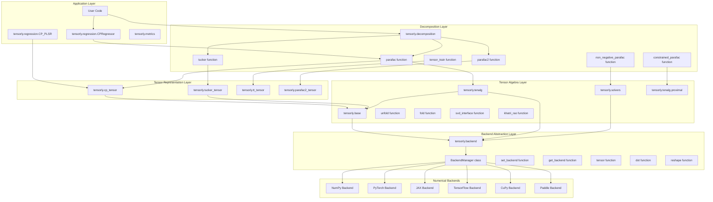

<!-- source: DeepWiki mcp.deepwiki.com · repo tensorly/tensorly · page 1 Overview · fetched 2026-10-21 -->

# Overview

<details>
<summary>Relevant source files</summary>

The following files were used as context for generating this wiki page:

- [README.rst](README.rst)
- [conda/meta.yaml](conda/meta.yaml)
- [doc/modules/api.rst](doc/modules/api.rst)
- [setup.cfg](setup.cfg)
- [setup.py](setup.py)
- [tensorly/decomposition/__init__.py](tensorly/decomposition/__init__.py)
- [tensorly/decomposition/tests/test_robust_decomposition.py](tensorly/decomposition/tests/test_robust_decomposition.py)

</details>


## Purpose and Scope

This document provides a high-level introduction to TensorLy, a Python library for tensor learning that enables tensor decomposition, tensor algebra, and tensor-based machine learning. This overview covers the library's purpose, core capabilities, architectural design, and key systems. For detailed information about specific subsystems, refer to the specialized pages: Backend System ([#2](#2)), Tensor Decompositions ([#3](#3)), Tensor Representations ([#4](#4)), and other sections listed in the table of contents.

**Sources:** [README.rst:1-189](), [doc/modules/api.rst:1-547]()

## What is TensorLy?

TensorLy is a Python library that makes tensor learning simple and accessible by providing a unified interface for tensor operations across multiple computational frameworks. A tensor is a multi-dimensional array (generalizing vectors and matrices to higher dimensions), and tensor learning involves decomposing, analyzing, and learning from such multi-way data structures.

The library addresses the fundamental challenge that different deep learning and numerical computing frameworks (NumPy, PyTorch, JAX, TensorFlow, CuPy, Paddle) have inconsistent APIs. TensorLy provides a thin abstraction layer that allows users to write code once and run it on any supported backend, seamlessly switching between CPU and GPU execution.

**Sources:** [README.rst:22-23](), [doc/modules/api.rst:5-14]()

## Core Capabilities

TensorLy provides four primary capabilities:

| Capability | Description | Key Modules |
|------------|-------------|-------------|
| **Tensor Decomposition** | Algorithms for factorizing tensors into lower-rank components (CP, Tucker, PARAFAC2, Tensor Train, Tensor Ring) | `tensorly.decomposition` |
| **Backend Abstraction** | Unified API supporting NumPy, PyTorch, TensorFlow, JAX, CuPy, and Paddle with automatic device management | `tensorly.backend` |
| **Tensor Algebra** | Operations like unfolding, Khatri-Rao products, mode products, and specialized linear algebra | `tensorly.base`, `tensorly.tenalg` |
| **Tensor Representations** | Data structures for factorized tensors (CPTensor, TuckerTensor, TTTensor, etc.) with reconstruction and manipulation methods | `tensorly.cp_tensor`, `tensorly.tucker_tensor`, etc. |

The library also includes higher-level applications such as tensor regression (`tensorly.regression`), random tensor generation (`tensorly.random`), and performance metrics (`tensorly.metrics`).

**Sources:** [doc/modules/api.rst:5-470](), [tensorly/decomposition/__init__.py:1-34]()

## High-Level Architecture

TensorLy follows a layered architecture where each layer builds on the abstractions provided by lower layers:



**Diagram: TensorLy Layered Architecture with Code Entities**

The architecture enforces clean separation: higher layers depend only on lower layers, never the reverse. The Backend Abstraction Layer is the foundation, with importance score 284.34 in the codebase analysis, making it the most critical component. All tensor operations flow through the `BackendManager` class, which provides dynamic dispatch to the appropriate numerical backend.

**Sources:** [doc/modules/api.rst:1-547](), [README.rst:22-128]()

## Key Systems

### 1. Backend System (Importance: 284.34)

The Backend System is TensorLy's most critical architectural component, providing a unified API across six numerical frameworks. The `BackendManager` class [tensorly/backend/__init__.py]() manages global and thread-local backend instances, enabling seamless switching between frameworks via `set_backend()` and context managers.

**Detailed documentation:** See [Backend System](#2)

### 2. Tensor Decomposition Algorithms

TensorLy implements multiple tensor factorization methods:

- **CP/PARAFAC** (Importance: 179.06): Decomposes tensors into sum of rank-1 components via `parafac()` function
- **PARAFAC2** (Importance: 207.71): Handles tensors with varying mode dimensions via `parafac2()` function
- **Tucker** (Importance: 110.79): Higher-order decomposition with core tensor via `tucker()` function
- **Tensor Train/Ring**: Sequential factorizations via `tensor_train()` and `tensor_ring()` functions
- **Constrained Decompositions** (Importance: 150.61): ADMM-based constrained optimization via `constrained_parafac()` function

**Detailed documentation:** See [Tensor Decompositions](#3)

### 3. Tensor Representations

Factorized tensor data structures stored in specialized classes:

- `CPTensor` (Importance: 74.26): Stores weights and factor matrices
- `TuckerTensor` (Importance: 74.26): Stores core tensor and factor matrices
- `Parafac2Tensor`: Stores projection matrices and factors
- `TTTensor`, `TRTensor`: Stores TT/TR cores

Each class provides methods like `to_tensor()`, `to_vec()`, and `mode_dot()` for reconstruction and manipulation.

**Detailed documentation:** See [Tensor Representations](#4)

### 4. Tensor Algebra Operations

The `tensorly.base` module provides fundamental tensor operations:

- **Unfolding/Folding**: `unfold()` and `fold()` for matricization
- **Vectorization**: `tensor_to_vec()` and `vec_to_tensor()`
- **Partial Operations**: `partial_unfold()`, `partial_fold()`

The `tensorly.tenalg` module provides advanced operations:

- **Products**: `khatri_rao()`, `kronecker()`, `mode_dot()`
- **SVD Interface**: `svd_interface()` supporting truncated, randomized, and symeig methods
- **Proximal Operators** (Importance: 150.61): 12+ constraint operators in `tensorly.tenalg.proximal`

**Detailed documentation:** See [Tensor Algebra Operations](#5), [SVD Interface](#5.1), [Proximal Operators](#5.2)

### 5. Regression and Applications

Higher-level applications built on tensor decompositions:

- `CPRegressor`: Tensor regression using CP decomposition with L2 regularization
- `CP_PLSR`: Partial least squares regression maximizing tensor-matrix covariance
- `TuckerRegressor`: Tucker-based regression

**Detailed documentation:** See [Regression and Applications](#7)

**Sources:** [tensorly/decomposition/__init__.py:1-34](), [doc/modules/api.rst:139-470]()

## Design Philosophy

### Backend Abstraction

TensorLy's design centers on the principle that users should write code once and run it anywhere. The `BackendManager` maintains a registry of loaded backends in `_loaded_backends` and provides dynamic dispatch through a unified API. Users call `tl.set_backend('pytorch')` or use `tl.backend_context('jax')` to switch frameworks without changing application code.

Example from the API:
```python
# Instead of numpy.array or torch.tensor
import tensorly as tl
tensor = tl.tensor(data)  # Works with any backend

# Instead of numpy.dot or torch.matmul
result = tl.dot(tensor_a, tensor_b)  # Backend-agnostic
```

**Sources:** [doc/modules/api.rst:5-14](), [doc/modules/api.rst:20-34]()

### Modular Decomposition Infrastructure

All decomposition algorithms share common infrastructure components:

- **Initialization**: SVD-based, random, or custom factor initialization
- **Error Calculation**: Reconstruction loss computation
- **Convergence Checking**: Tolerance-based stopping criteria
- **Optimization Solvers**: HALS, FISTA, Active Set for non-negative constraints

This design allows specialized methods (non-negative, constrained, robust) to reuse core functionality while adding domain-specific optimizations.

### Separation of Representation and Computation

Factorized tensors are stored in dedicated representation classes (`CPTensor`, `TuckerTensor`, etc.) separate from the decomposition algorithms that produce them. This separation allows:

- Multiple algorithms to produce the same representation format
- Representation-specific operations (normalization, mode products) independent of decomposition logic
- Reconstruction via dedicated `*_to_tensor()` functions

**Sources:** [doc/modules/api.rst:162-258](), [tensorly/decomposition/__init__.py:1-34]()

## Module Organization

The following diagram maps TensorLy's package structure to its functional components:

```mermaid
graph TB
    subgraph "tensorly Package Root"
        init["__init__.py<br/>Exports: set_backend, get_backend, tensor, dot, etc."]
    end
    
    subgraph "tensorly.backend Package"
        backend_init["backend/__init__.py<br/>BackendManager class"]
        numpy_backend["backend/numpy_backend.py"]
        pytorch_backend["backend/pytorch_backend.py"]
        jax_backend["backend/jax_backend.py"]
        tensorflow_backend["backend/tensorflow_backend.py"]
        cupy_backend["backend/cupy_backend.py"]
        paddle_backend["backend/paddle_backend.py"]
    end
    
    subgraph "tensorly.base Module"
        base["base.py<br/>unfold, fold, tensor_to_vec, vec_to_tensor"]
    end
    
    subgraph "tensorly.tenalg Package"
        tenalg_core["tenalg/core_tenalg.py<br/>khatri_rao, mode_dot, kronecker"]
        tenalg_svd["tenalg/svd.py<br/>svd_interface"]
        tenalg_proximal["tenalg/proximal.py<br/>soft_thresholding, simplex_projection"]
    end
    
    subgraph "tensorly.decomposition Package"
        decomp_cp["decomposition/_cp.py<br/>parafac, CP class"]
        decomp_nn_cp["decomposition/_nn_cp.py<br/>non_negative_parafac, CP_NN_HALS"]
        decomp_tucker["decomposition/_tucker.py<br/>tucker, Tucker class"]
        decomp_parafac2["decomposition/_parafac2.py<br/>parafac2, Parafac2 class"]
        decomp_tt["decomposition/_tt.py<br/>tensor_train, TensorTrain class"]
        decomp_constrained["decomposition/_constrained_cp.py<br/>constrained_parafac"]
        decomp_robust["decomposition/robust_decomposition.py<br/>robust_pca"]
    end
    
    subgraph "Tensor Representation Modules"
        cp_tensor["cp_tensor.py<br/>cp_to_tensor, cp_normalize, CPTensor"]
        tucker_tensor["tucker_tensor.py<br/>tucker_to_tensor, TuckerTensor"]
        tt_tensor["tt_tensor.py<br/>tt_to_tensor, TTTensor"]
        parafac2_tensor["parafac2_tensor.py<br/>parafac2_to_tensor, Parafac2Tensor"]
    end
    
    subgraph "tensorly.solvers Package"
        solvers_nnls["solvers/nnls.py<br/>hals_nnls, fista, active_set_nnls"]
        solvers_admm["solvers/admm.py<br/>admm function"]
    end
    
    subgraph "tensorly.regression Package"
        regression_cp["regression/cp_regression.py<br/>CPRegressor class"]
        regression_plsr["regression/cp_plsr.py<br/>CP_PLSR class"]
    end
    
    subgraph "Support Modules"
        random_mod["random.py<br/>random_cp, random_tucker, random_parafac2"]
        metrics_mod["metrics/<br/>MSE, RMSE, congruence_coefficient"]
    end
    
    init --> backend_init
    init --> base
    
    backend_init --> numpy_backend
    backend_init --> pytorch_backend
    backend_init --> jax_backend
    
    base --> backend_init
    tenalg_core --> backend_init
    tenalg_svd --> backend_init
    
    decomp_cp --> tenalg_core
    decomp_cp --> cp_tensor
    decomp_nn_cp --> solvers_nnls
    decomp_tucker --> tucker_tensor
    decomp_constrained --> tenalg_proximal
    decomp_constrained --> solvers_admm
    
    regression_cp --> cp_tensor
    regression_cp --> decomp_cp
    
    random_mod --> cp_tensor
    random_mod --> tucker_tensor
```



**Diagram: TensorLy Module Structure Mapping Code Entities**

The package follows Python's standard structure with each major system in its own module or package. The `tensorly/__init__.py` file re-exports the most commonly used functions from submodules, allowing users to access them directly via `import tensorly as tl`.

**Sources:** [doc/modules/api.rst:1-547](), [tensorly/decomposition/__init__.py:1-34](), [setup.py:48-70]()

## Installation and Dependencies

TensorLy requires Python 3 and has two core dependencies:

- `numpy`: Default backend and core dependency
- `scipy`: Additional numerical routines

Additional backends (PyTorch, JAX, TensorFlow, CuPy, Paddle) must be installed separately. The library is available via pip (`pip install tensorly`) or conda (`conda install -c tensorly tensorly`).

For development installation, clone the repository and install in editable mode:
```bash
git clone https://github.com/tensorly/tensorly
cd tensorly
pip install -e .
```

**Sources:** [setup.py:59](), [README.rst:30-60](), [conda/meta.yaml:22-25]()

## Testing and Quality Assurance

TensorLy uses pytest for testing with backend-specific test execution via environment variables:
```bash
TENSORLY_BACKEND='numpy' pytest -v tensorly
```

The test suite includes:
- Unit tests for all decomposition algorithms
- Backend compatibility tests
- Regression tests for known issues
- Coverage reporting via CodeCov (badge visible in README)

Tests are automatically run via GitHub Actions CI/CD on multiple Python versions and backends.

**Detailed documentation:** See [Testing Framework](#9.2), [CI/CD Pipeline](#9.3)

**Sources:** [README.rst:146-168](), [conda/meta.yaml:27-32](), [tensorly/decomposition/tests/test_robust_decomposition.py:1-79]()

## Performance Considerations

TensorLy's performance characteristics depend on the chosen backend:

| Backend | Best For | Device Support | Auto-Differentiation |
|---------|----------|----------------|---------------------|
| NumPy | CPU computation, prototyping | CPU only | No |
| PyTorch | GPU acceleration, gradients | CPU, CUDA | Yes |
| JAX | JIT compilation, XLA | CPU, GPU, TPU | Yes |
| TensorFlow | Production deployment | CPU, GPU, TPU | Yes |
| CuPy | GPU-only computation | CUDA only | No |
| Paddle | PaddlePaddle ecosystem | CPU, GPU | Yes |

The backend can be switched at runtime without code changes, allowing optimization for different deployment scenarios.

**Detailed documentation:** See [Using Different Backends](#2.2)

**Sources:** [doc/modules/api.rst:8-9](), [README.rst:99-106]()

## Documentation Structure

This wiki is organized into nine major sections:

1. **Overview** (this page): High-level introduction and architecture
2. **Backend System**: Backend abstraction, context management, thread safety
3. **Tensor Decompositions**: CP, Tucker, TT, PARAFAC2, robust and constrained methods
4. **Tensor Representations**: CPTensor, TuckerTensor, and other factorized formats
5. **Tensor Algebra Operations**: Unfolding, products, SVD, proximal operators
6. **Random Tensor Generation**: Testing and simulation utilities
7. **Regression and Applications**: CP regression and CP-PLSR
8. **Metrics and Validation**: Performance evaluation
9. **Developer Guide**: Contributing, testing, CI/CD, documentation

Each section provides detailed technical documentation with code citations and examples.

**Sources:** [doc/modules/api.rst:1-547]()

---

